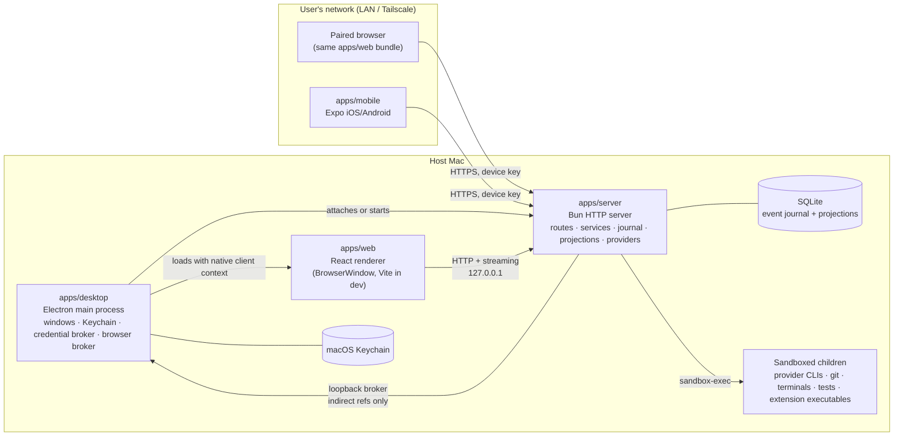
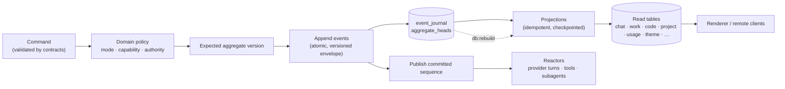

# Octant architecture

Octant is a local-first desktop workspace for Chat, Work, and Code across many AI
providers. The first shipping surface is Apple Silicon macOS; Linux and Windows
desktop are the same product, sequenced in the
[Current Release Boundary](#current-release-boundary).
This is the current architecture specification. Read the relevant section for
system boundaries; use the [design index](design/README.md) for topic owners.
Edit the current rule with an approved change in the same PR. Historical links
provide rationale and supporting detail, not a competing source of authority.
Sections explicitly label approved designs that are not yet fully implemented;
archive status alone is neither approval nor implementation evidence.

## Overview and principles

Octant is one Electron application that hosts a Bun HTTP server, a React
renderer, and (optionally) remote clients that connect to that same server.
Everything the user cares about — Projects, threads, memory, event history,
credential references, layouts — stays on the host machine. Artifact versions
are the exception once sync is on: they are copied into a store the user owns,
not into a store Octant operates. The journal does not leave. See
[Persistence](#persistence).

The design rests on a small set of invariants that every package obeys:

- **Local-first.** No Octant cloud account, relay, or telemetry is required.
  Artifact sync, when the person turns it on, uses a store that person owns.
  Octant operates none of it; an S3-compatible store is contacted only at the
  endpoint the person configured and only while the Settings › Sync switch is
  on. Remote access is host-to-device over the user's
  own network. Three host-initiated
  HTTPS calls exist in code: desktop update checks against a signed feed, managed
  device-tool update checks against the npm registry, and server marketplace
  fetches when the person searches, inspects, previews, or installs from the
  catalog. All have a Settings off switch: marketplace off means no catalog
  request; Updates off disables automatic update checks (manual Check for
  updates may still contact the signed feed); device tools' automatic updates
  start off, and off means no registry request (a manual check may still
  contact it). An in-app
  changelog rides that update path and bundled notes rather than adding a
  separate call ([decisions/0061-in-app-changelog.md](decisions/0061-in-app-changelog.md)).
  Opening Updates reads the desktop's current local update state so the installed
  version and saved preferences appear without requesting the signed feed.
- **The server is the authority.** Every authority check (mode, Project,
  thread, provider, approval, remote principal, optional spend ceiling) runs in
  `apps/server` before a side effect. The renderer and mobile app render what
  the server says is allowed; they never decide it.
- **The event journal is authoritative; projections are rebuildable.** Commands
  append versioned events to a SQLite journal. Read models are idempotent
  projections that can be dropped and rebuilt from the journal at any time.
- **Contracts are schema-only, domain is pure.** `@octant/contracts` holds
  Effect Schema definitions and nothing else. `@octant/domain` holds pure
  policy and state transitions with no I/O.
- **Dependencies point inward.** Apps consume packages; contracts and domain
  never import apps. Provider-specific payloads stop at the provider adapter.
- **A provider question has one answer identity.** Each question in a provider
  question set reaches Chat, Work, and Code with a distinct request id. The
  adapter collects answers in the provider's original question order, rejects
  duplicate answers, and settles the underlying callback only when complete.
- **Capabilities are honest and fail closed.** Every provider reports what it
  supports in every mode; an unsupported capability is disabled or refused,
  never silently emulated. No core capability may require a specific provider.
- **Install ≠ trust ≠ enable.** Extensions contribute nothing until each of
  those steps has been taken explicitly, and even then only within the mode,
  Project, thread, and provider policy that applies.

Packaged macOS hosts use a restricted executable search path containing system
utilities and standard package-manager locations. `/usr/sbin` is included so
local-server discovery can invoke the system `lsof`; arbitrary inherited PATH
entries are excluded.

## Process topology



**Desktop (`apps/desktop`).** The Electron main process owns native windows,
menus, the macOS Keychain, project-root, plugin-folder, and runtime-binary
pickers, and the in-app updater. A picker hands the server the chosen path
under the desktop bridge secret and gives the renderer only a single-use
receipt bound to its window, so a renderer can act on a path only the person
picked. It attaches to the canonical host at
`http://127.0.0.1:13773`, or starts that independently runnable host when it is
absent, then probes storage readiness before showing a window. It passes only
native broker coordinates and the desktop bridge secret that native-only
operations require. It also runs loopback-only
brokers the server talks back to: the credential broker (Keychain access by
opaque reference), the browser runtime broker, and on macOS the Simulator
device broker, behind which one native device helper per Simulator delivers
workbench input (see
[decisions/0137-simulator-input-reaches-the-guest-through-a-native-device-helper.md](decisions/0137-simulator-input-reaches-the-guest-through-a-native-device-helper.md)).
Every app window confines top-level navigation, redirects, and opened windows to
the exact packaged renderer asset or configured Vite development origin. Native
IPC also requires that trusted renderer URL, and the packaged renderer ships a
strict Content Security Policy; external pages are opened through explicit
server- or host-authorized flows instead of replacing the app window.

**Server (`apps/server`).** A Bun HTTP server bound to the stable canonical
loopback endpoint `127.0.0.1:13773`. It registers route modules per feature (`chatRoutes`,
`workThreadRoutes`, `codeRoutes`, `projectRoutes`, `extensionRoutes`,
`remote/*`, …), resolves a **client principal** for every request — a
process-local client context on the loopback listener (internally still named
`local-window` while that contract is migrated), or a `remote-device` principal
carrying authenticated remote identity — and runs all mutations through
services that append to the journal. Providers, tools, Git, terminals,
subagents, extensions, and recovery live here. A headless host runs the same
server through `@octant/cli` (`octant server run`, `octant web`). The
installable headless artifact (`scripts/package-headless.ts`) is self-contained:
it carries the bundled CLI (`bin/octant`), the bundled server (`lib/server`), the
web assets, and a top-level `node_modules` holding the third-party and native
dependencies both bundles leave external, built on the target platform itself.
An installed CLI starts that server under its own Bun runtime with
`OCTANT_ARTIFACT_ROOT` set, so the server verifies every listed file before it
opens the store. For Code,
verified remote requests carry their principal through an async request scope:
the paired device may reach existing active Code Projects without a desktop
workspace, while services retain thread, checkout, provider, and approval checks.
This admission ends on cancellation or dispatch completion. Local windows retain
their selected-Project restriction (ADR 0148). A killed start can leave the
control secret with no receipt and no socket; the next acquire quarantines
that file and continues, and it checks the socket is still absent before the
move so a peer that bound in the meantime keeps the secret it just wrote. An
ownership failure names the code, the artifact path, and the next step.

**Host resources.** `GET /api/host/resources` is a read-only snapshot of this
host's load: CPU use averaged over a short sample of the process's CPU times,
used and total memory, the core count, and used and free space on the volume
that holds the data directory. The disk figures are omitted when that volume
cannot be read. The snapshot names no path, no user, and no process. The server
keeps one snapshot for about five seconds. The local owner always receives it.
A paired remote device with an active session receives it under the same
`project.overview.read` action as the Project overview reads; an
unauthenticated caller is refused, with no figures in the refusal. The route
also compares the device's host identity with this host's, but every paired
device row on a host carries that host's own identity, so the comparison does
not separate one paired device from another. The Computers card
reads the route only while the card is on screen and the window is visible,
about every ten seconds, at most one read per host at a time and each abandoned
after five seconds, and does not poll in the background.

**Renderer (`apps/web`).** One React application served to the desktop window
and to authenticated remote browsers alike. It talks to the server through
`@octant/client-runtime` and never holds authority of its own. In development
Vite serves it with hot reload; in a packaged build the server serves the
built assets. A paired browser mounts the remote shell rather than the desktop
workspace: the same Chat, Work, and Code thread workspaces, driven by the
ordinary product clients over `createRemoteProductFetch`, which carries each
request on the device session and never presents a window capability. The
desktop's window-bound sidebar, dock, and Settings are not served remotely.

**Mobile (`apps/mobile`).** An Expo iOS/Android remote-control client. Threads
are host-owned; the phone stores only device keys, a host registry, and session
material. It uses the same contracts and client runtime as the browser. The
phone creates Chat, Work, and Code threads, reads their transcripts, and sends
follow-up turns under each thread's own authority (`start-work-thread-turn`
with the thread's binding; `start-provider-turn` on the thread's checkout).
Approvals, folder binding, file edits, and shell remain host-only and the
composer says so. Native startup supplies WebCrypto for the shared pairing and
request-proof clients; keys persist in platform secure storage. Native remote
fetch sends the proof-bound session cookie explicitly and disables the shared
cookie jar to prevent duplicate or stale cookies. Browser cookie ownership is
unchanged, and native remote requests refuse redirects.

Internal TestFlight distributes this same client and grants the phone no new
authority. The bundle is `app.octant.mobile` (installed name Octant) at source
version `0.1.0`; EAS Build signs and archives it, with build numbers from EAS
remote version state, and the `production` EAS profile means store
distribution, never a public release or App Review submission. The manually
dispatched `Mobile (TestFlight)` workflow builds only from `main` in the
protected `mobile-testflight` environment and uploads only when its `submit`
input is set; pull requests get no release credential. GitHub holds only the
revocable Expo token; Apple certificates, profiles, and the App Store Connect
key stay in EAS's credential service. The App ID enables no optional Apple
capability (push, associated domains, Sign in with Apple, iCloud), testers are
maintainer-controlled App Store Connect users, and external groups, public
links, and store listing stay closed under the
[mobile store hold](mobile-store-v1-hold.md). A build counts only after the
device pass in the [TestFlight runbook](mobile-testflight.md), not when EAS or
Apple finishes processing it.

**Local client context.** The local trust class is "holds a secret only the
host's OS user can read", not "is on loopback". Loopback plus an admitted
Origin says nothing about who is calling: another OS user on the same machine,
an `ssh -L` forward, a proxy that rewrites `Host`, or a local service account
all arrive that way, and a forged `Origin` header costs a non-browser caller
nothing. The secret is the desktop bridge secret, which the host owner projects
into the owner-only runtime directory. Electron windows and every CLI command
(`octant agent`, `octant listener`, pairing, `octant web`) present it on the
`/api/desktop/*` routes. A browser gets a session only through a one-time
launch token: the launcher (`octant web`, `octant web --dev`, or the desktop's
"Open in browser" action) mints it through `/api/desktop/launch-sessions` with
the bridge secret and opens a URL carrying it in the fragment. `octant web`
sends the secret only to the host that this OS user's owner-only host receipt
names (same address and instance), never to an endpoint that merely answers
`/health`, because another OS user can bind the port while the real host is
stopped. The token is
single-use, expires after five minutes, and is bound to the renderer origin it
was minted for, which must be one this listener serves (below). The renderer
strips it from the address bar with a history replace before it exchanges it at
`/api/shell/launch-session`; an exchange from any other origin, or with no
Origin, is refused and burns the token. `/api/shell/local-session` never mints
authority: it only refreshes a capability the tab already holds (so a reload
keeps its session) and answers 401 otherwise. Typing the host address by hand,
reopening a tab after the host restarted, or opening a copied tab therefore
shows "Open Octant from the desktop app or run `octant web`" instead of the
app. Electron, ordinary browsers, and Vite still read the same Machine-owned
Projects, threads, settings, and journal; a Vite renderer qualifies only when
the host was started with its origin in `OCTANT_WEB_URL` (the desktop dev loop
and `octant web --dev` set it for the host they start), and `octant web --dev`
mints its token for that origin. The context id scopes window-local presentation
and guards against accidental cross-window commands, but it is not a separate
Machine or durable authentication epoch. The packaged renderer additionally
proves its native renderer identity for desktop-only integration. When the host
instance changes, Electron re-registers every live Project window, replaces the
main-process authority and renderer identity, and publishes the new capability
so the renderer rebuilds its clients before snapshot recovery. The loopback
transport still validates the actual Host header, rejects non-loopback origins,
and removes process-local registration when its owning client closes. The
listener admits only its own loopback origin (under any loopback name), the
packaged renderer, and the development renderer origin named by
`OCTANT_WEB_URL`; a page on any other loopback port is refused before dispatch
and gets no CORS grant, because agents start local dev servers whose pages the
person opens in an ordinary browser. The listener never reflects a non-loopback
web origin into local authority. One residual window remains: the launcher
hands the token URL to the system browser as a process argument, which another
OS user can read for the moment that process runs, and the token is valid until
the browser exchanges it. The renderer holds the matching
line before its first request: a launch address that is plain HTTP to a
non-loopback host is refused with an explanation and never used
(`docs/decisions/0103`). Requests that send the window capability set
`redirect: "error"` so a later hop cannot carry the header to an address the
parser never judged.

Managed runtime tool transport uses the provider SDK's existing tool-request
and tool-answer contract. The adapter's in-process server exposes only the
current app-authored catalogue; external provider tool-server configuration
stays disabled. Code browser sessions can request an inline approval without
raising thread access. The grant is bound to the exact browser context and
owner, and browser-service policy is checked again before effects. Answering
the prompt with "always allow" journals the origin into shell settings, so a
new browsing context for that origin opens without asking — in Code, in Work,
and for later sessions — until the person forgets it under Settings; rebinding
an existing context to a different model or authority still asks, because the
remembered grant covers the page, not who drives it. The remembered set grows
only through that approval answer: `replace-settings` may remove an origin but
rejects additions, so a client cannot grant itself origins the prompt never
showed. Plan refuses every Code browser operation except stopping the
thread's own browser (`plan-mode-read-only`). See
[decision 0093](decisions/0093-app-owned-tools-use-managed-runtime-transports.md).

Tool definitions carry the agent's usage guidance alongside their argument
schemas. App-owned tools are capability families: one tool per object —
`octant_browser`, `octant_computer`, and in Code `octant_terminal`,
`octant_apple`, and `octant_android` — with its actions in an `operation`
enum. Decision 0067 keeps the always-visible tool prefix small and
cache-stable, so a family's description says only what an agent must know
before its first call, and its `help` operation returns the full usage on
demand. The managed tool set answers help from the family's own static text
(`withToolFamilyHelp`) and only for a family the turn offers; help never
reaches the family's executor, so every other action passes the same server
policy before any effect. A family whose grant or capability is off is
omitted rather than advertised and refused: Browser when the provider has no
verified tool transport, the thread's tool constraints exclude it, or a Code
host lends no browser; Apple or Android when the host has no toolchain to
lend; the planner's `octant_board` and `octant_propose_thread` outside the
designated planner thread. Browser shares one definition across modes.

Each mode offers only its admitted tools, so every runtime receives the same
definitions without a separate global tool installation or prompt catalogue,
through the transport its adapter verified:

| Runtime                             | App-managed tool transport                                                                                                                  |
| ----------------------------------- | ------------------------------------------------------------------------------------------------------------------------------------------- |
| Claude Code                         | The Agent SDK's in-process MCP server `octant`, owned by the provider connection                                                            |
| Codex                               | App-server `thread/start.dynamicTools`                                                                                                      |
| OpenCode                            | A connection-private loopback MCP endpoint, registered through OpenCode's own server API                                                    |
| ACP runtimes                        | An HTTP MCP bridge when the runtime advertises and accepts it; ACP client file and terminal capabilities are separate                       |
| Pi                                  | Octant's own Pi extension, calling a token-authenticated loopback bridge                                                                    |
| Native harness and direct endpoints | Definitions in the request, for models with verified tool support                                                                           |
| Typed CLI in a thread terminal      | Browser only, on a loopback MCP endpoint per grant, reached through `octant mcp`; partly built ([detail](design/terminal-browser-grant.md)) |

No transport edits a person's provider MCP, hook, or global configuration;
OpenCode's per-launch posture stays in its connection-private configuration.
Decisions 0006, 0093, and 0121 therefore hold.
The local-server adapter binds its private tool endpoint to one connection's
session and exact offered catalogue, and reports app tools only with a process
receipt attesting that external MCP, plugins, and skills cannot enter the
runtime; see [Provider runtimes](design/provider-runtimes.md#local-server-provider-adapter).

Browser and Computer are granted differently. Browser is a Work and Code
capability; Chat never offers it. It is offered on every Work or Code turn
whose provider carries app-managed tools, `@Browser` only adds selection
guidance, the first effect for an origin asks inline, and Plan mode refuses
effects. Computer is the bundled plugin plus a per-send `@Computer`
selection: only that send carries the full `octant_computer` family. A turn
without the selection carries the refusal-only definition described under
[Computer use plugin](#extensions-and-skills), and none at all when Computer
use is disabled, constrained out, or in Plan mode. Each application still
needs its own approval.

Canvas follows the same rule through its read-only `describe` operation: the
always-visible `octant_canvas` description says only what an agent needs before
its first call, and `describe` answers per-block guidance, recipes, and schemas.
The tool, recipes, presentation, preview, block catalogue, boards, comments, and
the `design` block are specified in [Canvas](design/canvas.md). Their boundaries:
`describe` reads no Project data and creates no artifact, and a recipe is a
starting shape, not authority; every new block kind or field is gated by a Canvas
schema version, so an older runtime refuses a document rather than misreading
it (the presentation-only table column `display` and chart, table, and metric
`format` fields are the one ungated exception, which the strict schema still
refuses on a runtime that predates them); a version is immutable, and a person's change (a plan task's status, a
diagram layout) is journaled as a new head version with the `local-user` actor
the host stamps itself; the host stamps comment authors, so a renderer never
authors as an agent; only a host window moves board nodes; `preview` renders
with the network off and no server address or credential; a static `design`
frame never receives `allow-scripts` and no frame has both `allow-scripts` and
`allow-same-origin`; a share carries a design only with the sharer's
acknowledgement that markup is shared as written, and refuses an action block; and
nothing drawn inline in the thread can journal a version.

Descriptions explain the existing presentation flows and distinguish creation,
queued jobs, and work proposals from opened previews or completed work.
Work also includes a short, budgeted artifact instruction in its required
context, so runtimes that use their own file tools know how written documents
appear in Files and Document. That instruction offers no tools or authority.

### Desktop menu bar

The menu bar is the closed-window fleet roster; the Inbox is the in-window list.
It prioritizes Open Octant, New task, and three compact sections: **Needs you**,
**Working**, and **Done since you looked**, at most six rows each. Empty
sections disappear. A row names the thread title, its mode, and its Project,
and choosing it opens and focuses that thread in the main window, opening the
window first when none is open. Local host contains status, browser access,
applicable lifecycle controls, and redacted diagnostics; Quit Octant retains
the existing active-work confirmation. The text beside the glyph is `!` while
the host itself needs attention (provider readiness, a lost host), otherwise the
count of threads that need the person.

The roster comes from the host, not from open windows, so it stays current with
every window closed. The shell registers its own local-window authority for the
menu bar with the desktop bridge secret it already holds, replaces it when the
host instance changes, and revokes it when the menu bar goes; it reads exactly
what any local window could. It polls `GET /api/fleet-activity` with the host
probe (every 2 s while a window is visible, 10 s otherwise). Every row names its
`activitySource`:

- **Needs you** is the pending-requests read
  ([pending requests across modes](#security-and-authority)): a Work request or
  any turn decision is `journal`; a Code approval or question, or a Chat
  question, is `session`, the live provider session parked on it. Code reach is
  per bound window and the menu bar's own window binds no Code Project, so its
  Code rows are the requests and decisions each local window with a persisted
  Code binding could answer; a Code Project no local window binds stays out. A
  thread that is both waiting and running is listed once, as needs you.
- **Working** is each mode's own navigation run state, the journaled fold the
  sidebar and board already use, so it is `journal`.
- **Done since you looked** is the one state the host cannot know, because only
  the shell knows when the person last opened a thread. A thread that leaves the
  host's list between two successful reads finished; it stays done until the
  thread is opened in a window or from the menu bar, or runs again. A focused
  window showing the thread when it finishes never makes it done. A failed or
  truncated read changes nothing, so a lost host cannot fake a finish. Done rows
  live in memory and start empty with each app or host instance.
- `screen` is reserved for an agent CLI seen only in a terminal pane. The
  contract refuses it for needs you, it never becomes done, it never counts
  toward the menu-bar number, and its row reads "seen in terminal". No current
  producer emits it: Octant does not scrape a PTY or screen for agent state.

Each row's tooltip names its source ("read from the journal", "read from the
live session"). The menu bar raises no notifications; banners and the dock badge
stay with the renderer's attention signals. Windows report only which thread
they show, which clears that thread's done row and tells the shell the window
can open a thread it is asked for. The read is local-window only, like pending
requests. Titles never enter the public health response or redacted
diagnostics. Separately managed hosts retain their existing lifecycle
restrictions. Nothing here writes provider MCP or hook configuration.

### Desktop context menus

Trusted top-level desktop windows may contribute a bounded native context menu
through the preload bridge: at most 160 entries, four submenu levels, and labels
up to 256 characters. Contributions contain presentation and opaque action IDs;
they cannot supply Electron roles, callbacks, paths, URLs, or native commands.
The shell returns the selected ID to the same window, which invokes its existing
renderer action and ordinary server authority checks. Dismissed, refused, closed,
or navigated windows select no action. Each window owns at most one contributed
native popup. The desktop's own text editing menu uses Chromium's edit flags and
fixed native roles; embedded browser frames cannot contribute workspace menus.

### Canvas documents, designs, and prototypes

Canvas produces three kinds of finished work: documents a person reads (a
spec, an article, a brief with tabs, metrics, diagrams, and badge tables),
designs they review (app screens, a site, a deck, a design system), and
prototypes they try (a flow that reacts to input and keeps state). It does so
in three tiers that an author mixes in one Canvas, using the lowest tier that
delivers the result. The static frames' `document` size and workspace theme
(Canvas schema version 16), their images named by asset id (version 17), and
running frames (version 18) have shipped, as described with the
[`design` block](design/canvas.md#design-block). The rest is accepted
direction: each rule below replaces the matching shipped rule in
[Canvas](design/canvas.md) when its slice ships, and until then the shipped
rule holds. Each tier is a Canvas schema bump, so an older runtime refuses the
document as a future version. Frames follow the
[Canvas HTML frames threat model](security/canvas-html-frames-threat-model.md).

- **Typed blocks carry data.** Metrics, tables, charts, plans, and the diagram
  family stay the catalog, because comments anchor to them, revision edits
  them, and shares keep their structure. Shipped at schema version 19 (see
  [Canvas](design/canvas.md)): `tabs` and `columns`, which name existing child
  blocks, a dashboard among them; closed diagram node roles (process, decision,
  terminator), edge styles, and group tones drawn by the one deterministic
  layout; a Gantt view of `plan`; and import of a bounded Mermaid subset into
  typed diagram blocks. Mermaid never renders; an unknown construct fails
  closed and stays a code block.
- **Static frames carry the look.** A `design` keeps a frame that runs
  nothing and has a `document` size whose height the host measures, which
  needs `allow-same-origin` and therefore never `allow-scripts`, and an opt-in
  workspace theme (semantic tokens, light or dark, the bundled fonts, and a
  first-party stylesheet for articles, cards, CSS-only tabs, badges, metric
  tiles, tables, callouts, and code), unthemed by default at device sizes,
  and images named by asset id, which the server resolves under the thread's
  mode and Project authority and the host inlines before drawing; all three
  have shipped. The frame itself loads nothing.
- **Running frames carry behavior.** A `design` may declare that it runs
  script. Its page comes from a host route fetched with a single-use ticket
  scoped to one Canvas version, never the session credential, with a
  `sandbox allow-scripts` response directive and a policy that allows inline
  script and style and no connection; the parent sandboxes the frame without
  `allow-same-origin`, `allow-top-navigation`, `allow-popups`, or
  `allow-forms`. A host-written bridge reports size, script errors, and a
  heartbeat, grants no tool, journal, or file capability, and a frame that
  stops answering or loads a second page is removed. Desktop runs these frames
  out of process, cancels any navigation away from the frame's own page, and
  reserves a shortcut frame script cannot intercept to return focus to host
  chrome. A remote browser cannot cancel a frame's own navigation, so there a
  running frame is not network-contained; that exposure is accepted, bounded
  by what the frame holds, and the Run control there says so. This tier has
  shipped.
- **The thread can hold the whole Canvas.** A person may expand any Canvas in
  its thread; the agent may ask for `inline` on a reading document, or on a
  `document`-size design that runs no script, without the 12-block cap; a
  running frame in the thread starts only on **Run**. Editing,
  comments, and sharing stay in the sidebar, and nothing drawn in the thread
  writes a version.
- **Agents are taught and checked.** `describe` presents the tiers with a
  finished example of each, in-tree recipes cover an article, a design brief,
  a design system, and a clickable prototype, and `preview` draws frames and
  returns overflow, contrast, missing-asset, and script-error warnings. This
  has shipped (see [Canvas](design/canvas.md)).
- **Shares and exports carry what they can draw safely.** Typed blocks travel
  as today. A frame travels in an authenticated snapshot only when the viewer
  draws it under the same frame policy and the sharer acknowledges that markup
  is shared as written, because the secret filter reads values, not markup;
  this has shipped at share version 10 (see [Canvas](design/canvas.md#shares)).
  HTML export writes frames as sandboxed `srcdoc` pages with the policy
  inside, the approval card names the markup it writes, and a themed design
  is drawn in the theme the person's window hands over; this has shipped.
  Markdown export writes the title. Public links stay out.

_Rationale:_ a `srcdoc` frame inherits the app policy (`script-src 'self'`),
so a running frame needs a page the host serves, and a frame sandboxed without
`allow-same-origin` has an opaque origin wherever it is served, so no separate
origin or desktop protocol is needed for that isolation. Growing only the
typed catalog was rejected because every new look becomes a schema change and
no closed set reaches a finished design or article. A separate origin, or an
Electron view per artifact, was rejected because it cannot be laid out in the
thread and does not exist for a remote browser; revisit if a frame ever needs
script with `allow-same-origin`. Rendering Mermaid was rejected as a second
layout, and an external design service because it sends Project content to a
third party and makes a core capability depend on one vendor.

### Device transport and evidence

The iOS Simulator and Android emulator are dock device panes: the screen is
streamed through the host, authorized like a screenshot, and never stored, and
closing a tab does not shut the destination down. An agent's request to raise
the pane lives only in server memory for the same thread and checkout. A raw
screen capture lands in a host-private directory only its own capture launch
may read or write. `octant_android` installs only a checkout-relative APK.
Input (tap, swipe, typed text, and hardware keys) rides the workbench control
channel with actor attribution and the remote/headless fail-closed attach gate;
an input whose delivery is unknown is reported `interrupted`, not `failed`, and an off-screen point or unsupported keyboard layout is refused,
never clamped or guessed. Octant does not script Simulator.app, and an agent
must not launch Simulator.app, `serve-sim`, or `serve-avd`. **Repair input**
runs only when a person requests it. Pane states, discovery, capture, input
delivery, keyboard layouts, and the managed streaming tools are specified in
[Device workbench](design/device-workbench.md).

On an approval-gated thread, **Allow input** is the confirmation that opens
that destination; clicks, typing, Home, and Lock never raise it
([decisions/0152-allow-input-opens-a-device-to-clicks.md](decisions/0152-allow-input-opens-a-device-to-clicks.md)).
The agent's `octant_apple` and `octant_android` tools follow the thread's
turn posture per operation, not a Full-access gate on the whole tool:
`discover`, `status`, and `screenshot` are reads and run under every posture,
Plan included, as is `open` of a destination already booted or booting: it only
shows the pane, changes nothing on the device, and has no host action an
approval could bind to. Every other operation is an effect, including `open` of
a shut-down destination, which boots it. Plan refuses it; Full access
sends it with no approval; under approval-gated and auto-accept-edits the
server asks in the thread (an `approval-requested` turn event, answered like a
Browser session ask) before the pane opens or the host is called, and an
approval mints the host's one-use, five-minute approval bound to exactly that
request and its checkout context — the same receipt a workbench confirmation
yields, validated by the same Apple or Android policy. A denial, expiry, or
thread that went stale or into Plan while waiting refuses the call. Input to a
destination the turn's window already holds open under Allow input rides that
grant without asking; an approved agent input opens or renews it as a pane
input does. `octant_terminal` still requires Full access: it runs arbitrary
shell commands, which an approval-gated thread already reaches through its
provider's own per-command approvals.

## Modes: Chat, Work, and Code

Modes are server-enforced domain policy, not renderer flags. Chat and Work can
be disabled in settings; Code is always available; disabling a mode never
deletes its data.

The shell shows two modes, **Work** and **Code**. Work presents the Chat and
Work domains together: one sidebar lists both kinds of thread and Project, and
a new-thread composer chooses **Chat** (creates a Chat thread, no folder) or
**In a folder** (creates a Work thread bound to a Project root). The choice is
only which create command the composer sends; the active server mode still
follows the thread or draft on screen, each row opens in its own mode and
reaches its own kind's commands, and nothing in the renderer can turn a Chat
into Work or a Work thread into Chat. Settings' Chat and Work switches still
gate their domains: with one off, the composer offers only the other kind.

| Mode     | Binds to                                                                                                                            | Authority                                                                                                                                                                                                                                                                                                                                                                                                                                                                         |
| -------- | ----------------------------------------------------------------------------------------------------------------------------------- | --------------------------------------------------------------------------------------------------------------------------------------------------------------------------------------------------------------------------------------------------------------------------------------------------------------------------------------------------------------------------------------------------------------------------------------------------------------------------------- |
| **Chat** | A virtual, memory-scoped Project, or no Project at all                                                                              | No filesystem or shell authority. Optional safe research tools; scratch space is isolated per thread.                                                                                                                                                                                                                                                                                                                                                                             |
| **Work** | Exactly one OS-confined project root                                                                                                | Confined reads and bounded writes inside that root, approval-gated unless the thread's access is auto-accept-edits; no shell and no Git; document adapters (docx, pptx, pdf, image); research with citations; server-authoritative board.                                                                                                                                                                                                                                         |
| **Code** | Exactly one directory, ideally a repository root; Code threads select a checkout (current checkout or a managed worktree) inside it | Starts approval-gated; Full access only when explicitly remembered for that Project. Plan mode is always read-only. Git, terminals, tests, PR observation, and managed subagents run inside the bound root. Creating a Code Project may explicitly initialize Git in that folder (`docs/decisions/0079`) so a Code thread can prepare a checkout immediately; if that initialization fails, creation is refused and no Project is journaled. Binding without Git remains allowed. |

Work's missing shell and Git are withheld, not approval-gated: a person is
never asked to approve a command in Work, because approving one would give the
thread authority its mode does not hold. Every Work turn records that posture
(`shell: "denied"`, `git: "denied"`). Each provider driver enforces it for a
session acquired in Work mode, since a provider's own shell tool is outside
anything the host can gate after the fact. Claude and Pi start without their
shell tool. OpenCode's session rules deny `bash` and its `task` delegation.
Codex threads start and resume with `features.shell_tool` and
`features.unified_exec` off, because a Codex command that only reads runs under
its read-only sandbox without escalating; a `command` or sandbox-widening `permissions` request that still
arrives is declined at the agent. An ACP agent's `execute` permission request
is refused at the agent. The declared kind is all Octant sees of an ACP call,
and `other` also covers Octant's own managed MCP tools, so an agent that labels
a command `other` still reaches a person's approval rather than running unasked.
Because a provider's in-process shell can emit no protocol request at all —
observed on Linux where a Vibe Work turn ran real commands inside its jail —
the ACP, OpenCode, and Pi runtimes also launch confined in Work with process
exec and fork denied, so the OS itself refuses a shell the protocol never
sees. An ACP profile whose entrypoint spawns its own stdio server keeps fork,
which reaches no shell without a second exec target. Work never runs at Full
access, so these launches are always wrapped. The Codex app-server and the
Claude postures Work uses are not wrapped (see
[security and authority](#security-and-authority)); they withhold the shell
through the thread config and tool list above instead. Octant's own harness
gives Work no shell port. File writes inside the Project
remain approval-gated in every driver. Work that needs a shell or Git is
promoted to Code (below).

Chat's missing filesystem and shell authority is withheld the same way, and
more completely: a Chat session is acquired on its per-thread scratch
directory, and nothing a provider asks for in Chat is anyone's to approve, so
every approval request is declined at the agent. A provider sandbox that only
blocks writes is not enough, because reads never escalate. Pi starts with no
built-in tools. OpenCode and ACP agents launch confined with process exec and
fork denied and the scratch directory read-only. Claude's gate keeps its reads
inside the scratch directory, and its shell and edits ask and are declined.
Codex threads get no execution environment (`environments: []` on the thread
and on every turn), which removes its shell, `apply_patch`, and `view_image`;
they also start and resume with the shell, image, plugin, and app features
off, so a CLI that ignores `environments` still has no shell, and the user's
own Codex plugins do not load. MCP servers from the user's Codex config run
outside any environment (a `node_repl` server read another repository with
none), and no setting turns them all off, so the driver reads the effective
config and switches each named server off for the thread; a Chat thread whose
servers cannot be listed does not start. Octant-managed tools (research,
Canvas) are unaffected; they run on the host, not in the provider's
environment.

Provider-owned memory stays off in every mode. Octant's memory is scoped to a
Project, and a provider's global memory reaches across all of them: Codex runs
with `features.memories` off, which also keeps its memory folder out of its
sandbox's readable roots, and Claude runs with no setting sources.

Withholding the shell does not cut Work off from a person's integrations.
Work is for files, browsers, and documents, and what separates it from Code
is Git and the developer environment, not the tools a person plugs in. An MCP
server the person installed and enabled as an Octant plugin is selectable in
Work and Code exactly as in Chat (see
[Extensions and skills](#extensions-and-skills)). It runs in Octant's own
supervised session rather than inside the provider, so the Work-mode launch
confinement does not stop it, and every call it answers waits for a person
unless a remembered approval of that tool in that Project covers it.

A Work or Code thread started without a chosen Project lands in the mode's
**default Project**: the host provisions `<default folder>/Work` or
`<default folder>/Code` on first use, binds it as an ordinary Project marked
`origin: "default-folder"`, and reuses it after. The default folder is the
`defaultFolder` shell setting (`~/Documents/Octant` unless changed, always
inside the user's home), and artifact files mirror under its `Artifacts`
subfolder until a mirror setting says otherwise. With the Code setting
`requireGitRepository` off, a Code thread may start in a folder that is not a
repository on a `plain-folder` checkout whose head is `none`; every Git-backed
feature reports itself unavailable there rather than inventing a revision. Code
threads without a Project need the further `allowDefaultFolderThreads` switch,
which the host accepts only while Git is not required. See
[decisions/0118-a-default-folder-for-what-nobody-gave-a-home.md](decisions/0118-a-default-folder-for-what-nobody-gave-a-home.md).

Code task creation accepts a plain-folder checkout when the server admits it under
Code settings. The renderer preserves its proposed branch as delivery intent without
claiming a checked-out branch; detached Git checkouts remain refused. Git-dependent
actions continue to report unavailable for plain folders.

An authorized repository test remains cancellable while the host rediscovers its
command definition. Cancellation during discovery prevents process launch; runtime
shutdown also cancels pending discovery and waits for it to settle. Thread and
checkout authority checks still precede both run and cancellation.

Every Project, in any mode, may carry one optional **colour**: a theme palette
role (red, orange, yellow, green, teal, blue, purple, or pink) the person picks
as the Project's identity. It lives on the Project record and is journaled as
`project.color-changed@1`, so every client sees the same colour. Absent means no
colour was picked and reads as a neutral mark; older Projects and events replay
without it. `change-project-color` carries the role, or `null` to clear it, and
follows the same rules as a rename: an archived Project refuses it, and a change
that would leave the colour as it is journals nothing. The colour grants no
authority and carries no status.

A Work Project may opt into a **status file**: `STATUS.md` at the top of its
folder, where the work stands, with dated follow-ups and deadlines. The setting
lives on the Project record as `statusFile` and is journaled as
`project.work-status-file-changed@1`; absent reads as disabled, so every
Project, including one created before the setting existed or whose folder
already holds a `STATUS.md`, starts off. The default-folder Project refuses it
on the server: it holds what nobody gave a home, so there is no single piece of
work for a status to describe. Enabling seeds `STATUS.md` if it is missing.
While enabled, the file is read into every Work turn ahead of the thread's
transcript with a standing instruction to keep it current; a completed turn
that changed files without touching it gets a `Recent changes` line appended
from the 0083 record; and a stale status or a near or passed date makes the next
task open by taking stock and asking for an update. The Work Project page, the
Work board's follow-up mark, and the inbox's `follow-up-due` attention signal
read the same file on demand; nothing about its content is journaled. While
disabled, Octant reads nothing from the folder for this purpose, adds no
instruction, and writes nothing there; turning the setting off leaves an
existing file untouched. Octant never writes an agent brief (`AGENTS.md`,
`CLAUDE.md`, or similar) into a user folder. This narrows the always-on
behavior first recorded in
[decisions/0119-a-work-project-keeps-its-status-in-its-folder.md](decisions/0119-a-work-project-keeps-its-status-in-its-folder.md).

Work never silently becomes Code. When coding work is detected in a Work
thread, the server records a **promotion proposal**; only explicit user approval
creates a linked Code thread, and the new thread inherits no authority from the
Work thread.

Rebinding a Code Project supersedes the checkout its existing threads were
created against, and no later observation can produce those threads' checkout
ids again, so the server reports them as unavailable rather than waiting on a
reconnection nobody is attempting. Per `docs/decisions/0032`, that refusal names
a way out: the thread's fail-closed surface offers an explicit rebind that moves
it onto the checkout the Project binds now. The server authorizes and journals
the move, and it never happens on its own — a matching filesystem root is not
consent to change what authority a thread holds. A session grant of Full access
does not survive the move; the thread lands on its persisted posture. A thread
that owns a managed worktree is refused, because that checkout is the thread's
own tree rather than the Project's.

A Code fork (`fork-code-thread`) is a managed-worktree creation the host
resolves itself: the client names the source thread and a finished turn, and
the host picks the files from its own record — the checkpoint the next writing
turn captured before it ran (a Plan turn in between writes nothing and is
skipped), or a fresh capture of the source checkout when the named turn is the
newest. It refuses a turn that has not finished and a point a writing turn
passed without a capture rather than guess. The worktree starts at that
checkpoint's commit on a new delivery branch, and the captured trees are laid
over it, so uncommitted work arrives too; a failure to lay them down removes
the worktree and creates nothing. The fork starts approval-gated with
current-session persistence and inherits no profile, pending outcome proposal,
running turn, or session grant. Every Code thread creation checks a
`forkedFrom` origin on the server: it must name another thread of the same
Project, and the fork's text handoff (below, "Fork handoff (Code)") must be
selectable from that thread through the named turn right now. A fork or
Restore from here whose handoff cannot be built is refused with the reason
before any worktree is prepared, because the text handoff is the one
conversation transfer every fork can fall back to.

A child AgentRun starts only when the thread's agent delegates through the
Octant Harness `delegate` tool or a provider harness's `octant_agents` tool.
Both entry points use the same host admission, routing, workspace, and lifecycle
services. Either parent harness can target either child harness; provider-owned
hidden subagents remain disabled. The host's AgentRun routes read and control
existing runs but create none. Admission (`admitAgentRunControlRequest`) prepares the child's workspace
on the server: Chat a research-only virtual workspace, Work the current
confined Project root and binding revision, and Code an isolated managed
worktree that is confirmed before admission. No client supplies a path, a
receipt, or a claimed `verified` flag. Admission, restart, and replay refuse
stale, expired, foreign-thread, foreign-Project, parent-checkout, unavailable,
or wider-than-parent grants. Whether the agent may delegate is one host
setting, on by default; a stored Ask from the retired "only when I start them"
choice reads as off.

Each Code child allocation is keyed by its parent and delegation request. Two
sibling requests receive distinct managed worktrees; only the same request can
reuse its verified receipt. The host checks the actual Git worktree inventory
and records the starting commit. Children start from committed source; the
parent checkout's uncommitted edits are not copied into a child worktree.

Provider-owned child reports are read-only observations through the existing
`child-agent-activity` SDK event. Chat attempts, Work turn updates, Code operation
frames, and managed-child conversations retain the normalized facts in their
existing journals or purgeable content. Identity includes the mode, root thread,
optional managed parent, provider instance, session, and provider child ID.
An observation never receives an AgentRun ID, workspace grant, or managed control.
Missing child model or task metadata stays unknown; the lead model is not a
substitute. Status is the provider's last report, not proof of a live process.
Replay is idempotent; conflicting reported identities become unknown, and missing
or circular child lineage is excluded. Each source retains at most 16 observed
children and eight history entries per child, with explicit partial/truncated
history. Parent reads include at most 64 observations. No current in-tree adapter
advertises native-child observation support: their existing child-disable and
provenance gates remain in force. SDK fixture coverage does not establish
real-provider native-child acceptance.

Child result packets retain at most 16 generations, including the current
generation's availability, immutable execution target and workspace receipt.
The reported summary is a bounded 4,096-character view of the generation's
existing result content. Lifecycle blockers come from recorded settlement facts.
Normalized file-change reports and host-executed tool returns are stored beside
the generation's reply, atomically with settlement, in the same subject-owned
content store. Each section retains at most 32 records and 60,000 serialized
characters; tool output is bounded to 2,048 characters. File paths outside the admitted workspace are omitted and
make the section truncated. Provider file reports are explicitly unverified;
host tool returns remain an unknown check outcome even when their output says
a test passed. No result implies parent delivery, review, merge, or deployment.
Writable managed Code children capture their isolated workspace before execution
and after confirmed provider teardown through the host's Git checkpoint port.
The same path covers Octant Harness and provider harnesses. The private session
record preserves the original tree and workspace identity across waits and retries
within one generation; a new follow-up generation starts its own comparison.
Git captures include tracked and non-ignored untracked files without changing the
real index, HEAD, or branch. Captures describe observed workspace changes, not proof
that the child alone authored them.

A settled comparison retains at most 128 paths and 65,536 diff characters, with a
120,000-character serialized ceiling, in subject-owned content beside the result.
Comparison captures create no Git refs, so a crash cannot leave pinned source
content behind. The retained diff remains readable after later edits or Git object
collection; collection before comparison can make the capture unavailable. A resumed generation
whose original tree was collected cannot substitute its current midpoint and
reports review unavailable. Waiting generations can advance their snapshot at the
next settlement; completed generations keep their original comparison. Failed
captures invalidate an earlier partial comparison for that same generation.
Review reads accept only the managed run and generation, check current parent and
child read authority, and never resolve a client-supplied filesystem path. Summary
polling carries metadata only. The existing Review surface opens the saved diff
without checkout mutation or parent-file navigation. Chat, Work, Plan, legacy
sessions without a baseline, and unavailable captures report review unavailable;
a parent checkout is never substituted.
Parent and child scope checks precede reads, streams recheck scope before each
frame, and a parent purge removes all generations' text and evidence. Nested
observations retain the authorized root thread and identify their managed parent
separately. Result reads do not consume or acknowledge delivery.

A managed child's lifecycle moves from Starting to Running once its workspace
is verified and its provider session starts, not at completion. One turn,
from provider acquisition to its terminal event, may work for at most 30
minutes (`MANAGED_AGENT_RUN_TURN_DEADLINE_MS`); a turn that reaches that bound
is recorded as Interrupted and releases its capacity. The bound counts working
time only: it pauses while the child waits for a person's approval or answer and
resumes with the remaining time once every pending request is answered, because
a child cut off with its approval card still open lost its work to the person's
pace rather than its own. No separate wall-time bound exists; a waiting child
keeps its capacity slot until the request is answered, the run is cancelled, or
the host restarts.

Managed children retain a private provider-session cursor and a bounded,
purgeable conversation alongside their journaled lifecycle. A cursor is bound
to the run, provider, model, workspace, context, and authority. Resume uses that
same native session only when the provider supports it and the binding still
matches; it never silently starts a fresh session. Missing or invalid continuity
requires Retry. Restarted conversation views are marked stale until execution
reconnects, and a purged subject cannot restore its session or conversation.

Children on either harness use the host's approval and question stores. Each
prompt identifies its child, provider, and model and is checked against the
live parent and child authority before and after the answer. A child approval
permits only that request, never consumes or creates a remembered lead-session
grant, and cannot approve an opaque provider action in Plan mode. Cancelled or
expired requests and requests whose transport was lost at restart cannot be
answered. The composer signals pending child input and opens its detail view. The same
request is a Needs you row naming the parent thread and the child (see
pending requests across modes); the row has one action, which opens the parent's
Agents tab on that child, and no way to answer.

Live child steering is optional on a provider connection. Codex uses its
current-turn steering command; Octant's harness inserts a note after a complete
tool-results step or response and persists it before acknowledging delivery.
Only notes retained in the fitted provider request are recorded and acknowledged;
notes omitted to fit the context limit are refused.
Unsupported steering is reported as such; a saved note alone is not evidence
that the running child received it.

Delegation resolves explicit provider/model selections against the parent's
current eligible catalog, including Project policy and supported reasoning
values. With no explicit target, both harnesses use the same role-to-slot
mapping and host/Project model slots (Settings names them model roles). An unconfigured route can inherit the
authorized parent target; a configured but unavailable or disallowed route does
not bypass its settings. The selected target and routing decisions remain
visible. Off, paused, tainted, and unauthorized parents cannot start helpers.

Parent conversation context is opt-in and fixed at admission. Chat uses its
admitted conversation; Work and Code expose bounded accepted prompts and
completed replies with source attribution, provider/model identity, taint, and
omission metadata. Work/Code selections contain at most 24 blocks of 4,000
characters, including metadata. Reasoning and tool bodies are excluded. A
foreign, changing, or incompletely read selection fails closed. A Code or Work
parent's own running turn is readable: its accepted prompts are selected and its
unfinished reply is disclosed as omitted. The selection is read before a child
workspace is allocated, so a refusal names the reason (for example, no readable
messages yet or a conversation that changed during the read) and leaves no
worktree behind.

Finished siblings currently owing a result to the same parent can be delivered
in one ordinary parent turn, capped at 16 members and 32,768 prompt characters.
Delivery does not wait for every sibling to finish. Each member's identity and
result generation are validated and journaled on the receiving turn; replay
settles only those members. Actual fallback provider/model attribution is kept.
The delivery service serializes work per parent and defers while it is busy.
A Chat delivery names the parent at its thread aggregate's head version, the
version Chat admission checks, and a refusal that only says the parent is
mid-turn or moved on is deferred and retried, never journaled as a failed
delivery. Delivery runs as the host, under the same per-process host scope a
[routine](#modes-chat-work-and-code) runs under, never through a window: a
child's result reaches its parent with no window open, and an open window lends
it neither identity nor Project binding. Admission still rechecks the parent's
Project access (an inactive Code Project refuses and the delivery fails), mode,
and posture as for any turn. A Work delivery waits while Work is turned off,
since no window stands in for the mode switch, and lands once Work is back on.
A Work delivery turn is journaled as the host's `system` actor, and any
approval it raises reaches the Project's local windows the way a routine's
does. A child that ends without a reply (failed, interrupted, or cancelled)
reports why on the managed `wait` and `status` answers and in the delivered
outcome line: its journaled reason, redacted with the diagnostics rules and cut
to 512 characters.

A completed managed child accepts an explicit follow-up through either
delegation tool or the Agents views. The caller supplies its current version
and a bounded message; native resume support, saved identity, current authority,
workspace, capacity, and spend are rechecked. Both tools and the UI revalidate
the saved provider, model, and reasoning against the parent's current eligible
catalog, including after asynchronous workspace preflight. Code workspace ownership and the
saved physical identity are verified asynchronously before a new generation
starts; current version and exact-window authority are checked again after
that wait. Execution preparation reserves spend and provider capacity before the
lifecycle commit, and releases both when the commit or host admission refuses.
A synchronous admission refusal leaves the completed generation, prior result,
and follow-up draft unchanged. An accepted execution binds its window before
provider acquisition. One accepted completed-child follow-up is staged in its
private session record before the lifecycle commit, bound to that session and
the next generation; an uncommitted future generation cannot replay it. Recovery
resumes an unsent message verbatim. A provider failure before sending that message
interrupts the generation so Resume can recover the accepted input in the saved
session. The record is marked uncertain before send
and cleared on confirmed completion; an uncertain delivery refuses automatic
resending and asks the caller to inspect the retained conversation. This is one
continuation input, not an editable work queue.
The child keeps its identity and conversation, while a new result generation gets its own delivery and
acknowledgement. Legacy delivery marks cover generation 1 only. A cancelled
child cannot continue, and unsupported continuation never becomes a silent
fresh start. The prior result must first reach its parent or be explicitly
collected; a refused follow-up keeps that result available. Status reads do not
consume replies. Only complete replies that fit the tool response bound are
consumed by explicit collection or single-child wait.

Managed Claude children persist the identity written by the adapter in private,
purgeable child content, bound to the admitted child and saved session. This
contains no credentials and is removed with parent content or provider removal.
The existing adapter still verifies the exact identity and native history;
a saved cursor alone cannot reconstruct missing proof.

Children can form a dependency graph. A run admitted with `dependsOn` (up to
eight existing sibling runs of the same parent thread) parks as Waiting under
`waiting-on-dependencies`: it holds no capacity slot, the capacity queue never
starts it, and a restart leaves it parked. `AgentRunDependencyScheduler` asks
the orchestration service to settle it on every committed status change, when
the parent thread's harness session is resumed, and once at boot, through the
pure `decideAgentRunDependencies`. When every dependency completed, the run
starts (or joins the capacity queue if no slot is free) and receives each
dependency's reply as a context block; a reply that is gone fails the start
closed. A ready run is held instead while its parent's harness session is
paused or `recovery-required` (the same rule that refuses a new `delegate`),
and a restart never starts one on its own: every run already parked when the
host boots stays parked, even once its dependencies complete, until a person
resumes it or resumes the parent's session; a person's resume of the run
itself is refused while the parent's session is held. The hold lives in the
orchestration service and is rebuilt the same way at every boot. A dependency that failed or was cancelled fails
the dependent without running it (`dependency-failed: <id>`); an interrupted
dependency does not, because a retry can still complete it. A run cannot be
admitted on a sibling that already failed or was cancelled, and since only
existing runs can be named, a cycle cannot be expressed.

How many children run at once is the person's setting
(`AgentRunPolicySettings.concurrency`: per thread and on the host, defaults 4
and 8, each at most `MAX_AGENT_RUN_CONCURRENCY` = 16). Run slots enforce it at
start: `createInMemoryCapacityPort` counts reservations per thread and per
host, reads the limits on every reservation, and reports which limit is full;
the capacity queue skips a waiter whose own thread is full so another thread's
waiter can take a freed slot. A run waiting on dependencies or a slot holds no
slot. Admission separately caps unfinished children (any active status,
waiting included) at 16 per parent and 32 per host as the runaway guard.

Threads form one real hierarchy (Project → thread → linked or child thread).
Work and Code have server-derived thread boards (Ready / In progress / Waiting /
Done); Chat has no board. Code lists active open and draft pull requests from
connected Projects in a manually refreshed workspace and joins exact
thread-owned PR status onto Code board cards. A Work or Code thread is Done
only when its user-confirmed delivery target is objectively satisfied;
ambiguous state resolves to Waiting.

**Pull-request merge.** The person at a local desktop window may merge one
open pull request from its review (`POST /api/code/project-pull-requests/merge`).
That is the only pull-request mutation Octant performs; approving, commenting,
requesting changes, editing, closing, reopening, and force-pushing stay absent.
The rules:

- **Who.** Only a `local-window` principal. The route answers 403 to a paired
  remote device before decoding the command, and the server service refuses
  any initiator other than `user` as `not-authorized`. No provider, agent tool,
  plugin, routine, or Code posture (Full access included) can reach it.
- **Confirmation.** The review enables Merge only for a fresh, unambiguous,
  open, mergeable observation. Merge opens an inline confirmation that names the reviewed head
  and focuses Cancel; nothing merges until the person chooses Confirm merge.
- **Server checks before the effect.** The command names the Project, the
  repository, the number, a method (merge, squash, or rebase), and the head SHA
  the person reviewed. The server refuses unless that Project is connected on
  this window and resolves to exactly that github.com repository, and refuses
  while GitHub access is revoked. It then re-reads the pull request and refuses
  `not-open`, `not-mergeable`, or `stale` (head moved), and passes
  `--match-head-commit` so GitHub also refuses a head that moves in between.
- **Credential.** The host's installed `gh` CLI with its own stored login.
  Octant stores no GitHub token; ambient `GH_TOKEN`, `GITHUB_TOKEN`, and
  `GH_ENTERPRISE_TOKEN` are stripped and prompts are disabled.
- **Record.** Every attempt that reaches the server merge path appends one
  `code.project-pull-request-merge-recorded@1` event, as its own aggregate,
  before the outcome returns: the local user as actor, the Project, the
  repository, the number, the method, the approved head SHA, and the result
  (merged, refused with its reason, unavailable with its reason, or failed as
  `aborted` or `error` when the merge call throws and the effect is unknown;
  the error is rethrown and its text is never journaled). The payload carries
  no credential, title, or body, and no projection reads it;
  it is Octant's own record beside GitHub's history. A failed local append
  fails the request even when GitHub already merged; the next refresh still
  observes Merged. The outcome also drops the cached detail and list rows. A
  thread linked to the pull request reaches Done only through the ordinary
  observed-state rule, never from this record.

**Delivery (publishing to a user-owned target) is dormant.** The ship service
and its journaled events exist, but the host wires no target source, no
artifact observer that saw a build produced, and no issuer of the per-act
approval bound to the exact target, revision, and build (`server.ts` passes an
empty target list, `observedArtifact` and `approval` that return nothing, and a
publish path that fails). The renderer shows Delivery only when a thread has an
enabled target (`hasActionableDelivery`), so it stays absent. It stays absent
until all three exist; a standing grant never substitutes for the per-act
approval.

**The Project planner thread is a server-only capability.** A Code Project may
designate one of its own Code threads as its planner, whose agent surveys the
Project's board and proposes new Code threads for a person to accept. The
server, contracts, domain policy (`@octant/domain/code-planner-policy`), and
the client-runtime transport implement it; no renderer, phone, or CLI surface
designates a planner, lists proposals, or resolves them, and the shell does not
advertise it. Because nothing in the shell designates a planner, no thread
receives the planner tools in ordinary use. Any later surface must keep the
rules below:

- **Routes.** `GET /api/code/planner/:projectId` returns the designation, its
  version, and the proposals; it needs only the authenticated window's access
  to that Project. `POST /api/code/planner/commands` (designate or undesignate)
  and `POST /api/code/planner/proposals/commands` (confirm or decline) accept
  only the `user` initiator; a principal gated as an agent, such as a paired
  remote device, is refused as unauthorized before decoding. Every command
  carries the expected aggregate version, and a stale one is refused, never
  merged. A body cannot supply window identity.
- **Designation.** Only an active Code Project, one planner per Project, and
  only a non-archived thread of that same Project. Designating while one is
  designated refuses, even for the same thread; undesignate first.
- **Agent tools.** `octant_board` and `octant_propose_thread` are offered only
  to the currently designated planner thread, and both re-resolve the
  designation on every call, so an undesignation takes effect mid-turn. The
  board read is the same server read-model the board UI queries, scoped to the
  planner's own Project, with no GitHub call. A proposal executes nothing: it
  is journaled as pending (at most ten unresolved per Project) with the
  planner thread as actor. Both tools sit before the Code posture gate because
  neither touches the checkout, but still pass the stale-identity and profile
  tool-constraint checks.
- **Resolution.** Only a person confirms or declines. A confirm creates its
  thread through the ordinary Code creation command, inside the proposal's own
  Project only; the planner has no creation authority of its own.

**Routines (Automation Center).** A routine is a host-owned, Project-bound
definition that starts an ordinary Work or Code thread with a fixed task prompt
on a trigger: once, every N minutes (15 minutes to 30 days), or weekly at a
local time in an IANA time zone. Chat has no routines. Each occurrence creates
at most one new thread (target policy `new-thread`) and runs its first turn
through the ordinary thread and turn services; a routine cannot do anything the
thread it creates could not do.

- **Authority ceiling.** A definition captures an execution profile (an existing
  agent profile: provider, model, policy, permission persistence) and an
  authority snapshot whose effective authority never widens the requested one
  and fits under the profile. Work routines get no shell or Git authority. Full
  access is never eligible, whether or not it was remembered elsewhere: the
  contract refuses it on the snapshot and dispatch blocks it as
  `full-access-ineligible`. Code runs are always created approval-gated. Work
  runs bind the Project's confined root like an interactive Work thread, and
  their unattended first turn runs ask-first even when the host's Work default
  is auto-accept-edits, unless the routine's captured effective authority is
  itself auto-accept-edits; the hold only narrows. A Code first turn runs with
  the `agent` initiator, so approvals wait for a person.
- **Revalidation at every occurrence.** Before creating a thread the dispatcher
  re-reads live host facts and blocks with a typed reason when the host, the
  Project (active, same mode, same version), the binding revision, the Code
  checkout, the execution profile version and policy, the provider and model,
  the authority digest, or the confirmed delivery-target template no longer
  matches. A stale definition never adopts replacement authority.
- **Who may author.** Routes accept only an authenticated principal from the
  transport; a body cannot supply principal or origin. A create must target a
  Project of the same mode that principal can reach, and every other command
  must address a routine whose Project it can reach. A paired remote device may
  author only on its own host and within those Projects; its routines get the
  same ceiling. Automation-origin execution cannot create, edit, run, pause, or
  archive a routine (`automation-recursion`), and no agent or provider tool
  reaches the routes.
- **Asleep or offline.** The scheduler is an in-process timer in the running
  host over journaled definitions. Nothing wakes the computer or runs in a
  cloud. On return it reconciles missed occurrences by the routine's policy:
  `skip` records them as skipped; `run-once` records all but the newest as
  skipped and runs the newest once. No catch-up burst. More than the missed-run
  cap blocks the routine as `missed-run-cap-exceeded`. A routine with an active
  run never overlaps itself.
- **Runs as the host.** A routine is host-owned, so its run creates the thread
  and starts the first turn as the host, never through a window: it runs with
  no window open, and an open window lends it neither identity nor Project
  binding. The routine scope is minted per process and never registered, so no
  route, renderer, or paired device can act as it; it reaches only active
  Projects of the routine's mode, after the revalidation above, and every
  ceiling here still applies. The thread's creation, and a Work run's first
  turn, are journaled as the host's `system` actor, so the journal tells a routine's thread from one a person
  started. A browser-origin approval a routine's turn raises has no window of
  its own, so it is offered to every local window that may drive that thread's
  browser (one bound to the routine's Project); answering settles only that
  prompt, and an "always allow" is journaled by the answering window.
- **Journal.** Definitions, revisions, lifecycle changes, occurrence claims and
  skips, runs, dispatch intents and claims, and cancellations are journaled. A
  claim commits the deterministic run before the occurrence ledger, so a crash
  repairs forward to the same run and never dispatches twice. Run-now and
  cancel are idempotent by request id.
- **Turning one off.** Pause stops future occurrences; Resume restarts from the
  next occurrence; Archive ends the routine and keeps its history (there is no
  delete). Cancel stops a run before its first turn starts; afterwards the
  thread's own interrupt applies.

A `#thread` mention points at another thread the sender can already Open. The
host resolves a bounded, read-only title, status, and transcript window at send
time. Dragging a sidebar thread onto a composer, or choosing Attach as context
from that thread's row menu, uses this same path: the mention search, given
the thread's id, returns that thread only when this window can Open it, so
where its title would rank does not matter, and the renderer does not read the
transcript to attach the chip. In Chat, an explicit mention also grants the source provider the bounded
`octant_thread_message` tool for that turn: it may send one of the user's
instructions to the mentioned Chat thread and receive its completed reply. The
target's own Chat turn, provider, Project, and authority remain authoritative;
an active target returns Waiting rather than being interrupted or duplicated.
Coordination is one hop and unavailable, unauthorized, or deleted targets fail
closed. Work and Code mentions remain read-only. In Work and Code, an `@file`
mention completes a path inside the thread's bound root; the host refuses a path
outside that root before reading it. Chat Projects have no filesystem authority,
so `@file` is absent there. Unknown `@` text stays ordinary text; `@plugin` /
`$skill` addressing is unchanged. Side Chat is a Chat-mode sidecar about
exactly one source thread: ordinary Chat with no inherited Work or Code
authority and no path that messages, approves, steers, or appends to the
source. Each turn the host re-resolves the source on the sender's window and
frames it as the conversation's subject: the newest 40 messages within 32,000
characters, with truncation stated, plus a current-state section capped at
8,000 characters. For Code that section names the branch, clean or dirty with
line totals, up to 50 uncommitted paths from Git (status joined with numstat
against HEAD, untracked files included), up to 50 paths the thread's turns
changed, and the delivery target; for Work, the Project folder and working folder; for every mode, the
newest five subagent results. Each state part that cannot be read says so on
its own; an unreadable transcript refuses the turn. The source block is a
required context entry, so the planner blocks with its usual remedies rather
than silently dropping the thread the Side Chat is about. On a provider that
keeps its own conversation, a byte-identical snapshot whose previous delivery
completed is replaced by a one-line "unchanged" notice, and the full snapshot
is resent at least every fifth turn. A Side Chat about a Work or Code thread
also gets read-only list, search (Code only), and read tools over the
source's files as app-managed tools; see
[security and authority](#security-and-authority).

A Chat attempt that fails or is interrupted carries a bounded failure code,
and the client-safe process diagnostic when the provider supplied one. The
transcript states Octant's sentence for that code. The provider's own message
stays off the attempt. A refusal Octant itself authored before the provider
answered (for example an unsupported capability or an unready provider) also
journals that host sentence, so replay after a restart shows the same refusal
the live turn did; provider-originated text is never persisted there. App-managed tool and research calls use the turn's own
deadline; a call that never returns ends the attempt instead of leaving it
running, and a cancellation is not recorded as that call having failed.

A turn stopped by the provider's own usage-limit signal additionally carries a
provider-neutral `usageLimit` fact in every mode: `temporary` (a live rate
window or overload), `exhausted` (the provider says the allowance is spent), or
`billing` (the provider reports an account/credit problem), plus the
provider-declared `resetsAt` instant when one exists. Only an explicit protocol
signal — Codex's `turn.error.codexErrorInfo`, Claude's assistant `error` and
result `terminalReason`, a rejected rate-limit message — produces the fact;
message-text matching never does, and account usage telemetry alone does not
prove this turn stopped. Providers without such a signal keep their ordinary
honest failure. An unknown reset stays unknown: the notice states the provider
did not say when the limit clears rather than fabricating a countdown, and a
billing stop gets no reset line at all. The fact is bound to the single
affected turn: each later attempt transition, successful recovery, provider or
account switch, and replacement error clears it. In Chat the fact rides the
parked `waiting` attempt (which records no failure); in Work it rides the
turn's `rate-limited` failure category; in Code it rides the journaled turn
failure and parks the turn as `waiting`. Drafts, queued input, and completed
tool results are untouched.

A stop that disclosed `resetsAt` additionally offers an explicit per-thread
opt-in: Resume when the limit resets. A billing stop never offers it, and a
stop that preserved no resumable provider state — the parked Chat attempt's or
Work turn's `resumeCursor`, or the Code turn's journaled evidence — cannot
take it. Accepting journals `usage-resume.scheduled@1` on the thread's own
aggregate with a record naming the exact turn or attempt, provider instance,
limit fact, and reset instant; the same commit emits the mode's
`thread-updated` so every connected client sees the scheduled state and its
cancel affordance. At the reset instant a host-owned scheduler re-reads the
journaled record, rechecks the thread's mode, lifecycle, provider account, and
that the bound stop still waits on the limit, then continues through the
ordinary serialized turn-admission path — the same command shape a manual
retry takes — so capacity gates, admission ordering, and the single-continuation
bound all hold unchanged. The dispatch settles by appending
`usage-resume.settled@1` plus the mode's `thread-updated` in one commit; the
outcome it records (`dispatched`, `invalidated`, or `failed` with the refusal
detail) stays on the thread until a newer thread event replaces it.
The old stop's notice describes a dispatched recovery as started, rather than
implying that the resumed turn is still running after it settles.
Cancellation, a manual retry, archival, a provider change, or any superseding
turn transition settles a stale recovery as `invalidated` rather than letting
it fire against newer state; a dispatch the admission path refuses settles as
`failed`. The dispatch runs as the host, under the same per-process host
scope a [routine](#modes-chat-work-and-code) runs under, never through a
window: it resumes with no window open, and an open window lends it neither
identity nor Project binding. The admission path still rechecks the thread's
Project access (an inactive Project refuses and settles `failed`), mode, and
posture exactly as for a person's retry, and a Work resume refuses while Work
is turned off, since no window stands in for the mode switch; a Work continuation is journaled as
the host's `system` actor. Any approval the resumed turn raises is offered the
way a routine's is: a browser-origin or extension-tool prompt goes to every
local window that may drive that thread (one bound to the Project the prompt
recorded), and
answering settles only that prompt. This resume timer is deliberately narrow and separate from
[routines](#modes-chat-work-and-code): an in-process host timer over journaled
opt-ins that only continues a stopped turn — no cloud wake, no background claim
beyond the host's own running process, and no billing automation. A host that was down or unreachable at the reset instant
rescans `status = scheduled` rows on return and dispatches the still-valid
ones; a record that cannot be re-validated settles `invalidated` and never
re-arms.

A child AgentRun stopped by the same provider usage-limit signal parks as
`waiting` with the normalized `usageLimit` fact on the run — never `failed`,
which would report a bounded wait as a dead run and offer Retry where the
honest action is waiting out the reset. The fact rides the run's own
aggregate on `agent.run-status-changed@1`, so the run's row, the parent's
delegated-task read, and the managed `status`/`wait` tools all report the
limit and any armed recovery rather than a pending result or a perpetual
Working child. A run still parked on a journaled limit survives a host
restart as `waiting`, the same as a run waiting on its immutable pool
decision. The same explicit opt-in exists on the run: a person arms or
withdraws it through the same `usage-resume.*@1` journaled contract — the
record binds the run's id, its execution provider, and the disclosed reset —
and the provider or parent agent cannot arm it silently. Dispatch goes
through the ordinary `start` path with the parent thread's live grant
re-derived at dispatch time (a Code parent contributes its execution policy
only while still active), so capacity gating, authority clamps, workspace
checks, and approval freshness apply unchanged; a run whose parent grant is
gone settles `failed` instead of being orphaned awake. The run leaving its
waiting state for anything but the resume's own dispatch — cancellation,
subtree withdrawal, a different disclosed reset — settles the opt-in
`invalidated`; a wait re-entered on the same declared reset leaves it armed.
The settle journals `usage-resume.settled@1` on the run's aggregate and folds
the outcome back into the run, so the opt-in's version stays the aggregate
head and a stale `expectedVersion` cannot overwrite it.

Agent-to-agent messaging is a separate, host-delivered channel beside mention
excerpts and that Chat one-hop tool. Its design is recorded in
[decisions/0063-agent-to-agent-messaging.md](decisions/0063-agent-to-agent-messaging.md)
and its threats in
[security/agent-to-agent-messaging-threat-model.md](security/agent-to-agent-messaging-threat-model.md),
both approved by the maintainer on 2026-10-12. 0063 stays a Proposed historical
record; this section is the effective rule, and it is narrower than the record.

- **Who may message whom.** A thread may message only another active thread of
  its own Project; any other id (unknown, another Project or mode, a child
  run, itself) refuses `unauthorized` in the same words, so a refusal never
  confirms a thread exists. Only Code turns are offered the
  `octant_agent_message` tool and a Project has one mode, so today this means
  Code to Code inside one Project. Chat threads, Work threads, and child runs
  neither send nor receive.
- **Sending.** The tool is omitted from a turn in Plan and from a profile whose
  tool allowlist leaves it out, and a call made anyway, or after the thread
  dropped to Plan mid-turn, is refused before anything is stored. An admitted
  send journals `agent.message-sent@1` on the `agent-message` aggregate, one
  message per recipient, and keeps the body in the host's store under an
  opaque reference; bodies never enter the journal. The sender is told `sent`
  and nothing more: sending starts no turn, grants no authority, and returns
  no reply. Bounds are four recipients per send, a 64 KiB body, and eight
  messages per sender that no turn has carried yet; a waiting message whose
  recipient closed or left the Project is refused at the sender's next send,
  so it stops holding a slot.
- **Delivery.** Admission is not delivery. When the recipient's next Code turn
  assembles its context, the host rechecks that the sender is still active,
  that both threads still share a Project, and that the recipient is active,
  and journals `agent.message-refused@1` otherwise. A message that passes
  marks the recipient with `thread.external-content-ingested@1` and is added
  to that turn as one context block: a host sentence naming only the sender's
  thread id, then the body inside the shared external-data frame. A turn
  carries the oldest waiting messages up to 64 KiB, at least one, and the rest
  wait for the turn after. `agent.message-delivered@1` is journaled once the
  provider has accepted that turn's prompt and context, not when the turn was
  taken on: a turn that was refused, cancelled, or failed before its send, and
  a host that stopped before it, leave the message waiting for the next turn.
  Delivery is therefore at least once. A host that stops after the provider
  accepted the turn and before the event is appended carries the same message
  into the next turn too; a host stop never drops a message unread. The block
  reaches every Code provider the way a `#thread` mention does and is part of
  that turn only.
- **Bodies.** A body lives only while its message waits: delivery and refusal
  delete it, purging either thread deletes it with the message, and at start
  the host keeps only the bodies of waiting messages. A message an earlier
  host journaled as delivered without a turn carrying it stays as journaled
  and is never offered.
- **Not built.** Nothing journals `agent.message-acknowledged@1`, and a sender
  has no tool to read what became of a message; the Agents center shows the
  host's counts and latest refusal. 0049 remains the Chat mention path.

## Agent task display

Providers that report their own task plans (Claude, Codex, ACP, OpenCode) emit
`task-progress` runtime events, and the host journals them. Each thread surface
shows the agent's restated plan as a live "N of M tasks completed" panel while
any task is open or the turn is still writing: Code from its journaled
operation events, Chat from `ChatAttempt.tasks` carried on
`chat.attempt-updated@1`, and Work from `WorkTurnState.tasks` journaled on
`work.turn-updated@1` with a live `turn-tasks` stream frame. The panel is a
projection of journaled state, never a renderer-owned plan; per-step detail
stays in the transcript's activity rows.

## Workspace shell

[Workspace behavior](design/workspace.md) owns navigation, Projects, panes,
content tabs, dock tools, and their presentation lifecycle. [DESIGN.md](../DESIGN.md)
owns their visual treatment. Those current specifications replace the historical
shell and visual-language migration descriptions; server authority and durable
state remain owned by the architectural sections here.

## Persistence



- **Store.** One SQLite file under `OCTANT_DATA_DIR` (default
  `~/Library/Application Support/Octant`), created with owner-only permissions.
  A single narrow SQLite port has two adapters — `bun:sqlite` in production
  and `better-sqlite3` for the Node portability smoke — that pass the same
  conformance suite. Journal, migration, and projection code depend only on
  the port. Settings → Data & privacy exposes a read-only, server-authoritative data
  map of those locations (and per-Project facts) so a person can see what
  this host stores without opening a document. Categories the host cannot
  verify are `unknown`; the map never carries secret values.
- **Envelope.** Every event carries schema version, event id, aggregate id and
  version, global sequence, correlation and causation ids, actor, host id, and
  timestamp. Unknown or future events are quarantined rather than dropped.
- **Projections.** Each feature owns its projection and persistence schema
  (`persistence/*Projection.ts`, `*PersistenceSchema.ts`). Projections are
  checkpointed by sequence, detect lag, and can be rebuilt individually or
  wholesale (`db:status`, `db:verify`, `db:rebuild`). A projection whose state
  lives only in process memory (AgentRuns, Canvases, image jobs, managed
  GitHub clones) declares `holdsStateInMemory` and replays from the start of
  the journal at every host start, because its stored checkpoint describes the
  previous process rather than this one. Automations are also in memory; the
  host rebuilds them with a fail-closed hydration after catch-up instead.
- **Migrations.** Ordered, forward-only, checksum-verified, applied in
  transactions before the server reports ready. A changed checksum or an
  unknown newer migration fails closed; a store backup is taken before a
  migration runs. Restart integration tests prove replay per feature.
- **Untrusted-content taint.** Browser observations, tool results, and imported
  external content that already carry tainting provenance append
  `thread.external-content-ingested@1` with thread identity and bounded source
  labels. Raw bodies never enter the payload. The thread-lifetime taint
  projection rebuilds from the journal; session, turn, and restart boundaries
  never clear it. Irreversible or authority-bearing actions on a tainted thread
  still require fresh confirmation after replay.
- **Clearing taint.** Taint keeps its thread lifetime, and a person at a local
  window may clear it. A clear records that they reviewed what the thread read.
  - It appends `thread.external-content-cleared@1` on the thread's
    `thread-external-content` aggregate with actor `local-user`. The payload
    holds the thread, the window, the cleared source labels, and the ingestion
    count, never content.
  - The request names the aggregate version the person was shown. A newer
    ingestion refuses it as `stale`; an untainted thread answers
    `already-clear` and journals nothing. It is refused while the thread's
    turn is running or queued, when its last turn ended without the host
    learning how (Code's `ambiguous`), and when the thread's own mode cannot
    be read for that window. A message still in the thread's message queue
    counts as a queued turn, whether the queue is moving, paused, or held.
    The message queue answers all of this for every mode, and the check and
    the append run under its per-thread ordering, so a send through the queue
    cannot land between them.
  - Only the local-only `POST /api/thread-external-content` clears. Its `read`
    returns each source with its count and first and last time, and the
    version a clear must name. The private listener answers a paired device
    404, the handler refuses a paired device and the host's own scope, and the
    route sits on the loopback chain only. No tool, command, model output,
    structured reference, agent message, or host-run turn (routine, goal
    loop, usage-limit resume, child-run delivery) can clear.
  - One clear covers that thread and only it. A child run and a fork keep
    their own taint.
  - A clear removes the mark only. Nothing leaves the model's context and the
    provider session is not restarted, so what the thread read can still steer
    the model.
  - A clear holds for nothing. The next ingestion taints the thread again,
    including a content reference recorded before the clear: the clear
    forgets the thread's ingestion rows, which are what deduplicate a
    reference. Until then everything taint was gating applies as on an
    untainted thread: Full access, remembered harness approval classes,
    remembered MCP tool grants, computer-use grants, auto-review, and helper
    starts.
  - It covers every mode and provider because it changes only Octant's own
    gate. It cannot cover a provider runtime's own tools: those run under the
    runtime's approvals and sandbox, and a clear changes nothing about them.
  - On replay a clear deletes the thread's ingestion rows and zeroes its taint
    row, and the projection ignores an event at or below the last one it
    applied for that thread. A journal without the event replays unchanged.
  - The surface is one notice in the composer of a Chat, Work, or Code thread
    that a local window has open, drawn only while the thread is marked, with a
    Review action. The notice reads the mark when the thread opens and again
    when a turn starts or settles. Review lists the sources in plain words
    with their counts and times (a row projected before the host recorded
    times shows none), says that clearing removes nothing the model read and
    that the next outside content marks the thread again, and holds Clear the
    mark back while a turn is running or messages are queued. Every refusal
    is shown as its own sentence, and a `stale` one reloads the list. A client
    that is not on a loopback host (`externalContentAvailable`) neither
    reads nor draws it. Approval prompts do not yet say that the mark is why
    they ask: neither the MCP tool approval view nor the harness approval
    carries that reason.
- **Browser captures.** Only a screenshot the agent asks for with the browser
  tool, or the person takes with the Browser pane's Screenshot control, is kept
  with the thread that owns the Browser. The bytes live in the host's managed
  attachment store and the journal holds only a reference, the page origin, URL,
  title, content hash, and time. A thread keeps its newest 32 captures and they
  are erased with the thread. Only a local window that can open the thread reads
  them, never a paired device. They never reach a Canvas share, replica sync, or
  a diagnostics export. They leave the host only in an export the local owner
  takes: that thread's export, or the host-wide data export that embeds it. A capture adds no Project filesystem authority and no
  second taint mechanism: the observation that produced it already taints the
  thread. Detail is in [Browser captures](design/browser-captures.md).
- **Recovery.** Sequence-based reconnect replay for local and remote clients —
  a dropped stream catches up from the authoritative snapshot before it reopens,
  keeps retrying while the host is unreachable, and a remote session whose window
  closed during sleep is renewed from the device key rather than re-paired —
  crash-safe
  append, explicit terminal reasons for turns, tools, terminals, and subagents,
  preservation of partial provider output, and recovery of outstanding
  approvals after restart. A parked provider question is the exception: the
  session that would consume the answer died with the process, so an answer
  submitted after restart settles the attempt interrupted — naming the outcome
  and leaving the turn retryable — instead of holding an undeliverable card
  forever. Multi-host Settings uses the
  same rule per registered host: reconnect renews from that host's device key;
  only a revoked, expired, lost, or host-changed credential forces a new pair.
  Revoke-self drops that host's sessions and streams before the client clears
  the local registry entry.
  Reopened Code terminals retain their runtime-work identity and resume at the
  persisted aggregate version, including restart interruption events. Live
  recorders keep their expected version so conflicting writes remain refused.

  On host restart, orphaned running Code turns become Waiting in both runtime
  and conversation state. Recovery appends a status event without replacing prompts,
  provider session cursors, or earlier events. Already settled turns remain settled;
  repeated startup does not append duplicate recovery events. A follow-up resumes
  the retained native identity under the ordinary current-authority checks.

- **Fast thread reads.** A thread paints from an authoritative snapshot before
  auxiliary Files, Git, Browser, or Computer Use observations begin. Code
  conversation evidence is read in bounded batches and page results paint as
  they arrive; live Code operation frames carry bounded display text beside
  their durable evidence references. Work uses a bounded delta feed over its
  durable transcript. One post-commit Machine change feed invalidates mode
  navigation and Project/extension projections instead of independent polling
  timers. A running turn's start time and latest step (a tool name and one
  redacted, truncated argument, or a wait on approval or an answer) ride on the
  same Chat, Work, and Code navigation rows as `executing`, optional and absent
  together outside a live turn. They are held in memory by one process-local
  live-turn registry the three turn runners feed from the normalized runtime
  events, are never journaled (a restart interrupts every turn, so there is
  nothing to rebuild), and are cleared when the turn ends. A provider reports
  an argument only where it can (Codex shell commands and file paths today);
  the others show the tool name alone. Redaction happens at the adapter and
  again when the event is observed: a login-shell wrapper is unwrapped, the first line only, no
  heredoc body, secret-shaped values and environment assignments replaced, every
  absolute path reduced to its last segment, then a length cap; a file change
  names its Project-relative path and never its contents. A step change is not a
  journal event, so the registry publishes a coalesced notice to the Machine
  change feed for the mode's navigation topic; the reads still follow the feed
  and add no timer. Rows are already filtered by the caller's Project and
  thread authority, so a remote client sees a step only for a thread it can list.
  Every process-local feed sends `snapshot-required` after gaps,
  overflow, or host restart. The client transport bounds and prioritizes reads,
  coalesces identical work, cancels obsolete thread switches, renews local
  client context without replaying mutations, and windows long transcripts.
  See [0075](decisions/0075-thread-reads-are-snapshot-first-and-change-driven.md).
- **Data lifecycle.** Reset, remove-all, delete-remote-host, and thread
  retention/purge operations are explicit, reported per scope, and never run
  implicitly. Removing a paired host or Project deletes what it owns and
  reports what it retained. A retention window (host default, Project
  override, or thread override) never deletes on its own; only a confirmed
  purge erases a thread's bulk content, derived projections, attachments,
  canvases authored in that thread (including their comments, shares,
  refreshes, actions, and mirrored files), agent-run session and content
  stores, harness sessions, and a managed worktree only when no other
  thread still references it, and only at a path inside that repository's
  managed worktree directory: a receipt that names any other path, or one
  the sweep cannot read, leaves every owned worktree in place and keeps
  its file so the leftover is visible. It then records a tombstone so a
  rebuild cannot resurrect the transcript. Usage records are de-linked,
  not erased: their token and cost aggregates stay for host accounting, the
  thread's identity leaves them (`subject_id` becomes NULL, modelled as a
  `deLinked` usage subject), and replay never re-links a purged thread.
  The thread's child runs are erased with it, so their `agent-run` rows
  are de-linked the same way; replay treats a run whose
  `agent.run-requested@1` event is gone as purged.
  A de-linked row belongs to no Project, so it reads as unfiled usage and
  as an "Erased threads" line in the dashboard and the host export; no
  thread or Project spend ceiling counts it. Project memory is Project
  data: a thread purge keeps the entries and removes the thread from their
  provenance. A Project-scoped purge also erases that Project's memory
  entries and every Canvas it owns, each with its comments, shares,
  receipts, mirrored files, journal history, aggregate heads, and
  quarantine rows, and evicts those Canvases from the live projection so
  reads stop serving them at once. The outcome lists what was de-linked and
  which Project scopes were deleted.
  The tombstone, other threads, Projects, credentials, external
  repositories, and SQLite free pages are named retained scopes rather
  than hidden leftovers. The effective window is the most specific one set
  (thread, then Project, then host, else forever). A thread-scoped purge
  erases the named thread; a Project- or host-scoped purge erases only threads
  whose last update is older than their effective window; purging an
  already-purged thread succeeds idempotently. A remote principal can neither
  set a window nor purge. See
  `docs/decisions/0035`. The one self-applying
  exception is startup journal compaction, which removes a
  `code.checkout-observed@1` event only when the next event of the same
  checkout observes the identical state; it preserves every answer a
  projection, rebuild, subscription, or export can give and reports how many
  events it removed. It runs in one transaction per store, renumbers each
  aggregate's surviving versions contiguously with its heads and checkout
  projection, skips any aggregate with quarantined events, version gaps, or a
  head or projection that disagrees with the journal tail, and keeps every
  event another names as its cause. See `docs/decisions/0039`. The other self-applying
  exception files rather than erases: the completed-thread sweep archives a
  thread the person completed once the Settings window has passed, keeping
  its transcript, checkout, and journal in place (`docs/decisions/0088`).
  A thread the caller
  may already Open can be exported as an `octant.thread-bundle/1` JSON cut
  of the journal — transcript, evidence, and provenance, named with the
  instant it was taken. A missing thread and one the caller cannot read get
  the same `not-found` refusal, so an export never reveals a hidden thread.
  Secrets, raw provider payloads, and filesystem
  paths never appear; attachment bytes and other bulk content outside the
  journal are listed as omissions. The thread's generated images and retained
  Browser captures appear as attachment records without bytes. A local owner
  can also take one `octant.host-export/1` cut of what this host holds: a thread bundle for
  every thread of every mode, Projects, Project memory, Canvases, a
  non-secret settings summary, usage export rows, and retention windows
  with purge tombstones. That call is a host-control read on the loopback
  route chain. A remote principal and a paired device are refused, and the
  remote forward list does not carry the path. The same forbidden-key walk
  runs over the assembled cut. Large stores are read and written in bounded
  pages, so a transcript, usage row, or tombstone table is not loaded all
  at once; each page is walked before it is written. The cut names what it
  leaves out — credentials, filesystem paths, attachment bytes, raw
  provider payloads, unsent drafts, paired-device keys, and window
  capabilities — and why. See `docs/decisions/0036`. User-facing
  drafts of the privacy notice, sub-processor position, data-residency
  statement, DPA template, SCC position, and EULA governing-law placeholders
  live in `apps/docs/advanced/` and are marked pending legal review; they
  describe this behavior rather than changing it. The draft shared-host
  controller footing for small teams lives in
  `docs/legal/shared-host-controller.md` and aligns with
  `docs/decisions/0040` without shipping the shared team host.
- **Artifact mirror.** After each committed artifact version the host
  rewrites that artifact's mirrored files in place (removing old names on
  rename) and journals every outcome as a receipt, including skipped and
  refused; a write failure never unwinds the version. Plan, an unbound or
  unavailable destination, and an unauthorized one are refused. A repository
  destination writes the working tree only; optional auto-commit (off by
  default, refused without a repository destination) commits only the files
  it just wrote, refuses when other work is staged, and never pushes.
  Settings changes need the current `expectedVersion`. An external edit comes
  back only through an explicit re-import that appends a version. The
  `/api/artifacts/mirror` route is loopback-only and refuses a paired device.
  See [0029](decisions/0029-artifact-storage-mirror.md).
- **Artifact replicas.** A replica is an append-only log in a store the user
  owns — a synced folder, or an S3-compatible bucket. Each host writes only
  its own write-once entries, one per committed artifact version or deletion,
  named by host id and sequence. No file is written by two computers, so a
  sync client's conflict copies and lost updates cannot happen. An entry is a
  readable JSON bundle in the
  [0029](decisions/0029-artifact-storage-mirror.md) format, with a detached
  signature from the writing instance's device signing key. The storage provider can
  read those files; they are not encrypted. Before an entry is written, and
  before an imported entry is accepted, the host applies the same refusal and
  redaction as a shared bundle: credentials, secret-shaped values, and absolute
  filesystem paths in free-form text do not leave, and a bundle that still
  contains them is refused. Each host's own journal stays the source of truth.
  A pull imports other hosts' entries as appended versions with provenance —
  the computer's name, the host id, and the origin sequence. It never adopts
  another journal and never overwrites a version. An imported entry keeps that
  origin identity. The importing host does not publish it again under its own
  sequence. A later edit on this host is a new version and a new entry. If two
  computers revise the same artifact from the same parent, the library shows
  both heads. The person picks one or merges them, and the merge is a new
  version. Nothing is silently chosen. Deletion is a tombstone entry. A
  tombstone and a revision from the same parent are two heads: the revision
  stays visible, and the tombstone is not discarded. Other computers hide the
  artifact only when the tombstone is the only head, and they offer to undo.
  A later version from another computer after a tombstone is a new version;
  the tombstone stays in the log. Each host's own erase and purge rules still
  apply locally. The mirror and the export stay separate. They still write
  plain files for people and other tools, and they still never push to git.
  Sync is Octant to Octant through the store. The log holds every artifact
  version, so a computer that joins can import those versions. It does not
  recreate threads, Projects, or settings. Binding an imported version to a
  local Project follows the existing artifact import rule and is not widened
  here. Scope is artifact and Canvas versions and tombstones, and changes to
  a Canvas's comment threads under the same rules. Threads and settings are
  not in this log. A
  replica-store contribution offers list, get, and put-if-absent. A folder
  store and an S3-compatible store ship in-tree on that seam. Direct cloud
  APIs for a host with no desktop sync client come later as plugins. Every
  publish, pull, refusal, and failure is journaled. A failed upload never
  unwinds a local version. Plan mode, and a host with sync off, make no store
  calls. See
  [0163](decisions/0163-artifact-replicas-in-storage-the-user-owns.md).
- **Artifact replica sync.** The entry format, store contract, membership
  derivation, publish, pull, restore, comment sync, synced library, binding, and
  store selection are specified in
  [Artifact replica sync](design/artifact-replica-sync.md). Their boundaries:
  membership is derived from signed, write-once records and never journaled as
  a fact; only an admitted computer's entries within its cut are imported, and
  an import enters no thread until a person binds it under that thread's
  authority; store selection, membership commands, and binding are host-only
  and refuse a paired device, which may read only the status view under
  `project.overview.read`; store credentials and device keys live in their own
  credential-store namespaces and never leave the host; and with sync off, no
  store chosen, or Plan mode, no store call is made.
- **Unsent composer drafts.** Each Chat, Work, and Code thread keeps one unsent
  composer draft in ordinary renderer storage on the client that typed it.
  Drafts are not journaled, not included in diagnostics, and not sent to a
  provider until the user sends the message. Mentions that live in the typed
  text persist with the draft; staged attachments and extra composer
  selections do not, and the composer says so when a restored draft dropped
  them. Sending or clearing removes the draft; deleting or purging the thread
  removes it too.

- **Accepted message queue.** Chat, Work, and Code share a host-owned ordered
  queue for messages the user submits while a turn runs. A successful enqueue
  acknowledges durable storage; the renderer then relinquishes the submitted
  draft and attachment ownership without clearing newer edits. Queue metadata,
  ordering and delivery identities are journaled. Prompt bodies, selected
  context and trusted attachment metadata stay in purgeable private storage.
  Versioned edit, reorder and removal commands detect concurrent clients;
  stable submission identities prevent an acknowledgement retry from adding
  another message.
  Code dispatch records a distinct operation identity for each attempt before
  admission begins. A durable pre-launch refusal keeps the queued message and
  attachments; explicit resume creates a fresh attempt instead of replaying a
  cached refusal. Recovery reconciles the recorded attempt before any retry,
  while genuine failures after admission remain terminal for that attempt.
  Before sending a queue command, the client saves a bounded local retry receipt
  containing the exact command and original draft identity, without window
  capabilities. An unresolved receipt survives navigation and reload and blocks
  a fresh submission until the original outcome is reconciled. Acknowledgement
  clears only the unchanged original draft. Receipt cleanup follows composer
  draft deletion and purge; a storage failure is visible and prevents an unsafe
  submission or retry.
  One dispatcher per thread sends through the mode's ordinary turn admission,
  regardless of harness. Every dispatch checks the current Project, provider,
  model, checkout, access and context policy. Only normal turn completion
  advances the queue automatically. Cancellation, failure, changed authority,
  unavailable attachments and uncertain delivery hold it with a visible reason.
  Restart recovery also holds pending work until an authenticated user resumes
  it; recovery never restores a temporary grant or guesses that an ambiguous
  send failed. Closing a composer cannot delete an accepted queued attachment.
  Thread purge removes queued private content and retained attachments.
  A queued message remains bound to the provider, model and authority settings
  present at enqueue. After changing those settings, restore them before
  resuming, or remove and resubmit the message with the new settings. Local
  authenticated windows share the queue; paired remote queue commands remain
  unavailable until dispatch can revalidate the originating device's grants.
  Queuing a future message is distinct from steering a running turn; steering
  remains subject to the active runtime's actual capability.

- **Composer placeholder.** An empty follow-up composer in a Chat, Work, or
  Code thread says "Reply…" and nothing else: a rotating feature tip in the
  place of a prompt read as noise to someone who already knew the feature and
  said nothing to someone who did not. A start screen's composer asks in plain
  words instead ("Ask anything…", "Describe the work…", "Describe the change…"),
  because a first-time person has not started a conversation to reply to.
  Active responses retain their send-next-message placeholder. Accessible input
  labels remain stable.

## Providers

The provider layer is defined by `@octant/provider-sdk` and implemented in
`apps/server/src/providers`.

- **Project provider policy.** A Project allows all providers (the default),
  an explicit list of provider instances, or `eu-zdr`: a provider instance or
  its selected model must carry an `eu` or a `zdr` data tag. Either tag
  suffices, as the Project page says; `eu-zdr` does not by itself guarantee
  zero retention. The host checks the policy before every Work and Code turn
  and handoff, including child runs, and refuses a disallowed provider.

- **Driver interface.** A `ProviderDriver` exposes `probe` (readiness and
  capability report without side effects), `acquire` (a `ProviderConnection`
  for a workspace), and tool verification. OpenCode and ACP probe refusals
  carry a closed Octant-authored `reason` plus bounded process diagnostics;
  free-form driver or provider text does not cross to clients, and Settings
  maps the reason to copy and next-step guidance. A version check may show
  its structured minimum version in provider readiness; free-form probe text
  remains redacted. HTTP endpoint drivers (OpenAI-compatible,
  Anthropic-compatible, Azure AI Foundry, Ollama) fail only with fixed
  Octant-authored sentences that carry no response body or credential, so a
  failed probe keeps that sentence on the observation and it survives a
  reload. An answer that is not the expected protocol (an HTML page, a body
  that is not a model list) is `incompatible`, not `degraded`. Readiness
  otherwise follows the driver's failure category, so an unreachable
  endpoint is `unavailable`, and so is an OpenAI-compatible,
  Anthropic-compatible, or Ollama endpoint answering a timeout, overload or
  gateway status (HTTP 408, 500, 502, 503, 504, 529). A connection
  offers `subscribe` — a
  scoped subscription to its normalized events, established before a caller
  sends so a provider that answers immediately is not missed (0082) — plus
  `start`, `resume`, `send`, `interrupt`, `stop`, `answerApproval`,
  `answerUserInput`, and `answerTool`, with optional current-turn `steer`. Every driver passes
  the shared conformance harness (chat, child-agent, and context-facts
  suites) before it is selectable.
- **Probe scheduling.** Operations on one provider instance run one at a time.
  A probe asked for while another probe of that instance is running joins it
  and shares its result, unless an enable or configuration change queued after
  it, which gets a fresh probe; so a slow endpoint costs one round trip however
  many surfaces ask. The host's HTTP listener allows a request 255 seconds
  (Bun's maximum) without bytes, because a probe or tool verification answers
  only when the endpoint does; the endpoint's own deadlines bound the wait.
  A direct-endpoint model list shows the models a person configured under their
  own heading ahead of the ones the endpoint reports.
- **Model configuration.** Model variants may carry normalized family and choice
  labels (for example a Fusion lead and sidekick). Choosing a label binds an
  already advertised model id; the renderer never constructs provider ids or
  adds combinations. Reasoning and other model settings remain declared options,
  validated by the server and applied before both new and resumed sessions send.
  Devin discovery selects each advertised model in a disposable, non-generating
  ACP session to obtain its own effort and speed choices. This can take tens of
  seconds for a large catalog. An explicit model-unavailable refusal omits only
  that model from the selectable catalog; authentication, configuration, transport,
  timeout, and protocol failures still fail discovery. Its model-config options exclude model and mode:
  they cannot change thread access, workspace roots, or approval policy. A choice
  the runtime stops offering or fails to confirm refuses session startup rather
  than silently falling back. Fusion remains a provider-owned model pairing;
  native subagent tools stay disabled and Octant still owns AgentRun delegation.
- **Registry.** Providers are multi-instance: each instance has a stable id,
  driver kind, configuration, readiness state, model list, capability report,
  and environment policy. A selected model is `{ hostId, providerInstanceId,
modelId }`, and the model picker is provider-first. Each Claude instance is
  one account. An account is a provider instance with a display name, an
  accent, an Octant-assigned provider-owned state directory, and a
  sign-in command. Each CLI driver that supports more than one account
  declares one account profile: the environment variables that point
  the CLI at that state directory, the default host directory, the
  assigned-directory pattern for extra accounts
  (`~/.<provider>-accounts/<instanceId>`), the sign-in and status
  commands, and whether multi-account is supported. Settings, the
  model picker, thread pinning, and usage history are written against
  that profile. Octant never reads, stores, or injects that provider's
  credentials ([0005](decisions/0005-provider-sdk-contract.md)).
  Plan usage limits (rolling windows, per-model weekly, overage) come
  only from the provider's own process: session `rate-limit-window`
  events, or a process reading a person asks for. That reading starts
  the provider's process, so it is made only on an explicit refresh
  (`onDemand` on the context-facts input), never on the schedule or
  before a turn. Observed with Claude Code 2.1.296, a process started
  only for the question holds no windows until it has made a model
  request, and answers with none; that is no answer, and the last
  snapshot stays. Octant never reads a token or credential file to
  fetch those numbers, and never calls a vendor usage endpoint
  itself. Each account keeps its own snapshot, keyed by
  the instance and the state directory that session ran under. The
  snapshots live in `providers/plan-usage.json` in the host store,
  readable by its owner only and listed in the host data map; removing
  an account removes its snapshots. An
  API-key account reports that plan limits do not apply rather than
  drawing empty bars, also when it kept the directory it had as a
  subscription account. Overage reads as in use once something was
  spent, not when it is merely switched on. A failed or missing
  refresh keeps the last snapshot and shows its age. Claude is the
  first adopter.
  Claude is the first adopter (`CLAUDE_CONFIG_DIR` and
  `CLAUDE_SECURESTORAGE_CONFIG_DIR`, default `~/.claude`, extras
  `~/.claude-accounts/<instanceId>`, `claude auth login` /
  `claude auth status`). Codex uses the same profile
  (`CODEX_HOME`, default `~/.codex`, extras
  `~/.codex-accounts/<instanceId>`, `codex login` /
  `codex login status`). Octant never reads Codex `auth.json` or
  the keyring, and never writes `cli_auth_credentials_store` into
  the user's config: Codex names its keyring entry by a hash of the
  canonical `CODEX_HOME` path (read in the Codex source at
  `rust-v0.162.1`), so two homes hold two logins without forcing
  file storage. The first account holds the host profile, and a new
  account takes it again once no account holds it. The first
  account keeps inherited `OPENAI_API_KEY` and the other Codex
  auth variables (existing installs authenticate that way). Extra
  assigned homes strip those variables so they cannot share the
  host key, and strip `CODEX_SQLITE_HOME` so their thread state
  database is not the host's. The AWS profile and file variables
  stay for every account: they choose among the AWS identities of
  the one operating-system user and hold no login of their own. An
  explicit API-key instance still receives only the
  broker-resolved key. Each Codex account has its own
  long-lived app-server and never shares that process with another
  account. Codex Plan uses Codex's own read-only sandbox, not an
  OS wrap; the account `CODEX_HOME` is the only extra path that
  launch receives. Extra Claude accounts are a
  maintainer-approved exception to the rule that a CLI uses its
  documented host profile and does not take a second login
  ([0121](decisions/0121-provider-owned-cli-runtime-and-updates.md)):
  two logins cannot share one profile without sharing credentials and
  session history. The implicit first subscription account keeps the
  host profile (`~/.claude`, or the inherited host overlay). Every
  extra account, and every API-key account, uses its assigned leaf.
  A leftover custom directory keeps working until the person
  explicitly re-assigns it; Octant never silently points that login
  at another path. Removing an account leaves its assigned directory
  in place, with that account's sign-in and history: Octant says
  where it is, the host data map lists `~/.claude-accounts` and
  `~/.codex-accounts`, and
  deleting it is the person's step. An accent is presentation only:
  changing it alone neither stops a running session nor resets the
  account's readiness. Sign-in is the unmodified CLI command in a
  terminal for that account. Connection check uses what the CLI or
  SDK reports. Two instances of the same driver cannot share one
  effective state directory after trailing-slash identity, including
  when a host overlay points two instances at the same existing
  directory. A relative inherited overlay refuses only that implicit
  directory-less subscription account. A replayed extra subscription
  that still omits a stored directory stays unusable until it has
  its own assigned leaf, so it cannot launch against the default
  login. A confined Plan launch refuses an account directory that
  is the checkout, sits inside it, or is an ancestor of it
  ([0145](decisions/0145-a-plan-turn-is-confined-by-octant.md)).
  Plan stays read-only for the project and checkout. The only write
  a confined Plan Claude launch receives is that assigned leaf plus
  the launch temporary directory.
  A thread stays on the instance it started with; there is no
  automatic failover, rotation, or load-balancing between accounts. Discovery can find
  installed runtimes and auto-register them. On first run, a detected Claude
  Code or Codex CLI instance is created enabled; every other detected runtime
  is created disabled. Discovery never installs or updates runtimes, never
  toggles an existing instance, and never treats enablement as readiness
  ([decisions/0112-first-run-claude-codex-enablement.md](decisions/0112-first-run-claude-codex-enablement.md)).
- **Provider catalog.** Settings › Provider catalog lists the bundled
  provider-driver packages (`bundledProviderDriverCatalog` in
  `@octant/plugin-host`). Each entry is validated against the public
  `ProviderDriverCatalogEntry` schema, which `@octant/plugin-api` re-exports
  from contracts. An entry is only a driver's manifest. It refuses excess
  properties (no install, trust, enable, credential, or capability claims),
  declared capabilities, contributions, a second component, an entry point
  other than `builtin:provider-driver/<kind>`, and any source other than
  `bundled`. Outside drivers need their own design before the schema admits
  them. The catalog repeats installed and trusted from the activation context
  that admits the driver; it never sets them. `resolveProviderCatalogState` in
  `@octant/domain` derives available, enabled, signed in, and ready separately.
  It reads the registry, the last observations, and the last scan, with each
  driver's modes and agent loop, and picks one next step that acts on the
  configured instance when one exists. Opening the catalog starts nothing. A
  scan, connect, enable, or connection check runs only from its step's button,
  and sign-in, Locate binary, and credentials stay on the runtime's own card.
  Discovery keeps one provider per driver family, as auto-registration does:
  a discovery connect for a driver that already has a provider returns that
  provider instead of creating a second one, and leaves its switch unchanged.
  Ollama is set up as an endpoint, never from the scan.
- **Driver families.** Direct HTTP drivers (OpenAI-compatible, Anthropic-
  compatible, Azure AI Foundry API-key, Ollama), image HTTP profiles
  (OpenAI Image and Gemini native image — never selectable as Chat, Work, or
  Code turn drivers), SDK/RPC drivers (Claude Agent SDK, Codex app-server,
  OpenCode, Pi, and Oh My Pi — whose driver discovers models but refuses
  `acquire`, so its probe reports `unavailable` and it never reaches a
  picker), and ACP-based agent CLIs
  (Kilo, Devin, Mistral Vibe, Kimi Code, Grok Build, Goose, GLM Agent, Gemini CLI,
  GitHub Copilot, Cline, Qwen Code, fx).
  OpenCode's version-selected routes, written session posture, tool-bridge
  registration, event mapping, approvals, and readiness probe are specified in
  [Provider runtimes](design/provider-runtimes.md#opencode). Their boundaries:
  each launch writes its posture into its connection-private configuration,
  and a launch that names no posture denies all; the tool bridge serves one
  session and refuses a call that names another; approvals are answered
  `once`, never `always`; Octant's denies outrank grants saved in OpenCode
  itself; app-managed tools are reported only for the exact release the
  hostile-configuration check covered, and only on macOS; and anything not mapped fails the turn
  closed. fx runs in a per-instance managed
  home because its ACP entrypoint exposes no profile-path variable; see
  [fx-acp-compatibility.md](fx-acp-compatibility.md) and
  [0130](decisions/0130-fx-runs-in-a-managed-home.md). fx is refused in Chat
  and Plan before any process starts, runs its `ask` mode below Full access
  and `code` only on Full access, authenticates only with a broker-held AI
  Gateway API key, and cannot read or write the Project root's `AGENTS.md`,
  `.mcp.json`, `.fx.json`, or `.agents`. Image profiles are
  recorded in [decisions/0055-image-generation-provider-profiles.md](decisions/0055-image-generation-provider-profiles.md).
  Generation itself is a journaled job with adapters for the dedicated image
  kinds `openai-image`, `gemini-native-image`, `bfl-image` (Black Forest Labs),
  and `ideogram-image`, and for an OpenAI-compatible custom image source, a
  bounded generated-image attachment scope, and usage rows attributed as
  `image-generation`. A job uses exactly one profile; a safety refusal ends it
  and is never retried elsewhere; a job found queued or running after a
  restart fails as interrupted and is never resent. Adapters accept only
  inline image bytes, and the journal holds attachment references and a
  prompt hash, never image bytes or prompt text. See
  [decisions/0056-image-generation-jobs-and-adapters.md](decisions/0056-image-generation-jobs-and-adapters.md).
  The **Image generator** surface (profile menu, host-wide `image-library`
  scope; see
  [decisions/0081-image-generation-is-its-own-surface.md](decisions/0081-image-generation-is-its-own-surface.md);
  any registered window may use the `image-library` scope, while thread scopes
  keep thread authority and the agent tool generates only into its own thread)
  and an app-managed `octant_create_image` tool invoke that job service
  through `/api/image/` when an enabled image profile exists (a dedicated
  image provider, or a custom image source named in Settings › Image
  generation, which every renderer surface lists alongside them); the composers
  carry no generation action. Agent-generated images preview in the thread by
  opaque attachment id, chain edits through `parentArtifactRef`, export with the thread, and
  never grant Chat filesystem authority.
  **Voice** is an app-managed capability rather than a provider kind: speech
  to text and text to speech each resolve against one enabled OpenAI-compatible
  instance named in Settings › Voice and reuse its base URL, authentication,
  and credential. The host serves `/api/speech/status`, `/api/speech/transcriptions`,
  and `/api/speech/synthesis` behind window authority, sniffs and bounds the
  audio, persists nothing, and reports each direction `ready`, `unconfigured`,
  or `unavailable` with the Settings link that fixes it; see
  [decisions/0084-voice-rides-an-openai-compatible-provider.md](decisions/0084-voice-rides-an-openai-compatible-provider.md).
  Every desktop composer (Chat, Work, Code, the welcome and draft composers) and
  Navigator show a microphone beside the attach control only while
  transcription is `ready`; the clip is recorded by the browser's own encoder,
  the transcript is appended to the draft, and the person still sends. Navigator
  can read replies aloud through the configured synthesis endpoint, or with the
  operating system's voices when none is set. The mobile composer shows a
  disabled microphone labelled unavailable; phone voice input is planned under
  the same decision and not wired.
  The ACP drivers share one
  generic ACP client and protocol layer. Each in-tree vendor is a bundled
  `provider-driver` plugin that reaches the host only through `provider-sdk`;
  ACP vendors configure that shared stack rather than shipping a second runtime.
  Disabled or incompatible driver plugins contribute no models, tools, or
  capabilities. Provider-specific wire payloads never leave the adapter — the
  rest of the system sees only normalized runtime events.
- **Honest capability.** Each driver reports, per mode and per model, whether
  app-managed tools, images, resume, approvals, and subagents are supported.
  The server disables what is unsupported instead of emulating it, and a
  composer reads the same probe before offering an app-managed tool — an
  incapable provider never shows the offer it would refuse on send. Whenever
  the host reports a runtime to a client (the registry snapshot and a
  Connection Check result) it attaches an `integration` derived in
  `@octant/domain/provider-runtime-integration` from the driver kind and that
  observation; drivers never set it and it is not stored. It states three
  facts. **Octant tools** is `available` with its transport, or `unavailable`
  with a reason (`not-confirmed`, `model-verification-required`,
  `runtime-not-confirmed`, `no-transport`). The transport per runtime:
  direct endpoints (OpenAI-compatible, Anthropic-compatible, Azure AI Foundry)
  use `request-tool-calls`; Claude uses `sdk-tool-server`, the in-process tool
  server its Agent SDK connection owns; Codex uses `app-server-dynamic-tools`;
  OpenCode and every ACP driver use `session-mcp-bridge`, a loopback HTTP MCP
  server registered with one session; Pi uses `session-tool-bridge`, a
  loopback bridge its extension calls; Ollama, Oh My Pi, and image profiles
  have none. Each transport is owned by the provider connection, so none writes
  provider MCP or hook configuration ([0006](decisions/0006-acp-agent-drivers.md),
  [0093](decisions/0093-app-owned-tools-use-managed-runtime-transports.md),
  [0121](decisions/0121-provider-owned-cli-runtime-and-updates.md)).
  **Activity** reuses the fleet `activitySource` vocabulary: `session` with the
  event kinds the live session reports, or `none` when no session runs here.
  **Resume** is `precise` for a provider-owned conversation whose driver
  resumes its session, `best-effort` for a host-owned conversation whose
  history Octant plans again from the journal, and `none` otherwise. Settings ›
  Providers & Models shows the three facts on each runtime card, and the
  composers offer neither `@Browser` nor `@Computer` for a selection whose
  runtime does not carry Octant's tools. Bounded
  provider subprocesses run under a deny-default profile: Seatbelt via
  `sandbox-exec` on macOS, Bubblewrap (`bwrap`) on Linux. Missing the backend
  selected for the host platform fails closed as incompatible.
- **Credentials.** API keys live in the host credential store — macOS Keychain
  on macOS, freedesktop Secret Service on Linux — and are reached only
  through the host's loopback credential broker by opaque UUID reference.
  The desktop saves a key from its own renderer; a Linux host without the
  desktop app takes it only from the host-local CLI, as
  [security and authority](#security-and-authority) states.
  A provider instance holds one stored value: a plain key, or a JSON pool of
  labelled keys in list order with one active key ([`apiKeyPool.ts`](../packages/host-runtime/src/apiKeyPool.ts)).
  A request sends the active key first, then the others in list order.
  Labels may reach the renderer; secrets may not, and only the host reads the
  pool and chooses the key. A quota, credit, or spend refusal cools that key for
  an hour, and a rate limit for a minute or the provider's `Retry-After`; the next
  attempt uses the next key. A refusal for a bad key never cools a key. Cooldowns
  are host memory and are not journaled.
  Provider OAuth has two postures ([0111](decisions/0111-host-driven-provider-oauth.md)).
  **Delegated** (`delegated-oauth`, including CLI `subscription`): login stays
  on the provider's own runtime; Octant never stores, refreshes, or journals
  those tokens. The account profile names the sign-in command; Octant never
  reads, stores, or injects that provider's credentials, including Claude
  OAuth tokens. A leftover helper-token envelope is deleted on upgrade,
  also for an account that was removed before the upgrade.
  **Host-driven** (`subscription-oauth`, direct HTTP drivers):
  the host runs a generic authorization-code PKCE runner and a device-code
  runner from a provider descriptor (endpoints, scopes, and a public client
  id). Direct endpoint drivers accept a `subscription-oauth` credential
  pointer from the broker and refresh through the host service per request.
  A missing or expired grant is `unauthenticated`, and a binding mismatch is
  `incompatible`; neither claims capabilities the endpoint has not shown.
  PKCE binds a one-shot loopback redirect on a random port, checks state
  and the code verifier, and times out. Device-code polling waits with backoff
  until consent, denial, or expiry. Refresh and access material stay in the
  0054 broker as opaque refs — never journaled, logged, exported, or
  renderer-visible. The raw credential resolve path refuses that material, so
  a refresh token is not handed out as an API key. Refresh runs in the broker.
  A revoked, expired, or reused refresh token becomes a typed sign-in-again
  state. An API-key path stays available beside every sign-in. The host-driven
  runner speaks vendor dialects: OpenRouter exchanges the code for an API key;
  the ChatGPT plan dialect registers the host as a user-defined agent on first
  sign-in (placeholder client id, agent name hint, stable `ext_agent_host_id`
  bound by the server), stores the issued `oaiapp_…` client id from the
  callback, validates the identity token against the issuer's JWKS, and
  revokes the refresh token at the issuer on sign-out. The plan route's
  request profile is enforced before send and its `subscription_sharing_*`
  error codes map to user-facing states. The effective
  authority rule is in [security and authority](#security-and-authority); the
  historical record remains Proposed. Secrets
  Octant holds for an integration use the same host credential path: the host
  keeps an opaque reference; plugins, the renderer, the journal, and diagnostics
  never receive raw token material. Broker URLs and tokens are stripped from
  every child environment. Linear is the first bundled Integration plugin, enabled by default:
  it contributes a Settings card through `settings.section`, connects with
  authorization-code + PKCE, and stores access and refresh tokens only in that
  host credential service. Connect opens a short-lived loopback listener on
  `127.0.0.1:52693` (`/oauth/linear/callback`, fallbacks 52694 and 52695) for
  the consent redirect, then closes it. Connect fails closed when the public
  client id (`OCTANT_LINEAR_OAUTH_CLIENT_ID`) is unset.

### Context and usage accounting

Context usage is a circular used-versus-available meter on
the active thread's composer; opening it shows an authoritative breakdown
popover without a further provider call, and Inspect context opens the
composition inspector for pin, exclude, and rebuild. Each of those commands
(`update-context-overrides` and `rebuild-context-plan` on `/api/context/commands`)
is refused `unauthorized`, before it is journaled, unless the subject is the
context subject of a chat, work, or code thread the calling local window can
open (the rule that lets it read the thread's kept images and Browser captures);
a paired device never reaches the route. Inspecting a thread that has no context plan yet is a successful empty answer, not a failed request. New context plans retain
model and service limit provenance and inspection metadata in the journal-backed
plan projection. Inspection restores those saved facts after a host restart
without querying the provider; saved observation timestamps remain unchanged.
Older plans without inspection metadata remain unavailable until a new turn
establishes it. Work includes native instructions, Browser guidance, and tool
definitions in its planned input, checks available provider-reported context bounds
before dispatch, and reconciles reported usage with the dispatched plan. Maximum
output is optional: an unknown limit stays unavailable rather than being inferred
from a response reservation. Emergency admission budgets are explicitly marked as
conservative fallbacks. A matching runtime window from the same provider, model,
and request shape is retained across restart and participates in subsequent
planning; it replaces emergency estimates while conflicting model facts retain
the more conservative bound. The Chat emergency window is 256,000 tokens: large
enough that an ordinary thread is sent whole, small enough to remain an
estimate. A limit whose source is `conservative-fallback` is never the model's
window (`hasKnownContextWindow` in the domain policy says so). The composer meter
then shows the fill alone, with no fraction, percentage, free space, or full
ring; the context inspector names the number as an estimate; and the native
harness's `context-remaining` tool refuses rather than hand the model an
estimate of its own room. A window the provider's own usage report names still
takes precedence.

A model's window is found without asking the person
(`resolveModelContextWindow` in `@octant/domain/model-context-window`). The
first source that names one wins, except that a learned window below the
reported one takes precedence: a window the person typed into the model's
details (`user-supplied`, "Set by you"); the provider's own model metadata
(`provider-discovery`, "Reported"); a window learned from the endpoint's own
refusals (`observed-evidence`, "Learned"), which also wins over a larger
reported figure because the endpoint refused above it; and the built-in model
profile catalogue (`reviewed-catalog`, "Profile"). Nothing naming one leaves the
labelled estimate above ("Estimate"). The labels appear only as the inspector's
limit source and as the placeholder of the optional override; nothing prompts
for a window. The profile catalogue ships with the app, is never fetched, and
lists only families whose windows their providers publish, each with its
reference. The opt-in reviewed model manifest (`OCTANT_REVIEWED_MODEL_MANIFEST=1`)
keeps its existing role as Chat's last fallback before the estimate and shares
the `reviewed-catalog` source, so it is also labelled "Profile". Profiles match on a normalized name (case, separators, a routing
prefix, a `:` tag, a release date, and `-latest` are ignored; a version is
not), and also on the `model` a direct endpoint names in its responses, so an
Azure AI Foundry or OpenAI-compatible deployment with a name of its own takes
its model's profile from its first completed request. A direct endpoint
(OpenAI-compatible, Azure AI Foundry, Anthropic-compatible) learns from each
request: an overflow refusal that names the limit ("maximum context length is
N tokens", "prompt is too long: X tokens > N maximum", and similar) lowers the
learned window before the harness's shrink-once recovery resends a smaller
request, and a completed request that used more than the learned window raises
it. A refusal that names no limit teaches nothing; the shrink-once recovery
still runs and the person sees at most the normal compaction notice. The
override, the learned window, and the served model are kept per provider
instance and model on the provider's model catalogue, so they survive probes
and restarts; setting the override takes effect on the next request and wins
over a runtime report, and clearing it returns to automatic resolution.

A direct endpoint's model accepts images only when a source says so
(`resolveModelInputModalities` in `@octant/domain/model-context-window`). The
first source that names its input modalities wins: the endpoint's own listing
(OpenRouter's `architecture.input_modalities`, a top-level `input_modalities`
on an OpenAI-style list entry, or the ChatGPT plan listing's
`input_modalities`), which also wins when it says text-only; then the same
profile catalogue, whose families carry an image-input flag only where their
cited model page lists image input, matched on the model id and, when neither
named them, on the `model` the endpoint said it served. Nothing naming
them leaves the model text-only with `imageInput` absent, which reads as
unknown rather than unsupported. Ollama keeps its own `vision` capability
report. The modality gates which models are offered for reading images and
whether app-managed tool results may carry images; composer attachments still
also need the provider's `nativeAttachments`, which direct endpoints do not
claim. There is no per-model image-input override yet.
Provider-managed Code turns also contribute their journaled token reports to the
usage ledger. A runtime that compacts its own session may report where, as
`autoCompactThreshold` on the usage report (tokens of the window the last request
filled); the meter derives its automatic-compaction line from that and from the
report's `contextTokens`, and shows nothing when either is absent. Claude Code is
the only runtime that reports one: the host asks its runtime for the point once,
when the session opens (Claude Code 2.1.287 answers `getContextUsage` with
`autoCompactThreshold` and `isAutoCompactEnabled`, in tokens, for example 167000
of a 200000 window), and the Claude mapper stamps it on every usage report of the
session together with the input the latest request read as `contextTokens`. The
runtime's separate `autocompact_state` message is only sent to remote workers, so
the host does not depend on it. Codex CLI and every other runtime report no
point and stay `unknown`.

**What fills a provider-run window.** A usage report may carry
`contextBreakdown` (`ProviderContextBreakdown` in `@octant/contracts`): a closed
set of part kinds (`system-prompt`, `octant-instructions`, `system-tools`,
`octant-tools`, `mcp-tools`, `agents`, `memory-files`, `skills`, `attachments`,
`messages`, `reserved`), each with tokens, an accuracy (`provider-reported`,
`exact-tokenizer`, `model-family-estimate`, `conservative-heuristic`) and an
optional count, plus counts of tools the runtime knows but has not loaded
(`deferred`, no tokens, no share), and `sentContext`, which says whether what
Octant sent inside the prompt is counted. Per runtime:

- Claude Code answers `query.getContextUsage()` with `categories` (name, tokens,
  `isDeferred`), `totalTokens`, `maxTokens`, and lists that give counts
  (`memoryFiles`, `mcpTools` with `isLoaded`, `agents`, `skills.includedSkills`).
  The port asks once per settled turn, attaches the decoded parts to the turn's
  result usage, and stops asking for the session after one unanswered request
  (1.5 s), so a slow runtime delays one turn at most. Category names outside the
  table (for example MCP server instructions) are not parts; their tokens stay
  in the occupancy. Paths and skill names are dropped at the port; only counts
  leave it.
- Codex app-server (`thread/tokenUsage/updated`: `last`/`total` input, cached,
  output and reasoning tokens, plus `modelContextWindow`), OpenCode (per-step
  tokens and the model's `limit.context`) and Pi (assistant `message_end` usage;
  the occupancy is the last message's input, cache and output) report one
  figure and no categories. The ACP driver reports no usage at all, so an ACP
  thread shows no window. Lists of tools, MCP servers, skills or instruction
  files exist in some runtimes but carry no token weight, so they are not parts.

  Pi usage is accumulated from completed assistant messages, not streaming usage
  snapshots. Input totals include uncached, cache-read, and cache-write tokens; context
  occupancy describes the latest model call. Totals reset for each turn, including
  retained native processes. If a completed assistant message omits valid usage,
  the turn remains unknown rather than presenting a partial total. Only provider-reported
  costs are carried on its usage events, and historical turns are not rewritten.

- For a runtime that reported none, the turn runner counts what Octant itself
  registered with the session: the app-managed tool definitions, which travel
  with every request. They are `octant-tools`, `conservative-heuristic` (the
  serialized definition at four characters to a token, floor 16 per tool), and
  are never added when the runtime reported its own categories, so a part is
  never counted twice.

**What Octant sends with each turn.** Octant's instructions (a profile's
instructions, the Browser guidance), skills (a profile's admitted skills and the
skills selected for a turn) and attachments are sent with every turn, inside the
prompt: `renderProviderTurnPrompt` puts the context blocks in the prompt text as
JSON, and attachments travel as the prompt's images. A runtime that keeps its
prompts therefore holds one copy per turn, and a running total is right only
while every copy is accounted for. The adapter, which knows its runtime, says on
each usage report what the runtime does with the prompt (`promptRetention`):

| Runtime           | What earlier copies do                                                                                                                                                                                                                                                                                                                                                                                                     | `promptRetention`                                                                         | Source                                                                                                                            |
| ----------------- | -------------------------------------------------------------------------------------------------------------------------------------------------------------------------------------------------------------------------------------------------------------------------------------------------------------------------------------------------------------------------------------------------------------------------- | ----------------------------------------------------------------------------------------- | --------------------------------------------------------------------------------------------------------------------------------- |
| Claude Code       | Each prompt is a user message in the session and is sent with every later request. Compaction keeps a summary and at most the messages the boundary lists as preserved, so what survives is Claude Code's choice. Octant sees compaction as the `compact_boundary` system message (`auto` or `manual`). The runtime's own `getContextUsage` categories win when it answers, so this matters only for reports without them. | `kept`, or `compacted` for the rest of a turn in which a `compact_boundary` arrived       | `SDKCompactBoundaryMessage` (`compact_metadata.preserved_messages`) in `@anthropic-ai/claude-agent-sdk` `sdk.d.ts`                |
| Codex app-server  | Each turn's input is a `userMessage` in the thread and is sent with every later request. Compaction rebuilds the thread from a summary and as many recent user messages as fit in 20,000 tokens, so what survives is Codex's choice. Octant sees compaction as the `contextCompaction` item.                                                                                                                               | `kept`, or `compacted` for the rest of a turn in which a `contextCompaction` item arrived | `build_compacted_history` and `COMPACT_USER_MESSAGE_MAX_TOKENS` in codex-rs `core/src/compact.rs`; the item in `codexProtocol.ts` |
| OpenCode          | Each prompt is a user message sent again with every request. A completed compaction sends the summary and at most a recent tail of messages. Octant sees `session.compacted` (1.x), `session.next.compaction.ended` (2.x) and `session.compaction.ended` (2.0.22).                                                                                                                                                         | `kept`, or `compacted` for the rest of a prompt in which compaction ended                 | `filterCompacted` in opencode `packages/opencode/src/session/message-v2.ts`; the events in `@opencode-ai/sdk`                     |
| Pi                | Each prompt is a session entry sent with every request. A compaction keeps a summary and the entries from `firstKeptEntryId` on. Octant sees `compaction_end`; one without `result` (aborted or failed) changed nothing.                                                                                                                                                                                                   | `kept`, or `compacted` when a `compaction_end` with a `result` arrived during the prompt  | Pi's JSON event stream docs (`packages/coding-agent/docs/json.md`, `compaction_start`/`compaction_end`)                           |
| ACP agents        | Each agent manages its own history; the protocol says nothing about what it keeps or compacts, and the driver reports no usage.                                                                                                                                                                                                                                                                                            | absent                                                                                    | ACP driver (`acpDriver.ts`, usage `unavailable`)                                                                                  |
| Any other adapter | Not determined.                                                                                                                                                                                                                                                                                                                                                                                                            | absent                                                                                    | —                                                                                                                                 |

From that the turn runner builds the parts (`octantWindowBreakdown` in
`apps/server/src/code/codeTurnContext.ts`):

- This turn's copy is estimated as sent: each context block's JSON at four
  characters to a token (floor 16), and each image by area as a provider scales
  it (fitted to 1568 px and about 1.15 megapixels, width × height / 750, at
  most 1,600), or 1,600 when its size cannot be read. Octant ships no tokenizer
  and does not know which model family a runtime routes to, so every figure is
  `conservative-heuristic`; none is labelled exact or model-family.
- What earlier turns of the provider session left comes from the last usage
  report of the prior turn in the journal. A turn that opens a new session
  starts from nothing; a fork whose first turn takes up another thread's session,
  a prior turn with no report, or a report from before this accounting leaves the
  session `history-unknown`.
- While the runtime says `kept` and the session is counted, the parts are the
  carried copies plus this turn's, as `octant-instructions`, `skills` and
  `attachments`. Otherwise the breakdown says `uncounted` with the reason
  (`retention-unknown`, `compacted`, `history-unknown`), the copies stay in
  `Other (provider)`, and the session stays uncounted until it ends. Nothing is
  estimated from a guess about what a runtime kept.
- Thread and file mentions, issue context, a fork's or provider switch's
  handoff and product feedback are part of the turn's own request; they stay in
  `Other (provider)`.

The renderer shows the parts and one remainder, `Other (provider)`, which is the
reported occupancy less the parts and is itself marked estimated when any part
is. When the parts outrun the occupancy (the breakdown follows the reply, the
occupancy precedes it) the window holds what the parts add up to, so the parts
and the remainder always sum to the figure shown. The latest breakdown that was
reported stands while a later turn is still running. Each category has one tone
in the popover's bar and key and on the inspector's entries; Free space and
Reserved have none ([DESIGN.md](../DESIGN.md), the context meter under "Shell and layout").

One operation contributes one request; a later report replaces its
previous totals. Code conversation usage also preserves optional cache-read and cache-write
counters. Codex native-thread totals are normalized to turn usage before recording;
missing cache reports remain unknown. Direct-endpoint (native harness) usage is
normalized from every wire protocol into the same buckets: `inputTokens` is all input,
cached or not, so context math never depends on whether an endpoint caches;
`cacheReadInputTokens` and `cacheWriteInputTokens` are the parts of it read from or
written to the prompt cache; `reasoningTokens` is the part of `outputTokens` spent
thinking. Protocols that already count cached tokens inside their input figure (Chat
Completions `prompt_tokens`, Responses `input_tokens`) are read as they come, and the
protocol that reports uncached input, cache reads, and cache writes as disjoint figures
(Messages) has them summed into `inputTokens`. A figure the endpoint did not report is
absent rather than zero, a turn of several requests reports the sum of the figures its
requests reported, and a report whose cache or reasoning figure exceeds its total is
refused as invalid usage. Unknown fields in a response are ignored; a known field of
the wrong type still fails the turn. The input tokens a request reports also
calibrate the native harness's next size estimate: a model's real bytes-per-token,
measured from the last call, is preferred over a flat four-bytes-per-token guess, so
a filled window is caught before the endpoint has to refuse the request. ACP and Pi resume cursors carry a durable
task binding, and resume supplies the currently allowed tool catalogue without
reconstructing native history. Chat and Work reuse provider-owned sessions across
follow-ups; Chat retries retain that identity and native scratch files. Native
Chat editing refuses where rollback is unavailable, so it cannot replace the
conversation behind the user's back. Resume refuses as `stale-resume` when the
cursor's binding names another provider instance, Octant session, Project
root, mode, or native id, and at most one live or starting process may own a
native session per provider instance, refused before spawn otherwise
([0157](decisions/0157-native-resume-keeps-a-durable-identity.md)). A separate replay checkpoint imports existing Code reports on
upgrade without replaying unrelated purged usage. The provider and model are
those recorded when the turn started, including after a later handoff. These
turns have no Octant planning estimate or variance: APIs omit those fields and
the request-detail table labels them unavailable.

**Child runs.** A managed child run records each turn it sends in the usage
ledger under its own `agent-run` subject. The context planner is not on the
child path, so the turn is journaled as a planless `context.usage-reconciled@1`
(request shape `agent-run-turn`) on a per-run `agent-run-usage` aggregate; the
`agent-run` aggregate's versions belong to its lifecycle commands. The row has
no planning estimate or variance, its usage is accumulated and priced exactly
as a Chat or Work turn's is, and a child turn that reached the provider and
reported nothing is recorded as unreported. A child run belongs to its parent
thread's Project: every Project-scoped usage read (the Usage dashboard, the
Project overview, and Project spend ceilings) resolves it through the parent
and mode on its `agent.run-requested@1` event and the parent thread's current
Project, the same records that place the thread's own rows. The same event
gives the run its parent's mode, so a mode filter or breakdown counts child
usage with its parent thread's.

**Turn speed and full usage, for every provider.** Every runner that watches a
provider's events (Chat, Work, Code) feeds each normalized runtime event to one
pure policy in `@octant/domain` (`turnMetricsPolicy`); no driver measures
anything. A turn is timed from the moment its prompt is sent, not from starting
the provider's session. The wait for a first token ends at the first text or
reasoning delta, and decode speed is the output tokens over the time from that
delta to completion with tool time taken out. Precision is a typed field on
every figure and is never inferred by a surface:

- `exact`: a usage report that names the one model request it covers
  (`requestStartedAt` on the runtime `usage` event) times that request on its
  own, and the time between requests is tool time by construction. Octant
  Harness reports this way. A turn with one report for the whole turn is also
  exact when it ran no tool and made no wait, because it was a single request.
- `approximate`: one report for the whole turn, with tool calls or waits inside
  it (Codex, Claude, Pi, OpenCode). The spans the provider streamed
  (`tool-start` to `tool-success` or `tool-failure`, merged where calls
  overlap; an unanswered `tool-request`, approval or question until the next
  event) are taken out of the window. A span it did not stream stays in, which
  is why the figure is labelled approximate.
- `unavailable`: no output tokens, no streamed text or reasoning to time them
  against, or a window that tool time leaves empty. Every timing figure is then
  absent and a surface hides it. Octant never shows a zero it did not measure.

A turn that made several requests reports its tokens once: the request-scoped
reports are summed and the restated turn total is ignored; a provider that
restates one turn's usage replaces the earlier report. Tool-call-only requests
stream no deltas, so they add to a turn's tokens but not to its decode window.
A retried request's wait counts toward first-token time, never decode time.
Session figures are weighted: total decode tokens over total decode time, so a
long turn weighs more than a short one, and a session is exact only while every
measured turn was. The cache hit rate is `cacheReadInputTokens` over
`inputTokens`, which already counts cache reads and writes; it is hidden when no
cache figure was reported, when nothing was sent, or when the read exceeds the
input (a provider that counts input another way), and a partial hit is never
rounded to a full one.

One `turn-metrics-recorded` frame is journaled on the thread's own aggregate
when each turn ends, whether it completed, failed, was cancelled, or was left
waiting: its full usage (input, output, reasoning, cache read and write, the
provider's own cost), its real start and end, how it stopped, and its timing.
`TurnMetricsStore` folds the frames back after a restart, so session totals are
identical to the live ones, and a thread purge erases them with the thread. The
usage query (`POST /api/usage/query`) returns them as `turnMetrics`: totals
over every matching turn plus the most recent fifty, within the same Project
scope as the ledger rows. The usage page and Settings usage read that field for
per-thread rows and the turn drill-in, and word them with the same module as the
composer line. It is left out when the query filters on a dimension
only the ledger carries (request shape, category, host, quality). A harness
turn record carries the same usage, timing, start and stop reason, and the
session's `usage` and `metrics` totals fold them, so a Code turn on a direct
endpoint no longer records zero tokens. Chat, Work and Code on every provider
journal the frame; the harness additionally keeps its own record.

**Compacting a session on request.** Not built yet: this is the design the
implementation follows, and until it lands `compact-range` stays a listed remedy
with no action behind it. **Compact session** replaces what the model sees from
the next turn on with a summary of the earlier conversation and a recent tail,
when the person asks, outside a turn. It never deletes or rewrites the journal:
the thread keeps every message, tool call and result, and the compaction is
itself an event in it.

Who compacts follows who owns the conversation (`conversationOwnership` on the
driver). Where Octant owns it, the host summarizes with the thread's own
provider and model. Where a runtime owns it, only that runtime can change what
its session sends, so Octant asks the runtime to compact and refuses where it
cannot. The host never starts a replacement provider session seeded with its
own summary behind the person's back; that is the existing fork handoff, which
stays a separate, explicit action.

| Thread                                                   | Who compacts             | How                                                                                                                                                                                                                                                         | Refuses with                                                  |
| -------------------------------------------------------- | ------------------------ | ----------------------------------------------------------------------------------------------------------------------------------------------------------------------------------------------------------------------------------------------------------- | ------------------------------------------------------------- |
| Chat or Work on a direct endpoint (host-planned history) | Host                     | `ContextHarnessService` summarizes the planned conversation before the tail through the existing summary generator (`makeContextSummaryGenerator`, a one-shot session on the thread's provider and model), then commits it as `maintainContext` does today. | `nothing-to-compact`                                          |
| Code on Octant Harness (journaled transcript)            | Octant Harness           | The harness connection's `compact` summarizes the transcript turns before the tail with the same endpoint and journals a `compacted` transcript event; later requests are built from the summary and the tail.                                              | `nothing-to-compact`, `no-session`                            |
| Codex app-server, any mode                               | Codex                    | `thread/compact/start` with the thread id (codex-cli 0.159.3 app-server schema); the run is observed as a turn carrying the `contextCompaction` item.                                                                                                       | `runtime-version-unsupported` when the method is not found    |
| Claude Code, any mode                                    | Claude Code              | The runtime's own `/compact`, sent by the port as a control input rather than a user turn; observed as `system`/`compact_boundary` (`compact_metadata.trigger: "manual"`, `pre_tokens`) and the `status` message's `compact_result`.                        | `runtime-version-unsupported` when `compact` is not announced |
| OpenCode, any mode                                       | OpenCode                 | `/api/session/:sessionID/compact` (served by OpenCode 2.0.26); observed as `session.compaction.ended`, `session.next.compaction.ended` or `session.compacted`.                                                                                              | `runtime-version-unsupported` on a server without the route   |
| Pi and Oh My Pi, any mode                                | Pi                       | Pi's RPC `compact` command (`packages/coding-agent/docs/rpc.md`); observed as `compaction_end`, which changed nothing when it carries no `result`.                                                                                                          | `runtime-version-unsupported` when the command is refused     |
| ACP agents                                               | Nobody                   | The protocol has no compaction request.                                                                                                                                                                                                                     | `runtime-cannot-compact`                                      |
| Any other adapter                                        | Nobody, unless it claims | An adapter compacts only by reporting the capability and implementing the seam below.                                                                                                                                                                       | `runtime-cannot-compact`                                      |

The Codex and Claude rows cite the schema and message shapes they were read
from. The OpenCode and Pi rows come from those runtimes' published API
descriptions and are not probed against a pinned release: OpenCode's route only
admits the request and reports completion on its session events, and Pi answers
its command with the compaction data. Each of those adapters starts by recording
the request, the completion signal, and the refusal for the release it pins,
and reports `sessionCompaction: "unsupported"` until that record exists.

Every runtime also refuses, before anything is journaled, with `turn-running`
(a turn is in flight; compaction never runs inside one), `compaction-running`,
`no-session` (nothing has been sent, so there is no session to compact),
`provider-unavailable` (the instance is disabled, signed out or unreachable),
`spend-ceiling-reached`, `mode-disabled`, or `remote-client`. The Claude decoder
today refuses `compact_boundary` as an unsupported runtime message, so accepting
it is part of the Claude work, not an assumption of this design.

The host path picks what to summarize the same way for every planned thread:
the conversation entries before a tail of the most recent exchanges that fit a
quarter of the plan's safe input budget, always keeping the latest exchange.
Pinned entries are never summarized and excluded entries stay excluded.
Material that does not fit one safe summary request is summarized from the
oldest end as far as it fits, and the rest stays as it was. A requested
compaction skips the reuse economics that automatic maintenance applies
(`not-net-positive`), because the person asked, but still requires the summary
to be smaller than what it replaces. The host path records the context ledger's
aggregate version before it asks for the summary and commits only if the
version is unchanged when the summary returns. A pin or an exclusion edited in
between fails the compaction as `context-changed` with nothing committed, so a
summary planned from the earlier state can never undo that edit; the person can
compact again. Automatic maintenance (`maintainContext`) holds the same
guard: a pin, an exclusion, or a new plan between the ledger read and the
summary's return ends the pass with the typed result `context-changed`, commits
no summary, and leaves the turn on its deterministic reduction.

_Authority._ Compaction is a command on the thread, not a tool call, and the
server checks it before any side effect:

- The caller is a local window that can open the thread. The context-command
  route already refuses `unauthorized` unless the subject is the context
  subject of a thread that window can open, under the rule that lets the window
  read that thread; compaction rides that check. It runs before anything is
  journaled, reserved, or sent, so a window cannot compact another Project's
  thread, send its conversation to a provider, or spend its budget by naming
  its subject. The subject's mode must be enabled.
- It needs no tool approval. It reads only the thread's own conversation, sends
  it to the provider and model the thread already uses, and writes no files and
  runs no commands. The confirm dialog is the person's consent.
- The summarizer is always the thread's own provider instance and model. The
  command carries no summarizer choice, and the domain's
  `cross-vendor-opt-in-required` refusal stays the guard on the host path.
- Plan mode allows it: compaction changes what the model sees, not what it may
  touch, so a Plan thread stays read-only.
- It never clears taint. A summary of tainted content is tainted content; the
  thread's taint and its single-use approval rule carry over unchanged, and
  remembered approvals are neither added nor removed.
- A paired remote client is refused (`remote-client`): context commands are
  already local-window only (`authenticatedProductRoutes.ts` admits no remote
  POST to `/api/context/commands`), and this design keeps that boundary.
- The request costs tokens. It is reserved through the capacity scheduler as
  Chat maintenance is, recorded in the usage ledger under the thread with request
  shape `context-compaction`, priced, and counted against the Project's spend
  ceilings.

_Command and receipt._ One new `ContextCommand` kind in
`packages/contracts/src/contextRpc.ts`:

```ts
{
  kind: "compact-session",
  subject: ContextSubjectRef,
  // Chosen by the renderer when the person confirms. Repeating it returns the
  // same compaction rather than compacting twice.
  compactionId: ContextCompactionId,
}
```

The command answers as soon as the request is journaled, with
`{ kind: "compaction-started", compactionId, executor }`, because a runtime's
compaction is a model call that can outlast an HTTP request. The receipt arrives
on the thread's live stream as `context.compaction-completed@1` and is also on
the inspector snapshot as `latestCompaction`:

- `executor`: `{ kind: "host", providerInstanceId, modelId }`, or
  `{ kind: "runtime", driverKind, providerInstanceId, modelId? }`.
- `trigger`: `requested`, or `automatic` for a runtime's own compaction that
  Octant observed (below).
- `tokensBefore`: the window's occupancy before, with its accuracy: the latest
  usage report's `contextTokens`, a figure the runtime reported with the
  compaction (Claude's `pre_tokens`), or the host plan's estimate.
- `tokensAfter`: the occupancy the runtime or the replanned host request
  reports, or `pending` until the next usage report arrives.
- `tokensFreed`: `{ kind: "measured" | "estimated", tokens, accuracy }`, or
  `{ kind: "unknown", reason: "awaiting-next-report" | "not-reported" }`. It is
  `tokensBefore − tokensAfter`, never negative and never guessed; a
  compaction that freed nothing says so.
- `summary`: `{ visibility: "stored", summaryId, summaryTokens, throughTurnId }`
  on the host path, where the text is the existing `ContextSummaryContent`; or
  `{ visibility: "runtime-only" }` where the runtime keeps the text (Codex's
  item carries none).
- `usage`: the compaction request's own tokens and cost, as reconciled.

Refusals answer the command as the existing `ContextFailure` with a
`compaction-refused` category and one reason from the closed set above.

_Journaling._ All on the subject's `context-ledger` aggregate:

- A requested compaction journals `context.compaction-requested@1` (compaction
  id, subject, executor, the requesting principal's kind), then exactly one of
  `context.compaction-completed@1` (the receipt) or
  `context.compaction-failed@1` (compaction id, reason, whether the session may
  have changed).
- An automatic compaction has no command and no requester, so it has no
  `requested` event. The turn runner journals one
  `context.compaction-completed@1` with `trigger: "automatic"` under the
  `system` actor. Its compaction id is derived by the host from the thread, the
  turn, and the position of that compaction among the turn's compactions, so
  the same runtime notification seen again after a recovery maps to the same id
  and is journaled once. The request-then-terminal pairing, and the
  interrupted-request rule below, apply to requested compactions only.
- The host path also appends `context.manifest-created@1`,
  `context.summary-created@1` and `context.plan-created@1` as `#commitSummary`
  does today; the summary text stays subject content, outside the journal, where
  a thread purge erases it.
- Octant Harness appends a `compacted` event to `native-harness-transcript`
  that names the summary and the last turn it covers. Earlier messages stay in
  the aggregate; resume and replay build requests from the summary and the tail.
  A fork after the compaction copies the marker with the transcript, so the
  fork sees what its source saw.
- The thread's timeline shows a compaction divider from the completed event.
  Everything above it stays visible, searchable and exported.
- A completed compaction marks a runtime's session `compacted`, so the window
  breakdown goes `uncounted` with that reason under the existing rule.
- A request with no terminal event when the host starts is closed as
  `context.compaction-failed@1` with `interrupted`; for a runtime executor the
  session may have changed, and the next usage report shows what it holds.

_Provider seam._ The extension is plugin-shaped: the server reaches a runtime
only through `@octant/provider-sdk`, never by sending `/compact` text or a
Codex RPC itself.

- `ProviderCapabilities` gains `sessionCompaction` (`supported`,
  `unsupported`, `unavailable`), reported per mode; absent means unsupported.
- `ProviderConnection` gains an optional
  `compact({ sessionId, compactionId })`, which resolves when the runtime
  reports the compaction ended, with
  `{ kind: "compacted", tokensBefore?, tokensAfter? }`,
  `{ kind: "refused", reason }` or
  `{ kind: "failed", message, sessionMayHaveChanged }`. A failure says
  `sessionMayHaveChanged: false` only when the adapter can attest it, as Pi's
  `compaction_end` without a `result` does. An adapter that cannot tell says
  `true`: the Claude decoder today reads `compact_result` as a bare status, so
  until it carries the session's state a failed Claude compaction is recorded
  as one that may have changed the session. A connection without `compact`
  cannot compact. Octant Harness implements it over its transcript.
- One normalized runtime event, `context-compacted`
  (`trigger: "requested" | "automatic"`, optional token figures), is emitted by
  each adapter that observes a compaction: the Codex item, the OpenCode events,
  Pi's `compaction_end` with a `result`, and Claude's `compact_boundary`. It
  replaces the per-driver `windowCompacted` flags as the source of
  `promptRetention: "compacted"`, and the turn runner journals it, so a
  runtime's automatic compactions get the same receipt. Provider payloads stop
  at the adapter.
- The provider-sdk conformance harness checks that a driver claiming
  `sessionCompaction` implements `compact`, emits `context-compacted` with
  `requested` before it resolves, and leaves the session resumable, and that a
  driver without `compact` does not claim the capability.

The host path for Chat and Work on a direct endpoint does not use the
connection's `compact`: their history is the host's, so `ContextHarnessService`
compacts the plan, and the next turn's fresh session receives it.

_UI._ The server says per thread whether compaction is offered
(`compaction: { status: "available" } | { status: "refused", reason }` on the
context answer), and the renderer never decides it.

- The context popover's footer gets a secondary **Compact session** button
  beside its existing action. The inspector gets the same button beside
  Rebuild, and its `compact-range` remedy runs the same command, labelled
  Compact session; choosing a range is not offered.
- A permanent refusal (`runtime-cannot-compact`,
  `runtime-version-unsupported`) hides the button; a transient one
  (`turn-running`, `compaction-running`, `provider-unavailable`) disables it with
  the reason as its tooltip.
- The confirm uses the shared alert recipe. Title: "Compact this session?" Body:
  "The earlier conversation is replaced by a summary. From the next message the
  model sees the summary and the most recent messages. The full history stays in
  this thread. This sends the conversation to {provider} · {model} and uses
  tokens." For a runtime executor it adds "{Runtime} writes the summary; Octant
  can't show it." Actions: **Compact** and Cancel.
- While it runs, the popover reads "Compacting…", the composer's send is
  disabled with "Compacting session" as the reason, and no new turn starts.
- The result line, in the popover and on the timeline divider:
  "Compacted · 41.2k freed · summary by Codex", "Compacted · freed amount shows
  after the next reply", "Compacted · nothing freed", or "Couldn't compact:
  {reason}". It is announced through the existing live region.

_Failures._

| What happens                                                       | Result                                                                                                                                                                                                                                                                                                                                                             |
| ------------------------------------------------------------------ | ------------------------------------------------------------------------------------------------------------------------------------------------------------------------------------------------------------------------------------------------------------------------------------------------------------------------------------------------------------------ |
| A turn is running, or another compaction is                        | Refused before anything is journaled; the same `compactionId` returns the compaction already under way.                                                                                                                                                                                                                                                            |
| The runtime reports failure (Pi with no `result`, Claude `failed`) | `failed` (`runtime-failed`), carrying the adapter's `sessionMayHaveChanged`. Unchanged (Pi) reads as nothing changed and the person can retry; may-have-changed (Claude today) says so, and the next usage report settles it.                                                                                                                                      |
| The host summary is not smaller than what it replaces              | `failed` (`summary-not-smaller`); nothing changes.                                                                                                                                                                                                                                                                                                                 |
| A pin or exclusion changes while the host summary is being written | `failed` (`context-changed`); nothing is committed, and the person can compact again.                                                                                                                                                                                                                                                                              |
| The request times out                                              | `failed` (`timed-out`) on the existing maintenance timeout; a host summary call is cancelled, a runtime is interrupted.                                                                                                                                                                                                                                            |
| The runtime lacks the request (older Codex, OpenCode, Pi, Claude)  | Refused `runtime-version-unsupported`, and the capability reports `unavailable` for that install.                                                                                                                                                                                                                                                                  |
| The provider is disabled, signed out or over a spend ceiling       | Refused `provider-unavailable` or `spend-ceiling-reached`.                                                                                                                                                                                                                                                                                                         |
| The thread's mode is disabled while compacting                     | A runtime that reports success has changed its session, so the compaction is journaled `completed` and the thread stays unusable until the mode returns. Only an interrupted or unknown outcome is `failed` (`subject-unavailable`), marked as one that may have changed the session. A host summary that has not been committed is dropped and recorded `failed`. |
| The thread is deleted while compacting                             | The result is discarded; the thread's purge erases the request with the rest of the thread.                                                                                                                                                                                                                                                                        |
| The host restarts mid-compaction                                   | Recorded as `failed` (`interrupted`); for a runtime the line says it may have compacted, and the next usage report settles it.                                                                                                                                                                                                                                     |

### Stop reasons

A completed runtime event may carry an optional stop reason. `max-tokens` means
the reply was cut off because the output limit was reached. `content-filter`
means the provider stopped the reply on a content filter. The field is absent
when the runtime did not say why the turn ended; absence is not a normal
finish guessed into a reason.

Chat Completions maps `finish_reason` `length` to `max-tokens` and
`content_filter` to `content-filter`. The Responses protocol maps
`incomplete_details.reason` `max_output_tokens` and `content_filter` the same
way. The Messages protocol maps `stop_reason` `max_tokens`, and `refusal`
(its safety classifier stopping the reply) to `content-filter`; an ACP prompt
result's `refusal` names the agent declining to continue, not a filter, so it
leaves the field absent. Claude's result
`stop_reason`, Pi's assistant `stopReason` of `length`, OpenCode's step
`finish` of `length`, and an ACP prompt result that names one of those
strings, map when the protocol reports them. A local runtime's `done_reason`
of `length` maps the same way. Codex's turn status does not say the output
was cut off, so its completed event leaves the field absent.

A turn record's stop reason is `max-tokens` when the completed event carried
that reason. The per-turn detail says "Cut off at the output limit". The
transcript shows a quiet note with Continue, which drafts a follow-up into
the composer and sends nothing until the person does.

The ACP and RPC mappers (Devin, Kimi, Grok, Copilot, Mistral Vibe, Oh My Pi)
report no usage today: the prompt result is read only for its stop reason, and
the capability is declared `unavailable`, so their turns are `unavailable` and
no cache figure is invented. Pi accumulates usage, including cache reads and
writes, from completed assistant messages. OpenCode reports input apart from
cache reads and writes, so its mapper adds them into `inputTokens` like the
Claude and Pi mappers do; that follows OpenCode's own token accounting and has
not been checked against a live OpenCode run.

Native Chat, Work, and Code resume acknowledgements may omit an unchanged resume
cursor. The host retains the already-admitted cursor in that case and persists a
replacement when one is returned. A changed session identity or an initial native
session without a recoverable cursor still fails closed; no transcript replay or
replacement conversation repairs the missing identity. A follow-up on another model of
the same provider instance resumes the same native session only when the driver
reports the `modelSwitch` capability; the resume carries the thread's current
model and the turn records it on the session. Codex restates the model and its
reasoning effort on each turn, and Claude resumes the SDK session under the new
model. Another model on any other driver still fails closed. In Code, a
change of provider instance starts a new session with a provider-switch
handoff (below); in Chat and Work it still fails closed. A started Code
thread's model picker offers its own provider's models only where its next
turn will accept them, and every other provider. Work and Chat also refuse
a follow-up that switches between provider-owned and host-owned conversation
history; switching adapters cannot implicitly replace an existing native task.
A Chat branch (`branch-chat-thread`, also behind a Chat checkpoint's restore)
refuses as `unsupported` before creating anything when the source's provider,
or the provider of the last completed attempt it would carry, owns its
conversation, or when that attempt's provider can no longer be resolved: the
native session already holds the source's later turns, and a copied attempt
has no resume cursor of its own, so the branch could only refuse its first
message. Host-owned conversations branch as before, because the
branch's next turn is planned again from its own journaled copy. The Chat
transcript omits Fork, Branch from here, and Restore from here on a turn the
host would refuse this way, reading each listed provider's kind through the
shared `providerKeepsConversation` policy; a provider the picker does not
list is left to the host, so the renderer never hides a branch it would accept.
Work also refuses when the previous driver is unavailable and its conversation
ownership cannot be established.

**Provider-switch handoff (Code).** A Code turn whose last recorded session
belongs to another provider instance on the same checkout starts a new session
on the thread's current provider; it never resumes or names the previous
session to the new provider. The turn carries a disclosed text handoff built by
the same selector that admits a child's parent context
(`admittedParentCodeContext`, purpose `provider-switch`): the thread's own
accepted prompts and completed replies, at most 24 blocks of 4,000 characters
including the summary block, each attributed to its provider and model, with
the thread's taint and every omission counted (earlier messages, purged or
oversized bodies, empty bodies, unfinished replies, attachments, truncation).
Reasoning, tool bodies and attachments are never read. The switching turn's
own prompt is excluded from the selection because it is sent as the prompt.
The host checks that what the selector returned is this thread's in this
Project before using it.

The handoff is journaled on the turn's operation as `context-handoff-attached`
when the new session is ready and before the prompt is sent: the previous and
new provider, model and session, the counts and taint, a content-store
reference to the exact blocks sent, and fixed `nativeSessionTransferred` and
`hiddenReasoningTransferred` values of `false`. A start recovered after a
restart reads that record back instead of selecting again, so it sends the
handoff first disclosed and journals no second one; a recovery after the new
session was recorded sends the journaled handoff again with the prompt, since
the provider may never have received it. A selection that changed since the
record refuses. The conversation page carries a summary of the record on the
turn (`handoff`), and the transcript shows what was handed over and that hidden
reasoning, tool activity and the previous session did not transfer. While the thread's selection names a provider other than the one its session
is on (the provider of its last finished reply, or of a later switching turn
whose handoff was journaled, which happens only once the new session is
ready), the composer says the next message starts a new session with a
handoff.

**Fork handoff (Code).** A fork's first session (no session recorded on the
fork yet) carries the source's conversation through the fork point, never
past it. When the fork's provider instance and model can take up the
source's own session there (today only the Octant Harness, `seedCodeForkHarnessSession`,
below), the fork resumes that copy and is sent no text. Otherwise, including
every fork onto a provider instance other than the one that wrote the fork
point, it reads the source through the same selector (purpose `fork`,
bounded `throughOperationId`): the source's accepted prompts and completed
replies up to and including the named turn, with the same bounds,
attribution, taint and omission counts. The named turn must be found or the
read refuses (`source-point-unavailable`); a whole-thread read refuses when
the thread moved during the read, but a read through a fork point covers only
settled turns, so the source running a later turn does not refuse it. The
host re-reads the source's record, authorizes the sending window against the
source's Project, and requires the source to be in the fork's Project before
reading, then checks that what came back is that thread's.

Either way the turn journals `context-handoff-attached` before the prompt is
sent, with the fork origin and the fork's provider and model: reason `fork`
with the counts, taint and a content reference to the exact blocks sent, and
fixed `false` native-session and hidden-reasoning values; or reason
`fork-native-session` with `nativeSessionTransferred: true` and no content.
A recovered start reads that record back like a provider switch's: a text
record is sent again without reading the source, and a native record whose
copy cannot be taken up again refuses rather than sending text it did not
disclose. The handoff is given once: a later turn has its own session. A first
turn that can neither resume nor build the text handoff refuses with a named
reason (the source unreadable to this window, in another Project, removed, its
fork point gone, nothing readable left, history beyond the bounded scan, or a
handoff that could not be saved). The conversation page carries the summary
as the turn's `handoff`, and the transcript says what carried over and that
the source's later replies (and, for text, its session, hidden reasoning and
tool activity) did not. Other runtimes that can fork a session natively
(Claude, Codex) still use the text handoff until a driver seam reports a
fork-at-point capability.

**A fork that later switches providers (Code).** A forked thread's
provider-switch handoff also carries the conversation the fork inherited,
whichever way its first turn received it: the selector (`inherited`) reads the
source through the fork point first, then the fork's own turns, into one window
under the same 24-block bound. The oldest inherited messages are the first left
out, counted in `earlierMessages`; the fork's own newest turns are kept.
Inherited messages are labelled as forked-conversation excerpts and name the
source thread, the summary says the thread is a fork, and the summary metadata
attributes both reads with their own taint. The host authorizes the sending
window against the source's Project and requires the source to be in the
fork's Project before reading it, exactly as for a fork's first turn, then
checks that what came back is that source's. A source that is unreadable,
removed, moved to another Project, missing its fork point, changed during the
read, or with no readable message among those the budget kept refuses the switch with a named reason that says the source is the
cause; it is never silently dropped, because the transcript shows the inherited
turns and the new provider must not answer as if it had seen them. The
journaled `provider-switch` record gains `inherited` (the fork origin, how many
carried messages came from the source, and the source's taint); its
top-level `messages` and `omissions` cover both reads and its top-level taint
stays the thread's own. A recovered start reads the record back as for any
switch, refusing if the thread's fork origin no longer matches it. The source
read covers only the source's own turns: a fork of a fork does not also carry
what its source inherited.

**Merge-back (Code).** A person can merge a fork's conversation back into
the thread it was forked from with the `merge-code-fork-context` command,
naming one of the fork's finished turns. It is an explicit action on the fork
and approval-free, because it only adds context: nothing runs, no model
summarises anything, and the fork's file changes reach the source only through
Git review (the existing worktree merge-back). The host authorizes the window
against the fork and the source, requires both in one Project, and reads the
fork's own turns through the same selector (purpose `fork-merge-back`), after
the fork's previous merge back (`afterOperationId`, which must be found) or
from the fork point, through the named turn, with the same bounds,
attribution, taint and omission counts. The fork's inherited copy of the
source is never sent back. The result is journaled on the source as
`fork-context-merged`, under an operation of its own, with a content reference
to the exact blocks and fixed `false` native-session and hidden-reasoning
values. Merges are deduplicated by fork and end turn: a merge through the
fork's last merged turn is refused (`already-merged`), and one with no new
readable turn is refused (`nothing-new`); the check and the append run without
yielding, so two merges cannot both pass. At most 64 merges may wait for the
source's next turn (`merges-pending` beyond that), so the bounded journal read
that finds waiting merges always holds them all. Outside content the fork took in
taints the source (`external-content`, label `fork-merge-back`) before the
merge is appended. Refusals are values on the command result
(`fork-context-merge`): unsupported, not a fork, source unavailable or
unauthorized, another Project, a missing or unfinished end turn, already
merged, nothing new, too many merges waiting, an unreadable fork, or a merge that could not be saved.

The source's next turn carries the oldest merges no turn has carried yet, at
most two (`MAX_CODE_FORK_MERGE_BACKS_PER_TURN`; later ones wait), after any
provider-switch or fork handoff and before the turn's own context, and
journals one `fork-context-delivered` per merge on its operation before the
prompt is sent, beside the handoff. Merges are carried in order, so the newest
delivered record says which merges are still pending. A recovered start reads
its own delivered records back instead of choosing again; a merge whose text
cannot be read refuses the turn rather than dropping it. The conversation page
carries the summaries as the turn's `forkMergeBacks`, and the transcript says
how many messages came from a fork, what was left out, and that hidden
reasoning, tool activity and file changes did not transfer.

A switch that cannot hand over refuses before the new provider is acquired,
naming why: no host selector, an unavailable or foreign thread or Project
(for a fork, its own or the inherited source's),
no recorded or readable conversation (for example every body purged), a
conversation that changed during the read, an inconsistent page, a history
beyond the bounded scan, or a journaled handoff that can no longer be read or
saved. A model change within a provider that cannot carry its session, and a
change of checkout, still refuse as before.

Optional Project and
thread spend ceilings (0060) are host owner policy over four dimensions:
tokens, turns, total agent run time, and money per window (for example two
hours a day, or $25 a month, for a Project). The server refuses a
provider-consuming turn at admission when remaining reserved token capacity
cannot cover a declared per-turn bound, when the turn count is used up, when
settled plus in-flight run time has reached the budget, or when settled money
spend has reached the budget, and the composer and Environment name the
exhausted dimension and a recovery. Token spend is the existing `UsageRecord`
ledger, never imported provider history. Token and money spend include child
runs: a thread ceiling counts its own runs, and a Project ceiling counts every
run whose parent thread belongs to the Project now, whichever thread started
it, at admission and in the Project overview. The Project a run's routing
receipt named at delegation does not count, so a thread moved to another
Project takes its children's spend with it. A child run is admitted against
its parent thread's ceiling and that thread's Project ceiling; a Chat child's
workspace names no Project, so its route's Project is used. Turns and run time come from journaled
`spend.turn-recorded@1` facts, one per admitted turn or child run, charged its
actual admitted-to-settled time; a turn still in flight counts its elapsed time,
and a turn a host exit interrupted records nothing.

A money budget is whole US cents (`costBudgetUsdCents`); a raise must be
strictly above the current budget and cannot add money to a ceiling that has
none, as for the other dimensions. Spend is the sum of the window's
`UsageRecord` costs in integer micro-dollars, floored to whole cents. Each
reconciled request records its cost from the provider runtime's own figure
(`costUsd` on the normalized `usage` event) as `provider-recorded`: Claude Code
(`total_cost_usd`), OpenCode, Pi, and an OpenAI-compatible endpoint that reports
`usage.cost` (OpenRouter; a BYOK `cost` is only OpenRouter's fee and is not
used). Without a provider figure, a model in the checked-in standard-rate price
table (`packages/domain/src/localUsagePricing.ts`, the same table and rule the
composer's cost line uses) is recorded as an `api-estimate`. On a subscription
plan both are API-rate equivalents, not the bill: Claude Code reports
`total_cost_usd` at API rates on a Claude plan too. The cost is fixed when the
usage is journaled: Chat, Work, and child runs carry it in the usage
reconciliation, and Code carries it in the turn's `usage` operation frame
(`cost`). Projections read the journaled cost and never price, so a rebuild
reproduces the ledger exactly: a later price-table revision does not re-price
history, and usage journaled before it carried a cost stays unpriced.

A turn's usage is accumulated as the runtime contract defines it
(`accumulateTurnUsage`): reports that name their request add up, a whole-turn
report replaces them, and the sum has a cost only when every request in it
reported one. The Claude mapper reports the turn so far after each model call,
summed by message id. Every turn that reached the provider leaves exactly one
ledger row however it ended — completed, failed, cancelled, or interrupted —
and Work keeps usage the provider reports after a cancel. A turn that reached
the provider and reported nothing (an ACP agent in Code reports no usage) is
recorded as unreported and unpriced, so token and money ceilings refuse after
it; a turn refused or failed before the provider leaves no row. A Code turn
reaches the provider once its `provider-session-ready` frame is journaled,
just before the prompt is sent, or when it completes. Any unpriced row in the
window — a model with no price, a provider that reports no cost or no usage,
and usage recorded before the ledger carried cost — makes the money ceiling
refuse `unknown-spend` rather than count that usage as free. That refusal
offers clearing the ceiling, waiting out a Project's calendar window, Usage,
or pausing; a raise cannot price the usage, so it is not offered. Turns from
before this behaviour that left no ledger row at all, including every child
run's, are not counted.

Money is checked between turns, like turns and run time, not reserved like
tokens. A provider reports cost only when a turn settles and no per-turn price
bound exists for every provider, so reserving would need a second, invented
bound; instead admission refuses once settled spend reaches the budget, a turn
already running finishes and may end over it, and concurrent turns admitted
while money remained can each add their cost. The Usage panel and Project
overview say so wherever a money budget is in force.

### Native harness

Direct-endpoint providers (`openai-compatible`, `anthropic-compatible`,
`azure-foundry`; `ollama` joins once its driver runs the tool loop) run under the
native harness in `apps/server/src/harness`:

- **Loop.** `createNativeHarnessConnection` is the harness's agent loop and
  the `ProviderConnection` every direct-endpoint driver hands out. Each driver
  supplies only a `NativeHarnessTransport` (one request over its wire
  protocol, its size bounds, and what a response teaches the registry); the
  loop owns the conversation. Instructions blocks become the system prompt
  (plus one sorted line per Octant tool on offer), so the prefix stays
  byte-stable. A step's calls go out as `tool-request` events and the turn
  runner executes them through its tool set; once every call is answered the
  results return in one message in call order. A request that outgrows the
  endpoint is shrunk in the request only — older tool results first, then
  whole earlier exchanges behind a note — and refused if the latest message
  alone does not fit. The lead has no tool to read a cut exchange back: the
  note tells it that its task list and the files on disk still reflect that
  work, and the journal keeps the full conversation for people, replay, and
  export. A journal lookup tool was specified once but never wired to a store,
  so it only ever reported itself unavailable and was removed; the note names
  no turn or sequence the model could ask for, and Chat and Work start a fresh
  session each turn, so a lookup needs those handles and a thread-scoped read
  of the rebuilt history before it can return. When the endpoint still rejects a request as too large,
  the loop recognises the refusal as a filled context window (OpenAI's
  `context_length_exceeded`, Anthropic's "prompt is too long", or the 400 or
  413 shape from an OpenAI-compatible host), shrinks it one further ladder
  step, and sends it once more; a second refusal stands. That step always
  changes the refused request, which may itself have been reduced already: a
  result already omitted or a note already in front is skipped, and when
  nothing is left to leave out the refusal stands. The size estimate
  prefers the input tokens the last call reported over a flat
  four-bytes-per-token guess. A tool call that names no offered tool, reuses a
  call id, or carries arguments that are not JSON is answered with an error
  result instead of failing the turn, so the model can correct itself; the
  arguments the model sent are never replaced by an empty object. A handful of
  such correction steps is the most a turn takes, so a model that will not
  correct itself fails rather than loop; the well-formed calls of that last
  step are answered as not run, so the conversation stays valid for the next
  send. An unknown stream event type is
  ignored and logged, never fatal.
- **Durable conversation.** `JournalNativeHarnessTranscriptStore` journals
  each step as it happens (`native-harness-transcript`, one aggregate per
  session): the user message once the request is known to fit, each reply,
  and each tool call the moment it settles. Sessions therefore report
  `resume: supported` and return a resume cursor, which is how a Code thread
  continues the same conversation on its next turn. `start` under an existing
  id begins a new generation. A resume first closes any call the process
  stopped in the middle of with a journaled interrupted result that says
  whether the tool only reads (`replay: "safe"`, call it again) or may have
  taken effect (`replay: "unsafe"`, check before repeating); nothing is
  silently re-run. A cancel (`interrupt`) ends only the turn in flight: the
  session and its conversation stay live, so the next `send` continues it
  without a resume or a journal rebuild, and a cancel during a tool step first
  closes the calls its runner never answered with the same interrupted results
  a resume would write. Only `stop` releases the session. Chat and Work still
  rebuild their history on the host and
  start a fresh session each turn.
- **Forks.** A Code fork on a harness model starts its first session from a
  copy of the source's transcript through the fork point
  (`seedCodeForkHarnessSession`), resumed like any other: the lead keeps its
  own messages, tool calls, and results instead of a text summary. A turn
  begins with the one user message `send` journals for it, and the copy is cut
  at the turn after the named one; the copy refuses — and the fork reads the
  journaled text handoff instead (see "Fork handoff (Code)") — unless the
  copy's binding is the fork's provider instance and model, the turn is
  still admitted, and the transcript holds exactly the turns the
  source ran on that session, the named turn finished, and its last step
  settled. Copied paths under the source's checkout are rewritten to the
  fork's worktree, and the secret values the fork's turn resolved are
  replaced with `[REDACTED]`. The copy's `opened` event names its source
  session and how many turns it inherited, so a fork of a fork counts its own
  turns correctly and the ancestry survives replay. The source's transcript is
  never touched. App state is not copied: a fork starts with no goal, plan,
  task list, steering notes, questions, or remembered approvals, because each
  of those is keyed to the thread that owns it, and it never inherits running
  state or access.
- **Tools.** `createNativeHarnessTools` composes the nine working tools and
  the harness reads as one `AppManagedToolSet`, trimmed by mode through the
  closed tool catalog (`harness-*` capability ids). `web-fetch` and
  `web-search` are offered only where the host has them (`web-search` needs a
  configured SearXNG endpoint). A Chat thread gets them only while its
  research is on, because research is its grant to reach the web; Work and
  Code need no such grant, and a child gets them only with network authority.
  A tool that was not offered refuses as `tool-unavailable` if the model calls
  it anyway. Every call decodes its
  arguments, wraps a `ToolActionRequest` under the thread's current authority,
  and passes `ToolCallAuthorityService.authorize` before any port runs. The
  thread's authority comes from the same resolver the browser tools use, in
  every mode: a Chat thread holds it with or without a Project; a Work or Code
  thread holds it only on its Project's current binding. When none resolves,
  every call refuses as `tool-authority-stale` with a message the model
  relays to the person; nothing renews it except the thread becoming usable
  again. Files go through `NativeHarnessFileSystem` (confined to the root, symlinks
  resolved, edits require a prior read); `bash` writes the command to a
  script in its own subdirectory of `harness/scripts` and runs it through the
  same confined owned-process-group port as repository tests (Seatbelt on
  macOS, the bubblewrap sandbox on Linux), so a timeout or cancel ends the
  whole tree. That port refuses a shell as a test command's `argv[0]`, so a
  test argv stays literal; the harness's only way to a shell is its separate
  script entry point, which the two harness ports alone enable and which runs
  exactly `/bin/sh` with one regular-file script. The script directory lies
  outside every root a confined launch may write, and each launch may read
  only its own script's subdirectory, so no command can swap the script
  another thread is about to run; web fetches
  refuse private destinations, and connect through a `lookup` that checks
  every address the name resolves to at the moment the socket opens, so a
  name cannot pass the check and then resolve somewhere private.
- **Egress and hostile content.** Inference and tool egress are separate
  paths. A direct-endpoint request goes from the server process to the
  configured base URL only, carries the credential, and refuses any redirect
  without following it. The stored key belongs to the base URL it was entered
  for: changing an OpenAI-compatible, Anthropic-compatible, or Azure AI Foundry
  endpoint's base URL deletes its stored key before the change is journaled,
  and refuses the change if the key cannot be deleted, so the person enters a
  key again for the new server. Changing only other settings keeps the key.
  `web-fetch` sends no credential and no model-chosen header, method, or body
  (its arguments are a URL and a size), so a public
  inference host sees an anonymous GET and a local one (Ollama, LM Studio) is a
  private destination it refuses. Private means loopback, unspecified, RFC 1918,
  CGNAT, link-local (including cloud metadata), multicast, and reserved IPv4;
  in IPv6 all of `::/64` other than IPv4-mapped, unique-local, link-local
  `fe80::/10`, site-local, and multicast. An IPv6 address is judged by its
  value rather than its spelling, and mapped, NAT64 (`64:ff9b::/96`), and 6to4
  addresses by the IPv4 address they carry. Every redirect hop is checked
  again, and a scheme other than `http`/`https`, credentials in the URL, or a
  sixth redirect refuses. A harness child without network authority is offered
  no web tool, and its `bash` runs on a shell whose Seatbelt profile has no
  network rule and its own writable work directory, so it shares no writable
  state with a networked command; the lead and a child with network
  authority use the ordinary one. The tool process environment carries only `PATH`, `HOME`, the temporary
  and locale variables, and what the harness sets, never a provider
  credential. Only a harness tool result that brings in outside content taints
  the thread: `web-fetch`, `web-search`, and a `delegate` `collect` that
  returns a finished child's reply (it may relay what the child fetched). A
  child's reply delivered to its parent as a new turn taints the parent the
  same way, journaled before the turn is admitted; a delivery whose taint
  cannot be recorded waits. Local `read`, `grep`, `glob`, `bash`,
  `edit`, `write`, and `goal-check` results do not, so local work keeps its
  ordinary approvals; the catalog's `resultTaintsThread` marks each tool and
  `nativeHarnessResultTaintsThread` decides, failing closed for a name it does
  not know. A command under OS-level `allow` egress keeps today's posture and
  its output does not taint: the host cannot see what such a command received,
  so this is a stated exception to the thread-taint rule, recorded in the
  [threat model](security/security-architecture-threat-model.md), and standing
  approvals stay active after it. Under the approved, unbuilt `proxied` level
  a launch taints when it received bytes from an outside host, as the
  [egress rules](#harness-tool-egress-rules) describe. Once tainted, `bash`, `edit`,
  `write`, `goal-check`, and `web-fetch` need a person's confirmation for every
  call even under Full access, and refuse when no approval surface exists;
  `web-fetch` is included because a GET can carry data out in its URL. That
  confirmation is single-use: a remembered "always" approval stops covering
  its class the moment the thread is tainted, and an "always" answered then
  covers only that call, so surfaces offer no "for this session" choice
  (`singleUse` on the approval). A person's clear ends this until the next
  result that taints ([Persistence](#persistence), Clearing taint).
  `web-search` does not ask under taint: it
  reaches only the search endpoint the person configured, so the tool-call
  policy instead refuses a tainted thread's query that looks like it carries
  data, under every posture and before any request leaves, with a named
  reason such as `search-query-refused-under-taint: contains a URL`. The
  patterns that count as carrying data (length, URLs, email addresses, hex
  runs, escaped bytes, base64, and high-entropy tokens) are specified in
  [Search queries on a tainted thread](design/search-query-taint.md). `searchQueryRefusalUnderTaint` in
  `packages/domain/src/untrustedContentPolicy.ts` decides; untainted threads
  are unchanged. Residual risk: a short plain-word query can still carry a few
  words, but only to the endpoint the person chose. Revisit if a default
  hosted third-party search provider ships. A tool the thread was not offered
  refuses as `tool-unavailable` without reaching policy or a person. The harness has no
  per-host network rules, rule expiry, or learn mode yet: a tool process gets the
  thread's OS-level `none` or `allow`. The approved design for them, not yet built, is
  [Harness tool egress rules](#harness-tool-egress-rules). `nativeHarnessEgress.hostile.test.ts` holds the
  adversarial proofs; `nativeHarnessShell.test.ts` runs both shells under real
  Seatbelt and shows only the networked one reaching a loopback listener.
- **Tool verification.** A routine Check connection runs no generating
  request, so an OpenAI-compatible, Anthropic-compatible, or Azure AI Foundry
  endpoint offers a model Octant's tools only after a person proved that model
  calls one. The `verify-model-tools` command sends one forced
  `octant_capability_echo` request through the same sender a turn uses, for one
  model; an Anthropic-compatible endpoint sends it in its own wire shape, with
  `tool_choice` `any`. A model that calls the tool joins
  `verifiedToolModelIds` on the observed state, which the journal persists with
  the catalog and a configuration change clears; a model that answers in text
  leaves it out, and a transport failure (authentication, timeout) is reported
  rather than recorded as "unsupported". Admission, the AgentRun transport
  check, and the Chat preflight read that set per model, so verifying one model
  never offers tools to its siblings; the only tool an unverified model is
  admitted with is that echo. A tool call in a real turn widens nothing either:
  the provider-level `appManagedTools` flag of an OpenAI-compatible,
  Anthropic-compatible, or Foundry profile stays "unsupported", because a tool
  call proves only the model that made it. The command accepts only the models
  the endpoint lists or the profile configures, and only a Foundry profile's
  configured deployments, because its catalogue lists base models that are not
  deployments. Ollama has no verify action until its driver runs the tool
  loop. The model picker marks an unverified model "Chat only" with a "Verify
  tools" action (in Chat, on the selected model), and Settings → Octant
  Harness says the same for a slot's chosen model.
- **Goals.** A thread goal may carry up to twelve acceptance criteria
  (`ThreadGoalCriterion`), each with an optional check command; one without a
  command is confirmed by a person. `NativeHarnessTurnObserver` puts an open
  goal — objective, each criterion's status, budget left — in front of every
  harness turn as per-turn content after the stable instructions. The `goal`
  tool reads it and lets the lead write criteria once, only while the goal has
  none; a person revises them afterwards. `goal-check` (Code, policed exactly
  as `bash`, approval naming the command) runs a criterion's own check — the
  command comes from the goal, never the call, is at most 200 characters so
  the approval shows it whole, and is fixed when approval is asked; a check
  changed while the approval was open runs nothing — and records the observed
  outcome with `record-thread-goal-check` as `test` evidence, met only on a
  zero exit. When the last criterion is met the goal completes on that
  evidence (0025); a model saying it is done completes nothing. A goal loop
  treats a goal with criteria as complete only when all are met, and a round
  whose own checks completed the goal takes no further spend.
- **Routing.** `NativeHarnessRoutingStore` journals a host default and
  Project overrides of slot tables; `resolveNativeHarnessRoute` in
  `@octant/domain` is the pure resolver; `NativeHarnessRouter` adds cooldowns
  and a per-slot circuit breaker. Child runs take their model from the role's
  slot through `admitAgentRunControlRequest`, the one path that starts a
  subagent. The lead is the exception: it runs on the model its thread chose,
  and the `default` slot decides only where it continues once that model has
  failed (below).
- **Endpoint failures.** Each direct-endpoint transport sends through
  `sendWithEndpointRetry`, one policy for both wire protocols. Retryable are
  HTTP 408, 429, 500, 502, 503, 504, and 529 (classified `unavailable` or
  `rate-limited`, with a provider's `Retry-After` carried on the failure), a
  refused or reset connection, an idle stream, a stream that closes before its
  terminal event, and a completion with no text and no tool call. A request goes
  out at most five times, waiting 0.5 s doubling to 10 s with about a tenth of
  jitter; `Retry-After` replaces the wait, capped at a minute. A request is
  retried only while nothing of it has streamed (text or reasoning); tool calls
  reach the loop only with the settled response, so they never count as output.
  Each retry is a `retrying` runtime event emitted before its wait. The thread's
  working indicator, the terminal footer, and the phone session panel show
  "Provider busy, retrying 2/5 in 4 s" and count the wait down, in ordinary
  text rather than a warning, until the next text, reasoning, or tool call
  arrives or the turn settles; a failed or cancelled attempt keeps no retry line. The turn's
  detail counts those same events. What a
  failed attempt billed is added to the usage of the attempts after it. A
  cancel ends a wait at once and stays `interrupted`. The stream idle limit is
  120 s and restarts on any byte, so keep-alive comments and reasoning deltas
  count. A spent allowance (`usageLimit` other than `temporary`), a rejected
  credential, and a malformed event are never retried. A refusal that names a
  filled context window (OpenAI's `context_length_exceeded`, Anthropic's
  "prompt is too long", or a 400 or 413 shape) is classified as context
  overflow, which the retry policy never sends again as-is: the loop shrinks
  the request and retries it once (above). Transports reject with
  the typed `ProviderFailure` (`runProviderEffect`), not the Effect runtime's
  wrapper, because the category is what these rules decide on.
- **Lead fallback.** When a request's retries are spent, the loop asks its
  `NativeHarnessLeadFallback` once per model it has not yet run on this turn.
  `NativeHarnessLeadFallbackService` reports the failure to
  `NativeHarnessRouter.reportFailure` (the model sits out its cooldown and the
  slot's breaker counts it), resolves the `lead` job again under the running
  turn's Project (a Project's table may only narrow the host's; turns of
  different Projects that would pick different models get no fallback), journals
  that decision on the thread's harness session, and opens the next model's
  endpoint through the `NativeHarnessEndpointRegistry` that every direct-endpoint
  driver fills as it is built. The target may belong to another provider
  instance; it must be a harness endpoint and must admit the turn's input, or
  the fallback is refused. The turn continues on it for its remaining steps and
  the next turn starts on the thread's own model. With no other ready model the
  turn fails with the endpoint's own failure and the typed refusal (`slot-empty`,
  `no-eligible-candidate`, `circuit-open`, `no-other-model`, `not-routed`,
  `refused`) in its message and, for the first three, in the journaled
  `unroutable` decision. A failure that was not retried, or that happened after
  output streamed, never moves the turn.
- **Session.** `NativeHarnessSessionStore` journals one session per thread:
  routing decisions, turn records, context reductions, advisor interventions,
  the steering notes a person typed (queued, handed to the lead inside a tool
  result, dropped at the turn's end — so a restart keeps an undelivered one).
  A client mints each note's id, and a queue of an id among the thread's
  last 64 notes — even one delivered or taken since — lands nothing new, so a
  retried steer is not a second note. Notes left when the turn ends become
  the next prompt through `take`, which removes every queued note and returns
  them to exactly one caller, so two clients watching the same turn end
  cannot both send them. A person redirects running work only through these
  ordered notes and through goal revisions checked against the goal's
  version (a stale one is refused, never merged); Side Chat is a separate
  read-only Chat and can do neither. A turn's start is journaled
  (`native-harness-turn-started`) and closed by its completed record or a
  `native-harness-turn-settled` frame, which every mode's turn path writes
  however the turn ended. A person's pause drains: the running turn and the
  helpers it started finish, while the next turn, a new `delegate`, and the
  thread's goal loop are refused or paused. Replay keeps whatever status the
  journal last set — a completed turn never clears a pause. A session whose
  replayed journal still holds an open turn or a pending approval or
  question is `recovery-required` after a restart: it admits nothing, and
  only a resume clears it, after the host checks the lead's provider instance
  is present and enabled, a Code thread's checkout has been confirmed
  available since the restart (a restart leaves every checkout waiting until a
  window's bootstrap revalidates it), and a Work Project's folder still exists
  at the path it was bound to (`not-ready` names what is missing). That resume journals the lost turn as
  `lost-in-restart` and the dead approvals and questions as expired, so the
  next restart does not raise the recovery again. Also journaled:
  the questions a lead asked with how each was
  settled, and — on each turn record — the last calls the lead made (tool,
  what it asked for, ok/refused/failed, duration), noted live on the session
  while the turn runs and journaled with the record when it ends. `NativeHarnessQuestionStore` blocks an `ask-user` call until an
  answer arrives from any surface (`POST /api/native-harness/sessions/:thread/questions`,
  or the Code thread's own inline question path), or until it expires or the
  turn is interrupted. `NativeHarnessTurnObserver` puts the stable
  instructions block in front of every harness turn, records the completed
  reply, and asks the `advisor` slot for a review. An advisor with no model of
  its own is off: unlike other jobs, its unconfigured slot does not fall back
  to `default`, because the review costs a request on every turn and runs only
  once someone chooses it. The session view still
  carries the thread's follow-up suggestions for the surfaces that read it,
  joined in from their own store (below).
- **Terminal.** `octant agent` in `packages/cli` is the same thread on a
  terminal: `agentThread.ts` is the mode-neutral thread port (Chat, Work,
  and Code adapters over the modes' own routes, plus creation), `agentHost.ts`
  the harness calls, `agentTuiModel.ts` the pure presentation (transcript,
  footer, palette projected from `@octant/theme` tokens), and `agentTui.ts`
  the OpenTUI screen, loaded only when stdout is a terminal and `--plain` or
  `--json` was not asked for. The terminal registers a window authority with
  a renderer identity, like the desktop renderer, and `agentWindow.ts` opens
  the Project and then the thread in that window before driving it, because
  Code checkouts, goals, and harness approvals are authorized against what a
  window has open. `agentLiveFeed.ts` follows the thread's own live feed
  under that same window capability — the Chat events stream, the Work
  turn stream, or back-to-back replays of the running Code operation's
  events — and only uses it as a wake-up: every redraw still reads the
  thread through the mode's routes, so the stream never becomes a second
  source of truth. Harness questions and approvals have no stream and are
  picked up by a one-second fallback read. A Browser site ask is not a
  harness approval, so `agentSiteApprovals.ts` reads it on the same tick
  from the route the app's thread view uses: `/api/browser/approvals` for
  Work, and for Code the `/api/pending-requests` approvals that carry
  `browserOrigin` (answered with `answer-provider-approval`). A Code
  approval without `browserOrigin` is a provider's own tool approval and is
  never offered as a site ask. A terminal whose stdin has ended denies the
  ask instead of leaving the turn waiting.
- **Surfaces.** `/api/native-harness/routing` and
  `/api/native-harness/sessions/:threadId` serve the web, desktop, phone, and
  `octant agent` / `octant harness` from one `NativeHarnessSessionView`.

Follow-up suggestions are every provider's, not the harness's
(`apps/server/src/followUps`). Every Chat, Work, and Code turn, on any
provider, carries one fixed instructions block that lets the model end a reply
with up to three suggestions in an `octant-follow-ups` fenced block.
`ThreadFollowUpSuggestionStore` journals the latest reply's set per thread
(`thread-follow-up-suggestions`), retires it when a later reply suggests
nothing, and replays sets a harness session journaled earlier. The shared
message parser leaves the block out of the reply a person reads.
`/api/follow-up-suggestions/:threadId` reads the set, previews what one
suggestion would create — a new thread in the same mode and Project, or a
worktree only for a Code thread in a Project — and activates it with an
explicit confirmation, refusing a repeat before anything is created. A
confirmed follow-up is created by `createFollowUp` through the mode's ordinary
creation command on the confirming window, on the model that suggested it; the
prompt is never sent on the person's behalf. The web shows the set as chips at
the top of the composer of each local thread pane.

Side tasks are the mid-turn counterpart (`apps/server/src/sideTasks`). On any
provider that runs app-managed tools, every Chat, Work, and Code turn's tool
set includes `octant_offer_side_task`; Work and Code turns also carry browser
and computer use. The
model offers out-of-scope work it noticed (title, one-sentence reason,
standalone prompt, and in a Code thread in a Project a worktree or the current
checkout). The call only journals the offer (`thread-side-tasks`, at most five
open per thread) and returns at once; it grants nothing. `/api/side-tasks/:threadId`
lists offers and starts or dismisses one. Starting is the person's
confirmation: the host creates the thread through `createFollowUp` on the
offering model, marks the offer started, and sends the prompt as the first
message through the mode's ordinary turn command on the confirming window
(`send-chat-turn`, `start-work-thread-turn`, or staged evidence plus
`start-provider-turn`); a Code thread still starts approval-gated. This is the
one place a prompt is sent for the person, and only on their click. If the
message does not go out, the thread stays and the prompt waits in its
composer. The web shows open offers as cards above the chips.

### Harness tool egress rules

**Status: design approved by the maintainer on 2026-10-13. Nothing in this
section is implemented.** Today a harness tool process gets the thread's
OS-level `none` or `allow` (see Egress and hostile content above). This is the
approved-but-unfinished design, and the phases below track its delivery. Its
approval replaces the "no local egress proxy in this release" decision in the
[threat model](security/security-architecture-threat-model.md#approved-decisions-henrik-2026-08-12)
for native-harness tool processes only; until a phase lands, that decision
still describes what runs.

**Outcome.** A command the harness runs for a thread reaches exactly the
destination hosts and ports a person allowed for that thread, until the
allowance expires, and nothing else. A refused connection can become a
proposal the person sees, never a rule by itself.

**Where it applies.** The harness `bash` tool and the repository test runs a
harness thread starts, on a thread whose tool egress resolves
`provider-endpoints-only` (Code approval-gated and auto-accept-edits). Under
this design that policy materializes as a new third OS level, `proxied`,
instead of `allow`, so the name finally means what it says for tools: the
command reaches only what a rule names. `none` (Plan, Work, Chat, a child
without network authority) is unchanged and runs no proxy. Full access and an
explicit network approval (`unrestricted`) keep OS `allow`. `web-fetch` and
`web-search` run in the server process, not in a confined command, and keep
their own rules above; they neither use nor consult egress rules. Provider
runtimes that run their own tools inside their own process (Claude Agent SDK,
Codex, OpenCode, ACP, Pi) are out of scope: their inference and tool traffic
share one process, so a proxy could not tell them apart, and 0132's
provider-endpoints-only exception still materializes as `allow` for them.
Saying so is the honest boundary; routing those runtimes through the proxy
with provider-endpoint rules is a separate follow-up.

**Enforcement point.** A forward proxy owned by the server process, one
listener per confined launch:

- **Listener.** Before a `proxied` launch the host binds a fresh listener on
  `127.0.0.1` at an OS-chosen port (macOS) or a fresh Unix socket in a `0700`
  per-launch directory under the host's data directory (Linux), and mints a
  256-bit launch token. The listener carries the launch's identity — thread,
  Project, tool call, and parent thread for a child — so every decision and
  audit record names the call that made the connection. It closes when the
  launch's process group ends. A per-launch listener rather than one shared
  port means a confined process cannot borrow another launch's identity, and a
  call-scoped rule needs no extra bookkeeping.
- **Protocol.** HTTP `CONNECT host:port` tunnels, and absolute-form plain
  `http://` requests, which the proxy forwards with `Proxy-Authorization` and
  hop-by-hop headers removed and nothing added. Every request must carry
  `Proxy-Authorization` with the launch token; a missing or wrong token gets
  `407` and is recorded. The proxy does not terminate TLS, inspect bodies, add
  credentials, or follow redirects; a redirect is the client's next request,
  checked like any other. When the first bytes of a `CONNECT` tunnel are a TLS
  ClientHello with a server name, that name must equal the `CONNECT` host or
  the tunnel closes (`sni-mismatch`). That stops a client naming an allowed
  host to the proxy and a different one to a shared front end; fronting by a
  Host header inside TLS, and Encrypted Client Hello, remain a residual risk
  stated in the approval copy for wildcard and CDN-hosted rules.
- **Decision order per request.** Token, then destination syntax (an IP
  literal, a port outside 1–65535, or a name that is not a valid DNS name
  refuses), then the rule match, then resolution, then the private-destination
  check on every resolved address, then connect. A refusal at any step answers
  `403` with a one-line reason the command's output shows, such as
  `octant-egress-refused: no-rule registry.npmjs.org:443`.
- **DNS and rebinding.** The confined process does no resolution: proxy-aware
  clients send the name in `CONNECT`, and the OS rules below leave it no
  resolver to ask, which also closes DNS as an exfiltration channel. The proxy
  resolves the name itself with the same all-addresses lookup `web-fetch` uses,
  refuses when any answer is private, and connects to the address it checked,
  so a name cannot pass the check and then resolve somewhere else. Each
  `CONNECT` resolves afresh; the proxy keeps no cache of its own.
- **Private and loopback refusals.** The proxy refuses any destination that
  resolves to an address `isPrivateAddress` (in `nativeHarnessWebFetch.ts`)
  classifies as private, under every rule, including a wildcard rule whose
  subdomain resolves privately. This is what keeps the proxy from being a path
  to the Octant server's own API, the remote listener, a local inference
  endpoint, a LAN service, or cloud metadata. A rule cannot name an IP literal,
  `localhost`, or a single-label name. There is no private-destination
  exception in this design.
- **Forcing traffic through it on macOS.** The Seatbelt profile for `proxied`
  replaces `(allow network*)` with one rule,
  `(allow network-outbound (remote ip "localhost:<port>"))`, keeping the trust
  daemon lookups and public trust material `allow` already opens (TLS still
  runs in the client). It opens no `mDNSResponder` socket or DNS service
  lookup, no other loopback port, no inbound rule, and no UDP. Seatbelt's
  remote-address filter accepts only `*` or `localhost` as the host, which is
  why the allowlist cannot live in the profile itself.
- **Forcing traffic through it on Linux.** The bubblewrap capsule keeps
  `--unshare-all` without `--share-net`, so it has a private network
  namespace whose only interface is loopback, binds the per-launch socket
  directory read-only, and does not bind `/run/systemd/resolve`. An
  Octant-owned forwarder starts first inside the capsule, listens on
  `127.0.0.1` at a fixed port in that private namespace, relays each accepted
  connection byte-for-byte to the Unix socket, then runs the command and exits
  with it. The forwarder holds no policy; the token and every decision stay
  with the host proxy.
- **Environment.** The launch environment adds `HTTPS_PROXY`, `HTTP_PROXY`,
  and `ALL_PROXY` (and their lowercase forms) set to
  `http://octant:<token>@127.0.0.1:<port>`, empty `NO_PROXY`/`no_proxy`, and
  `NODE_USE_ENV_PROXY=1`. The environment is advisory: a client that ignores
  it reaches nothing, because the OS rules deny direct egress. SSH remotes,
  raw TCP, UDP, and HTTP/3 fail under `proxied`; HTTPS Git remotes, npm, pip,
  cargo, Go, and curl honour the variables. The token is visible to the
  command itself and may appear in its output; it is worthless once the launch
  ends and is never journaled or logged by the host.

**Rule model.**

- **Shape.** A rule names one destination host — an exact name or
  `*.suffix`, which matches subdomains but not the suffix itself and needs at
  least two labels after the wildcard — and one port (default 443). Names are
  compared in lowercase IDNA ASCII form without a trailing dot. A rule has an
  id, a scope, an absolute `expiresAt`, the principal who granted it, and the
  approval it came from. At most 64 live rules per thread and per Project.
- **Scope.** `call` (one launch; ends with it), `thread`, or `project` (every
  `proxied` launch of every thread in that Code Project). A child with network
  authority uses its parent's live rules and holds none of its own, so it is
  never wider than its parent, and a parent's revocation or expiry reaches it
  at once; a child without network authority stays `none`. Taint reaches it
  the same way: a child's launch is checked against its parent's taint as well
  as its own, and when either thread is tainted the standing rules are
  suspended for that launch, so the single-use confirmation described under
  Taint below is asked on the parent's thread, where the child's proposals
  already surface. Rules are local to
  the host that granted them: they are never exported, synced, or replicated,
  and a paired device sees them only as the host reports them.
- **Expiry.** Every rule expires; there is no permanent rule. Thread rules
  offer `call`, 1 hour, 8 hours (the default), and 7 days; Project rules
  offer 7 days (the default) and 30 days. The proxy compares `now` against
  `expiresAt` on every new request and on every chunk relayed through an open
  tunnel, so a rule is dead at `expiresAt` whatever a timer or a sleeping
  machine did, and its tunnels close then. Revocation closes them at once.
  Expiry is derived from the stored timestamp rather than journaled as its own
  event, so replay reaches the same answer with no clock-dependent record.
- **Who grants.** Rules arise only from answering a `network-access` approval
  — a learn-mode proposal or a person adding a rule in the thread's rules
  list — never from a model tool call, a tool result, a reviewer, or
  configuration a repository ships. Thread and call rules may be granted by
  anyone who may already answer that thread's approvals, a paired device
  included under its existing clamps. Project rules need the person at a local
  window whose workspace holds the Project, like remembered Full access. The
  planned reviewer (0110) may answer a per-call `network-access` prompt on a
  thread that is not tainted. Its answer produces `call` rules for that one
  launch and nothing wider, journaled as `thread.egress-rule-granted@1` with
  the reviewer as the granting principal; it cannot grant a thread or Project
  rule. A tainted thread's single-use confirmation needs a person, so the
  reviewer cannot answer it.
- **Taint.** Taint suspends standing rules, matching the rule that a
  remembered "always" approval stops covering its class once a thread is
  tainted. On a tainted thread every `bash` call already needs a single-use
  confirmation; that prompt lists the hosts the thread's thread and Project
  rules name, preselected, and the person confirms the set this call may
  reach. What is confirmed becomes `call` rules for that launch only. Thread
  and Project rules are neither applied nor grantable from a tainted thread,
  so an injected command cannot inherit a host allowed before the injection,
  and an allowed host that accepts anonymous or attacker-supplied writes
  cannot carry data out without a person seeing that host for that command.
- **Output taints.** Bytes a command receives from an outside host are
  untrusted content, so every `proxied` launch that received any, a `bash`
  call or a repository test run alike, taints the thread, consistent with the
  rule that a harness result bringing in
  outside content taints. The proxy counts bytes received per launch, from
  every allowed destination, including entries beyond the summary's 64-entry
  cap, and the launch summary carries that total. The server appends the
  thread's taint event from the total, before the tool result returns to the
  model and in the same step as the summary; when the taint cannot be
  recorded the call reports `unavailable`, so the model never reads output
  the journal has not marked. The two events are on different aggregates and
  a server can exit between them, so the summary is the durable fact: at
  startup, any summarized launch whose total is above zero and whose thread
  carries no taint event taints that thread before a turn is admitted. A
  refused request, and a launch that received
  nothing, do not taint. The taint is the thread-lifetime one and never
  clears, so a package install or a clone taints the thread and later `bash`
  calls need the single-use confirmation above; that is the accepted cost of
  letting a command read from the network.

**Learn mode.** A per-thread setting, on by default for `proxied` threads.
With it on, a request the proxy refuses for `no-rule` or `expired` records a
proposal — host, port, the launch that asked, and a count — and still
refuses: the connection fails, the command sees the refusal, and nothing waits
on the person. When the call ends, the thread's open proposals surface as one
`network-access` request listing each host with a scope and expiry choice;
granting creates the rules and the model may retry. Proposals are a separate
record the proxy's decision function never reads, so no number of attempts,
and no proposal left unanswered, grants anything. Refusals for a private
destination, an IP literal, a token, or an SNI mismatch are not proposable.
Proposals are bounded at 16 distinct hosts per launch and 64 open per thread;
beyond that refusals are counted, not proposed. A proposal from a tainted
thread is marked and can only be granted as a `call` rule on the next
confirmed call. A child's proposals surface on its parent's thread with the
child named, and granting them grants the parent. With learn mode off, the
refusal reaches the command's output and nothing is proposed.

**Audit journal.** On the thread aggregate unless noted; payloads carry host,
port, scope, `expiresAt`, rule and launch identity, the server-resolved
principal, and the thread's taint at the time, never a token, URL path, header,
or body:

- `thread.egress-rule-granted@1`, `thread.egress-rule-revoked@1`, and on the
  Project aggregate `project.egress-rule-granted@1` and
  `project.egress-rule-revoked@1`. A grant is journal-first: a rule whose event
  cannot be appended is not in force.
- `thread.egress-proposal-raised@1` and `thread.egress-proposal-declined@1`.
- `thread.egress-launch-started@1` before a `proxied` launch's listener
  accepts a connection: launch identity and time. When it cannot be appended
  the launch refuses before the command runs.
- `thread.egress-decisions-recorded@1` while the launch runs: each distinct
  host and port first decided, or whose counts changed, with its decision,
  reason, request count, and bytes each way. The proxy flushes a batch at 16
  entries or every 5 seconds, whichever comes first, so a crash loses at most
  that tail of decisions and counts, never more. When a batch cannot be
  appended the proxy refuses new requests for that launch
  (`audit-unavailable`) and keeps existing tunnels until they end.
- `thread.egress-launch-summarized@1` when the launch ends: the final totals,
  including the bytes received that taint the thread, and each distinct host
  and port, at most 64 entries with a `truncated` flag. It is appended before
  the tool result returns to the model; when it cannot be, the call reports
  `unavailable`, so the model never acts on egress the journal does not hold.
- `thread.egress-launch-incomplete@1`, appended at startup for every launch
  that has a start event and no summary, because the server exited first.
  Its record holds what the batches captured and says the tail is unknown.
  Because the bytes received are then unknown too, recovery taints the thread
  unless the recorded batches show the launch received none and ended before
  its first allowed connection. Recovery also taints the thread for a launch
  that was summarized with bytes received but whose taint event is missing.

**Failure modes.** Each fails closed:

| Failure                                                        | Result                                                                     |
| -------------------------------------------------------------- | -------------------------------------------------------------------------- |
| Listener cannot bind, or the forwarder cannot start            | The launch refuses before the command runs; it never falls back to `allow` |
| Rule projection unreadable                                     | Empty rule set; every request refuses                                      |
| Resolution fails or times out                                  | That request refuses (`resolve-failed`)                                    |
| Rule expires or is revoked during a tunnel                     | The tunnel closes                                                          |
| Server exits or restarts                                       | Confined process groups die with it; listeners do not outlive the host     |
| Client ignores the proxy variables                             | Its direct connection is denied by the OS rules                            |
| Concurrency limit reached (128 tunnels, 16 pending per launch) | Further requests refuse (`limit`)                                          |
| Grant or launch summary cannot be journaled                    | The rule is not in force; the call reports `unavailable`                   |
| Launch start cannot be journaled                               | The launch refuses before the command runs                                 |
| Decision batch cannot be journaled                             | New requests refuse (`audit-unavailable`); open tunnels run to their end   |
| Server exits mid-launch                                        | Recovery marks the launch incomplete and taints the thread                 |
| Server exits after the summary and before the taint event      | Recovery taints the thread from the summary's bytes received               |

**Inference stays separate.** Harness inference leaves from the server
process to the configured base URL with the credential, as today; it never
passes through the proxy, and the proxy has no access to the credential
broker. The inference host is not implicitly allowed for tools: a rule naming
it lets a command make anonymous requests there and nothing more, and a local
inference endpoint is private, so the proxy refuses it under any rule.

**Linux parity.** Linux enforces the same rules through the private network
namespace and the forwarder described above, with the same proxy, decisions,
and journal. The difference is mechanical: a Unix socket replaces the loopback
port at the host side. A Linux host that cannot start the capsule or the
forwarder refuses the launch, as a missing `bwrap` already does.

**Performance.** Per launch: one listener bind and one token, well under a
millisecond beside the existing confinement start. Per request: one
resolution (served by the system resolver's cache), a linear match over at
most 128 rules, and a first-chunk peek for the server name. The data path is
a socket pipe with no inspection, so throughput is bound by loopback. The
phase 2 benchmark sets the budget: a clone and a package install against a
local fixture origin within 10% of the direct path.

**Delivery phases.** Each phase lands as its own PR with the hostile cases
for what it adds in `nativeHarnessEgress.hostile.test.ts`, extending the
proofs that suite already holds:

1. **Rule model and decision (domain, contracts).** A pure
   `decideToolEgress` in `packages/domain` and the event schemas. Accepted
   when truth-table tests show: a rule allows only its own thread or
   Project; a wildcard matches subdomains and not the apex; an IP literal and
   a single-label name refuse; `now >= expiresAt` refuses; taint suspends
   thread and Project rules and leaves `call` rules; a child sees exactly its
   parent's live rules; the decision takes no proposal input.
2. **Host proxy.** The listener, token, `CONNECT` and plain-HTTP paths,
   resolution with pinning, private refusal, server-name check, limits, and
   batched decision records, launch summary, and bytes-received count, tested against fixture origins through an injected
   resolver. Accepted when integration tests show: an allowed host connects;
   an unruled host, a rule for another thread, an expired rule, a missing or
   forged token, a private answer, a name that is public then private, an IP
   literal, the Octant server's port, and a mismatched server name all refuse
   with their reason and a summary entry; a tunnel closes when its rule
   expires or is revoked; and the benchmark budget holds.
3. **Grants, expiry, learn mode.** The `network-access` grant flow,
   learn-mode proposals, the thread and Project rules lists with revoke, and
   the journal events, run against phase 2 launches with fixture origins so
   commands are not yet on the proxy. Accepted when server integration tests
   show: learn mode refuses and proposes but never connects, however often it
   is asked; an unanswered or declined proposal grants nothing; a paired
   device cannot grant a Project rule; a tainted thread can grant only `call`
   rules and its standing rules stop applying; a grant that cannot be
   journaled is not in force; output received through the proxy taints the
   thread before the result returns, for a test run as for `bash`; a child of
   a tainted parent cannot use the parent's standing rules; a reviewer's
   answer yields only `call` rules and cannot answer a tainted thread; a crash
   mid-launch loses at most one decision batch and recovery marks the launch
   incomplete; a crash between the summary and the taint event still leaves
   the thread tainted after restart; and rendered QA
   covers the proposal card and the rules lists.
4. **Confinement wiring and the switch.** The `proxied` OS level in the
   Seatbelt builder and the bubblewrap capsule with its forwarder, and the
   harness ports that launch with it. This phase is what changes Code harness
   commands on approval-gated and auto-accept-edits threads from open network
   to ruled network, and it lands only
   after phases 2 and 3 are in, so no release has those commands on `proxied`
   without a way to grant a host; until it lands they stay on `allow`, and
   the user guide changes with it. Accepted when native probes under real
   Seatbelt on macOS and real `bwrap` on Linux, run for an approval-gated
   thread and for an auto-accept-edits thread, show: a direct connection to a
   public fixture fails; a name lookup fails; another loopback listener is
   unreachable; the proxy is reachable and an allowed host works; a client
   that ignores the proxy variables fails; and a launch whose listener cannot
   bind never runs. It also shows end to end that a refused install proposes a
   host, the person grants it, and the retry succeeds.
5. **Escape-suite gate.** An `egress-rule-bypass` fixture row in the threat
   model's escape suite drives phases 1–4 end to end, and the layer-3 native
   probes join the pre-release check.

## Extensions and skills

`@octant/plugin-host` is the pure model: normalized component kinds
(`skill-instructions`, `mcp-server`, `mcp-tool`, `mcp-prompt`, `mcp-resource`,
`hook`, `app`, `agent`, `apple-development-adapter`, `board`, `integration`,
`ui-surface`, `appearance-pack`, `preview-viewer`, `provider-driver`), composer addressing
(`@plugin`, `@plugin/component`, `$skill`), and the activation ladder. The
manifest and component schemas themselves (`ExtensionPackageManifest`,
component kinds, declared capabilities, and renderer contribution points)
live in `@octant/contracts/extensions`; `@octant/plugin-api` re-exports the
subset a plugin author needs as a narrower, named surface. Unknown
contribution points are rejected. The renderer contribution registry resolves
`sidebar.destination`, `settings.section`, `workspace.tab`, `thread.pane`,
`preview.viewer`, `appearance.preset`, and `board.view` from the effective
first-party catalog; it never decides availability. `apps/server/src/extensions`
owns the runtime: package store, inspector, marketplaces (skills.sh, npm,
curated catalog, npm Agent Plugins), Agent Plugins ingestion, supervisor, MCP
session manager, and skill discovery.

**Activation ladder.** `resolveExtensionActivation` resolves each component to
an effective state with a structured reason. A component is active only when
the package is installed, its source is trusted, the plugin master switch and
the component switch are enabled, compatibility passes, and host, mode,
Project, thread, and provider policy allow it. Any other state — `not-installed`,
`untrusted`, `quarantined`, `plugin-disabled`, `component-disabled`,
`incompatible`, `mode-prohibited`, `project-prohibited`, `thread-prohibited`,
`host-prohibited`, `stale-catalog-epoch`, `broken`, `draining` — contributes no
prompt, schema, tool, route, model, or capability.

- Executable components are quarantined until explicitly reviewed and then run
  in supervised, sandboxed processes with a ready handshake, bounded output,
  durable process receipts, and drain-then-stop on disable.
  On macOS the deny-default Seatbelt profile reads the system roots, the
  component's own roots, and its runtime's install: the executable's folder
  and, for a Homebrew runtime, `<prefix>/Cellar`, `<prefix>/opt`, and
  `<prefix>/etc/openssl@3`, never the rest of the prefix. It also grants
  `/` and metadata of every parent folder of those roots, because a runtime
  such as node will not start without them. Metadata names a folder; it does
  not read its contents.
- Skills are discovered only from valid `.agents/skills/` packages between the
  working directory and the Project or repository root, plus the user-global
  `~/.agents/skills/`.
- Marketplace network is on user action: curated catalog search is in-memory;
  inspect/install fetches the pinned GitHub tree; standalone skill search
  queries skills.sh and npm with the typed text; Agent Plugins search queries
  npm with the publisher-adopted `agent-plugin` / `agent-plugins` keywords,
  validates every candidate at listing time (bounded tarball bytes, canonical
  root `plugin.json` `$schema`, unsafe-path and link rejection), lists the real
  identity and digest, and resolves exactly the listed `name@version` from
  cache. A candidate that fails validation is not listed. Opening Settings does
  not fetch a catalog.
- A structured mention cannot install, trust, enable, or elevate anything.
- A selected MCP server component reaches Chat, Work, and Code turns through
  the provider's app-managed tool transport. The host resolves the selection
  against the thread's own mode scope, connects the supervised session for
  that scope, offers only the selected tools, and refuses the turn when the
  provider or model cannot carry Octant's tools. Every call waits for an
  approval in the turn's window, shown in the open thread, unless a
  remembered approval covers it (next item). An MCP
  server's launch command starts the server, not a shell the model holds, so
  a stdio server is declared `mcp`, not `shell`, whichever package format
  carried it.
- **Remembered MCP tool approvals.** A person may answer a tool's prompt with
  "always allow in this Project". That journals a grant for that one tool in
  that one Project (`extension.tool-grant-recorded@1` on the Project's
  `extension-tool-grant` aggregate), never for the whole server. The grant
  binds the Project, extension, package, component, and MCP tool name, the
  package version and digest, and a SHA-256 of the tool's name, description,
  and input schema as its server listed them at connect; the provider-facing
  tool name is not part of it, because that name embeds the thread. A later
  call in any thread of the Project that matches all of it runs unasked,
  under the calling turn's own authority and only while the component is
  effective and selected on that send. Any mismatch asks again, so a package
  update or a changed listing is a new question
  (`decideExtensionToolGrant` in `@octant/domain`). The payloads hold
  identifiers and digests, never a call's arguments or result.
  - A grant grows only through that answer from a local window. No route,
    command, manifest field, structured reference, tool call, model output,
    paired device, or host-owned turn (a routine, a goal loop, a usage-limit
    resume, a child-run delivery) can create one. A host-owned turn in the
    Project may use one, but the prompt it raises is approved once and is
    never remembered, even when a person at a local window answers it:
    nobody chose to send that turn.
  - A thread with no Project and a Plan turn are asked for every call, and
    the answer covers that call alone. An answer that asks to be remembered
    where it cannot be is refused and the call keeps waiting.
  - On a thread that has taken in outside content, a grant holds only for a
    stdio server, which Octant launches with no network and writes limited to
    its plugin data. A network (HTTP) server's tool asks for every call there
    and the answer is single use, because its arguments can carry out what
    the thread has read. Every MCP result taints its thread, so a network
    tool's grant spares the prompt only until that thread's first tool result.
  - Disabling the plugin or component, archiving the Project, or switching a
    mode off leaves grants stored and unused. Uninstall, withdrawn source
    trust, and rollback revoke them (`extension.tool-grant-revoked@1`), so
    installing or trusting the package again restores nothing. A person
    revokes one through the local-only `/api/extensions/tool-grants`, which
    lists and revokes and has no request that adds a grant. Settings › Data &
    privacy lists them by Project with Revoke, and the prompt offers "always
    allow" only to a client on a loopback host.
  - This covers only the tools Octant itself calls. An MCP server that a
    provider runtime starts from the person's own configuration (for example
    a Codex Work or Code thread using `~/.codex/config.toml`) is called
    inside that runtime, is never seen by Octant, and stays under the
    runtime's own approvals.
- Core capabilities (browser/computer use, tests, Apple validation, approvals,
  memory, subagents) are app-managed and provider-neutral; no core capability
  depends on an optional extension. Computer use is destination-shaped: the
  host reports whether a screen exists, and an adapter performs
  observe/execute/cleanup. A host with no destination reports the capability
  absent and refuses actions as a value rather than throwing. See
  [decisions/0053-computer-use-destinations.md](decisions/0053-computer-use-destinations.md).

**Canvas export.** A destination plugin contributes an export target through
`@octant/plugin-api`. The contribution names the formats it accepts. The host
offers it only when the package is installed, trusted, enabled, and effective;
a disabled or uninstalled target is omitted, not listed as refused. The server
renders the Canvas to Markdown or HTML, shows an approval card with that
payload and the destination, and calls the target only after approval. The
call returns a receipt (a link, a path, or a remote id) or a typed refusal.
Each completed export is a `canvas.export@1` journal event and is rebuilt by
replay. When the destination was called but the journal could not take the
record, the answer is `unrecorded` and carries the destination's outcome; it is
never reported as a failed export. PDF and PNG are named formats the seam can carry later; this host does
not render them. A target that passed activation is still reported honestly as
`not-connected`, `ready`, or `refused`. A local target may describe the exact
file it would write, and the card then names that path: approving a card that
names an existing file is the confirmation to replace it, and a call without
that confirmation writes a numbered copy beside the file instead of over it.
The rendered Markdown, HTML, and the artifact preview SVG read numbers through
the shared Canvas formatter and draw marks to the shared chart specifications
and the shared squarified treemap layout, so an exported reading matches the
screen rather than growing a second reading.

The folder destination ships in-tree on that same port, so it is offered,
approved, and journaled exactly as a plugin's contribution is. Its folder comes
from the host folder browser — a renderer sends a candidate the host listed, and
the host resolves the path — and is remembered per Project, with a host-wide
folder for a thread filed nowhere, in a `canvas.export-folder-changed@1` journal
frame rebuilt on restart. A folder must be inside the person's home unless the
standing access-outside-project approval exists, the same rule the artifact
mirror's global folder follows. Writes are confined to the chosen folder and are
atomic: a temporary file is renamed into place, so a reader never sees a
half-written export. The folder is stored by its real path, and a write whose
folder no longer resolves to that path — because it or a folder above it was
replaced by a link after it was chosen — is refused rather than followed. The
user guide's exporting page (`apps/docs/guide/export.md`) states the same rules
for a person.

The GitHub Gist destination ships in-tree on the same port. It reuses the GitHub
connection Octant already resolved through the `gh` command — the host-managed
credential, never a token read by this code — so a host with no usable
connection reports `not-connected` and one whose credential is stored in plain
text reports `refused`, the same states the other GitHub capabilities report.
The connection state is read on demand, when an export lists or prepares its
destinations, and kept until Octant's own GitHub commands report a change; a
state that cannot offer the gist is read again on the next listing. No GitHub
call happens at host start. A GitHub refusal other than a rejected credential
(for example a connection without the `gist` scope) is reported as declined, not
as GitHub being unreachable. A remote destination can describe more than a file:
`describeDestination` names the account the export acts as and the audience the
result will have, and a destination's own note, which the approval card shows
verbatim. The person chooses `secret` or `public` on the card, the choice
travels back through the `canvas-export-decision` request into `exportDocument`,
and the card states plainly that a public result is visible to anyone. A gist is
Markdown only and one file named from the Canvas title with a `.md` extension;
the rendered document passes the same secret-and-path filter every exported
document does, and one that fails it is refused rather than published. The
receipt is the gist URL and its id, journaled in `canvas.export@1` like any
other destination's.

**Computer use plugin.** The bundled Computer component is selected through
`@Computer` in Chat, Work, and Code. The server validates the structured
selection and supplies `octant_computer` through the provider's existing
app-managed tool transport. The capability binds to one send: a turn whose
message carried no selection still registers the name, as a refusal-only
definition that tells the agent to ask for @Computer again rather than a
provider-side unknown-tool failure. The public plugin capability is bound to one
task, window, provider, model, and access posture. Each application needs a
five-minute approval; stop, cancellation, changed authority, or disable revokes
control. Observations carry window and element identities, with screenshots
for image-capable models. Application content remains untrusted.

Computer observations verify that the requested window still belongs to the
current application process before requesting its accessibility state or pixels.
A vanished window returns a window-unavailable refusal directing the caller to
list current windows; stale IDs are never silently retargeted.

On Apple Silicon macOS, Electron main owns the official CuaDriver SDK and its
private embedded child. The authenticated loopback broker is available only
to Octant's host process; its credentials never enter provider children.
Settings exposes plugin enablement, macOS permission setup, the driver version,
and update controls. The app bundles a pinned, publisher-verified driver. The
driver runs under Octant's macOS permissions, so it checks upstream daily only
when the person turns automatic updates on in Settings › Computer use; it is
off by default, a saved choice is kept, and a manual Check for updates still
works. Verified updates stage privately, activate
only while idle, and retain the previous version if startup fails. The driver
never uses a standalone CuaDriver installation. Plan refuses computer-use
control. See
[decisions/0113-computer-use-plugin-and-driver-updates.md](decisions/0113-computer-use-plugin-and-driver-updates.md).

**Managed device tools.** The iOS Simulator and Android emulator panes ride
upstream streaming tools (`serve-sim`, `serve-avd`) that Octant vendors as
pinned, integrity-verified npm releases. Electron main runs them under the
desktop runtime, never a system Node, and each launch receives only an
allowlisted environment, never provider keys, tokens, broker credentials, or
other `OCTANT_*` values. They run unconfined under Octant's signed identity.
Automatic updates check the npm registry only when the person turns them on in
Settings › Device tools (off by default), and never run an upstream installer
or lifecycle script. OpenCode's managed copy rides the same channel. Packaging,
signing, staging, resolution, and the streaming attach and fallbacks are
specified in [Device workbench](design/device-workbench.md#managed-device-tools).

### Plugin boundaries and remaining extraction

The approved design bounds a feature's reach through public, provider-neutral
ports. New providers and tools use `@octant/provider-sdk`, `@octant/plugin-api`,
and `@octant/plugin-host`; they do not gain direct access to host internals.
Integration and board modules receive typed, capability-scoped ports, without raw
filesystem, shell, or credential handles. OAuth access and refresh tokens remain
in the host credential service; plugin state contains only opaque references.
Plugin projections are namespaced by package id and remain rebuildable.

These are the current extraction boundaries; eligibility is not a claim that the
feature is already an independently packaged plugin:

| Surface                                                               | Boundary to preserve                                                                                                           |
| --------------------------------------------------------------------- | ------------------------------------------------------------------------------------------------------------------------------ |
| Thread boards                                                         | Separable projection and UI; Work/Code status policy stays host-owned and Chat has no board                                    |
| GitHub and Linear                                                     | Integration ports and contributed views; no direct host-service wiring                                                         |
| Canvas and preview viewers                                            | Scoped artifact contracts, renderer modules, and registered viewers                                                            |
| Zen, backgrounds, theme presets                                       | Appearance contributions and their scoped state                                                                                |
| Usage, diagnostics, Navigator, automations UI                         | Scoped reads/actions and independent presentation; underlying authority stays in the host                                      |
| Browser/computer use, agent hierarchy, remote/mobile, Apple workbench | Only presentation and optional adapters are extraction candidates; core capability, lifecycle, and security remain app-managed |
| Marketplace and plugin registry                                       | Stay in the host because they admit and activate other components                                                              |
| Provider drivers                                                      | Bundled vendor plugins through provider-sdk; generic ACP transport and honest-capability enforcement stay host-owned           |
| Image adapters (OpenAI, Gemini, BFL, Ideogram)                        | In-tree adapters the image job service picks directly; move behind the provider seam, image jobs stay host-owned               |

The schema API, renderer contribution registry, vendor driver admission,
Integration port, and plugin-module Settings/sidebar seams exist. The API is a
curated re-export of contracts, preserving the contracts package's dependency
direction. Some Settings rows remain host-compiled. Linear uses the Integration
port as a bundled plugin; extracting the remaining GitHub and board packages
and packaging remaining appearance/viewer assets is unfinished work, tracked in
Linear rather than inferred from archive status.

Preserve the extraction sequence: establish a provider-neutral port and renderer
seam before moving a feature behind them; keep extraction separate from unrelated
fixes; move remaining GitHub/board packages before the remaining appearance/viewer
packaging. Changing host mode policy is a separate explicit design change, not a
permission supplied by an integration plugin. The Integration kind stays Code-mode
safe until that policy changes. Plugin disable preserves data and selections,
drains running executables, and removes effective contributions; deleting
credentials requires its own explicit confirmation.

The rationale and original migration account remain in
[0001](decisions/0001-plugin-architecture.md). This section owns the current
boundary and approved direction; the archived proposal's status is not a delivery
gate. The connector marketplace hold remains in force.

## Security and authority

The full threat model lives in the security documentation; the load-bearing
mechanisms are:

- **Local authority needs the bridge secret.** Nothing reachable on loopback
  grants window authority by itself. Electron and the CLI present the desktop
  bridge secret, which only the host's OS user can read from the owner-only
  runtime directory; a browser presents a one-time launch token minted with
  that secret and bound to its origin. Another OS user, an `ssh -L` forward,
  or a proxy that rewrites `Host` reaches the listener but gets no capability
  (the local client context under [Process topology](#process-topology) has
  the flow).
  Paired remote clients keep their own device-session path, unchanged.
- **Server-side tool-call policy.** A tool call from a model is a petition, not
  a grant. Every call resolves through the closed tool catalog, the mode's
  capability matrix, the thread's elevation state, and the actor's authority
  before anything executes. Tool results and external content are data with
  provenance, never instructions.
- **Approvals.** Independent categories — project file writes, shell commands,
  network access, external application observation or control, destructive
  actions, credential access, access outside the bound root, privilege or
  sandbox changes. Grants are scoped and journaled; a remembered approval of
  one MCP tool in one Project follows the rules in
  [Extensions and skills](#extensions-and-skills). Code starts approval-gated;
  Plan mode is read-only; auto-accept-edits waives only project file writes;
  a Work thread takes its access from Settings › Work when it is created —
  ask-first (the default) or auto-accept-edits — and keeps it; the host sets
  it, not the renderer, and a goal-loop round uses it only when the loop's own
  ceiling allows auto-accept-edits too. A goal-loop round runs as the host,
  under the same per-process host scope a
  [routine](#modes-chat-work-and-code) runs under, never through a window: it
  runs with no window open, an open window lends it neither identity nor
  Project binding, its turn is journaled as the host's `system` actor, and the
  ordinary Work turn path still rechecks the thread, its active Work Project,
  and the round's authority. A loop pauses while Work is turned off, since no
  window stands in for the mode switch, and a round's turn rechecks the switch
  at admission, so turning Work off while a round is being prepared refuses
  it. An approval a round raises is
  offered the way a routine's is, to the local windows bound to its Project.
  A goal-loop round marks a checkpoint before it starts when its thread has
  one to mark; a Work folder has none, because a checkpoint anchors a Chat
  turn or a Code operation, a Work turn's record of what changed in its folder
  names paths without their contents, and Work holds no Git. A round without
  a checkpoint runs only when its effective authority is approval-gated, so a
  person approves every write, and its recorded round carries no checkpoint
  id. Under auto-accept-edits, and under Plan (a Work round has no read-only
  path, so it would still write what a person approves), the loop pauses as
  `checkpoint-unavailable` and says so in its panel. A checkpoint that fails to mark reads as none.
  Nothing else about a Work turn widens:
  it stays confined to the Project root, and providers without an auto-accept
  path keep asking;
  Full access is a remembered, per-Project decision. The host records that
  decision with `octant project access <name> full-access` (journaled
  `project.code-access-changed@1`); a thread that asks for Full access for
  the Project's default then starts without a per-thread native
  confirmation, and an existing thread can be raised to it the same way,
  while session-only Full access still needs one. `octant agent` sends that
  same request for a Code thread exactly when the Project's bootstrap says it
  remembers Full access, and approval-gated otherwise; the host's check is
  the only grant, so it refuses the request once the Project stops
  remembering, and the terminal has no way to ask for more. A composer
  turn may
  request a narrower posture; the server clamps it to the thread's grant
  and records the posture the turn ran under. A Code thread's `autoApprove`
  flag lets a compatible harness's own reviewer answer the prompts Octant
  would otherwise surface. It says who answers, not what is permitted:
  categories, the sandbox, egress, and credential reach stay Octant's. It is
  effective only on approval-gated or auto-accept-edits, only when the
  provider reports `harnessAutoReview: "supported"`, and only while the thread
  has not ingested untrusted content (unknown taint counts as ingested); it is
  set with the posture through `change-code-thread-access` and clamped and
  inherited with it. Claude runs `permissionMode: "auto"` with Octant's
  callbacks still registered. Codex sends `approvalsReviewer: "auto_review"`
  on approval-gated only (`codexExecutionSettings`): both prompting postures
  run Codex `read-only`, so an in-root patch edit escalates, and Codex's
  reviewer is thread-wide and keeps those requests from the host, so on
  auto-accept-edits it would answer — and could deny — the edit the posture
  waives. The waiver outranks the delegation, so a Codex auto-accept-edits
  thread with `autoApprove` still asks the person about commands and network.
  Octant never classifies a command as in-root-only from its text instead:
  Codex reports `commandActions` as `unknown` for a plain `> file` redirect.
  One provider-owned exception is accepted: on OpenCode 2.x, approval-gated
  honours permission grants the person saved in OpenCode itself for the same
  repository, so such an action runs without an Octant prompt. Octant's
  denies still win, and Octant never writes such a grant; the
  [OpenCode runtime specification](design/provider-runtimes.md#opencode) states the details.
  The access picker also offers "Lower thread" to durably return a thread to
  approval-gated and revoke a session-only Full-access grant for that window
  without confirmation.
  On a host with no native confirmation surface — a headless Linux station
  has none — session-only Full access cannot be raised from any client: the
  access picker refuses the raise and names the remembered route, so Full
  access arrives only through the host's recorded
  `octant project access <name> full-access` decision. The desktop-owned
  challenge invariant is preserved by not offering the grant the challenge
  cannot guard.
  The native harness may swap a configured reviewer onto eligible shell
  and network prompts when a host setting is on
  (`docs/decisions/0110`); that planned path does not yet run.
  Three provider tool requests denied in one Code turn end it as
  interrupted, with the reason journaled, so a provider cannot loop a
  person's refusals.
- **Pending requests across modes.** `GET /api/pending-requests` returns every
  approval, question, and turn decision (next item) the calling window can
  answer, oldest waiting first,
  at most 128 with a `truncated` flag. It adds no authority: each mode lists
  only what its existing answer command would admit for that window. Work uses
  the Work request service's Project check (an active Work Project) and lists a
  request only on a thread the window's Work thread list holds; Code passes each
  request through the scope `answer-provider-approval` and
  `answer-provider-input` pass first (thread and checkout identity, the window's
  bound Code Project, an available checkout, an active thread); Chat lists a
  question on an active, listed thread filed under no Project or an active Chat
  Project. A disabled Chat or Work mode is not asked. Each item carries the
  handle its mode's existing answer command takes; there is no new answer route.
  Only requests a live turn in this host can deliver are listed: a Code or Chat
  request journaled by a turn that died with the process is left out, because
  answering it settles the turn interrupted. Excluded: Chat approvals (Chat
  declines every provider approval), hidden Side Chats, Work browser tool approvals
  (`/api/browser/approvals`), Computer Use approvals, extension tool approvals,
  and a lead native-harness session approval (a request with no `source`); a
  native-harness question raised on a Code turn is a Code question and is
  listed. A child agent's approval or question (`source` set) is listed as a
  `child-approval` or `child-question` row on a Work or Code parent: it carries
  the parent thread, the child's run, role, task (at most 200 characters),
  provider, and model, and the request text, but no options and no answer
  handle, so the read adds no answer route. It is listed only while a waiter in
  this host can still settle it and the session view still holds the pending
  item (a restart, an expiry, a decision, or an eviction past the view's 50
  entries removes it), and only for a window that passes the check the harness
  session route applies to the parent thread, while the parent's mode is
  enabled. A Chat child is never listed because Chat has no Agents tab to
  review it in. An approval a child raises still covers that request only and
  never offers a remembered grant. A Code turn's Browser site ask
  is a Code approval and is listed with `browserOrigin`, the site it waits to
  open, which a provider's own approval never carries. Text keeps
  each mode's own bounds and sanitization. The read is local-window only: its
  path is outside every prefix the remote listener forwards, the remote action
  classifier names no action for it, and the route refuses a paired device's
  principal. Freshness rides the Machine change feed: a harness session's approval or
  question asked or settled publishes `work-navigation` and `code-navigation`,
  a Work request's
  transitions and a Chat attempt's question are journaled, a Code request's ask,
  answer, and turn end are journaled stream events, and a Code browser-origin
  approval that expires or is abandoned — which journals nothing — publishes
  `code-navigation` itself.
- **Fleet activity.** `GET /api/fleet-activity` returns the threads that need
  the calling window's person and the threads that are running, needs you
  first, at most 64 with a `truncated` flag, each naming its mode, title,
  Project name, and `activitySource` (`journal`, `session`, or the reserved
  `screen`, which can never say needs you). It composes the pending-requests
  read, the Code requests and decisions each local window with a persisted Code
  binding could answer, and each mode's own navigation run state, and adds no
  authority or state.
  It is local-window only under the same rules as pending requests: outside
  every forwarded prefix, no remote action, and a paired device's principal is
  refused. The [desktop menu bar](#desktop-menu-bar) is its reader.
- **Turn decisions.** A Work or Code turn that cannot continue without the
  person's choice ends its reply with one closing `octant-decision` block: an
  ask (one line, at most 110 characters) and one to four options (at most 60
  characters each), exactly one recommended. Every Work and Code turn on every
  provider is asked for the block by one fixed instruction beside the
  follow-up one; Chat is not. The host reads it with the pure domain parser
  (`parseTurnDecision`) from the normalized reply alone — a Code turn's message
  content in journal order, a Work turn's `response` — so nothing a provider
  adapter emits outside that text can raise one, and a missing, mid-reply, or
  malformed block raises nothing. The pending-requests read lists it as a third
  kind, `decision`, under the same local-window rule and the same per-mode
  reach (Code: the window's Code thread list; Work: an active Work Project and
  the window's Work thread list), oldest first from the turn's end. A decision
  is derived on read from the latest provider turn and the thread's rest state,
  so replay rebuilds it and nothing new is journaled: it is open only while
  that turn is the thread's latest and `completed`, and the thread is not
  archived, completed, or snoozed. A newer turn (so one per thread), a turn
  that was interrupted or failed (including one that died with the process),
  or putting the thread away closes it; a snooze that ends shows it again. Its
  answer is the thread's ordinary next turn through `start-provider-turn` or
  `start-work-thread-turn`, with the option's words as the prompt and the
  authority the composer has; there is no answer route, and an option performs
  no host action. On the board an open decision files the thread under Waiting
  with `decision-pending` (after recovering and a live request's
  `awaiting-input`, before an interrupted turn); Done still requires the
  delivery target to be satisfied, and a decision blocks neither completing nor
  snoozing.
- **Fail-closed refusals name a recovery.** A refusal that fails closed on
  authority must name a recovery a person can perform: a user action, a
  restart, or elapsed time. A posture none of those can clear is not an
  acceptable resting state. Recovery is a deliberate act by the machine's
  owner, never a widening of the automatic admission rule, and the refusal
  says what clears it where the person is, not only in a log. "Sign in with
  the account command in Settings." is the shape.
- **Sandbox.** Git, terminals, test runners, extension executables, and every
  provider `--version` read launch through one shared confinement port
  (`ProcessConfinementPort`), and so do provider runtimes except where the
  confinement matrix below says a runtime is unwrapped. On macOS that is
  `sandbox-exec` with deny-default Seatbelt profiles; on Linux it is Bubblewrap
  (`bwrap`) with private `/tmp`, bound roots, and no unconfined fallback,
  recorded in [decisions/0057-linux-confinement-bubblewrap.md](decisions/0057-linux-confinement-bubblewrap.md).
  The child runs `--unshare-all`, regains the network only when egress
  resolves to `allow`, dies with its parent, and gets a new session except for
  interactive terminals. The synthetic root is read-only, deny paths are
  covered by empty read-only tmpfs mounts, and a launch carrying Seatbelt
  `extraRules` is refused as `incompatible`.
  Plan and Chat also load a seccomp filter that denies process-creating
  fork/clone (while allowing `clone` with `CLONE_THREAD` for pthreads) and
  `execveat` after start, because Bubblewrap cannot block the first `execve`
  ([decisions/0068-linux-plan-process-deny.md](decisions/0068-linux-plan-process-deny.md)).
  A launch that needs that filter fails closed as `incompatible` on a CPU
  other than x64 or arm64 or without an executable `/bin/sh`.
  Sensitive system roots remain denied even where runtime compatibility
  requires a broad file-read rule; each launch's exact roots are re-allowed
  after those denials. On macOS every launch, in both egress modes, can read
  the public TLS files under the `/private` denial: `openssl.cnf`,
  `x509v3.cnf`, `cert.pem`, and `certs/` in `/private/etc/ssl`. Without them,
  LibreSSL in `/usr/bin/curl` and `/usr/bin/openssl` exits before opening a
  socket. The directory itself is not granted, so OpenSSL's default key
  directory `/etc/ssl/private` stays denied. An offline launch still fails
  at the socket. Path checks alone are never the boundary. Confined
  reads open a handle and verify identity against what containment resolved.
  Missing the platform-selected backend (`sandbox-exec` on macOS, `bwrap` on
  Linux) fails closed. A provider runtime that makes its own API call resolves
  provider-endpoints-only on every posture below Full access, Plan included, a
  scoped exception to 0009 recorded in
  [decisions/0132-provider-runtimes-reach-provider-endpoints.md](decisions/0132-provider-runtimes-reach-provider-endpoints.md)
  and extended by
  [decisions/0145-a-plan-turn-is-confined-by-octant.md](decisions/0145-a-plan-turn-is-confined-by-octant.md):
  the process producing a plan still has to ask the model for it, while the
  tools that thread reaches keep `none`. Seatbelt and Bubblewrap cannot express
  a host allowlist, so `provider-endpoints-only` materializes as plain OS
  network `allow` for the runtime process (`materializeOsNetworkEgress`): the
  runtime, Plan included, can reach any host. The endpoint restriction the name
  promises holds only for Octant-brokered tools (browser origin allowlists,
  research backends). The persisted value keeps its name for journal
  compatibility.
  A provider runtime launch is wrapped when the process carries exactly one
  thread's authority. The goal is that every runtime below Full access is
  wrapped; the current state, which `providerProcessConfinement.test.ts` pins
  against this table, is below. Full access never gets the deny-default
  profile. The one wrapper it can get is deny-only: an ACP profile with
  extension or host-auth paths to deny (Kimi, for example) launches Full access
  under an allow-default `sandbox-exec` profile or a Bubblewrap host-root bind
  that denies only those paths (`makeAcpConfinementLive`). That wrapper
  confines nothing else.

  | Runtime (module)                                                          | Plan                            | Approval-gated, auto-accept-edits                   | OS egress below Full access                      | Plan's read-only enforced by                                                         |
  | ------------------------------------------------------------------------- | ------------------------------- | --------------------------------------------------- | ------------------------------------------------ | ------------------------------------------------------------------------------------ |
  | ACP, OpenCode, Pi (`acpProcess.ts`, `openCodeProcess.ts`, `piProcess.ts`) | Wrapped                         | Wrapped                                             | `allow`                                          | Octant sandbox: no root write, no exec or fork                                       |
  | Claude Agent SDK (`claudeProcess.ts`)                                     | Wrapped; Chat children run here | Unwrapped; runtime's own sandbox, project root only | `allow` on Plan; not limited by Octant otherwise | Octant sandbox: project and checkout read-only; write only the assigned account leaf |
  | Codex app-server (`codexProcess.ts`)                                      | Unwrapped                       | Unwrapped                                           | Not limited by Octant                            | Codex's own `read-only` sandbox                                                      |
  | Oh My Pi (`ohMyPiProcess.ts`), readiness probe only                       | Unwrapped                       | Unwrapped                                           | Not limited by Octant                            | No turn runs                                                                         |

  Codex is unwrapped because its app-server is leased once per provider
  instance: `providerRuntimeRegistry` keys runtimes by `instanceId`, so one
  process carries every thread on that instance, each choosing its own root
  and `sandbox` at `thread/start`. No profile is exact for all of them, and one
  wide enough for all of them is not a boundary. That exception closes when
  the lease is keyed by the thread's root and execution policy, as an OpenCode
  connection is. Claude is a gap, not an exception: one process per query
  already carries one thread's authority, and its remaining postures close as
  its per-query spawn callback prepares a confined launch for them.
  `providerProcessConfinement.test.ts` refuses a new module that launches
  without the shared builder unless it is named here. The ACP/OpenCode/Pi row has one
  carve-out from "no exec or fork". On macOS, an OpenCode 2 Chat, Plan or Work
  launch may fork and may exec exactly `/usr/bin/false`, which is its Git
  stand-in (described below). Oh My Pi's probe is a held gap, not
  an exception. Octant-owned tools those threads reach stay confined either
  way. A runtime's own built-in tools (Codex's shell, Claude's Bash on the
  postures that write) run under that runtime's sandbox, not Octant's.
  A confined Claude Plan launch may write only the assigned leaf of that
  account's state directory (`~/.claude` or
  `~/.claude-accounts/<instanceId>`) and the launch temporary directory.
  The checkout must not be that leaf, sit inside it, or be an ancestor of
  it, so Plan cannot reopen the project through the account grant.
  A confined Claude launch on a subscription account signs in with the
  unmodified CLI, which on macOS reads its login by running
  `/usr/bin/security` against the login keychain. Measured on macOS 27.0.1
  with Claude Code 2.1.296, that read needs four things and nothing else:
  exec of exactly `/usr/bin/security`, `process-fork`, read of the one file
  `~/Library/Keychains/login.keychain-db`, and the two security-server
  lookups. With any one missing the runtime is signed out, so the launch
  takes all four, as Seatbelt `extraRules` and the fork switch, the same
  way an OpenCode launch may exec `/usr/bin/false`. No shell, no Keychain
  write, and no other file in that folder is granted: `/bin/sh` and every
  other exec stay refused, which keeps hooks and the Bash tool out. The
  cost: the confined runtime may fork, may run `security`, which returns
  any keychain item that trusts that tool, and may read the encrypted
  login keychain file. The driver refuses a file tool that names that
  folder, so the grant serves the runtime's sign-in read and not the
  model. A launch on an API key takes none of it. Linux keeps the login in
  a file inside the account directory, which the launch already holds, and
  Seatbelt rules do not apply there. Before a confined launch starts, the
  `claude auth status` check that readiness uses runs inside that launch's
  sandbox: a sign-in the sandbox cannot read refuses the turn with the step
  that fixes it, instead of failing after the turn has started. Octant
  never reads, stores, or injects Claude OAuth tokens; a leftover
  helper-token envelope is deleted on upgrade, and the account form says
  to revoke it with Anthropic. A
  bound root a launch may not write is denied in the profile, so a checkout under that launch's own temporary directory is not
  writable through it. The `--version` read every family and the discovery
  scan perform before a runtime starts is wrapped too, with no root, no home, no network and one
  throwaway scratch directory it may write, per
  [decisions/0146-a-version-read-launches-confined.md](decisions/0146-a-version-read-launches-confined.md).
  Its environment is an allowlist (path, locale, user, terminal, time zone,
  its scratch directory, and the family's guards), so provider credentials
  and config-home variables are dropped; its process group is killed when the
  read settles. Credential-reading readiness probes are not version reads and
  still run unconfined: Claude's `auth status --json` and discovery's
  `authProbeArgs` read the person's own sign-in state, a standing gap like
  Oh My Pi's probe.
  OpenCode 2 runs `git rev-parse` at startup to resolve its project, and the
  Chat, Plan, and Work jail denies fork and exec outright. Rather than widen
  the jail to a real Git binary, a macOS 2.x launch gets a private stand-in: a
  `<TMPDIR>/git-standin-*/bin/git` symlink to `/usr/bin/false` placed first on
  the child's PATH, with `allowProcessFork` and exactly one exec grant,
  `(allow process-exec (literal "/usr/bin/false"))`. The spawn succeeds and
  git exits non-zero, which OpenCode reads as "not a git project" and serves
  the directory anyway. No real git, no shell, and no other exec becomes
  possible; OpenCode 1.x and Code mode are unchanged. The readiness probe
  attests at a directory with a `.git` marker under the Chat/Plan
  confinement and fails closed — listing-only, no turns — if a future
  OpenCode treats the failing git as fatal. Linux confinement cannot express
  that one exec without also allowing fork, which is the hole the Plan jail
  exists to close, so a 2.x Chat, Plan, or Work launch on Linux keeps fork
  and exec denied. The probe fails closed and the runtime stays listing-only
  there until Linux confinement can express the narrow per-path exec grant.
  Discovery re-allowances — a runtime asking whether a path exists and what it
  resolves to, not to read it — follow one rule. Each names an exact literal
  node, never a subpath, so entries inside it stay denied; a subpath grant is
  admissible only for a system-owned tree with no user content (the Simulator
  cryptex mount under `/private/var/run`). The verb is the weakest measured to
  work: `file-read-metadata` by default, `file-read-data` on a directory node
  only where metadata was measured insufficient, never on a file whose contents
  are not needed. The set is closed: only nodes the runtime actually probes and
  that exist are granted. Each rides the launch that needs it (`extraRules` or
  an explicit input flag), never the shared profile default, and is emitted
  after the denials because Seatbelt applies the last matching rule. OpenCode
  2's tool-home probe (`openCodeDiscoveryRules`) is the shape: literal
  metadata and read-data on `~/.claude` and `~/.agents`, metadata on
  `~/.claude.json`, while `~/.claude/settings.json` stays unreadable and
  unprobed homes such as `~/.codex` stay denied. Reading a person's
  configuration content or reaching outside the bound root is not discovery.
  A denial in this class usually surfaces as an empty result with exit 0, not
  an error, so a fix is proven from the runtime's own output, not its exit code.
  Confined Git reads no configuration from the person's home: every launch sets
  `GIT_CONFIG_GLOBAL=/dev/null` and `GIT_CONFIG_NOSYSTEM=1`, and a commit takes
  its author from the host's recorded identity when the checkout names none. In a
  linked worktree it may read the metadata its own worktree names — the
  `gitdir` the bound root's `.git` file points at and that directory's
  `commondir` — and nothing else outside the bound root
  (`gitLinkedWorktreeMetadataPaths`). Because the `.git` file is writable by
  anyone who can write the checkout, the grant requires Git's reciprocal
  record: the `gitdir` sits in a `worktrees` directory, its `gitdir` file
  points back at this marker, and its `commondir` resolves to the main
  repository's `.git`. On macOS each ancestor of the two paths gets literal
  `file-read-metadata` only, for Git's component-by-component walk, plus
  literal reads of the two xcode-select links the `/usr/bin/git` shim needs;
  on Linux the same paths are bound, and only when they exist. Write on that
  metadata is off by default and requested per launch (`writable`), only by a
  mutation launch whose policy in force is not Plan: the rules are appended
  last and would otherwise outrank the launch's own read-only posture.
  Observation stays read-only for every caller; mergeability runs
  `merge-tree --write-tree` against a quarantined object directory that reads
  the real objects through an alternate. A launch names every directory it
  writes outside the bound root, since on Linux an unnamed one under the
  private tmpfs does not exist for the confined process.
  Toolchain commands the Android workbench issues keep their own deliberate
  carve-out: `~/.android` — the AVD store, adb keys, and emulator lock files —
  plus a non-empty `ANDROID_AVD_HOME` when configured are bound read-write even
  under the private-home deny, because `emulator -list-avds` exits 0 with an
  empty list when it cannot reach the store and the pane would report no
  devices forever. An empty `ANDROID_AVD_HOME` is treated as unset rather than
  forwarded, since a non-absolute grant path would make the confinement
  builder refuse every Android command.
  The Apple `test` action stays confined too, and splits so the extra reach
  touches only the phase that needs it: `build-for-testing` runs under the
  ordinary profile, which keeps the project's Run Script phases away from the
  widened reach, while `test-without-building` carries a closed set of
  per-launch grants through `extraRules`, never the shared profile default:
  literal `file-read*` on `~/Library/Developer/Xcode/SDKToSimulatorIndexMapping.plist`;
  literal `file-read-metadata` on `/private`, `/private/var`, and
  `/private/var/tmp`; `file-read* file-write*` over
  `^/private/var/tmp/com\.apple\.launchd\.[^/]+(/.*)?$`, the per-boot launchd
  session socket family; `mach-lookup` on `com.apple.PowerManagement.control`,
  `com.apple.testmanagerd.control`, `com.apple.dt.instruments.dtarbiter.xpc`,
  and `com.apple.dt.instruments.dtsecurity.xpc`; `pseudo-tty` with
  `file-write*`/`file-ioctl` on `/dev/ptmx` and `/dev/ttys<N>`;
  `job-creation`; and untargeted `signal`. No other Apple launch receives any
  of them. Xcode's `IDETestProgressNotification` post stays denied: it is
  cosmetic to a CLI run.
  _Rationale:_ each grant is the weakest spelling that cleared a measured,
  fatal refusal — an empty destination list, an aborted power assertion, an
  unreachable session socket, "Pseudo Terminal Setup Error", a runner that
  could not launch, and hangs at `testmanagerd`, the DT arbiter, and "Testing
  started" — and no single grant unblocks the run alone. `signal` is the
  broadest: the session kills a stale app copy it did not fork, and denying it
  hangs every later session; the launch still cannot read user files, open the
  network, or leave its root. A future xcodebuild refusal is measured and added
  to this list, never to the shared profile.
  Apple builds prepare a private derived-data directory per action and grant
  writes to that directory only for its `xcodebuild` phases. Run installation
  reads its product from the same directory without write access; XCTest
  results also land inside it. Simulator captures remain isolated in their own
  private directory and are writable only by the capture launch.

- **ACP client capabilities.** ACP client filesystem and terminal effects are
  executed by Octant inside the Code confinement, with bounded reads, writes,
  terminal lifetimes, and output. Terminal requests with direct `args` use
  direct argv; requests without `args` run their command line through the
  confined shell. Writes are placed through a confined process, and execution
  posture is re-checked for every write and terminal creation.
  Provider terminal overlays cannot replace `TMPDIR`, `PATH`, or `HOME`.
  They are journaled as app-managed tool events, refused in Plan mode, and
  governed by the thread's execution posture together with provider-approved
  permission; the ACP provider does not gain a second permission prompt or a
  path outside the bound checkout. These capabilities are offered whenever the
  driver reports `acpClientCapabilities`, independently of whether the
  app-managed HTTP MCP bridge was negotiated.
- **Project terminals.** A person may open a terminal for a Code Project with
  no thread. It is the person's shell, not an agent's: no provider, tool call,
  AgentRun, or thread can address it, read its output, or type into it, and
  nothing it prints enters a prompt. Only an active Code Project has one. A
  Work Project has no shell authority, so it has no Project terminal and Work
  never gains a shell this way; Chat has no root. The shell runs at the
  Project's bound root at its current binding revision (the Project's own
  folder, never a thread's managed worktree) through the same confinement a
  Code thread's terminal gets, with its own shell state and no credential
  references. Only the person at a local window whose workspace holds that
  Code Project may start, attach to, type into, resize, or stop it. That is the
  user-initiated terminal the Code policy already lets a local person open in
  an approval-gated thread without a prompt, so it asks for none and reaches no
  further than that thread's terminal. A paired device is refused outright:
  a remote Code terminal is gated as an agent, and a Project terminal has no
  thread to hold that approval. The shell runs under the posture a new thread
  in the Project starts with, approval-gated or Full access where the Project
  remembers it; Plan never applies, because nothing plans in it. The owning
  window, Project, and binding revision are checked before every command, and
  another window cannot attach. Its lifecycle is journaled on its own
  `project-terminal` aggregate (`code.project-terminal-started@1`,
  `code.project-terminal-ended@1`); its output stays in the host's bounded
  in-memory transcript and is never journaled, because it belongs to no
  thread's record. Archiving the Project or relinking its root ends every one of
  its terminals as `authority-revoked` at once, and a command that finds the
  Project inactive or rebound ends the terminal the same way. A host restart
  ends a terminal still recorded as running as `host-restarted`, since its
  process did not survive.
- **Terminal Browser grant (partly built).** A person may start a Code thread
  terminal with a Browser grant, so a provider CLI they type there can drive
  that thread's Browser and nothing else. It is off by default, asked for per
  terminal, and honored only from a local window: a paired device, a routine, or
  an agent is refused and no terminal starts. Only an active Code thread has
  one; Work has no shell, and the Project terminal cannot ask. The host mints a
  grant bound to one host run, thread, terminal session, and window, holds it in
  memory only, and starts the terminal with two variables through its brokered
  credential path: the address of a loopback endpoint of that grant's own
  (unguessable path, bearer token, `Host` check) and the token. Calls run as the
  thread through the same Browser tool set a managed turn gets, so the per-action
  policy, origin approval, taint, and Plan refusal are unchanged, no screenshot is
  kept as a thread capture, and the desktop bridge secret is never involved.
  The grant ends when the terminal closes, the person switches it off, the
  thread is completed, archived, or purged, its window loses authority, or the
  host stops; a revoked or unknown grant answers every call `unauthorized`. Issue
  and end are journaled without the token or address. Built: the grant, its
  endpoint, its lifecycle, its refusals, and the `octant mcp` command a CLI is
  pointed at. Not built: the window switch and approval wording, the user guide,
  and desktop packaging. Detail is in
  [Terminal Browser grant](design/terminal-browser-grant.md).
- **Terminal shell configuration.** On macOS a thread or Project terminal is
  the person's login shell (`-l`), and its read roots add, read-only and only
  where they exist, the shell's rc and login files, the framework trees they
  source, and the tool homes PATH points into, each listed in
  `apps/server/src/code/terminalProcessPort.ts`. The rest of the home stays
  enumerated as denied and writes stay in the bound root and the shell's own
  state directory. A file is named wherever a file is enough. A directory is
  granted only when the tool reads it as a tree: a framework (`~/.oh-my-zsh`,
  `~/.config/fish`) sources files throughout it, and a version manager's shims
  resolve to toolchains elsewhere in its home (`~/.local/share/mise`,
  `~/.asdf`, `~/.pyenv`, `~/.rbenv`, `~/.volta`, `~/.nvm`, `~/.bun`,
  `~/.rustup`), so naming only the shim directory still breaks every command
  behind it. No listed directory is where a tool keeps credentials; a home that
  shares its directory with one is granted by its executable subdirectory
  (`~/.cargo/bin`, never `~/.cargo`), and credential homes such as `~/.ssh`,
  `~/.aws`, and `~/.config/gh` are never listed. Homebrew and other prefixes
  outside the home are already readable. A path a rc sources that is not
  listed fails at the prompt as a permission error rather than widening the
  grant; adding one is a change to the list under this rule. On Linux the
  shell's HOME is its state directory with a minimal rc, so none of this
  applies there.
- **Project browsing contexts.** A person may open a browser for a Work or Code
  Project with no thread, under the same separation: it is the person's
  browser, never an agent's. Its page lives in its own isolated, ephemeral
  context, registered with the browser runtime under an owner id derived from
  the Project (never a thread id), so no thread's surface can attach to it and
  no thread's origin approval carries into it. A separate Project browser
  service owns these contexts; the agent's browser tools resolve contexts only
  through the thread-owned automation service, which never sees them, and the
  runtime is handed only the page action, never an authority. Only the person
  at a local window whose workspace holds that Project for its mode may open,
  read, or close it; a paired device is refused outright, because creating a
  browsing context is already local-only and a Project page has no thread
  whose approval could stand in. It opens only http and https addresses; a
  page on the same site takes a new address in place, and another site starts
  a fresh context whose allowlist is that site. It carries the host's usual
  session ceiling and is not journaled, like a thread's browsing context.
  Archiving the Project, relinking its root, turning its mode off, the window
  moving to another Project, or the window's authority ending closes it. On the desktop app the page is a live native view; elsewhere the
  host drives a headless page and shows its picture.
- **Side Chat reads.** A Side Chat may read its source thread's transcript,
  state, and files; it never inherits the source's Work or Code execution
  authority. The file tools (`octant_side_chat_list_files`,
  `octant_side_chat_search_files` for Code, `octant_side_chat_read_file`)
  are the only tools it gains. Before every call the host checks that the
  sidecar link still exists and that the caller's window can still Open the
  source, and the call then runs through the same host read the Files panel
  uses (Code's checkout listing and search; Work's folder listing and
  confined read), which re-authorizes the window against the source's root. A
  Code read goes through `CodeService.readFile`, the same checkout authority
  and confinement sequence without the desktop file helper that the editor's
  open needs, and Code calls wait briefly while the host is still resolving a
  `waiting` checkout. Paths are relative and confined; results are bounded and recorded as
  external content like other app-managed tool results. There is no write,
  shell, Git, or network tool, and a provider that cannot take app-managed
  tools gets none and is told the files are unreadable. The `#thread`
  dialogue tool is refused for a sidecar, in both directions, before anything
  reaches the target.
- **Subagents.** Child runs receive equal-or-narrower authority, clamped
  server-side; Code children require a verified isolated worktree receipt.
  A managed child, whether driven by Octant's harness or a provider harness,
  receives `octant_canvas` bound to the workspace and Project the host resolved
  for that run. The model cannot name a path. Create and revise succeed only
  inside that scope; another Project or an unresolved checkout is refused, and
  the child run is the author. A Code child's scope is the managed worktree the
  host allocated for that delegation, found through the same receipt lookup that
  allocated it and valid only while that receipt is ready and still names the
  worktree the run was admitted with; a child's worktree is never a journaled
  thread checkout, so none is required. A provider transport that cannot carry
  app-managed tools fails the start with a typed reason rather than dropping
  the tool. Each adapter turns its provider's own subagent feature off, because a child
  the provider starts itself runs outside the journal and the approval path.
- **Canvas design images.** A design frame never loads anything itself. The
  server resolves the images a design declares on every read, through the
  authorized Canvas read and under the version's mode, Project, and thread: a
  Chat Project reaches only images generated in its own threads, and Work and
  Code files pass the Work confinement sequence. Only sniffed raster images
  within the per-image and per-design budgets are returned, the renderer
  inlines them as `data:` images, and the journal holds references only
  ([Canvas HTML frames threat model](security/canvas-html-frames-threat-model.md), F5).
- **Remote clients.** Pairing issues a revocable device key; the private
  listener is HTTPS on a LAN or Tailscale address with a host-owned identity.
  Remote requests are classified fail-closed by an admission policy and route
  classifier. A remote principal can never exceed host, mode, provider, Project,
  or thread authority, cannot mint local receipts, and every remote mutation is
  journaled with its principal. The listener, pairing tickets, pairing
  decisions, and device inventory are administered only over the host's
  loopback administration channel — the desktop bridge secret plus a
  registered window capability — which both Settings → Remote access and the
  `octant listener` / `octant pair` / `octant auth` commands use; the private
  listener forwards none of those routes. A listener enabled there is
  remembered owner-only under the data directory (the boundary that holds the
  host identity key), including its TLS key, and re-enabled when the server
  starts; a server shutdown keeps it and only a local disable forgets it.
  A paired client may click, scroll, and press keys in the host's agent
  browser, but may not navigate it, type into it, or close a tab. Those clicks
  and keys can still follow a link or submit a form within the context's
  approved origins; the host's navigation guards refuse any page outside them,
  so a paired client cannot take the host browser to a new origin.
- **Provider keys on a host without the desktop app.** _Designed, not yet
  built._ The desktop saves an endpoint's API key or bearer token over
  native IPC from its own renderer, so a browser client — local or paired —
  has no way to save one and says provider credential management is
  unavailable. On a headless Linux host the key is entered with the host-local
  `octant` CLI, and only there:
  - **Commands.** `octant provider key set <instance>`,
    `octant provider key status <instance>`, and
    `octant provider key remove <instance>`; `octant provider remove <instance>`
    removes a credential-bearing instance. `<instance>` is an instance id or
    an exact, unique display name; an ambiguous name is refused with the
    candidates. The instance must exist and use API-key or bearer
    authentication, so no secret is written for an instance that cannot use
    it.
  - **Entry.** With a terminal, the key is read from `/dev/tty` with echo off
    and the prompt on standard error. Without one, the command refuses unless
    `--stdin` is given, then reads standard input to end of file and drops
    one trailing newline. The key is never accepted as an argument or
    environment variable, which other processes and shell history can read,
    and is never printed, not even its length or a prefix. An empty key or
    one over the broker's 12 KiB bound is refused before anything is sent.
  - **Channel.** The CLI sends the key once, over the loopback administration
    session `octant listener` uses, to host-local routes under
    `/api/desktop/provider-credentials/` that require the desktop bridge
    secret on every request plus a registered window capability, refuse any
    request carrying an `Origin` header or a non-loopback `Host`, and are not
    forwarded by the private listener. The bridge secret lives in the
    owner-only runtime directory, so only processes running as the host's
    user can call these routes, and no browser page can: a browser always
    sends `Origin` and never holds the secret. The server passes the key to
    the credential broker's provider routes, which store it with
    `secret-tool` on standard input. It is never in a
    process argument, the environment, the journal, logs, diagnostics, a
    provider child, or a response; the routes answer only `stored`,
    `missing`, `removed`, or a typed refusal.
  - **Not the browser.** The loopback browser client cannot save a key, even
    on the host itself. The host cannot tell who is behind a loopback
    connection: the local session (`/api/shell/local-session`) is granted to
    any process that can reach `127.0.0.1` and send the listener's own `Origin`,
    including another OS user on the same machine, an SSH port forward from
    another computer, or a proxy that rewrites `Host`. Listener identity
    proves a request is not a paired device's, but not that the person is at
    the host. The listener admits only its own loopback origin, the packaged
    renderer, and the `OCTANT_WEB_URL` development renderer, so a page from
    a dev server on another loopback port, or from another site (the Host
    check also keeps out DNS rebinding), is refused before it can mint a local
    session. That does not separate the people or processes
    that can use an admitted origin, and cross-site scripting in the
    renderer would inherit the window capability. The
    bridge secret binds the CLI to the host's OS user, and nothing a browser
    can present does. A browser on a host with no desktop app stays
    read-only for credentials and names the CLI command.
  - **Store absent or locked.** `octant server run` starts a credential
    broker only when Secret Service (`org.freedesktop.secrets` on the user
    bus) and `/usr/bin/secret-tool` are present at start. Without a broker the
    routes refuse as `credential-store-unavailable`, and the CLI names both
    requirements and says to restart the server after starting the keyring.
    This workflow is Linux-only: the macOS Keychain broker and its helper are
    owned by the desktop app, so `octant server run` on a macOS host without
    it starts no broker, the routes refuse as `credential-store-unavailable`,
    and the CLI says to save the key in the desktop app. Octant adds no
    server-owned Keychain path for that case, and nothing else stores the key.
    A locked collection, or one that would need an unlock prompt a headless
    session cannot show, fails the store as unavailable. Nothing is written
    in either case, and there is no fallback to a file, the data directory,
    or an environment variable. A turn that resolves a key from a locked store
    fails with the driver's existing unauthenticated state.
  - **Replace and remove.** `set` on an instance that already has a key
    refuses unless `--replace` is given, so a mistyped name cannot overwrite
    another endpoint's key. Replacing overwrites the entry in place. A failed
    store leaves the old key in use, and the next connection check or turn
    resolves the new key without a restart. `key remove` clears the key and
    leaves the instance configured and unauthenticated. `provider remove`
    runs the existing `remove-provider` command first and clears the key only
    once the instance is gone, the same order the desktop uses, so a refused
    removal never leaves a configured instance with no key. A clear that fails
    after removal is reported. `key remove` then accepts that removed
    instance's id to retry, because clearing a secret is never a widening.
    The server serializes credential writes with provider registry commands
    for the same instance: one critical section covers a `set`'s validation
    (the instance exists and uses key or bearer authentication) through the
    credential store, and a `provider remove` from the registry command
    through the credential clear, so a concurrent removal cannot leave a new
    orphaned secret behind. **Open before building:** an instance's stored
    value may now be a pool of labelled keys (see Credentials under
    [providers](#providers)), which this design predates. It does not yet say
    whether `set --replace` replaces a whole pool with one key or refuses, nor
    how the CLI would add or remove one labelled key.
  - **Audit.** Secret Service and the journal cannot be updated atomically,
    so each store, replace, and remove is journaled as two provider credential
    events around the write. The server appends `requested` before it calls
    the broker, then `completed` or `failed` with the outcome category once
    the broker answers. If the journal append for `requested` fails, nothing
    is written. At startup the server closes every `requested` event that has
    no outcome by asking the broker whether the instance holds a key: a
    `set` or replace that finds one is closed `completed-unverified`, a
    `remove` that finds none is closed `completed`, and any other answer is
    closed `indeterminate`. Replace cannot be confirmed any further because
    the journal holds no value or fingerprint, so a crash mid-replace stays
    `indeterminate`; the old or new key is in use and the next connection
    check reports which. An event holds the instance id, the action, the
    outcome category, the local window id, and the time. It holds no key,
    length, prefix, or hash, because a hash of a short key can be guessed
    offline. Refusals carry only their category.
- **Artifact replica membership.** Each replica entry carries a detached
  Ed25519 signature from the device signing key the writing host holds for its
  replica instance, in a credential namespace of its own that provider
  credentials cannot reach — not a paired client's device key. There is no
  replica key. The entry names that key, and the instance id is derived from
  it, so a record that fails verification under its own key, names an id
  that is not its key's, or is not the canonical encoding of its entry with
  the canonical base64 text of its signature, is not valid and is journaled as
  unreadable.
  Membership is derived from the valid records a host holds and the founder it
  pinned; an entry counts only when its writer is admitted through a chain of
  signed approvals and acceptances from that founder and the entry sits at or
  before any cut on it. A new computer joins by writing a join request into
  the store, signed over the time it was written; a request older than a day
  is not offered for approval. A member in good standing approves it by name,
  and only the store's own copy of the request can be approved, not a copy a
  caller hands over. A short matching code, compared on both screens, is a
  consistency check that the request, the approving computer's key, and the
  founder are the ones the joining computer means. It is not a secret and not
  a tamper proof: six digits leave room for someone who can write the store
  to search offline for a substituted join request that yields the same
  code. The signatures and the verified approval chain, not the code, make
  the records authoritative. The joining
  computer then signs its acceptance of that one approval, which makes the
  approver its only parent. Revoke writes a signed revocation, and only a
  computer that brought the revoked one in, directly or through others, can
  revoke it. Store setup, joining, and revoking happen on the host, never from
  a paired phone. Store credentials live in the host credential store — macOS
  Keychain or freedesktop Secret Service — and are not written into the
  replica. An S3-compatible store is contacted only over authenticated TLS. A
  plaintext endpoint is refused, and store credentials are not sent on it.
  The storage provider can read the synced content: the artifact versions and
  tombstones are plain files. Settings and the user guide
  (`apps/docs/guide/sync-artifacts.md`) say so before sync is turned on.
  Opt-in encryption of replicas is not this rule. A replica import appends
  versions to this journal and adopts nothing else. Membership accepts an
  entry signed by an admitted instance's device signing key, within its cut,
  as authentic. It does not delegate host authority between hosts.
- **Replica store endpoints.** A bucket endpoint must be `https` with no path,
  query, or user info, and must not be link-local — IPv4 `169.254.0.0/16` or
  IPv6 `fe80::/10`, literal or IPv4-mapped — where cloud instance metadata
  answers; the contract refuses it before any request is signed. Loopback and
  private ranges stay allowed, because a self-hosted bucket server such as
  MinIO on the same machine or LAN is a legitimate store. A host name is not
  resolved to check where it points; the endpoint is whatever the person on
  the host typed, and only that person can set it.
- **Hosts never trust each other.** Multi-host views merge read models
  client-side; credentials and mutable authority never cross hosts. Completing
  all-hosts honesty, pairing at scale, and conflict presentation is client
  registry work under
  [decisions/0059-multi-host-federation.md](decisions/0059-multi-host-federation.md),
  not a new trust boundary. Conflicting facts stay under their owning host;
  create and mutation routing name one destination and refuse when that host is
  not routable — they never queue offline work or convert one host's read model
  into authority on another. An all-hosts list keeps every registered host;
  an unreachable host's cached items stay listed as stale and read-only, and
  an authority-bearing mutation is allowed only on a host whose read model is
  ready.
- **Local servers and Running services.** Listener observation is ephemeral,
  scoped to listening sockets of the current user, and never journaled. One
  classifier decides what may be listed at all: a system daemon, another user's
  process, or an interpreter with no project and no editor lineage is omitted
  rather than shown disabled, so no surface can be read as a host process
  inventory. The Code Environment reads it per thread. The start screen's
  Running services reads the same service host-wide (`list-running-services`
  on the same authenticated route; no thread or Project in the command) and
  adds one filter before anything is probed: a listener is published only when
  its working directory sits inside an active Code Project the Project
  bootstrap lists (today every active Code Project on the host, the same set
  the per-thread route resolves against; it does not vary by window), or inside
  the worktree of one thread of such a Project, which a host-written ownership
  receipt vouches for. A listener outside those roots gets no row and no health
  probe. Rows are Octant-owned (a live terminal descendant) or not owned. A
  not-owned row is any other admitted current-user listener in those roots
  whose lineage names no editor; an earlier Octant session, a terminal, Claude
  Code, or Codex could have started it, and Octant cannot tell which, so the
  row and its Stop confirmation say only that Octant does not own it. The same bounded scan, health phase and
  deadline apply, and a scan that cannot finish is a refusal, never an empty
  list. Open and Stop re-observe and re-classify by an opaque id that is not a
  process id and differs from the per-thread id for the same listener. Stop is
  judged under the origin's posture (a server in a Plan thread's own worktree is
  never stoppable; the Project folder is no one thread's, so a server there is
  judged approval-gated even when a Plan thread works in it), a server Octant
  does not own needs the confirmation naming process, folder and port, and a
  paired device may stop only a server Octant owns; the actor comes
  from the request's authenticated principal. A window reads the host it is
  connected to; All Hosts federation does not carry these rows.
- **Host-driven provider sign-in.** A local principal may start a descriptor-driven
  PKCE or device-code sign-in. The host, not a provider child and not the
  renderer, owns the loopback redirect, the device poll, and refresh. State and
  the code verifier are checked, the redirect is one-shot, and an unanswered
  consent times out. Tokens stay in the credential broker. The journal records
  the terms acknowledgment (who and when) and the public sign-in state, never
  an access token, refresh token, authorization code, or verifier. A remote
  principal cannot acknowledge terms, start the flow, or refresh. Starting a
  sign-in without a recorded acknowledgment of that descriptor's terms is
  refused (`terms-required`). A revoked,
  expired, or reused refresh token is a typed sign-in-again state and drops the
  stored grant. The API-key path remains available beside that sign-in.
  [0111](decisions/0111-host-driven-provider-oauth.md) stays a Proposed
  historical record; this section is the effective rule.
- **Subscription sign-in dialects.** The host OAuth runner also speaks vendor wire
  dialects beside the standard PKCE path: OpenRouter exchanges the code for an
  API key, and the ChatGPT plan dialect registers the host as a user-defined
  agent. Each keeps the host-driven sign-in rule above, and tokens stay in the
  credential broker. In the ChatGPT plan dialect, the identity token is
  validated before a grant is stored, a replaced grant's local material is
  deleted, and a request the plan route's profile cannot express is refused
  before send. The wire details are in
  [Provider runtimes](design/provider-runtimes.md#subscription-sign-in-dialects).
- **Update feed signing keys are per ring.** The desktop updater verifies a
  feed's Ed25519 signature against the compiled-in keys of the ring the signed
  release names, before any other field is believed. Stable trusts only the
  stable key (`OCTANT_UPDATE_PUBLIC_KEY`); preview and candidate trust the
  preview key (`OCTANT_UPDATE_PREVIEW_PUBLIC_KEY`) and the stable key. The
  preview workflow builds unreviewed `main` without an approval gate, so
  anything merged there can read the key it signs with; a shared key would let
  that code sign a `ring: "stable"` feed and make the stable approval
  meaningless. The stable key may sign previews because its holder can already
  sign stable, and it is how installs that predate the preview key reach a
  build that knows it. Those installs read `<ring>/<platform>-<arch>.json`;
  key-aware builds read preview and candidate feeds at
  `<ring>/<platform>-<arch>.preview-key.json`, which is all the preview
  workflow writes. The old name holds a bridge feed that the
  approval-gated `release-preview-bridge.yml` signs once with the stable key,
  pointing at a published build that ships the preview key and reads the new
  name. Nothing overwrites it, so an install offline for any length of time
  still finds a release it can verify. The release wizard mints a ring's key
  only when the app ships none for it: replacing a deployed key strands every
  install that trusts it, and rotation would need a staged overlap. The private
  halves are environment secrets:
  `OCTANT_UPDATE_FEED_PRIVATE_KEY` only in `stable`,
  `OCTANT_UPDATE_FEED_PREVIEW_PRIVATE_KEY` only in `preview`.
  `scripts/sign-update-feed.ts` reads the secret for the ring it signs and
  refuses a key whose public half the app does not trust for that ring, so an
  unset preview public key fails the release job instead of publishing a feed
  no install can verify. The signed ring must still equal the ring the app
  follows. The feed's publish credential is not part of this trust: a writer
  that can replace a feed file can withhold a ring's updates, never install
  something no trusted key signed.

**Proposed, not accepted: Claude sign-in inside Anthropic's terms.** Octant
would not mint, store, or inject a Claude setup or OAuth token. Claude
subscription sign-in would stay in Anthropic's own flow, and confined Claude
launches would sign in from a Claude-owned config directory. Step 0 of the
plan was measured on 12 Oct 2026, and the maintainer chose the Keychain read
it found. The rule is still not in force: it needs Anthropic's Commercial
Terms or an explicit Anthropic exception. Until that is recorded, the rules
in this document describe the build as it ships. The steps, the open questions, and the rejected alternatives live in
[the remediation plan](plans/claude-inside-anthropics-terms.md).

## Package map

| Package                   | Responsibility                                                                                                                                          | Depends on                                                        |
| ------------------------- | ------------------------------------------------------------------------------------------------------------------------------------------------------- | ----------------------------------------------------------------- |
| `packages/contracts`      | Effect Schema entities, commands, events, RPC and wire contracts; no runtime logic                                                                      | `effect`                                                          |
| `packages/domain`         | Pure policies and state transitions (modes, tool calls, approvals, remote access, boards, canvas, …)                                                    | contracts, theme                                                  |
| `packages/theme`          | Semantic theme schema, presets, backgrounds, typography, importer, contrast                                                                             | contracts                                                         |
| `packages/provider-sdk`   | `ProviderDriver` interface, normalized runtime events, discovery, conformance harnesses                                                                 | contracts, `effect`                                               |
| `packages/plugin-host`    | Extension manifests, component model, activation ladder, addressing, bundled skills and provider-driver plugins, Agent Plugins loader                   | contracts, `yaml`                                                 |
| `packages/plugin-api`     | Public plugin manifest, component, and contribution schemas for third parties (re-exports contracts/extensions)                                         | contracts                                                         |
| `packages/host-runtime`   | Host paths, owner receipts, service lifecycle, credential broker, host OAuth runners, bridge secret, diagnostics, redaction (shared by desktop and CLI) | —                                                                 |
| `packages/client-runtime` | Authenticated transport, per-feature clients, reconnect, remote pairing, host federation registry and merged reads                                      | contracts, domain                                                 |
| `packages/cli`            | `octant` binary: headless server run, service manager, status, `web` launcher, artifact install                                                         | contracts, host-runtime                                           |
| `apps/server`             | Authoritative control plane: routes, services, journal, projections, providers, tools, extensions, remote gateway                                       | contracts, domain, plugin-host, host-runtime, provider-sdk, theme |
| `apps/desktop`            | Electron shell: windows, menus, native credential-store integration, pickers, signed updates, server process lifecycle, packaging                       | contracts, domain, host-runtime                                   |
| `apps/web`                | React renderer for desktop and paired browsers                                                                                                          | client-runtime, contracts, domain, plugin-host, theme             |
| `apps/mobile`             | Expo iOS/Android remote-control client                                                                                                                  | client-runtime, contracts, domain                                 |

Dependencies point inward: no package imports an app, and `contracts` imports
nothing first-party.

## Current Release Boundary

The [Current Release Boundary in `AGENTS.md`](../AGENTS.md#current-release-boundary)
is the one statement of what the first release includes and defers. This
section owns the architectural rules behind it. On macOS, Squirrel.Mac refuses
a replacement that does not satisfy the running app's designated requirement,
so signing, notarization, and update ship as one deliverable.

Desktop is one product on macOS, Linux, and Windows; platform differences are
fail-closed posture, never a second app. The desktop process owns its local
server on every OS. The sequence is the Linux desktop shell, then the Linux
AppImage with its signed feed, then Windows. Windows packaging, installers,
feeds, and packaging CI wait for an explicit maintainer decision after Linux
parity. Windows Work and Code stay unavailable until an approved Windows
confinement design is documented: the confinement port supports only macOS
and Linux and refuses every other platform, so Work and Code fail closed
there. Simulator, the Apple workbench, and vibrancy stay macOS-only.

**Updates** (`apps/desktop/src/appUpdateService.ts`, `appUpdateFeed.ts`,
`packages/domain` `appUpdatePolicy`):

- Trust comes from the feed signature, never the host. Octant verifies an
  Ed25519 signature over the canonical encoding of the feed's `release`
  object (the wrapper's `schemaVersion` is validated, not signed) against a
  public key compiled into the app, then requires the offered release to be strictly newer and to name
  this platform, architecture, and the ring the app asked for. The artifact's
  SHA-256 is inside the signature and the downloaded bytes are hashed before
  anything installs.
- On macOS the platform updater is then handed the verified bytes through a
  loopback feed Octant serves for the install, never the public feed, and
  checks the code signature as an independent second gate. A Linux AppImage
  is not code-signed, so the feed signature and artifact hash are its whole
  trust root: Octant replaces only the image it was launched from (`APPIMAGE`)
  atomically, and refuses a package or archive launch before any request. A
  platform with no signed channel (`supportsSignedDesktopUpdateChannel`:
  macOS and Linux today) refuses with "untrusted-signature".
- Unverifiable is refused, never downgraded: an unparseable feed, unknown key,
  version that is not strictly newer, wrong platform or ring, unreachable
  service, or mismatched artifact yields no install, no override, and a
  refusal naming the check. The exact two-field empty document
  (`"status": "empty"`, schema version 1) means no release in this channel,
  not that the build is current.
- Rings are `stable` (tags), `preview` (scheduled `main` builds), and
  `candidate` (on-demand builds of a chosen ref, so a test install exercises
  the real update path) at `<base>/<ring>/<platform>-<arch>.json`. A build's default ring is read from
  its version; the signed ring field is what separates the streams. The base
  is overridable but must be HTTPS.
- Release notes for an offered update ride inside the signed release (at
  most 4,096 characters) and fail with it; notes for the running build are a
  bundled file read from disk, so What's New never adds a request.
- The person controls application: an update is staged and applied on a
  relaunch they start, and install waits while agents are active or a thread
  needs attention. Automatic checks are a setting; the host starts with them
  off until the persisted choice arrives, then checks daily. A check is a
  plain GET carrying only version, platform, and architecture (the ring is in
  the path); it is not a telemetry channel.

Historical rationale: [0034](decisions/0034-signed-updates.md) and
[0058](decisions/0058-cross-platform-desktop.md). 0058's ban on any updater
for an unsigned build predates the Linux AppImage feed; the rule above, where
the signed feed is the trust root for an image that has no platform signing,
is current.

Artifact replicas, when the person turns sync on, go only to a store that
person owns — a synced folder or an S3-compatible bucket. Octant operates no
storage and no relay for them. The storage provider can read the files. That
does not open a hosted relay or an Octant cloud account. See
[0163](decisions/0163-artifact-replicas-in-storage-the-user-owns.md).

The start gates for the connector / OAuth marketplace and full LSP /
extension host / debugger holds are in
[release-boundary holds](release-boundary-holds.md). Neither hold is opened by
plugin work, a first-party Integration, or Monaco and external-editor handoff.

## Development loop

```sh
bun install --frozen-lockfile
bun run dev        # Vite renderer + Electron with hot reload; server spawned from source
bun run verify     # paths:check, wiring:check, decisions:check, fmt:check, lint, typecheck, test, build
```

- `bun run dev` starts Vite for `apps/web` and launches Electron against it.
  Renderer edits hot-reload; server edits apply on the next relaunch. On
  startup the dev script rebuilds `apps/desktop/dist/main.mjs` whenever
  `apps/desktop/src` is newer, so `apps/desktop/src` edits need only a
  restart of `bun run dev` rather than a manual
  `bun run --cwd apps/desktop build`.
- A headless Linux station: `octant server run`, then `octant web` (or
  `octant web --dev` for Vite), run as the OS user that started the host so
  it can read the bridge secret and mint the browser's launch link. Linux requires `bubblewrap` and Git 2.36 or
  newer; without `bubblewrap`, Work and Code fail closed. Stored provider
  credentials also need an unlocked freedesktop Secret Service session and
  the `secret-tool` client; without them the host still runs Chat, Work, and
  Code but reports its secret store unavailable. ADE and other boot-managed hosts should run
  `scripts/ade/start-secret-service-session.sh` on each start so the session
  bus and keyring are live (never a snapshotted socket path alone). The start
  script writes `~/.config/octant-host/session.env`; when `start` and
  `server run` are separate processes, source that file in the server-launch
  shell before the host — start-script exports do not cross the subprocess
  boundary. Until a Cloud Agent Saved environment executes the `start` hook,
  run the script manually and source `session.env` the same way. Provider
  CLIs are ordinary host binaries: install one to a user-writable path such
  as `~/.local/bin` and point the provider instance at that absolute path.
- `octant web --dev` changes only the renderer: it starts Vite and attaches it
  to the canonical Machine host. Browser QA and Electron share the same store,
  Projects, threads, and live journal. Destructive tests use an explicit
  `OCTANT_DATA_DIR`; development mode never creates an implicit profile. The
  Vite page is not the host, so the tab remembers the `serverUrl` it was
  launched with (per renderer origin, in tab session storage, judged again like
  a typed address); a reload or in-tab navigation that loses the query keeps
  its Machine instead of reading the Vite origin as one.
- `bun run package:desktop` packages the peer Machine for the build host:
  `out/Octant.app` on Apple Silicon macOS, or an unsigned
  `out/Octant-<version>-linux-x64.AppImage` on x64 Linux (with
  `out/Octant-linux-x64/` kept for inspection). Linux packages skip Darwin
  helpers. A dogfood AppImage is not code-signed. An AppImage launch checks
  the signed `<base>/<ring>/linux-x64.json` feed, verifies the signature and
  hash before use, replaces the image atomically (write beside, fsync,
  rename), and relaunches. A bad signature, a non-writable location, or a
  launch that is not that image fails closed, and the reason is shown in
  Settings. Windows stays out. Override with
  `OCTANT_PACKAGE_TARGET=darwin-arm64|linux-x64` on a matching host only.
- Focused checks: `bun run --filter <package> test|typecheck`; the store can be
  inspected with `bun run --cwd apps/server db:verify`.
- Formatting is `oxfmt`, linting is `oxlint`; Turbo runs the per-package
  scripts. Always run `git diff --check` before opening a PR.
