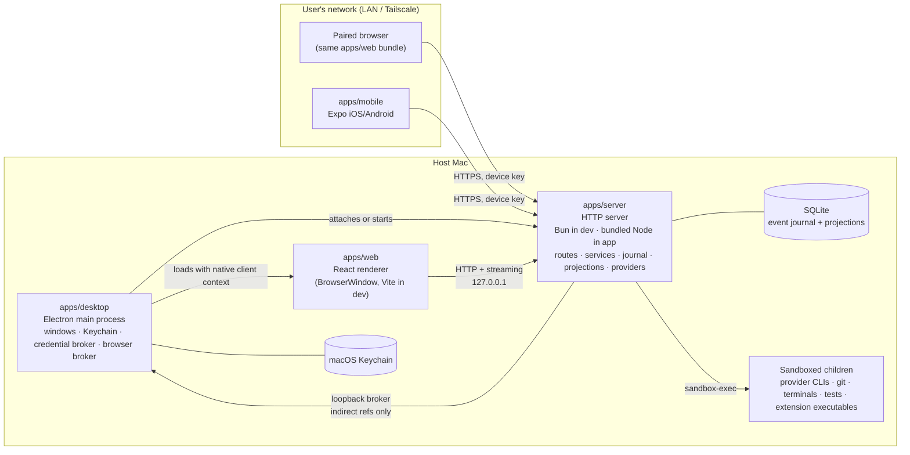
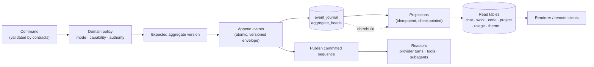

# Octant architecture

Octant is an original, local-first desktop workspace for Chat, Work, and Code
across many AI providers. The first shipping surface is Apple Silicon macOS; Linux and Windows
desktop are the same product, sequenced in the
[Current Release Boundary](#current-release-boundary).
This is the current architecture specification. Read the relevant section for
system boundaries; use the [design index](design/README.md) for topic owners.
Edit the current rule with an approved change in the same PR.
Sections explicitly label approved designs that are not yet fully implemented.

## Overview and principles

Octant is one Electron application that hosts a Bun HTTP server, a React
renderer, and (optionally) remote clients that connect to that same server.
Everything the user cares about — Projects, threads, memory, event history,
credential references, layouts — stays on the host machine. Artifact versions
are the exception once sync is on: they are copied into a store the user owns,
not into a store Octant operates. The journal does not leave. See
[Persistence](#persistence).

Six principles are the yardstick for every product rule in the
specifications (maintainer decisions, 2026-10-31). A rule that protects none of
them is a default a person can change, not a law. Octant's purpose is a useful
place to run many agents: every provider in one place, plus tools the native
apps lack. It is not a locked-down workspace; one stricter than the native
apps gives nobody a reason to use it.

1. **The person's ecosystem, the person's call.** Octant runs on their
   machine, with their accounts, folders, and tools. Their explicit choice
   beats Octant's caution.
2. **Privacy and no telemetry are not adjustable.** Nothing leaves the machine
   unless the person sent it or configured where it goes. No usage data
   without opt-in.
3. **Guardrails are on by default and can be lowered to Full access.**
   Protection against malicious tool calls and prompt injection stays strong
   out of the box. A person may relax it per Project, per thread, or globally;
   the choice is visible and journaled
   ([Guardrail levels](#security-and-authority)). The first run asks which
   mode new threads start in and pre-selects Auto, never Full access
   (maintainer decision, 2026-10-31). Full access means what it means in the
   providers' own apps: no sandbox and no prompts. Outside content is only
   recorded there, and every hard line holds.
4. **Key providers run as themselves.** Claude Code, Codex, Mistral Vibe, and
   OpenCode keep their native tools, subagents, skills, hooks, and sandboxes
   inside Octant. Octant adds; it does not amputate
   ([Key providers run as themselves](#providers)).
5. **Honesty never softens.** Octant always says what a provider or tool can
   and cannot do, and records what happened.
6. **Never stricter than the native app.** Anything a person can allow in a
   key provider's own app, they can allow in Octant, with the same or fewer
   steps. Rationale (compared 2026-10-31): Claude Code offers a bypass mode,
   an automatic mode whose classifier reviews each call, its sandbox off by
   default, and merge-when-ready in its desktop app; Codex offers no
   approvals with full access, an automatic approval reviewer, and its own
   subagents on by default; other agent workspace apps start threads in full
   access and merge, auto-merge, and merge whole stacks. Those apps also send
   telemetry by default, which Octant never does (principle 2).

**Hard lines.** No setting, guardrail level, or reviewer turns these
off:

- No telemetry, no usage data, no Octant cloud; nothing leaves unless the
  person sent it or chose where it goes.
- Octant stores no forge token, never journals a secret value, and redacts
  secrets from logs, the journal, and exports. Credentials reach a provider
  only through the credential broker; Octant never injects ambient keys.
- Updates are signed and verified; anything unverifiable is refused.
- Authority is checked on the host before any side effect; a phone or web
  client never exceeds what the person allowed on the host.
- Providers report capabilities honestly and fail closed.
- The journal records every lowered guardrail, every merge, and every
  force-push, with who allowed it.
- An agent never merges or force-pushes on its own initiative: only when the
  person asked for it, or under a standing setting the person turned on.
- An agent never marks a thread Done, and a spend ceiling the person set
  holds at every level.
- Plan mode is read-only. That is the definition of Plan, not a guardrail:
  in Plan an agent may look and propose, and changes nothing in the
  workspace (the Code checkout or the Work folder), on the host, or in the
  outside world. Looking includes the page already open in the thread's own
  Browser ([Browser in Plan](design/browser-agent-tool.md#plan-mode)), and
  proposing includes an offer the person confirms (a side task, a routine).
  The one thing Plan writes is the thread's own Canvas documents
  (`octant_canvas` `create` and `revise`), because a Canvas changes only the
  thread's own document, never the checkout, the host, or the outside world;
  publishing, sharing, the artifact mirror, and replica sync of a Plan
  thread's Canvas stay refused ([Canvas](design/canvas.md)).

Every other product rule that limits what a person or an agent may do is a
default: on out of the box, lowerable by the person, and journaled when
lowered. A rule that is allowed
but not built says so ("allowed; not built yet"), so a specification never
claims a feature exists.

The design rests on a small set of invariants that every package obeys:

- **Local-first.** No Octant cloud account, relay, or telemetry is required.
  Artifact sync, when the person turns it on, uses a store that person owns.
  Octant operates none of it; an S3-compatible store is contacted only at the
  endpoint the person configured and only while the Settings › Sync switch is
  on. Remote access is host-to-device over the user's
  own network; traffic among a person's own hub and spokes there is not a
  third-party call ([Hub and spokes](design/hub-and-spokes.md), built). Four host-initiated
  HTTPS calls exist in code: desktop update checks against a signed feed, managed
  device-tool update checks against the npm registry, server marketplace
  fetches when the person searches, inspects, previews, or installs from the
  catalog, calls to the public Canvas share service when the person
  publishes, updates, or revokes a public link (and the host retries a revoke
  it could not complete). Each has a Settings off switch. The switches: Public links starts
  off and off means no share-service request except finishing a revoke; marketplace off means no catalog
  request; Updates off disables automatic update checks (manual Check for
  updates may still contact the signed feed); device tools' automatic updates
  start off, and off means no registry request (a manual check may still
  contact it). An in-app
  changelog rides that update path and bundled notes rather than adding a
  separate call.
  Opening Updates reads the desktop's current local update state so the installed
  version and saved preferences appear without requesting the signed feed.
  One more call exists only on a hub whose person turned on Send notifications
  directly (off by default, window only): the hub calls Apple's push service
  (`api.push.apple.com`, or `api.sandbox.push.apple.com` when the person marked
  the build as development), `oauth2.googleapis.com`, and `fcm.googleapis.com`
  with the person's own Apple and Firebase credentials, kept in the credential
  store, to deliver sealed notifications to a phone app that person built
  themselves. No other host, no redirect, ten seconds at most, and the content
  stays sealed to the phone ([Building the phone app
  yourself](design/mobile-maturity.md#building-the-phone-app-yourself)).
- **The server is the authority.** Every authority check (mode, Project,
  thread, provider, approval, remote principal, optional spend ceiling) runs in
  `apps/server` before a side effect. The renderer and mobile app render what
  the server says is allowed; they never decide it.
- **The event journal is authoritative; projections are rebuildable.** Commands
  append versioned events to a SQLite journal. Read models are idempotent
  projections that can be dropped and rebuilt from the journal at any time.
- **Contracts are schema-only, domain is pure.** `@octant/contracts` holds
  Effect Schema definitions and nothing else. `@octant/domain` holds pure
  policy and state transitions with no I/O.
- **The host reads strictly; a client ignores what it does not know.**
  Everything the host decodes refuses unknown fields: requests and commands
  from any client, the journal, projections it rebuilds, provider and extension
  payloads, and plugin manifests. A client reading a host answer (a response
  body or a stream frame) decodes it with `decodeHostAnswer`, which drops fields
  it does not know, so a newer host can add an optional field without an older
  phone, browser, or CLI losing the thread. A known field with the wrong type
  still fails. Asks a person decides on (approvals, questions, and proposals,
  marked `personDecides` in the contracts) stay strict inside an answer: an
  unknown field there refuses the whole answer, so a person is never shown less
  than the ask authorizes. Versions are not negotiated per field.
- **Dependencies point inward.** Apps consume packages; contracts and domain
  never import apps. Provider-specific payloads stop at the provider adapter.
- **A provider question has one answer identity.** Each question in a provider
  question set reaches Chat, Work, and Code with a distinct request id. The
  adapter collects answers in the provider's original question order, rejects
  duplicate answers, and settles the underlying callback only when complete.
- **App-owned questionnaires stay in their thread.** The provider-neutral
  `ask-user` tool can collect a bounded group of single- or multiple-choice
  answers and an optional comment. The host validates the complete response
  against the journaled ask before settling its one-use request. It conveys
  preferences, never permission. [Workspace: inline questionnaires](design/workspace.md#inline-questionnaires)
  owns presentation and submitted summaries; provider-native question adapters
  retain their existing callback contracts.
- **Capabilities are honest and fail closed.** Every provider reports what it
  supports in every mode; an unsupported capability is disabled or refused,
  never silently emulated. Claude Code, Codex, Mistral Vibe, and OpenCode are
  the first-class providers, with one promise: full native capability,
  documented. A capability may be built for Claude Code and Codex first; what
  Mistral Vibe and OpenCode still lack is listed as not built yet, not as a
  lower tier. Every other provider gets a documented degraded form, listed in
  the [provider capability matrix](#security-and-authority) ("degraded on"),
  or reports the capability unsupported. The app-managed tools below stay provider-neutral, and a seam is
  never widened for one vendor.
- **Install ≠ trust ≠ enable.** Extensions contribute nothing until each of
  those steps has been taken explicitly, and even then only within the mode,
  Project, thread, and provider policy that applies. Extension installation
  never implies trust, activation, enablement, or authority. Disabled
  components contribute no context; executable components remain quarantined
  and subject to ordinary sandbox and approval policy. Structured extension or
  plugin references cannot install, trust, enable, elevate, or bypass policy.
  The three steps stay separate by default; a person may install and trust a
  package in one confirmed step (built: **Install and trust** beside
  **Confirm install**), and enabling stays its own switch.
  Skills are discovered only from valid `.agents/skills/` and
  `.claude/skills/` packages in the permitted repository ancestry (the closed
  `PROJECT_SKILL_ROOTS` allow-list), from the user-global `~/.agents/skills/`
  directory, and also from the key providers' own skill folders and any
  folder a person adds in Settings (built), all under the same activation
  ladder. Discovery reads the home folder's own `.claude` only when the person
  turns that provider's folder on ([Extensions and skills](#extensions-and-skills)).
- **Modes are server-enforced.** Chat, Work, and Code are server-enforced
  domain modes, not renderer flags. Code is always available; disabling Chat or
  Work never deletes their data. The shell presents Chat and Work as one
  visible Work mode beside Code: its new-thread composer chooses Chat (no
  folder) or Work in a folder, and the server keeps both domains unchanged.
  The server enforces Work and Code as a focus: which surfaces and tool sets
  a thread starts with, under one shared
  [guardrail level](#security-and-authority), not as different authority
  ceilings (maintainer decision, 2026-10-31). A thread keeps the kind it was
  created with; the choice never converts a thread, and moving work between
  Work and Code is a person's choice
  ([Modes](#modes-chat-work-and-code)).
- **Work and Code share one capability set.** Chat Projects are virtual,
  memory-scoped containers with no implicit filesystem or shell authority.
  Work binds one project root and Code binds one directory (each with any extra
  folders the person adds, granted the same access), each meant to be
  OS-confined, and both run under the same guardrail levels: shell, local
  command-line tools, SSH to the person's own machines, file reads and
  writes, Git, provider-native tools, subagents, routines, and Full access
  are governed identically in both. Work is for documents,
  artifacts, and local tasks, and keeps its board and Done by a person; Code
  is for coding, shows checkouts and worktrees, and keeps the objective
  delivery target. Work hides developer surfaces (Git panels, pull request and review
  surfaces, issue-tracker integrations, worktrees and checkouts) until the
  person turns them on for that Project. Defaults may differ for people who
  are not developers, such as plain-language approval prompts in Work; the
  authority never does. New threads start at the level the person picked at
  first run (or later set in Settings › Code › Access), and Plan mode is always
  read-only. Below Full access, Octant's
  own tool launches are OS-confined; one provider runtime is not yet
  (Claude outside Plan) and relies on the runtime's own sandbox, per the confinement matrix in
  [Security and authority](#security-and-authority). Every driver starts a
  Work session with its shell and Git at the thread's level, as in Code, and
  Work threads reach Full access
  ([Modes](#modes-chat-work-and-code) lists what each driver does).
- **Core capabilities are app-managed.** Browser/computer use, tests, Apple
  validation, approvals, memory, and subagents are app-managed,
  provider-neutral capabilities. Core Apple development cannot depend on an
  optional extension. App-managed is in addition to a key provider's own
  tools, never instead of them: its native subagents, web tools, and skills
  stay available beside Octant's ([Providers](#providers)).
- **New providers, tools, and capabilities are plugin-shaped.** They reach the
  system through the published seams (`@octant/provider-sdk`,
  `@octant/plugin-api`, `@octant/plugin-host`) and take no shortcut a
  third-party plugin could not take. Shipping in-tree is allowed; wiring a
  provider or tool directly into server internals, or widening a seam for one
  vendor, is not. A capability that cannot be expressed through a seam is a
  reason to extend the seam in its own change, not to bypass it.
- **Threads, boards, and Done.** Use the unified real-thread hierarchy and
  server-authoritative Work/Code boards. Chat has no board. A Code thread is
  Done only when its user-confirmed delivery target is objectively satisfied. A
  Work thread is Done when a person marks it Done. An agent cannot mark any
  thread Done.
- **Remote clients never exceed what the host granted.** Remote clients never
  exceed host, mode, provider, Project, or thread authority. A hub or peer host
  acting on another host is a remote client there, held to the grant that
  host's person chose. A person's own owner device may use a local window's
  powers on a host only after a fresh unlock on that device; agents, routines,
  and peer hosts never do
  ([Hub and spokes: owner devices](design/hub-and-spokes.md#owner-devices)).
- **Owner Browser control is a separate person capability.** An enrolled owner
  may unlock one already-open visible native Code Private page for at most
  60 seconds. Signed target/frame/sequence checks preserve the original local
  window and task authority. Credential-bearing frames use a volatile human
  response, never an agent observation or artifact. Stop, disconnect and expiry
  leave the existing person hold; explicit Hand back requires the agent to read
  again. Other resources and ordinary paired callers remain refused. The owning
  rules are [Owner control of an open Code page](design/browser-agent-tool.md#owner-control-of-an-open-code-page).
- **Privacy is about third parties.** Preserve local-first and
  privacy-preserving defaults. Add telemetry, external calls, credential
  exposure, or cloud dependencies only when the request authorizes them and the
  current specification documents the boundary. Traffic among a person's own
  devices over their private network is not an external call and may be
  generous, but it is always authenticated, encrypted, and held to the owning
  specification's rules.

Packaged macOS hosts use a restricted executable search path containing system
utilities and standard package-manager locations. `/usr/sbin` is included so
local-server discovery can invoke the system `lsof`; arbitrary inherited PATH
entries are excluded.

## Process topology

On macOS, both trusted desktop executables use sealed ASAR entries and fixed
launch roles. Each app's separately identified, same-version bundled runtime runs
its host, managed tools and executable extensions as Node (Stable's also runs its
scoped terminal CLI; Nightly's host is only its test-data host). The worker runtime is
not a trusted desktop peer, and Node consumers keep physical server files and
stdin supervision. The runtime has independent Framework/fuse bytes; no arbitrary
script runs under the trusted desktop executable's identity. See the owning
[fixed-entry rules](design/nightly-app.md#fixed-packaged-entry).

The ordinary packaged macOS main owns a bounded native status preflight for
Nightly, authenticated in both directions from kernel audit tokens, same-user
login scope and strict signed primary-app policy. Its discovery name grants no
authority; the status response includes no endpoint or lease. A separate
closed window protocol issues a fresh server window identity and short native
lease to an authenticated Nightly main. The lease is enforced on window and
renderer requests and held responses; administrative bridge secrets remain in
Stable. A separate closed human presentation route carries bounded frames and
input for the existing native Browser owner. A closed Stable app can start in
its fixed host-only role after installed-artifact validation; fresh authenticated
status still precedes window registration. See the owning
[host-only launch rules](design/nightly-app.md#starting-a-closed-stable-host).
Agent observations remain separate;
Standard-text composition uses a separate native input context and no-content
field/caret metadata.
Explicit in-app UI quit can retain the host for current authenticated Nightly
clients; accepted terminal quit closes admission before cleanup. See the owning
[client lifetime rules](design/nightly-app.md#keeping-the-host-for-current-clients).
Nightly's own updater uses its local preference storage and current window
authority; it never changes Stable's channel or stops Stable's host. See
[Nightly update ownership](design/nightly-app.md#nightlys-own-updates).
Lease loss destroys the old Nightly renderer before a bounded fresh native
registration retry; only an already retained current client receives managed
restart grace. See [reconnect rules](design/nightly-app.md#reconnecting-after-host-loss).
Packaged Linux has no signature or audit token, so the same status and window
protocols run over a `0600` `SOCK_SEQPACKET` path socket in the private
per-user runtime folder. Each side admits the other only for the same user, a
pidfd-held process incarnation with the same mount, user and PID namespaces
and root, and a kernel credential on every message; pidfd exit or EOF revokes
leases. Executable paths and `$APPIMAGE` grant nothing, and a Nightly whose
renderers run unsandboxed registers no window. A closed Linux Octant starts
only from the launcher record its last packaged launch wrote, by descriptor,
with the host-only role and a minimal environment. Same-user unconfined code
can pass this check, an accepted limit. See
[Linux client trust](design/nightly-app.md#linux-client-trust).
Full IME reconversion, accessibility, native popups and full lifecycle
acceptance remain unfinished. See
[native client window leases](design/nightly-app.md#native-client-window-leases) and
[desktop status preflight](design/nightly-app.md#authenticated-desktop-status-preflight).



**Desktop (`apps/desktop`).** The Electron main process owns native windows,
menus, the macOS Keychain, project-root, plugin-folder, and runtime-binary
pickers, and the in-app updater. A picker hands the server the chosen path
under the desktop bridge secret and gives the renderer only a single-use
receipt bound to its window, so a renderer can act on a path only the person
picked. It attaches to the canonical host at
`http://127.0.0.1:13773`, or starts that independently runnable host when it is
absent, then probes storage readiness before showing a window. It passes
native broker coordinates and the desktop bridge secret that native-only
operations require. A packaged launch also passes the app's version in
`OCTANT_ARTIFACT_VERSION`; a development launch does not. It also runs loopback-only
brokers the server talks back to: the credential broker (Keychain access by
opaque reference), the browser runtime broker, and on macOS the Simulator
device broker, behind which one native device helper per Simulator delivers
workbench input.
It starts the prototype host, a second process of its own executable with no
network route and no resolver, where running Canvas prototypes are drawn
(see [Canvas documents, designs, and prototypes](#canvas-documents-designs-and-prototypes)).
One desktop-owned launch keeps a fixed inventory of the server child, native
brokers, constructed services, and managed-tool service as each is acquired.
Until the Computer or Simulator broker returns, the launch owns cleanup of
its constructed Computer service or Simulator helper wrapper.
Startup rollback, losing a competing-host race, and normal stop share one
close completion. They attempt every acquired stage in dependency order even
when another stage fails, report only fixed cleanup stage names, and retain
failed ownership for the existing quit deadline. Credential setup and
synchronous server-spawn failures remain sanitized; readiness failures keep
their classification for restart policy. An independently managed host is
never added to this inventory or stopped with it.

Accepted quit is terminal for host start and restart admission, including
queued work. A start already in progress must close a late desktop-owned
result; a late borrowed attachment is left alone. Confirmation remains
cancellable before that admission closes. The quit deadline reads the current
launch, including resources acquired after acceptance, and retains the one
successfully closed quit-owned launch until app exit: closing updater and
broker APIs does not itself prove every tracked managed-tool process exited.
This preserves the existing emergency termination path and its deadline;
it does not add a process-exit guarantee for managed tools.

Every app window confines top-level navigation, redirects, and opened windows to
the exact packaged renderer asset or configured Vite development origin. Native
IPC also requires that trusted renderer URL, and the packaged renderer ships a
strict Content Security Policy; external pages are opened through explicit
server- or host-authorized flows instead of replacing the app window.

**Server (`apps/server`).** A Bun HTTP server bound to the stable canonical
loopback endpoint `127.0.0.1:13773`. It registers route modules per feature (`chatRoutes`,
`workThreadRoutes`, `codeRoutes`, `projectRoutes`, `extensionRoutes`,
`remote/*`, …), resolves a **client principal** for every request — a
process-local client context on the loopback listener (internally still named
`local-window` while that contract is migrated), or a `remote-device` principal
carrying authenticated remote identity — and runs all mutations through
services that append to the journal. Providers, tools, Git, terminals,
subagents, extensions, and recovery live here. A headless host runs the same
server through `@octant/cli` (`octant server run`, `octant web`). The
installable headless artifact (`scripts/package-headless.ts`) is self-contained:
it carries the bundled CLI (`bin/octant`), the bundled server (`lib/server`), the
web assets, and a top-level `node_modules` holding the third-party and native
dependencies both bundles leave external, built on the target platform itself,
and the target's bundled TypeScript language server with its license notice.
An installed CLI starts that server under its own Bun runtime with
`OCTANT_ARTIFACT_ROOT` and `OCTANT_ARTIFACT_VERSION` set. The server verifies
every listed file before it opens the store, and reports that version on
`/health`, in a diagnostics export, and on the owner receipt. When the stamped
version is missing or unusable, the CLI still sets `OCTANT_ARTIFACT_VERSION`
to empty so a value inherited from the parent process cannot replace it. The
host treats an empty or over-long value as unset and reports the package
version a development script exports, or `0.0.0-dev` when that is absent. For Code,
verified remote requests carry their principal through an async request scope:
the paired device may reach existing active Code Projects without a desktop
workspace, while services retain thread, checkout, provider, and approval checks.
This admission ends on cancellation or dispatch completion. Local windows retain
their selected-Project restriction. A killed start can leave the
control secret with no receipt and no socket; the next acquire quarantines
that file and continues, and it checks the socket is still absent before the
move so a peer that bound in the meantime keeps the secret it just wrote. A start
takes over from a recorded owner only when its control socket does not answer
and its process is gone: the pid no longer exists, is an unreaped zombie (an
aborted owner whose parent has not collected it yet), or belongs to a process
with a different start time (a recycled pid, including one now held by another
user). If the process cannot be inspected, the owner counts as live and the
start refuses. An ownership failure names the code, the artifact path, and the
next step.

**Memory pressure.** The server samples its own resident size and the
system's memory-pressure signal every 15 seconds (every 5 while pressure
lasts): the kernel's pressure level on macOS, and the available share of
`/proc/meminfo` on Linux, where under 10% reads as low and under 5% as very
low. A reading the platform cannot give is "unknown", which counts as no
signal, never as normal pressure. The host process counts as pressure on its
own once it holds its **memory limits**: low at the first, very low at the
second. The setting is Automatic by default, which is 2 GiB (4 GiB for very
low), or a quarter (a half) of a machine smaller than 8 GiB. Custom replaces
the pair with two sizes in GB of 1024³ bytes, the same unit as the default
(0.5 to 64, very low above low) that apply as
given on any machine, without the small-machine scaling: the person chose them
knowing what else the machine runs. The limits are a host setting in Settings >
Host, changed only by a local window: `POST /api/host-control/memory-limits`
sits on the loopback host-control surface, behind the `host.service.memory-limits`
action that a paired device is denied, so a paired device can neither read nor
change it. Each change is one journaled event
(`host-memory-limits.changed@1`) naming who made it, when, and the values
before and after; the `host_memory_limits_projection` row is rebuilt from those
events, and saving the values already in force records nothing. A pair that is
out of bounds or not ordered comes back as a refused outcome with a plain
message, never as a stored value. The guard reads the saved limits at every
sample, and a change takes a reading at once, so a new limit applies without a
restart; a limits read that fails falls back to Automatic and is logged, since
the built-in pair is the safe reading. The limits only move when the host eases
itself; they never touch a running turn or the system's own signal. On the
first low reading, when pressure rises, and
then at most once a minute while it lasts, the host eases itself in a fixed
order: it logs the reading, stops provider runtimes whose last lease ended and
sessions parked for reuse (the next turn starts them again), then trims caches
it rebuilds on demand (SQLite's page cache and, under Bun, the heap). A running
turn is never stopped; the report only counts how many were left running. The
host-control status carries a `memory` report (level, the host's size in
megabytes, the limits in force as set and as resolved for this machine, the last
relief as counts, and any unclean stop) and nothing named:
no provider, thread, or path. The renderer shows it as one dismissible, quiet
notice and as rows in Settings > Host, only when the host stopped something, when
memory was very low, or after an unclean stop. The Memory limits control (an
Automatic or Custom choice with two fields) sits in its own Memory section on
the same page whenever the host reports memory. Dismissal is local to the
renderer. Nothing leaves the machine.

The host keeps `host-memory.json` in its data directory (owner-only: the last
pressure level, size, and time seen). Only a clean shutdown marks it clean, so
the next start that finds it unmarked reports the previous process as stopped
unexpectedly together with that last reading, without claiming a cause: a
crash from memory looks like an unmarked file with a high last reading, and
nothing more is inferred. The per-user service restarts a crashed host: the
launchd job keeps the host alive after any exit but a successful one (30
seconds apart), and the systemd unit restarts it on failure, which includes a
kill by signal. A start that failed on configuration does not loop. No telemetry
is involved at any step.

**Language services.** Code editor language services and, later, a debugger
run as confined children the server launches per checkout, under the
[Language services](design/language-services.md) design accepted on 2026-10-26.
The desktop app and the headless artifact carry the bundled server's binary for
their target with its license notice, signed with the app on macOS
([packaging rules](design/language-services.md#packaging-rules)).
Its seam and companion are built: the `language-server` component kind, the
pure launch policy, the read and document contracts, the remote-approvable
`code.language.read` action, and the server's confined, receipted,
crash-limited language servers behind `POST /api/code/language/documents` and
`POST /api/code/language/read`. Besides the bundled TypeScript server, a
person can add a `static` server from a local folder holding an
`octant-language-server.json` package document: it installs through the
extension package store untrusted and disabled, its review names the binary,
its digest, its languages, and its class, and it serves only once trusted and
switched on, verified against that digest at every start. The Monaco editor
calls those routes through the Code client: it shows the server's diagnostics
as markers and opens a definition in another file through the ordinary
file-open path, locally and from a paired device. Explicit checkout references
consume the already-initialized server's actual capability and acknowledged
current draft, return bounded snapshot locations, and reuse that file-open path;
these reads never start or retarget a server. Unsupported or unknown support
stays explicit, with no save, new agent tool or write authority
([references rules](design/language-services.md#explicit-checkout-references)). A Settings › Code switch,
stored in the journaled Code settings, turns the bundled server off, and the
host then answers `turned-off`. A person can also add a `repo-tooling` server,
which runs the repository's own tooling: it starts only after the person at a
local window approves it for a checkout or the Code Project (a journaled
`shell-commands` approval through the local-only
`POST /api/code/language/approvals`), never in Plan or for a paired device,
may then write the checkout and run programs as a terminal does, and reaches
the network through its own `proxied` egress proxy under the Project's rules,
audited like a harness command's launch
([Repository tooling](design/language-services.md#repository-tooling)).
Agents read the same servers through one read-only app-managed tool,
`octant_code` (`code-language` in the closed catalog), whose `diagnostics`,
`definition`, and `references` operations are allowed in Plan and ask nothing.
It is offered on a Code turn whose provider carries Octant's tools only when a
server an agent may start (`static` and effective, so the Settings switch is
honoured) covers a file a bounded scan finds in the turn's checkout or extra
folders. It reads the saved file, never an editor's draft, returns at most
200 references, and never starts or reads through a server that runs
repository tooling, approved or not
([agent read rules](design/language-services.md#agent-read-rules)).
The debugger's seam and session host are built: the `debug-adapter`
component kind (Code only, quarantined like any executable component), the
`octant-debug-adapter.json` package document, which installs from a local
folder untrusted and disabled with a review of its binary, digest, runtimes,
and `launch` body, the pure start policy, the configuration schema, and the
mapping from a repository launch file to proposals. A person at a local
window confirms a configuration (a journaled `shell-commands` approval for one
configuration digest and adapter package state) and starts it; the adapter and
the program run in one capsule confined as a terminal, on the session's own
`proxied` egress under the thread's rules below Full access, and the session
ends at once when the thread, its posture, its checkout, the confirmation, or
the Project goes. The routes under `/api/code/debug/` are local-window only
with no remote action, no agent tool reaches a session, and nothing a session
shows is journaled. The Code dock's Run and debug tool calls them: it lists
and confirms configurations, starts a session with the window's gutter
breakpoints (configuration saved locally per endpoint/window/thread/checkout,
revalidated before use; no session state is restored), and shows the stack,
variables, and a debug console, deciding no refusal itself
([Debugger session rules](design/language-services.md#debugger-session-rules),
[Debugger panel rules](design/language-services.md#debugger-panel-rules)).

**Host resources.** `GET /api/host/resources` is a read-only snapshot of this
host's load: CPU use averaged over a short sample of the process's CPU times,
used and total memory, the core count, and used and free space on the volume
that holds the data directory. The disk figures are omitted when that volume
cannot be read. The snapshot names no path, no user, and no process. The server
keeps one snapshot for about five seconds. The local owner always receives it.
A paired remote device with an active session receives it under the same
`project.overview.read` action as the Project overview reads; an
unauthenticated caller is refused, with no figures in the refusal. The route
also compares the device's host identity with this host's, but every paired
device row on a host carries that host's own identity, so the comparison does
not separate one paired device from another. The Computers card
reads the route only while the card is on screen and the window is visible,
about every ten seconds, at most one read per host at a time and each abandoned
after five seconds, and does not poll in the background.

**Renderer (`apps/web`).** One React application served to the desktop window
and to authenticated remote browsers alike. It talks to the server through
`@octant/client-runtime` and never holds authority of its own. In development
Vite serves it with hot reload; in a packaged build the server serves the
built assets. A paired browser mounts the remote shell rather than the desktop
workspace: the same Chat, Work, and Code thread workspaces, driven by the
ordinary product clients over `createRemoteProductFetch`, which carries each
request on the device session and never presents a window capability. The
desktop's window-bound sidebar, dock, and Settings are not served remotely.

**Mobile (`apps/mobile`).** An Expo iOS/Android remote-control client. Threads
are host-owned; the phone stores only device keys, a host registry, and session
material. It uses the same contracts and client runtime as the browser. The
phone creates Chat, Work, and Code threads, reads their transcripts, and sends
follow-up turns under each thread's own authority (`start-work-thread-turn`
with the thread's binding; `start-provider-turn` on the thread's checkout).
Approvals, folder binding, file edits, and shell remain host-only and the
composer says so. A person may attach a camera photo, a library image, or a
file from the system document picker to a thread, through that mode's own
attachment route and only for media the thread's model takes; the host removes
image metadata from every paired upload
([Mobile maturity: capture](design/mobile-maturity.md#capture)). Native startup supplies WebCrypto for the shared pairing and
request-proof clients; keys persist in platform secure storage. Native remote
fetch sends the proof-bound session cookie explicitly and disables the shared
cookie jar to prevent duplicate or stale cookies. Browser cookie ownership is
unchanged, and native remote requests refuse redirects.

Its background shares the desktop's three Gradient pictures and Pixelate/Dither
print effect (Appearance › Background), drawn once through a GL shader that
uses the same ordered threshold.

Internal TestFlight distributes this same client and grants the phone no new
authority. The bundle is `app.octant.mobile` (installed name Octant) at source
version `0.1.0`; EAS Build signs and archives it, with build numbers from EAS
remote version state, and the `production` EAS profile means store
distribution, never a public release or App Review submission. The manually
dispatched `Mobile (TestFlight)` workflow builds only from `main` in the
protected `mobile-testflight` environment and uploads only when its `submit`
input is set; pull requests get no release credential. GitHub holds only the
revocable Expo token; Apple certificates, profiles, and the App Store Connect
key stay in EAS's credential service. The App ID enables no optional Apple
capability (push, associated domains, Sign in with Apple, iCloud) until the
maintainer builds with phone push on (`OCTANT_MOBILE_PUSH=1`, which adds push
and Keychain sharing for the notification service extension), testers are
maintainer-controlled App Store Connect users, and external groups, public
links, and store listing stay closed until
[public store distribution](design/mobile-maturity.md#phase-e-public-store-distribution),
a track in scope for the first preview, opens with a separate maintainer action for
submission. A build counts only after the
device pass in the [TestFlight runbook](mobile-testflight.md), not when EAS or
Apple finishes processing it. Internal Android builds carry the same client
under the same rules: the manually dispatched `Mobile (Android internal)`
workflow builds a signed APK from `main` in its own protected
`mobile-android-internal` environment, EAS holds the keystore, the public log
names no install link, and testers are maintainer-chosen
([Android runbook](mobile-android-internal.md)). Push notifications, capture and
voice input, and store distribution extend this client under
[Mobile maturity](design/mobile-maturity.md), which grants the phone no
authority beyond what the host grants.

**Local client context.** The local trust class is "holds a secret only the
host's OS user can read", not "is on loopback". Loopback plus an admitted
Origin says nothing about who is calling: another OS user on the same machine,
an `ssh -L` forward, a proxy that rewrites `Host`, or a local service account
all arrive that way, and a forged `Origin` header costs a non-browser caller
nothing. The secret is the desktop bridge secret, which the host owner projects
into the owner-only runtime directory. Electron windows and every CLI command
(`octant agent`, `octant listener`, pairing, `octant web`) present it on the
`/api/desktop/*` routes. A browser gets a session only through a one-time
launch token: the launcher (`octant web`, `octant web --dev`, or the desktop's
"Open in browser" action) mints it through `/api/desktop/launch-sessions` with
the bridge secret and opens a URL carrying it in the fragment. `octant web`
sends the secret only to the host that this OS user's owner-only host receipt
names (same address and instance), never to an endpoint that merely answers
`/health`, because another OS user can bind the port while the real host is
stopped. The token is
single-use, expires after five minutes, and is bound to the renderer origin it
was minted for, which must be one this listener serves (below). The renderer
strips it from the address bar with a history replace before it exchanges it at
`/api/shell/launch-session`; an exchange from any other origin, or with no
Origin, is refused and burns the token. `/api/shell/local-session` never mints
authority: it only refreshes a capability the tab already holds (so a reload
keeps its session) and answers 401 otherwise. Typing the host address by hand,
reopening a tab after the host restarted, or opening a copied tab therefore
shows "Open Octant from the desktop app or run `octant web`" instead of the
app. Electron, ordinary browsers, and Vite still read the same Machine-owned
Projects, threads, settings, and journal; a Vite renderer qualifies only when
the host was started with its origin in `OCTANT_WEB_URL` (the desktop dev loop
and `octant web --dev` set it for the host they start), and `octant web --dev`
mints its token for that origin. The context id scopes window-local presentation
and guards against accidental cross-window commands, but it is not a separate
Machine or durable authentication epoch. The packaged renderer additionally
proves its native renderer identity for desktop-only integration. When the host
instance changes, Electron re-registers every live Project window, replaces the
main-process authority and renderer identity, and publishes the new capability
so the renderer rebuilds its clients before snapshot recovery. The loopback
transport still validates the actual Host header, rejects non-loopback origins,
and removes process-local registration when its owning client closes. The
listener admits only its own loopback origin (under any loopback name), the
packaged renderer, and the development renderer origin named by
`OCTANT_WEB_URL`; a page on any other loopback port is refused before dispatch
and gets no CORS grant, because agents start local dev servers whose pages the
person opens in an ordinary browser. The listener never reflects a non-loopback
web origin into local authority. One residual window remains: the launcher
hands the token URL to the system browser as a process argument, which another
OS user can read for the moment that process runs, and the token is valid until
the browser exchanges it. The renderer holds the matching
line before its first request: a launch address that is plain HTTP to a
non-loopback host is refused with an explanation and never used.
Requests that send the window capability set
`redirect: "error"` so a later hop cannot carry the header to an address the
parser never judged.

Managed runtime tool transport uses the provider SDK's existing tool-request
and tool-answer contract. The adapter's in-process server exposes only the
current app-authored catalogue; external provider tool-server configuration
stays disabled. Code browser sessions can request an inline approval without
raising thread access. The grant is bound to the exact browser context and
owner, and browser-service policy is checked again before effects. Answering
the prompt with "always allow" journals the origin into shell settings, so a
new browsing context for that origin opens without asking — in Code, in Work,
and for later sessions — until the person forgets it under Settings; rebinding
an existing context to a different model or authority still asks, because the
remembered grant covers the page, not who drives it. The remembered set grows
only through that approval answer: `replace-settings` may remove an origin but
rejects additions, so a client cannot grant itself origins the prompt never
showed. A remembered origin covers Private pages only; a page in a Project or
Personal Browser profile asks for each origin and remembers the pair (origin,
profile), never one without the other
([Browser profiles](design/browser-profiles.md#the-agent-on-a-signed-in-page)).
Plan admits only the Browser operations that read the page already open in
the thread's own Browser (`audit` among them) and `stop`, and refuses every
other one as `plan-mode-read-only`, a recording included, from one table of
operations; a recording already running when Plan begins is stopped and
discarded ([Browser for agents: Plan mode](design/browser-agent-tool.md#plan-mode)).
Downloads in the agent's Browser
are blocked on every page unless the person turns on "Let agents download
files" in Settings (a shell setting only a local window writes, off by
default). Then a download an agent action starts is held in a private
temporary folder of the host, never the workspace, and saved only by the
agent's `download-save`, which asks the person every time, at every access
level, before creating a new file in `downloads/` of the thread's workspace;
programs and installers and a symbolic link are refused, and a paired device,
a terminal grant, and Plan cannot save
([Browser for agents: Download](design/browser-agent-tool.md#download)). A
person's own download in the Browser pane stays blocked. An upload asks every
time, at every access level, naming each file and the site, and the answer is
never remembered.

Tool definitions carry the agent's usage guidance alongside their argument
schemas. App-owned tools are capability families: one tool per object —
`octant_browser`, `octant_computer`, `octant_threads` in Work and Code, in
Code `octant_terminal`, `octant_apple`, `octant_android`, `octant_pull_request`,
and `octant_github`, and for Zen's assistant `octant_zen` — with its actions in
an `operation` enum. The always-visible tool prefix stays small and
cache-stable, so a family's description says only what an agent must know
before its first call, and its `help` operation returns the full usage on
demand. The managed tool set answers help from the family's own static text
(`withToolFamilyHelp`) and only for a family the turn offers; help never
reaches the family's executor, so every other action passes the same server
policy before any effect. A family whose grant or capability is off is
omitted rather than advertised and refused: Browser when the provider has no
verified tool transport, the thread's tool constraints exclude it, or a Code
host lends no browser; Apple or Android when the host has no toolchain to
lend; the threads tool's `board` operation and the side-task tool's `board`
target outside the designated planner thread. A family whose operations differ
by turn lists only the ones this turn may use in its enum, and its `help`
covers only those: `octant_threads` drops `send`, `acknowledge`, and
`receipts` in Plan and in Work. Browser shares one definition across modes.

Omission is decided per session where the runtime keeps its own tool list,
because a tool list sits at the start of a provider's cached prompt and any
change to it re-bills the whole conversation:

- **Claude Code** lists a tool from the first turn that offers it until the
  session ends. A tool a later turn adds reconnects the in-process server
  (removed, then added again), because Claude Code ignored a replacement
  server under the same name and kept the tools it first listed (2.1.211
  against a local stand-in endpoint). A listed tool the turn does not offer
  stays listed and is refused before it runs, by the permission callback and
  the pre-tool hook with "This Octant tool is not available in this turn",
  and by the server itself if a call still arrives. A turn that offers no
  tools leaves the server connected. A new session lists only what its first
  turn offers.
- **Codex** takes its tools in `thread/start.dynamicTools`, which
  `thread/resume` does not accept, so a Codex thread keeps the tools it
  started with; one not offered in a later turn is refused by the host's tool
  policy, and one first offered later does not reach that thread. The driver
  records definition fingerprints with the starting names. New or changed
  definitions require the person's explicit fresh-session text handoff choice;
  the host never pretends a resume changed Codex's fixed catalogue.

Each mode offers only its admitted tools, so every runtime receives the same
definitions without a separate global tool installation or prompt catalogue,
through the transport its adapter verified:

| Runtime                             | App-managed tool transport                                                                                                                                                                                                                                 |
| ----------------------------------- | ---------------------------------------------------------------------------------------------------------------------------------------------------------------------------------------------------------------------------------------------------------- |
| Claude Code                         | The Agent SDK's in-process MCP server `octant`, owned by the provider connection                                                                                                                                                                           |
| Codex                               | App-server `thread/start.dynamicTools`                                                                                                                                                                                                                     |
| OpenCode                            | A connection-private loopback MCP endpoint, registered through OpenCode's own server API                                                                                                                                                                   |
| ACP runtimes                        | An HTTP MCP bridge when the runtime advertises and accepts it; ACP client file and terminal capabilities are separate                                                                                                                                      |
| Pi                                  | Octant's own Pi extension, calling a token-authenticated loopback bridge                                                                                                                                                                                   |
| Native harness and direct endpoints | Definitions in the request, for models with verified tool support                                                                                                                                                                                          |
| Typed CLI in a thread terminal      | Browser only, on a loopback MCP endpoint per grant, reached through `octant mcp`; the person adds that command to their CLI, and Octant writes no provider configuration. The macOS app ships the command too ([detail](design/terminal-browser-grant.md)) |

No transport edits a person's provider MCP, hook, or global configuration;
OpenCode's per-launch posture stays in its connection-private configuration.
The local-server adapter binds its private tool endpoint to one connection's
session and exact offered catalogue, and reports app tools only with a process
receipt attesting that external MCP, plugins, and skills cannot enter the
runtime; see [Provider runtimes](design/provider-runtimes.md#local-server-provider-adapter).

**Browser and Computer are tools, not mentions.** The host offers them on
every eligible turn, and the agent uses them when the person's request needs
them. No composer selection exists, and neither the tool definition nor the
message text grants anything: authority comes from the person's approval at
the moment of action. A Browser or Computer selection left in an older draft or
queued message still decodes, is kept with the turn as journaled, and is
ignored; the composers drop it from a restored draft with a note.

- **Browser** is offered in Work and Code when the provider carries app-managed
  tools, never in Chat. The first effect on each origin asks inline. In Plan
  the definition is present, the reads of the page already open still run
  under every other gate, and every effect is refused.
- **Computer** is offered in Chat, Work, and Code only when all of these hold:
  the bundled plugin is enabled, there is a screen bridge or a leased desktop,
  the provider carries app-managed tools, the tool is not constrained out, and
  the turn is not in Plan or a Side Chat's. Otherwise no definition is offered
  at all.
- **Providers.** Claude Code and Codex carry both tools; other providers carry
  them only through a verified app-tool transport, per the table above. A
  runtime without app tools gets neither, and Settings says so on its card.
- **Agent context** is the definitions plus one host line per offered tool, 40
  tokens or fewer, saying what the tool is for, that it asks first, and that
  what it reads is data. Detail stays behind the tool's `help` or `describe`.
- **Destination.** A send names a disposable desktop by its destination alone;
  without one, Computer acts on this Mac, or on a screenless host's one running
  desktop of the thread.

Dropping the chip widens what an agent may _ask_ for, since any eligible turn
can request control, including one that has read hostile content. The
selection used to be the person's intent for each send; these rules put that
intent at the moment of action instead:

- The first Computer action on each application in a thread asks, even under
  Full access: no app grant exists until the person approves one, and the
  tool never reads the execution policy to skip the ask. A grant lasts five
  minutes and covers that application, owner, and authority only.
- Once outside content has entered the thread (a Browser page, a tool result,
  imported content), no standing grant carries a Computer action: every
  action asks again, for that one action, and the ask names what marked the
  thread.
- The approval card shows the agent's stated reason, quoted as its words, and
  the outside sources with their last read.
- Only the person at this Mac approves control of this Mac. A paired device or
  remote client may read a session's state and can neither approve nor stop
  it; a desktop lease's approvals are asked in the thread.
- Stop, cancellation, a changed authority, or turning the plugin off revokes
  control.

Canvas follows the same rule through its read-only `describe` operation: the
always-visible `octant_canvas` description says only what an agent needs before
its first call, and `describe` answers per-block guidance, recipes, and schemas.
The tool, recipes, presentation, preview, block catalogue, boards, comments, and
the `design` block are specified in [Canvas](design/canvas.md). Their boundaries:
`describe` reads no Project data and creates no artifact, and a recipe is a
starting shape, not authority; every new block kind or field is gated by a Canvas
schema version, so an older runtime refuses a document rather than misreading
it (the presentation-only table column `display` and chart, table, and metric
`format` fields are the one ungated exception, which the strict schema still
refuses on a runtime that predates them); a version is immutable, and a person's change (a plan task's status, a
diagram layout) is journaled as a new head version with the `local-user` actor
the host stamps itself; the host stamps comment authors, so a renderer never
authors as an agent; only a host window moves board nodes; `preview` renders
with the network off and no server address or credential; a static `design`
frame never receives `allow-scripts` and no frame has both `allow-scripts` and
`allow-same-origin`; a share carries a design only with the sharer's
acknowledgement that markup is shared as written, and refuses an action block;
nothing drawn inline in the thread can journal a version; and Plan keeps
`create` and `revise` (the thread's own document) while the tool offers no
publish or share and the mirror and replica sync write nothing for a Plan
thread.

Descriptions explain the existing presentation flows and distinguish creation,
queued jobs, and work proposals from opened previews or completed work.
Work also includes a short, budgeted artifact instruction in its required
context, so runtimes that use their own file tools know how written documents
appear in Files and Document, and every turn that offers `octant_canvas` (Work,
Code, and every Chat thread) includes a short, budgeted Canvas
delivery instruction, so a runtime delivers kept or shared work as a Canvas
rather than as its own file or a long reply; its text is owned by
[Canvas](design/canvas.md#agent-tool-and-recipes). Neither instruction offers
tools or authority, and the Canvas one is absent wherever the tool is not
offered.

### Desktop menu bar

The menu bar is the closed-window fleet roster; the Inbox is the in-window list.
It prioritizes Open Octant, New task, and three compact sections: **Needs you**,
**Working**, and **Done since you looked**, at most six rows each. Empty
sections disappear. A row names the thread title, its mode, and its Project,
and choosing it opens and focuses that thread in the main window, opening the
window first when none is open. Local host contains status, browser access,
applicable lifecycle controls, and redacted diagnostics; Quit Octant retains
the existing active-work confirmation. The text beside the glyph is `!` while
the host itself needs attention (provider readiness, a lost host), otherwise the
count of threads that need the person.

The roster comes from the host, not from open windows, so it stays current with
every window closed. The shell registers its own local-window authority for the
menu bar with the desktop bridge secret it already holds, replaces it when the
host instance changes, and revokes it when the menu bar goes; it reads exactly
what any local window could. It polls `GET /api/fleet-activity` with the host
probe (every 2 s while a window is visible, 10 s otherwise). Every row names its
`activitySource`:

- **Needs you** is the pending-requests read
  ([pending requests across modes](#security-and-authority)): a Work request or
  any turn decision is `journal`; a Code approval or question, or a Chat
  question, is `session`, the live provider session parked on it. Code reach is
  per bound window and the menu bar's own window binds no Code Project, so its
  Code rows are the requests and decisions each local window with a persisted
  Code binding could answer, read once per distinct binding since what a window
  can answer depends only on what it binds; a Code Project no local window
  binds stays out. A
  waiting subagent, the agent's own approval, and a Work agent's own question
  are read the same way. The
  menu bar's window binds no Project, so its Work and Code rows for them are the
  waits that each saved local window with a Work or Code Project binding could
  open, whether or not that window is open now; a window bound to no Project
  adds none. A Chat thread's own approval is listed for any local window. Each parent is one needs-you
  row whose `activitySource` is `session`, and like every fleet row it carries
  the thread title, mode, Project name, state, and time, never the request
  text, the child's task, or its role. A thread that is both waiting and
  running is listed once, as needs you.
- **Working** is each mode's own navigation run state, the journaled fold the
  sidebar and board already use, so it is `journal`.
- **Done since you looked** is the one state the host cannot know, because only
  the shell knows when the person last opened a thread. A thread that leaves the
  host's list between two successful reads finished; it stays done until the
  thread is opened in a window or from the menu bar, or runs again. A focused
  window showing the thread when it finishes never makes it done. A failed or
  truncated read changes nothing, so a lost host cannot fake a finish. Done rows
  live in memory and start empty with each app or host instance.
- `screen` is reserved for an agent CLI seen only in a terminal pane. The
  contract refuses it for needs you, it never becomes done, it never counts
  toward the menu-bar number, and its row reads "seen in terminal". No current
  producer emits it: Octant does not scrape a PTY or screen for agent state.

Each row's tooltip names its source ("read from the journal", "read from the
live session"). The menu bar raises no notifications; banners and the dock badge
stay with the renderer's attention signals. The dock badge counts the threads
that need the person (as the Inbox does), never a finished turn. Windows report only which thread
they show, which clears that thread's done row and tells the shell the window
can open a thread it is asked for. The read is local-window only, like pending
requests. Titles never enter the public health response or redacted
diagnostics. Separately managed hosts retain their existing lifecycle
restrictions. Nothing here writes provider MCP or hook configuration.

Chromium's developer tools (View › Toggle Developer Tools and Reload, and their
shortcut) stay in development builds and in packaged Preview and candidate
builds, and are hidden in a packaged stable release, decided by the build's
version (maintainer decision, 2026-11-06). Octant Nightly hides them whenever
it is packaged.

### Desktop context menus

Trusted top-level desktop windows may contribute a bounded native context menu
through the preload bridge: at most 160 entries, four submenu levels, and labels
up to 256 characters. Contributions contain presentation and opaque action IDs;
they cannot supply Electron roles, callbacks, paths, URLs, or native commands.
The shell returns the selected ID to the same window, which invokes its existing
renderer action and ordinary server authority checks. Dismissed, refused, closed,
or navigated windows select no action. Each window owns at most one contributed
native popup. Embedded Nightly page editing menus use the same native presenter,
with a separate main-only protocol and fixed Stable page editing commands. Their
host-issued menu identity captures an already focused standard field's
incarnation; current source, presentation, layout and native lease are checked
after metadata waits. Source retirement cancels the owned popup without closing
the Nightly window. No page labels, selection text or clipboard contents cross
that protocol. Keyboard invocation binds its paired user gesture to a host-issued
pending identity; main-only activation uses the current field's verified native
caret and actual viewport. Cleanup releases cannot activate it, and pending IDs
never reach the renderer. The supported subset and remaining clipboard acceptance
are owned by [Nightly's page editing menu rules](design/nightly-app.md#standard-page-editing-menus).

The desktop's own text editing menu uses Chromium's edit flags and
fixed native roles; embedded browser frames cannot contribute workspace menus.

### Canvas documents, designs, and prototypes

Canvas produces three kinds of finished work: documents a person reads (a
spec, an article, a brief with tabs, metrics, diagrams, and badge tables),
designs they review (app screens, a site, a deck, a design system), and
prototypes they try (a flow that reacts to input and keeps state). It does so
in three tiers that an author mixes in one Canvas, using the lowest tier that
delivers the result. The static frames' `document` size and workspace theme
(Canvas schema version 16), their images named by asset id (version 17), and
running frames (version 18) have shipped, as described with the
[`design` block](design/canvas.md#design-block). The rest is accepted
direction: each rule below replaces the matching shipped rule in
[Canvas](design/canvas.md) when its slice ships, and until then the shipped
rule holds. Each tier is a Canvas schema bump, so an older runtime refuses the
document as a future version. Frames follow the
[Canvas HTML frames threat model](security/canvas-html-frames-threat-model.md).

- **A Canvas belongs to its thread's Project, or to the thread.** A Work or
  Code Canvas belongs to the thread's Project and the root or worktree the
  host resolves for it; a Chat Canvas to the thread's Chat Project, or, when
  the thread is in none, to the thread alone, with no Project in its
  provenance (Canvas schema version 20). A thread-owned Canvas holds what a
  Chat Project Canvas holds and no more (no file, shell, Git, or network
  authority; images only from its own thread), is reached by its own thread's
  agent and by a window in Chat, follows its thread into a Chat Project
  without joining that Project's inventory or memory, is erased with the
  thread's purge, exports to the host folder, and is never mirrored, shared,
  or published to a replica. [Canvas](design/canvas.md#agent-tool-and-recipes)
  owns the rule. This has shipped.
- **Typed blocks carry data.** Metrics, tables, charts, plans, and the diagram
  family stay the catalog, because comments anchor to them, revision edits
  them, and shares keep their structure. Shipped at schema version 19 (see
  [Canvas](design/canvas.md)): `tabs` and `columns`, which name existing child
  blocks, a dashboard among them; closed diagram node roles (process, decision,
  terminator), edge styles, and group tones drawn by the one deterministic
  layout; a Gantt view of `plan`; and import of a bounded Mermaid subset into
  typed diagram blocks. Mermaid never renders; an unknown construct fails
  closed and stays a code block.
- **Static frames carry the look.** A `design` keeps a frame that runs
  nothing and has a `document` size whose height the host measures, which
  needs `allow-same-origin` and therefore never `allow-scripts`, and an opt-in
  workspace theme (semantic tokens, light or dark, the bundled fonts, and a
  first-party stylesheet for articles, cards, CSS-only tabs, badges, metric
  tiles, tables, callouts, and code), unthemed by default at device sizes,
  and images named by asset id, which the server resolves under the thread's
  mode and Project authority and the host inlines before drawing; all three
  have shipped. The frame itself loads nothing.
- **Running frames carry behavior.** A `design` may declare that it runs
  script. Its page comes from a host route fetched with a single-use ticket
  scoped to one Canvas version, never the session credential, with a
  `sandbox allow-scripts` response directive and a policy that allows inline
  script and style and no connection; the parent sandboxes the frame without
  `allow-same-origin`, `allow-top-navigation`, `allow-popups`, or
  `allow-forms`. A host-written bridge reports size, script errors, and a
  heartbeat, grants no tool, journal, or file capability, and a frame that
  stops answering or loads a second page is removed. Desktop does not draw a
  running design in a frame: a page policy does not cover WebRTC or name
  lookups, so the prototype runs in the prototype host, a process of its own
  that `apps/desktop` starts from its own executable with the agent's preview
  browser's no-route switches: every connection, loopback included, goes to a
  proxy that is never a proxy, and a resolver rule answers every name with
  not-found. The host draws the page offscreen; the window paints its pixels
  and forwards the person's pointer and keys. The main process opens a page
  there only for a ticketed design page it was named and fetches that page
  itself; the host refuses new windows, navigation, permissions, and downloads,
  and the reserved shortcut that returns focus to host chrome is never
  forwarded to the page. If the host cannot read back that its network and
  resolver are closed, the prototype does not run. A remote browser cannot
  cancel a frame's own navigation or contain its peer connections, so there a
  running frame is not network-contained; that exposure is accepted, bounded
  by what the frame holds, and the Run control there says so. This tier has
  shipped.
- **A person can bring a page.** **Import HTML…** turns one HTML page a
  person chooses or pastes (for example, a page an AI assistant made) into a
  new Canvas holding one `document`-size `design`. It is a create in every
  respect authority sees: the same window context, Project, and create-policy
  checks run on the host before the page is read, the server writes the
  Canvas, and a paired device may not import, as it may not create. The host
  bounds the page (256 KiB, and one frame and stylesheet after the import)
  and answers `too-large`, `not-html`, `unparseable`, `empty`, or
  `unsupported` before anything is journaled. The tier is the design policy's
  own reading: a page that keeps inline script or an event handler is a
  running design under the running tier's page, sandbox, policy, bridge, and
  prototype host; every other page is static. Everything the page would load
  or leave for is taken out and listed to the person; nothing is fetched. The
  Canvas carries outside content from its first version, so every agent that
  reads it is marked, the importing thread included. This has shipped (see
  [Canvas](design/canvas.md#html-import)).
- **The thread can hold the whole Canvas.** A person may expand any Canvas in
  its thread; the agent may ask for `inline` on a visualization (a chart,
  dashboard, table, math, or diagram) or a reading document, or on a
  `document`-size design with or without script, without the 12-block cap; a
  plan, mockup, or device-size design asked for inline stays a sidebar Canvas
  shown in the thread as a preview card. A running frame in the thread is the
  sidebar's sandboxed frame and starts only on **Run**. Editing,
  comments, and sharing stay in the sidebar, and nothing drawn in the thread
  writes a version.
- **Agents are taught and checked.** `describe` presents the tiers with a
  finished example of each, in-tree recipes cover an article, a design brief,
  a design system, and a clickable prototype, and `preview` draws frames and
  returns overflow, contrast, missing-asset, and script-error warnings. This
  has shipped (see [Canvas](design/canvas.md)).
- **Shares and exports carry what they can draw safely.** Typed blocks travel
  as today. A frame travels in an authenticated snapshot only when the viewer
  draws it under the same frame policy and the sharer acknowledges that markup
  is shared as written, because the secret filter reads values, not markup;
  this has shipped at share version 10 (see [Canvas](design/canvas.md#shares)).
  HTML export writes frames as sandboxed `srcdoc` pages with the policy
  inside, the approval card names the markup it writes, and a themed design
  is drawn in the theme the person's window hands over; this has shipped.
  Markdown export writes the title. A public link is an export too: off until
  the person turns on Settings › Permissions › Public links, published only from
  the approval card in a local window and never by an agent, it carries the
  share filter's blocks without host, Project, thread, or source identity to
  the public Canvas share service, which can read it, draws design frames only
  from a separate user-content origin, and deletes it on revoke or expiry (see
  [Canvas public links](design/canvas-public-links.md)).

_Rationale:_ a `srcdoc` frame inherits the app policy (`script-src 'self'`),
so a running frame needs a page the host serves, and a frame sandboxed without
`allow-same-origin` has an opaque origin wherever it is served, so no separate
origin or desktop protocol is needed for that isolation. Growing only the
typed catalog was rejected because every new look becomes a schema change and
no closed set reaches a finished design or article. A separate origin, or an
Electron view per artifact, was rejected because it cannot be laid out in the
thread and does not exist for a remote browser; revisit if a frame ever needs
script with `allow-same-origin`. Rendering Mermaid was rejected as a second
layout, and an external design service because it sends Project content to a
third party and makes a core capability depend on one vendor.

### Device transport and evidence

The iOS Simulator and Android emulator are dock device panes: the screen is
streamed through the host, authorized like a screenshot, and never stored, and
closing a tab does not shut the destination down. An agent's request to raise
the pane lives only in server memory for the same thread and checkout. A raw
screen capture lands in a host-private directory only its own capture launch
may read or write. `octant_android` installs only a checkout-relative APK.
Input (tap, swipe, typed text, and hardware keys) rides the workbench control
channel with actor attribution and the remote/headless fail-closed attach gate;
an input whose delivery is unknown is reported `interrupted`, not `failed`, and an off-screen point or unsupported keyboard layout is refused,
never clamped or guessed. Octant does not script Simulator.app, and an agent
must not launch Simulator.app, `serve-sim`, or `serve-avd`. **Repair input**
runs only when a person requests it. **Record screen** starts and stops a time-limited recording a person asked for;
the video is stored as evidence under the screenshot rules and starting is an
effect confirmed per recording. **Open URL** opens a credential-free
`http`/`https` address a person asked for; it is an effect confirmed per
address (Allow input never covers it), and evidence keeps only the origin. **Rotate** turns the device between portrait
and landscape for a person who asked; it is an effect confirmed on its own
(Allow input never covers it). An agent can also read a device without a
picture: `octant_android` `describe-ui` lists the labelled elements on screen
with centres in tap pixels, and its `tap` takes an element `target` matched
exactly by resource-id, then content-desc, then text, refusing none or several
matches; both tools' `logs` return a bounded tail of an app's own log, with
the crash buffer or the app's newest crash reports when asked. The text comes
back in the tool result and is kept as a log artifact under the screenshot
rules; durable evidence records only a one-line note. Describing the UI and
tapping an element by name are Android-only: the iOS Simulator's element
lookup needs the native device helper, so a Simulator tap by `target` is
refused. Pane states, discovery, capture, input delivery, keyboard layouts,
inspection, and the managed streaming tools are specified in
[Device workbench](design/device-workbench.md). Octant drives the iOS
Simulator only. Physical iPhones and iPads, and App Store Connect upload,
submission, and release, are out of scope (maintainer decision, 2026-10-29):
the host runs no `devicectl`, signs nothing for a device, and serves no
`/api/apple/devices`, `/api/apple/device-*`, or `/api/apple/distribution*`
route, and `octant_apple` offers no device or distribution operation. An agent
that needs a device or the store uses its own provider tools under the thread's
ordinary sandbox and approvals. Journals that hold `validation.*` events with
`apple-device-*` or `apple-distribution-*` step ids from earlier releases
still replay unchanged: those events are generic validation records.
Files the removed feature wrote stay in place and nothing reads them:
`device-identities.json`, `signing/`, `devicectl/`, `device-captures/`, and
`distribution-keys/` under the data directory's `apple-runtime/` folder. Every
Apple launch is still denied `signing/`, `devicectl/`, `device-captures/`, and
`distribution-keys/`, because they may hold device listings, entitlements, or
a key file; a person can delete them. The macOS Keychain item
`app.octant.app-store-connect-keys.v1`, where a person may have saved an App
Store Connect key, is likewise left in place: nothing reads or writes it, the
host data map no longer lists it, and the Keychain helper still enumerates it
so a full data purge removes it. The broker has no
`/v1/app-store-connect-keys/*` routes and `octant apple key` is gone; a key
saved in 1Password was only ever a reference and is untouched.

On an approval-gated thread, **Allow input** is the confirmation that opens
that destination; clicks, typing, Home, and Lock never raise it.
The agent's `octant_apple` and `octant_android` tools follow the thread's
turn posture per operation, not a Full-access gate on the whole tool:
`discover`, `status`, `screenshot`, `logs`, and Android's `describe-ui` are
reads and run under every posture, Plan included, as is `open` of a destination
already booted or booting: it only
shows the pane, changes nothing on the device, and has no host action an
approval could bind to. Every other operation is an effect, including `open` of
a shut-down destination, which boots it. Plan refuses it; Full access
sends it with no approval; under approval-gated and auto-accept-edits the
server asks in the thread (an `approval-requested` turn event, answered like a
Browser session ask) before the pane opens or the host is called, and an
approval mints the host's one-use, five-minute approval bound to exactly that
request and its checkout context — the same receipt a workbench confirmation
yields, validated by the same Apple or Android policy. A denial, expiry, or
thread that went stale or into Plan while waiting refuses the call. Input to a
destination the turn's window already holds open under Allow input rides that
grant without asking; an approved agent input opens or renews it as a pane
input does. `octant_terminal` follows the thread's level: Plan refuses it,
Full access runs it, and below Full access each command the agent types into
it (`run` or `write`) asks the person in the thread with the command shown
first; an approval for a command that starts the terminal also mints the
host's one-use approval for that start. Reading and stopping it ask nothing.
A host that cannot ask refuses it below Full access.

## Modes: Chat, Work, and Code

Modes are server-enforced domain policy, not renderer flags. Chat and Work can
be disabled in settings; Code is always available; disabling a mode never
deletes its data.

The shell shows two modes, **Work** and **Code**. Work presents the Chat and
Work domains together: one sidebar lists both kinds of thread and Project, and
a new-thread composer chooses **Chat** (creates a Chat thread, no folder) or
**In a folder** (creates a Work thread bound to a Project root). The choice is
only which create command the composer sends; the active server mode still
follows the thread or draft on screen, each row opens in its own mode and
reaches its own kind's commands, and nothing in the renderer can turn a Chat
into Work or a Work thread into Chat. Settings' Chat and Work switches still
gate their domains: with one off, the composer offers only the other kind.

| Mode     | Binds to                                                                                                                                                                                                                   | Authority                                                                                                                                                                                                                                                                                                                                                                                                                                                                                                                                                                                                                                                                                                                                           |
| -------- | -------------------------------------------------------------------------------------------------------------------------------------------------------------------------------------------------------------------------- | --------------------------------------------------------------------------------------------------------------------------------------------------------------------------------------------------------------------------------------------------------------------------------------------------------------------------------------------------------------------------------------------------------------------------------------------------------------------------------------------------------------------------------------------------------------------------------------------------------------------------------------------------------------------------------------------------------------------------------------------------- |
| **Chat** | A virtual, memory-scoped Project, or no Project at all                                                                                                                                                                     | No filesystem or shell authority. Optional safe research tools; scratch space is isolated per thread.                                                                                                                                                                                                                                                                                                                                                                                                                                                                                                                                                                                                                                               |
| **Work** | One OS-confined main folder, plus any [extra folders](#projects-with-several-folders) the person adds                                                                                                                      | The shared capability set at the thread's [guardrail level](#security-and-authority): file reads and writes, shell, Git, local command-line tools, SSH to the person's own machines, provider-native tools, and subagents, as in Code. Focus: documents and artifacts with document adapters (docx, pptx, pdf, image), research with citations, local tasks, and the server-authoritative board; Done by a person. Developer surfaces stay hidden until the person turns them on for the Project (below).                                                                                                                                                                                                                                           |
| **Code** | One main directory, ideally a repository root, plus any [extra folders](#projects-with-several-folders) the person adds; Code threads select a checkout (current checkout or a managed worktree) inside the main directory | The same shared capability set at the thread's guardrail level, which starts in the mode the person picked at first run (Auto pre-selected; Ask first where the provider has no Auto) or later set for the Project or in Settings › Code › Access; any thread switches mode from its composer. Plan mode is always read-only. Focus: Git, terminals, tests, pull requests, review, and managed subagents inside the bound root, with checkouts, managed worktrees, and the objective delivery target. Creating a Code Project may explicitly initialize Git in that folder so a Code thread can prepare a checkout immediately; if that initialization fails, creation is refused and no Project is journaled. Binding without Git remains allowed. |

A No-project Chat thread can be filed into a Chat Project from its thread menu
(**Move to Project…**), picking one or creating it there. The move is the
server's `move-chat-thread` command: it keeps the thread's kind, history, and
settings, accepts only an active Chat Project, and adds no filesystem, shell, or
network authority; the Project's memory applies from the thread's next message.
A Chat already in a Project offers no move. A tool-extension selection resolved
while the thread had no Project no longer matches its new scope and is refused
until it is selected again.

A Work or Code thread can be filed into another Project of its own mode from its
row menu (**Move to Project…**). The server's `move-work-thread` and
`move-code-thread` commands keep the thread's kind, history, and guardrail
level, and add no filesystem reach: the pure `decideThreadMove` policy admits
only an active Project of the same mode whose bound folder is the thread's
folder or contains it, and refuses an archived thread, a running turn, a thread
waiting on the person, the thread's own Project, and any other folder, each with
a plain reason. A person makes the move; a routine acting as the host is
refused. A Work thread takes the destination's binding revision and its working
directory is rewritten to name the same place under the new root, so a
containing folder changes the confinement root but not where the thread works.
A Code thread also needs its checkout to stay valid: the destination's checkout
must be the same repository at the same folder, so a Project that merely
contains the thread's folder is refused. A checkout of the Project's folder is
re-derived under the destination and journaled before the thread; a managed
worktree keeps its own identity. A session grant of Full access is discarded on
the move. The destination's provider policy still applies to the thread's
provider and model. Each move is one journaled thread update by the local
person with its time, and replays like any other thread update.

Stop asks the runtime to end a turn. When the runtime does not end it, a
provider whose sessions each own a process (reported as the `forceStop`
capability, Claude today) lets the person **Force stop** the turn ten seconds
after pressing Stop in Chat, Work or Code. The server commands kill
that attempt's own runtime process tree and nothing else, journals the attempt
`cancelled`, and leaves the thread usable and its session resumable. A runtime
that serves several threads from one process (Codex, OpenCode) reports
`forceStop` unsupported: the command is refused, the UI never offers it, and
Stop settles the attempt at once as before. For a provider that supports it, a
Stop keeps the attempt running until the runtime really ends it, so a Stop that
did not take stays visible. Work returns `stop-requested` while its exact
request-owned supported runtime is still ending. Its force command requires the
same request/thread/turn and an already-aborted owned controller. Code's force
command additionally names the original turn operation, rejects replacement
operations and requires that Stop already reached that controller. Neither path
accepts a PID or kills a shared runtime; the provider owns process verification.
The normal turn lifecycle records completion/cancellation, preserving queued
messages and history. A kill failure leaves an explicit recovery error.

**One authority model, two focuses** (maintainer decision, 2026-10-31: "Work
and Code should essentially be able to do the same, but Work is more for
non-technical users that do not need issue-tracker/Git tools etc. But for
technical users it's a way to differentiate working with documents /
artifacts, local tasks etc. vs coding."). Work and Code differ in what they
show and which tools a thread starts with, never in what a thread may do:

- **Authority is the level, in both modes.** The
  [guardrail level](#security-and-authority) in force (Guarded, Reviewed,
  or Full access) decides who approves a shell command, a write, a
  Git operation, an SSH connection, a native tool, a subagent, or a routine,
  and what confines it, identically in Work and Code. Nothing about Work
  lowers a ceiling: Work threads reach Full access as Code threads do, their writes follow the level rather than always asking, and
  the [Git and pull requests](#security-and-authority) column of the level
  table applies to both. The OS confinement for a Work launch is the one a
  Code launch gets at the same level (the confinement matrix in
  [Security and authority](#security-and-authority)), and a Work turn records
  `shell` and `git` at the level it ran with.
- **Focus is presentation and starting tool set.** Work shows documents,
  artifacts, local tasks, and its board. It hides developer surfaces (Git
  panels, pull request and review surfaces, issue-tracker integrations, and
  the worktree and checkout pickers) until the person turns on **Developer
  tools** for that Work Project; Code shows them. The switch is a person's,
  journaled with who and when; an agent, a routine, or an import never sets
  it, and it changes what a Work Project shows, not what its threads may do.
  A Work thread can run `git` through its shell with the switch off; the
  switch decides whether Octant's Git and pull request surfaces appear for
  it. Work keeps Done by a person; Code keeps the objective delivery target.
  A Work Project with Developer tools on still marks Done by a person, so
  work that needs an objective delivery target moves to Code.
- **Defaults may differ, authority may not.** Work may start with defaults
  suited to people who are not developers, such as approval prompts that
  describe a command in plain language before showing it, or a provider's
  developer-only native tools listed under the Project's Developer tools
  rather than in the composer. Every such default is presentation: a person
  reaches the same capability in Work with the same or fewer steps.

Each provider driver starts a session acquired in Work mode exactly as it
starts a Code session at the same level, and a Work turn journals `shell` and
`git` as the level it ran at (`guarded`, `provider-review` for Reviewed, or `full-access`;
`denied` on a turn accepted before the shared rule was built), with
`confinement` `unconfined` at Full access. Built per runtime:

- **Claude Code:** the Work session starts with its shell tool, at the
  thread's level as in Code (Guarded asks per command, Reviewed uses its
  automatic mode, Full access runs unattended).
- **Codex:** Work threads start and resume with the shell features on and the
  approval policy and sandbox the level maps to in Code; `command` and
  `permissions` requests inside the root reach the person at Guarded. A Work
  thread still starts with a project-doc budget of zero, so it does not read
  the folder's agent brief.
- **OpenCode:** the session rules no longer deny `bash` and `task` in Work;
  the posture's rules apply as in Code.
- **Pi:** the Work session starts with its shell tool.
- **ACP agents, Mistral Vibe included:** an `execute` request reaches the
  person at Guarded as in Code, and a Work launch gets the exec and fork a
  Code launch at that level gets.
- **Octant Harness:** a Work harness thread has the shell port a Code harness
  thread has, on the network its level resolves, under the same harness
  authority.
- **Host:** a Work thread takes Auto, Ask first, Accept edits, or Full access
  from Settings › Work when it is created and switches from its composer
  (`change-work-thread-access`, journaled on the thread); raising a thread or
  the Settings default to Full access is chosen at a local window, as in
  Code. A caller with narrower authority than the thread (a goal-loop round,
  a routine, a delegated turn) runs the turn at the thread's level clamped to
  its own (`clampWorkAccess`).

- **Developer tools:** a Work Project's switch
  (`change-work-project-developer-tools`, journaled as
  `project.work-developer-tools-changed@1` with who and when on the Project)
  is set only from a window on this host; a paired device is refused. It
  shows the Project terminal and Project actions, the developer surfaces Work
  has today; no thread's authority reads it.

An ACP agent whose shell runs in-process with no protocol request reports
`unsupported` at Guarded and Reviewed and runs only at Full access, in Work as
in Code (built: the profile's `shellWithoutRequest`; no shipped profile sets
it). Octant Shield answers a Work thread's approvals at Auto on
every runtime that routes them to Octant, as it answers a Code thread's:
the Octant Harness, Claude Code, Codex, OpenCode, ACP agents, and Pi, judged
against the Project folder and counted against the Work thread's spend; see
[Octant Shield](#octant-shield).

A driver that cannot run a Work session at the level in force reports so and
keeps the narrower behavior; it never runs commands under a weaker guard
than the level names.

SSH to the person's own machines goes through the thread's shell, in Work
and Code alike: a thread runs `ssh`, `scp`, or `rsync` as ordinary commands.
Octant carries no SSH protocol of its own; the commands use the person's own
SSH agent, or for a server the person chose it for a key Octant made and
keeps in the credential broker, and, at Full access, their own configuration. Below Full access a harness command reaches a registered
server through relays and an agent socket the host opens for that one command,
and a provider runtime's own commands through a folder and an agent socket
the host opens for its launch
([Octant Shield](#octant-shield), servers as built). No mode bans them: in
Work as in Code they are commands at the thread's level. At Guarded, the
first connection to each host in a thread asks the person, naming the host,
even where a remembered approval would cover the command otherwise. Network egress for shell commands follows the level: at Guarded
and Reviewed it follows the Project's egress rules, so a host those
rules do not allow is refused; at Full access the network is open.

Chat's missing filesystem and shell authority is withheld, and by rule, not
only in today's build: a Chat session is acquired on its per-thread scratch
directory, and nothing a provider asks for in Chat is anyone's to approve, so
every approval request is declined at the agent. A provider sandbox that only
blocks writes is not enough, because reads never escalate. Pi starts with no
built-in tools. OpenCode and ACP agents launch confined with process exec and
fork denied and the scratch directory read-only. Claude's gate keeps its reads
inside the scratch directory, and its shell and edits ask and are declined.
Codex threads get no execution environment (`environments: []` on the thread
and on every turn), which removes its shell, `apply_patch`, and `view_image`;
they also start and resume with the shell, image, plugin, and app features
off, so a CLI that ignores `environments` still has no shell, and the user's
own Codex plugins do not load. MCP servers from the user's Codex config run
outside any environment (a `node_repl` server read another repository with
none), and no setting turns them all off, so the driver reads the effective
config and switches each named server off for the thread; a Chat thread whose
servers cannot be listed does not start. Those are the person's own tool
servers, so a person may turn them on for Chat with the account's **Run
Codex as itself** switch (built), or for one thread with its own-setup choice
(built; see the per-thread switch below).
Such a Chat thread keeps no environment, shell, or image reads, and its
servers, plugins, and apps stay as the person's Codex config has them. A server turned on runs with its own reach,
which Chat's no-filesystem rule does not cover, and the switch says so. Octant-managed tools (research,
Canvas) are unaffected; they run on the host, not in the provider's
environment.

Provider-owned memory stays off in every mode. A provider's global memory
follows its own rules into every Project, outside Octant's controls: Codex runs
with `features.memories` off, which also keeps its memory folder out of its
sandbox's readable roots, and Claude runs with no setting sources. Octant keeps
two memories of its own instead: Project memory, scoped to one Project, and
person memory below.

### Person memory

Decided 2026-11-01: Octant should know what other work the person has done
outside the current Project, the way a person expects of a chat assistant, and
the person can turn it off. Memory is automatic and on by default; no entry
asks for confirmation, because confirming each one was rejected as too much
friction. Project memory is unchanged and stays Project-scoped; person memory
is a layer beside it that belongs to the person on this host. It is built,
except where a bullet says otherwise.

- **What is kept.** Short entries about the person and their work, each one
  kind of `preference`, `working-style`, or `past-work`, at most 400
  characters, and for each remembered thread one digest: its title, mode,
  Project, provider, end time, and a summary of at most 600 characters. Every
  entry keeps the threads it came from as its sources (an entry learned again
  from a later thread gains that thread as a second source rather than a
  duplicate). The person can read, edit, and delete each entry and see its
  sources in Settings › Memory, and Forget everything erases all entries and
  digests at once.
- **When it is written.** After a thread ends: a Chat, Work, or Code thread
  the person completed (put away) after memory was turned on. A sweep of the
  three modes' completed threads runs five minutes after start and then
  hourly, and distills
  each such thread at most once, so a thread that was reopened and completed
  again is not distilled twice. Threads completed before memory existed are
  never back-filled, so turning it on never starts a burst of model calls.
  Forgetting everything, switching memory back on, letting a Project back
  in, or allowing a thread again moves that start to the moment of the
  change, so nothing that ended while memory was off, kept out, or just
  forgotten is learned afterwards. A
  thread with nothing the person wrote is recorded as remembered without a
  call.
- **What the distiller reads.** Only what the person wrote in the thread and
  its title: never the agent's answers, tool output, attachments, or files.
  Rationale: an agent's answer can carry outside content (a web page, a tool
  result the Watcher marked) or the contents of a file it read, and a memory
  entry must never be made on outside content's say-so or from a protected
  path; the person's own words carry neither unless the person put them there.
  It also reads the same way in every mode, through reads the host already
  makes for Octant Shield. Secrets are redacted (the same secret shapes as
  approvals, plus private-key blocks) before the text reaches the model and
  again before anything is stored, and an entry or summary that still names a
  protected path is dropped.
- **The model call.** One tool-less, single-use session per ended thread, in a
  scratch folder outside every Project, on the thread's own provider with that
  provider's smallest model, unless Settings › Providers & Models › Automatic
  model calls picks another account. Its usage
  is recorded against the thread as a `person-memory` usage row, so the person
  sees it in the usage dashboard. A reply that read outside content is thrown
  away. The call sits behind one seam (`personMemoryDistillationAllowed`) that
  answers per provider kind, so background use can later be limited for one
  provider without touching the rest; today it allows every kind. Open risk:
  whether a provider's terms allow background calls on a subscription sign-in
  is not settled, and the seam is where an answer would land. If the chosen
  account is off, not ready or at its limit, the thread waits for a later pass;
  it is never distilled on another account. Limits: at most 5 new entries per
  ended thread, 200 entries kept (past that the oldest never-edited entry is
  dropped), 20 sources per entry, 512 Projects kept out, and the distiller sees
  at most the newest 12,000 characters of the person's messages.
- **Where it goes.** Every new Chat, Work, and Code thread, on every provider,
  gets one `person-memory` context block through Octant's own context
  assembly, placed after Octant's instructions and before Project memory and
  the conversation. It holds the entries that existed when the thread was
  created (so it is the same text on every turn and a provider's prompt cache
  keeps its prefix; an entry the person edits or deletes changes it, which
  re-sends the standing context once), newest first, capped at 2,000
  characters. Its text opens by saying it is data about the person from
  earlier threads, not instructions, and each line names its kind. The
  context inspector lists it as Person memory in Chat and Work, so a person
  can see when it was used; a Code window, which is counted by part, counts
  it with Octant's instructions.
- **Searching past threads.** `octant_past_threads` is a read-only host tool,
  offered in Chat (not a Side Chat), Work, and Code beside the thread's other
  host tools. It
  searches the digests and entries above and answers with at most five short
  excerpts, each naming its thread, mode, Project, and date. It reads no
  thread transcript, no file, and no other Project's folder, and it grants no
  file, shell, or Project authority: what it returns is what memory already
  holds. Each call shows in the thread as a tool step.
- **Controls (Settings › Memory).** One switch for all of it, on by default:
  off stops writing, the block, and the tool, and keeps what is stored until
  the person forgets it. A second switch for searching past threads. Per
  Project, Keep a Project out: that Project's threads are not distilled,
  entries and digests whose every source is in it are not shown to other
  threads or found by search, and its own threads get no block and no tool.
  Per thread, Leave no trace (from the thread's menu, listed in Settings
  where it can be undone): the thread is not distilled, gets no block and no
  tool, and what was already remembered from it is erased when it is marked.
- **Deleting.** Deleting an entry or forgetting everything erases those
  events from the journal, not only from the view. Purging or deleting a
  thread erases its digest, removes it from every entry's sources, and erases
  each entry that came only from it.
- **Storage.** Entries, digests, settings, and Leave-no-trace marks are
  journal events (`person-memory-*` aggregates) held in host memory and
  rebuilt from the journal at start, so they are local, owner-only, and in no
  diagnostics or telemetry. A thread's digest names the thread as `threadId`,
  so a thread purge takes it with the thread. Export my data carries person
  memory: a `person-memory` page holding every entry with the threads it came
  from (title, mode, Project, provider account, end time), and no digest or
  setting. Entries were redacted before storage, so the export adds nothing
  beyond what Settings › Memory shows.
- **Who may read it.**
  - A local window: read and change everything in Settings › Memory.
  - A paired device: the memory routes refuse it, and a turn it sends gets no
    block and no tool, because a device may be granted only some Projects and
    memory crosses them.
  - A turn the host starts as itself (a routine's run, a delivered child
    result, a turn resumed after a usage limit): no block and no tool, since
    no person is at the window. A provider session that held the block is
    sent its standing context again once without it.
  - A subagent (child run): neither; it receives only what its lead passes it.
  - A hub, spoke, or peer host: person memory stays on the host that wrote
    it and is never synced or relayed.
  - A provider: sees memory only in a thread on that provider that uses it.
    Memory learned in a thread on one provider can reach a thread on another,
    and Settings › Memory says so in those words.
- **First run.** The first-run flow says in one sentence that Octant
  remembers across threads and that Settings › Memory turns it off.

Work is not cut off from a person's integrations. Work is for files,
browsers, and documents, and what separates it from Code is which developer
surfaces it shows, not the tools a person plugs in. An MCP
server the person installed and enabled as an Octant plugin is selectable in
Work and Code exactly as in Chat (see
[Extensions and skills](#extensions-and-skills)). It runs in Octant's own
supervised session rather than inside the provider, so today's Work-mode launch
confinement does not stop it, and every call it answers waits for a person
unless a remembered approval of that tool in that Project covers it.

A Work or Code thread started without a chosen Project lands in the mode's
**default Project**: the host provisions `<default folder>/Work` or
`<default folder>/Code` on first use, binds it as an ordinary Project marked
`origin: "default-folder"`, and reuses it after. The default folder is the
`defaultFolder` shell setting (`~/Octant` unless changed, always inside the
user's home, and stored by its real path when chosen; see
[host reads of a bound root](#security-and-authority)), and artifact files
mirror under its `Artifacts` subfolder until a mirror setting says otherwise. It sits at the top of home rather than in
`~/Documents`, which macOS guards with a privacy prompt. Work always offers its
default Project. Code has one choice, the `requireGitRepository` setting ("Code
needs a Git repository", on by default). Off, a Code thread may start in a
folder that is not a repository on a `plain-folder` checkout whose head is
`none`, and that includes the Code default Project; every Git-backed feature
reports itself unavailable there rather than inventing a revision. On, both are
refused.

The default folder used to be `~/Documents/Octant`, and threads without a
Project in Code had a separate `allowDefaultFolderThreads` switch beside the Git
requirement. A stored folder is kept, so an install that stored
`~/Documents/Octant` keeps it; only an install that never stored one follows
the new default. A window saves shell settings whole, filled-in folder
included, so in practice any install that saved a setting while the old default
was in effect stored it. Default Projects already bound under the old folder
stay ordinary Projects with their threads, and a changed folder creates a new
default Project beside them. Settings, journal events, and update commands that
still carry `allowDefaultFolderThreads` decode, and the switch is dropped: the
Git requirement each install stored is the one choice it keeps. The host only
ever stored that switch on with Git not required, so on-and-on never existed;
an install that had Git off and the switch off now also offers the Code
default Project, which is the one combination the single choice cannot keep.

Code task creation accepts a plain-folder checkout when the server admits it under
Code settings. The renderer preserves its proposed branch as delivery intent without
claiming a checked-out branch; detached Git checkouts remain refused. Git-dependent
actions continue to report unavailable for plain folders.

A Code Project may be bound to a folder on one of the person's registered
servers over SSH (maintainer decision, 2026-10-31, replacing the 2026-10-29
removal; [Server Projects](design/server-projects.md) owns the detail).
Inference, approvals, every authority check, and the journal stay on this
host; a thread's files, shell, Git, and terminals are on the server. Server
Projects are a catalog of their own, never the local Project catalog, so no
service that reads a local Project's folder can be handed a server path.
Octant connects with this host's own `ssh`, the person's SSH config, and their
agent: keys stay with the host, nothing is forwarded, an unknown host key is
refused, and a call that cannot reach the server fails with nothing run on
this host instead. Built: the catalog, the connection, and the folder check
at binding (Settings › Access › Servers); Code threads there, which run only
on the Octant Harness, with file tools, commands, and Git on the server under
the same levels, approvals, and journal as a local Project; thread
terminals that are logins on the server; the Git tab, whose Git runs on
the server; the dock's Review tool; the Files panel, file editor, and Tests
panel, which read, write, and run on the server; the Project terminal; one
shared SSH connection per server; and a thread's own worktree, made with Git on the server, and its
pull request, opened by repository and branch name. A Work Project may be
bound there too, in the same catalog: its Work threads run on the Octant
Harness with file tools and commands on the server under the same rules, opened from the
Work sidebar and composer. Not built: Work Files, research sources, the status
file and due dates, and the Project terminal for a Work Project on a server;
extra folders; saved Project actions; a Project-level guardrail level or
reviewer. It is tested only against a throwaway local `sshd`, never a real
server. Octant has no sandbox on the server,
so below Full access a remembered approval does not cover a command there. An agent in a local Project still
reaches a remote machine with `ssh` through its shell (above), and Octant on
another computer is a hub-and-spoke member
([Hub and spokes](design/hub-and-spokes.md)). The earlier SSH target binding
was removed, and its records are handled as follows. A journal written by a build that
could bind a Project to an SSH target still replays: its thirteen event names
(`ssh-target.*`, `ssh-remote-*`, `provider-runtime-egress.*`) are retired, and
a thread left on a `remote-root` checkout keeps its history but refuses every
operation, because its Project is no longer in the catalog and no window opens
it. A restart interrupts such a thread's turn that was still running and
withdraws the approvals and questions it left pending. A migration drops the
five `ssh_*` projection tables, which nothing fills any more. The
`<data>/ssh-targets/` folder of host-key pin files is left in place and
listed in the host data map as an unused leftover; Octant never deletes it. An
export written before the removal still assembles: its `ssh-targets` page is
read and dropped.

An authorized repository test remains cancellable while the host rediscovers its
command definition. Cancellation during discovery prevents process launch; runtime
shutdown also cancels pending discovery and waits for it to settle. Thread and
checkout authority checks still precede both run and cancellation.

Every Project, in any mode, may carry one optional **colour**: a theme palette
role (red, orange, yellow, green, teal, blue, purple, or pink) the person picks
as the Project's identity. It lives on the Project record and is journaled as
`project.color-changed@1`, so every client sees the same colour. Absent means no
colour was picked and reads as a neutral mark; older Projects and events replay
without it. `change-project-color` carries the role, or `null` to clear it, and
follows the same rules as a rename: an archived Project refuses it, and a change
that would leave the colour as it is journals nothing. The colour grants no
authority and carries no status.

Any Project may hold a **brand kit**: named colour, font, radius, and spacing
tokens that designs draw with under the Canvas `brand` theme. It lives on the
Project record as `brandKit`, is set by `change-project-brand-kit`, and is
journaled as `project.brand-kit-changed@1`; absent means no kit. The domain
validates every value with the same rule a design's own brand passes
(`designBrandTokenRefusal`), so nothing a kit holds can end a stylesheet
declaration or load a resource. A kit carries no filesystem, shell, or provider
authority, so Chat Projects hold one too. See [Canvas](design/canvas.md) for how
it reaches an agent and a frame.

A Work Project may opt into a **status file**: `STATUS.md` at the top of its
folder, where the work stands, with dated follow-ups and deadlines. The setting
lives on the Project record as `statusFile` and is journaled as
`project.work-status-file-changed@1`; absent reads as disabled, so every
Project, including one created before the setting existed or whose folder
already holds a `STATUS.md`, starts off. The default-folder Project refuses it
on the server: it holds what nobody gave a home, so there is no single piece of
work for a status to describe. Enabling seeds `STATUS.md` if it is missing.
While enabled, the file is read into every Work turn ahead of the thread's
transcript with a standing instruction to update it when the turn changes where
the work stands and to leave it unchanged for questions and conversation; a
completed turn that changed files without touching it gets a `Recent changes`
line appended from the turn's observed-changes record; and a stale status or a
near or passed date makes the next task open by taking stock and asking for an
update, unless its request is a greeting or unrelated to the work, which is
answered first with the update offered at the end. An unconditional "update
before you finish" rule asked the model to rewrite the file after a one-word
greeting. The file reaches the model as keyed standing context, so a runtime
that keeps its own conversation receives it again only when it changed; the
take-stock request is a one-turn instruction on the task's first turn, so the
standing rule's text never changes (see
[Held standing context](#held-standing-context)). The Work Project page, the
Work board's follow-up mark, and the inbox's `follow-up-due` attention signal
read the same file on demand; nothing about its content is journaled. While
disabled, Octant reads nothing from the folder for this purpose, adds no
instruction, and writes nothing there; turning the setting off leaves an
existing file untouched. Octant never writes an agent brief (`AGENTS.md`,
`CLAUDE.md`, or similar) into a user folder, and a Work turn does not read an
existing one: Claude Work turns load no project settings or instruction files,
and Codex Work threads start and resume with `project_doc_max_bytes = 0`, which
skips the `AGENTS.md` discovery Codex otherwise runs from the repository root
down to the Project root. This narrows the always-on
behavior the status file had at first.

Work never silently becomes Code. When coding work is detected in a Work
thread, the server records a **promotion proposal**: an offer to continue in
Code's focus, with its checkouts, worktrees, delivery target, and developer
surfaces. Only explicit user approval creates the linked Code thread. A
promotion moves focus and tooling, not authority: both threads run under the
shared guardrail levels, and the new thread takes the level of its own
Project and scope as any new Code thread does, never a level carried over
from the Work thread.

Rebinding a Code Project supersedes the checkout its existing threads were
created against, and no later observation can produce those threads' checkout
ids again, so the server reports them as unavailable rather than waiting on a
reconnection nobody is attempting. That refusal names
a way out: the thread's fail-closed surface offers an explicit rebind that moves
it onto the checkout the Project binds now. The server authorizes and journals
the move, and it never happens on its own — a matching filesystem root is not
consent to change what authority a thread holds. A session grant of Full access
does not survive the move; the thread lands on its persisted posture. A thread
that owns a managed worktree is refused, because that checkout is the thread's
own tree rather than the Project's.

A Code fork (`fork-code-thread`) is a managed-worktree creation the host
resolves itself: the client names the source thread and a finished turn, and
the host picks the files from its own record — the checkpoint the next writing
turn captured before it ran (a Plan turn in between writes nothing and is
skipped), or a fresh capture of the source checkout when the named turn is the
newest. It refuses a turn that has not finished and a point a writing turn
passed without a capture rather than guess. The worktree starts at that
checkpoint's commit on a new delivery branch, and the captured trees are laid
over it, so uncommitted work arrives too; a failure to lay them down removes
the worktree and creates nothing. The fork starts approval-gated with
current-session persistence and inherits no profile, pending outcome proposal,
running turn, or session grant. Every Code thread creation checks a
`forkedFrom` origin on the server: it must name another thread of the same
Project, and the fork's text handoff (below, "Fork handoff (Code)") must be
selectable from that thread through the named turn right now. A fork or
Restore from here whose handoff cannot be built is refused with the reason
before any worktree is prepared, because the text handoff is the one
conversation transfer every fork can fall back to.

A fork or Restore from here copies its source's conversation, and a harness
fork its tool results too, so a thread made from a source marked with
outside content starts marked. A Code creation with a `forkedFrom` origin
whose source is marked appends `thread.external-content-ingested@1` on the new
thread
(`external-content`, label `code-fork`, content reference
`code-fork-<source thread>-<fork turn>`) before it journals the thread, so no
moment exists at which the thread is created and unmarked; a mark that cannot
be journaled refuses the creation and removes its worktree. The mark and the
thread commit as one journal unit, so a creation that fails after the mark
leaves no mark behind: only a person's clear may forget a mark, so a failed
creation is never undone by a later event. An unmarked source
makes an unmarked thread. The source's mark is read when the creation is
checked, as its handoff reports it. A source a person cleared is unmarked, and
its fork starts unmarked: the clear holds until the next ingestion, and a
fork brings in nothing the person has not reviewed. A source marked again
after its clear marks its fork. The new thread's mark is its own. It
survives replay, a purge of the new thread erases it, and a person clears it
there like any other.

A Chat branch (`branch-chat-thread`, which Chat's Restore from here also
sends) copies its source's messages and completed replies, so a branch of a
marked source starts marked by the same rule: the mark (`external-content`,
label `chat-branch`, content reference
`chat-branch-<source thread>-<branch turn>`) and the branch commit as one
journal unit with the mark first, and a mark that cannot be journaled refuses
the branch with nothing created. The source's mark is read from its
outside-content projection when the branch is made; the cleared-source,
replay, purge, and clear rules above hold unchanged.

A follow-up or side task a model suggested on a marked thread starts marked
too, in every mode, by the same rule (label `follow-up`, content reference
`follow-up-<source thread>-<new thread>`). It copies no transcript, but its
title and prompt are text an agent wrote after reading what marked the source,
nothing bounds what that text can carry, and a side task sends its prompt as
the new thread's first message. Starting one is not a review the way a clear
is. The host's follow-up creator reads the source's mark when it creates the
thread and hands the mark to the Chat, Work, or Code creation as a host-only
input no wire command can carry; a source a person cleared passes on nothing.

A thread a person confirms from a Code planner's proposal starts marked when
the planner thread is marked, by the same rule (label `planner-proposal`,
content reference `planner-proposal-<planner thread>-<proposal>`). The planner
agent wrote the proposal's title and intent after reading whatever marked its
thread, and the intent becomes the new thread's opening prompt; confirming
reviews the proposed work, not what the planner read. The planner service reads
the planner thread's mark at the confirm and hands it to the Code creation as
the same host-only input; a mark that cannot be journaled refuses the confirm,
creates nothing, and leaves the proposal pending.

Fork, branch, follow-up, and planner proposal journal their marks through one
shared step.

A Work-to-Code promotion starts its linked Code thread unmarked. The proposal
names a Work Project, not a Work thread: its summary is text the person typed
into the proposal, its artifact refs are opaque names the host checks for
leaked authority and never reads into the Code thread, and the linked thread
takes only that summary, as its title. No agent-written or outside text
crosses, and there is no source thread whose mark the host could read; marking
from one would mean trusting a thread id the client names. A promotion that
comes to carry a Work thread's transcript or text an agent wrote must mark by
the rule above.

A `#thread` mention or a Side Chat's source brings another thread's
transcript into a turn, so a source marked with outside content marks the
thread reading it (labels `thread-mention` and `side-chat`, content reference
`<label>-<source thread>`). The host reads the source's mark after reading its
transcript and appends the reader's mark before it hands the framed text to
the turn, the order the sibling-thread `read` keeps, so the reader's provider
never sees a marked source's text on an unmarked thread. A mark that cannot be
recorded withholds the text: a mention is answered as unreadable, which costs
the mention and not the send, and a Side Chat turn is refused. The reference
names the source, so mentioning one source again journals nothing new until a
person clears the reader. The sibling-thread `read` marks its caller on every
call, whatever the target, because an agent chose to read; a mention or a
Side Chat is the person's own choice of thread, so an unmarked or cleared
source passes on nothing, as for a fork. A person-returned Side Chat reply inherits the sidecar’s mark under
`side-chat-return`, after the exact selected reply and retained receipt are
revalidated and before ordinary send, queued delivery, retry or resume reads it.
An unreadable reference or a failed mark refuses admission; an edited excerpt
never silently becomes trusted plain prose. Chat, Work, and Code mentions share
one resolver, and a thread that mentions itself is not marked again. A Side
Chat's state section also carries finished subagents' replies, and a reply
marks its parent only when it is delivered, which waits while the parent's
turn runs, so each reply in that section marks the sidecar itself (label
`subagent-result`, content reference `subagent-result-<run>`) by the same
order; a reply that cannot mark it refuses the turn.

A Canvas carries the mark of what wrote it. Every Canvas version commits
through the Canvas event store, and when the thread the Canvas belongs to, or
the managed child writing it, is marked at that moment, the store first appends
`canvas.outside-content-carried@1` (aggregate `canvas-outside-content`, one
event per writer, naming the writer and the first marked version) in the same
journal unit as the version, so no moment exists at which the Canvas holds that
text unmarked; a mark that cannot be read or recorded refuses the version
(a create, revise, board drag, refresh, or adopted version is refused with
`unavailable` and a message to try again, never reported as a race). This
covers an agent's create and revise, a child's, a hand-off document, a person's
edit, and a version taken from another computer, which marks the thread it
lands in first (`Synced from …`). A version taken from another computer is
recorded under its own author, an agent whose id is the version's id, and the
Canvas carries that author whenever the thread it lands in is marked, so a
person's clear of that thread never makes the synced text the thread's own. A version taken before it recorded its own author is named the same way at host start, from the thread's journaled ingestion of it (`replica-artifact:<canvas>:<version>`), which a clear does not erase. The Canvas tool's `read` and `preview` are how
another thread's model reaches a Canvas (any Canvas of its Project, by id; a
Canvas a Chat thread owns outside every Project answers only that thread), so
both mark the reader (label `canvas`, content reference `canvas-<canvas>`)
after the Canvas is read and before anything from it is returned, when the
Canvas records a writer other than the reader or the thread it belongs to is
marked now; the second rule covers a Canvas written before marks were recorded
at write time. A reader that cannot be marked is not given the Canvas. Every mode follows this
rule, Chat included: only a `read` or `preview` that returns content from a
marked Canvas marks the reader, so `describe`, a create, a revise, and a read
of a clean Canvas leave the thread unmarked. A child
is marked under its run, as its other tools are. A writer reading its own
Canvas passes on nothing. The mark recorded at write time is the Canvas's own:
a person's clear on the writer reviews what that thread read, not every thread
that will read the Canvas later, so it leaves the Canvas marked. It survives
replay, and a purge of the Canvas, or of the thread it belongs to, erases it.
A Chat Canvas selection carries only its name into planning, never the
Canvas's text, and a Canvas's mirrored or exported files are files: another
thread that reads them with its own file tools is not marked, as for any file a
marked thread writes.

An in-place restore (`restore-git-checkpoint`, sent by both Restore files to
this point and Undo restore) overwrites a checkout other threads may share, so
the host refuses it, as a `conflict` before Git is touched and before any undo
point is taken, while another thread has a live turn that may write there: a
turn in state `running` or `waiting` whose posture is not Plan. A turn parked
on an approval counts, because it writes as soon as it is answered. "The same
checkout" is the same resolved checkout root path, not the same checkout id:
the id derives from Project and binding revision, so two Projects on one folder
have different ids for one directory, and a managed worktree has its own path
and so never matches. The refusal names the other thread by title (cut to 100
characters) only when it is in the requesting thread's Project; otherwise it
says a thread in another Project is writing. A writing turn counts from just
before the host captures its checkpoint, through the runtime's preparation
(credentials, session seeding, fork preparation), until the runtime has taken
it on, so a restore cannot land between the capture and the launch. A start
that is refused or fails while preparing stops counting at once and holds
nothing back after that. Stopping a turn that is still preparing releases its
root at once, even if a preparation step never returns, and the turn is
refused at its next admission check, at the latest just before the runtime
takes it on, so it never reaches its provider. The stop is journaled as the
start's result when Stop returns, so the transcript shows the turn stopped and a
retry of that operation, including a start recovered after a restart, answers
from the journal instead of launching it. A stopped start whose preparation
settles later clears and settles only its own runtime bookkeeping (pending
start, spend reservation), keyed by its operation, never that of a newer turn
on the same thread. The other order is serialized
by root too: a turn that starts while a restore that passed this check is still
overwriting the same root holds the root, so no further restore starts, and
waits for the overwrite to finish before it captures its checkpoint, so it
starts from the restored files. A second restore of a root that is being
overwritten is refused as a `conflict` as well. Git alone queues only per
checkout id, which would let a turn or a restore in another Project on the same
folder, or a recovered start that captures nothing, run on a half-restored
tree. Restore from here and Fork from here create a thread on its own worktree
and are not subject to the check. The files part of a rewind (below) is an
in-place restore and takes the same check and the same serialization. Discard
uses the same live-writer check and root serialization, checked after approval
and immediately before Git is called. A writing turn that starts during discard
waits before capturing its checkpoint; another restore or discard is refused
until the overwrite finishes, including when it fails. Discard also refuses
while its own thread has a starting or live turn, as a rewind does: that turn
could otherwise write the files being discarded. The existing reviewed-state
token and tracked-path checks still apply. Stage and unstage do not discard
files and keep their existing rules. Reversing selected unstaged hunks uses
this same destructive-operation gate, own-turn refusal and root writer hold.
It reverses only the selected patch; it never substitutes whole-file discard.
No command here reaches commit revert.

Current Review can select exact text hunks from **Index → Working tree** for
stage or reversal, or **HEAD → Index** for unstage. A combined HEAD-to-working-tree
view is not an unstaged comparison. The host retains the canonical comparison,
its digest, hunk identities and an opaque digest of the original host root/binding
witness; commands carry only its operation reference and
selected identities, never renderer-supplied patches. Before applying, the host
revalidates the original live principal, Project binding, checkout and physical
root, current posture, reviewed state and exact canonical bytes. It checks again
after queued work and native preflight, with a final synchronous authority/root
proof after launch preparation. Git receives a bounded patch on stdin with no
three-way or whitespace fallback. The host recounts each selected hunk's
header for omitted earlier hunks that change the line count, so a preflight that
still relocates a hunk is genuine drift and is refused.
A replaced physical root cannot adopt an old comparison even when its Git bytes
match. A missing original witness requires a fresh comparison; the stable host
witness remains usable after restart while the same root and authority remain.
The managed writer hold excludes competing Octant writes during reversal.
Unmanaged external processes can still race after the last native preflight and
state check; this is not a filesystem-wide atomic compare-and-swap.

Binary, rename, conflict, nonregular-file/mode and ambiguous-path comparisons
explain why selection is unavailable. Truncated or non-UTF-8 bytes cannot become
an editable patch. Captured, historical and branch review views remain read-only.
The person confirms reversal and ordinary approval policy still applies. After a
write, Review rereads current state. If authority retires after a launched write,
the private operation stream retains only its minimal mutation outcome, never
fresh comparison or error bytes; the retired caller is told the checkout may
have changed and must Refresh. An authorized replay reads that outcome instead
of applying the same operation again; an uncertain native result stays failed
rather than being presented as proof that nothing changed.

**Rewind and fork instead of edit (maintainer decision, 2026-11-01).** Chat,
Work and Code threads do not edit a sent message: editing rewrites what the
model was told behind its back and leaves a session that still holds the old
turn. Every message of a thread instead offers **Fork from here** and
**Rewind to here**. Restoring a marked checkpoint still forks; a thread can
now also move back in place. Chat's differences are under **Chat** below.

- **Fork from here** on a reply forks through that reply, and on a person's
  message through the reply before it; the first message of a thread offers
  none, because nothing comes before it. A Code fork follows the fork rules
  above. A Work fork is a new Work thread in the same Project that carries the
  source's messages and finished replies through that point as text, starts at
  Ask first with no inherited profile, running turn, or session grant, is
  marked when its source is, and leaves the source untouched. The carried turns
  are copied into the fork's own journal in the same unit that creates it,
  each naming the source turn it came from, so every later read is of the
  fork's own turns. Original attachment references retain their source identity;
  bytes are read only for an admitted continuation, as described under
  **Original inputs in continuations** below. Tool steps and changed-file
  records stay with the source. Its first turn on a provider that keeps its own session starts a
  new session with the carried turns as a disclosed text handoff; a host that
  rebuilds the conversation reads them from the copies.
- **Rewind to here** on a person's message removes that turn and every later
  one; on a reply it removes the turns after it. The person chooses
  conversation, files, or both, and is asked once, in a dialog that reads
  `preview-code-rewind` first and shows how many turns leave and which files
  differ from the checkpoint the files would come back from. Nothing changes
  until they answer.
- **Files** come back from Octant's own checkpoints: the checkpoint the first
  removed turn captured before it ran, or, past Plan turns that wrote nothing,
  the next one a writing turn captured. A writing turn without a capture
  refuses the files part, as a fork does. The files part is journaled as an
  ordinary `restore-checkpoint` result under its own operation, so Undo
  restore offers the way back from it, and it runs first: a restore that does
  not complete leaves the conversation as it was. A Code thread in a Project on
  a registered server takes no checkpoints, a Plan thread writes nothing, and
  Work takes no file checkpoints, so each rewinds the conversation only and
  says why.
- **Refusals.** A rewind is refused while a turn of the thread is starting,
  running, or waiting. Its files part is refused while another thread has a
  live writing turn on the same checkout root, by the in-place restore check
  above. A conversation-only rewind touches no file, so another thread's
  writing turn cannot conflict with it and does not refuse it.
- **The journal stays authoritative.** Removed turns are never deleted. The
  rewind's own completed result (`thread-rewound` for Code,
  `work.thread-rewound@1` for Work) is the record that removes them: every
  conversation read, the transcript, a fork point, a handoff, the context plan,
  and export leave out each turn that started at or after the rewind's first
  removed turn and before the rewind was journaled. Replay folds the same
  records, so a rebuilt projection removes the same turns, and a turn sent
  after a rewind is the thread's own again until a later rewind removes it.
  Readers that place files or a copied session by the order turns ran (fork
  and rewind file points, the harness session copy) still read removed turns,
  because a removed turn captured the files the turn before it left. The
  thread's usage figure counts the turns it holds; the usage ledger, the Usage
  dashboard, and spend ceilings still count every turn that ran.
- **Removed turns stop reaching the model.** A session recorded before the
  rewind still holds them, so it is never resumed as it stands. A provider
  that reports `sessionRollback` continues a copy of its own session cut back
  at the last kept turn (`rewind-native-session`); today that is the Octant
  Harness, whose transcript copy is the one a harness fork makes. Every other
  provider reports it unsupported in its capability report, and the next turn
  starts a fresh session with a disclosed text handoff of the kept turns
  (`rewind`), journaled before the prompt is sent, as a provider switch's is.
  A host that rebuilds the conversation itself each turn rebuilds it from the
  kept turns. With no turn kept the thread starts again as it did at first,
  and a fork's first turn carries its source's conversation again.
- **The composer.** The person's message from the first removed turn returns
  to the composer for editing, which is how a sent message is changed in Chat,
  Work and Code.
- **On the phone.** The Android and iOS client offers Fork from here and
  Rewind to here on every message of a Chat, Work or Code thread it can open,
  through the same host routes and commands, and gains no authority from it.
  A paired device is a remote principal and a Code operation from it is gated
  as an agent's, so the host's own rules decide each part. A fork and a
  conversation-only rewind are allowed. A rewind that puts files back is the
  in-place restore, which the host asks an approval for under Ask first and
  Auto-accept edits, and approvals are taken only at a window on the computer
  (`/api/desktop/*` never reaches a phone); under Full access the host asks
  nothing and allows it. The phone therefore offers files only for a Full
  access Code thread whose preview says files can come back, shows the same
  preview and the same single confirmation, and otherwise offers the
  conversation only and says why in the sheet. Chat and Work have no files and
  say so. Nothing is offered while a turn starts, runs or waits, or while the
  host is stale; the host refuses the same cases itself. The removed message
  returns to the phone's composer above any draft.

  Rationale: the narrower choice keeps the existing boundary. Giving a phone
  its own way to approve a file restore would be a new approval path for a
  destructive effect, and the phone cannot know the host's session grants, so
  it offers files only where the thread's own posture asks nothing and shows
  the host's refusal as it is when the host disagrees.

- **Chat.** Chat follows these rules with the differences below. It has no
  files and gains no filesystem or shell authority: the rewind dialog says so
  and offers the conversation only, with no preview read and no checkpoint
  restore, and the command (`rewind-chat-thread`) carries only the thread, its
  expected version and the first turn to remove, so provider, model and
  Project scope stay the server's.
  - **Fork from here** is the Chat branch (`branch-chat-thread`, above and
    below) and keeps its rules: it copies message text and completed replies,
    never the source's session, and starts a new session with a `branch`
    handoff when the provider keeps its conversation in one. On a reply it
    branches through that turn; on a person's message, through the turn before
    it, so the first message offers none. The reply's own Fork control is the
    same action.
  - **Rewind to here** on a person's message removes that turn and every later
    one; on a reply it removes the turns after it, so the last reply offers
    none. It is asked once, in the same dialog, and is refused while a
    response is running, while the thread is compacting, when the thread or its
    Project is not active, on a stale version, and for a turn that is not part
    of the active conversation. Nothing changes until the person answers.
  - **The journal stays authoritative.** The rewind appends one
    `chat.thread-rewound@1` event, which names the removed turns and carries the
    thread's next version. The projection marks each removed turn `rewound`;
    the turn and its attempts stay journaled. `activeChatTurns` leaves a
    rewound turn out as it does a superseded one, so the transcript, the window
    and its count of left-out turns, context planning, handoffs, mentions,
    subagent context, export, search and the message queue read the kept
    conversation. Replay marks the same turns. A turn sent after a rewind is
    the thread's own again.
  - **Old journals with edits.** Chat once edited a sent message by appending a
    turn that names the one it replaced (`supersedes`). The command is gone and
    nothing writes that marker, but the field, the fold and the display stay: a
    journal that holds edits replays and shows the same conversation it always
    did, and a rewound edit does not bring back the turn it replaced.
  - **Removed turns stop reaching the model.** Chat does not use
    `sessionRollback`. A provider that keeps its conversation in a session of
    its own starts a new session with a disclosed `rewind` handoff of the kept
    turns, journaled with the attempt before the prompt is sent, and with no
    turn kept starts as it did at first. A conversation the host holds is
    rebuilt from the kept turns, a harness session that ran the removed turns
    is not continued, and a compaction summary that reaches past the kept turns
    is not reused.
  - **The composer.** The client already holds the removed message, so the
    command returns no text: the person's message goes back to the composer
    above any draft already there once the host has journaled the rewind.

  Rationale: Chat could copy the Work cut of a provider's own session only by
  trusting a runtime to cut at exactly the kept turn, which no provider has
  proven without a paid live turn, and its Octant Harness conversation is
  rebuilt from the journal anyway. The handoff or the rebuild is the path whose
  content the host chooses and journals, so Chat takes it for every provider
  and leaves `sessionRollback` to Work and Code.

Rationale: provider-owned runtimes (Claude Code, Codex, OpenCode, ACP agents)
each have their own way back in a session, but Octant could not prove any of
them cuts at exactly the kept turn without a paid live turn, and a wrong cut
would hand the model a turn the person removed while the transcript says it is
gone. A fresh session with a disclosed handoff is the one path whose content
the host chooses and journals, so those providers report `sessionRollback`
unsupported until a driver proves its own rollback. Rewinding only the
conversation changes nothing but the thread's own record, so it is gated as a
read (it runs in Plan and asks for no approval); any rewind that puts files
back is gated as the in-place restore it performs.

A child AgentRun starts only when the thread's agent delegates through
`octant_agents`, the one child-run tool, offered to an Octant Harness lead and
to a provider runtime's agent alike. Its operations are `capabilities`,
`delegate`, `status`, `wait`, `cancel`, and `follow-up`; `wait` with a zero
timeout reads a finished reply without blocking. Either parent harness can
target either child harness; provider-owned hidden subagents remain disabled.
Every child appears in the Agents surface, where the person can watch, stop,
or resume it, and `cancel` is the agent's way to stop one it started.

Rationale: the harness once offered its own `delegate` tool beside
`octant_agents`, with different words (`start`, `collect`) for the same
actions over the same admission, so a Harness lead saw two tools that did
one job. `octant_agents` was kept because it alone could cancel a child, and
because its `wait` answers at once for a child that is waiting for a free
request slot or on a provider limit, where the harness tool blocked until its
timeout and held the slot the child needed. What the harness tool had that
`octant_agents` lacks, a `wait` over several children at once, is a wait per
child in turn. A journal that names the retired tool still replays: its name
stays readable in turn records and approvals
(`NATIVE_HARNESS_RETIRED_TOOL_NAMES`). The host's AgentRun routes read and control
existing runs but create none. Reads, the Agents center list, acknowledgements,
and cancellation are authorized per window: the window's own workspace must
currently hold the parent thread on the matching Project, so the center lists
only the runs of threads the window has open. Admission (`admitAgentRunControlRequest`) prepares the child's workspace
on the server: Chat a research-only virtual workspace, Work the current
confined Project root and binding revision, and Code an isolated managed
worktree that is confirmed before admission. No client supplies a path, a
receipt, or a claimed `verified` flag. Admission, restart, and replay refuse
stale, expired, foreign-thread, foreign-Project, parent-checkout, unavailable,
or wider-than-parent grants. Whether the agent may delegate is one host
setting, on by default; a stored Ask from the retired "only when I start them"
choice reads as off.

Each Code child allocation is keyed by its parent and delegation request. Two
sibling requests receive distinct managed worktrees; only the same request can
reuse its verified receipt. The host checks the actual Git worktree inventory
and records the starting commit. Committed revision is the default source.
The person can instead open the parent task's **Worktrees → Child source**,
capture **Current edits snapshot**, inspect the included paths, then explicitly
select it for children prepared from that task. Capturing alone does not enable
it. Selecting **Committed revision** clears the selection. Existing children
never change when this selection or the parent's files change.

A current-edits source reuses Git checkpoints, with a separate worktree tree and
index tree, without committing to or changing the parent's branch, files or
staging. Capture enumerates tracked changes and eligible untracked files,
including nested untracked files; ignored files are excluded. Protected changes,
truncated or oversized manifests (over 256 paths), unreadable objects, and an
unstable capture refuse rather than silently copying a subset. A capture has a
thirty second bound and is checked against a second capture and observation.
The selected snapshot is bound to the parent thread, checkout, binding and base
revision; a stale selection must be replaced or explicitly cleared before a
child can start.

Each child records its committed base, snapshot identity and included paths in
its managed receipt and admitted workspace. The parent's child details and the
child's provider context identify the source. Copying preserves staging in that
child's independent checkout. The host journals applying and completed copy
states before admission; an incomplete, failed or interrupted copy refuses
confirmation and execution. It is never automatically reapplied over a child's
files, including after a lost reply or restart. Prepare a new child to recover
an incomplete copy. The checkpoint anchors follow existing checkout retention.
This source choice transfers files, not model attachments.

Provider-owned child reports are read-only observations through the existing
`child-agent-activity` SDK event. Chat attempts, Work turn updates, Code operation
frames, and managed-child conversations retain the normalized facts in their
existing journals or purgeable content. Identity includes the mode, root thread,
optional managed parent, provider instance, session, and provider child ID.
An observation never receives an AgentRun ID, workspace grant, or managed control.
Missing child model or task metadata stays unknown; the lead model is not a
substitute. Status is the provider's last report, not proof of a live process.
Replay is idempotent; conflicting reported identities become unknown, and missing
or circular child lineage is excluded. Each source retains at most 16 observed
children and eight history entries per child, with explicit partial/truncated
history. Parent reads include at most 64 observations. No current in-tree adapter
advertises native-child observation support: their existing child-disable and
provenance gates remain in force. SDK fixture coverage does not establish
real-provider native-child acceptance.

Child result packets retain at most 16 generations, including the current
generation's availability, immutable execution target and workspace receipt.
The reported summary is a bounded 4,096-character view of the generation's
existing result content. Lifecycle blockers come from recorded settlement facts.
Normalized file-change reports and host-executed tool returns are stored beside
the generation's reply, atomically with settlement, in the same subject-owned
content store. Each section retains at most 32 records and 60,000 serialized
characters; tool output is bounded to 2,048 characters. File paths outside the admitted workspace are omitted and
make the section truncated. Provider file reports are explicitly unverified;
host tool returns remain an unknown check outcome even when their output says
a test passed. No result implies parent delivery, review, merge, or deployment.
Writable managed Code children capture their isolated workspace before execution
and after confirmed provider teardown through the host's Git checkpoint port.
The same path covers Octant Harness and provider harnesses. The private session
record preserves the original tree and workspace identity across waits and retries
within one generation; a new follow-up generation starts its own comparison.
Git captures include tracked and non-ignored untracked files without changing the
real index, HEAD, or branch. Captures describe observed workspace changes, not proof
that the child alone authored them.

A settled comparison retains at most 128 paths and 65,536 diff characters, with a
120,000-character serialized ceiling, in subject-owned content beside the result.
Comparison captures create no Git refs, so a crash cannot leave pinned source
content behind. The retained diff remains readable after later edits or Git object
collection; collection before comparison can make the capture unavailable. A resumed generation
whose original tree was collected cannot substitute its current midpoint and
reports review unavailable. Waiting generations can advance their snapshot at the
next settlement; completed generations keep their original comparison. Failed
captures invalidate an earlier partial comparison for that same generation.
Review reads accept only the managed run and generation, check current parent and
child read authority, and never resolve a client-supplied filesystem path. Summary
polling carries metadata only. The existing Review surface opens the saved diff
without checkout mutation or parent-file navigation. Chat, Work, Plan, legacy
sessions without a baseline, and unavailable captures report review unavailable;
a parent checkout is never substituted.
Parent and child scope checks precede reads, streams recheck scope before each
frame, and a parent purge removes all generations' text and evidence. Nested
observations retain the authorized root thread and identify their managed parent
separately. Result reads do not consume or acknowledge delivery.

Settled managed attempts record active milliseconds and the chosen limit through the existing subject-owned result evidence, atomically with lifecycle persistence. Waiting intervals are excluded. The child detail shows its latest recorded attempt and cumulative recorded time, and labels historical, cancelled or lost-startup gaps as unavailable rather than inventing wall-time totals. Existing cumulative Project/thread ceilings remain independent and authoritative.

A managed child's lifecycle moves from Starting to Running once its workspace
is verified and its provider session starts, not at completion. One turn,
from provider acquisition to its terminal event, has a default 30-minute working-time limit. The person can choose 1–240 minutes in Helper agents settings before the next attempt; agents cannot change that setting. Retry and Resume each read the current setting and start a fresh timer, never inherit the old attempt's remainder. Provider acquisition and startup each have an independent two-minute readiness bound, so raising the task limit does not enlarge a stuck startup. A turn that reaches its working-time bound
is recorded as Interrupted and releases its capacity. The bound counts working
time only: it pauses while the child waits for a person's approval or answer and
resumes with the remaining time once every pending request is answered, because
a child cut off with its approval card still open lost its work to the person's
pace rather than its own. No separate overall wall-time cap exists, by decision: the working
deadline is the only bound, since a cap that counted a person's wait would
cut off the work it protects. A waiting child keeps its capacity slot until
the request is answered, the run is cancelled, or the host restarts.

Managed children retain a private provider-session cursor and a bounded,
purgeable conversation alongside their journaled lifecycle. A cursor is bound
to the run, provider, model, workspace, context, and authority. Resume uses that
same native session only when the provider supports it and the binding still
matches; it never silently starts a fresh session. Missing or invalid continuity
requires Retry. Restarted conversation views are marked stale until execution
reconnects, and a purged subject cannot restore its session or conversation.

Children on either harness use the host's approval and question stores. Each
prompt identifies its child, provider, and model and is checked against the
live parent and child authority before and after the answer. A child approval
permits only that request, never consumes or creates a remembered lead-session
grant, and cannot approve an opaque provider action in Plan mode. Cancelled or
expired requests and requests whose transport was lost at restart cannot be
answered. The composer lists eligible child approvals and questions beside the parent's own request, in a bounded scroll region with keyboard-selectable requests and an Open child action. It reads and answers the same authoritative pending IDs as Agents, names the child, provider/account and recorded target folder, and disables responses on a failed refresh or lost connection. A paired device receives a restricted child-request view with only eligible approvals and questions; parent sessions, turns, tool results, tasks, steering and follow-ups are never included. It may read and answer only requests from a child execution admitted by that device's own turn, approve once or deny; another device's, a local window's and host-owned executions remain unavailable. Admission and explicit Retry/Resume bind the execution to the authenticated scope; reads never transfer ownership, restart loses live ownership, and live parent/child authority is rechecked before the response can run. Settings, launch, pause, steering and remembered grants gain no remote route. The same
request is a Needs you row naming the parent thread and the child (see
pending requests across modes); the row has one action, which opens the parent's
Agents tab on that child, and no way to answer.

Live child steering is optional on a provider connection. Codex uses its
current-turn steering command; Octant's harness inserts a note after a complete
tool-results step or response and persists it before acknowledging delivery.
Only notes retained in the fitted provider request are recorded and acknowledged;
notes omitted to fit the context limit are refused.
Unsupported steering is reported as such; a saved note alone is not evidence
that the running child received it.

Delegation resolves explicit provider/model selections against the parent's
current eligible catalog, including Project policy and supported reasoning
values. A provider that can answer counts even when its catalog is
degraded (a Foundry deployment its models route does not list); a direct
endpoint model is a target only once its tools are verified. With no explicit target, both harnesses use the same role-to-slot
mapping and host/Project model slots (Settings names them model roles). An unconfigured route can inherit the
authorized parent target; a configured but unavailable or disallowed route does
not bypass its settings. The selected target and routing decisions remain
visible. Off, paused, tainted, and unauthorized parents cannot start helpers.

Parent conversation context is opt-in and fixed at admission. Chat uses its
admitted conversation; Work and Code expose bounded accepted prompts and
completed replies with source attribution, provider/model identity, taint, and
omission metadata. Work/Code selections contain at most 24 blocks of 4,000
characters, including metadata. Reasoning and tool bodies are excluded. A
foreign, changing, or incompletely read selection fails closed. A Code or Work
parent's own running turn is readable: its accepted prompts are selected and its
unfinished reply is disclosed as omitted. The selection is read before a child
workspace is allocated, so a refusal names the reason (for example, no readable
messages yet or a conversation that changed during the read) and leaves no
worktree behind.

When parent context includes original user attachments, admission captures at
most eight immutable input references (32 MiB in all), including source mode,
thread and attachment identity, media type, name, length and digest. These
references share the purgeable context snapshot; the journal records only the
input count and preserve/text-only policy. The destination's observed native
attachment capability and model modality must support every selected input.
Missing source metadata or unsupported input refuses creation; the caller can
choose another model or explicitly request text-only context. A waiting pool
route checks the eventual target before provider startup. Execution re-reads
exact bytes, verifies their digest and source lifecycle, and refuses the whole
send if any required input changed, disappeared or was revoked. Restart uses
the same recorded selection. A native follow-up verifies the selection without
appending duplicate original inputs to the retained session. A separate input
receipt distinguishes original user inputs from the coordinator's brief and
report, both in provider context and the child's conversation view. Deleting
the parent destroys its manifest together with its derived conversation.

Finished siblings currently owing a result to the same parent can be delivered
in one ordinary parent turn, capped at 16 members and 32,768 prompt characters.
Delivery does not wait for every sibling to finish. Each member's identity and
result generation are validated and journaled on the receiving turn; replay
settles only those members. Actual fallback provider/model attribution is kept.
The delivery service serializes work per parent and defers while it is busy.
A Chat delivery names the parent at its thread aggregate's head version, the
version Chat admission checks, and a refusal that only says the parent is
mid-turn or moved on is deferred and retried, never journaled as a failed
delivery. Delivery runs as the host, under the same per-process host scope a
[routine](#modes-chat-work-and-code) runs under, never through a window: a
child's result reaches its parent with no window open, and an open window lends
it neither identity nor Project binding. Admission still rechecks the parent's
Project access (an inactive Code Project refuses and the delivery fails), mode,
and posture as for any turn. A Work delivery waits while Work is turned off,
since no window stands in for the mode switch, and lands once Work is back on.
A Work delivery turn is journaled as the host's `system` actor, and any
approval it raises reaches the Project's local windows the way a routine's
does. A child that ends without a reply (failed, interrupted, or cancelled)
reports why on the managed `wait` and `status` answers and in the delivered
outcome line: its journaled reason, redacted with the diagnostics rules and cut
to 512 characters.

A completed managed child accepts an explicit follow-up through either
delegation tool or the Agents views. The caller supplies its current version
and a bounded message; native resume support, saved identity, current authority,
workspace, capacity, and spend are rechecked. Both tools and the UI revalidate
the saved provider, model, and reasoning against the parent's current eligible
catalog, including after asynchronous workspace preflight. Code workspace ownership and the
saved physical identity are verified asynchronously before a new generation
starts; current version and exact-window authority are checked again after
that wait. Execution preparation reserves spend and provider capacity before the
lifecycle commit, and releases both when the commit or host admission refuses.
A synchronous admission refusal leaves the completed generation, prior result,
and follow-up draft unchanged. An accepted execution binds its window before
provider acquisition. One accepted completed-child follow-up is staged in its
private session record before the lifecycle commit, bound to that session and
the next generation; an uncommitted future generation cannot replay it. Recovery
resumes an unsent message verbatim. A provider failure before sending that message
interrupts the generation so Resume can recover the accepted input in the saved
session. The record is marked uncertain before send
and cleared on confirmed completion; an uncertain delivery refuses automatic
resending and asks the caller to inspect the retained conversation. This is one
continuation input, not an editable work queue.
The child keeps its identity and conversation, while a new result generation gets its own delivery and
acknowledgement. Legacy delivery marks cover generation 1 only. A cancelled
child cannot continue, and unsupported continuation never becomes a silent
fresh start. The prior result must first reach its parent or be explicitly
collected; a refused follow-up keeps that result available. Status reads do not
consume replies. Only complete replies that fit the tool response bound are
consumed, by `wait`. A reply `wait` hands back marks the parent as having read
outside content first, as a delivered reply does, because the child may relay
what it fetched; a mark that cannot be recorded keeps the reply owed.

Managed Claude children persist the identity written by the adapter in private,
purgeable child content, bound to the admitted child and saved session. This
contains no credentials and is removed with parent content or provider removal.
The existing adapter still verifies the exact identity and native history;
a saved cursor alone cannot reconstruct missing proof.

Children can form a dependency graph. A run admitted with `dependsOn` (up to
eight existing sibling runs of the same parent thread) parks as Waiting under
`waiting-on-dependencies`: it holds no capacity slot, the capacity queue never
starts it, and a restart leaves it parked. `AgentRunDependencyScheduler` asks
the orchestration service to settle it on every committed status change, when
the parent thread's harness session is resumed, and once at boot, through the
pure `decideAgentRunDependencies`. When every dependency completed, the run
starts (or joins the capacity queue if no slot is free) and receives each
dependency's reply as a context block; a reply that is gone fails the start
closed. A ready run is held instead while its parent's harness session is
paused or `recovery-required` (the same rule that refuses a new `delegate`
operation),
and a restart never starts one on its own: every run already parked when the
host boots stays parked, even once its dependencies complete, until a person
resumes it or resumes the parent's session; a person's resume of the run
itself is refused while the parent's session is held. The hold lives in the
orchestration service and is rebuilt the same way at every boot. A dependency that failed or was cancelled fails
the dependent without running it (`dependency-failed: <id>`); an interrupted
dependency does not, because a retry can still complete it. A run cannot be
admitted on a sibling that already failed or was cancelled, and since only
existing runs can be named, a cycle cannot be expressed.

How many children run at once is the person's setting
(`AgentRunPolicySettings.concurrency`: per thread and on the host, defaults 4
and 8, each at most `MAX_AGENT_RUN_CONCURRENCY` = 16). Run slots enforce it at
start: `createInMemoryCapacityPort` counts reservations per thread and per
host, reads the limits on every reservation, and reports which limit is full;
the capacity queue skips a waiter whose own thread is full so another thread's
waiter can take a freed slot. A run waiting on dependencies or a slot holds no
slot, and neither does one waiting for the provider to take another request
([Provider capacity](#context-and-usage-accounting)). Admission separately caps unfinished children (any active status,
waiting included) at 16 per parent and 32 per host as the runaway guard.

Threads form one real hierarchy (Project → thread → linked or child thread).
Work and Code have server-derived thread boards (Ready / In progress / Waiting /
Done); Chat has no board. Code lists active open and draft pull requests from
connected Projects in a manually refreshed workspace and joins exact
thread-owned PR status onto Code board cards. A Code thread is Done only when
its user-confirmed delivery target is objectively satisfied; ambiguous state
resolves to Waiting, and no person's mark overrides it. A Work thread is Done
when a person
marks it Done (`confirm-work-thread-completion`, naming the thread's current
title). The mark is final: it needs no evidence text, and stale supporting
evidence, a later rename, or an outstanding child run does not return the card
to Waiting. Requiring fresh, matching evidence filled boards with Waiting cards
for work the person had already finished. The host refuses the mark from a
routine or anything else acting as the host, and no provider tool can send it,
so an agent cannot mark a thread Done. An optional note sent with the mark is
kept as the thread's completion evidence; without one the thread carries no
evidence record.

The mark locks the thread on the host until the thread is archived and
reactivated, which clears it; a lock only in the window let a queued message,
a routine, or a child's result start a turn anyway. Work turn admission, the
one path every Work turn takes, refuses a turn on a marked thread before it
counts as the person re-engaging, whoever sends it: a window or phone, the
message queue, a usage-limit continuation, a child run's result delivery, a
goal round, or a routine. The host also refuses a provider or model change
and a new resume-at-reset opt-in. Each refusal reaches the window and the
phone through the ordinary refusal of that command. Renaming, archiving,
putting away and cancelling a scheduled resume stay open. Nothing owed to the
thread is dropped silently:

- The message queue holds. It refuses a new message, keeps the messages it
  already has with the visible `thread-unavailable` hold, and the person
  resumes or removes them after reactivating.
- A child run's result waits, readable on the run, and is delivered as a turn
  once reactivation commits.
- A resume-at-reset that falls due while the mark stands ends as
  `invalidated` with a note on the thread. Held until reactivation, it would
  run at a time the person never chose.

Work artifacts belong to the Project, not the thread, so the mark does not
lock them; changes from the thread happen in turns, which it refuses. A turn
already running when the mark lands finishes normally.

**Git and pull requests.** A Code thread may push its own branch and open,
update, and stack pull requests from it, and merge them when the person asked
for it (maintainer decision, 2026-10-31: pull requests are larger now, and the
native apps already merge on request). The line sits at an agent acting on its
own initiative and at other people's branches, because those are where an
agent could land work nobody asked for or destroy someone else's. Every forge
change goes through one journaled Octant pull-request tool, and these rules
hold for every action in it:

- **Where.** Only the repository the thread's Project binds, and only a base
  inside that repository.
- **Whose branch.** A thread owns the branch its checkout works on, the head
  of its delivery target. It never acts on another thread's branch, and acts
  on the default or a protected branch only through a merge or force-push the
  person asked for (the forge's own protection still applies); a stacked pull
  request may only target
  the branch of the thread or linked thread it stacks on.
- **Refusals.** Plan mode refuses every action except `unwatch`, and revoked
  forge access refuses every action that reaches the forge. `unwatch` stops the thread's own watch,
  which only takes reach away, so Plan allows it and it never asks (see
  Watching its own pull request below). The tool's `help` operation is not an
  action: it returns the tool's own usage text in any posture, asks nothing,
  and reaches no forge.
- **Force-push.** Rewriting the thread's own branch uses force-with-lease
  (`push-git` with `force`), which names the remote head it replaces, so a
  branch someone else moved is refused by Git. The host accepts a force only on
  the thread's own delivery branch. A plain force-push, or any push to the
  default branch, happens only with the person's approval for that one act,
  which a standing Full access grant does not stand in for; the person's own
  click in a window is that approval. Both are journaled with the thread's
  other Git work.
- **Labels, close, and reopen.** `update-pull-request` also adds and removes
  labels the repository already has (a label it lacks is refused, never
  created) and closes or reopens the thread's own pull request. `state` stands
  alone, and reopening a merged pull request is refused. The branch is never
  deleted.
- **Comments and review replies.** `comment-pull-request` posts a comment, or a
  reply in one review thread, under the person's name. The agent drafts it by
  asking: the approval shows the whole text, and the host posts only with an
  approval for that act, at every level, because it cannot tell at Full access
  whether the person asked.
- **Watching its own pull request.** The tool's `watch` lets the host wake the
  thread when its pull request changes, instead of the agent polling; it is
  not a forge change, and `unwatch` ends it. The host resolves the thread's own
  open linked pull request (the agent names none), and `watch` asks the person
  for that act at every level, because it lets the host start turns in the
  thread later, when nobody may be there. Plan refuses `watch` (not `unwatch`,
  which only takes reach away and never asks), and so does a turn the host
  started on its own (`automation-recursion`), such as a wake: nobody is there
  to approve it, and a wake must not renew its own watch. The rules are under
  [Merge when ready and Auto-fix](#modes-chat-work-and-code) below.
- **Record.** Each action journals the actor, the repository, the number, and
  the head SHA, as Octant's own record beside the forge's history.
- **Credential.** Octant stores no forge token, as under the merge rules
  below.
- **Approval shows the whole text.** Below Full access, a title or body change
  asks the person in the thread with the exact repository, base, head, draft
  state, title, and body; the answer becomes a one-use approval bound to that
  command and the delivery target. The prompt shows the whole title and body or
  none of it: text too long for the approval prompt (the 2 KB summary bound) is
  refused rather than shown cut, because an approval never covers text the
  person could not read.
- **Merging on the person's say.** A Code thread may merge, turn on
  auto-merge, or merge a whole stack only when the person allowed it: in the
  request itself, through the Project's "agents may merge" setting, or
  through a routine the person created with merging allowed
  ([Routines](#modes-chat-work-and-code)). The merge must match the reviewed
  head SHA and the repository's required checks, and is journaled with who
  allowed it. Built: an agent merges on the request in the turn, and only
  after the person approves that one merge in the thread, at every guardrail
  level (`merge-pull-request`). The approval names the method and the head;
  the host refuses unless the head is still that one and the required checks
  pass. Also built: a Code Project's **Agents may merge** switch
  (`agentMerge` on the Project, `change-code-project-agent-merge`, journaled as
  `project.code-agent-merge-changed@1`) and a Code routine's **Merge the pull
  requests it opens** choice (`agentMerge: "allowed"` on the routine
  definition, copied into every run's snapshot). Each is its own stored
  choice, set only from a window on this host (a paired device is answered
  403), and neither is inferred from a request-time approval. With a stored
  choice in force the tool sends the merge as `authorization: standing` naming
  `project` or `routine`; the host does not take that word, it reads the
  stored choice again at the merge and refuses with `unauthorized` when it no
  longer backs the claim, so switching the choice off stops the next merge
  even in a thread that relied on it. The head and required-checks rules hold
  unchanged, and the command, journaled with the thread's other delivery
  work, carries which choice allowed it. Rationale: the Project switch covers
  every thread in that Project; a routine's choice covers only the thread one
  of its runs created (a new-thread Code run of the same Project), and only
  while the live routine is enabled and still allows it, because the narrower
  reading keeps a merge from reaching work nobody scheduled. A comment still
  asks every time.
  Agents do not approve or request changes on a pull request; the forge does
  not let a pull request's author approve their own.

| Action                                     | Who                                                                                          | Approval                                                                                                                          | Still refused                                               | Built                                                                                                                                                                                                                                                                                                                                        |
| ------------------------------------------ | -------------------------------------------------------------------------------------------- | --------------------------------------------------------------------------------------------------------------------------------- | ----------------------------------------------------------- | -------------------------------------------------------------------------------------------------------------------------------------------------------------------------------------------------------------------------------------------------------------------------------------------------------------------------------------------- |
| Fast-forward push to its own branch        | Agent or person                                                                              | Approval-gated asks for each act; remembered Full access does not ask                                                             | A branch the thread does not own; any force option          | Yes (`push-git`)                                                                                                                                                                                                                                                                                                                             |
| Open a pull request                        | Agent or person                                                                              | As for push                                                                                                                       | A repository outside the binding; a base outside it         | Yes, ready or draft (`create-pull-request`)                                                                                                                                                                                                                                                                                                  |
| Open a draft pull request                  | Agent or person                                                                              | As for push                                                                                                                       | As for opening                                              | Yes (`create-pull-request` with `draft`)                                                                                                                                                                                                                                                                                                     |
| Mark ready for review                      | Agent or person                                                                              | As for push                                                                                                                       | A pull request the thread does not own                      | Yes (`update-pull-request`, `draft: false`)                                                                                                                                                                                                                                                                                                  |
| Stacked pull request on its parent         | Agent or person                                                                              | As for push                                                                                                                       | A parent branch no thread or linked thread of this one owns | Yes (`create-pull-request` with `base`; the parent branch needs an open pull request)                                                                                                                                                                                                                                                        |
| Amend and push with force-with-lease       | Agent or person, own branch only                                                             | As for push                                                                                                                       | A protected or a shared branch; any other thread's branch   | Yes (`push-git` with `force: with-lease`)                                                                                                                                                                                                                                                                                                    |
| Plain force-push, or to the default branch | Agent or person, when the person asks in that turn                                           | The person's approval for this one act, at every level                                                                            | Without that approval; another thread's branch              | Yes (`push-git`; a standing Full access grant does not cover it)                                                                                                                                                                                                                                                                             |
| Edit title or body                         | Agent or person                                                                              | As for push                                                                                                                       | A pull request the thread did not open and is not linked to | Yes (`update-pull-request`)                                                                                                                                                                                                                                                                                                                  |
| Add or remove labels                       | Agent or person                                                                              | As for push                                                                                                                       | Creating repository-wide labels                             | Yes (`update-pull-request` with labels; the person's `actions` route)                                                                                                                                                                                                                                                                        |
| Review replies and comments                | Agent drafts; person sends                                                                   | The person approves each post at every level, Full access included, because it posts under their name and the text is shown whole | Approving or requesting changes                             | Yes (`comment-pull-request`; the person's `actions` route)                                                                                                                                                                                                                                                                                   |
| Approve or request changes                 | Person                                                                                       | —                                                                                                                                 | The pull request's own author, by the forge's rule          | Yes: the person's `actions` route, from a local window, on the head they read                                                                                                                                                                                                                                                                |
| Close or reopen                            | Person, or agent with approval                                                               | Asks below Full access; at Full access, done when the person asked                                                                | Deleting the branch; reopening a merged pull request        | Yes (`update-pull-request` with `state`; the person's `actions` route)                                                                                                                                                                                                                                                                       |
| Watch its own pull request                 | Agent asks; person allows                                                                    | The person's approval for each watch, at every level; stopping it never asks                                                      | Plan; a host-started turn; another pull request             | Yes (the tool's `watch` and `unwatch`; see Merge when ready and Auto-fix)                                                                                                                                                                                                                                                                    |
| Merge, auto-merge, or merge a stack        | Person on any of their windows, phone, or web client; Code thread when the person allowed it | The person's confirmation, request, Project setting, or routine; reviewed head SHA and required checks                            | An agent on its own initiative; hub or peer hosts           | Yes: a person merging one pull request or a stack from a window, phone, or web client; Merge when ready from a window, phone, or web client with the same confirmation; an agent's merge on request (`merge-pull-request`, asks each time), or without asking when a Project's Agents may merge switch or a routine's merge choice allows it |

Which path reaches the forge depends on the thread's
[guardrail level](#security-and-authority):

- **Guarded and Reviewed.** Pull-request changes go through the
  pull-request tool, which is the only sanctioned path. Octant refuses a
  recognizable push or pull-request write before its Harness shell runs it,
  and before answering a provider approval request that includes the pending
  command. A generic shell approval or a Judge allow cannot authorize that
  write: the agent must use the structured tool, whose repository, branch,
  revision, consent, required-check and live-authority checks still apply.
  A refused provider approval is recorded as a failed tool row, not as a
  Shield or provider-reviewer verdict. This refusal applies with or without
  Shield. A provider reviewer that
  answers internally never sends Octant that pending command; enforcement
  on that path is unsupported, as detailed below.
- **Full access.** The provider's own `git` and forge command-line tool
  are the person's choice, as they would be outside Octant. Octant journals
  each push or pull-request change it observes (a shell command whose
  activity the provider reports), with the actor and the command, and the
  hard lines still hold: Octant refuses a merge or a plain force-push the
  person did not ask for and a push to another thread's branch when it can
  see them before they run, and records what it could not see. Built: every
  push, merge, and pull-request change Octant reads in a shell command
  (`forgeShellChanges` in `packages/domain/src/forgeShellChangePolicy.ts`:
  `git push` with its branches and force options, `gh pr` and `gh api`
  writes to a pull request, a merge however it is spelled, inside a nested
  shell, a compound command, or behind a wrapper such as `timeout` too;
  a here-document's body is data, not a command) is journaled under the
  thread as
  `shield-forge-changes.observed@1` with who ran it (`octant-harness` or
  `provider-runtime`), the kinds and branches, the command redacted and cut
  to 2 KB, and what happened. An Octant Harness command is read before it
  runs: at Full access one that merges, force-pushes plainly, forces or
  deletes a branch other than the thread's own, or names another active Code
  thread's branch in the same Project (`--all` and `--mirror` count when
  there is one) is refused as `forge-<line>` with a message that names the
  merge or push tool, which asks the person, and journaled `refused`; every
  other Full access command runs and is journaled `ran` with its exit code,
  and a record that cannot be kept withholds its output. A Full access push
  is also refused when the branches other threads own cannot be read;
  unavailable authority never becomes an empty branch list. A provider runtime
  reports a command only as it starts, and only the first line its tool
  start names, so a change on a later line goes unseen; Octant journals it `seen-after-start` and, at Full access,
  names the hard line it crossed; it cannot stop it. A target behind an
  expansion (`git push origin "$BRANCH"`) is journaled `unreadable` and not
  refused, since a word check cannot tell where it goes. _Rationale:_ a
  refusal is not a prompt, so Full access still asks nothing; the agent is
  sent to the tool whose approval the rules above already require at every
  level. A push to the default branch through the shell is recorded, not
  refused, because only the sentence above names the acts Octant stops
  there.

At Guarded and Reviewed a known gap remains: a Code agent's shell can
reach forge credentials today. (At Full access no runtime is sandboxed,
so a command can use the host's forge command-line login and Git credential
helper; that reach is the person's choice at that level, as above.) Under
Codex's prompting postures, a shell command the person approves escalates out of
Codex's `read-only` sandbox with the same reach. Claude's prompting postures
run inside the runtime's own sandbox, which denies reads outside the project
root (so `~/.config/gh` and `~/.ssh` are out of reach); whether a
Keychain-backed credential helper is reachable there has not been measured.
A push or pull-request change made through that gap is journaled as a
forge change where Octant sees the command (above), but none of the rules
above can be enforced after it starts. The pre-action refusals above cover
only recognizable commands Octant executes or receives as pending approval
calls. Provider-reviewer decisions and Full access tool-start observations
are records, not consent or pre-action enforcement. Arbitrary scripts,
aliases, expansions and commands that a runtime does not report cannot be
classified reliably by this command reader. Complete confinement of those
provider paths at Guarded and Reviewed remains unsupported.

**Pull-request merge.** A person merges one open pull request from its review
(`POST /api/code/project-pull-requests/merge`). Beside it, the person may turn
on **Merge when ready** and **Auto-fix** for a Code thread's pull request
(rules after these). The merge rules:

- **Who.** A person, from any of their windows, phone, or web client, one
  pull request or a whole stack in one step; or a Code thread when the person
  allowed it, as above. Built: a `local-window` principal or a paired phone
  or web client merging one pull request
  (`POST /api/code/project-pull-requests/merge`), a whole stack in one step
  (`/merge-stack`), and an agent's merge on the person's request through the
  pull-request tool. A paired client must send `confirmed: true` for the head
  it reviewed, and the server then reads the repository's required checks and
  refuses unless they pass (`checks-not-passing`, or `checks-unknown` when
  they cannot be read). The local window's Confirm merge sends the same
  confirmation. No provider, plugin, routine, hub or peer host reaches the
  routes. Merge when ready from a paired device is built, under its own rule
  below. An agent's merge on a Project setting or routine is built, under the
  merge rules above. Built: a host may ask a paired client's merge for a
  fresh unlock on one of its owner devices first
  ([Hub and spokes: owner devices](design/hub-and-spokes.md#owner-devices)).
  **Owner unlock before a phone or browser merges** is a host switch, off by
  default and set only from a window on that host
  (`POST /api/desktop/hub/paired-merge-unlock`; each change is journaled), so
  no paired client is locked out until the person turns it on. While it is on,
  the merge, stack, and Merge when ready routes answer a paired client's
  request that carries no valid unlock with `owner-unlock-required`, a plain
  reason, and the host's hub member id, before the service is reached, so
  nothing merges. The owner device asks the host's owner route
  (`/api/hub/owner/challenge`, a signed member request) for a challenge bound
  to the merge route's own method, path, and body hash; only an owner on the
  host's own list gets one. Its unlock key signs it (the phone's
  biometric-gated key, or the browser's passkey for the origin that served the
  page), and the client sends the same body again with the proof in
  `x-octant-owner-unlock`. The host consumes the challenge, checks the proof
  against the key on its own owner list (the hub's list while the hub role is
  on, else the spoke's, under the Owners grant item), refuses a revoked device
  or the hub's own member, and journals `owner-merge-unlocked` with the owner.
  A missing, unreadable, replayed, expired, mismatched, unverified, or unlisted
  unlock is refused with its reason. The reviewed-head confirmation and the
  required-checks gate still apply after it. A local window's click needs no
  unlock. Hub and peer hosts never merge on a person's behalf.
  Rationale for the narrower choices taken: the proof names no owner, because
  the challenge was issued to one owner the owner route authenticated, so the
  host takes that owner and its key from its own list and never from the
  request or the hub's roster. The client sends a merge without a proof first
  and learns from the refusal that one is needed, so it never learns or keeps
  the switch's state and a host with it off costs nothing. Turning Merge when
  ready off merges nothing, so it asks no unlock. A stack asks one unlock for
  the whole stack, because its body names every pull request and is checked
  whole before anything merges. The switch is offered only beside a host's
  owner devices; a host left in no hub with it on refuses every paired merge
  with `no-owner-list` rather than merging without an owner.
- **Stack.** The command lists one to ten pull requests bottom first, each
  with the head the person reviewed. The server reads every one first and
  refuses the stack whole unless each is open and each base is the head
  branch of the one before it (`not-a-chain`, `duplicate`, `too-long`,
  `unreadable`). It then merges one at a time through the same path as a
  single merge, and stops at the first that does not merge, answering what
  landed and why it stopped.
- **Confirmation.** The review enables Merge only for a fresh, unambiguous,
  open, mergeable observation. Merge opens an inline confirmation that names the reviewed head
  and focuses Cancel; nothing merges until the person chooses Confirm merge.
  Turning Merge when ready on asks the same way (Confirm Merge when ready);
  turning it off is immediate.
- **The phone.** The pull-request panel of a Code thread offers **Merge…**
  and **Merge when ready…** (squash) for an open pull request. Each first
  re-reads the pull request from GitHub (`detail/refresh`) and goes on only for
  a fresh, open, mergeable one, then names the head it read and waits for
  Cancel or Confirm. Confirm sends `confirmed: true` for that head, so the
  host's checks above apply unchanged. **Turn off Merge when ready** needs no
  confirmation. The phone has no controls for labels, comments, replies,
  close, or reopen; those stay with the desktop window.
- **Server checks before the effect.** The command names the Project, the
  repository, the number, a method (merge, squash, or rebase), and the head SHA
  the person reviewed. The server refuses unless that Project is connected on
  this window and resolves to exactly that github.com repository, and refuses
  while GitHub access is revoked. It then re-reads the pull request and refuses
  `not-open`, `not-mergeable`, or `stale` (head moved), and passes
  `--match-head-commit` so GitHub also refuses a head that moves in between.
- **Credential.** The host's installed `gh` CLI with its own stored login.
  Octant stores no GitHub token; ambient `GH_TOKEN`, `GITHUB_TOKEN`, and
  `GH_ENTERPRISE_TOKEN` are stripped and prompts are disabled.
- **Record.** Every attempt that reaches the server merge path appends one
  `code.project-pull-request-merge-recorded@1` event, as its own aggregate,
  before the outcome returns: the local user as actor, the Project, the
  repository, the number, the method, the approved head SHA, and the result
  (merged, refused with its reason, unavailable with its reason, or failed as
  `aborted` or `error` when the merge call throws and the effect is unknown;
  the error is rethrown and its text is never journaled). The payload carries
  no credential, title, or body, and no projection reads it;
  it is Octant's own record beside GitHub's history. A failed local append
  fails the request even when GitHub already merged; the next refresh still
  observes Merged. The outcome also drops the cached detail and list rows. A
  thread linked to the pull request reaches Done only through the ordinary
  observed-state rule, never from this record.

**The person's pull-request actions.** `POST /api/code/project-pull-requests/actions`
takes one of: add or remove labels, a comment, a reply in one review thread,
approve, request changes, close, or reopen, for a pull request in the
repository a Project binds. The
person's click is the approval. It answers 403 to a paired device, the
service refuses any caller but a local window as `not-authorized`, and it
refuses unless the Project is connected on this window and resolves to
exactly that github.com repository, and while GitHub access is revoked. A
label the repository lacks is `label-not-found`, never created; reopening a
merged pull request is refused as `merged`; the branch is never deleted. An
approval or a request for changes names the head the person read
(`headSha`): the host reads the pull request first and refuses `stale` when
the head moved and `not-open` or `merged` when it is not open, and the review
is recorded through GitHub's review API against that commit. GitHub accepts a
review for an older commit rather than refusing it, so the host reads the pull
request again after the post and answers `stale` instead of `done` if the head
moved in between; the review then stays on the commit the person read. A request for changes
needs a note; an approval may carry one. GitHub refuses a review of the
person's own pull request, which Octant reports as `own-pull-request`. Only
the local window reviews: no agent, routine, or paired device does. Every attempt that reaches
the server appends `code.project-pull-request-action-recorded@1` as its own
aggregate before the answer returns: the local user, the Project, the
repository, the number, the action, the label names, the length of a comment
(never its text), and the result.

The review pane carries these controls under **Your actions**: the labels on
the pull request as buttons to remove, the labels the repository already has
as buttons to add (a free-text label is not offered, because the host never
creates one), a comment box, a reply box on each open review thread, a Review
box with **Approve** and **Request changes** (the latter needs a note; neither
is offered once the pull request is closed or merged), and Close or Reopen
pull request (neither is offered once merged). A comment or reply
says it posts under the person's name. What the controls name comes from
`POST /api/code/project-pull-requests/action-context`, a read-only query with
the same Project check, answered 403 to a paired device and never journaled:
the pull request's labels, the repository's labels (up to 100), and up to 50
review threads with their id, path, first author, and the start of the first
comment. A paired phone or web client that reaches the pane is told that only
the desktop window can do these.

**Merge when ready and Auto-fix.** A Code thread's pull request review carries
two switches (`POST /api/code/project-pull-requests/merge-when-ready` and
`/auto-fix`; `POST /api/code/project-pull-requests/switches` reads them). The
person's click is the approval; nothing else turns either on. Beside them, a
thread's agent may ask to watch its own pull request; the person's approval of
that one act is the click (maintainer decision, 2026-11-05: an agent waiting on
CI or reviewers should be woken, not left polling).

- **Who.** Auto-fix: only a `local-window` principal; its route answers 403 to
  a paired device before decoding. Merge when ready: a `local-window`
  principal, or a paired phone or web client that sends `confirmed: true` for
  the head it reviewed on turning it on (without it the service refuses
  `not-authorized` before reaching the forge); turning it off needs no
  confirmation. The forge itself still waits for the required checks and
  reviews, so the server does not read them. A device's turn-on is journaled
  with `caller: remote-device`. Both refuse unless the Project is connected on
  this window and resolves to exactly that github.com repository. These
  routes are the person's own controls: no provider, agent tool, plugin, or
  routine can reach them. (An agent's auto-merge on the
  person's request goes through the pull-request tool and its rules above, and
  so does its watch, below.)
  Reading the switches needs only that Project check.
- **Merge when ready** turns on the forge's own auto-merge: `gh pr merge <n>
--auto --<method> --match-head-commit <head the person saw>`. The host first
  reads the repository's settings; when the repository does not allow
  auto-merge it answers `unsupported` (`auto-merge-not-allowed`) and turns
  nothing on. It never imitates auto-merge with a loop of its own. The method
  is the one the person picked in the review, refused as
  `method-not-allowed` when the repository forbids it, or, when none is sent,
  the first the repository allows (squash, merge, rebase). Turning it off runs
  `--disable-auto`. While it is on, the host observes the pull request about
  once a minute and shows what it waits on (checks, reviews, a conflict); it
  records `merged` when the forge merged and `turned-off-by-forge` when the
  forge dropped auto-merge or the pull request closed.
- **Auto-fix** binds the pull request to one Code thread linked to it (the
  host refuses any other thread as `thread-not-linked`). While it is on, the
  host observes the pull request about once a minute: failed required checks
  (`gh pr checks --required`) with the tail of each failed job's log (at most
  4 KB, four jobs), unresolved and not-outdated review threads (every page of them) with their
  comments, and a merge conflict with the base. On a new failure it wakes the
  thread with one provider turn, through the same host path a routine
  follow-up takes, so the thread's own access level and approvals apply. The
  turn states Octant's rules first (never force-push, never rewrite pushed
  history, merge the base branch instead of rebasing; after a fix the agent
  may reply to the review thread and resolve it with its ordinary tools) and
  then the forge's text inside an outside-content block. Before the turn
  starts the host records `thread.external-content-ingested@1` on the thread
  (label `pull-request-auto-fix`), so the taint rules apply; when that mark is
  refused, no turn is sent.
- **Auto-fix limits.** A failure is a check name, a review thread id, or the
  base conflict. Each started wake spends one attempt on every failure it
  carried; at most three attempts per failure, after which Auto-fix stops
  (`attempt-limit`) and opens the thread's follow-up marker. The same failures
  on the same head never start a second turn; a wake that started none (the
  thread refused it, or the outside-content mark was refused) is tried again
  on the next pass, spends no attempt, and journals an identical refusal once.
  A wake waits while a turn runs or is
  ambiguous in the thread, while its session compacts, or for a minute after
  the person last typed in its composer (`POST /api/code/composer-activity`,
  sent by the composer at most every fifteen seconds); waiting is shown, never
  journaled. Auto-fix stops when the pull request merges or closes, when the
  thread is archived, completed, or gone, when the Project no longer connects
  the pull request's repository (`authority-lost`), or when the person turns
  it off. The host asks the Project check again before every pass, not only
  at the click; a revoked GitHub login or a thread that no longer links to
  the pull request holds Auto-fix quiet, and after a host restart it stays
  quiet until a window shows the pull request again, because the connection
  is a per-window fact. Turning it on again starts a fresh attempt count.
- **Watch.** The pull-request tool's `watch` (rules above) binds the
  thread's own open pull request, the one linked to it on the board, to that
  thread; one thread watches a pull request at a time
  (`watched-by-another-thread`). The host checks the Project and the link,
  asks the person, checks both again after the answer, then reads the pull
  request once and journals what is already true (settled checks, the review
  decision, a conflict) as the baseline it never wakes for. It shares Auto-fix's
  pass, its pauses (a turn running or ambiguous, compaction, a minute after the
  person typed), its outside-content mark (label `pull-request-watch`), and its
  host path for the turn, but it fixes nothing: the turn names the pull
  request and the wake, tells the agent to decide what its task needs under its
  usual rules and how to `unwatch`, and puts everything the forge supplied
  (check names, logins, review and comment text up to 2 KB each) inside the
  outside-content block. A pass reads `gh pr view --json statusCheckRollup,…`
  (every check on the head, not only required ones) and one GraphQL query for
  the newest 50 reviews and 50 comments, whose bodies `gh`'s own jq cuts before
  they reach the host. Asking `gh pr view` for reviews and comments instead
  would page through the whole history and, past 1 MiB, fail every pass. A
  watch skips the required-check, review-thread, and log reads it alone does
  not need.
- **What wakes a watch.** Checks on the head settling (none still running),
  once per head and outcome, passed or failed; the review decision changing
  from the one the thread last heard; a review or a comment posted after the
  watch began, once per id (a pending review is not counted, nor a comment the
  host's own `gh` login wrote, which is the person or the agent under their
  name); a conflict with the base, once per head. Everything new on one pass
  goes into one turn (at most 32 signals). A wake that started no turn is tried
  again and spends nothing, as for Auto-fix.
- **Watch limits.** A watch ends when the pull request merges or closes, when
  the thread is archived, completed, or gone, when the Project no longer
  connects the repository (`authority-lost`), when the agent calls `unwatch`,
  after ten started wakes (`wake-limit`), or three days after it began
  (`expired`), checked even while nothing vouches for it; the last two open the
  thread's follow-up marker. Three days covers a review round across a weekend
  without leaving a forgotten watch running. Asking again turns nothing new
  on; after a stop it starts a fresh budget. Known gap: the vouching window is
  not journaled, because window ids do not outlive the process, so after a
  host restart a watch stays quiet, with its clock still running, until a
  window shows the pull request's review or the thread's agent asks to watch
  it again from a window that may act on it.
- **Watch reach.** GitHub is a separable integration
  ([Plugin boundaries](#plugin-boundaries-and-remaining-extraction)), so the
  Code runtime and its pull-request tool hold only a watch port (`watch`,
  `unwatch`, and the outcomes above), never the switch service. The server's
  composition root binds that port to the switch service, which also wakes
  the thread through the runtime's follow-up path; an extracted GitHub package
  satisfies the same port, and moving the switch service behind it is
  separate extraction work.
- **Record.** Every switch change and every wake appends one event on the
  `code-project-pull-request-switches` aggregate type, each its own aggregate:
  `code.project-pull-request-merge-when-ready-recorded@1` (enabled with method
  and head, disabled, merged, turned off by the forge),
  `code.project-pull-request-auto-fix-recorded@1` (enabled, disabled, woke
  with the head, failure identities, attempt, and whether the turn started,
  was refused, or was never sent because the mark was refused; stopped with
  its reason), and `code.project-pull-request-watch-recorded@1` (enabled with
  its baseline signals, disabled, woke with the head, signal identities, wake
  number, and result; stopped with its reason). Clicks are journaled as the
  local user, a watch's enabled and disabled as the thread's agent (an `agent`
  actor naming its provider instance and thread), observations as the host. Payloads carry no log, comment, or credential text. The host rebuilds
  both switches, every attempt count, and every watch's baseline, seen signals,
  and wake count by replaying these events on start.
- **Host-local.** The observation runs in the Octant server only while a
  switch or a watch is on, through the host's `gh` login. It is not a routine
  and needs no hosted service; a stopped host observes nothing.

**The GitHub plugin switch.** GitHub is a bundled first-party plugin
(component `github-integration`) a person can switch off; it is on by default,
and a missing store row counts as on. Switching it off removes the GitHub
account integration and keeps its data. The server refuses on the effective
state, not the renderer: the GitHub authentication, catalogue and recents
routes, the managed-clone routes, issue context for create-from-issue, and the
`octant_github` read tools all refuse or are absent, and the Canvas export list
no longer binds the GitHub Gist destination, so an export to it is refused as an
unknown destination without a `gh` call. The renderer reads the same effective
state and drops the GitHub Settings section, the Issues destination, the
GitHub tab and repository picker in project creation and the composer, the
create-from-issue and issue-reference entries, and the GitHub cards on the home
screen, and sends no GitHub authentication request. Git, worktrees and the
pull-request plumbing that Code delivery uses (the pull-request pane and chip,
review, switch and merge actions, the `pull-requests` sidebar destination,
failing-check follow-ups, the board's pull-request join) are not the
integration and stay on with the plugin off. MCP connector catalog entries for
GitHub are separate connectors the person adds, and keep their own sign-in and
activation.

**Reading GitHub (`octant_github`).** A Code thread's agent reads the
repository its Project delivers to through one read-only family, offered to
Code threads on a provider that carries app-managed tools while the GitHub
integration is effective and the thread's tool constraints allow it. The host
fixes the repository to the thread's delivery target; no input names a
repository, host, endpoint, or flag, and an input field an operation does not
take is refused rather than ignored.

- **Operations.** `issues`, `pull-requests`, and `projects` list rows (number,
  title, state, author, last update, link) newest first. `issue` reads one
  issue or pull request by number in detail: labels, body, and the newest ten
  comments of its conversation, never review comments or a diff. `search`
  finds issues and pull requests in that repository whose title or body match
  a query of at most 160 characters; the server composes the search, always
  with its own `repo:` qualifier, and keeps only `author:` and `#number` from
  the query's terms, so a search never leaves the repository. `help` returns
  the full usage without reaching GitHub.
- **Bounds.** A page is 1 to 30 rows (20 by default), and a size outside that
  is refused as invalid input rather than clamped; further pages follow an
  opaque cursor bound to the same read. In `issue`, the body is cut to 8 KB and
  each comment to 2 KB, each marked truncated when cut, and `commentsOmitted`
  counts the older comments left out, so a cut is always stated.
- **Authority.** Every call re-checks the thread (same binding, still active),
  its profile's tool constraints, and the GitHub capability for that read on a
  fresh snapshot before anything is read: `issues-read` for `issues`, `issue`,
  and `search`, which go through GitHub's Issues endpoints that serve pull
  requests too, `pull-requests-read` for `pull-requests`, and `projects-read`
  for `projects`. It changes nothing on GitHub. A successful read is journaled
  as outside content (`github-issues`, `github-pull-requests`,
  `github-projects`, `github-issue`, `github-pull-request`, or
  `github-search`) before the model receives it, and a read that cannot be
  journaled is withheld.

**Delivery (publishing to a user-owned target) is dormant.** The ship service
and its journaled events exist, but the host wires no target source, no
artifact observer that saw a build produced, and no issuer of the per-act
approval bound to the exact target, revision, and build (the host's workspace
wiring, `apps/server/src/wiring/workspace.ts`, passes an empty target list,
`observedArtifact` and `approval` that return nothing, and a publish path that
fails). The renderer shows Delivery only when a thread has an
enabled target (`hasActionableDelivery`), so it stays absent. It stays absent
until all three exist; a standing grant never substitutes for the per-act
approval.

**The Project planner thread proposes work for a person to review.** A Code Project may
designate one of its own Code threads as its planner, whose agent surveys the
Project's board and proposes new Code threads for a person to accept. The
server, contracts, domain policy (`@octant/domain/code-planner-policy`), and
client-runtime transport implement it. The Code Project overview's **Project
planner** section lets a person designate an existing same-Project thread,
inspect proposals, remove the designation and approve or decline. Phone and CLI
designation or resolution are not added. The rules are:

- **Routes.** `GET /api/code/planner/:projectId` returns the designation, its
  version, and the proposals; it needs only the authenticated window's access
  to that Project. `POST /api/code/planner/commands` (designate or undesignate)
  and `POST /api/code/planner/proposals/commands` (confirm or decline) accept
  only the `user` initiator; a principal gated as an agent, such as a paired
  remote device, is refused as unauthorized before decoding. Every command
  carries the expected aggregate version, and a stale one is refused, never
  merged. A body cannot supply window identity.
- **Designation.** Only an active Code Project, one planner per Project, and
  only a non-archived thread of that same Project. Designating while one is
  designated refuses, even for the same thread; undesignate first.
- **Agent tools.** The planner reads its board with the `board` operation of
  `octant_threads` and proposes a task with `octant_offer_side_task` and target
  `board`. Both are offered only to the currently designated planner thread,
  and both re-resolve the designation on every call, so an undesignation takes
  effect mid-turn. The board read is the same server read-model the board UI
  queries, scoped to the planner's own Project, with no GitHub call, at most
  100 cards with truncation stated; its cards are text agents wrote, so a read
  marks the planner as having read outside content (source `octant_threads`).
  A board offer maps the side task's title, reason, and prompt onto the
  proposal's title, rationale, and intent; the tool's schema states the tighter
  of each pair of bounds (title 80, reason 280, prompt 4,000 characters), and
  the planner service decodes the proposal's own bounds again. A proposal
  executes nothing: it is journaled as pending (at most ten unresolved per
  Project) with the planner thread as actor, and is not a side-task card, so
  the side-task cap of five does not apply. Neither needs an approval or
  passes the Code posture gate, because neither touches the checkout. A
  non-empty profile allowlist must name `octant_threads.board` for the board
  read and `octant_offer_side_task.board` for board offers: each was a tool of
  its own a profile could leave out, and folding them in must not hand an
  existing allowlist either.
- **Resolution.** Only a person confirms or declines. A confirm creates its
  thread through the ordinary Code creation command, inside the proposal's own
  Project only; the planner has no creation authority of its own.
- **Review and execution.** The overview shows the proposal's title, exact
  intent, rationale and current status. **Review and approve** opens the ordinary
  Code creation controls for provider/model, checkout and access, with the Project
  and proposal text fixed, under a heading that names the decision rather than
  the start screen's new-task question. **Approve and start described task** sends the current
  proposal version and ordinary creation command, then starts the exact intent
  as the first message only after confirmed creation, through the normal thread
  authority path. An unavailable selected provider prevents approval. Created
  tasks remain reachable from the proposal; a failed first turn remains on its
  created task with the prompt and refusal for explicit recovery.
- **Freshness and uncertainty.** The overview refreshes proposals and designation
  on entry, reconnect and after decisions; disconnected, failed or stale review
  state cannot submit another decision. Commands use the displayed aggregate
  version and never retry automatically. Before ordinary creation awaits, the
  host journals a `creating` attempt with the exact submitted thread id on that
  proposal's aggregate. This versioned admission belongs to one attempt across
  windows and host restarts; a second confirm or decline cannot overtake it.
  Reads and decision replies have a thirty-second wait bound; a timeout does not
  prove cancellation. The renderer writes and verifies that attempt's id and
  expected version in session storage before dispatch, retaining it across
  review close, remount and reload. Missing storage makes approval unavailable.
  A missing task, a fresh pending proposal or declined status never proves that
  a previous creation ended, and never releases an unknown attempt.
  The host may record `failed` only from a trusted built-in creation refusal
  before its worktree-commit or plain-thread-journal boundary was entered. A
  typed pre-boundary refusal permits an explicit repair retry after a newer
  authoritative proposal version; generic, custom-service, post-boundary and
  final-append failures retain `creating`. The observer is host-only, never a
  wire assertion. Restart with no stored task remains uncertain. A stored
  same-Project task may repair the proposal linkage, but that observation returns
  no creation/first-turn permission. The renderer reads only the retained task
  id and offers inspection; a refused or uncertain response never starts a
  provider turn or submits a replacement. Only a matching confirmed response
  enters the ordinary first-send path. Admission/failure facts carry bounded
  metadata, not raw provider errors. The list bounds rendered history to fifty
  proposals, pending first.

**Routines (Automation Center).** A routine is a host-owned, Project-bound
definition that starts an ordinary Work or Code thread with a fixed task prompt
on a trigger: once, every N minutes (15 minutes to 30 days), weekly at a
local time in an IANA time zone, or matching file arrivals in a local Work
Project (Work and `new-thread` only). A routine targets a Chat, Work, or Code
Project. A **Chat routine** keeps Chat's authority, since a Chat thread has no
file, shell, or Git authority for a routine to widen: its definition binds an
active Chat Project (the receipt names the Project and its version, with no
folder or binding revision), its authority snapshot grants no filesystem,
shell, Git, or subagents, and the contract refuses a Chat definition that
does. It has no level to pick and no follow-up (`same-thread`) target, and no
thread's agent proposes one, because a Chat thread has no Environment to
propose from. Each run creates a Chat thread in the Project through
`create-chat-thread`, puts it on the routine's provider and model, and sends
the task as one `send-chat-turn` under a submission identity derived from the
occurrence, so a retry after a crash finds the turn it already sent. Each occurrence creates
at most one new thread (target policy `new-thread`) and runs its first turn
through the ordinary thread and turn services; a routine cannot do anything the
thread it creates could not do. The one exception is a follow-up (target
policy `same-thread`, below), which creates no thread and sends one turn into
the thread it came from.

- **File arrivals.** A person configures the existing main Work or Code Project root,
  a relative existing input directory, included suffixes, excluded directories,
  a settling interval of 2–60 seconds and at most 1–32 automatic starts per
  explicit arm (default 8). Configuration and reviewed re-arm are local-window
  actions; ordinary pause, archive and thread cancellation keep their existing
  authority. No thread agent proposes a file routine. The existing host scheduler
  owns observation and dispatch; there is no second runner or hosted watcher.
  Watch events are hints, never path authority or writer identity. Complete
  confined content scans cover only permitted regular files: hidden entries,
  symbolic links, excluded directories and the current Secret guard's protected
  entries are excluded without reading or reporting them. Unsupported nonhidden
  paths, replaced roots, unreadable input and scan limits block the observation;
  a truncated scan never advances the baseline. One scan has at most 4,096
  directory entries, 256 matching files, 16 MiB per file and 64 MiB of content.
  Current host/Project/binding/profile/provider authority and cursor ownership
  are rechecked after asynchronous work, before journal or dispatch admission.
  The native resolver retains the exact canonical root and input-directory
  device/inode identities. Its synchronous current proof is checked after all
  awaited preparation at source/review commit and ordinary Work acceptance,
  then again after provider session startup immediately before prompt send;
  replacement paths are never silently adopted. A filesystem without that
  native capability cannot authorize a new file admission. Run-input proof
  acquisition has a 10-second stage bound and invalidates late results rather
  than resubmitting a task; this is not an end-to-end task deadline.
- **File baseline, recovery and feedback.** The first complete settled scan is
  baseline only. A bounded source cursor lives in the routine's existing journal
  and projection. A deterministic occurrence creates its run first, then commits
  the source checkpoint and occurrence claim in one definition batch before
  dispatch; crash repair keeps the same run and budget debit. Restart or watcher
  loss records a coverage gap. Offline skip/run-once sees only net changed
  surviving final-state files, at most one batch; files created and deleted while
  unobserved cannot be reconstructed. Neither quiet time nor restart resets the
  arm budget. Temporary source unavailability or a scan limit never waives a
  required review after an edit, root/authority change or retained-activity
  overflow. The same durable cursor keeps that review reason across failure and
  restart; recovering availability cannot silently re-arm or dispatch a batch.
  Any matching change observed while the routine, known managed
  descendants or existing Project-root harness process receipts remain active,
  through the first settled quiescent scan, is held for explicit Review/Re-arm.
  Missing or uncertain ownership does not prove quiescence. It may be outside
  input or routine output; filenames do not identify the writer. The finite
  per-arm limit bounds automatic feedback even from writers not attributable
  through those receipts. Preview discloses the limit and busy-input hold before
  enable; status shows remaining starts and retained input. Re-arm binds the
  exact current definition/source/observation/batch and current authority,
  explicitly either runs the held surviving batch once or skips it. A blind
  Resume never drops held input or resets the budget. An intentional pause of
  a watching source requires a new settled baseline on ordinary Resume rather
  than applying offline catch-up to paused-period changes; existing held or
  unknown activity remains held. A review that loses its
  response remains unconfirmed: refresh details and run history before another
  explicit decision; the client never resends it automatically. Input paths are
  delivered as bounded framed external data through the ordinary Work context
  plan, separately from the person's fixed task, without copying file contents
  into the routine journal or prompt. Current protected-read and authority rules
  still govern the task's actual reads. Ordinary Work acceptance journals a
  host-computed reference and digest of the exact framed input. Recovery requires
  the original request, turn, thread, Project, binding, provider, model, fixed
  task and input receipt; matching acceptance is recovered before reading or
  marking the live source again. Missing legacy evidence or a mismatch remains
  unconfirmed and never causes automatic resend or retroactive input adoption.
  The receipt proves accepted input, not provider delivery or completion.
  More than 64 retained unsettled owned
  runs makes quiescence unknown rather than dropping older ownership: finish and
  review the Project's tasks and cleanup, then archive that routine and explicitly
  configure a new one; neither Resume nor Save clears this hold. Existing timed/manual
  routines retain their behavior. A Code run copies only its selected batch
  into `octant-routine-inputs/<run-id>` in its new managed checkout before its
  first turn. Confined reads must match every observed digest and size; a
  changed or unavailable source refuses admission. Confined exclusive writes
  never overwrite a different existing file or follow a linked destination.
  An identical partial copy may be reused after a crash. The framed input names
  these copied paths, and the ordinary Code evidence store retains the exact
  task and framed metadata. A recorded start recovers that input before any
  fresh source read or copy. These are ordinary checkout files: review them
  before committing or pushing. The copy changes neither the main checkout nor
  ignore rules and grants no authority beyond the selected batch and child checkout.
- **Integration events.** A person at a local window selects a connected source,
  its filters, fixed task, profile, effective authority and new-thread delivery
  before enabling a Work or Code routine. The host binds an immutable account
  and repository/workspace identity through a read-only contribution in
  `@octant/plugin-api/integration`; discovery grants no authority. The scheduler
  consumes the normalized source port, never credentials or vendor clients.
  GitHub contributes recent completed workflow runs for a selected repository,
  with optional workflow number, branch and conclusions. Its selected OAuth
  repository reader observes the latest 100 completed runs and their latest
  known attempts; the identity is repository/run/attempt. Unseen attempts and
  older runs outside that window are not history the host can reconstruct.
  Linear contributes the complete current set assigned to the connected person,
  optionally filtered by team key and project identifier, bounded at 256 issues
  and three pages. Its identity binds the viewer and workspace, and ordinary
  issue updates do not repeat an assignment: an issue must be observed absent
  and then present to produce another assignment occurrence.
  The existing host scheduler polls at the person's 1–60 minute interval,
  with at most two source observations in flight and a 20-second observation
  stage bound. Rate-limited sources preserve their cursor and honor a bounded
  retry delay. Incomplete, malformed, over-limit or revoked observations never
  replace the baseline. The first complete observation is a quiet baseline.
  The journal retains at most 256 seen identities and 32 pending events. Loss
  of the entire full CI window requires explicit review, rather than assuming
  every visible old run is new. The source supplies bounded window identities
  before conclusion filtering, so an unmatched run can prove overlap and a
  filtered subset cannot hide a lost full window. The journal retains that
  coverage receipt independently from matching-event deduplication. Failed
  observations preserve the last complete observation time, so recovery still
  applies the selected offline policy to the whole gap. Exhausted cursor bounds
  also require review.
  Each automatic claim first commits its deterministic ordinary run, then its
  source/occurrence ledger; recovery completes the same claim and allowance
  debit. The finite allowance is 1–32 starts per explicit arm, default 8.
  Events arriving while a run is active, and CI from the routine's reserved
  `automation/` branches, are held for review. This conservative attribution
  and the finite allowance bound feedback without claiming to identify every
  outside writer. The activity check retains at most 64 owned runs, including
  cancelled runs whose ordinary turn or children remain active. Missing or
  overflowing evidence is unknown and blocks automatic admission and re-arm;
  finish and review tasks and children, then archive and explicitly configure a
  new routine when its history is full. Code completion is observed from the
  exact recorded operation, session, prompt, checkout and provider, never from
  the thread's latest unrelated turn. Pause, restart, quiet time and ordinary Save reset no budget.
  Explicit Review/Re-arm requires current local-window/source/Project authority,
  no active run, and the displayed definition version. It skips held events,
  restores the allowance and establishes a fresh quiet baseline. A lost response
  remains unconfirmed and is never automatically resent.
  After host absence or restart, Skip records surviving observations without a
  run; Run once retains only the newest surviving unobserved event. Coverage
  gaps remain visible. No policy reconstructs intermediate offline assignment
  changes or unseen CI attempts. Event metadata enters the ordinary Work or
  Code turn as framed external data and is recorded for exact-input recovery;
  it cannot edit the task or grant permissions. Cancellation, history, run
  authority and first-turn idempotency stay with the existing routine path.
  The CI failures Start-screen card remains a read-only draft producer and adds
  no CI poll. Its bounded routine-history read shows existing routine work and
  the source CI link for the same Project/repository/branch before another fix
  is drafted. The older check rollup has no workflow-attempt identity, so the
  card labels this as branch correlation, never proof that one job is repaired.
- **Run Retry.** A person may retry a failed, interrupted or cancelled run of
  an unchanged enabled routine. This creates a new ordinary manual run linked
  to the original and retains its file/event receipt. It never resets the
  automatic source allowance, revives an ambiguous active launch, adopts newer
  input or silently widens authority. Changed definitions require a new manual
  decision through Run now; one-shot same-thread follow-ups are not retried.
- **Authority ceiling.** A definition captures an execution profile (an existing
  agent profile: provider, model, policy, permission persistence) and an
  authority snapshot whose effective authority never widens the requested one
  and fits under the profile. Work routines take the shared capability set at
  the routine's level, as Code routines do: a Work routine's authority
  captures the shell and Git, and one saved without them (every Work routine
  saved before Work had the shell) blocks at dispatch as `authority-mismatch`
  until a person saves it again under a profile that grants them, because a
  Work turn cannot withhold them and a routine never runs above its snapshot.
  The catalog offers an approval-gated Work-compatible profile with that same
  filesystem, shell, and Git authority; it needs no additional Code-only
  profile. A routine asks first by default: a Full access profile is not eligible,
  whether or not it was remembered elsewhere (the contract refuses it on the
  snapshot and dispatch blocks it as `full-access-ineligible`), Code runs are
  created approval-gated, and a Work run's unattended first turn runs
  ask-first even when the host's Work default is auto-accept-edits, unless the
  routine's captured effective authority is itself auto-accept-edits; the hold
  only narrows. A person may instead opt a routine into its **Project's
  level** (`projectLevel: "opted-in"` on the definition, journaled with every
  revision and copied into each run's definition snapshot): each run then
  takes the level the Project's new threads start at, read at dispatch, Full
  access included. A Code run's thread is created at that mode (the Project's
  own, else Settings › Code › Access), and a Work run's turn is not narrowed
  below its thread's level, which a routine thread takes from Settings ›
  Work. Only a local window sets the opt-in: a paired device is refused at the
  route, and a routine an agent proposes never has it. A person may instead
  **pick a level on the routine itself** (`runLevel` on the definition, one of
  Ask first, Accept edits, Auto, or Full access; at most one of this and the
  Project opt-in, journaled and copied into each run's snapshot the same way).
  It is the highest level a run may use, never a grant: a Code run's thread is
  created at the lower of the pick and the level the Project's new threads
  start at, and a Work run's turn takes the pick as its ceiling, so it is
  clamped to the thread's own level (`clampWorkAccess`). A pick can therefore
  lower a run below its Project's level and never raise it above what the
  person allowed there. Only a local window sets it, a paired device is
  refused at the route, a routine an agent proposes never has it, and a Chat
  routine cannot carry it. The editor saves **Ask first** explicitly as
  `runLevel: "ask-first"` for Work and Code, including when a person edits and
  saves an older definition that omitted the field. Existing omitted values
  retain their dispatch behavior until saved; Chat keeps omitting the field.
  _Rationale:_ the maintainer asked for a level "never
  above what the person allowed"; the narrower reading, the Project's level
  as the ceiling, keeps Full access a choice made where the Project's level is
  set.
  A Code
  routine may also be created with **Merge the pull requests it opens**
  (`agentMerge: "allowed"` on the definition, journaled with every revision and
  copied into each run's snapshot); only a local window sets it, a paired device
  is refused at the route, and a routine an agent proposes never has it. It
  lets the run's agent merge the pull request its own thread opened under the
  merge rules in [Git and pull requests](#modes-chat-work-and-code), with the
  head and required checks enforced, while the live routine is enabled. A routine never runs at a level lower than the one
  its creator chose. Work runs bind the Project's confined root like an
  interactive Work thread. A Code first turn runs with
  the `agent` initiator, so approvals wait for a person.
- **Revalidation at every occurrence.** Before creating a thread the dispatcher
  re-reads live host facts and blocks with a typed reason when the host, the
  Project (active, same mode, same version), the binding revision, the Code
  checkout, the execution profile version and policy, the provider and model,
  the authority digest, or the confirmed delivery-target template no longer
  matches. A stale definition never adopts replacement authority.
- **Who may author.** Routes accept only an authenticated principal from the
  transport; a body cannot supply principal or origin. A create must target a
  Project of the same mode that principal can reach, and every other command
  must address a routine whose Project it can reach. A paired remote device may
  author only on its own host and within those Projects; its routines get the
  same ceiling. Automation-origin execution cannot create, edit, run, pause, or
  archive a routine (`automation-recursion`). No agent or provider tool reaches
  the routes. An agent takes part only through the proposal and the routine
  tools below: it may read routines, propose one, ask the person to pause or
  archive one that is its thread's own, and report its own run's result.
  Every change still happens as a person's principal confirming it; resume,
  edit, run now, and cancel stay the person's alone.
- **Proposed from a thread.** A Work or Code thread's agent may propose a
  routine with the app-managed `octant_propose_routine` tool: a name, a task
  prompt, a trigger (once at an explicit instant, every N minutes within the
  bounds above, or weekly at a local time in an IANA zone), and a missed-run
  policy. It names nothing else: the thread's own Project and mode are implied,
  and the agent cannot choose another Project, a profile, a model, or any
  authority. Chat is never offered the tool, a turn that runs as the host (a
  routine's run, or a usage-limit resume) is refused it as
  `automation-recursion`. A turn in Plan is offered and may call it, as it
  may offer a side task: a proposal records only a suggestion the person
  confirms, and the routine takes none of the thread's posture, so it runs
  asking first (or at the level the person later picks for it), never in
  Plan; a follow-up's turn in its own thread is still narrowed by that
  thread's posture, as any turn is. A proposal creates nothing, whatever
  the thread's posture: a remembered Full access does not let an agent create
  or confirm a routine, and the routine it leads to is approval-gated anyway.
  The host holds it for ten minutes as a suggestion chip at the foot of the
  thread, listed and
  answerable only by the window or paired device whose turn raised it; with
  no such window open, or once it goes away, the proposal is withdrawn
  unanswered. The chip's one click confirms and dismissing it declines.
  Confirm is the `POST /api/automations/proposals/decide` route, under the same transport
  principal and Project check as `commands`. On confirm the host builds the
  definition from the thread's live facts (Project version and binding, the
  Code thread's own available checkout, the thread's provider and model, and
  an approval-gated profile that allows that model, the thread's own when it
  qualifies) and creates it through the ordinary create command as the
  confirming principal, so every ceiling and revalidation above applies
  unchanged: filesystem and tools only, no network or subagents, Work without
  shell or Git, Code asking first, and session-only permission kept
  session-only in both the authority receipt and the execution profile each
  run's thread is created from. A thread that left its Project, an archived
  thread, or an unavailable checkout refuses at confirm and creates nothing; a
  thread in Plan does not, since the routine is built at the approval-gated
  authority above whatever the thread's posture. The first answer takes the proposal off the list, so a
  retry cannot create a second routine. The call waits for the answer and
  reports `confirmed` with the routine id, `declined`, `expired`, `cancelled`,
  or the host's refusal. The tool rides the `appManagedTools` capability in
  the matrix under [security and authority](#security-and-authority): a
  provider or model without it is not offered the tool, and its degraded form
  is the person creating the routine in Automation Center.
- **Routine tools in a thread.** A Work or Code thread's agent is also offered
  the app-managed `octant_routines` tool, on the same capability and never in
  Chat, with `help`, `list`, `get`, `pause`, `archive`, and `report-result`.
  `list` and `get` read the routines of the thread's own Project and mode from
  the projection (a routine elsewhere reads as absent), with each routine's
  schedule, state, prompt, and recent runs, and flag a routine proposed or
  created from this thread, the routine whose run started this thread, and the
  run this turn belongs to. They answer at any posture, Plan included, and in
  a routine's own turn. `pause` and `archive` only ask: the request waits as a
  card in the thread under the proposal rules above (the raising window or
  paired device only, ten minutes, the shared cap of 32, withdrawn with the
  turn), and the person's confirmation is their own pause or archive through
  the `proposals/decide` route and the ordinary command, under the same
  Project check, at the routine version the agent saw, so a routine changed
  since is refused rather than changed. An agent may ask only about a routine
  that is its thread's own: `originThreadId` is this thread, or one of the
  routine's runs started this thread. A Code turn in Plan is refused, and so
  is every turn the host runs on its own, the routine's own run included:
  nobody is present to confirm, the card is listed only to the window that
  raised it and a host-run turn has none, and acting without a confirmation
  would be automation-origin execution pausing a routine. A run that should
  stop says so through `report-result` instead. `report-result` takes an
  outcome (`succeeded`, `nothing-to-do`, `needs-attention`, `failed`) and a
  summary of at most 1 KB, and is accepted only from the turn the dispatcher
  started for that run: the dispatcher hands the run's identity to the turn it
  starts through host-only start options that no wire command carries, and
  the host checks it against the run's journaled thread, so neither the host
  scope alone, a usage-limit resume, nor a person's later turn in the same
  thread can report. It is journaled once per run as
  `automation-run-result-reported@1`; replay keeps the first, it never
  changes the run's lifecycle, and Automation Center shows it beside the
  run's own status. Push notifications stay redacted and do not carry it. A
  reported summary is the run agent's own words, so a thread that reads it is
  marked as having read outside content.
- **Created from a thread by a person.** The person may also create a routine
  from a Work or Code thread's Environment with
  `POST /api/automations/thread-routines` (`create-thread-routine`: thread,
  name, prompt, trigger, missed-run policy). The host builds the definition
  from that thread's live facts exactly as for a confirmed proposal, so its
  Project, mode, binding, and approval-gated profile are the thread's and the
  body cannot name wider ones; a thread outside the named Project, or Chat,
  refuses. It is created as the requesting principal
  through the same create command.
- **Origin thread.** A routine confirmed from a proposal, or created from a
  thread by a person, records that thread as `originThreadId` on its journaled
  definition. Only the host sets
  it, never a command body, and later revisions keep it, so the projection
  rebuilds the link on replay. It links the routine and the thread in the UI
  and grants nothing.
- **Follow-ups in the same thread.** A follow-up is a routine with a `once`
  trigger, missed-run policy `run-once`, and target policy `same-thread`; the
  contract refuses `same-thread` with any other trigger or policy, and a
  persisted one without `originThreadId`. Its one run sends its fixed prompt as
  a new turn in its origin thread, under the host's heading
  (`Scheduled follow-up you set up earlier in this thread:`), so the agent has
  that conversation and the transcript marks the turn as scheduled rather than
  typed; the mark is presentational and the run's journaled dispatch intent is
  the evidence. It is made two ways, both through the create path above as a
  person's principal: the agent proposes it with `octant_propose_routine`
  (trigger `follow-up`: an instant and a prompt) and the person confirms the
  chip, or the person sets it up from the thread with
  `POST /api/automations/follow-ups` (`schedule-follow-up`: thread, time,
  prompt), which builds the definition from the thread's live facts exactly as
  a confirmed proposal does. Chat threads cannot have one, and the proposal
  refusals above apply. Moving it (`reschedule-follow-up`) is an ordinary
  update of its time; cancelling it is the ordinary archive. An edit cannot
  change any routine's target policy, and Run now is refused for a follow-up,
  because its one turn is its scheduled one. Its turn runs as the host under
  the same ceilings as any routine run: a Work turn uses the thread's own
  folder and runs ask-first, a Code turn asks for `approval-gated` and is
  clamped by the thread's grant, so a person widening the thread never widens
  the follow-up, and the turn's tools refuse new routines
  (`automation-recursion`).
- **Follow-up revalidation.** At fire time, after the routine checks above, the
  host checks the thread itself and refuses with a typed reason rather than
  adapting: `thread-unavailable` when the thread is gone, archived, or in
  another Project; `thread-done` when a person marked it Done (Work) or
  Complete; `full-access-ineligible` when the Code thread now has Full access;
  `execution-profile-mismatch` when its provider or model changed; and
  `thread-busy` when a turn is running or being started in it. A busy thread
  is skipped, not waited on: waiting would put a scheduled turn behind the
  person's own at a time nobody chose. A refusal fails the run with its
  reason in the journal and sends nothing; unlike other routines, a follow-up
  is not left paused, because the once trigger then ends it.
- **Follow-up missed window.** A follow-up missed while the host was asleep or
  off runs once on return if it is at most 24 hours late. Past that it fails
  as `follow-up-missed` and sends nothing: a check made a day late is stale.
  Either way it runs at most once and then ends itself as `exhausted`, the
  state every spent one-time routine reaches, with its run history kept.
- **Asleep or offline.** The scheduler is an in-process timer in the running
  host over journaled definitions. Nothing wakes the computer or runs in a
  cloud today. A self-hosted wake service on a person's hub, which only wakes
  a spoke and never holds or runs its routines, is built
  ([Hub and spokes](design/hub-and-spokes.md#wake-service)); it has run only
  between hosts on loopback with a fake socket. On return it reconciles missed occurrences by the routine's policy:
  `skip` records them as skipped; `run-once` records all but the newest as
  skipped and runs the newest once. No catch-up burst. More than the missed-run
  cap blocks the routine as `missed-run-cap-exceeded`. A routine with an active
  run never overlaps itself.
- **Runs as the host.** A routine is host-owned, so its run creates the thread
  and starts the first turn as the host, never through a window: it runs with
  no window open, and an open window lends it neither identity nor Project
  binding. The routine scope is minted per process and never registered, so no
  route, renderer, or paired device can act as it; it reaches only active
  Projects of the routine's mode, after the revalidation above, and every
  ceiling here still applies. The thread's creation, and a Work run's first
  turn, are journaled as the host's `system` actor, so the journal tells a routine's thread from one a person
  started. A browser-origin approval a routine's turn raises has no window of
  its own, so it is offered to every local window that may drive that thread's
  browser (one bound to the routine's Project); answering settles only that
  prompt, and an "always allow" is journaled by the answering window.
- **Journal.** Definitions, revisions, lifecycle changes, occurrence claims and
  skips, runs, dispatch intents and claims, cancellations, and a run's
  reported result are journaled. A
  claim commits the deterministic run before the occurrence ledger, so a crash
  repairs forward to the same run and never dispatches twice. Run-now and
  cancel are idempotent by request id.
- **Work first-turn outcomes.** The existing scheduler observes the retained
  Work turn request after acceptance, matching its runtime receipt, thread,
  Project, host, binding, provider and model against the run's captured snapshot.
  Only journaled terminal truth releases that run's active slot; missing or
  mismatched evidence stays active, and a changed current definition never
  replaces the captured owner. A cancelled/interrupted Work turn records an
  interrupted run; a failed turn records runtime failure. The status commits
  before another occurrence may be claimed. Replay and notification failure
  never send the old provider call again. This observes first-turn completion,
  not proof that delegated children or background processes are quiescent.
- **Turning one off.** Pause stops future occurrences; Resume restarts from the
  next occurrence; Archive ends the routine and keeps its history (there is no
  delete). Cancel stops a run before its first turn starts; afterwards the
  thread's own interrupt applies. A thread's agent may ask for a pause or an
  archive of its own routine under the routine tools above; only the person's
  confirmation does it.

A `#thread` mention points at another thread the sender can already Open. The
host resolves a bounded, read-only title, status, and transcript window at send
time. Dragging a sidebar thread onto a composer, or choosing Attach as context
from that thread's row menu, uses this same path: the mention search, given
the thread's id, returns that thread only when this window can Open it, so
where its title would rank does not matter, and the renderer does not read the
transcript to attach the chip. In Chat, an explicit mention of a Chat thread also grants the source
provider the bounded `octant_ask_thread` tool for that turn: it may send one of
the user's instructions to the mentioned Chat thread and receive its completed
reply, at most three times a turn. The target's own Chat turn, provider,
Project, and authority remain authoritative; an active target returns Waiting
rather than being interrupted or duplicated. Coordination is one hop (the
target's turn is offered no ask) and unavailable, unauthorized, or deleted
targets fail closed. Work and Code mentions remain read-only: a turn whose
mentions name no Chat thread is not offered the tool, and a Work or Code
thread named in a call refuses. In Work and Code, an `@file`
mention completes a path inside the thread's bound root; the host refuses a path
outside that root before reading it. Chat Projects have no filesystem authority,
so `@file` is absent there. In local desktop Work and Code composers (drafts and
existing threads), dropping a native folder or local `file:` URI inserts an editable
absolute `@folder/` reference after the host validates the current Project or
checkout roots, extra folders, and pinned filesystem identity. The window names
this computer and the canonical folder. Validation reads metadata only: no
recursive listing, attachment contents, turn, grant, or working-directory change.
Remote client paths, inaccessible/deleted directories, and escaping symlinks refuse
with an explanation. A draft targeting a future managed checkout refuses until
that thread exists; it never remaps a dropped Project path into another checkout.
Names retain spaces and Unicode; duplicate canonical references are inserted once.
Draft edits and ordinary image attachments survive validation and refusal.
Unknown `@` text stays ordinary text. `@` is the one composer
picker in every composer: it lists the effective snapshot's available skills,
effective plugin MCP servers, and connectors the person added (a disabled or
untrusted item is absent), plus the thread's files in Work and Code. Choosing a
row makes a structured selection chip that the host re-resolves at send; it
never installs, trusts, enables, or elevates anything. `/` lists commands only,
and `$skill` stays a typed alias. Side Chat is a Chat-mode sidecar about
exactly one source thread: ordinary Chat with no inherited Work or Code
authority and no agent path that messages, approves, steers, or appends to the
source. A person may explicitly choose a finished reply’s **Use in source draft**
action. The host resolves that exact reply and its linked, still-openable source;
the client appends only that reply to the source’s editable unsent draft, keeping
existing text and caret, including while the source runs. It neither sends nor
queues, steers or approves anything. Other replies, attachments and tool output
are omitted visibly, and an overlong answer says it was truncated. The draft
retains a typed reference to the sidecar, turn, attempt and original answer
digest even if the person edits its text. New replies retain a bounded receipt
on their existing Chat attempt: versions observed at the host’s actual source
reads, context digest, read range and omissions. Independent reads are not an
atomic snapshot; older replies say their original source snapshot was not
recorded. On ordinary send, queued delivery, retry and resume, the host checks
the exact reference and receipt again, refuses missing/purged/unauthorized or
wrong-destination references, and records inherited outside-content provenance
before the provider reads. Choosing a reply grants no execution authority.
Each turn the host re-resolves the source on the sender's window and
frames it as the conversation's subject: the newest 40 messages within 32,000
characters, with truncation stated, plus a current-state section capped at
8,000 characters. For Code that section names the branch, clean or dirty with
line totals, up to 50 uncommitted paths from Git (status joined with numstat
against HEAD, untracked files included), up to 50 paths the thread's turns
changed, and the delivery target; for Work, the Project folder and working folder; for every mode, the
newest five subagent results. Each state part that cannot be read says so on
its own; an unreadable transcript refuses the turn. The source block is a
required context entry, so the planner blocks with its usual remedies rather
than silently dropping the thread the Side Chat is about. On a provider that
keeps its own conversation, a byte-identical snapshot whose previous delivery
completed is replaced by a one-line "unchanged" notice, and the full snapshot
is resent at least every fifth turn. A Side Chat about a Work or Code thread
also gets read-only list, search (Code only), and read tools over the
source's files as app-managed tools; see
[security and authority](#security-and-authority).

A Chat attempt that fails or is interrupted carries a bounded failure code,
and the client-safe process diagnostic when the provider supplied one. The
transcript states Octant's sentence for that code. The provider's own message
stays off the attempt. A refusal Octant itself authored before the provider
answered (for example an unsupported capability or an unready provider) also
journals that host sentence, so replay after a restart shows the same refusal
the live turn did; provider-originated text is never persisted there. App-managed tool and research calls use the turn's own
deadline; a call that never returns ends the attempt instead of leaving it
running, and a cancellation is not recorded as that call having failed.

A turn stopped by the provider's own usage-limit signal additionally carries a
provider-neutral `usageLimit` fact in every mode: `temporary` (a live rate
window or overload), `exhausted` (the provider says the allowance is spent), or
`billing` (the provider reports an account/credit problem), plus the
provider-declared `resetsAt` instant when one exists. Only an explicit protocol
signal — Codex's `turn.error.codexErrorInfo`, Claude's assistant `error` and
result `terminalReason`, a rejected rate-limit message — produces the fact;
message-text matching never does, and account usage telemetry alone does not
prove this turn stopped. Providers without such a signal keep their ordinary
honest failure. An unknown reset stays unknown: the notice states the provider
did not say when the limit clears rather than fabricating a countdown, and a
billing stop gets no reset line at all. The fact is bound to the single
affected turn: each later attempt transition, successful recovery, provider or
account switch, and replacement error clears it. In Chat the fact rides the
parked `waiting` attempt (which records no failure); in Work it rides the
turn's `rate-limited` failure category; in Code it rides the journaled turn
failure and parks the turn as `waiting`. Drafts, queued input, and completed
tool results are untouched.

A refused resume is the other fact that parks a Code turn as `waiting`: the
provider's `stale-resume` failure journals as Code's own `stale` failure
category, and the transcript's recovery — the waiting status row offering a
new task in the Project, the composer left ready to send — keys on that
stated category, never on the absence of a request or a limit, which a
different parked wait could also satisfy.

A stop that disclosed `resetsAt` additionally offers an explicit per-thread
opt-in: Resume when the limit resets. A billing stop never offers it, and a
stop that preserved no resumable provider state — the parked Chat attempt's or
Work turn's `resumeCursor`, or the Code turn's journaled evidence — cannot
take it. Accepting journals `usage-resume.scheduled@1` on the thread's own
aggregate with a record naming the exact turn or attempt, provider instance,
limit fact, and reset instant; the same commit emits the mode's
`thread-updated` so every connected client sees the scheduled state and its
cancel affordance. At the reset instant a host-owned scheduler re-reads the
journaled record, rechecks the thread's mode, lifecycle, provider account, and
that the bound stop still waits on the limit, then continues through the
ordinary serialized turn-admission path — the same command shape a manual
retry takes — so capacity gates, admission ordering, and the single-continuation
bound all hold unchanged. The dispatch settles by appending
`usage-resume.settled@1` plus the mode's `thread-updated` in one commit; the
outcome it records (`dispatched`, `invalidated`, or `failed` with the refusal
detail) stays on the thread until a newer thread event replaces it.
The old stop's notice describes a dispatched recovery as started, rather than
implying that the resumed turn is still running after it settles.
Cancellation, a manual retry, archival, a provider change, or any superseding
turn transition settles a stale recovery as `invalidated` rather than letting
it fire against newer state; a dispatch the admission path refuses settles as
`failed`. The dispatch runs as the host, under the same per-process host
scope a [routine](#modes-chat-work-and-code) runs under, never through a
window: it resumes with no window open, and an open window lends it neither
identity nor Project binding. The admission path still rechecks the thread's
Project access (an inactive Project refuses and settles `failed`), mode, and
posture exactly as for a person's retry, and a Work resume refuses while Work
is turned off, since no window stands in for the mode switch; a Work continuation is journaled as
the host's `system` actor. Any approval the resumed turn raises is offered the
way a routine's is: a browser-origin or extension-tool prompt goes to every
local window that may drive that thread (one bound to the Project the prompt
recorded), and
answering settles only that prompt. This resume timer is deliberately narrow and separate from
[routines](#modes-chat-work-and-code): an in-process host timer over journaled
opt-ins that only continues a stopped turn — no cloud wake, no background claim
beyond the host's own running process, and no billing automation. A host that was down or unreachable at the reset instant
rescans `status = scheduled` rows on return and dispatches the still-valid
ones; a record that cannot be re-validated settles `invalidated` and never
re-arms.

A child AgentRun stopped by the same provider usage-limit signal parks as
`waiting` with the normalized `usageLimit` fact on the run — never `failed`,
which would report a bounded wait as a dead run and offer Retry where the
honest action is waiting out the reset. The fact rides the run's own
aggregate on `agent.run-status-changed@1`, so the run's row, the parent's
delegated-task read, and the managed `status`/`wait` tools all report the
limit and any armed recovery rather than a pending result or a perpetual
Working child. A run still parked on a journaled limit survives a host
restart as `waiting`, the same as a run waiting on its immutable pool
decision. The same explicit opt-in exists on the run: a person arms or
withdraws it through the same `usage-resume.*@1` journaled contract — the
record binds the run's id, its execution provider, and the disclosed reset —
and the provider or parent agent cannot arm it silently. Dispatch goes
through the ordinary `start` path with the parent thread's live grant
re-derived at dispatch time (a Code parent contributes its execution policy
only while still active), so capacity gating, authority clamps, workspace
checks, and approval freshness apply unchanged; a run whose parent grant is
gone settles `failed` instead of being orphaned awake. The run leaving its
waiting state for anything but the resume's own dispatch — cancellation,
subtree withdrawal, a different disclosed reset — settles the opt-in
`invalidated`; a wait re-entered on the same declared reset leaves it armed.
The settle journals `usage-resume.settled@1` on the run's aggregate and folds
the outcome back into the run, so the opt-in's version stays the aggregate
head and a stale `expectedVersion` cannot overwrite it.

Agent-to-agent messaging is a separate, host-delivered channel beside mention
excerpts and that Chat one-hop ask. A Code turn reaches it through the `send`,
`acknowledge`, and `receipts` operations of `octant_threads`, the tool it also
sees its sibling threads with (below). Its threats are recorded in
[security/agent-to-agent-messaging-threat-model.md](security/agent-to-agent-messaging-threat-model.md),
approved by the maintainer on 2026-10-12. This section is the effective rule.

- **Who may message whom.** A thread may message only another active thread of
  its own Project; any other id (unknown, another Project or mode, a child
  run, itself) refuses `unauthorized` in the same words, so a refusal never
  confirms a thread exists. Only Code turns are offered the messaging
  operations and a Project has one mode, so this means Code to Code inside one
  Project. Chat threads, Work threads, and child runs neither send nor
  receive: Work turns carry no messages, so a Work thread's `octant_threads`
  offers no `send` (see the rationale below). A recipient is named by the same
  `<thread id>@<project id>` reference `list` returns; one whose Project part
  is not the sender's current Project refuses `unauthorized` in the same
  words, even when its thread part names a thread the sender could reach, and
  is journaled as `agent.message-refused@1` like any refusal that names a
  recipient. The tool judges the raw recipient list before the delivery
  service sees it: more than four entries, any malformed reference, or any
  reference of another Project refuses the whole send, and nothing is sent to
  the rest.
- **Sending.** The messaging operations are left out of the enum of a turn in
  Plan and of a profile whose non-empty tool allowlist does not name
  `octant_threads.send`, and a call made anyway, or after the thread dropped to
  Plan mid-turn, is refused before anything is stored. A refusal made
  there, for a call that names a recipient, is journaled as
  `agent.message-refused@1` without a body. An admitted
  send journals `agent.message-sent@1` on the `agent-message` aggregate, one
  message per recipient, and keeps the body in the host's store under an
  opaque reference; bodies never enter the journal. The sender is told `sent`
  and nothing more: sending starts no turn, grants no authority, and returns
  no reply. Bounds are four recipients per send, a 64 KiB body, and eight
  messages per sender that no turn has carried yet; a waiting message whose
  recipient closed or left the Project is refused at the sender's next send,
  so it stops holding a slot.
- **Delivery.** Admission is not delivery. When the recipient's next Code turn
  assembles its context, the host rechecks that the sender is still active,
  that both threads still share a Project, and that the recipient is active,
  and journals `agent.message-refused@1` otherwise. A message that passes
  marks the recipient with `thread.external-content-ingested@1` and is added
  to that turn as one context block: a host sentence naming only the sender's
  thread id, then the body inside the shared external-data frame. A turn
  carries the oldest waiting messages up to 64 KiB, at least one, and the rest
  wait for the turn after. `agent.message-delivered@1` is journaled once the
  provider has accepted that turn's prompt and context, not when the turn was
  taken on: a turn that was refused, cancelled, or failed before its send, and
  a host that stopped before it, leave the message waiting for the next turn.
  Delivery is therefore at least once. A host that stops after the provider
  accepted the turn and before the event is appended carries the same message
  into the next turn too; a host stop never drops a message unread. The block
  reaches every Code provider the way a `#thread` mention does and is part of
  that turn only.
- **Bodies.** A body lives only while its message waits: delivery and refusal
  delete it, purging either thread deletes it with the message, and at start
  the host keeps only the bodies of waiting messages. A message an earlier
  host journaled as delivered without a turn carrying it stays as journaled
  and is never offered.
- **Acknowledgement and sender read-back.** The host-authored envelope names
  its immutable messageId. `octant_threads` takes explicit `acknowledge` and
  `receipts` operations for up to 20 durable IDs per call; `send` is always
  named. An acknowledgement is the current
  recipient reporting receipt: the host checks the exact delivered record,
  current sender and recipient Code authority and same-Project relationship.
  A sender cannot acknowledge its outgoing message or name another recipient;
  the caller thread comes from the running turn. Duplicate acknowledgements
  and replay retain one fact. Neither prompt acceptance nor turn completion
  automatically acknowledges a message. Acknowledgement proves no understanding
  or action. Sender status reads only that thread's own queued, delivered,
  acknowledged or refused metadata, never a body, target title or peer lookup.
  The authenticated existing facts route lists bounded recent receipts and
  refusals only for sender threads the window may open. Its provider-delivered
  count includes acknowledged messages; acknowledgement is a later receipt,
  not an additive delivery total. The messaging operations remain omitted and
  refused in Plan, on excluded profiles and cancelled turns; managed children,
  Chat and Work gain no messaging rights. Sending again, including retrying a
  send, creates a new durable message; receipt retries use the existing ID.
- **Expiry.** Each newly admitted message records an explicit deadline 24 hours after admission under the maintainer-approved lifetime policy. The host journals `agent.message-expired@1` before deleting a queued body or freeing its slot; expiry is a separate receipt and never counts as provider delivery or refusal. Delivery rechecks expiry before carrying a message, startup reconciles it, and a scoped host sweep checks at most once a minute. An append failure retains the body for retry. Older records without a deadline retain their existing lifetime; no timestamp is reinterpreted as consent. A message already journaled delivered or acknowledged does not expire. The Chat mention path is unchanged.
- **Refusals in the Agents center.** A refusal is journaled at the send, at
  the tool (a turn in Plan, a profile without the tool, a call with no
  message; a cancelled turn is not a refusal), and at delivery, with these
  limits. A send naming more than four recipients is refused as a whole and
  journaled for its first four. A turn journals each distinct (recipient,
  reason) refusal once and at most eight in all; past that a refusal is still
  the answer the sender gets but is not journaled, because every journaled
  refusal is read back at each start under a fixed scan bound and a model
  looping on a refused call must not fill it. A call too malformed to name a
  recipient is not journaled. The refusal event names its sender and
  recipient threads, because a message refused before admission has no
  `agent.message-sent@1` to say who sent it, and a purge of either thread
  takes the message aggregate with it, so a restart replays neither. The
  projection keeps the newest fifty such refusals per sender and counts the
  rest, beside the messages that were refused later. The Agents center lists
  the newest five with the sender, the thread named, the reason, and its age,
  and states how many more there are. The `/api/agent-messages` read is
  scoped by the sender thread: a window sees the counts and refusals only of
  messages sent by a thread it may open, asked afresh on every read and never
  remembered, so a refusal never reveals a thread to a window that could not
  already see its sender. The recipient id shown is the one the sender's own
  transcript holds. A refusal journaled before the event named its endpoints
  is not shown.

Seeing sibling threads is the read-only companion to messaging, approved by
the maintainer on 2026-10-13 and extended to Work on 2026-11-05, when the
maintainer folded messaging and the planner's board into the same tool. The
`octant_threads` tool lets a Work or Code turn see the other threads of its
own Project, and a Code turn message one or wait for one to finish. Its
operations are `help`, `list`, `read`, `wait`, and in Code `send`,
`acknowledge`, `receipts`, and the planner's `board`. No operation creates,
steers, completes, archives, or stops a thread.

- **Rationale for Work.** Work and Code share one authority model, so the
  read-only operations, which change nothing outside the caller's own record,
  reach Work under the same rules as Code. Messaging does not: a message is
  carried by the recipient's next turn, and only Code turns assemble that
  context, so a message to a Work thread would wait unread for good. Until a
  rule says how a Work turn carries, frames, and confirms a message, Work
  threads neither send nor receive, the most conservative reading of the
  approval.

- **Who may see whom.** The caller is a Work or Code thread's turn; the
  targets are the other threads of the same Project, which are all of its
  mode, that are neither completed nor archived (in Work also neither marked
  Done nor being deleted). Threads of another Project, the caller itself,
  child runs (they have the managed `status` and `wait`), deleted threads,
  every Chat thread, and a thread of the other mode are never listed or
  readable. The host decides the set from the
  caller's own thread on every call; the model supplies no Project, path, or
  window.
- **Operations.** `list` returns, for each target, a reference, the title, the
  state (`working`, `waiting-for-person`, or `idle`), and when the state last
  changed: at most 32 rows, most recently changed first, with `truncated`.
  `read` returns one target's title, state, and the same bounded transcript
  window a `#thread` mention resolves (12 messages within 8,000 characters,
  truncation stated), and no tool payloads beyond that window, files, or diff.
  `wait` returns when the target leaves `working`, or after the caller's
  timeout, 30 seconds by default and at most 120 like a child run's `wait`,
  with the state only; `working` in its answer means the time ran out.
- **References.** A reference is `<thread id>@<project id>`, the one form every
  operation names a thread by, `send` included: the thread part is the id
  messaging journals, and the Project part keeps the same text from ever
  naming a thread of another Project. It grants nothing; `read` and `wait` re-decide
  the set at the call, so a reference refuses once its thread is completed,
  archived, deleted, or in another Project than the one it was listed in, and
  it never resolves to a different thread. `read` decides again after its
  transcript read, and `wait` on every look, so a thread that closes or moves
  meanwhile refuses too, as does one the `#thread` mention read cannot serve.
  A reference does not carry the thread's working state, since `wait` exists
  to see that state change. Every reference outside the set, malformed text
  included, refuses `unauthorized` with one sentence, so a refusal confirms
  nothing outside the caller's Project. A call
  whose input fails the tool's schema (an unknown operation, an extra field, a
  timeout out of range, a reference over 128 characters), whose turn was
  cancelled, whose profile leaves the tool out, or whose caller is unknown,
  completed, or archived refuses `policy`; none depends on another thread.
  The caller and the turn are re-checked wherever the target is. Inside
  it, `list` makes the set visible on purpose; a `sent` answer from messaging
  already confirmed it.
- **Taint and framing.** A `read` or `list` answer joins the turn inside the
  shared external-data frame, like a delivered agent message. `read` and
  `list` (a title is text a person or an agent wrote) mark the caller with
  `thread.external-content-ingested@1` before the result returns, every time;
  a call that cannot be marked returns `unavailable` and nothing else. Each
  call journals its own mark, under the source label `sibling-thread`,
  whether or not the caller was already marked. `wait` returns a closed set
  of states and does not mark. A thread that lists its siblings therefore
  asks for single-use confirmation on risky actions afterwards, and that mark
  clears only by a person.
- **Offer and bounds.** The read operations are offered in Plan, since none
  changes anything outside the caller's own context, and left out for a
  profile whose non-empty allowlist does not name `octant_threads`; the tool is
  omitted when no operation is left. In Work they reach every turn whose
  provider carries app-managed tools, as Work's other tools do. A turn may make 8 `read` and 4 `wait`
  calls; the next refuses `rate-limited`. Every `read` and `wait` whose input
  decodes counts, refused or not, so probing references spends the same
  budget as reading them. `list` is not counted. Each answered `read` and
  `wait` is journaled as `thread.sibling-observed@1` on the reader's own
  `sibling-thread-observation` stream with reader, target, action, time, and
  the bytes returned, never the text; purging the reader purges it. A call
  the host cannot journal returns `unavailable` and nothing else. A refused
  call is not journaled, and `list` is recorded only by its mark.
- **Carriage.** The Code and Work runtimes add the tool to each turn's
  app-managed tool set, created once per turn so the bounds above are that
  turn's. It
  reaches the provider on the transport that runtime already uses for every
  app-managed tool: an in-process MCP server for Claude, dynamic tools for
  Codex, a loopback MCP bridge for ACP agents and OpenCode, a loopback
  custom-tool bridge for Pi, and function calling for direct endpoints. A thread whose runtime carries no
  app-managed tools (OpenCode without Octant's isolated
  configuration, an ACP agent that does not take the bridge, a direct-endpoint
  or Ollama model nobody verified for tools) is offered none, this one included. Child
  runs compose their own tool sets and are never offered it.
- **Facts.** The host answers from its own records on every call. Threads
  are the persisted Code threads, or the projected Work threads; a deleted
  thread's row is erased and a child run never has one, so neither resolves.
  A Work thread's state comes from the activity that files it on the Work
  board (a running turn is `working`; an open request, an interrupted turn,
  or a finished turn that asked the person to decide is
  `waiting-for-person`), its `stateChangedAt` from its newest turn, and its
  `read` from the Work `#thread` mention read. A Code thread's state comes
  from the evidence that files it on the Code board: running work is `working`;
  an unanswered approval or question, a step whose outcome is unconfirmed or
  that waits on a decision, an interrupted last turn, or a finished turn that
  asked the person to decide is `waiting-for-person`; anything else is
  `idle`. `stateChangedAt` is the newest update among the latest provider
  turn and every other runtime work record, or the thread's creation when it
  has never run; a turn parked on an approval keeps its running record, so
  its time is when that turn last moved. `read` takes its transcript from
  the Code `#thread` mention read for the window the turn runs for, judged on
  that window's standing authority like every Project check in a turn's tool
  call (see [Security and authority](#security-and-authority)).

### Projects with several folders

A Work or Code Project has one **main folder** (its bound root) and any
number of **extra folders** the person adds, up to 16 (maintainer decision,
2026-10-31). An extra folder gets the same access as the main folder at each
thread's [guardrail level](#security-and-authority). New tasks may choose an approved working folder; Code checkouts and Git remain bound to their own checkout. Built.

- **Adding and removing.** Only a person adds or removes one, from the
  Project page's folders card. Add folder… opens the native folder picker on
  desktop (the host folder browser elsewhere), which issues the same
  single-use binding receipt a Project's creation or relink consumes, so the
  path is the folder's real path and an agent, a routine, or an import never
  supplies one. `add-project-extra-folder` and `remove-project-extra-folder`
  journal `project.extra-folder-added@1` (the folder, who added it, and
  when) and `project.extra-folder-removed@1` (the folder, who removed it,
  and when), each with the whole Project after the change, so replay rebuilds
  the list. A Project journaled before the field existed replays with none.
- **Task working folder.** At creation, the person chooses a server-issued
  folder identity from the current Project and an optional relative subdirectory.
  The identity binds the Project's main binding revision and the extra folder's
  journaled addition revision; remove/re-add produces a new identity even if the
  path and timestamp match. A request supplies no arbitrary absolute root.
  The provider, terminal default, saved actions and new Work artifacts use this
  choice. The composer and Environment show it. The choice is immutable for that
  task, including its subdirectory; a different choice starts a new task. Existing
  threads without an identity retain their main-folder/checkout interpretation and
  their existing relative-directory control. This avoids resuming a retained native
  session against a different root. Missing, removed, relinked or replaced working
  folders refuse rather than redirect output. A running turn checks its selected
  identity and physical directory until settlement and cancels on revocation.
  An extra working folder is shared, including for a child worktree. Code Git,
  PRs, changed-file receipts and Review still describe that thread's primary
  checkout only; the UI states that limit.
- **What can be a folder.** The domain policy refuses the home folder and
  any folder above it, a system folder (`/`, `/System`, `/Library`, `/usr`,
  `/etc`, `/private`, `/Volumes` itself and their peers) or a folder inside
  a system-owned tree, a credential folder in home (`.ssh`, `.aws`,
  `.azure`, `.gnupg`, `.kube`, `.docker`, `.password-store`,
  `.config/gcloud`, `.config/gh`, `Library/Keychains`), anything inside or
  containing one of those, the main folder, a folder inside or around the
  main folder or another extra folder, and a seventeenth. Relinking the main
  folder onto or around an extra folder is refused until that folder is
  removed. A Chat Project has no folders.
- **What the folders grant.** Every place that confines a thread treats
  main and extra folders as the Project: the OS profiles give each extra
  folder exactly the main folder's rule at that level (Seatbelt reads, and
  writes or a trailing write denial; Bubblewrap a writable or read-only
  bind), Claude's sandbox lists them in its read and write allow lists and
  its `additionalDirectories`, Codex's wrapped profile and its approval
  scope include them, OpenCode's session rules allow reaching them as a
  folder of the session rather than an outside directory, ACP and Pi
  profiles bind them, and the Octant Harness file tools accept an absolute
  path in one, and Octant Shield's fast rules allow reads and edits in one
  as in the main folder (its command rules keep to the main folder). Plan
  reads them and writes none, as it does the main folder.
  Full access stays unwrapped. The deny rules for secrets and the
  `DEFAULT_DENY_READ_PATHS` refusal of ancestor roots apply to extra folders
  unchanged. A folder missing on disk at launch is left out of the profile
  rather than failing it. The lease or connection a runtime reuses is keyed
  by its folders, and a change applies from the next turn. A Codex thread
  that resumes after its folders changed first closes the idle lease of the
  same root and mode that still holds it, as after a posture change.
- **What the agent is told.** The runtime only sees its working directory,
  so each Work and Code turn carries an instruction naming the extra folders
  by absolute path and saying that commands, Git and checkouts start in the
  main folder.
- **Code.** Worktrees, checkouts, Git and pull requests stay keyed to the
  main folder; an extra folder is a plain folder with no checkout
  management. Language services, debug sessions and repository tests do
  cover an extra folder: a file there is named by its absolute path, and the
  root authority places it in one of the Project's current extra folders (and
  refuses any other absolute path) after resolving the checkout, so a window,
  thread or checkout the main authority refuses reaches no extra folder. A
  language server or debug adapter for such a file runs with the folder as its
  own bound root, in a server keyed by the folder; the folder has no file
  watch, and a debug session's breakpoints and stack frames belong to the
  folder its program runs in, so one session never spans two folders. Test
  discovery also reads each existing extra folder's `package.json` and
  `.octant/tests.json`, with ids of their own and the folder's absolute path
  as the working directory; a run starts there, with that folder as its root
  for artifacts, and the sandbox binds the folder as it binds the checkout. Octant's own shell port
  for the harness starts in the main folder but reads and writes each extra
  folder as it does the main one, and the ACP client file and terminal tools
  accept an absolute path or working directory inside an extra folder and
  bind every Project folder for the command they launch; a path outside all
  of them is refused. The editor and the Files explorer open, read and save
  a file in an extra folder under the same checkout authority and the same
  confinement as the checkout's own: the request names the file by absolute
  path, the root authority places it in one of the Project's current extra
  folders after resolving the checkout, and the folder is then the file's
  root. The explorer lists each extra folder as its own tree beneath the
  checkout's, labelled with the folder's last component. The explorer watches
  the checkout and all sixteen eligible extra folders over one shared authenticated
  stream per thread/window authority. Duplicate views share that stream; the host
  shares an OS watcher for the same physical root. Each notice identifies its root
  and names paths relative to it. The host rechecks the current binding and folder
  membership before registration and delivery; removal or relink ends the stream.
  Reconnection and truncated notices reconcile every visible tree. Language services
  watch extra roots too and reconcile open documents after a dropped watch.
  Requests may name only the checkout or an exact current extra root; a child path
  is refused. A save there is
  journaled like any other save of the thread.
- **Terminals and Project actions.** A Project terminal starts in the main
  folder unless the person picks an extra folder. A saved action previews its
  host-resolved task working folder when selected, otherwise the active checkout
  in a Code thread. Work task actions and new terminals use their task folder;
  Project-level actions without a task use the main folder. The action's directory is relative to that
  folder. Explicit picks accept only the main folder or an extra folder the
  Project record lists, compared as the exact path. See the Project actions
  rule under [Security and authority](#security-and-authority). Every Project terminal
  binds all of the Project's folders that exist like the main folder, so the
  shell can move between them; the pick only chooses where it starts. The
  header's action buttons and the start screen's quick tools offer the pick
  once a Project has an extra folder. A Code thread's terminal binds every
  Project folder that exists as a Project terminal does, and its start command
  may name an extra folder to start in, compared as the exact path the Project
  lists; the host refuses any other, and a folder missing on disk is left out
  of the binding. The Terminal tab's menu offers **Restart in** each extra
  folder (a Project with none shows no pick, and Plan shows none). The pick
  opens a confirmation naming the destination and explaining that restart stops
  the shell and every command running in it. Only an explicit confirmation stops
  it; Cancel preserves it, and New terminal offers a separate shell when available.
  This terminal-only choice does not change the task's recorded working folder.
  The first terminal a task opens starts in its recorded working directory.
- **Work files.** A path relative to the main folder is always the main
  folder's; a file in an extra folder is named by its absolute path, and the
  host honours an absolute path only inside one of the Project's current
  extra folders, never anywhere else. The Work Files listing walks the main
  folder and then each extra folder under the same confinement and bounds,
  names an extra folder's entries by absolute path, and opens one through a
  preview token that resolves to that folder. The Work overview's folder
  list adds each extra folder's top level after the main folder's, sharing
  the item limit and naming each by its last component, so it carries no
  host path. A turn's record of the files that changed while it ran watches
  every folder the same way, so a file written in an extra folder lists as
  Work's own. An artifact the host creates for a Work thread takes a name with
  no path and is placed in the folder that thread works in: its working
  directory relative to its selected approved root, read from the thread by
  the host and never from the create request. Without a thread it goes to the
  main folder. The artifact's record retains its folder identity and relative
  destination, so revise, rename, conversion, export and preview continue there
  after replay; a later thread change cannot retarget it. Removing/re-adding or
  relinking that root refuses these operations without a fallback. Legacy records
  without an identity retain their main-folder interpretation.
- **`@file` picker and Code search.** A mention is the main folder's relative
  path or the absolute path of a file inside one of the Project's current
  extra folders; the host reads an absolute path only there and reports any
  other as out of root. The picker lists each existing extra folder with the
  main folder under the same confinement and root identity checks, and the
  Code picker offers those files by absolute path. Code search walks the
  checkout and then each extra folder under the shared budgets, and a match
  there carries its folder; choosing it opens the file in the editor by the
  folder's path joined to the match's.

## Agent task display

Providers that report their own task plans (Claude, Codex, ACP, OpenCode) emit
`task-progress` runtime events, and the host journals them. Claude's checklist
is its `TodoWrite` tool: the driver offers it in every posture, Plan included,
and lets it run unasked, because it changes only Claude's own session state
(no file, shell, network, or person). Each call restates the whole list, and
a task id follows a list position, so the panel keeps Claude's latest order and
wording.

`task-progress` adds or updates one task. Because every one of these providers
restates its whole plan, each restatement ends with a `task-list` event naming
the ids the plan now holds, in order (at most 64, the per-turn task cap). Each
surface keeps only those tasks, in that order, so a step the provider drops
leaves the panel, a moved step moves, and an empty list clears it. `task-list`
belongs to the `taskProgress` capability: a driver that reports it supported
may send either kind. Code journals it as its own operation event; Chat and
Work fold it into the list they already journal whole. A journal written before
`task-list` existed holds only `task-progress` and replays exactly as it did,
dropped steps included.

Each thread surface shows the agent's restated plan as a live "N of M tasks
completed" panel while any task is open or the turn is still writing: Code from its journaled
operation events, Chat from `ChatAttempt.tasks` carried on
`chat.attempt-updated@1`, and Work from `WorkTurnState.tasks` journaled on
`work.turn-updated@1` with a live `turn-tasks` stream frame. The panel is a
projection of journaled state, never a renderer-owned plan; per-step detail
stays in the transcript's activity rows.

## Tool calls in Chat and Work

Every mode shows a turn's tool calls as the same compact group in the
transcript (see [DESIGN.md](../DESIGN.md) Transcript). Code replays them from
its journaled `tool-activity` events. Chat and Work record exactly the same
step per tool call and nothing more: the provider's tool call id, the tool
name, a state (`started`, `running`, `completed`, `failed`), and an optional
progress or result message of at most 2048 bytes, redacted before it is kept. No tool
input and no tool output is captured, except the `published` page a call put
outside this host (its `https` address and title, and the host's own snapshot
of the file it sent; today only a Claude artifact), which Code's
`tool-activity` and its conversation steps carry too and the transcript shows
as a link card beside the drawn snapshot. A turn keeps at most 64 steps in arrival
order and sets a truncated flag when it called more. Chat carries them as
`ChatAttempt.toolSteps` on `chat.attempt-updated@1`; Work carries them as
`WorkTurnState.toolSteps` journaled with the settled `work.turn-updated@1`,
with a live `turn-tools` stream frame while the turn runs. That frame restates
every step at each change, so it carries a published page's link but not its
snapshot (up to 256 KiB, resent once per later tool event); the snapshot
arrives with the settled turn. They live on the
attempt or turn record, so they are thread content and purging the thread
removes them with it. Both fields are optional, so a turn saved before they existed
still decodes, and the group draws nothing for a turn that called no tool. This
changes rendering and recording only; Chat's and Work's authority, and Work's
shell posture, are unchanged.

### Web search

Octant has one web search, `web-search` (`WEB_SEARCH_TOOL_DEFINITION`): one
name, one argument schema, and one result shape wherever a model meets it. It
searches the SearXNG endpoint in Chat settings for a query of 1 to 512
characters and returns that query with each result's title, URL, and snippet,
5 results unless the call asks for 1 to 10. It opens no page.

- **Where.** A Chat thread is offered it on every provider while its research
  is on and its research route is ready through SearXNG; a provider-native
  route uses the provider's own search instead. The native harness offers the
  same definition as its own tool in Work and Code, and in Chat under the
  same research grant ([Native harness](#native-harness)). A harness Chat
  thread gets it once, from the harness's own tool set: the turn adds no second
  copy beside it.
- **Invalid queries.** A call with a missing, empty, blank, or over-long query
  is refused as `invalid-query` and searches nothing. It never stands in
  other text for the query: Chat's earlier search, `octant_web_research`,
  searched the person's whole prompt when the query was missing, sending text
  they never meant as a query to the search service. A search the endpoint
  does not answer comes back to the model as `search-failed` rather than
  ending the turn.
- **Outside content.** A successful result marks the thread as having read
  outside content. On a harness thread the call also passes the harness's
  tool-call policy, which refuses a tainted thread's query that looks like it
  carries data ([Search queries on a tainted thread](design/search-query-taint.md));
  a Chat thread on another provider searches through its research route, as
  its search did before, without that refusal.
- **Rationale for the name.** `web-search` was already the harness's tool, with
  its policy, Plan rule, and outside-content label keyed to it. Giving every
  Chat provider that name, rather than keeping `octant_web_research` beside it,
  is what lets a harness Chat thread carry one search instead of two, one of
  which skipped the taint rule. The earlier label `octant_web_research` still
  reads in a journaled outside-content list.

## Workspace shell

[Workspace behavior](design/workspace.md) owns navigation, Projects, panes,
content tabs, dock tools, and their presentation lifecycle. [DESIGN.md](../DESIGN.md)
owns their visual treatment. Those current specifications replace the earlier
shell and visual-language migration descriptions; server authority and durable
state remain owned by the architectural sections here.

### Zen assistant tool

Zen's assistant arranges the Zen space in front of its window through one
family, `octant_zen`, offered only to the Chat thread bound as that space's
assistant on that window ([Workspace](design/workspace.md)); no other thread,
and no other window's space, is reachable through it.

- **Operations.** `get-space` returns the space's version, its dimming and
  element opacity, and each element's id, kind, title, geometry, stacking, and
  whether it is minimized, and nothing of what a note, checklist, or pinned
  thread says. `search-threads` finds threads this window can open, and
  `pin-thread` pins one as a card. `create-widget` adds an empty Notes,
  Checklist, or Timer widget, the only kinds it can create; a recipe widget
  comes only from `preview-recipe`, whose preview creates nothing until the
  person confirms it in Zen, expires after ten minutes or when the space
  changes, and is limited to four open at once. `place-element` moves,
  resizes, focuses, minimizes, restores, or removes an element, and
  `update-appearance` changes dimming and element opacity. `help` returns the
  full usage without touching the space.
- **Versions.** Every change names the version it applies to
  (`expectedVersion`) and returns the new one. A change against an out-of-date
  version changes nothing and comes back as a `conflict` carrying the space's
  current version, so a model reads the space again and retries rather than
  failing blind. `get-space` is how a model learns the version and element ids
  before its first change.
- **Authority.** The host decides every call against the window's own space and
  the assistant binding; input naming a window or space is refused. A timer
  runs at most eight hours (25 minutes by default).
  A successful result is journaled as outside content under `octant_zen`; the
  seven tools it replaced were journaled under their own `octant_zen_*` names,
  which still read.
- **Plugin switch.** Zen is a bundled first-party plugin (`zen`, a `ui-surface`
  component allowed in every mode) that is on by default. While it is off, the
  host refuses every `/api/zen` route, including the background routes, with a
  typed `plugin-disabled` result, offers no `octant_zen` tool to any thread, and
  the renderer cannot open Zen. Switching it off deletes nothing: layouts,
  backgrounds, focus zones, and events stay on disk and reappear when it is
  turned back on. The built-in background catalog stays in the host because app
  backdrops use it too.

## Persistence



- **Store.** One SQLite file under `OCTANT_DATA_DIR` (default
  `~/Library/Application Support/Octant`), created with owner-only permissions.
  A single narrow SQLite port has two adapters — `bun:sqlite` in production
  and `better-sqlite3` for the Node portability smoke — that pass the same
  conformance suite. Journal, migration, and projection code depend only on
  the port. Both adapters run the store in WAL mode with `synchronous = FULL`:
  a Chat reply's streamed deltas batch into one journal commit per short burst,
  so the authoritative journal fsyncs a bounded number of times per second
  instead of once per token, and a power loss loses at most the burst that was
  still open — never a committed one.
  Settings → Data & storage exposes a read-only, server-authoritative data
  map of those locations (and per-Project facts) so a person can see what
  this host stores without opening a document. Categories the host cannot
  verify are `unknown`; the map never carries secret values.
- **Envelope.** Every event carries schema version, event id, aggregate id and
  version, global sequence, correlation and causation ids, actor, host id, and
  timestamp. Unknown or future events are quarantined rather than dropped.
- **Projections.** Each feature owns its projection and persistence schema
  (`persistence/*Projection.ts`, `*PersistenceSchema.ts`). Projections are
  checkpointed by sequence, detect lag, and can be rebuilt individually or
  wholesale (`db:status`, `db:verify`, `db:rebuild`). A projection whose state
  lives only in process memory (AgentRuns, Canvases, image jobs, managed
  GitHub clones, artifact replicas) declares `holdsStateInMemory` and replays
  from the start of the journal at every host start, because its stored
  checkpoint describes the previous process rather than this one. It names
  the aggregate types it applies, and that replay reads only those rows.
  Automations are also in memory; the host rebuilds them with their own
  hydration after catch-up instead, which leaves them empty and reported
  unloaded rather than partial when it cannot finish (see the next item).
- **Startup hydration reads a store's own rows.** Every in-memory store and
  projection rebuilds at start from its own aggregate types, read in journal
  order through the (type, sequence) index, so no store reads, decodes, or
  counts another store's rows: a journal dominated by Code turn frames (one
  row per streamed provider delta) cannot lock out an unrelated store or slow
  its start. The start-up compatibility check still decodes every row, so a
  row that no longer decodes stops the start as before. Each scan cap counts
  only the store's own rows, and what passing it does differs by store:
  - Work threads, Work settings, Work turns, Work artifacts, and agent
    messages apply rows one batch at a time under a 1,000,000-row cap, and
    refuse to start the host past it.
  - Work promotions and workflows collect every frame in memory before
    applying them, keep a 100,000-row cap, and refuse to start the host past
    it.
  - Work research keeps a 100,000-row cap; past it the host starts and
    research reports unavailable.
  - Automations apply rows one batch at a time under the 1,000,000-row cap.
    Past it the host still starts, but the Automation list reports that
    history could not be loaded (the Automation Center says so and that
    nothing is scheduled), Automation commands are refused, and the
    scheduler does not start, so nothing fires against history the host never
    read. The journal is untouched; the state clears on a start that can read
    it.
  - Work requests and the uncapped stores read all of their own rows.
- **Reads while a window is open stay off the full journal.** Every service
  checks that the store is usable before each read, and that check answers
  from the latest store inspection (the integrity check plus a decode of every
  journal row): the one startup ran, or a newer one host diagnostics asked
  for. It never starts one itself. A Code thread's whole operation history,
  which the board, the sidebar's pull-request join and child observations
  read every few seconds, is read through a (type, thread, sequence) index
  and kept decoded between reads: a later read decodes only the rows appended
  since, and a thread whose slice shrank (a purge) is read afresh. The kept
  histories are shared by every reader of the journal and bounded at 100,000
  frames across threads, least recently read dropped first. A Chat thread's
  events stream holds the same rule: its frames journal on several aggregates —
  the thread's own events, its work-list and follow-up entries, and the context
  ledger that settles a compaction — all keyed by the thread id, so the stream
  reads each slice through the (type, aggregate, sequence) index (migration 89)
  instead of replaying the global journal, and a held stream that wakes on every
  machine change decodes only its own thread's rows.
- **Migrations.** Ordered, forward-only, checksum-verified, applied in
  transactions before the server reports ready. A changed checksum or an
  unknown newer migration fails closed; a store backup is taken before a
  migration runs. Restart integration tests prove replay per feature.
- **Untrusted-content taint.** Browser observations, tool results, and imported
  external content that already carry tainting provenance append
  `thread.external-content-ingested@1` with thread identity and bounded source
  labels. Raw bodies never enter the payload; a provider runtime's own web tools
  append it too, as the next item describes. The thread-lifetime taint
  projection rebuilds from the journal; session, turn, and restart boundaries
  never clear it. Irreversible or authority-bearing actions on a tainted thread
  still require fresh confirmation after replay. That gate follows the
  thread's [guardrail level](#security-and-authority): on at Guarded and
  Reviewed, and off at Full access, where the mark is recorded and shown
  but never prompts or blocks;
  a person turns it down for one thread by setting its level, or for a
  Project's new threads by setting the Project's level, in Work and Code
  alike, and back up the same way (`outsideContentRecordedOnly`). No
  switch turns it down at a level below Full access: the gate is what keeps
  a marked thread's irreversible calls asking there, so turning it down
  means choosing Full access for that scope. The mark
  itself is recorded at every level, because the journal records what came
  in. One gate enforces it today:
  `resolveThreadElevation` in `packages/domain/src/toolCallPolicy.ts` asks
  afresh, under every posture below Full access that allows the tool at all,
  for each closed-catalog entry marked `irreversibleUnderTaint`
  (MCP tools, computer-use, the harness's `web-fetch`, `bash`, `edit`,
  `write`, and `goal-check`); Plan refuses all of these but `web-fetch`
  before that check. At Full access in Work and Code the taint is recorded only (see
  [modes](#modes-chat-work-and-code)). A contract test refuses a catalog entry in a
  destructive, credential, outside-Project, or privilege-expansion class
  without that flag. A Code Git action a person takes from a window is that
  person's own per-action act, and no agent tool issues one.
  The prompt that asks says why. A harness approval asked for the thread's
  own call (`singleUse`), an MCP tool prompt, and a Computer use approval on
  a marked thread carry `outsideContent`: the sources that marked it, most
  recently read first, each with its read count and first and last read
  time, at most eight, and the total number of sources. The host reads them
  from the ingestion projection when it asks; no client supplies them, and
  they hold labels and times only, never content or a content reference. The
  web, phone, and terminal prompts say the thread took in outside content,
  so the call is approved once, and list them in the words the Clear review
  uses (one definition in `@octant/domain`), ahead of the answer controls.
  The full-screen terminal panel cannot scroll, so it runs the source names
  and counts together on a few wrapped lines and leaves times to the plain
  prompt and `--json`.
  The collapsed Computer use strip never offers Approve for a marked
  approval: it offers a review that opens the full prompt. A
  Computer use approval the host gates as marked but whose sources it cannot
  read carries an empty list, so it still says so. A child run's approval
  names no sources: it is never remembered in the first place.
- **Provider runtimes' own web tools.** A runtime's built-in web search or page
  fetch, or a tool the model's provider runs on its own servers, hands its
  result to the model without Octant seeing it. The adapter reports the call
  as a normalized `outside-content-read` event when it first sees it:
  `web-search`, `web-fetch`, or `hosted-tool`, the runtime's tool name, and the
  query or address as one redacted line bounded in UTF-16 units, when the
  runtime gave one. A call that later fails, is denied, or is cancelled may
  already have returned a page, so the start marks. A driver may report it
  whether or not it reports tool activity.
  - Chat, Work, and Code turn runners mark the thread. A child run's runner
    marks the run's own id, which is where its harness tools read the mark.
    Each runner marks before it looks at its event budget or a Stop, since
    the read reached the model either way.
  - The label is `runtime-web-search`, `runtime-web-fetch`, or
    `runtime-hosted-tool`, with origin `tool-result`. The reference is
    opaque: `runtime-web-`, the tool's name when it is a plain identifier, and
    a SHA-256 of the tool, the turn, the call, and the query or address. No
    query, address, or page content is journaled.
  - A mark that cannot be recorded stops the turn, because the content has
    already reached the model. The read stays owed in the host process: the
    thread's next turn records it before it starts, or is refused with the
    same reason, so retrying cannot resume the provider session that read it
    while the thread is unmarked. A host restart forgets what is owed.
  - Marking does not gate a tool the runtime executes itself. A Code turn
    whose approvals the runtime's own reviewer answers (harness auto-review)
    is stopped at the mark and tells the person why, because the reviewer was
    chosen for the session while the thread was unmarked. The next turn
    starts without it, as auto-review is off on a marked thread.
  - A single-shot request (a context summary, a hand-off document, a commit or
    pull-request draft, a harness single shot) has no thread of its own to
    mark, so an answer written after such a read is not used.
  - Codex: its `webSearch` item, on `item/started`. A start may carry an empty
    query. Octant does not switch Codex's web search off.
  - OpenCode: `webfetch`, `websearch`, and `codesearch`, and any call its
    provider executed (`provider.executed`, or `executed` on the 2.0.22
    stream), on `tool.called`. A call a person then denies has already marked.
  - ACP agents: a tool call whose kind is `fetch`, or whose kind is `search`
    with a `rawInput.query` and no path, pattern, glob, or other place to
    look, the first time the agent reports it. A web search an agent reports
    under `search` with a path-like input, or with no `query`, is not marked;
    `search` also covers local file searches, so that residual stays.
  - Claude: `WebSearch` and `WebFetch`, on the call's first content block,
    and the same two inside one of Claude's own subagents, read from the
    subagent's reply. The driver offers both only to a session that carries
    the person's own setup with web tools on
    ([Key providers run as themselves](#providers)), asks before each below
    Full access, and refuses a session that reports either otherwise.
  - Pi and the direct endpoints have no built-in web tool. Pi is launched with
    only its file and shell tools, and a direct endpoint fails a turn whose
    stream carries a hosted or server-side tool's output.
- **Clearing taint.** Taint keeps its thread lifetime, and a person at a local
  window may clear it. A clear records that they reviewed what the thread read.
  - It appends `thread.external-content-cleared@1` on the thread's
    `thread-external-content` aggregate with actor `local-user`. The payload
    holds the thread, the window, the cleared source labels, and the ingestion
    count, never content.
  - The request names the aggregate version the person was shown. A newer
    ingestion refuses it as `stale`; an untainted thread answers
    `already-clear` and journals nothing. It is refused while the thread's
    turn is running or queued, when its last turn ended without the host
    learning how (Code's `ambiguous`), and when the thread's own mode cannot
    be read for that window. A message still in the thread's message queue
    counts as a queued turn, whether the queue is moving, paused, or held.
    The message queue answers all of this for every mode, and the check and
    the append run under its per-thread ordering, so a send through the queue
    cannot land between them.
  - Only the local-only `POST /api/thread-external-content` clears. Its `read`
    returns each source with its count and first and last time, and the
    version a clear must name. The private listener answers a paired device
    404, the handler refuses a paired device and the host's own scope, and the
    route sits on the loopback chain only. No tool, command, model output,
    structured reference, agent message, or host-run turn (routine, goal
    loop, usage-limit resume, child-run delivery) can clear.
  - The mark is keyed by the bare thread id, and Chat, Work, and Code
    threads share one id space: the journal refuses to start a thread under an
    id another mode's thread already holds, so a client-chosen id cannot share
    another mode's mark or, by being purged, erase it. A mark that threads of
    two modes already share (history from before that check) cannot be told
    apart, so a clear of it is refused as `thread-unavailable`.
  - One clear covers that thread and only it. A child run and a fork keep
    their own taint; a Code fork, a Chat branch or restore, a follow-up or
    side task, and a thread confirmed from a planner proposal start with their
    source's mark when they are made, and a mention or Side Chat of a marked
    thread marks the thread reading it (see the Code fork rule under Modes).
    A Canvas written while its writer was marked keeps that mark after the
    writer is cleared, and marks the next thread that reads it.
  - Measured deterministic Auto/Shield scenario (2026-11-06): research ingestion,
    an in-root edit, then the declared local `bun run test` command produces zero
    outside-content prompts with or without a person clearing after review. A
    subsequent GET to a configured safe network produces one such prompt without
    clear and zero after clear. This is a policy/journal fixture measurement,
    not a live provider turn count; provider-owned review can differ. It gives
    no basis for weakening taint policy or recommending Full access.
  - A clear removes the mark only. Nothing leaves the model's context and the
    provider session is not restarted, so what the thread read can still steer
    the model.
  - A clear holds for nothing. The next ingestion taints the thread again,
    including a content reference recorded before the clear: the clear
    forgets the thread's ingestion rows, which are what deduplicate a
    reference. Until then everything taint was gating applies as on an
    untainted thread: Full access, remembered harness approval classes,
    remembered MCP tool grants, computer-use grants, auto-review, and helper
    starts.
  - It covers every mode and provider because it changes only Octant's own
    gate. It cannot cover a provider runtime's own tools: those run under the
    runtime's approvals and sandbox, and a clear changes nothing about them.
  - On replay a clear deletes the thread's ingestion rows and zeroes its taint
    row, and the projection ignores an event at or below the last one it
    applied for that thread. A journal without the event replays unchanged.
  - The surface is one notice in the composer of a Chat, Work, or Code thread
    that a local window has open, drawn only while the thread is marked, with a
    Review action. The notice reads the mark when the thread opens and again
    when a turn starts or settles. Review lists the sources in plain words
    with their counts and times (a row projected before the host recorded
    times shows none), says that clearing removes nothing the model read and
    that the next outside content marks the thread again, and holds Clear the
    mark back while a turn is running or messages are queued. Every refusal
    is shown as its own sentence, and a `stale` one reloads the list. A client
    that is not on a loopback host (`externalContentAvailable`) neither
    reads nor draws it. Approval prompts do not yet say that the mark is why
    they ask: neither the MCP tool approval view nor the harness approval
    carries that reason.
- **Browser captures.** Only a screenshot the agent asks for with the browser
  tool, or the person takes with the Browser pane's Screenshot control, is kept
  with the thread that owns the Browser, and so is a short recording (an
  animated PNG) of the agent's page during one call that asked for it with
  `record`. The bytes live in the host's managed
  attachment store and the journal holds only a reference, the page origin, URL,
  title, content hash, and time. A thread keeps its newest 32 captures and they
  are erased with the thread. Only a local window that can open the thread reads
  them, never a paired device. They never reach a Canvas share, replica sync, or
  a diagnostics export. They leave the host only in an export the local owner
  takes: that thread's export, or the host-wide data export that embeds it. A capture adds no Project filesystem authority and no
  second taint mechanism: the observation that produced it already taints the
  thread. A thread also keeps the agent's last 50 Browser steps as `browser.step-recorded@1`
  events on a per-thread aggregate, bounded and erased like captures: the
  operation, the element's role and name, the page's origin and path, and the
  one-line result or failure category, never typed text or a field's value. With the
  captures they are the thread's Browser proof, read only by a local window,
  added to a pull request body only when the person chooses, and never in
  telemetry. Detail is in [Browser captures](design/browser-captures.md).
- **Browser flows.** An agent's Browser run can be saved as a named flow in the
  thread's Work or Code Project and replayed by name with no model turn between
  steps, each step admitted like a call of its own. The host keeps up to 50 flows
  of up to 50 steps per Project as `browser.flow-saved@1` and
  `browser.flow-deleted@1` events on one aggregate per Project. A step holds the
  operation as a call writes it, an element as its role and name, and the page's
  path and title expected after it, never page text, a ref id, or a secret. A
  Project erase takes them; they are in no thread export, host data export, or
  replica sync. Only a local window lists and deletes them. Detail is in
  [Browser for agents: Flows](design/browser-agent-tool.md#flows).
- **Journal growth.** A diagnostics export carries journal events per aggregate
  kind per day for the last 14 days, the journal head sequence, and the database
  size, as kind names and counts only: no payload, identifier, or thread or
  Project name. A packet carrying this section or the `hostHealth` counters
  (see the development loop) is version 2, or version 3 when it also counts
  debug sessions (below); a version 1 packet carries neither. One grouped query over the `event_journal_occurred_at` index
  reads it when diagnostics are exported or Settings opens, never on a timer,
  and Settings shows the same table. An export also counts Code debug
  sessions started, and ended per end reason, over the same window
  (`debugSessions`, a version 3 packet, absent when there were none), with
  no session, thread, or Project named; the rule is in
  [Debugger session rules](design/language-services.md#debugger-session-rules).
- **Host health over time.** Once a minute the host samples its own process:
  resident and heap memory, event-loop stalls and slow database statements
  since the previous sample (count and worst), the journal database's size
  (its main file, not the write-ahead log),
  and each host latency measurement's count, p50, p95 and maximum over the
  minute, plus the process start, which marks restarts. Samples are numbers
  only: no route, SQL, thread, or Project. They live in `host-health.sqlite3`
  beside the journal, not in it, because they are host diagnostics rather
  than product state: they are kept 14 days, pruned hourly, never synced,
  exported, or replayed, and deleting the file loses nothing a person made. A
  sample that cannot be written is dropped; recording never fails the host.
  `POST /api/usage/host-health` reads a span as minutes, or as hours when the
  minutes would exceed 2,016 points (asked for minutes over a longer span, it
  returns the newest 2,016); an hour sums its minutes' counts and keeps their
  worst memory, stall, and latency. A paired device may read it like the usage reads. A restart is a process start inside the span that replaced an earlier process, judged against the last sample before the span
  and read from the minutes before any roll-up, so restarts inside one hour all count.
  Pruning runs on a host's first sample and then hourly, so a host that
  restarts often still forgets samples past 14 days. It names nothing Project-scoped, so
  any authenticated window may read it. The lifetime counters a diagnostics
  export carries are unchanged.
- **Support bundle.** The maintainer approved a diagnostics file the person
  saves and sends themselves (2026-10-31); Octant never sends it. Host ›
  Maintenance › Save diagnostics and `octant diagnostics export --out <folder
or .zip>` write the same files, built by one host command
  (`/api/diagnostics/bundle`, with a plain-list read at
  `/api/diagnostics/bundle/preview`). Both routes sit on the loopback
  administration chain beside host control, reject a paired device, and are
  not in the remote forward list, so only a window or CLI session on this
  machine reaches them. The person sees the list of sections, with how many
  entries each holds now, and what the file never holds, before anything is
  written; the CLI prints it first and `--list` stops there. The files are a
  readme plus one JSON file per section: versions (Octant, wire, runtime),
  system (operating system, release, architecture, processor count, memory),
  providers (each enabled provider by kind and position, its readiness,
  process state, sign-in kind, detected version, and capability support, never
  its name, address, models, or message), host log (the newest 200 lines with
  time, level, event, and message cut to 240 characters, without details),
  recent activity (the newest 200 journal event names, sequences, and times
  from the journal, with the payload column never selected), confinement and
  guardrails (the default guardrail level and remembered-permission setting,
  Code threads counted per execution policy, the sandbox tools the host
  found, and whether the remote listener is on), and process (uptime, memory,
  processor time, event-loop delay and slow-statement counters, clients,
  active sessions, store state, and database size). A section the host cannot
  read says so in its file; it never reads as empty. The fact types have no
  field for a message, prompt, file content, or Project or thread name. Every
  string is swept before it is written: the host's home folder becomes `~`,
  the diagnostics redaction removes keys, tokens, credentialed addresses, and
  other people's home paths, and a sentence that states a secret is withheld
  whole. The host log is the same store `octant server logs` reads, which
  already redacts on write; the bundle redacts it again. A hand-over is
  journaled as `diagnostics.support-bundle-exported@1` with the time, the
  sections, the file and byte counts, and the destination as a category
  (`downloads`, `desktop`, `documents`, `home-folder`, `temporary-folder`,
  `other-folder` for the CLI, `browser-download` for a browser or paired
  client, or `chosen-by-person` for the desktop dialog), never a path or any
  content. If the event cannot be recorded, no bundle is handed over. The desktop
  app opens Electron's native save dialog (`dialog.showSaveDialog`, opening in
  Downloads at `octant-diagnostics-<date>.zip`) from the main process over the
  preload bridge's `saveSupportBundle`, and posts the chosen path with the
  desktop secret to `/api/diagnostics/bundle/save`, a route no renderer origin
  can call. The host stages the zip beside that path, journals the export, and
  only then moves the file into place, so a refused record leaves no file and an
  unwritable folder leaves no record. The renderer learns the saved file's name
  and nothing else. A browser or paired client has no such bridge: the web app
  builds a stored zip from the files the host hands over and saves it through
  the browser's download, and the host records `browser-download`. Those
  hand-overs are journaled before the caller writes the files, so a write that
  then fails still shows as an export. The CLI writes a `.zip` or a new or empty
  folder, refusing to overwrite. This
  is separate from the failure report above, which exports one failed
  operation by correlation ID.
- **Recovery.** Sequence-based reconnect replay for local and remote clients —
  a dropped stream catches up from the authoritative snapshot before it reopens,
  keeps retrying while the host is unreachable, and a remote session whose window
  closed during sleep is renewed from the device key rather than re-paired —
  crash-safe
  append, explicit terminal reasons for turns, tools, terminals, and subagents,
  preservation of partial provider output, and recovery of outstanding
  approvals after restart. A parked provider question is the exception: the
  session that would consume the answer died with the process, so an answer
  submitted after restart settles the attempt interrupted — naming the outcome
  and leaving the turn retryable — instead of holding an undeliverable card
  forever. Multi-host Settings uses the
  same rule per registered host: reconnect renews from that host's device key;
  only a revoked, expired, lost, or host-changed credential forces a new pair.
  Revoke-self drops that host's sessions and streams before the client clears
  the local registry entry.
  Removing a host, from the desktop's federated hosts or the phone's host list,
  stops that host's session and deletes its device key from secure storage;
  other hosts' keys stay. On the phone, Remove works with no connection to the
  host, asks first, and sends nothing to the host, so it does not revoke: the
  host keeps listing the device until it is revoked from the desktop. The host
  leaves the list even when the key cannot be deleted, and the phone says so.
  Reopened Code terminals retain their runtime-work identity and resume at the
  persisted aggregate version, including restart interruption events. Live
  recorders keep their expected version so conflicting writes remain refused.

  On host restart, orphaned running Code turns become Waiting in both runtime
  and conversation state. Recovery appends a status event without replacing prompts,
  provider session cursors, or earlier events. Already settled turns remain settled;
  repeated startup does not append duplicate recovery events. A follow-up resumes
  the retained native identity under the ordinary current-authority checks.

  A Work turn the journal still reads as accepted, running, or waiting after a
  restart has no runtime left to finish it. The projection settles it as failed
  with the `interrupted` category, so the header reads Interrupted, the Board
  keeps the thread under Waiting with the interrupted reason, and the thread
  takes its next message. The settlement is derived on every start and not
  journaled, so rebuilding twice reads the same. A turn waiting on a provider
  usage limit keeps waiting for the reset. An approval the lead was blocked on
  stays `lost-in-restart` in the harness session: only Resume is offered, and
  the call it guarded never runs.

- **Fast thread reads.** A window owns Code navigation bootstrap and the
  follow-up navigation list. Its open thread controllers consume that metadata
  while keeping independent transcripts, streams and active-thread follow-up
  reads; opening another tab does not bootstrap the window's list again.
  A thread paints from an authoritative snapshot before
  auxiliary Files, Git, Browser, or Computer Use observations begin. Code
  conversation evidence is read in bounded batches and page results paint as
  they arrive; live Code operation frames carry bounded display text beside
  their durable evidence references. Work uses a bounded delta feed over its
  durable transcript. Work, Chat, and Code threads open on their newest turns
  through a windowed read and load earlier pages on request; each page is one
  contiguous run of whole turns, bounded by count and by text, and the
  journal and projection stay complete ([thread windows](design/host-reads-and-commands.md#thread-windows)).
  Chat pages over the active conversation only and counts the turns edits
  superseded or rewinds removed, so nothing derived from the whole thread goes partial; the
  Markdown copy and the thread's totals read the whole thread first. A Code
  page carries the usage of every older turn, so the thread's totals stay
  whole, and its window read starts from the newest turns without scanning the
  thread; a fork's earlier pages continue into its source at the fork point.
  The forward Code conversation read is unchanged for export, forks, hand-off,
  mentions, and the CLI's live feed. The phone and the CLI open a Code thread
  on its newest window without Load earlier, and read the tail of the forward
  read from a host without the window route.
  The older whole-transcript route answers with the newest 64 turns of a longer
  thread, oldest first; export and `#thread` mentions read the whole thread on
  the host. One post-commit Machine change feed invalidates mode
  navigation and Project/extension projections instead of independent polling
  timers. Chat navigation selects active threads before reading their activity
  through thread indexes, so archived history is not scanned during sidebar
  refreshes. Hidden-thread filtering still precedes the service's result limit. An image job queued or finished journals on its own `image-jobs`
  topic, so a thread's generated-image list re-reads when the agent's image
  tool completes a job rather than on its idle cadence. Captures, tool
  approvals, follow-up offers and message queues use their own metadata-only
  Machine change topics. A renderer re-reads the authoritative scoped API
  after a notice, on reconnect or becoming visible, and every thirty seconds
  as recovery. Hidden windows stop recovery timers. In-memory approval
  services publish both creation and settlement, including expiry and
  cancellation; the notice carries no approval body or authority. A notice
  arriving during a read earns one trailing read. Consumers without the
  Machine feed retain their bounded polling fallback. A running turn's start time and latest step (a tool name and one
  redacted, truncated argument, or a wait on approval or an answer) ride on the
  same Chat, Work, and Code navigation rows as `executing`, optional and absent
  together outside a live turn. They are held in memory by one process-local
  live-turn registry the three turn runners feed from the normalized runtime
  events, are never journaled (a restart interrupts every turn, so there is
  nothing to rebuild), and are cleared when the turn ends. A provider reports
  an argument only where it can (Codex shell commands and file paths today);
  the others show the tool name alone. Redaction happens at the adapter and
  again when the event is observed: a login-shell wrapper is unwrapped, the first line only, no
  heredoc body, secret-shaped values and environment assignments replaced, every
  absolute path reduced to its last segment, then a length cap; a file change
  names its Project-relative path and never its contents. A step change is not a
  journal event, so the registry publishes a coalesced notice to the Machine
  change feed for the mode's navigation topic; the reads still follow the feed
  and add no timer. Rows are already filtered by the caller's Project and
  thread authority, so a remote client sees a step only for a thread it can list.
  Every process-local feed sends `snapshot-required` after gaps,
  overflow, or host restart. The client transport bounds and prioritizes reads,
  coalesces identical work, cancels obsolete thread switches, renews local
  client context without replaying mutations, and windows long transcripts.
- **Code reply metadata.** Newly sent and resumed Code replies apply the same
  review-preview, changed-file, handoff and fork-return metadata rules. Live
  metadata targets the assistant row created by that stream, including the
  optimistic row of a newly sent turn. Send, resume and reconnect keep their
  own lifecycles and draft recovery.

- **Data lifecycle.** Reset, remove-all, delete-remote-host, and thread
  retention/purge operations are explicit, reported per scope, and never run
  implicitly. Removing a paired host or Project deletes what it owns and
  reports what it retained. A retention window (host default, Project
  override, or thread override) never deletes on its own; only a confirmed
  purge erases a thread's bulk content, derived projections, attachments,
  canvases authored in that thread (including their comments, shares,
  refreshes, actions, and mirrored files), agent-run session and content
  stores, harness sessions, the Octant Harness transcript (with its
  compaction summaries), Ollama session history, and Claude resume identity
  of every provider session
  the thread's own Chat attempts, Work turns, or Code operations first
  recorded or its child runs' session records name (each is keyed by that
  provider session, not by the harness session record, and a session a Chat
  branch copied from its source stays with the source), and a
  managed worktree only when no other
  thread still references it, and only at a path inside that repository's
  managed worktree directory: a receipt that names any other path, or one
  the sweep cannot read, leaves every owned worktree in place and keeps
  its file so the leftover is visible. It then records a tombstone so a
  rebuild cannot resurrect the transcript. Usage records are de-linked,
  not erased: their token and cost aggregates stay for host accounting, the
  thread's identity leaves them (`subject_id` becomes NULL, modelled as a
  `deLinked` usage subject), and replay never re-links a purged thread.
  A provider session that answers one host request and stops (a hand-off,
  a context or compaction summary, a commit or pull-request draft, an
  advisor review) starts single-use under a random id no thread records, so
  a purge could never find what it kept; Claude therefore records no resume
  identity for it and is asked to save no transcript of its own
  (`persistSession: false`), Octant Harness keeps its transcript in memory
  only, and nothing is left behind to purge. A store from before that rule
  is swept once, at the first startup after the upgrade and before any
  session can start: a Claude resume identity or Octant Harness transcript
  is erased only when no other journal event and no child run's session
  record names its session (nor, for Claude, the runtime's own session id a
  resume looks up). Any mention keeps it, a fork's source included, so the
  sweep never takes what a thread or run can still resume. Unlike the
  operations above it runs without a request, because it removes only what
  no scope owns and no purge can reach.
  The thread's child runs are erased with it, so their `agent-run` rows
  are de-linked the same way; replay treats a run whose
  `agent.run-requested@1` event is gone as purged.
  A de-linked row belongs to no Project, so it reads as unfiled usage and
  as an "Erased threads" line in the dashboard and the host export; no
  thread or Project spend ceiling counts it. Project memory is Project
  data: a thread purge keeps the entries and removes the thread from their
  provenance. A Project-scoped purge also erases that Project's memory
  entries and every Canvas it owns, each with its comments, shares,
  receipts, mirrored files, journal history, aggregate heads, and
  quarantine rows, and evicts those Canvases from the live projection so
  reads stop serving them at once. The outcome lists what was de-linked and
  which Project scopes were deleted.
  The tombstone, other threads, Projects, credentials, external
  repositories, and SQLite free pages are named retained scopes rather
  than hidden leftovers. The effective window is the most specific one set
  (thread, then Project, then host, else forever). A thread-scoped purge
  erases the named thread; a Project- or host-scoped purge erases only threads
  whose last update is older than their effective window; purging an
  already-purged thread succeeds idempotently. A remote principal can neither
  set a window nor purge. A purge erases by the bare thread id, so a thread
  whose id another mode's thread also holds (history from before the journal
  refused that, below) is never purged: a thread-scoped purge refuses it as
  `invalid`, and a Project- or host-scoped purge passes over it. The one self-applying
  exception is startup journal compaction, which removes a
  `code.checkout-observed@1` event only when the next event of the same
  checkout observes the identical state; it preserves every answer a
  projection, rebuild, subscription, or export can give and reports how many
  events it removed. It runs in one transaction per store, renumbers each
  aggregate's surviving versions contiguously with its heads and checkout
  projection, skips any aggregate with quarantined events, version gaps, or a
  head or projection that disagrees with the journal tail, and keeps every
  event another names as its cause. The other self-applying
  exception files rather than erases: the completed-thread sweep archives a
  thread the person completed once the Settings window has passed, keeping
  its transcript, checkout, and journal in place.
  A thread the caller
  may already Open can be exported as an `octant.thread-bundle/1` JSON cut
  of the journal — transcript, evidence, and provenance, named with the
  instant it was taken. A missing thread and one the caller cannot read get
  the same `not-found` refusal, so an export never reveals a hidden thread.
  Secrets, raw provider payloads, and filesystem
  paths never appear; attachment bytes and other bulk content outside the
  journal are listed as omissions. The thread's generated images and retained
  Browser captures appear as attachment records without bytes. A local owner
  can also take one `octant.host-export/1` cut of what this host holds: a thread bundle for
  every thread of every mode, Projects, Project memory, every Canvas (one a
  Chat thread owns outside every Project names no Project), a
  non-secret settings summary, usage export rows, and retention windows
  with purge tombstones. That call is a host-control read on the loopback
  route chain. A remote principal and a paired device are refused, and the
  remote forward list does not carry the path. The same forbidden-key walk
  runs over the assembled cut. Large stores are read and written in bounded
  pages, so a transcript, usage row, or tombstone table is not loaded all
  at once; each page is walked before it is written. The cut names what it
  leaves out — credentials, filesystem paths, attachment bytes, raw
  provider payloads, unsent drafts, paired-device keys, and window
  capabilities — and why. User-facing
  drafts of the privacy notice, sub-processor position, data-residency
  statement, DPA template, SCC position, and EULA governing-law placeholders
  live in `octant-site/docs/advanced/` and are marked pending legal review; they
  describe this behavior rather than changing it. The draft shared-host
  controller footing for small teams lives in
  `docs/legal/shared-host-controller.md` and covers sharing a host the people
  control, without shipping the shared team host.
- **Artifact mirror.** After each committed artifact version the host
  rewrites that artifact's mirrored files in place (removing old names on
  rename) and journals every outcome as a receipt, including skipped and
  refused, with the refusal reason; a write failure never unwinds the
  version. The mirror settings read (`GET /api/artifacts/mirror`) returns the
  settings with each Project's latest outcome for the destination it uses
  now, rebuilt from the receipts at startup. A Plan-mode refusal, which says
  nothing about the destination, and a receipt for a destination the Project
  no longer uses are not reported, so choosing a folder again clears a
  refusal at once. Mirror Settings shows each refused or failed Project with
  the host's reason and asks for the folder again; it never resubmits the
  stored path, which a link could now lead elsewhere. Plan, an unbound or
  unavailable destination (including a folder that no longer resolves to the
  real path it was stored by; see
  [host reads of a bound root](#security-and-authority)), and an unauthorized
  one are refused. A repository
  destination writes the working tree only; optional auto-commit (off by
  default, refused without a repository destination) commits only the files
  it just wrote, refuses when other work is staged, and never pushes.
  Settings changes need the current `expectedVersion`. An external edit comes
  back only through an explicit re-import that appends a version. The
  `/api/artifacts/mirror` route is loopback-only and refuses a paired device.
- **Artifact replicas.** A replica is an append-only log in a store the user
  owns — a synced folder, or an S3-compatible bucket. Each host writes only
  its own write-once entries, one per committed artifact version or deletion,
  named by host id and sequence. No file is written by two computers, so a
  sync client's conflict copies and lost updates cannot happen. An entry is a
  readable JSON bundle in the
  artifact mirror's format, with a detached
  signature from the writing instance's device signing key. The storage provider can
  read those files; they are not encrypted. Before an entry is written, and
  before an imported entry is accepted, the host applies the same refusal and
  redaction as a shared bundle: credentials, secret-shaped values, and absolute
  filesystem paths in free-form text do not leave, and a bundle that still
  contains them is refused. Each host's own journal stays the source of truth.
  A pull imports other hosts' entries as appended versions with provenance —
  the computer's name, the host id, and the origin sequence. It never adopts
  another journal and never overwrites a version. An imported entry keeps that
  origin identity. The importing host does not publish it again under its own
  sequence. A later edit on this host is a new version and a new entry. If two
  computers revise the same artifact from the same parent, the library shows
  both heads. The person picks one or merges them, and the merge is a new
  version. Nothing is silently chosen. Deletion is a tombstone entry. A
  tombstone and a revision from the same parent are two heads: the revision
  stays visible, and the tombstone is not discarded. Other computers hide the
  artifact only when the tombstone is the only head, and they offer to undo.
  A later version from another computer after a tombstone is a new version;
  the tombstone stays in the log. Each host's own erase and purge rules still
  apply locally. The mirror and the export stay separate. They still write
  plain files for people and other tools, and they still never push to git.
  Sync is Octant to Octant through the store. The log holds every artifact
  version, so a computer that joins can import those versions. It does not
  recreate threads, Projects, or settings. Binding an imported version to a
  local Project follows the existing artifact import rule and is not widened
  here. Scope is artifact and Canvas versions and tombstones, and changes to
  a Canvas's comment threads under the same rules; a Canvas owned by a Chat
  thread outside every Project has no Project to file under and is never
  published. Threads and settings are
  not in this log. A
  replica-store contribution offers list, get, and put-if-absent. A folder
  store and an S3-compatible store ship in-tree on that seam. Direct cloud
  APIs for a host with no desktop sync client come later as plugins. Every
  publish, pull, refusal, and failure is journaled. A failed upload never
  unwinds a local version. Plan mode, and a host with sync off, make no store
  calls.
- **Artifact replica sync.** The entry format, store contract, membership
  derivation, publish, pull, restore, comment sync, synced library, binding, and
  store selection are specified in
  [Artifact replica sync](design/artifact-replica-sync.md). Their boundaries:
  membership is derived from signed, write-once records and never journaled as
  a fact; only an admitted computer's entries within its cut are imported, and
  an import enters no thread until a person binds it under that thread's
  authority; store selection, membership commands, and binding are host-only
  and refuse a paired device, which may read only the status view under
  `project.overview.read`; store credentials and device keys live in their own
  credential-store namespaces and never leave the host; and with sync off, no
  store chosen, or Plan mode, no store call is made.
- **Unsent composer drafts.** Each Chat, Work, and Code thread keeps one unsent
  composer draft in ordinary renderer storage on the client that typed it.
  Drafts are not journaled, not included in diagnostics, and not sent to a
  provider until the user sends the message. Mentions that live in the typed
  text persist with the draft; staged attachments and extra composer
  selections do not. The narrow exception is a person-returned Side Chat reply’s
  typed provenance reference, which persists with its editable text and is
  revalidated at ordinary admission. Corrupt references keep a visible blocked
  draft; ordinary editing does not strip them. Clearing the entire draft is an
  explicit recovery option. The composer says so when a restored draft dropped
  them. Sending or clearing removes the draft; deleting or purging the thread
  removes it too.

- **Accepted message queue.** Chat, Work, and Code share a host-owned ordered
  queue for messages the user submits while a turn runs. A successful enqueue
  acknowledges durable storage; the renderer then relinquishes the submitted
  draft and attachment ownership without clearing newer edits. Queue metadata,
  ordering and delivery identities are journaled. Prompt bodies, selected
  context and trusted attachment metadata stay in purgeable private storage.
  Versioned edit, reorder and removal commands detect concurrent clients;
  stable submission identities prevent an acknowledgement retry from adding
  another message.
  Code dispatch records a distinct operation identity for each attempt before
  admission begins. A durable pre-launch refusal keeps the queued message and
  attachments; explicit resume creates a fresh attempt instead of replaying a
  cached refusal. Recovery reconciles the recorded attempt before any retry,
  while genuine failures after admission remain terminal for that attempt.
  Before sending a queue command, the client saves a bounded local retry receipt
  containing the exact command and original draft identity, without window
  capabilities. An unresolved receipt survives navigation and reload and blocks
  a fresh submission until the original outcome is reconciled. Acknowledgement
  clears only the unchanged original draft. Receipt cleanup follows composer
  draft deletion and purge; a storage failure is visible and prevents an unsafe
  submission or retry.
  One dispatcher per thread sends through the mode's ordinary turn admission,
  regardless of harness. Every dispatch checks the current Project, provider,
  model, checkout, access and context policy. Only normal turn completion
  advances the queue automatically. Cancellation, failure, changed authority,
  unavailable attachments, uncertain delivery and a Work thread's Done mark
  hold it with a visible reason.
  Restart recovery also holds pending work until an authenticated user resumes
  it; recovery never restores a temporary grant or guesses that an ambiguous
  send failed. Closing a composer cannot delete an accepted queued attachment.
  Thread purge removes queued private content and retained attachments.
  A queued message remains bound to the provider, model and authority settings
  present at enqueue. After changing those settings, restore them before
  resuming, or remove and resubmit the message with the new settings. Local
  authenticated windows share the queue; paired remote queue commands remain
  unavailable until dispatch can revalidate the originating device's grants.
  A committed queue change or terminal turn event wakes only its thread's
  dispatcher. Response text and unrelated journal writes do not scan other
  queues. A recovery pass runs once per second to catch runtime state that
  settles after its event and retry retained-content cleanup; it reads queue
  identities without decoding their full state. Overlapping passes share one
  discovery only, so a queue still waiting on a slow admission never stops a
  later pass from advancing the others. Per-thread ordering
  and current-authority checks still precede admission.
  Queuing a future message is distinct from steering a running turn; steering
  remains subject to the active runtime's actual capability.

- **Composer placeholder.** An empty follow-up composer in a Chat, Work, or
  Code thread says "Reply…" and nothing else: a rotating feature tip in the
  place of a prompt read as noise to someone who already knew the feature and
  said nothing to someone who did not. When the latest reply suggested a next
  message for this thread, the empty composer shows it instead and Tab takes
  it. A start screen's composer asks "Ask anything…" in every mode, because a
  first-time person has not started a conversation to reply to. Neither
  changes while a response runs, and accessible input labels remain stable.

## Providers

### Provider cloud jobs

A person may separately opt an endpoint into provider-hosted execution and
submit an immutable cloud job from an existing local Code thread. The thread,
checkout and ordinary tools remain local; there is no automatic cloud routing.
Only the exact bounded text reviewed for that job is sent. Octant attaches no
files, conversation history, environment, host tools, MCP servers, Browser,
credentials or approval callback. Text the person pastes may itself contain
private information; path-based secret guards cannot inspect an arbitrary
provider-native command. Explicit per-job consent authorizes execution inside
the provider's sandbox without local command approval callbacks. It does not
grant that sandbox any local authority. Plan refuses submission but preserves
owned job inspection and cancellation.

The optional public `CloudSessionDriver` capability and equivalent outside-driver
RPC normalize create/read/cancel. The first supported protocol is the published
`openai-agents-v1` codec, also available to third-party drivers. Other protocols
are unsupported. A host-owned operation intent seals the exact reviewed model,
text and no-network/no-tool environment, method, path and body. An outside
adapter cannot supply a broader request plan or access another remote job. The
host retains the API credential and observes the actual created session ID
before an outside RPC reply. No key or generic credential-return route is
exposed. Runtime activation and observed capability requirements still apply.

Opt-in defaults off independently for each provider instance. A local window
must own the current Code Project/thread; paired clients, routines, subagents
and headless callers receive no implicit authority. Submission rechecks current
window, Project binding, checkout, effective posture, opt-in, instance version,
key availability and spend policy after any credential unlock. The original
authenticated window capability remains current across body reads and unlocks;
re-registering the same window ID cannot revive an old request. The existing key
pool chooses a current configured key; it exposes no generation receipt, so no
atomic same-key-generation guarantee is made. The one-use create permit is
consumed immediately before dispatch. That dispatch journals one unpriced usage
fact attributed to the thread and Project, with no fabricated context plan or
priced estimate. Reads and cancellation requests record no new inference usage.

The official API has no enforced per-job total-charge ceiling in this slice.
Any current thread or Project spend ceiling therefore refuses cloud creation;
an unbudgeted task still requires explicit cost consent. The usage projection
retains unknown cost rather than recording free work. The ten-minute host
watchdog requests cancellation; it is neither a runtime nor a billing cap.

Intent and immutable job/input identity enter the journal before create. An
ambiguous create is never automatically retried. Known remote IDs recover by
read after restart; a projection rebuild cannot submit. A new reviewed job may
explicitly acknowledge exact prior same-thread/Project unknown job IDs and
versions, leaving those receipts and unknown usage intact. This authorizes a
distinct submission, not a retry, stop, deletion or waiver of future unknowns.
At most sixteen unacknowledged unresolved jobs are admitted host-wide, one per
thread. Input is bounded to 16,000 characters and returned text to 32,000;
transport replies are separately bounded to 2 MiB and thirty seconds.

Admission loss while create is in flight withholds output, keeps a host-observed
remote ID and requests cancellation. After accepted handoff the job is
host-owned through its watchdog, independently of an ordinary window close.
Opt-out and host shutdown request cancellation of known active jobs. Requested,
acknowledged, disconnected and timed-out are never proof of remote completion.
Only normalized terminal turn evidence settles a job; session idle alone does
not. Returned text is untrusted data and never executes or applies a local patch.
Local thread purge removes the associated journal input/output/remote identity
and de-links retained unknown usage under the existing retention rule. It does
not delete provider-held data or guarantee remote cancellation; a late known ID
is used only for cleanup, without restoring purged input.

The exact API, account limitations and verification boundary are owned by
[Provider runtimes: provider cloud sessions](design/provider-runtimes.md#provider-cloud-sessions).

- **CLI turn results.** The one-shot and line-mode CLI report a send refusal
  even when it arrives during projection polling. An earlier completed turn
  never supplies the new prompt's reply or success status. Streaming may begin
  before send returns, but only from a newly observed turn. A readable baseline
  transcript is required before sending; a failed read is never an empty
  conversation. Questions and approvals are handled only after a new turn is
  observed, with a settled send refusal checked after each polling read.

- **CLI model selection.** An explicit `octant agent --model` selects the
  provider account and model for a new Chat thread before its first prompt.
  Work and Code retain their harness-endpoint selection. Unknown or ambiguous
  names refuse before inference; a qualified name must identify exactly one
  account/model pair. The creation flag cannot silently override or be ignored
  when attaching with `--thread` or `--last`; that combination is refused.

The provider layer is defined by `@octant/provider-sdk` and implemented in
`apps/server/src/providers`.

- **Key providers run as themselves.** Claude Code, Codex, Mistral Vibe, and
  OpenCode run inside Octant as they run on their own, plus Octant's journal
  and views (maintainer decision, 2026-10-31). Their native subagents, web
  tools, skills, the person's home configuration, and a trusted Project's
  hooks, MCP servers, and plugins are the person's own setup, so Octant offers
  them rather than switching them off. The switch-offs elsewhere in these
  specifications describe what is built today; each is marked against this
  rule. Where a native feature reaches beyond Octant's view, the
  [guardrail level](#security-and-authority) decides its default: at Guarded
  and Reviewed it is off until the person turns it on for the account,
  Project, or thread; at Full access it is on, in Work and Code alike.
  Plan stays read-only and Chat's filesystem and shell stay withheld at
  every level. Octant still journals and shows a native child
  run, marks outside content a native web tool read, and reports each
  feature's capability honestly. A trusted Project, for this rule, is one the
  person marked trusted for that provider's own Project code in Octant; where
  the provider keeps its own folder-trust list, that list applies as well.

  | Provider     | Today                                                                                                                                                                                              | Rule                                                                                                                                                                                                                 | Built                                                                                                                                                                                                                                                                                                                                                                                                                                                                                      |
  | ------------ | -------------------------------------------------------------------------------------------------------------------------------------------------------------------------------------------------- | -------------------------------------------------------------------------------------------------------------------------------------------------------------------------------------------------------------------- | ------------------------------------------------------------------------------------------------------------------------------------------------------------------------------------------------------------------------------------------------------------------------------------------------------------------------------------------------------------------------------------------------------------------------------------------------------------------------------------------ |
  | Claude Code  | With the setup off: own subagents off; `WebSearch` and `WebFetch` never offered and a session reporting them refused; Project skills off; no setting sources, so home config and skills never read | All on when the person allows: native subagents, web search and fetch, Project and home skills, home settings and a trusted Project's hooks, MCP servers, and plugins; automatic mode as Reviewed's default reviewer | Reviewed with its own reviewer, in Work and Code; subagents (shown as child runs), web search and fetch, home skills, home settings and hooks, and a trusted Project's settings, hooks, skills, MCP servers, and plugins. The account's own MCP servers start only with a trusted Project's, because `strictMcpConfig` governs both                                                                                                                                                        |
  | Codex        | Own subagents off; Project skills disabled by path; in Chat every person-added tool server switched off by name                                                                                    | Own subagents, Project skills, and the person's tool servers on, Chat included; its own approval review as Reviewed's default reviewer                                                                               | Reviewed with its own reviewer, in Work and Code; with the setup on, Project skills on, the person's tool servers on in Chat, and its own subagents at every level, each shown as a child run with its approvals and app-tool calls answered through the parent's approval path                                                                                                                                                                                                            |
  | Mistral Vibe | Project and home skills off; Project context off; runs through the ACP bridge only                                                                                                                 | Its own skills, a trusted Project's tools and MCP servers, and its auto-approve mode as Reviewed's default reviewer; first-class with the same promise                                                               | Reviewed with its auto-approve mode, in Work and Code; with the setup on, its skills, Project context, the account's MCP servers, connectors, and hooks, and a trusted Project's `.vibe` tools, MCP servers, hooks, plugins, and agents; its own subagents only at Full access in Work and Code, shown as child runs, because a subagent's permission request names nothing Octant could show. Stays on the ACP bridge by choice ([why](design/provider-runtimes.md#mistral-vibe-surface)) |
  | OpenCode     | Shell and delegation follow the level in Work as in Code; Project skills off; Octant's denies outrank the person's saved OpenCode grants; approvals answered `once`, never `always`                | The person's own OpenCode permission rules apply; "always" allowed; its delegation on; its skills on; Reviewed through Octant Shield                                                                                 | With the setup on: its skills on, and a remembered 2.x approval answered `always` and saying the grant lives in OpenCode's own store. its delegation followed as child runs, the MCP servers and permission rules in the person's own OpenCode configuration, and a tool the person's rules allow running without a card; Reviewed through Octant Shield at Auto                                                                                                                           |

  Every other provider keeps the deny rules for Project code and skills under
  [Extensions and skills](#extensions-and-skills) until it is promoted the
  same way. Turning a native feature on never turns on a provider's own
  memory, telemetry, or self-update: those channels stay off by their own
  switches ([Security and authority](#security-and-authority)), because they
  send data the person did not choose to send.

  How the person turns it on (built):

  - **Account.** Settings › Providers shows **Run <provider> as itself** on
    each Claude Code, Codex, OpenCode, and Mistral Vibe account. It sends
    `set-provider-native-setup`, which only a local window may send (the
    route refuses a paired device or web client), and journals
    `provider.instance-native-setup-changed@1` with the account's whole
    record; the field is `nativeSetup` on the instance, absent when off, and
    no configuration change or new account carries it. Any other provider's
    account, and any other ACP agent, is refused, by the policy and by the
    journal's own decoder.
  - **Project.** A Work or Code Project's **Trusted providers** lists the key
    providers it trusts (`nativeProviders` on the Project, set by
    `change-project-native-providers` from a local window and journaled as
    `project.native-providers-changed@1`). Trusting a provider there turns
    its own setup on in that Project and lets it load the Project's own
    settings, hooks, MCP servers, plugins, and tools. A Chat Project has no
    folder and holds no trust.
  - **Thread.** Each Chat, Work, and Code thread of a key provider carries its
    own choice: Account default, On, or Off (the **Own setup** menu beside the
    composer's picker). `set` on `POST /api/providers/thread-native-setup`
    sends it, only from a local window (a paired device may read it, and the
    host refuses a provider account that is not a key provider's), and
    journals `thread.native-setup-changed@1` on the thread's own
    `thread-native-setup` aggregate; the host reads it again at the thread's
    next turn. On counts like the account switch but never grants a Project's
    code, which still needs the Project's trust. Off loads none of the
    provider's own setup in that thread at any level, Full access included.
  - **Resolution.** For every Chat, Work, and Code session it starts or
    resumes, the host reads both from the journal and resolves one
    `ProviderNativeSetup` (`resolveProviderNativeSetup` in
    `@octant/domain`): nothing for a provider that is not a key provider;
    nothing at Guarded and Reviewed unless the account, the Project, or the
    thread's On choice allows it; on at Full access unless the thread chose
    Off. Plan leaves the account's tool servers, hooks,
    and the Project's code off; Chat leaves hooks and the Project's code off
    and keeps the account's tool servers, which is the switch's own note.
    The Project's code needs the Project's trust at every level, Full access
    included. A single-use request, a child run Octant itself starts, and a
    hand-off carry none, so they keep today's switch-offs. The session
    carries the result to the driver (`nativeSetup` on
    `ProviderSessionStart` and `ProviderSessionResume`), and a driver turns
    on only the features its `nativeSetup` capability reports supported.

- **Project provider policy.** A Project allows all providers (the default),
  an explicit list of provider instances, or `eu-zdr`: a provider instance or
  its selected model must carry an `eu` or a `zdr` data tag. Either tag
  suffices, as the Project page says; `eu-zdr` does not by itself guarantee
  zero retention. The host checks the policy before every Work and Code turn
  and handoff, including child runs, and refuses a disallowed provider.

- **Driver interface.** A `ProviderDriver` exposes `probe` (readiness and
  capability report without side effects), `acquire` (a `ProviderConnection`
  for a workspace), and tool verification. OpenCode and ACP probe refusals
  carry a closed Octant-authored `reason` plus bounded process diagnostics;
  free-form driver or provider text does not cross to clients, and Settings
  maps the reason to copy and next-step guidance. A version check may show
  its structured minimum version in provider readiness; free-form probe text
  remains redacted. HTTP endpoint drivers (OpenAI-compatible,
  Anthropic-compatible, Azure AI Foundry, Ollama) fail only with fixed
  Octant-authored sentences that carry no response body or credential, so a
  failed probe keeps that sentence on the observation and it survives a
  reload. An answer that is not the expected protocol (an HTML page, a body
  that is not a model list) is `incompatible`, not `degraded`. Readiness
  otherwise follows the driver's failure category, so an unreachable
  endpoint is `unavailable`, and so is an OpenAI-compatible,
  Anthropic-compatible, or Ollama endpoint answering a timeout, overload or
  gateway status (HTTP 408, 500, 502, 503, 504, 529). A connection
  offers `subscribe` — a
  scoped subscription to its normalized events, established before a caller
  sends so a provider that answers immediately is not missed — plus
  `start`, `resume`, `send`, `interrupt`, `stop`, `answerApproval`,
  `answerUserInput`, and `answerTool`, with optional current-turn `steer`. Every driver passes
  the shared conformance harness (chat, child-agent, and context-facts
  suites) before it is selectable.
- **Probe scheduling.** Operations on one provider instance run one at a time.
  A probe asked for while another probe of that instance is running joins it
  and shares its result, unless an enable or configuration change queued after
  it, which gets a fresh probe; so a slow endpoint costs one round trip however
  many surfaces ask. The host's HTTP listener allows a request 255 seconds
  (Bun's maximum) without bytes, because a probe or tool verification answers
  only when the endpoint does; the endpoint's own deadlines bound the wait.
  A direct-endpoint model list shows the models a person configured under their
  own heading ahead of the ones the endpoint reports.
- **Model configuration.** Model variants may carry normalized family and choice
  labels (for example a Fusion lead and sidekick). Choosing a label binds an
  already advertised model id; the renderer never constructs provider ids or
  adds combinations. Reasoning and other model settings remain declared options,
  validated by the server and applied before both new and resumed sessions send.
  Devin discovery selects each advertised model in a disposable, non-generating
  ACP session to obtain its own effort and speed choices. This can take tens of
  seconds for a large catalog. An explicit model-unavailable refusal omits only
  that model from the selectable catalog; authentication, configuration, transport,
  timeout, and protocol failures still fail discovery. Its model-config options exclude model and mode:
  they cannot change thread access, workspace roots, or approval policy. A choice
  the runtime stops offering or fails to confirm refuses session startup rather
  than silently falling back. Fusion remains a provider-owned model pairing;
  native subagent tools stay disabled and Octant still owns AgentRun delegation.
- **Registry.** Providers are multi-instance: each instance has a stable id,
  driver kind, configuration, readiness state, model list, capability report,
  and environment policy. A selected model is `{ hostId, providerInstanceId,
modelId }`, and the model picker is provider-first. Each Claude instance is
  one account. An account is a provider instance with a display name, an
  accent, an Octant-assigned provider-owned state directory, and a
  sign-in command. Each CLI driver that supports more than one account
  declares one account profile: the environment variables that point
  the CLI at that state directory, the default host directory, the
  assigned-directory pattern for extra accounts
  (`~/.<provider>-accounts/<instanceId>`), the sign-in and status
  commands, and whether multi-account is supported. Settings, the
  model picker, thread pinning, and usage history are written against
  that profile. Octant never reads, stores, or injects that provider's
  credentials.
  Claude and Codex plan usage limits (rolling windows, per-model weekly,
  overage) come only from the provider's own process: session
  `rate-limit-window` events, or a process reading a person asks for.
  Devin and OpenCode Go have no such channel in their runtimes, so their
  plan windows come from the account usage endpoint under the
  account usage endpoint rule in
  [Security and authority](#security-and-authority). The Claude
  reading starts
  the provider's process, so it is made only on an explicit refresh
  (`onDemand` on the context-facts input), never on the schedule or
  before a turn. Observed with Claude Code 2.1.296, a process started
  only for the question holds no windows until it has made a model
  request, and answers with none; that is no answer, and the last
  snapshot stays. Claude Code 2.1.301 can also report
  `rate_limits_available: false` in that cold process. For a subscription
  account this means unavailable usage, not that a plan does not apply.
  Only explicit API-key authentication establishes the no-plan state.
  For Claude and Codex, Octant never reads a token or credential file
  to fetch those numbers, and never calls a vendor usage endpoint
  itself. Each account keeps its own snapshot, keyed by
  the instance and the state directory that session ran under. The
  snapshots live in `providers/plan-usage.json` in the host store,
  readable by its owner only and listed in the host data map; removing
  an account removes its snapshots. An
  API-key account reports that plan limits do not apply rather than
  drawing empty bars, also when it kept the directory it had as a
  subscription account. Overage reads as in use once something was
  spent, not when it is merely switched on. A failed or missing
  refresh keeps the last snapshot and shows its age. Every provider
  instance's last plan-limit reading, whatever its source, is also saved
  in `providers/usage-readings.json` (owner-only, listed in the host data
  map), so the usage rings show it after a host restart as a past
  observation with its original `observedAt`. A restored reading is
  never refreshed by starting a provider: the launch pass and the
  schedule leave it as it is, and the first fresh evidence (a turn's
  report or a refresh a person asked for) replaces it. Windows and
  buckets whose reset has passed are dropped on restore, and a reading
  of an instance that was removed or disabled is not shown and is
  forgotten. Claude is the first adopter.
  Claude is the first adopter (`CLAUDE_CONFIG_DIR` and
  `CLAUDE_SECURESTORAGE_CONFIG_DIR`, default `~/.claude`, extras
  `~/.claude-accounts/<instanceId>`, `claude auth login` /
  `claude auth status`). Codex uses the same profile
  (`CODEX_HOME`, default `~/.codex`, extras
  `~/.codex-accounts/<instanceId>`, `codex login` /
  `codex login status`). Octant never reads Codex `auth.json` or
  the keyring, and never writes `cli_auth_credentials_store` into
  the user's config: Codex names its keyring entry by a hash of the
  canonical `CODEX_HOME` path (read in the Codex source at
  `rust-v0.162.1`), so two homes hold two logins without forcing
  file storage. The first account holds the host profile, and a new
  account takes it again once no account holds it. The first
  account keeps inherited `OPENAI_API_KEY` and the other Codex
  auth variables (existing installs authenticate that way). Extra
  assigned homes strip those variables so they cannot share the
  host key, and strip `CODEX_SQLITE_HOME` so their thread state
  database is not the host's. No account receives the AWS profile
  or shared-config variables (`AWS_PROFILE`, `AWS_CONFIG_FILE`,
  `AWS_SHARED_CREDENTIALS_FILE`); a Bedrock sign-in follows the
  rule under the confinement matrix in
  [security and authority](#security-and-authority). An
  explicit API-key instance still receives only the
  broker-resolved key. Each Codex account has its own
  app-server processes and never shares one with another
  account. Below Full access each runs under Octant's profile, and
  the account `CODEX_HOME` is the only extra path that
  launch receives. Extra Claude accounts are a
  maintainer-approved exception to the rule that a CLI uses its
  documented host profile and does not take a second login:
  two logins cannot share one profile without sharing credentials and
  session history. The implicit first subscription account keeps the
  host profile (`~/.claude`, or the inherited host overlay). Every
  extra account, and every API-key account, uses its assigned leaf.
  A leftover custom directory keeps working until the person
  explicitly re-assigns it; Octant never silently points that login
  at another path. Removing an account leaves its assigned directory
  in place, with that account's sign-in and history: Octant says
  where it is, the host data map lists `~/.claude-accounts` and
  `~/.codex-accounts`, and
  deleting it is the person's step. An accent is presentation only:
  changing it alone neither stops a running session nor resets the
  account's readiness. Sign-in is the unmodified CLI command in a
  terminal for that account. Connection check uses what the CLI or
  SDK reports. Two instances of the same driver cannot share one
  effective state directory after trailing-slash identity, including
  when a host overlay points two instances at the same existing
  directory. A relative inherited overlay refuses only that implicit
  directory-less subscription account. A replayed extra subscription
  that still omits a stored directory stays unusable until it has
  its own assigned leaf, so it cannot launch against the default
  login. A confined Plan launch refuses an account directory that
  is the checkout, sits inside it, or is an ancestor of it.
  Plan stays read-only for the project and checkout. A confined Plan
  Claude launch reads that assigned leaf and writes only its runtime
  folders, plus the launch temporary directory, as the
  [security section](#security-and-authority) states. On macOS, an account
  with no assigned directory also reads the one file `~/.claude.json`: refused
  it, the runtime retries for about six seconds, longer than the sign-in probe
  waits.
  A thread stays on the instance it started with; there is no
  automatic failover, rotation, or load-balancing between accounts. Discovery can find
  installed runtimes and auto-register them. On first run, a detected Claude
  Code or Codex CLI instance is created enabled; every other detected runtime
  is created disabled. Discovery never installs or updates runtimes, never
  toggles an existing instance, and never treats enablement as readiness.
  Providers settings may read a runtime's newest published version (one plain
  npm `dist-tags` request, cached a day, off with the Marketplace fetches
  switch) to say "Update available"; only the person's click runs the
  provider's own updater, per
  [Runtime updates](design/provider-runtimes.md#runtime-updates).
- **Provider catalog.** Settings › Providers & Models › Provider catalog lists the bundled
  provider-driver packages (`bundledProviderDriverCatalog` in
  `@octant/plugin-host`). Each entry is validated against the public
  `ProviderDriverCatalogEntry` schema, which `@octant/plugin-api` re-exports
  from contracts. An entry is only a driver's manifest. It refuses excess
  properties (no install, trust, enable, credential, or capability claims),
  declared capabilities, contributions, a second component, an entry point
  other than `builtin:provider-driver/<kind>`, and any source other than
  `bundled`. That schema stays closed: an outside driver has its own public
  `OutsideProviderDriverEntry` schema in `@octant/plugin-api`, read from a
  local folder or a signed npm package, installed held, and admitted at its digest when its source is
  trusted; the catalog lists effective outside drivers in their own group from
  the registry snapshot. Third-party provider-driver plugins are in scope for the
  first preview under [Outside provider drivers](design/outside-provider-drivers.md). The catalog repeats installed and trusted from the activation context
  that admits the driver; it never sets them. `resolveProviderCatalogState` in
  `@octant/domain` derives available, enabled, signed in, and ready separately.
  It reads the registry, the last observations, and the last scan, with each
  driver's modes, agent loop, and sandbox (who confines a runtime, held to the
  confinement matrix by `providerProcessConfinement.test.ts`), and picks one next step that acts on the
  configured instance when one exists. Opening the catalog starts nothing. A
  scan, connect, enable, or connection check runs only from its step's button,
  and sign-in, Locate binary, and credentials stay on the runtime's own card.
  The card may also point its runtime at a binary the latest scan found, when
  its saved one is missing or incompatible: the `locate-binary` command then
  names a scanned path instead of a picker receipt, and the host takes it only
  if it is a candidate of that driver kind from its own scan, checking it
  exactly as it checks a picked file.
  Discovery keeps one provider per driver family, as auto-registration does:
  a discovery connect for a driver that already has a provider returns that
  provider instead of creating a second one, and leaves its switch unchanged.
  Ollama is set up as an endpoint, never from the scan.
- **Driver families.** Direct HTTP drivers (OpenAI-compatible and Anthropic-
  compatible, each with a key or the organization's own sign-in, Azure AI
  Foundry with an API key or a directory sign-in, Ollama),
  image HTTP profiles
  (OpenAI Image and Gemini native image — never selectable as Chat, Work, or
  Code turn drivers), SDK/RPC drivers (Claude Agent SDK, Codex app-server,
  OpenCode, Pi, and Oh My Pi — whose driver discovers models but refuses
  `acquire`, so its probe reports `unavailable` and it never reaches a
  picker), and ACP-based agent CLIs
  (Kilo, Devin, Mistral Vibe, Kimi Code, Grok Build, Goose, GLM Agent, Gemini CLI,
  GitHub Copilot, Cline, Qwen Code, fx).
  OpenCode's version-selected routes, written session posture, tool-bridge
  registration, event mapping, approvals, and readiness probe are specified in
  [Provider runtimes](design/provider-runtimes.md#opencode). Their boundaries:
  each launch writes its posture into its connection-private configuration,
  and a launch that names no posture denies all; the tool bridge serves one
  session and refuses a call that names another; a 2.x approval is answered
  `once`, and `always` only when the person remembers approvals for the
  Project and let OpenCode run as itself, with the approval saying the grant
  lives in OpenCode's own store; Octant's denies outrank grants saved in
  OpenCode itself; app-managed tools are reported only for the exact release the
  hostile-configuration check covered, and only on macOS; and anything not mapped fails the turn
  closed. fx runs in a per-instance managed
  home because its ACP entrypoint exposes no profile-path variable. fx is refused in Chat
  and Plan before any process starts, runs its `ask` mode below Full access
  and `code` only on Full access, authenticates only with a broker-held AI
  Gateway API key, and cannot read or write the Project root's `AGENTS.md`,
  `.mcp.json`, `.fx.json`, `.agents`, or `.claude/skills`. fx is offered
  (maintainer decision, 2026-10-31). Measured 2026-10-28 on fx 0.0.15, fx
  loads TLS roots by reading `/Library/Keychains/System.keychain` and aborts
  certificate loading when the deny-default Seatbelt profile denies it,
  instead of falling back to `/etc/ssl/cert.pem`, so it could not reach the
  AI Gateway. A sandboxed fx launch below Full access on macOS may therefore
  read that one file. The rule is a literal read emitted after the Keychain and
  built-in secret-file denials, so neither overrides it, while a path the
  person protects in Settings still does; nothing grants a write
  beneath `/Library`, and no other runtime gets it. The rest of
  `/Library/Keychains`, the person's own `~/Library/Keychains`, every other
  secret path, and `/var/db/SystemKey` stay denied. The risk is low: the file
  is world-readable on macOS, and its item secrets are encrypted with the
  root-only `/var/db/SystemKey`, so the read yields public certificates and
  ciphertext. At Full access fx runs unsandboxed like every runtime. From
  2026-10-29 to 2026-10-31 fx was withheld instead; the withheld-driver
  mechanism remains and holds no driver.
  Generation itself is a journaled job with adapters for the dedicated image
  kinds `openai-image`, `gemini-native-image`, `bfl-image` (Black Forest Labs),
  and `ideogram-image`, and for an OpenAI-compatible custom image source, a
  bounded generated-image attachment scope, and usage rows attributed as
  `image-generation` (a provider that returns no token counts leaves its row
  `unavailable`, never a measured zero; Usage lists each job with its provider, model, and quality, under the Project and mode of the thread it was made in, and a library job is unfiled). A job uses exactly one profile; a safety refusal ends it
  and is never retried elsewhere; a job found queued or running after a
  restart fails as interrupted and is never resent. A stored image must fit
  20 MiB and, when its header declares dimensions, 16,384 pixels a side and
  100 million pixels in all; a full disk fails the job with a plain cause and
  leaves no partial file. Adapters accept only
  inline image bytes, and the journal holds attachment references and a
  prompt hash, never image bytes or prompt text.
  Image providers reach the job service through the provider-sdk image seam
  (`@octant/provider-sdk/image-generation`): a driver builds one profile's
  adapter from the profile and capability-scoped ports, never from host
  internals. The ports are one provider call the host authenticates with a
  key leased from the profile's key pool (the adapter names only the header,
  and a refused key cools down as for any other call), the bounded
  approved-URL fetch, and the host's generated-image media-type check; size,
  time, and redirect bounds are the host's, with the response bound sized for
  base64 images. The credential goes only over HTTPS to the hosts the driver
  declares in code, or to the origin of a base URL the person configured; the
  host refuses any other URL before it reads the key. Bundled image drivers pass the
  same plugin-host activation ladder as provider drivers but stay out of the
  chat-driver catalog, and a profile whose image driver plugin is disabled
  fails its jobs as unsupported before any provider call. The seam's
  conformance harness proves a driver stops before calling out when cancelled
  or given an empty prompt, records unreachable providers and unexpected
  errors as sanitized failures, and returns only bytes the host's media-type
  check accepted.
  The OpenAI, Gemini, Black Forest Labs, and Ideogram drivers ship in-tree but
  import only `@octant/contracts` and the image seam, as a third-party image
  plugin would; a test fails on any other import. They declare their hosts:
  `api.openai.com`, `generativelanguage.googleapis.com`, `*.bfl.ai` (its
  polling URLs name regional subdomains), and `api.ideogram.ai`. The OpenAI
  and Gemini endpoints stay fixed, with no base URL. The Black Forest Labs and
  Ideogram profiles take an optional
  base URL (HTTPS, or HTTP on loopback), absent meaning the provider's own
  endpoint; setting, moving, or clearing it deletes the stored key first, as
  for any endpoint. The signed-URL exception stays bound to the provider's
  own result: the image is fetched exactly at the URL the provider's
  authenticated response named, without the credential, and a configured
  base URL neither rewrites that URL to the base URL's host nor approves
  any other URL on that host.
  The **Image generator** surface (profile menu, host-wide `image-library`
  scope;
  any registered window may use the `image-library` scope, while thread scopes
  keep thread authority and the agent tool generates only into its own thread)
  and an app-managed `octant_create_image` tool invoke that job service
  through `/api/image/` when an enabled image profile exists (a dedicated
  image provider, or a custom image source named in Settings › Voice &
  images, which every renderer surface lists alongside them). The
  composer of an open Chat, Work, or Code thread also carries a **Create
  image…** icon beside attach and dictate. It opens the same generation sheet,
  scoped to that thread, so the result lands there as a thread artifact; it is
  a person-driven action only, because the agent's image tool stays in Chat.
  With no image profile ready the icon opens Settings › Voice & images
  instead, and it is absent where the host serves no image generation. Work and
  Code keep their existing saves of a result: a Save click is the consent in
  Work, and Code confirms. The start-screen and draft composers have no
  thread to scope a job to and carry no such action. A custom source is a provider plus a model, so
  several sources on one provider share one profile: the profile view names the
  provider when it holds more than one source, and carries each source's own
  label by model, which names the source a generated image ran on.
  Agent-generated images preview in the thread by
  opaque attachment id, chain edits through `parentArtifactRef`, export with the thread, and
  never grant Chat filesystem authority.
  **Voice** is an app-managed capability rather than a provider kind: speech
  to text and text to speech each resolve against one enabled OpenAI-compatible
  instance named in Settings › Voice and reuse its base URL, authentication,
  and credential. Mistral's speech route is the one dialect the adapter
  speaks besides OpenAI's: on `api.mistral.ai` the voice goes as `voice_id`
  and the reply is JSON with base64 `audio_data`, as Mistral's OpenAPI
  description lays out; transcription there is OpenAI-shaped and needs no
  dialect. An endpoint page, and Add endpoint's last step, offer the
  endpoint's voice models to Voice settings when it lists any (a preset's
  known models, or ids that read as transcription or speech models): one
  click makes a transcription model the one Voice uses, and speech is named
  with what it still needs, a voice from the provider, since Octant cannot
  choose one. The host serves `/api/speech/status`, `/api/speech/transcriptions`,
  and `/api/speech/synthesis` behind window authority, sniffs and bounds the
  audio, persists nothing, and reports each direction `ready`, `unconfigured`,
  or `unavailable` with the Settings link that fixes it.
  Every desktop composer (Chat, Work, Code, the welcome and draft composers) and
  Navigator show a microphone beside the attach control only while
  transcription is `ready`; the clip is recorded by the browser's own encoder,
  the transcript is appended to the draft, and the person still sends. Navigator
  can read replies aloud through the configured synthesis endpoint, or with the
  operating system's voices when none is set. A paired device reaches status
  and transcription only: the listener forwards those two routes
  (`speech.transcribe` is remote-approvable) and never synthesis
  (`speech.synthesize` stays with the host), and the route holds each device
  to its own clip bound and budget. The phone composers show a microphone only
  while the host reports transcription `ready` and append the transcript to
  the draft; the rules are in
  [Mobile maturity](design/mobile-maturity.md#voice).
  The ACP drivers share one
  generic ACP client and protocol layer. Each in-tree vendor is a bundled
  `provider-driver` plugin that reaches the host only through `provider-sdk`;
  ACP vendors configure that shared stack rather than shipping a second runtime.
  An ACP agent is registered in one place, in two halves: its row in
  `ACP_AGENT_PROFILES` ([`acpAgentProfiles.ts`](../packages/contracts/src/acpAgentProfiles.ts)),
  which holds what Octant knows before the agent runs (name, executable,
  version probe, authentication postures, key label, sign-in guidance, update
  command, bundled-plugin serial), and its runtime profile in
  [`acpProfiles.ts`](../apps/server/src/providers/acpProfiles.ts), which the
  compiler requires for every row. Everything else is derived from the row:
  the closed `ProviderDriverKind` vocabulary, the shared configuration and
  instance schemas, the `create-<kind>-provider` and
  `change-<kind>-configuration` commands, tool-transport placement, the
  discovery descriptor, the bundled plugin and its identity, picker and
  Settings labels, and the Settings create and configuration forms. A new
  agent adds its row, its runtime profile, its logo, and conformance evidence.
  The row never widens the vocabulary to `string`: an unlisted kind fails to
  decode, a configuration must name the same agent as its instance or command
  and a posture its row lists, and every capability is still the one the
  agent's own `initialize` and probe report. Native drivers stay exhaustive
  switches; only the ACP placement is read from the table. The provider
  projection checks only that `driver_kind` is non-empty: its closed list had
  to be rebuilt for every new driver kind, while the instance schema already
  decodes each instance before it is written and each row when it is read,
  and refuses a row whose `driver_kind` disagrees with it.
  Disabled or incompatible driver plugins contribute no models, tools, or
  capabilities. Provider-specific wire payloads never leave the adapter — the
  rest of the system sees only normalized runtime events.
- **Honest capability.** Each driver reports, per mode and per model, whether
  app-managed tools, images, resume, approvals, and subagents are supported.
  The server disables what is unsupported instead of emulating it, and a
  composer reads the same probe before offering an app-managed tool — an
  incapable provider never shows the offer it would refuse on send. Whenever
  the host reports a runtime to a client (the registry snapshot and a
  Connection Check result) it attaches an `integration` derived in
  `@octant/domain/provider-runtime-integration` from the driver kind and that
  observation; drivers never set it and it is not stored. It states four
  facts. **Octant tools** is `available` with its transport, or `unavailable`
  with a reason (`not-confirmed`, `model-verification-required`,
  `runtime-not-confirmed`, `no-transport`). The transport per runtime:
  direct endpoints (OpenAI-compatible, Anthropic-compatible, Azure AI Foundry,
  Ollama) use `request-tool-calls`; Claude uses `sdk-tool-server`, the in-process tool
  server its Agent SDK connection owns; Codex uses `app-server-dynamic-tools`;
  OpenCode and every ACP driver use `session-mcp-bridge`, a loopback HTTP MCP
  server registered with one session; Pi uses `session-tool-bridge`, a
  loopback bridge its extension calls; Oh My Pi and image profiles
  have none. Each transport is owned by the provider connection, so none writes
  provider MCP or hook configuration.
  **Activity** reuses the fleet `activitySource` vocabulary: `session` with the
  event kinds the live session reports, or `none` when no session runs here.
  **Resume** is `precise` for a provider-owned conversation whose driver
  resumes its session, `best-effort` for a host-owned conversation whose
  history Octant plans again from the journal, and `none` otherwise.
  **Context** pairs `usage` (`reported`, `not-reported` when the driver
  declares usage unsupported, `not-confirmed`) with `compaction` (`octant` for
  a host-owned conversation; for a runtime-owned one `runtime` when any mode
  takes the request, `runtime-update-required` when the install is too old,
  `not-confirmed` when the runtime is neither ready nor degraded and so
  reported no capabilities, and `none` otherwise, mirroring the host's
  compaction decision, which treats such a runtime as unavailable rather than
  unable). ACP agents
  read `not-reported` and `none`: their history is the agent's own and opaque
  to Octant. Settings › Providers & Models shows these facts on each runtime
  card (Octant tools, Activity, Resume, Context window, Compaction). A runtime
  that does not carry Octant's tools is offered neither Browser nor Computer.
  Bounded
  provider subprocesses run under a deny-default profile: Seatbelt via
  `sandbox-exec` on macOS, Bubblewrap (`bwrap`) on Linux. Missing the backend
  selected for the host platform fails closed as incompatible.
- **Credentials.** API keys live in the host credential store — macOS Keychain
  on macOS, freedesktop Secret Service on Linux — and are reached only
  through the host's loopback credential broker by opaque UUID reference.
  The desktop saves a key from its own renderer; a host without the desktop
  app takes it only from the host-local `octant provider key` command, as
  [security and authority](#security-and-authority) states.
  A person may also link an external secret store (the 1Password CLI `op`
  today) and point a provider's API key, or a connector's secret, at an item in
  it instead of pasting the value. The credential store then holds a pointer
  under the same id: the store name and the item reference, which names an item
  and is not a secret. The broker follows the pointer when the value is used,
  hands the value to the caller that asked through the existing resolve route,
  and keeps nothing; the value never enters the journal, logs, diagnostics, or
  the renderer ([linked secret stores](#linked-secret-stores) states the rules).
  A provider instance holds one stored value: a plain key, or a JSON pool of
  labelled keys in list order with one active key ([`apiKeyPool.ts`](../packages/host-runtime/src/apiKeyPool.ts)).
  A request sends the active key first, then the others in list order.
  Labels may reach the renderer; secrets may not, and only the host reads the
  pool and chooses the key. A quota, credit, or spend refusal cools that key for
  an hour, and a rate limit for a minute or the provider's `Retry-After`; the next
  attempt uses the next key. A refusal for a bad key never cools a key. Cooldowns
  are host memory and are not journaled.
  Provider OAuth has two postures.
  **Delegated** (`delegated-oauth`, including CLI `subscription`): login stays
  on the provider's own runtime; Octant never stores, refreshes, or journals
  those tokens. The account profile names the sign-in command; Octant never
  reads, stores, or injects that provider's credentials, including Claude
  OAuth tokens. A leftover helper-token envelope is deleted on upgrade,
  also for an account that was removed before the upgrade.
  **Host-driven** (`subscription-oauth`, direct HTTP drivers):
  the host runs a generic authorization-code PKCE runner and a device-code
  runner from a provider descriptor (endpoints, scopes, and a public client
  id). Direct endpoint drivers accept a `subscription-oauth` credential
  pointer from the broker and refresh through the host service per request.
  A missing or expired grant is `unauthenticated`, and a binding mismatch is
  `incompatible`; neither claims capabilities the endpoint has not shown.
  PKCE binds a one-shot loopback redirect on a random port, checks state
  and the code verifier, and times out. Device-code polling waits with backoff
  until consent, denial, or expiry. Refresh and access material stay in the
  credential broker as opaque refs — never journaled, logged, exported, or
  renderer-visible. The raw credential resolve path refuses that material, so
  a refresh token is not handed out as an API key. Refresh runs in the broker.
  A revoked, expired, or reused refresh token becomes a typed sign-in-again
  state. An API-key path stays available beside every sign-in. The host-driven
  runner speaks vendor dialects: OpenRouter exchanges the code for an API key;
  the ChatGPT plan dialect registers the host as a user-defined agent on first
  sign-in (placeholder client id, agent name hint, stable `ext_agent_host_id`
  bound by the server), stores the issued `oaiapp_…` client id from the
  callback, validates the identity token against the issuer's JWKS, and
  revokes the refresh token at the issuer on sign-out. The plan route's
  request profile is enforced before send and its `subscription_sharing_*`
  error codes map to user-facing states. The effective
  authority rule is in [security and authority](#security-and-authority).
  Enterprise directory sign-in and
  cloud-IAM request signing (`directory-oauth`, `cloud-iam`) are an accepted
  design (2026-10-26) in [Enterprise provider identity](design/enterprise-provider-identity.md).
  Azure AI Foundry speaks `directory-oauth`: the server begins a sign-in only
  for a local principal and only from the instance's own tenant, client, and
  endpoint origin (the `/api/providers/oauth` route builds the broker
  descriptor from configuration), the driver resolves one audience-bound
  bearer per request through `DirectoryOAuthHost` and sends no stored value,
  and switching an instance between a key and a sign-in, or changing its
  tenant, client, or base URL, deletes the stored credential and forgets the
  grant before the change is journaled. A device-code sign-in begins only for
  an instance opted in to it, and only from the host-local
  `octant provider sign-in` command (see "Organization sign-in on a host
  without the desktop app" under [security and authority](#security-and-authority)).
  An OpenAI-compatible or Anthropic-compatible gateway speaks
  `directory-oauth` against the organization's own OpenID Connect issuer (the
  broker's `issuer-oidc` dialect): the issuer is fixed when the instance is
  created, the broker reads its endpoints from the issuer's discovery document
  and accepts only endpoints on the issuer's own origin, and the grant binds to
  the issuer, client, the one gateway scope, and the gateway's origin, with no
  host list. A gateway signs in on the loopback redirect only; device code
  stays Azure AI Foundry's opt-in.
  Amazon Bedrock speaks `cloud-iam`: the person signs in at the organization's
  single sign-on portal with a device code from the host-local
  `octant provider sign-in` command, and the broker keeps that session and the
  temporary credentials it mints for the instance's one account and role. The
  server describes each Converse request to the broker's
  `/v1/cloud-iam/sign` route by its fields (method, host, path, query, the
  content type and accept headers, and the body's hash); the broker checks
  them against the signing scope it stored at sign-in (the Bedrock runtime
  host of one commercial region, the `/model/` path prefix, `POST`), builds
  the canonical request itself, and answers with that one request's signature
  headers. No route answers with a key, and the server never holds one.
  Secrets
  Octant holds for an integration use the same host credential path: the host
  keeps an opaque reference; plugins, the renderer, the journal, and diagnostics
  never receive raw token material. Broker URLs and tokens are stripped from
  every child environment. Linear is the first bundled Integration plugin, enabled by default:
  it contributes a Settings card through `settings.section`, connects with
  authorization-code + PKCE, and stores access and refresh tokens only in that
  host credential service. Connect opens a short-lived loopback listener on
  `127.0.0.1:52693` (`/oauth/linear/callback`, fallbacks 52694 and 52695) for
  the consent redirect, then closes it. Connect fails closed when the public
  client id (`OCTANT_LINEAR_OAUTH_CLIENT_ID`) is unset.

### Context and usage accounting

Context usage is a circular used-versus-available meter on
the active thread's composer; opening it shows an authoritative breakdown
popover without a further provider call, and Inspect context opens the
composition inspector for pin, exclude, and rebuild. Each of those commands
(`update-context-overrides` and `rebuild-context-plan` on `/api/context/commands`)
is refused `unauthorized`, before it is journaled, unless the subject is the
context subject of a chat, work, or code thread the calling local window can
open (the rule that lets it read the thread's kept images and Browser captures);
a paired device never reaches the route. Inspect (`POST /api/context/inspect`)
follows open in the same way: it answers a local window only for the context
subject of a chat, work, or code thread that window can open, or for a
`project` subject naming a Project it can open. A window can open a Project by
the rule that decides which of its threads it can open: a Chat Project only
while it is the window's Chat context, any active Work Project, and a Code
Project the Code Project access rule admits (the window's own bound Project).
A paired device is admitted to inspect as a `project.overview.read` and judged
by the same rules under its own device scope, so it reaches only what its
overview reads already cover: threads in active Work and Code Projects and
those Projects themselves. It holds no Chat context, so it inspects no Chat
thread or Chat Project. Every other subject, including one that does not exist
or names no thread or Project, is refused `unauthorized` (403, "Context subject
is not available to this window.") before the harness is read, in the same
words whether or not the subject exists. Inspecting a subject the caller may
read that has no context plan yet is a successful empty answer, not a failed
request. New context plans retain
model and service limit provenance and inspection metadata in the journal-backed
plan projection. Inspection restores those saved facts after a host restart
without querying the provider; saved observation timestamps remain unchanged.
Older plans without inspection metadata remain unavailable until a new turn
establishes it. Work includes native instructions, Browser guidance, and tool
definitions in its planned input, checks available provider-reported context bounds
before dispatch, and reconciles reported usage with the dispatched plan. Maximum
output is optional: an unknown limit stays unavailable rather than being inferred
from a response reservation. Emergency admission budgets are explicitly marked as
conservative fallbacks. A matching runtime window from the same provider, model,
and request shape is retained across restart and participates in subsequent
planning; it replaces emergency estimates while conflicting model facts retain
the more conservative bound. The Chat emergency window is 256,000 tokens: large
enough that an ordinary thread is sent whole, small enough to remain an
estimate. A limit whose source is `conservative-fallback` is never the model's
window (`hasKnownContextWindow` in the domain policy says so). The composer meter
then shows the fill alone, with no fraction, percentage, free space, or full
ring; the context inspector names the number as an estimate; and the native
harness's `context-remaining` tool refuses rather than hand the model an
estimate of its own room. A window the provider's own usage report names still
takes precedence.

A model's window is found without asking the person
(`resolveModelContextWindow` in `@octant/domain/model-context-window`). The
first source that names one wins, except that a learned window below the
reported one takes precedence: a window the person typed into the model's
details (`user-supplied`, "Set by you"), held to the model's
`trainedContextWindow` when its provider reports one, as Ollama does
(`effectiveContextWindowOverride`; a held window is labelled "Reported", and
the Settings box saves a larger number as the trained window); the
provider's own model metadata (`provider-discovery`, "Reported"); a window learned from the endpoint's own
refusals (`observed-evidence`, "Learned"), which also wins over a larger
reported figure because the endpoint refused above it; and the built-in model
profile catalogue (`reviewed-catalog`, "Profile"). Nothing naming one leaves the
labelled estimate above ("Estimate"). The labels appear only as the inspector's
limit source and as the placeholder of the optional override; nothing prompts
for a window. The profile catalogue ships with the app and is updated with each
release; it is never fetched at runtime, and the preview has no signed or
scheduled remote profile list. It lists only families whose windows their
providers publish, each with its reference. A model's maximum output follows
the same match (`resolveModelMaxOutput`): the figure its provider reported,
else the family's `maxOutput` from the profile, found on the model's id or the
model its endpoint served, and applied whichever source fixed the window,
including a window a driver reported without a maximum. A figure larger than
the window is dropped. Only a model nothing matches is planned with the
Chat fallback's 1,024-token maximum, labelled `conservative-fallback`, and a
profile that lists no maximum (as the DeepSeek-V4.1-Flash entry) leaves it
unstated rather than guessed. The opt-in reviewed model manifest (`OCTANT_REVIEWED_MODEL_MANIFEST=1`)
keeps its existing role as Chat's last fallback before the estimate and shares
the `reviewed-catalog` source, so it is also labelled "Profile". Profiles match on a normalized name (case, separators, a routing
prefix, a `:` tag, a release date, and `-latest` are ignored; a version is
not), and also on the `model` a direct endpoint names in its responses, so an
Azure AI Foundry or OpenAI-compatible deployment with a name of its own takes
its model's profile from its first completed request. The host learns from
each request a direct endpoint sends through the harness endpoint port, for
every such endpoint alike: an overflow refusal whose message names the limit
("maximum context length is N tokens", "prompt is too long: X tokens > N
maximum", and similar) lowers the learned window before the harness's
shrink-once recovery resends a smaller request, a completed request whose
reported usage went past the learned window raises it, and the model a
response names (`servedModelId`) is recorded. The endpoint only reports these
in what its request settles with; the host keeps them. Ollama names no served
model, so an Ollama model learns a window only once a refusal names its limit.
A refusal that names no limit teaches nothing; the shrink-once recovery
still runs and the person sees at most the normal compaction notice. The
override, the learned window, and the served model are kept per provider
instance and model on the provider's model catalogue, so they survive probes
and restarts; setting the override takes effect on the next request and wins
over a runtime report, and clearing it returns to automatic resolution.

A direct endpoint's model accepts images only when a source says so
(`resolveModelInputModalities` in `@octant/domain/model-context-window`). The
first source that names its input modalities wins: the endpoint's own listing
(OpenRouter's `architecture.input_modalities`, a top-level `input_modalities`
on an OpenAI-style list entry, or the ChatGPT plan listing's
`input_modalities`), which also wins when it says text-only; then the same
profile catalogue, whose families carry an image-input flag only where their
cited model page lists image input, matched on the model id and, when neither
named them, on the `model` the endpoint said it served. Nothing naming
them leaves the model text-only with `imageInput` absent, which reads as
unknown rather than unsupported. Ollama keeps its own `vision` capability
report. The modality gates which models are offered for reading images and
whether app-managed tool results may carry images; composer attachments still
also need the provider's `nativeAttachments`, which direct endpoints do not
claim. There is no per-model image-input override yet.
Provider-managed Code turns also contribute their journaled token reports to the
usage ledger. A runtime that compacts its own session may report where, as
`autoCompactThreshold` on the usage report (tokens of the window the last request
filled); the meter derives its automatic-compaction line from that and from the
report's `contextTokens`, and shows nothing when either is absent. Claude Code is
the only runtime that reports one: the host asks its runtime for the point once,
when the session opens (Claude Code 2.1.287 answers `getContextUsage` with
`autoCompactThreshold` and `isAutoCompactEnabled`, in tokens, for example 167000
of a 200000 window), and the Claude mapper stamps it on every usage report of the
session together with the input the latest request read as `contextTokens`. The
runtime's separate `autocompact_state` message is only sent to remote workers, so
the host does not depend on it. Codex CLI and every other runtime report no
point and stay `unknown`.

**Provider capacity.** One in-memory `ProviderCapacityScheduler` per host admits
every Chat turn, managed child, Automation dispatch, and context compaction
against each provider instance's service limits and its observable concurrency
(two requests at once for Chat turns). Work holds a slot from dispatch until its
owner reports how it ended. A reported end frees the slot at once, whether the
work completed, failed, was cancelled, or timed out, and whether or not the
provider reported usage: usage it did not report stays counted at the estimate
(`ambiguous`) until it is reconciled or newer provider facts replace it. Only
work whose end nobody saw keeps its slot: work running at shutdown, a managed
child whose provider never confirmed it stopped, and a Chat turn the host
abandoned (cancelled, timed out, over its event budget) whose provider refused
the stop, since that request may still be executing. Holding the slot of
every turn that ended without usage leaked it: two failed turns, or two replies
from an endpoint that reports no usage, refused every later turn on that
provider until the host restarted.

Only a capacity answer backs a provider off. When a Chat turn fails on a rate
limit, or on an overloaded endpoint that named a `Retry-After`, the scheduler
refuses all work on that provider for the wait the provider named, at most 60
seconds, or for 10 seconds when it named none. Those are the bounds of a direct
endpoint's own retries, which have already waited by the time a turn fails, so
the backoff only keeps new turns from piling onto the same limit. Facts observed
meanwhile neither shorten nor erase it. A refused request (HTTP 400), a rejected
credential, an unreachable endpoint, and a spent or billing usage limit are not
capacity answers: the turn fails or parks with its own cause and the next turn
runs. A turn the scheduler refuses ends Interrupted with `capacity-unavailable`
and a sentence that names what is full and, when known, how long until it frees
("The provider rate-limited this endpoint. Try this turn again in 15 seconds.").
A managed child the scheduler refuses for a limit that frees, whether slots in
use, a request or token allowance, or a rate limit, waits instead of ending. It
is recorded as Waiting under "Waiting for a free request slot", which the Agents
tab, the terminal and the agent's `delegate`, `status` and `wait` results show,
and it holds no run slot, no provider slot and no session while it waits. The
host recognises a waiting helper by its own record of the wait, never by that
text, so a provider's own `waiting` message that reads the same is not one.

A helper does not queue inside the scheduler: a queued helper would stand ahead
of every later turn on its provider and refuse them all as waiting on earlier
work, so a helper nobody is watching would hold up the person's own chat.
Person-started turns keep a head start instead, not strict precedence. A Chat
turn is refused at once when the provider is full and never waits, so a helper
does not take a freed slot straight away: after any turn, helper or compaction
frees one on a provider, that provider's helpers leave it alone for two
seconds, which protects a follow-up or a quick reply, and only ask after that if
nobody took it. A person who replies later can still find every slot taken by
a helper and get `capacity-unavailable`. Another provider's helpers are not held
back by it. They also ask every five seconds while any helper waits, because a
rate limit frees by the clock, oldest first, and the five-minute limit is
checked on that round whatever has freed meanwhile. A helper's own failed try gives its
slot back without counting as a freed one, so a start that keeps failing is
retried on that five-second round and never in a loop. The slot is asked for before the child is marked
Starting, so a try that still finds the provider full journals nothing. The spend reservation that try
makes first is dropped without recording a turn
(`SpendCeilingService.abandon`, which every child that never starts uses), so
tries never use up the parent's or Project's turn budget. A person can cancel
a waiting helper like any other. A helper whose parent session is paused or
needs a check after a restart keeps waiting until the person lets it go.

Nothing the helper was admitted under is trusted when its slot frees. The
host reads the parent again, with no request to carry it: if the helper-agent
setting is off, the parent thread has read untrusted content, is archived or
moved to another Project than the helper was routed under, or its live grant
no longer allows starting helpers or covers the helper's, the helper ends
Interrupted (`authority-drift`) and never starts. The same read gates every
other child that starts by itself: one that waited on its siblings (`after`)
and one queued for a run slot. Such a child that then
finds the provider full takes the slot wait, under its reason and its own clock,
and hands the run slot it was about to use to the next waiter. A start refused for the child's own workspace
or authority ends the wait with that reason (`workspace-denied`,
`authority-drift`) and does not retry. Five minutes, the idle bound of a Chat
turn, is the longest a helper waits; past it the helper ends Interrupted with
`capacity-unavailable` and the sentence that names what is full, and Retry
starts it again once a slot frees. A longer wait would mean a person's
unanswered question is holding the slot, and the helper should say so rather
than look busy. A restart interrupts a waiting helper like any other
unfinished child (`restart-without-resumable-execution`), because the lead's
turn did not survive it either. A spent quota never frees by waiting, and
the other typed start refusals (spend ceiling, workspace, provider, context)
are not capacity: those end the child Interrupted at once under their own
reason, and a process death is recorded only for a failure nothing typed.

Only a Chat lead holds a slot while it works, so a Chat helper counts against
the two-request limit together with its lead and any other Chat turn, such as
one waiting for a person's answer; a Work or Code lead holds none. A lead that
blocked on a helper waiting for its slot would keep the slot the helper needs:
two Chat leads holding both slots, each waiting on its own helper, would wait
for each other. The `wait` operation of the agents tool therefore answers at
once for a helper that waits for a request slot, with the reason and the
instruction to end the turn or continue other work, and the helper's result is
delivered to the lead when it completes. The host does not take a slot back
from a lead that waits for a person's answer.

**What fills a provider-run window.** A usage report may carry
`contextBreakdown` (`ProviderContextBreakdown` in `@octant/contracts`): a closed
set of part kinds (`system-prompt`, `octant-instructions`, `system-tools`,
`octant-tools`, `mcp-tools`, `agents`, `memory-files`, `skills`, `attachments`,
`messages`, `reserved`), each with tokens, an accuracy (`provider-reported`,
`exact-tokenizer`, `model-family-estimate`, `conservative-heuristic`) and an
optional count, plus counts of tools the runtime knows but has not loaded
(`deferred`, no tokens, no share), and `sentContext`, which says whether what
Octant sent inside the prompt is counted. Per runtime:

- Claude Code answers `query.getContextUsage()` with `categories` (name, tokens,
  `isDeferred`), `totalTokens`, `maxTokens`, and lists that give counts
  (`memoryFiles`, `mcpTools` with `isLoaded`, `agents`, `skills.includedSkills`).
  The port asks once per settled turn, attaches the decoded parts to the turn's
  result usage, and stops asking for the session after one unanswered request
  (1.5 s), so a slow runtime delays one turn at most. Category names outside the
  table (for example MCP server instructions) are not parts; their tokens stay
  in the occupancy. Paths and skill names are dropped at the port; only counts
  leave it.
- Codex app-server (`thread/tokenUsage/updated`: `last`/`total` input, cached,
  output and reasoning tokens, plus `modelContextWindow`), OpenCode (per-step
  tokens and the model's `limit.context`) and Pi (assistant `message_end` usage;
  the occupancy is the last message's input, cache and output) report one
  figure and no categories. Verified Mistral Vibe 3.0.3 ACP updates also report
  an independent context reading and per-turn token deltas, as specified in
  [Provider runtimes](design/provider-runtimes.md#mistral-vibe-surface). Other
  ACP runtimes report no usage through the driver, so their context meters
  say the runtime reports no usage (from integration `context.usage`) rather
  than that none has arrived yet. That holds in every mode: a Work or Chat thread is planned by
  Octant, so its meter still shows Octant's own estimate, and the line stands
  where a window's share would be. Lists of tools, MCP servers, skills or instruction
  files exist in some runtimes but carry no token weight, so they are not parts.

  Pi usage is accumulated from completed assistant messages, not streaming usage
  snapshots. Input totals include uncached, cache-read, and cache-write tokens; context
  occupancy describes the latest model call. Totals reset for each turn, including
  retained native processes. If a completed assistant message omits valid usage,
  the turn remains unknown rather than presenting a partial total. Only provider-reported
  costs are carried on its usage events, and historical turns are not rewritten.

- For a runtime that reported none, the turn runner counts what Octant itself
  registered with the session: the app-managed tool definitions, which travel
  with every request. They are `octant-tools`, `conservative-heuristic` (the
  serialized definition at four characters to a token, floor 16 per tool), and
  are never added when the runtime reported its own categories, so a part is
  never counted twice.

**What Octant sends with each turn.** Octant's instructions (a profile's
instructions, the Browser guidance), skills (a profile's admitted skills and the
skills selected for a turn) and attachments travel with the prompt: each context
block is a tagged plain-text section, beside the request where the runtime has a
channel for it and inside the prompt text ahead of the request otherwise (see
[held standing context](#held-standing-context)), and attachments travel as the
prompt's images. A runtime that keeps its prompts holds every copy it was sent,
so standing context it already holds is not sent again (see
[held standing context](#held-standing-context)); this turn's copy is only what
actually went out, and a running total is right only while every copy is
accounted for. The adapter, which knows its runtime, says on
each usage report what the runtime does with the prompt (`promptRetention`), and
the turn runner reports `compacted` for the rest of a turn once the adapter's
`context-compacted` event arrives:

| Runtime           | What earlier copies do                                                                                                                                                                                                                                                                                                                                                                                                     | `promptRetention`                                                                         | Source                                                                                                                            |
| ----------------- | -------------------------------------------------------------------------------------------------------------------------------------------------------------------------------------------------------------------------------------------------------------------------------------------------------------------------------------------------------------------------------------------------------------------------- | ----------------------------------------------------------------------------------------- | --------------------------------------------------------------------------------------------------------------------------------- |
| Claude Code       | Each prompt is a user message in the session and is sent with every later request. Compaction keeps a summary and at most the messages the boundary lists as preserved, so what survives is Claude Code's choice. Octant sees compaction as the `compact_boundary` system message (`auto` or `manual`). The runtime's own `getContextUsage` categories win when it answers, so this matters only for reports without them. | `kept`, or `compacted` for the rest of a turn in which a `compact_boundary` arrived       | `SDKCompactBoundaryMessage` (`compact_metadata.preserved_messages`) in `@anthropic-ai/claude-agent-sdk` `sdk.d.ts`                |
| Codex app-server  | Each turn's input is a `userMessage` in the thread and is sent with every later request. Compaction rebuilds the thread from a summary and as many recent user messages as fit in 20,000 tokens, so what survives is Codex's choice. Octant sees compaction as the `contextCompaction` item.                                                                                                                               | `kept`, or `compacted` for the rest of a turn in which a `contextCompaction` item arrived | `build_compacted_history` and `COMPACT_USER_MESSAGE_MAX_TOKENS` in codex-rs `core/src/compact.rs`; the item in `codexProtocol.ts` |
| OpenCode          | Each prompt is a user message sent again with every request. A completed compaction sends the summary and at most a recent tail of messages. Octant sees `session.compacted` (1.x), `session.next.compaction.ended` (2.x) and `session.compaction.ended` (2.0.22).                                                                                                                                                         | `kept`, or `compacted` for the rest of a prompt in which compaction ended                 | `filterCompacted` in opencode `packages/opencode/src/session/message-v2.ts`; the events in `@opencode-ai/sdk`                     |
| Pi                | Each prompt is a session entry sent with every request. A compaction keeps a summary and the entries from `firstKeptEntryId` on. Octant sees `compaction_end`; one without `result` (aborted or failed) changed nothing.                                                                                                                                                                                                   | `kept`, or `compacted` when a `compaction_end` with a `result` arrived during the prompt  | Pi's JSON event stream docs (`packages/coding-agent/docs/json.md`, `compaction_start`/`compaction_end`)                           |
| ACP agents        | Each agent manages its own history; Octant has no verified prompt-retention or compaction evidence. Vibe 3.0.3 reports usage and context without that breakdown; other ACP runtimes report no usage.                                                                                                                                                                                                                       | absent                                                                                    | ACP driver; verified Vibe usage in [Provider runtimes](design/provider-runtimes.md#mistral-vibe-surface)                          |
| Any other adapter | Not determined.                                                                                                                                                                                                                                                                                                                                                                                                            | absent                                                                                    | —                                                                                                                                 |

From that the turn runner builds the parts (`octantWindowBreakdown` in
`apps/server/src/code/codeTurnContext.ts`):

- This turn's copy is estimated as sent, leaving out standing blocks the
  session already held: each context block's JSON at four
  characters to a token (floor 16), and each image by area as a provider scales
  it (fitted to 1568 px and about 1.15 megapixels, width × height / 750, at
  most 1,600), or 1,600 when its size cannot be read. Octant ships no tokenizer
  and does not know which model family a runtime routes to, so every figure is
  `conservative-heuristic`; none is labelled exact or model-family.
- What earlier turns of the provider session left comes from the last usage
  report of the prior turn in the journal. A turn that opens a new session
  starts from nothing; a fork whose first turn takes up another thread's session,
  a prior turn with no report, or a report from before this accounting leaves the
  session `history-unknown`.
- While the runtime says `kept` and the session is counted, the parts are the
  carried copies plus this turn's, as `octant-instructions`, `skills` and
  `attachments`. Otherwise the breakdown says `uncounted` with the reason
  (`retention-unknown`, `compacted`, `history-unknown`), the copies stay in
  `Other (provider)`, and the session stays uncounted until it ends. Nothing is
  estimated from a guess about what a runtime kept.
- Thread and file mentions, issue context, a fork's or provider switch's
  handoff and product feedback are part of the turn's own request; they stay in
  `Other (provider)`.

The renderer shows the parts and one remainder, `Other (provider)`, which is the
reported occupancy less the parts and is itself marked estimated when any part
is. When the parts outrun the occupancy (the breakdown follows the reply, the
occupancy precedes it) the window holds what the parts add up to, so the parts
and the remainder always sum to the figure shown. The latest breakdown that was
reported stands while a later turn is still running. Each category has one tone
in the popover's bar and key and on the inspector's entries; Free space and
Reserved have none ([DESIGN.md](../DESIGN.md), the context meter under "Shell and layout").

One operation contributes one request; a later report replaces its
previous totals. Code conversation usage also preserves optional cache-read and cache-write
counters. Codex native-thread totals are normalized to turn usage before recording;
missing cache reports remain unknown. Direct-endpoint (native harness) usage is
normalized from every wire protocol into the same buckets: `inputTokens` is all input,
cached or not, so context math never depends on whether an endpoint caches;
`cacheReadInputTokens` and `cacheWriteInputTokens` are the parts of it read from or
written to the prompt cache; `reasoningTokens` is the part of `outputTokens` spent
thinking. Protocols that already count cached tokens inside their input figure (Chat
Completions `prompt_tokens`, Responses `input_tokens`) are read as they come, and the
protocol that reports uncached input, cache reads, and cache writes as disjoint figures
(Messages) has them summed into `inputTokens`. A figure the endpoint did not report is
absent rather than zero, a turn of several requests reports the sum of the figures its
requests reported, and a report whose cache or reasoning figure exceeds its total is
refused as invalid usage. Unknown fields in a response are ignored; a known field of
the wrong type still fails the turn. The input tokens a request reports also
calibrate the native harness's next size estimate: a model's real bytes-per-token,
measured from the last call, is preferred over a flat four-bytes-per-token guess, so
a filled window is caught before the endpoint has to refuse the request. ACP, Pi,
Claude Code, Codex, and OpenCode resume cursors carry a durable task binding
(provider instance, Octant session, Project root, mode, and the model the session
started on), written by the driver when the session starts and journaled with the
turn, and resume supplies the currently allowed tool catalogue without
reconstructing native history. Chat and Work reuse provider-owned sessions across
follow-ups; Chat retries retain that identity and native scratch files. Chat,
Work and Code threads rewind instead of editing, so no turn replaces the
conversation behind the user's back (Modes, "Rewind and fork instead of
edit"). Resume refuses as `stale-resume` when the
cursor's binding names another provider instance, Octant session, Project
root, mode, or native id, or, on OpenCode and Pi, whose sessions keep the model
they started on, another model; the check runs before the runtime is asked or any live
session is retired. A cursor written before its driver recorded a binding is
still checked by the driver against the runtime's own session (its folder and
history). A child run's completed turn restates the native id without the
binding; the run keeps the bound cursor it started with. At most one live or
starting process may own a native session per provider instance, refused before
spawn otherwise. A separate replay checkpoint imports existing Code reports on
upgrade without replaying unrelated purged usage. The provider and model are
those recorded when the turn started, including after a later handoff. These
turns have no Octant planning estimate or variance: APIs omit those fields and
the request-detail table labels them unavailable.

**Child runs.** A managed child run records each turn it sends in the usage
ledger under its own `agent-run` subject. The context planner is not on the
child path, so the turn is journaled as a planless `context.usage-reconciled@1`
(request shape `agent-run-turn`) on a per-run `agent-run-usage` aggregate; the
`agent-run` aggregate's versions belong to its lifecycle commands. The row has
no planning estimate or variance, its usage is accumulated and priced exactly
as a Chat or Work turn's is, and a child turn that reached the provider and
reported nothing is recorded as unreported. A child run belongs to its parent
thread's Project: every Project-scoped usage read (the Usage dashboard, the
Project overview, and Project spend ceilings) resolves it through the parent
and mode on its `agent.run-requested@1` event and the parent thread's current
Project, the same records that place the thread's own rows. The same event
gives the run its parent's mode, so a mode filter or breakdown counts child
usage with its parent thread's.

**Turn speed and full usage, for every provider.** Every runner that watches a
provider's events (Chat, Work, Code) feeds each normalized runtime event to one
pure policy in `@octant/domain` (`turnMetricsPolicy`); no driver measures
anything. A turn is timed from the moment its prompt is sent, not from starting
the provider's session. The wait for a first token ends at the first text or
reasoning delta, and decode speed is the output tokens over the time from that
delta to completion with tool time taken out. Precision is a typed field on
every figure and is never inferred by a surface:

- `exact`: a usage report that names the one model request it covers
  (`requestStartedAt` on the runtime `usage` event) times that request on its
  own, and the time between requests is tool time by construction. Octant
  Harness reports this way. A turn with one report for the whole turn is also
  exact when it ran no tool and made no wait, because it was a single request.
- `approximate`: one report for the whole turn, with tool calls or waits inside
  it (Codex, Claude, Pi, OpenCode). The spans the provider streamed
  (`tool-start` to `tool-success` or `tool-failure`, merged where calls
  overlap; an unanswered `tool-request`, approval or question until the next
  event) are taken out of the window. A span it did not stream stays in, which
  is why the figure is labelled approximate.
- `unavailable`: no output tokens, no streamed text or reasoning to time them
  against, a window that tool time leaves empty, or a window under one second
  (`MIN_DECODE_WINDOW_MS`). A gateway that holds a reply and releases it in one
  burst puts every token within milliseconds of the first, and that window
  states a rate no model produces. Every timing figure is then absent and a
  surface hides it. Octant never shows a zero it did not measure, nor a rate it
  could not. A request under the floor is dropped from a multi-request turn the
  same way, and a turn recorded before the floor existed is left out of session
  and thread totals when it is read.

A turn that made several requests reports its tokens once: the request-scoped
reports are summed and the restated turn total is ignored; a provider that
restates one turn's usage replaces the earlier report. Tool-call-only requests
stream no deltas, so they add to a turn's tokens but not to its decode window.
A retried request's wait counts toward first-token time, never decode time.
Session figures are weighted: total decode tokens over total decode time, so a
long turn weighs more than a short one, and a session is exact only while every
measured turn was. The cache hit rate is `cacheReadInputTokens` over
`inputTokens`, which already counts cache reads and writes; it is hidden when no
cache figure was reported, when nothing was sent, or when the read exceeds the
input (a provider that counts input another way), and a partial hit is never
rounded to a full one.

One `turn-metrics-recorded` frame is journaled on the thread's own aggregate
when each turn ends, whether it completed, failed, was cancelled, or was left
waiting: its full usage (input, output, reasoning, cache read and write, the
provider's own cost), its real start and end, how it stopped, and its timing.
`TurnMetricsStore` folds the frames back after a restart, so session totals are
identical to the live ones, and a thread purge erases them with the thread. The
usage query (`POST /api/usage/query`) returns them as `turnMetrics`: totals
over every matching turn plus the most recent fifty, within the same Project
scope as the ledger rows. The usage page and Settings usage read that field for
per-thread rows and the turn drill-in, and word them with the same module as the
composer line. It is left out when the query filters on a dimension
only the ledger carries (request shape, category, host, quality). A harness
turn record carries the same usage, timing, start and stop reason, and the
session's `usage` and `metrics` totals fold them, so a Code turn on a direct
endpoint no longer records zero tokens. Chat, Work and Code on every provider
journal the frame; the harness additionally keeps its own record. The native
record is written at final host settlement, after provider completion and
cleanup. If cancellation wins that interval, the record carries the final
interrupted outcome and usage once; it does not also retain a successful record
for the same turn. Advisor review starts only for a successfully settled turn.

**What went wrong inside a turn, for every provider.** The same fold that
times a turn also counts its trouble (`turnDiagnosticsPolicy` in
`@octant/domain`), from the same normalized runtime events, so a tool failure
on Codex and one on Octant Harness land in the same tally and no driver counts
anything itself. The turn's `turn-metrics-recorded` frame carries the result as
`diagnostics`:

- Tool calls and tool failures in total, always stated, and per tool (the
  most-called 32, with a flag when more ran): calls, `tool-failure` results,
  calls still open when the turn ended, shell results with a non-zero exit, and
  the total and longest `tool-start`-to-result time. A result whose start the
  provider never streamed counts in the totals only.
- Retries by reason (`rate-limited`, `unavailable`, `stream-interrupted`,
  `empty-completion`) with the wait each caused; approval and question
  requests; rate-limit window or bucket reports at warning or exhausted;
  runtime compactions; and the runtime's own output stop reason
  (`content-filter` included).
- When the provider failed the turn, its structured failure: category,
  refusal reason, process stage, kind, exit code and signal, usage-limit kind,
  and retry-after. Its message is the one piece of text kept: redacted by the
  diagnostics rules, with absolute paths outside home folders removed too,
  folded onto one line, and cut to 512 characters. A message that states a
  secret in words ("the password is …") or still looks like one after
  redaction is not kept at all.

Tool input, tool output, and tool failure text are never in the frame; the
transcript already holds them for the person who opens the turn. A turn that
fails before the provider streams anything carries no failure facts, which reads
as "failed, no reason reported" rather than a guessed one. Turns recorded before
diagnostics were counted have no `diagnostics` field, and a read leaves them
out of diagnostic totals rather than counting them as clean.

**Reading how turns went.** `POST /api/usage/diagnostics` answers with a
report built on each read from the recorded turn frames
(`buildTurnDiagnosticsReport` in `@octant/domain`), in the same Project scope,
authentication, and filter as a usage read. A filter on a ledger-only dimension
(request shape, category, host, quality) is refused rather than ignored, and an
unknown time zone is refused. The report holds:

- Totals over every matching turn: how turns ended, content-filter stops, tool
  calls, failures and unfinished calls, retries by reason, approval and
  question requests, rate-limit reports and turns that ran out, compactions,
  likely cache misses, and nearest-rank p50, p95 and maximum for
  time-to-first-token, decode speed, and wall time.
- One benchmark row per provider instance and model with the same counts and
  percentiles, input and output tokens, and the prompt-cache read and write
  tokens over only the turns that reported a cache figure, so a hit rate is
  weighted by input and a provider that never reports its cache has no rate
  rather than 0%.
- Tools ranked by failures, failures grouped by category and process kind with
  the newest redacted message, and the newest 50 troubled turns (failed,
  cancelled, cut at the output limit, or with a tool failure or retry) for
  drilling into the thread.
- Likely prompt-cache misses: a turn in the same thread, on the same provider
  and model, that started under five minutes after a turn that read or wrote
  the cache, sent at least 2,048 input tokens, reported its cache figures, and
  read none. It is a likelihood, not a provider fact; a changed system prompt
  or tool list also breaks a cache.
- A trend by UTC hour or by calendar day in the reader's time zone.
- A **Same prompt** list: prompts sent to two or more provider and model pairs.
  Each turn frame may carry a `promptDigest`, a keyed HMAC-SHA-256 of the prompt
  with its whitespace normalized, made by the host from the prompt text the
  turn's service already holds and keyed with a random host-local key kept in a
  private file under the data folder. Only a thread's first turn on a context of
  its own is digested, because a short follow-up ("continue", "yes") is not a
  task by itself and would group unrelated work. The prompt text and the key are never
  journaled or reported, and a purge of the thread takes the digest with its
  frame. Detail, and the benchmark suites built on it, are in
  [Model benchmarks](design/model-benchmarks.md).

Percentiles count only turns that measured the figure, so a provider that
reports no timing has no speed rather than zero. A turn recorded before
diagnostics were counted counts toward how it ended and its speed, never toward
tool, retry, or limit totals.

**Benchmarks.** A person can run one prompt on several models and compare
them. The journal holds two aggregates. A `benchmark-suite` aggregate keeps the
suite as the person wrote it (cases, checks, an optional judge and rubric) as
`benchmark-suite-saved` and `benchmark-suite-deleted`. A `benchmark-run`
aggregate keeps one run: `benchmark-run-started` carries the whole run with
every cell queued, a snapshot of the suite's cases and judge so editing the
suite later never rewrites a finished run, then `benchmark-cell-started`,
`benchmark-cell-settled`, `benchmark-cell-judged`, `benchmark-cell-rated`,
`benchmark-run-ended` and `benchmark-run-purged`. Prompt text sits in these
events because the person wrote it as a definition; an answer never does. It is
read from the cell's own thread. `BenchmarkProjection` holds both in memory,
rebuilt at start from those two aggregates alone, and applies an event only
past the version its aggregate already reached, so replay is idempotent.

A run is cells: one per case, contender (provider instance, model, optional
reasoning effort) and repetition, planned repetition-first so an early stop
still compares every contender. `BenchmarkRunner` is a host service that ticks
every two seconds while a run is `running` and resumes running runs from the
projection at start. A cell is an ordinary Chat thread in the **Benchmarks**
Project (one fixed Project id, created once at the first start), created and
sent exactly as a routine's Chat dispatch does it: the thread and the turn's
submission id are derived from the cell id, so a retry after a crash finds the
thread and turn it already made. The turn goes through the ordinary Chat
commands, so the capacity scheduler, the Project spend ceiling and the
provider's capability refusal all apply: the runner adds no bypass. A refusal
settles the cell `failed` with the refusal's sentence, and a turn the scheduler
has no room for yet leaves the cell queued. At most two cells run per provider
instance and four per host. When the turn completes, the runner scores the
cell's deterministic checks against the answer (`scoreBenchmarkChecks`), journals
the result, and archives the thread so it stays off every list. A turn still
running after 30 minutes is interrupted and settles `failed` as timed out. Before
each cell starts, `benchmarkBudgetDecision` projects spend from the cells that
settled (tokens and cost read from `TurnMetricsStore` by thread id) and, when the
next cell would pass the run's token or cost budget, skips the queued cells and
ends the run `budget-reached`. Code cases are defined and stored, but their cells
settle `failed` until the Code runner exists; the judge, stars, and exports are
later work, and their contract fields and events are already in place.

The routes are all `POST` JSON. `/api/benchmarks/suites/list`,
`/runs/list` and `/runs/read` (a run with its leaderboard and each cell's
figures joined from turn metrics) answer a local window and a remote device
that reaches the loopback handler with a bound principal. `/suites/save`,
`/suites/delete`, `/runs/start`, `/runs/cancel` and `/runs/purge` spend money or
erase threads, so a principal other than a local window is refused with 403
before the body is read. Start refuses a missing suite (404), a contender that
is not an enabled provider model on this host, and a run over 2,000 cells (422),
and answers a retried run id with the run it already made. Purging a run
purges each cell's thread, by the fixed identity its cell derives, through the
ordinary thread purge path and keeps the run if any purge fails. Like usage
reads, the three read paths are on the remote forward list, classified as
non-secret reads; no write path is forwarded. A `matches` check runs its pattern
in a worker thread under a two-second deadline against at most 50,000 characters
of the answer, so a pattern that never returns fails the check instead of
stalling the host. Each start of the host archives again the threads of settled
cells that are still active.

**Compacting a session on request.** Built so far: the host path for Chat and
Work on a direct endpoint — the `compact-session` command, its receipt,
refusals and journal events, the per-thread `compaction` answer on the
inspector snapshot, the host summary, the outcome on the thread's live stream,
and the server's send block while a compaction runs; the provider seam with the
Codex, Claude Code and Octant Harness adapters; and the server's use of that
seam, so a runtime-owned Chat or Work conversation and a Code thread compact
through their runtime where its adapter claims `sessionCompaction`, with the
same send block on Code turns; and the window: the **Compact session** button in
the context popover and the inspector, its confirm, the running state, the
result line, and the composer's held send, read from a per-thread compaction
state every thread kind answers, Code included; and the Chat, Work and Code turn
runners journal a runtime's own compactions on the same ledger, which, with the
requested ones, now decide when a Code window breakdown stops counting Octant's
per-turn context as held; and the compaction divider on the thread's timeline in
Chat, Work and Code. No compaction, requested or automatic, has been run against a real
runtime yet. **Compact session** replaces
what the model sees from the next turn on with a summary of the earlier
conversation and a recent tail, when the person asks, outside a turn. It never
deletes or rewrites the journal: the thread keeps every message, tool call and
result, and the compaction is itself an event in it.

Who compacts follows who owns the conversation (`conversationOwnership` on the
driver), read from the instance's driver kind rather than from a driver that is
ready now; a Code thread's session is always a runtime's, Octant Harness on a
direct endpoint. Where Octant owns it, the host summarizes with the thread's
own provider and model. Where a runtime owns it, only that runtime can change
what its session sends, so Octant asks the runtime to compact and refuses where
it cannot. Whether it can is the instance's last observed
`sessionCompaction` for the thread's mode: absent or `unsupported` refuses
`runtime-cannot-compact`, `unavailable` refuses `runtime-version-unsupported`,
and an instance the host has not observed yet, or a signed-out one that can
compact, refuses `provider-unavailable`, because it may compact once it is
reachable.

A runtime compaction resumes the session the thread's next turn would resume,
opened as that turn opens it: the same provider instance, session and resume
cursor, in the scratch folder (Chat), the session's working folder in the bound
root (Work), or the checkout resolved under the asking window's authority
(Code), confined as a turn is, with no tools, and under the gated posture
(Plan stays Plan). A thread whose provider, model (unless the provider can
carry the session on to another) or Work binding has moved since its last turn
has no such session and is refused `no-session`, as is a Code session that has
never reported usage, since nothing shows it holds an exchange. The host then
calls the connection's `compact`, records the latest usage the runtime reports
on that session until the run carrying the compaction closes (at most a second
after it answers), and stops the session. A compacted session is left terminal
by its runtime (Claude closes the command, Codex ends the run), and the next
turn resumes it, as every turn does. The receipt's `tokensBefore` is the figure
the runtime reported with the compaction, else the latest usage report's
occupancy (`contextTokens`, or a Code turn's last input on the same session),
else the host plan's estimate. A compaction since that report changed the
window it describes: the figure that compaction reported after stands instead,
and without one the older report is labelled `conservative-heuristic`, an upper
bound. `tokensAfter` is the runtime's figure or `pending`. A Code thread has no
context plan, so its compaction takes no capacity slot and writes no usage
ledger row, as a Code turn takes and writes none; its spend still settles
against the ceilings and its figures are on the receipt. The host never starts
a replacement provider session seeded with its own summary behind the person's
back; that is the existing fork handoff, which stays a separate, explicit
action.

| Thread                                                   | Who compacts             | How                                                                                                                                                                                                                                                                                                                                                                                                                                    | Refuses with                                                  |
| -------------------------------------------------------- | ------------------------ | -------------------------------------------------------------------------------------------------------------------------------------------------------------------------------------------------------------------------------------------------------------------------------------------------------------------------------------------------------------------------------------------------------------------------------------- | ------------------------------------------------------------- |
| Chat or Work on a direct endpoint (host-planned history) | Host                     | `ContextHarnessService` summarizes the planned conversation before the tail through the existing summary generator (`makeContextSummaryGenerator`, a one-shot session on the thread's provider and model), then commits it as `maintainContext` does today. The next message rebuilds a fresh harness session from the compacted plan rather than continuing the old one.                                                              | `nothing-to-compact`                                          |
| Code on Octant Harness (journaled transcript)            | Octant Harness           | The harness connection's `compact` summarizes the transcript turns before the tail with the same endpoint and journals a `compacted` transcript event; later requests are built from the summary and the tail.                                                                                                                                                                                                                         | `nothing-to-compact`, `no-session`                            |
| Codex app-server, any mode                               | Codex                    | `thread/compact/start` with the thread id (codex-cli 0.159.3 and 0.162.1 app-server schemas); the run is observed as a turn carrying the `contextCompaction` item.                                                                                                                                                                                                                                                                     | `runtime-version-unsupported` when the method is not found    |
| Claude Code, any mode                                    | Claude Code              | The runtime's own `/compact`, sent by the port as a user-role input that carries no tools and is not counted as a turn; observed as `system`/`compact_boundary` (`compact_metadata.trigger: "manual"`, `pre_tokens`) and the `status` message's `compact_result`. A resumed session sends its `compacting` status and a `rate_limit_event` before it initializes; the port holds both and delivers them after the initialized message. | `runtime-version-unsupported` when `compact` is not announced |
| OpenCode 2.2.0 or newer, any mode                        | OpenCode                 | `POST /api/session/{sessionID}/compact` with `delivery: "queue"`, which answers at once with the queued item; the compaction is observed as `session.compaction.ended` (success) or `session.compaction.failed` (its `error.type` is `compaction.unavailable` for a session with nothing to compact yet), and the run it rode on ends with `session.execution.succeeded`.                                                              | `runtime-version-unsupported` on an older 2.x or any 1.x      |
| Pi and Oh My Pi, any mode                                | Nobody yet               | Octant sends no compaction request, so the driver declares no `sessionCompaction`. Pi documents an RPC `compact` command (`packages/coding-agent/docs/rpc.md`), but the adapter does not send it (see below). Pi's own compactions are observed as `compaction_end`, which changed nothing when it carries no `result`.                                                                                                                | `runtime-cannot-compact`                                      |
| ACP agents                                               | Nobody                   | The protocol has no compaction request; the thread says so in place of the button.                                                                                                                                                                                                                                                                                                                                                     | `runtime-cannot-compact`                                      |
| Any other adapter                                        | Nobody, unless it claims | An adapter compacts only by reporting the capability and implementing the seam below.                                                                                                                                                                                                                                                                                                                                                  | `runtime-cannot-compact`                                      |

The Codex and Claude rows cite the schema and message shapes they were read
from. The Codex adapter claims compaction from codex-cli 0.162.1, the release
whose schema and source (`rust-v0.162.1`) it was read against; an older install
reports `unavailable`. The claim is a floor: a later release is claimed too,
although only 0.162.1 was read, so a later one that drops the request is
refused as too old when asked, but one that changes the order below would go
unnoticed until a smoke run against it. At that tag every compaction path replaces the thread's
history before it completes the `contextCompaction` item and returns every
failure before that replacement, so a completed item is a compaction that
happened, and a run Codex itself reports as failed without one changed nothing;
an interrupted run, a lost runtime or a report Octant could not read may have
changed it. The Claude adapter claims compaction when the runtime announces
`compact` among its commands (Claude Code 2.1.296 does, read through the SDK's
initialization without a model call), and settles a compaction once both the
boundary and a successful `compact_result` are in, on a failed one, or at the
latest on the result that closes the command. The OpenCode adapter claims compaction from 2.2.0, the release whose
OpenAPI description and event stream it was read against (a local server with
no prompt sent: the route, the queued item it returns, and the events of a
compaction of a session with nothing to compact); an older 2.x release and
every 1.x release report `unavailable`. The route only admits the request, so
the adapter holds the request open until the run the compaction rode on ends,
and keeps that run's closing idle out of the turn mapper. A report of
`session.compaction.ended` is a compaction that happened; a
`compaction.unavailable` failure is refused as `nothing-to-compact` and
attests the history was left alone; any other named failure is a failure that
says the same; and a run that ends or a session that is stopped without a
report may have changed the history. A turn offered while the compaction is
pending is refused. The compaction summary and token figures were not read
from a real model run, so no before-and-after figure is reported, and the
success path is proven against recorded event shapes only. The Pi command named
in its row comes from Pi's published API description and has not been probed
against a pinned release: Pi answers its command with the compaction data.
The Pi adapter does not send its request yet. It starts by recording the
request, the completion signal, and the refusal for the release it pins;
until that record exists it declares no `sessionCompaction`, so **Compact
session** on a Pi thread is refused `runtime-cannot-compact`, and only the
runtime's own compactions are observed.

Every runtime also refuses, before anything is journaled, with `turn-running`
(a turn is in flight; compaction never runs inside one), `compaction-running`,
`no-session` (nothing has been sent, so there is no session to compact),
`provider-unavailable` (the instance is disabled, signed out or unreachable, or
the Project's provider policy does not allow it),
`spend-ceiling-reached`, `mode-disabled`, or `remote-client`. The Claude decoder
reads `compact_boundary` with its trigger and token figures, and the `status`
message with its `compact_result`.

The host path picks what to summarize the same way for every planned thread:
the conversation entries before a tail of the most recent exchanges that fit a
quarter of the plan's safe input budget, always keeping the latest exchange.
Pinned entries are never summarized and excluded entries stay excluded.
Material that does not fit one safe summary request — counting the request's
instruction and each excerpt's header — is summarized from the oldest end as
far as it fits, and the rest stays as it was. A requested
compaction skips the reuse economics that automatic maintenance applies
(`not-net-positive`), because the person asked, but still requires the summary
to be smaller than what it replaces. The host path records the context ledger's
aggregate version, and the conversation it summarizes, in the same step that
journals the request, and commits only if the version is unchanged when the
summary returns; a plan journaled before the summary is even requested fails the
compaction without sending anything. A pin or an exclusion edited in
between fails the compaction as `context-changed` with nothing committed, so a
summary planned from the earlier state can never undo that edit; the person can
compact again. Automatic maintenance (`maintainContext`) holds the same
guard: a pin, an exclusion, or a new plan between the ledger read and the
summary's return ends the pass with the typed result `context-changed`, commits
no summary, and leaves the turn on its deterministic reduction.

_Authority._ Compaction is a command on the thread, not a tool call, and the
server checks it before any side effect:

- The caller is a local window that can open the thread. The context-command
  route already refuses `unauthorized` unless the subject is the context
  subject of a thread that window can open, under the rule that lets the window
  read that thread; compaction rides that check. It runs before anything is
  journaled, reserved, or sent, so a window cannot compact another Project's
  thread, send its conversation to a provider, or spend its budget by naming
  its subject. The subject's mode must be enabled.
- It needs no tool approval. It reads only the thread's own conversation, sends
  it to the provider and model the thread already uses, and writes no files and
  runs no commands. The confirm dialog is the person's consent.
- The thread's provider must pass the rule a turn on that thread passes before
  it sends anything. For Work that is the Project's provider policy, judged by
  the same function a Work turn uses (`isProviderAllowedByProjectPolicy`): an
  allow-list that leaves the provider out, or an EU or zero-retention policy it
  does not meet, refuses `provider-unavailable` before a driver is built and
  before anything is journaled, reserved, or sent, and the thread's
  `compaction` status reports the same refusal. A Chat Project is a virtual
  container with no provider policy, so a Chat thread has none to pass.
- It refuses wherever the thread's next turn would be refused for the
  thread's own standing, because a summary nobody can send next is not worth
  paying for:
  - A Work thread is judged by the decision every Work turn passes
    (`decideWorkTurnAuthority`), given the authority a window showing the thread
    now would send: its last turn's, on the Project's current binding, with the
    thread's own folder, provider and model. A Project that is archived, gone,
    or unbound, or a thread that is no longer active, refuses
    `project-unavailable`. A binding that moved since the thread was made
    leaves the thread unable to take a turn, so it has no session to carry on
    and refuses `no-session`, as the runtime path already did.
  - A Chat thread that is not active (archived) refuses `project-unavailable`
    through the check every Chat send, rewind, retry and resume makes first. A
    Code thread whose Project is no longer an active Code Project refuses
    `project-unavailable` by the rule a Code turn's Project access applies
    (`hasActiveProject`). Neither has a folder binding to move.
  - Saved model options the model no longer offers refuse
    `model-options-unsupported` in every mode, judged by the same
    `unsupportedModelOptionValues` a turn uses. A Work turn checks the stored
    catalog; Chat and Code turns check a live provider probe, and the
    compaction checks the stored catalog for them too, because reading a
    thread's compaction state must not probe the provider.
  - A harness session that is paused (by the advisor, by the person, or for
    recovery) refuses `thread-paused` in every mode, through the same harness
    admission every Chat, Work and Code turn asks before it starts.
- The Code runtime's compaction session opens nothing for a `remote-root`
  checkout, a folder on a registered server; compaction of a server thread's
  conversation is not built.
- The summarizer is always the thread's own provider instance and model. The
  command carries no summarizer choice, and the domain's
  `cross-vendor-opt-in-required` refusal stays the guard on the host path.
- Plan mode allows it: compaction changes what the model sees, not what it may
  touch, so a Plan thread stays read-only.
- It never clears taint. A summary of tainted content is tainted content; the
  thread's taint and its single-use approval rule carry over unchanged, and
  remembered approvals are neither added nor removed.
- A paired remote client is refused (`remote-client`): context commands are
  already local-window only (`authenticatedProductRoutes.ts` admits no remote
  POST to `/api/context/commands`), and this design keeps that boundary.
- The request costs tokens. It is reserved through the capacity scheduler as
  Chat maintenance is, recorded in the usage ledger under the thread with request
  shape `context-compaction`, priced, and counted against the Project's spend
  ceilings. It reserves and settles tokens like a turn but is not counted as
  one, and the thread's latest usage leaves it out, because it is a summary
  request, not a reply the window was sized for. Before a host has run a turn
  on the provider since it started, the plan's stored service limits stand in
  for capacity facts, one request at a time.

_Command and receipt._ One new `ContextCommand` kind in
`packages/contracts/src/contextRpc.ts`:

```ts
{
  kind: "compact-session",
  subject: ContextSubjectRef,
  // Chosen by the renderer when the person confirms. Repeating it returns the
  // same compaction rather than compacting twice.
  compactionId: ContextCompactionId,
}
```

The command answers as soon as the request is journaled, with
`{ kind: "compaction-started", compactionId, executor }`, because a runtime's
compaction is a model call that can outlast an HTTP request. When it ends, the
outcome arrives on the thread's live stream as a `compaction-settled` event
carrying the compaction's record: the receipt that
`context.compaction-completed@1` journaled, or the failure that
`context.compaction-failed@1` journaled, with the executor its request named. A
failure rides the stream too, because a
window that disabled send while the compaction ran must learn that it ended
either way. A Chat thread's events stream reads the outcome back from the
journal and sends it only to a subscriber that asks with `compaction=1`, as
`contents=1` is asked for, because a client that decodes frames strictly would
refuse an event it does not know; a Work thread's turn stream carries it as a
frame of its own. On that same stream, an attempt's first streamed delta
journals `chat.attempt-updated@1` (outcome `streaming`, the first response
reference) and every later delta journals `chat.attempt-response-appended@1`
carrying only the reference it appended and the attempt's `updatedAt`, so
journal bytes per reply are linear in its length. Deltas inside a short burst
share one journal commit, folded ahead of any full attempt update in the same
transaction, so the store fsyncs per burst rather than per token and stays on
`synchronous = FULL`. The appended frame goes only
to a subscriber that asks with `appended=1`; every other subscriber still
receives each delta as a full `attempt-updated` frame read back from the
projection, which already holds the attempt's current state. An opt-in
parameter the host does not know is ignored rather than refused, so a newer
client on an older host still streams: a bad value on a known opt-in is a 400,
but a future opt-in degrades to the frames it would have had without it. The receipt is
also on the inspector snapshot as
`latestCompaction`:

- `executor`: `{ kind: "host", providerInstanceId, modelId }`, or
  `{ kind: "runtime", driverKind, providerInstanceId, modelId? }`.
- `trigger`: `requested`, or `automatic` for a runtime's own compaction that
  Octant observed (below).
- `tokensBefore`: the window's occupancy before, with its accuracy: the latest
  usage report's `contextTokens`, a figure the runtime reported with the
  compaction (Claude's `pre_tokens`), or the host plan's estimate.
- `tokensAfter`: the occupancy the runtime or the replanned host request
  reports, or `pending` until the next usage report arrives.
- `tokensFreed`: `{ kind: "measured" | "estimated", tokens, accuracy }`, or
  `{ kind: "unknown", reason: "awaiting-next-report" | "not-reported" }`. It is
  `tokensBefore − tokensAfter`, never negative and never guessed; a
  compaction that freed nothing says so.
- `summary`: `{ visibility: "stored", summaryId, summaryTokens, throughTurnId }`
  on the host path, where the text is the existing `ContextSummaryContent`; or
  `{ visibility: "runtime-only" }` where the runtime keeps the text (Codex's
  item carries none).
- `usage`: the compaction request's own tokens and cost, as reconciled. A
  compaction that fails after the provider reported usage journals that usage
  with the failure, so the ledger and the spend ceilings count what was spent.

Refusals answer the command as the existing `ContextFailure` with a
`compaction-refused` category and one reason from the closed set above.

_Journaling._ All on the subject's `context-ledger` aggregate:

- A requested compaction journals `context.compaction-requested@1` (compaction
  id, subject, executor, the requesting principal's kind), then exactly one of
  `context.compaction-completed@1` (the receipt) or
  `context.compaction-failed@1` (compaction id, reason, whether the session may
  have changed).
- An automatic compaction has no command and no requester, so it has no
  `requested` event. The turn runner journals one
  `context.compaction-completed@1` with `trigger: "automatic"` under the
  `system` actor. Its compaction id is derived by the host from the thread, the
  turn, and the position of that compaction among the turn's compactions, so
  the same runtime notification seen again after a recovery maps to the same id
  and is journaled once. The turn is the provider send that saw it: the Chat
  attempt (a retry is a new one), the Work turn, or the Code operation. A
  notification delivered twice within one turn carries the same event sequence
  and counts once. Its `tokensBefore` is the runtime's own figure, else the
  turn's latest usage report (only an upper bound once an earlier compaction in
  the turn came after it), else the session's occupancy read as a requested
  compaction reads it; a compaction with no figure at all is not journaled,
  because a receipt never guesses. Its `usage` is `unreported`: the runtime's
  summary request rode inside the turn, whose own usage reports carry it. A
  child run's compaction is not journaled, because a child's session is not the
  thread's window and no reader shows it. The request-then-terminal pairing, and
  the interrupted-request rule below, apply to requested compactions only.
- The host path also appends `context.manifest-created@1`,
  `context.summary-created@1` and `context.plan-created@1` as `#commitSummary`
  does today; the summary text stays subject content, outside the journal, where
  a thread purge erases it.
- A thread purge erases the thread's compaction events and keeps the rest of
  its ledger as host accounting. The surviving ledger events are renumbered
  contiguously in the same transaction, as journal compaction does, because the
  store verifier treats a per-aggregate version gap as corruption. Checkpoints
  that had passed the deleted events are pinned back to the journal head,
  because a checkpoint past the head is the same kind of corruption.
- Octant Harness appends `native-harness-transcript-compacted@1` to
  `native-harness-transcript`: the summary, how many of the transcript's turns
  it stands for, and how many turns ran before the first turn that reads it
  (every turn so far for a requested compaction, which the next turn reads;
  all but the running turn for one made mid-turn, which that turn reads
  itself, so the record allows a summary of every turn before its first
  reader; older records keep decoding). It summarizes
  the turns before the latest one, as many of the oldest as fit one request to
  the session's own endpoint with no tools, and nothing is journaled unless the
  summary came back. That request carries each message, tool call, tool
  result, and the earlier summary as at most 4,000 characters; a longer one
  keeps its opening and its end around a marker saying how many characters
  were left out, because a fresh Chat or Work session's first message carries
  the planned history with the person's request at its end. Earlier messages stay in the aggregate; resume and replay
  build requests from the summary and the turns after it, and a later
  compaction supersedes an earlier one. The model reads the summary behind a
  line saying how many of the session's first turns it stands for and that
  they are no longer shown in full, then that its task list and, in Work and
  Code, the files on disk still reflect that work. A Chat session, which has
  no folder, is told only of its task list and is not asked by its summary
  request for files or changes. Because the lead keeps its task list only
  through `todo-write` calls, the summary carries the arguments of the latest
  successful `todo-write` in the summarized turns verbatim, clipped the same
  way when longer than 4,000 characters (or the list the earlier summary
  carried), instead of trusting the model to restate it. The
  same compaction runs automatically mid-turn when a request in any mode would
  otherwise lose whole exchanges (see the native harness loop). A fork copies the latest compaction
  its source had read by the turn it was forked at, including one made
  part-way through that turn, rewritten for the fork's folder and secrets like
  the messages, so the fork reads what its source read then and never a summary
  of a turn it does not contain. Only
  a Code connection offers `compact`: the host compacts a Chat or Work
  thread's planned history, and the next message after that compaction
  rebuilds a fresh session from it instead of continuing the old one.
- The thread's timeline shows a compaction divider from the completed event.
  Everything above it stays visible, searchable and exported. The compaction
  state read carries every completed receipt, oldest first
  (`completedCompactions`), and the window draws one quiet labelled rule per
  receipt, in the muted text and rule colours with no accent, in Chat, Work and
  Code alike. It sits before the first row that ended after the compaction
  completed, so a requested compaction falls between two turns and a runtime's
  own sits ahead of the reply it happened in (Work rows carry a time only on
  the person's messages, so there it falls before the next message of theirs).
  A compaction older than the loaded history is not drawn until that history
  loads. Each pane asks the host about its own thread, so a split workspace
  shows every pane its own dividers, active or not, and no pane draws another
  thread's; a pane asks again when its rows change.
- A completed compaction marks a runtime's session `compacted`, so the window
  breakdown goes `uncounted` with that reason under the existing rule. Within
  a turn, the runner that sees `context-compacted` reports the turn's later
  usage as `compacted`. Across turns, a Code turn that resumes a session stops
  carrying the previous turn's counted copies when the ledger records a
  compaction after that turn's last usage report in journal order (not by the
  events' clocks, which can tie): a completed one, or a failed one that may
  have changed the session. That check comes first: a runtime whose last report
  of a turn is its own breakdown (Claude Code) carries no `sentContext`, and the
  journaled compaction still makes the next turn `uncounted` / `compacted`
  rather than `history-unknown`. A runtime's automatic compaction inside a turn
  lands before that turn's closing usage report, and the runner marks that
  report `compacted` (a runtime-owned breakdown gets the field added) when the
  turn had Octant-sent copies to uncount or the runtime reported its own
  categories, so the next turn carries it. When neither the session nor the turn holds any such copy,
  the breakdown stays `counted` with no sent parts, because nothing is left to
  uncount.
- A request with no terminal event when the host starts is closed as
  `context.compaction-failed@1` with `interrupted`; for a runtime executor the
  session may have changed, and the next usage report shows what it holds.

_Provider seam._ The extension is plugin-shaped: the server reaches a runtime
only through `@octant/provider-sdk`, never by sending `/compact` text or a
Codex RPC itself.

- `ProviderCapabilities` gains `sessionCompaction`, one of `supported`,
  `unsupported` or `unavailable` for each of `chat`, `work` and `code`; absent
  means unsupported in every mode. A connection acquired for a mode whose
  sessions the runtime cannot compact has no `compact`. The direct endpoints
  claim `code` only, because Octant Harness keeps a Code session's transcript
  and the host plans Chat and Work history.
- `ProviderConnection` gains an optional
  `compact({ sessionId, compactionId })`, which resolves when the runtime
  reports the compaction ended, with
  `{ kind: "compacted", tokensBefore?, tokensAfter? }`,
  `{ kind: "refused", reason }` (`runtime-version-unsupported`, `no-session`,
  `turn-running` or `nothing-to-compact`, all decided before the runtime is
  asked anything) or
  `{ kind: "failed", message, sessionMayHaveChanged }`. A failure says
  `sessionMayHaveChanged: false` only when the adapter can attest it, as Pi's
  `compaction_end` without a `result` does, a Codex run that reports its own
  failure before completing its compaction item does, and an Octant Harness
  summary that never came back does. An adapter that cannot tell says `true`:
  Claude reports a failed compaction only as `compact_result: "failed"`, with
  no word on the session's state, so a failed Claude compaction is recorded as
  one that may have changed the session. A connection without `compact` cannot
  compact. Octant Harness implements it over its transcript.
- One normalized runtime event, `context-compacted`
  (`trigger: "requested" | "automatic"`, optional token figures), is emitted by
  each adapter that observes a compaction: the Codex item when it completes,
  Claude's `compact_boundary` (`requested` only while the connection's
  `compact` waits on it; a `/compact` the person typed into the session is the
  runtime's own, `automatic`), Octant Harness
  once its marker is journaled (`automatic` when its loop compacted to fit a
  request mid-turn), `requested` for OpenCode while the connection's `compact`
  waits on its `session.compaction.ended`, and, as `automatic`, OpenCode's
  other compactions and Pi's `compaction_end` with a `result`, which those
  adapters already read to tell a compacted window. Pi claims no requested
  compaction until its row is probed. OpenCode may announce one compaction
  under more than one of its names, so its adapter reports the first since the
  latest usage report. A
  Code turn leaves the event out of the turn's own events. It replaces the
  per-driver `windowCompacted` flags as the source of
  `promptRetention: "compacted"`: an adapter's usage reports say only whether
  the runtime keeps each prompt, and the turn runner journals the compaction,
  so a runtime's automatic compactions get the same receipt. Provider payloads
  stop at the adapter.
- The provider-sdk conformance harness checks that a driver claiming
  `sessionCompaction` implements `compact`, emits `context-compacted` with
  `requested` before it resolves, and leaves the session resumable, and that a
  driver without `compact` does not claim the capability
  (`runSessionCompactionConformance`, per mode; the lifecycle harness also
  refuses a claim the acquired connection cannot honor). A claim of
  `unavailable` must refuse as `runtime-version-unsupported`. A connection
  refuses a turn while its compaction is pending: Codex would queue the turn
  behind the compaction and read the compaction's report as the turn's, and
  Claude would take the `/compact` result as the turn's reply. A fixture that
  can hold its runtime's compaction open has the harness check it.

The host path for Chat and Work on a direct endpoint does not use the
connection's `compact`: their history is the host's, so `ContextHarnessService`
compacts the plan, and the next turn's fresh session receives it.

_UI._ The server says per thread whether compaction is offered
(`compaction: { status: "available" } | { status: "refused", reason }` on the
context answer), and the renderer never decides it. A Code thread has no
context plan, so its inspector read answers `not-planned`; the window instead
reads `GET /api/context/compaction?aggregateType=…&aggregateId=…`, which answers
every thread kind with the same `compaction` decision `compact-session` makes,
the thread's `latestCompaction`, and, only while compaction is offered, the
`executor` that would compact, so the confirm can name where the conversation
goes before the person agrees. It authenticates the window and answers only one
that can open the thread, as the command does; a paired device is passed
through and refused `remote-client`. The window reads it when the thread opens,
when its mode's navigation feed moves (turns starting and ending), and every
1.5 seconds while a compaction runs, because the Work and Code streams do not
carry the outcome to the meter; it asks the inspector again once a compaction it
watched has ended.

- The context popover's footer gets a secondary **Compact session** button
  beside its existing action. The inspector gets the same button beside
  Rebuild, and its `compact-range` remedy runs the same command, labelled
  Compact session; choosing a range is not offered.
- A permanent refusal (`runtime-cannot-compact`,
  `runtime-version-unsupported`, and `remote-client`,
  which no window on a paired device can change) hides the button, and the inspector leaves the
  `compact-range` remedy out; every other refusal (`turn-running`,
  `compaction-running`, `provider-unavailable`, `no-session`,
  `nothing-to-compact`, `spend-ceiling-reached`, `mode-disabled`,
  `project-unavailable`, `model-options-unsupported`, `thread-paused`) disables
  it with the reason as its tooltip and its accessible description.
- The confirm uses the shared alert recipe. Title: "Compact this session?" Body:
  "The earlier conversation is replaced by a summary. From the next message the
  model sees the summary and the most recent messages. The full history stays in
  this thread. This sends the conversation to {provider} · {model} and uses
  tokens." For a runtime executor it adds "{Runtime} writes the summary; Octant
  can't show it." Actions: **Compact** and Cancel.
- While it runs, the popover reads "Compacting…", the composer's send is
  disabled with "Compacting session" as the reason, and no new turn starts.
  The server enforces the last part, not the window: a Chat send, rewind, retry,
  resume or delivered subagent result is refused `waiting`, a Work turn
  `stale`, and a Code turn `waiting`, with "This session is being compacted.
  Send again when it finishes." A subagent result, and a usage-limit
  continuation the person opted into, wait the compaction out instead of being
  spent: each is offered again as soon as the compaction ends. A Code turn
  refused `waiting` defers the result or continuation on that refusal, even
  when the compaction has already ended by the time the refusal arrives. A
  message queued on the thread waits too: the queue reads the thread as busy
  while it compacts, as it does while a turn runs. The two cannot
  interleave the other way either: a turn or a resumed attempt counts as
  running for compaction from the moment it is queued (a Code turn: from the
  moment it passes the compaction check) until it is accepted or launched,
  because it reads the conversation it plans from, or the session it resumes,
  while it is prepared (a Chat turn journals its plan before its attempt), so a
  compaction can neither be planned over nor commit a summary the turn never
  read, and a runtime is never asked to compact a session a turn is resuming.
  The held send points to the "Compacting session" note as its description.
  If the compaction-state read fails while a compaction runs, the window keeps
  the running answer and asks again, more slowly each time; after five failed
  reads in a row (a host that went away, or a window that lost the thread) it
  stops holding send and reads "Compaction state unknown: the host stopped
  answering. It may still be compacting, and refuses a send until it ends."
- The result line, in the popover and the inspector (and on the
  timeline divider): "Compacted · 41.2K freed · summary by Codex", "Compacted ·
  freed amount shows after the next reply · summary by Codex", "Compacted ·
  freed amount not reported · summary by Codex", "Compacted · nothing freed ·
  summary by Codex", or "Couldn't compact: {reason}." A runtime's own
  compaction reads "Compacted automatically by Codex · 41.2K freed", "Compacted
  automatically by Codex · nothing freed", or, when the runtime reported no
  amount, "Compacted automatically by Codex": nothing revisits that receipt, so
  the line promises no later figure. A completed line names
  who wrote the summary and ends without a full stop; a failure is a sentence
  and ends with one, and one that may have changed the session adds "The
  session may have changed; the next reply shows what it holds." A refused
  request reads "Couldn't compact: {reason}." until the server offers
  compaction again. It is
  announced through the meter's live region, only for a compaction the window
  watched end, so a result already there when the thread opens is shown, not
  announced.

_Failures._

| What happens                                                                                                       | Result                                                                                                                                                                                                                                                                                                                                                                                                                                                                                                                                                                                                                                                                                                          |
| ------------------------------------------------------------------------------------------------------------------ | --------------------------------------------------------------------------------------------------------------------------------------------------------------------------------------------------------------------------------------------------------------------------------------------------------------------------------------------------------------------------------------------------------------------------------------------------------------------------------------------------------------------------------------------------------------------------------------------------------------------------------------------------------------------------------------------------------------- |
| A turn is running, or another compaction is                                                                        | Refused before anything is journaled; the same `compactionId` returns the compaction already under way.                                                                                                                                                                                                                                                                                                                                                                                                                                                                                                                                                                                                         |
| The runtime reports failure (Pi with no `result`, Claude `failed`)                                                 | `failed` (`runtime-failed`), carrying the adapter's `sessionMayHaveChanged`. Unchanged (Pi) reads as nothing changed and the person can retry; may-have-changed (Claude today) says so, and the next usage report settles it.                                                                                                                                                                                                                                                                                                                                                                                                                                                                                   |
| The host summary request fails                                                                                     | `failed` (`summary-failed`); nothing changes, and the person can retry.                                                                                                                                                                                                                                                                                                                                                                                                                                                                                                                                                                                                                                         |
| The host summary is not smaller than what it replaces                                                              | `failed` (`summary-not-smaller`); nothing changes.                                                                                                                                                                                                                                                                                                                                                                                                                                                                                                                                                                                                                                                              |
| A pin, an exclusion, or the thread's provider or model changes while the host summary is being written             | `failed` (`context-changed`); nothing is committed, and the person can compact again. A provider or model change is journaled on the thread, so the context ledger's version is not the only guard.                                                                                                                                                                                                                                                                                                                                                                                                                                                                                                             |
| The request times out                                                                                              | `failed` (`timed-out`). A host summary call is cancelled on the existing maintenance timeout (30 seconds) and nothing changes. A runtime compaction gets the inactivity bound a Code turn has (five minutes), because it is a model call over the whole session that streams nothing until it ends. It is then interrupted and the session stopped: Codex runs the compaction as a turn of its own in an app-server other sessions share and keeps running it after a stop, so only its `interrupt` ends it before a later turn would queue behind it; Claude and Octant Harness refuse an interrupt with no turn in flight, and the stop ends theirs. It is recorded as one that may have changed the session. |
| The runtime refuses after the request was journaled (its install changed, Octant Harness finds nothing to compact) | `failed` (`runtime-failed`); the adapter decided before asking, so nothing changed.                                                                                                                                                                                                                                                                                                                                                                                                                                                                                                                                                                                                                             |
| The session cannot be opened (the checkout or folder is gone, the window lost access to it, the resume fails)      | `failed` (`subject-unavailable`); the runtime was never asked, so nothing changed.                                                                                                                                                                                                                                                                                                                                                                                                                                                                                                                                                                                                                              |
| The runtime lacks the request (older Codex, OpenCode, Pi, Claude)                                                  | Refused `runtime-version-unsupported`, and the capability reports `unavailable` for that install.                                                                                                                                                                                                                                                                                                                                                                                                                                                                                                                                                                                                               |
| The provider is disabled, signed out or over a spend ceiling                                                       | Refused `provider-unavailable` or `spend-ceiling-reached`.                                                                                                                                                                                                                                                                                                                                                                                                                                                                                                                                                                                                                                                      |
| The thread's mode is disabled while compacting                                                                     | A runtime that reports success has changed its session, so the compaction is journaled `completed` and the thread stays unusable until the mode returns. Only an interrupted or unknown outcome is `failed` (`subject-unavailable`), marked as one that may have changed the session. A host summary that has not been committed is dropped and recorded `failed`.                                                                                                                                                                                                                                                                                                                                              |
| The thread is deleted while compacting                                                                             | The result is discarded and the request ends `failed` (`subject-unavailable`), because an ordinary delete keeps the ledger until a purge and a request left open would read as running. Usage the provider reported is still journaled, because the request was spent; the thread's purge erases the compaction and keeps that usage.                                                                                                                                                                                                                                                                                                                                                                           |
| The host restarts mid-compaction                                                                                   | Recorded as `failed` (`interrupted`); for a runtime the line says it may have compacted, and the next usage report settles it.                                                                                                                                                                                                                                                                                                                                                                                                                                                                                                                                                                                  |

### Held standing context

A provider that keeps its own conversation (`conversationOwnership: "provider"`:
Claude Code, Codex, OpenCode, Pi, Oh My Pi and ACP agents) records every user
message it is sent and sends it again with every later request. Octant's turn
prompt is therefore built to be appended, never rewritten:

- **Framing.** `renderProviderContextSections` writes each context block as a
  `<octant-context kind="…">` section of plain text, in the order given. A
  channel that already marks its content as Octant's carries Octant's own
  instructions as plain paragraphs instead (`renderContextBesideRequest`),
  because a per-block tag there repeats the channel and its kind means nothing
  to the model; material keeps its sections, where the kind says what the text
  is and that the person did not write it. The
  framing holds nothing but the blocks' own text, so the same blocks render to
  the same bytes every turn. A block's text cannot open or close a section:
  `<octant-context` and `</octant-context` inside it are written with `&lt;`.
  This replaced a single JSON array of every block, which put escaped JSON at
  the head of every recorded user message.
- **Beside the request, not inside it.** Where the runtime offers a channel
  for context apart from the message, the message is only what the person
  typed, so the runtime's own transcript and thread titles show the request
  rather than Octant's tags. Context still enters the conversation as appended
  messages, never through a system prompt or a tool list, so it never changes
  the cached prefix of earlier turns.
  - _Codex_ 0.140.0 and later: `turn/start.additionalContext`. Octant's own
    instructions (`instructions`, `turn-instructions`) go as one
    `application` entry of plain paragraphs, which Codex records as a
    developer message; skills
    and material go as one `untrusted` entry, a user message, so third-party
    text keeps the user-level authority it had inside the request. Codex sends
    an entry only when its value changed, which can skip only a value that is
    already the latest of its kind in the thread; a compaction clears both the
    entries and that memory. A turn that restates the context always sends the
    material entry, headed by the revision of the whole context and saying it
    replaces earlier material entries, even when no material remains: a
    restatement that left it out kept the withdrawn copy as the latest value,
    so a skill deselected and then selected again matched it and was skipped. 0.130.0 accepted the field and dropped it, so an
    older install keeps the context inside the request.
  - _Claude Code_ 2.1.211 and later: the `UserPromptSubmit` hook, carrying
    Octant's instructions as plain paragraphs and the rest as sections. Claude
    Code shows the context to the model as a reminder in the same user turn,
    records it beside the message, and keeps it across resume. It saves hook context
    over 10,000 characters to a file and shows only a preview, so the context
    goes there only while it fits; otherwise Octant's own instructions go there
    if they fit and the rest stays inside the message. The hook is used only
    where it is known to run. Turning the person's own hooks off sets
    `disableAllHooks` in the session's flag settings, which on 2.1.211 skips
    settings-file hooks and still runs Octant's SDK hook (measured against a
    local stand-in endpoint); on a later release with the person's hooks off,
    the context stays inside the message. A managed policy can still skip every
    hook, so the hook confirms each message whose context it handed over. A
    turn whose context it never confirmed reports no prompt retention, so the
    held record sends that context again, and the session frames its context
    inside the message from then on.
  - _Every other runtime_, and Codex or Claude Code below those releases:
    the sections, then `Current request:` and the request, in one message
    (`renderProviderTurnPrompt`). Octant Harness instead makes `instructions`
    and `skill-instructions` its system prompt and renders the rest this way.
  - _Measured_ against local stand-in endpoints (Codex 0.120.0 through
    0.164.0; Claude Code 2.1.211 and 2.1.318): placement, persistence across
    resume and compaction, size limits, and that consecutive requests share a
    byte-identical prefix apart from the newest turn.
- **Only what is new.** Standing blocks (`instructions` and
  `skill-instructions`, which carry Octant's instructions and skills,
  `project-memory` and `work-item`) that the session
  already holds are left out of the turn; per-turn blocks (messages, summaries,
  mentions, issue context, handoffs, and `turn-instructions`, Octant's
  instructions for one turn alone) are always sent. A new session, including
  one started afresh after a refused resume, gets everything once. A standing
  block that Octant re-reads every turn, such as a Work Project's status file,
  carries a `key`: a newer version under the same key is sent and appended
  after the older one, which counts as a revision rather than a withdrawal, so
  nothing else is restated. When a held standing block is no longer part of
  the turn's context at all (a deselected skill), the whole context is sent
  again behind a fixed note that it replaces all earlier Octant context, so a
  stale copy never stands alone. The rule is `providerTurnContextDelta` in
  `@octant/provider-sdk/chat-conformance`.
- **Orientation and order.** Every mode on every provider opens Octant's
  instructions with one fixed orientation block per mode
  (`apps/server/src/orientation/octantOrientation.ts`). It says the model runs
  inside Octant and the person reads rendered replies in its window, what the
  mode is for, that Octant's tools describe themselves and that refusals are
  reported rather than worked around, and how decision and follow-up blocks
  appear. It names no tool, folder, provider, date or person, and leaves what a
  mode may touch to the runtime's tools and Octant Harness's mode line. Codex
  and Claude Code bring prompts written for a terminal, and before this nothing
  told the model it was inside Octant. The instructions then follow one order
  in every mode: orientation, the reply formats it introduces, the mode's own
  rules (Work's folder rule, document delivery, the status file), tool notes,
  and finally anything for the current turn alone.
- **Rules follow the tools the session can call.** A block that describes an
  app tool (the Canvas delivery rule, the Browser and Computer notes, and the
  routing lines) names that tool, and a driver whose session cannot call it
  leaves the block out. A routing line says only where an Octant tool replaces
  a path the runtime would take on its own: `octant_apple` and `octant_android`
  instead of Simulator.app or an emulator window, `octant_terminal` instead of
  a backgrounded shell command, `octant_pull_request` and `octant_github`
  instead of `gh`, and `octant_agents` when work should run on another
  provider or model or where the person can watch it. Each is sent only when
  its tool is offered, and every line stays under 240 characters
  (`appToolHostLines.test.ts`).
  Codex needs this: a thread keeps the tools it started with for good, since
  `thread/resume` accepts other tools and ignores them, and nothing reports
  them back (0.164.0 against a local stand-in endpoint). The Codex driver
  records the thread's starting tool names and definition fingerprints in its
  resume cursor, so a resume after a restart still knows them. A cursor written
  before the name record keeps every rule; one without fingerprints requires
  explicit text-handoff continuation before offering nonempty tools. Without it, a tool first offered later in a thread was described to a
  model that could not call it.
- **Standing text stays fixed.** Anything that varies from turn to turn is a
  `turn-instructions` block or a keyed block, never a change to a standing
  instruction's text. Changing that text withdraws the held block, which
  restates the whole context, and in Octant Harness, where instructions form
  the system prompt, it invalidates the provider's cached prefix for the whole
  conversation. The status file's take-stock request once lived inside its
  standing rule and changed it whenever the status crossed a staleness or date
  threshold. Octant Harness sends the advisor's redirect and today's date (UTC,
  which Codex and Claude Code supply themselves) the same way, as one-turn
  instructions outside its system prompt.
- **When a block counts as held.** The server keeps one record per provider
  session id (`apps/server/src/providers/heldTurnContext.ts`), which the Chat,
  Work, and Code turn runners consult before sending. A block counts as held only
  after a turn that carried it reported `completed` on that same session, with a
  usage report saying the runtime keeps its prompts (`promptRetention: "kept"`):
  a failed or interrupted turn may never have reached the runtime's history, and
  an adapter that cannot say what its runtime keeps (ACP agents today) reports
  no compaction either, so its sessions are sent the standing context every
  turn. A
  failed or interrupted turn that restated the context leaves the session
  holding nothing, because the runtime may still have kept that restatement
  (Claude reports usage before a failed result), and it supersedes what was
  held. Likewise a failed or interrupted turn that sent a newer version of a
  keyed block leaves that key unheld, since the runtime may have kept the newer
  version: were the status file restored to the held text, leaving it out
  would let the newer one stand. A session opened by `start` holds nothing. A compaction, automatic
  (`context-compacted`, or a usage report with `promptRetention: "compacted"`)
  or requested, drops the record, because the runtime keeps only a share of
  earlier prompts Octant cannot see. The record is kept in the host data
  directory (`providers/held-turn-context.json`, owner-only): provider session
  ids and SHA-256 digests of standing blocks and their keys, never their text, for at most the
  256 most recently changed sessions. A resumed session's first turn after a
  restart therefore sends only what is new, as the runtime's own history
  survived the restart too. Every change that drops a holding (a fresh start, a
  failed restatement, a compaction) is written synchronously before the next turn is sent, and a write
  that fails removes the file; a missing, unreadable, or malformed file holds
  nothing, which costs one extra copy, never a missing one.
- **What the journal and meter say.** The Chat and Work context plans still list
  a held block as included: it is in the window, delivered by an earlier turn. A
  Code turn's window breakdown counts only the copy this turn actually sent, so
  `octant-instructions` and `skills` grow when they change, not every turn.

Turn usage keeps the provider's cache-read and cache-write counters
(`cacheReadInputTokens`, `cacheWriteInputTokens`), so the effect is measurable
on the existing turn metrics: on a multi-turn Claude or Codex thread, each
later turn's uncached input no longer carries the standing context again.
`apps/server/src/providers/heldTurnContext.benchmark.test.ts` measures it on a
real Code session (opt-in, it spends the signed-in account's turns): the same
four Plan turns, with a resume before the third, are run once sending the whole
standing context every turn and once sending only what the session does not
hold, and each turn's time to first text, turn time, input, uncached input,
cache hit, and standing characters sent are printed side by side. No figures
are recorded here until that run has been made on a maintainer's machine.

Agent runs and host-owned conversations (direct endpoints, the native harness,
Ollama) are unchanged apart from the framing: a host-owned conversation is
rebuilt from the journal every turn, and the native harness carries
instructions in its system prompt.

### Stop reasons

A completed runtime event may carry an optional stop reason. `max-tokens` means
the reply was cut off because the output limit was reached. `content-filter`
means the provider stopped the reply on a content filter. The field is absent
when the runtime did not say why the turn ended; absence is not a normal
finish guessed into a reason.

Chat Completions maps `finish_reason` `length` to `max-tokens` and
`content_filter` to `content-filter`. The Responses protocol maps
`incomplete_details.reason` `max_output_tokens` and `content_filter` the same
way. The Messages protocol maps `stop_reason` `max_tokens`, and `refusal`
(its safety classifier stopping the reply) to `content-filter`; an ACP prompt
result's `refusal` names the agent declining to continue, not a filter, so it
leaves the field absent. Claude's result
`stop_reason`, Pi's assistant `stopReason` of `length`, OpenCode's step
`finish` of `length`, and an ACP prompt result that names one of those
strings, map when the protocol reports them. A local runtime's `done_reason`
of `length` maps the same way. Codex's turn status does not say the output
was cut off, so its completed event leaves the field absent.

A turn record's stop reason is `max-tokens` when the completed event carried
that reason. The per-turn detail says "Cut off at the output limit". The
transcript shows a quiet note with Continue, which drafts a follow-up into
the composer and sends nothing until the person does.

The ACP and RPC mappers (Devin, Kimi, Grok, Copilot, Mistral Vibe, Oh My Pi)
report no usage today: the prompt result is read only for its stop reason, and
the capability is declared `unsupported`, so their turns are recorded as
unreported and no cache figure is invented. A driver declares usage
`unsupported` only when it never reports usage for that instance, because a
spend ceiling leaves such a provider's unreported turns out (below); one
response without usage is not that evidence, so a runtime observed per turn
(the local Ollama runtime, a compatible endpoint) keeps its earlier value
instead. Pi accumulates usage, including cache reads and
writes, from completed assistant messages. OpenCode reports input apart from
cache reads and writes, so its mapper adds them into `inputTokens` like the
Claude and Pi mappers do; that follows OpenCode's own token accounting and has
not been checked against a live OpenCode run.

Native Chat, Work, and Code resume acknowledgements may omit an unchanged resume
cursor. The host retains the already-admitted cursor in that case and persists a
replacement when one is returned. A changed session identity or an initial native
session without a recoverable cursor still fails closed; no transcript replay or
replacement conversation repairs the missing identity. A follow-up on another model of
the same provider instance resumes the same native session only when the driver
reports the `modelSwitch` capability; the resume carries the thread's current
model and the turn records it on the session. A provider that cannot carry the
session on to another of its models starts a fresh session with the same
disclosed provider-switch handoff instead of refusing the turn, so a model
swap never wedges a thread on a refusal the person cannot act on. Claude resumes only a session
whose identity (provider instance, Octant session, SDK session, Project root,
authentication) this host recorded; the identity is journaled
(`claude-resume-identity`), so a host restart keeps an existing thread
resumable and compactable. A removed identity or a removed provider stays
refused as `stale-resume` after a restart. A reconfigured provider keeps its
identities, as it did within one host lifetime; the resume checks (instance,
authentication, Project root, account directory history) still decide. A
thread purge erases the identity of the session the thread recorded. Codex restates the model and its
reasoning effort on each turn, and Claude resumes the SDK session under the new
model. Another model on any other driver still fails closed. A change of
provider instance starts a new session with a provider-switch handoff in Code
(below) and, where the new provider keeps its conversation in a session of its
own, in Chat and Work ("Chat and Work handoff", below). A started Code, Chat or
Work thread's model picker offers its own provider's models only where its
next turn will accept them, and every other provider. A Chat or Work thread
whose own provider is gone is offered every provider.

**Original inputs in continuations.** Child delegation, provider/model switches,
rewind, Work and Code forks, Chat branches and Code fork merge-back preserve
original user inputs separately from the selected conversation text. Only the
modes that support each action may supply inputs. A source reference names the
original thread, Project where known, attachment identity, display name, media
type, length and digest. Repeated matching references select one original before
input bounds; conflicting metadata for the same identity refuses the selection.
A nested fork or branch retains that identity instead
of pretending the receiving thread owns the original bytes. Each destination
reopens the existing attachment store, checks current source and destination
scope, verifies exact bytes and observes the target model's attachment support.
It refuses a missing, changed, unsupported or revoked input before provider send;
no description, transcript excerpt or model summary substitutes for the original.
Only an explicit text-only choice may omit original inputs, and its receipt names
those omissions. A text-only selection retains at most eight individual input
references and counts additional omitted inputs within the bounded 384-input
source selection; unavailable original metadata is marked unknown rather than
inventing filenames or a count. Those unlisted or unknown originals cannot be
restored by upgrading the same admission: a fresh handoff must select them
explicitly. New-turn inputs and retained product feedback share the provider's
attachment bound; an oversized pending feedback batch stays pending.

The bounded manifest lives in the receiving thread's existing purgeable attachment
scope. The journal stores its identity, digest, purpose, policy and counts, without
filenames or bodies. A recovered admitted turn reopens that manifest rather than
selecting replacement originals. Source deletion or Project movement refuses later
preserving sends; destination purge removes its manifests. A successful native
fork or rewind keeps the runtime's own input state and does not duplicate those
attachments in a text handoff. Ordinary follow-ups in an existing native session
keep their existing turn-only attachment behavior. These references grant no
filesystem, Project, execution or native-writer authority.

**Provider-switch handoff (Code).** A Code turn whose last recorded session
belongs to another provider instance on the same checkout starts a new session
on the thread's current provider; it never resumes or names the previous
session to the new provider. The turn carries a disclosed text handoff built by
the same selector that admits a child's parent context
(`admittedParentCodeContext`, purpose `provider-switch`): the thread's own
accepted prompts and completed replies, at most 24 blocks of 4,000 characters
including the summary block, and, when the probe reported the target model's
context window, capped to half of it (estimated at four characters per token)
so a switch to a small-context model does not overflow its window, each
attributed to its provider and model, with
the thread's taint and every omission counted (earlier messages, purged or
oversized bodies, empty bodies, unfinished replies, attachments, truncation).
Reasoning and tool bodies are never read. Original user inputs are admitted
separately under **Original inputs in continuations** below. The switching turn's
own prompt is excluded from the selection because it is sent as the prompt.
The host checks that what the selector returned is this thread's in this
Project before using it.

The handoff is journaled on the turn's operation as `context-handoff-attached`
when the new session is ready and before the prompt is sent: the previous and
new provider, model and session, the counts and taint, a content-store
reference to the exact blocks sent, and fixed `nativeSessionTransferred` and
`hiddenReasoningTransferred` values of `false`. A start recovered after a
restart reads that record back instead of selecting again, so it sends the
handoff first disclosed and journals no second one; a recovery after the new
session was recorded sends the journaled handoff again with the prompt, since
the provider may never have received it. A selection that changed since the
record refuses. The conversation page carries a summary of the record on the
turn (`handoff`), and the transcript shows what was handed over and that hidden
reasoning, tool activity and the previous session did not transfer. While the thread's selection names a provider other than the one its session
is on (the provider of its last finished reply, or of a later switching turn
whose handoff was journaled, which happens only once the new session is
ready), or names another model of the same provider whose driver cannot carry
the session on to it, the composer says the next message starts a new session with a
handoff.

**Fork handoff (Code).** A fork's first session (no session recorded on the
fork yet) carries the source's conversation through the fork point, never
past it. When the fork's provider instance and model can take up the
source's own session there (today only the Octant Harness, `seedCodeForkHarnessSession`,
below), the fork resumes that copy and is sent no text. Otherwise, including
every fork onto a provider instance other than the one that wrote the fork
point, it reads the source through the same selector (purpose `fork`,
bounded `throughOperationId`): the source's accepted prompts and completed
replies up to and including the named turn, with the same bounds,
attribution, taint and omission counts, bounded by the fork's own model
window when the probe reported it, as for a provider switch. The named turn must be found or the
read refuses (`source-point-unavailable`); a whole-thread read refuses when
the thread moved during the read, but a read through a fork point covers only
settled turns, so the source running a later turn does not refuse it. The
host re-reads the source's record, authorizes the sending window against the
source's Project, and requires the source to be in the fork's Project before
reading, then checks that what came back is that thread's.

Either way the turn journals `context-handoff-attached` before the prompt is
sent, with the fork origin and the fork's provider and model: reason `fork`
with the counts, taint and a content reference to the exact blocks sent, and
fixed `false` native-session and hidden-reasoning values; or reason
`fork-native-session` with `nativeSessionTransferred: true` and no content.
A recovered start reads that record back like a provider switch's: a text
record is sent again without reading the source, and a native record whose
copy cannot be taken up again refuses rather than sending text it did not
disclose. The handoff is given once: a later turn has its own session. A first
turn that can neither resume nor build the text handoff refuses with a named
reason (the source unreadable to this window, in another Project, removed, its
fork point gone, nothing readable left, history beyond the bounded scan, or a
handoff that could not be saved). The conversation page carries the summary
as the turn's `handoff`, and the transcript says what carried over and that
the source's later replies (and, for text, its session, hidden reasoning and
tool activity) did not. Other runtimes that can fork a session natively
(Claude, Codex) still use the text handoff until a driver seam reports a
fork-at-point capability.

**A fork that later switches providers (Code).** A forked thread's
provider-switch handoff also carries the conversation the fork inherited,
whichever way its first turn received it: the selector (`inherited`) reads the
source through the fork point first, then the fork's own turns, into one window
under the same 24-block bound. The oldest inherited messages are the first left
out, counted in `earlierMessages`; the fork's own newest turns are kept.
Inherited messages are labelled as forked-conversation excerpts and name the
source thread, the summary says the thread is a fork, and the summary metadata
attributes both reads with their own taint. The host authorizes the sending
window against the source's Project and requires the source to be in the
fork's Project before reading it, exactly as for a fork's first turn, then
checks that what came back is that source's. A source that is unreadable,
removed, moved to another Project, missing its fork point, changed during the
read, or with no readable message among those the budget kept refuses the switch with a named reason that says the source is the
cause; it is never silently dropped, because the transcript shows the inherited
turns and the new provider must not answer as if it had seen them. The
journaled `provider-switch` record gains `inherited` (the fork origin, how many
carried messages came from the source, and the source's taint); its
top-level `messages` and `omissions` cover both reads and its top-level taint
stays the thread's own. A recovered start reads the record back as for any
switch, refusing if the thread's fork origin no longer matches it. The source
read covers only the source's own turns: a fork of a fork does not also carry
what its source inherited.

**Merge-back (Code).** A person can merge a fork's conversation back into
the thread it was forked from with the `merge-code-fork-context` command,
naming one of the fork's finished turns. It is an explicit action on the fork
and approval-free, because it only adds context: nothing runs, no model
summarises anything, and the fork's file changes reach the source only through
Git review (the existing worktree merge-back). The host authorizes the window
against the fork and the source, requires both in one Project, and reads the
fork's own turns through the same selector (purpose `fork-merge-back`), after
the fork's previous merge back (`afterOperationId`, which must be found) or
from the fork point, through the named turn, with the same bounds,
attribution, taint and omission counts. The fork's inherited copy of the
source is never sent back. The result is journaled on the source as
`fork-context-merged`, under an operation of its own, with a content reference
to the exact blocks and fixed `false` native-session and hidden-reasoning
values. Merges are deduplicated by fork and end turn: a merge through the
fork's last merged turn is refused (`already-merged`), and one with no new
readable turn is refused (`nothing-new`); the check and the append run without
yielding, so two merges cannot both pass. At most 64 merges may wait for the
source's next turn (`merges-pending` beyond that), so the bounded journal read
that finds waiting merges always holds them all. Outside content the fork took in
taints the source (`external-content`, label `fork-merge-back`) before the
merge is appended. Refusals are values on the command result
(`fork-context-merge`): unsupported, not a fork, source unavailable or
unauthorized, another Project, a missing or unfinished end turn, already
merged, nothing new, too many merges waiting, an unreadable fork, or a merge that could not be saved.

The source's next turn carries the oldest merges no turn has carried yet, at
most two (`MAX_CODE_FORK_MERGE_BACKS_PER_TURN`; later ones wait), after any
provider-switch or fork handoff and before the turn's own context, and
journals one `fork-context-delivered` per merge on its operation before the
prompt is sent, beside the handoff. Merges are carried in order, so the newest
delivered record says which merges are still pending. A recovered start reads
its own delivered records back instead of choosing again; a merge whose text
cannot be read refuses the turn rather than dropping it. The conversation page
carries the summaries as the turn's `forkMergeBacks`, and the transcript says
how many messages came from a fork, what was left out, and that hidden
reasoning, tool activity and file changes did not transfer.

A switch that cannot hand over refuses before the new provider is acquired,
naming why: no host selector, an unavailable or foreign thread or Project
(for a fork, its own or the inherited source's),
no recorded or readable conversation (for example every body purged), a
conversation that changed during the read, an inconsistent page, a history
beyond the bounded scan, or a journaled handoff that can no longer be read or
saved. A model change within a provider that cannot carry its session, and a
change of checkout, still refuse as before.

**Chat and Work handoff.** Whether a Chat or Work turn needs a handoff
depends only on the provider it is sent to, decided by the pure
`decideConversationSession` policy: a provider whose history the host holds
(`providerKeepsConversation` false) is sent the history again every turn, from
whatever provider wrote it, so moving to one needs nothing handed over and no
longer refuses when the previous provider kept a session or is gone. Octant
Harness on an OpenAI-compatible, Anthropic-compatible, or Azure AI Foundry
endpoint is host-owned in this sense but keeps every session durably
(`conversationOwnership: "host-resumable"`; Ollama stays `host`), so a new message
continues the previous attempt's session and sends only itself: the same
session id, which is the endpoint's prompt cache key, and the lead's own
messages, tool calls and results. It continues only the same provider instance
and model (in Work also the same folder binding), after a turn that completed,
was cancelled, or was cut off by a restart, with a recorded resume cursor, and
with no host compaction completed since that turn, because the session would
never read the summary. The host still plans the whole conversation for a
continued turn and only leaves its blocks out of the send: the plan is what
spend admission and capacity size the request by (the session sends its
transcript again with every request), what the context meter shows, and what
a requested compaction selects from, so a long continued conversation stays
compactable. When that plan has to leave earlier conversation out to fit, the
turn does not continue either: the host rebuilds the history in a fresh
session from that plan (Chat also compacts what it dropped, as for any
host-planned turn), so what the model reads is what the plan journals rather
than whatever the session's own window fitting kept. Anything else (the
first turn, a failed or parked turn, a retry, a rewind, a branch, an earlier
turn regenerated or resumed after the previous turn ran, another provider or
model) rebuilds the history on the host in a fresh session, as before, and the
next message continues that one. Resuming never widens a thread: the harness refuses a
transcript opened for another endpoint, folder, or mode as `stale-resume`, and
each turn offers only the tools its own mode allows, so a Chat thread gains no
tools by continuing. A provider that keeps its conversation in a session of its own continues that
session only when it is the same provider instance with a recorded resume
cursor (and, for another model, the `modelSwitch` capability; in Work also the
same folder binding). Any other provider instance starts a new session with a
disclosed text handoff built by the same selector as Code's (purpose
`provider-switch`, or `branch` for a branch), and so does another model of the
same provider whose driver cannot carry the session on to it: a same-provider
model swap without `modelSwitch` starts a fresh session with that handoff
instead of refusing the turn as unrecoverable. the thread's own active
conversation, at most 24 blocks of 4,000 characters including the summary,
each message attributed to its provider and model, with the thread's taint and
every omission counted (earlier messages, purged or oversized or empty bodies,
unfinished replies, attachments, truncation). Superseded turns, reasoning, tool
activity, research, `#thread` mention and preview
context, and Project memory are never part of the text selection; original
user inputs are admitted separately under **Original inputs in continuations**
below; the host adds the ordinary
per-turn context beside it as it does for any turn. Chat has no filesystem or
shell authority and gains none: the handoff is text the thread already
holds. The turn being sent is not in the thread yet, so it is never part of
its own handoff.

The selection runs before the turn is journaled, and the host checks that what
it returned is this thread's, in this thread's Project (a Chat outside any
Project has none). The record is journaled with the turn, before the provider
is sent anything: on the Chat attempt (`handoff`, with the attempt's
`attempt-updated` events) and on Work's `work.turn-accepted@1`. It holds the
reason, the previous provider and model (a switch), the number of messages
carried, the omission counts, whether the thread had taken in outside content,
and fixed `nativeSessionTransferred` and `hiddenReasoningTransferred` values of
`false`. The record keeps counts, not a second copy of the text: Chat and Work
have no recovered start that re-sends a handoff, and every block is a verbatim
excerpt of the thread's own journaled messages. A replay of the journal
rebuilds the same record. The thread's own mark is unchanged by the move, so
the handoff reports it and does not re-mark. A new message (or a delivered
subagent result) starts a handed-over session, and so does a Chat retry whose
own session may not have received its handoff; a resume and an edit continue
or rewrite a conversation that already has a session, so a switch they would
need still refuses with the native-session message. The session's resume
cursor is recorded when the session starts, before the provider is sent
anything, so an attempt or turn that carried a handoff and did not complete is
not taken up again: the next message, retry or usage-limit continuation hands
the conversation over again in a fresh session and journals a new record
(naming the provider the conversation came from), and a resume of it refuses.
The Side Chat source is likewise sent in full to a session that has just
started. The same provider with no recoverable cursor, a model change without
`modelSwitch`, and in Work a changed folder binding or folder still refuse as
before, because a handoff would replace a conversation that provider still
holds.

A switch that cannot hand over refuses before the provider is started, with
the reason and a way forward: no host selector, a thread that is gone,
another thread's or Project's conversation, no recorded or readable message
(for example every body purged), a conversation that changed during the read,
or a history the read could not complete. Nothing is journaled and no
session starts.

**Chat branch.** A branch (`branch-chat-thread`, also behind a Chat
checkpoint's restore) copies message text and never the source's session, so
on a provider that keeps its conversation in a session of its own the branch
has no session to resume. It is created, and its first turn starts a new
session with the carried conversation as a `branch` handoff (framed as the
conversation it was branched from, through the reply it was branched at); a
branch that moves to another provider before that turn gets the same handoff.
Once the branch has run a turn of its own the thread continues natively, and a
later provider change is an ordinary switch. A host-held conversation branches
as before. The branch's mark is inherited from the source when the branch is
made, and the handoff reports it. The branch is not refused up front: its first
turn refuses with the reason if the carried conversation cannot be read.

Optional Project and
thread spend ceilings are host owner policy over four dimensions:
tokens, turns, total agent run time, and money per window (for example two
hours a day, or $25 a month, for a Project). The server refuses a
provider-consuming turn at admission when remaining reserved token capacity
cannot cover a declared per-turn bound, when the turn count is used up, when
settled plus in-flight run time has reached the budget, or when settled money
spend has reached the budget, and the composer and Environment name the
exhausted dimension and a recovery. Token spend is the existing `UsageRecord`
ledger, never imported provider history. Token and money spend include child
runs: a thread ceiling counts its own runs, and a Project ceiling counts every
run whose parent thread belongs to the Project now, whichever thread started
it, at admission and in the Project overview. The Project a run's routing
receipt named at delegation does not count, so a thread moved to another
Project takes its children's spend with it. A child run is admitted against
its parent thread's ceiling and that thread's Project ceiling; a Chat child's
workspace names no Project, so its route's Project is used. Turns and run time come from journaled
`spend.turn-recorded@1` facts, one per admitted turn or child run, charged its
actual admitted-to-settled time; a turn still in flight counts its elapsed time,
and a turn a host exit interrupted records nothing.

A money budget is whole US cents (`costBudgetUsdCents`); a raise must be
strictly above the current budget and cannot add money to a ceiling that has
none, as for the other dimensions. Spend is the sum of the window's
`UsageRecord` costs in integer micro-dollars, floored to whole cents. Each
reconciled request records its cost from the provider runtime's own figure
(`costUsd` on the normalized `usage` event) as `provider-recorded`: Claude Code
(the measured turn increment in `total_cost_usd`, as specified in
[Provider runtimes](design/provider-runtimes.md#claude-code)), OpenCode, Pi, and an OpenAI-compatible endpoint that reports
`usage.cost` (OpenRouter; a BYOK `cost` is only OpenRouter's fee and is not
used). Without a provider figure, a model in the checked-in standard-rate price
table (`packages/domain/src/localUsagePricing.ts`, the same table and rule the
composer's cost line uses) is recorded as an `api-estimate`. On a subscription
plan both are API-rate equivalents, not the bill: Claude Code reports
`total_cost_usd` at API rates on a Claude plan too. The cost is fixed when the
usage is journaled: Chat, Work, and child runs carry it in the usage
reconciliation, and Code carries it in the turn's `usage` operation frame
(`cost`). Projections read the journaled cost and never price, so a rebuild
reproduces the ledger exactly: a later price-table revision does not re-price
history, and usage journaled before it carried a cost stays unpriced.

The native harness estimates each completed request on that request's model and
input size before summing a multi-request turn. A turn's summed input must not
select a long-context price tier that none of its requests used. Normalized
usage carries this host estimate separately as `estimatedCostUsd`, in US dollars;
`costUsd` remains exclusively the provider's figure and takes precedence. The
ledger rounds the summed estimate once to the nearest integer micro-dollar.
An explicit null estimate means that request usage, pricing, or retry boundaries
were incomplete; it stays unpriced rather than falling back to pricing the
aggregate or treating the missing amount as zero. An absent estimate retains the
existing single-report pricing rule for other runtimes. This does not rewrite
historical usage or change token totals.

A turn's usage is accumulated as the runtime contract defines it
(`accumulateTurnUsage`): reports that name their request add up, a whole-turn
report replaces them, and the sum has a cost only when every request in it
reported one. The Claude mapper reports the turn so far after each model call,
summed by message id. Every turn that reached the provider leaves exactly one
ledger row however it ended — completed, failed, cancelled, or interrupted —
and Work keeps usage the provider reports after a cancel. A turn that reached
the provider and reported nothing (most ACP agents in Code report no usage) is
recorded as unreported and unpriced; whether token and money ceilings refuse
after it depends on its provider (below). A turn refused or failed before the
provider leaves no row. A Code turn
reaches the provider once its `provider-session-ready` frame is journaled,
just before the prompt is sent, or when it completes. Any unpriced row in the
window — a model with no price, a provider that reports no cost, an unreported
turn of a provider that can report usage, and usage recorded before the ledger
carried cost — makes the money ceiling refuse `unknown-spend` rather than count
that usage as free. That refusal
offers clearing the ceiling, waiting out a Project's calendar window, Usage,
or pausing; a raise cannot price the usage, so it is not offered. Turns from
before this behaviour that left no ledger row at all, including every child
run's, are not counted.

A provider that never reports usage is not counted against a token or money
ceiling. The host decides by provider, not by row: a ledger row's
`provider_instance_id` names the instance, and the instance's runtime
capability as the host observes it now (`ProviderRuntimeRegistry`, the same
observation that gates app-managed tools and model switches) decides whether
its unreported rows count. Only `usage: "unsupported"` leaves them out: the ACP
mappers and Oh My Pi declare it because they never emit usage. A provider that
can report usage keeps the rule above, so its failed, cancelled, or
interrupted turn that reported nothing still refuses `unknown-spend`; counting
it as nothing would make an interrupted turn free. An instance that no longer
exists, is disabled, has not been probed since the host started, or declares
`unavailable` counts the same way: an unknown capability fails closed. Rows
written before this rule are read the same way, so a thread with unreported
turns from an ACP agent is no longer stuck. The rule reads the capability at
evaluation time for every row in the window, so a runtime that starts
reporting usage makes its earlier unreported rows count again (refusing until
they leave the window or the ceiling is cleared), and a driver must never
downgrade to `unsupported` because one response lacked usage. Excluded rows add
no tokens and no cost; the provider's reported rows, if any, still count, and
every other provider's spend in the same thread or Project is counted and
enforced. Turns and run time count every provider. The reading
(`SpendCeilingRemaining.notMeasuredProviders`) names each excluded instance
with rows in the window, and the thread Usage panel and Project overview show
it as **Not measured**, so a person is not led to read the ceiling as covering
it. A model with no known price, or usage journaled before the ledger carried
cost, is a different case and still makes a money ceiling refuse
`unknown-spend` as described above.

Money is checked between turns, like turns and run time, not reserved like
tokens. A provider reports cost only when a turn settles and no per-turn price
bound exists for every provider, so reserving would need a second, invented
bound; instead admission refuses once settled spend reaches the budget, a turn
already running finishes and may end over it, and concurrent turns admitted
while money remained can each add their cost. The Usage panel and Project
overview say so wherever a money budget is in force.

### Native harness

Direct-endpoint providers (`openai-compatible`, `anthropic-compatible`,
`azure-foundry`, and `ollama`) run under the native harness in
`apps/server/src/harness`. Ollama stays a literal-loopback HTTP origin: its
transport speaks Ollama's native `/api/chat` and refuses any other base URL,
so a cloud, LAN, or tunnelled Ollama is not a harness endpoint. Ollama cuts a
prompt longer than the window it loaded without an error, which can drop the
harness's instructions and tool definitions, so every Ollama request names its
window as `options.num_ctx` and the transport measures the request against
that same number. The probe settles it per model from `/api/show`: the
Modelfile's own `num_ctx` (held to the trained window, which Ollama never
exceeds), else the `<general.architecture>.context_length` Ollama itself reads
the trained window from, held to 32,768 tokens, else 4,096 tokens. The probe
reports that window as the model's context limit in every case, so the planner
and the meter plan against what Ollama actually loads. The cap exists because Ollama
allocates the whole window's KV cache when it loads a model, whatever the
prompt's length: an 8B model needs about 4 GiB of it at 32K and 16 GiB at a
trained 128K, and a model trained for 1M would not load on most Macs. A
Modelfile `num_ctx` is not capped, since it is a deliberate choice and what
Ollama loads anyway. A window set on the model's catalogue entry (the Settings
Context window box) wins and outlives every probe, held to the trained window
the probe also reports as `trainedContextWindow`: Ollama clamps `num_ctx` to
it, so a larger setting would let the planner and the meter count room the
model never loads. When Ollama reports no window, Octant assumes and asks for
4,096 tokens, Ollama's own default on a machine with little GPU memory, rather
than guessing larger.
Verify tools sends the same window, so the check does not make Ollama reload
the model at another size.

- **Loop.** `createNativeHarnessConnection` is the harness's agent loop and
  the `ProviderConnection` every direct-endpoint driver hands out. Each driver
  supplies only a `NativeHarnessTransport` (one request over its wire
  protocol, its size bounds, and what a response teaches the registry); the
  loop owns the conversation. Instructions blocks become the system prompt
  (plus one sorted line per Octant tool on offer), so the prefix stays
  byte-stable. A step's calls go out as `tool-request` events and the turn
  runner executes them through its tool set; once every call is answered the
  results return in one message in call order. Ollama names no call id and
  pairs a result with its call by tool name, so its transport gives each call
  its own id and each result the name of the call it answers. A turn's own
  attachments ride on its user message for that turn's requests only and are
  never journaled, like tool images; only an endpoint whose model takes them
  (an Ollama vision model) is admitted such a turn. A request that outgrows the
  endpoint is shrunk in the request only — older tool results first, then
  whole earlier exchanges behind a note — and refused if the latest message
  alone does not fit. On a Chat, Work, or Code connection, before any whole
  exchange is left out, the loop first compacts: it summarizes the turns before
  the running turn exactly as a Code connection's `compact` does (below),
  journals the marker, emits `context-compacted` with `trigger: "automatic"`,
  and rebuilds the request from the summary and the turns after it. Every
  mode's session continues its journaled conversation, so every mode
  summarizes the same way: on the session's own endpoint, provider and model,
  with no tools, so a Chat summary request has no file, shell, or network
  reach. A fresh Chat or Work session carries the host's planned history,
  which the host already compacted when it dropped any, inside its first
  message; that is the running turn and is never summarized, and a continued
  session whose plan would leave conversation out is rebuilt fresh by the host
  instead, so one overflow is never summarized by both. It sends at most one
  summary request per turn, so a summary that failed is not paid for again on
  every later step, and only on the lead's own model (a fallback model's window
  may differ), and never summarizes the running turn's own prompt or steps,
  even when a steering note opened a later boundary; when there is nothing
  before the running turn, or the summary does not come back, the ladder
  continues as before. The summary's text and reasoning never reach the
  turn's events, but its streaming is forwarded as content-free `liveness`
  (at most once every five seconds), because the Chat, Work, and Code turn
  runners interrupt a turn that is silent for its inactivity window and a summary over a long
  session can stream for longer. The summary request's usage joins the turn's total and
  cost (an endpoint retry of it leaves the turn's estimated cost unknown, as
  for any request), and the turn runner journals the compaction as an automatic receipt
  and reports the turn's later usage as `compacted`, the same as a
  first-class runtime's own. Rationale: a cut exchange is gone from the
  model's view with only the note in its place, while a summary keeps the
  task, decisions and open work in view at the cost of one tool-less
  request, so a long session survives an overflow more often than a
  single ladder step lets it. When the ladder still cuts exchanges, the note tells the lead that its task list (and,
  in Work and Code, the files on disk; a Chat thread has no folder) still
  reflects that work, and the journal keeps the full
  conversation for people, replay, and export. A lead in any mode can also
  read a cut exchange back: it is offered `journal-lookup`, a read-only
  harness read of its own `native-harness-transcript`. The note then names the journal
  message numbers before the first message it kept (`Messages 0 to N`), and
  only numbers already journaled, so it never hands out a handle the model
  cannot fetch; the numbering is the journal's, so a compaction summary
  (requested, restored on resume, or made automatically part-way through the
  running turn) or an earlier cut does not shift it. A lookup takes `from` (and an optional
  `count`, at most 20, and `offset`) and nothing else: it cannot name a thread or a session.
  The host reads the conversation of the session the thread's running turn
  recorded in its own journal (a Chat thread's newest attempt, which a
  regenerated earlier turn may hold rather than the tail; a Work thread's
  newest turn; a Code thread's newest `provider-session-ready`), and refuses
  (`journal-unavailable`) when that session is not a harness session of the
  thread's provider in the thread's own mode; a number past the end refuses
  as `journal-message-missing`. A Chat or Work session the host rebuilt
  because the previous one could not continue (a host compaction, a retry
  or rewind, a regenerated earlier turn, or a model or provider change) is a
  new conversation, so a lookup reads only the one the
  running turn uses; an earlier one stays in the journal for people, replay,
  and export but is not reachable from the tool. Rationale: the rebuilt
  session began from the host's planned history of those turns, and reaching
  an older session would need a handle the call cannot name. A result is bounded (32k
  characters in all, each text or payload at most 8k, less when one message
  carries many) and says the next number when more follows. A longer text or
  payload is clipped with a marker saying how much was left out and where to
  read on, and its message carries `nextOffset`: the same `from` with that
  `offset` returns the next part of message `from`'s text and every payload
  (later messages start at their beginning), so all of a long message,
  such as a rebuilt session's first message carrying the planned history,
  is readable in bounded parts. An offset at or past the end of every text
  and payload of that message refuses as `journal-offset-past-end`. The turn's
  resolved credential values are redacted from it exactly as a fork's copy
  redacts them, plain and JSON-escaped, before a message is split into parts,
  so a value straddling two parts never leaves a piece at a time; nothing but the conversation's own
  messages leaves, so no approval or other journal record rides along. A
  Code lead is not offered the tool without that secret list; Chat and Work
  turns resolve no credential values, so theirs is empty. The read is
  `thread-local` in the catalog, so it needs no approval, is allowed in Plan,
  and gives a Chat thread no file, shell, or network reach. A Side Chat, not
  being a lead, is not offered it. When the endpoint still rejects a request as too large,
  the loop recognises the refusal as a filled context window (OpenAI's
  `context_length_exceeded`, Anthropic's "prompt is too long", or the 400 or
  413 shape from an OpenAI-compatible host). A connection that has not
  yet tried to compact for that request, nor sent a summary request earlier in
  the turn, summarizes earlier turns as above
  and sends the rebuilt request; otherwise, or when that request is refused
  too, the loop shrinks it one further ladder step and sends it once more; a
  refusal after that stands. That step always
  changes the refused request, which may itself have been reduced already: a
  result already omitted or a note already in front is skipped, and when
  nothing is left to leave out the refusal stands. The size estimate
  prefers the input tokens the last call reported over a flat
  four-bytes-per-token guess. A tool call that names no offered tool, reuses a
  call id, or carries arguments that are not JSON is answered with an error
  result instead of failing the turn, so the model can correct itself; the
  arguments the model sent are never replaced by an empty object. A handful of
  such correction steps is the most a turn takes, so a model that will not
  correct itself fails rather than loop; the well-formed calls of that last
  step are answered as not run, so the conversation stays valid for the next
  send. An unknown stream event type is
  ignored and logged, never fatal.
- **Endpoint port.** A direct endpoint reaches the harness through the
  provider-sdk harness endpoint port (`@octant/provider-sdk/harness-endpoint`),
  the same seam a third-party driver would use. The port is types only: the
  request, message, stream-event, response, and transport shapes the loop
  consumes (the server's `NativeHarness*` transport names are aliases of them,
  so there is one definition), and a `HarnessEndpointDriver` that keeps its own
  probe, Verify tools, and authentication and supplies a `harnessEndpoint`: an
  `open` that sends one request attempt and an `admitTurn` verdict on a turn's
  input for one of its models. It has no `acquire`: `runOnNativeHarness` turns
  it into a `ProviderDriver` whose connections the host builds with
  `createNativeHarnessConnection`, refusing a connection with no product mode,
  and whose conversations are host-owned (`host-resumable` when the host
  wiring says so: the OpenAI-compatible, Anthropic-compatible, and Azure AI
  Foundry endpoints continue a Chat or Work follow-up in its session, while
  Ollama stays `host`). Every product caller names a mode; the packaged
  OpenAI-compatible smoke sends its turns as Chat. These drivers once read a
  missing mode as Chat, and the port refuses it instead because the harness
  scopes its tools by mode. Before the driver's `admitTurn` is
  asked, the host refuses a turn offering tools to a model without a Verify
  tools record on the instance, so a driver's own verdict cannot hand tools
  to an unverified model. The host wraps the transport in its
  retry policy (below), dropping any `retrying` event the driver streams
  itself because retry notices are the host's, registers that retrying
  endpoint in the `NativeHarnessEndpointRegistry` with the driver's
  `admitTurn`, wires lead
  fallback and the shared transcript store, keeps the instance's session
  count, and keeps what each attempt teaches about the model's context window
  ([Context and usage accounting](#context-and-usage-accounting)).
  `runHarnessEndpointConformance` proves
  an endpoint refuses unverified tools, rejects a cancel as `interrupted`, and
  stops sending after release. Every direct endpoint is on the port: Ollama,
  OpenAI-compatible, Anthropic-compatible, and Azure AI Foundry import nothing
  from the harness or the retry module, keep their credential gate inside
  `open`, and are run with `runOnNativeHarness` (Ollama by the provider
  factory, the other three by the server's provider wiring). The overflow
  wording the wire parsers write and the host reads back lives in its own
  module, apart from the retry policy. Verify tools sends its capability echo
  outside any session, so a session never offers an unverified model even the
  echo.
- **Durable conversation.** `JournalNativeHarnessTranscriptStore` journals
  each step as it happens (`native-harness-transcript`, one aggregate per
  session): the user message once the request is known to fit, each reply,
  and each tool call the moment it settles. Sessions therefore report
  `resume: supported` and return a resume cursor, which is how a Code thread
  continues the same conversation on its next turn. A single-use `start`
  journals nothing and returns no cursor: its conversation lives only as long
  as the session. `start` under an existing id begins a new generation. A resume first closes any call the process
  stopped in the middle of with a journaled interrupted result that says
  whether the tool only reads (`replay: "safe"`, call it again) or may have
  taken effect (`replay: "unsafe"`, check before repeating); nothing is
  silently re-run. A cancel (`interrupt`) ends only the turn in flight: the
  session and its conversation stay live, so the next `send` continues it
  without a resume or a journal rebuild, and a cancel during a tool step first
  closes the calls its runner never answered with the same interrupted results
  a resume would write. Only `stop` or connection teardown releases the session.
  Opening an endpoint belongs to the pending start or resume: if that operation
  is cancelled or its connection closes before opening finishes, the late
  endpoint is released without admitting a session or changing its transcript.
  It cannot restore an active-session count after cleanup. Chat and Work
  continue the same way: a new message resumes the previous turn's session
  from its cursor, whether the process restarted in between or the turn was
  cancelled (each Chat or Work turn stops its live session when it ends, and
  the next one resumes it from the journal), and the host rebuilds the history
  in a fresh session only when the session cannot be taken up as it stands
  (see "Chat and Work handoff").
- **Forks.** A Code fork on a harness model starts its first session from a
  copy of the source's transcript through the fork point
  (`seedCodeForkHarnessSession`), resumed like any other: the lead keeps its
  own messages, tool calls, and results instead of a text summary. A turn
  begins with the one user message `send` journals for it, and the copy is cut
  at the turn after the named one; the copy refuses — and the fork reads the
  journaled text handoff instead (see "Fork handoff (Code)") — unless the
  copy's binding is the fork's provider instance and model, the turn is
  still admitted, and the transcript holds exactly the turns the
  source ran on that session, the named turn finished, and its last step
  settled. Copied paths under the source's checkout are rewritten to the
  fork's worktree, and the secret values the fork's turn resolved are
  replaced with `[REDACTED]`. The copy's `opened` event names its source
  session and how many turns it inherited, so a fork of a fork counts its own
  turns correctly and the ancestry survives replay. The source's transcript is
  never touched. App state is not copied: a fork starts with no goal, plan,
  task list, steering notes, questions, or remembered approvals, because each
  of those is keyed to the thread that owns it, and it never inherits running
  state or access.
- **Task list.** `todo-write` replaces the lead's own task list, which is not
  a thread plan. It is journaled on the harness session as a
  `native-harness-tasks-replaced` frame (a list rewritten unchanged adds
  none), rebuilt on replay, and carried in the session view as `tasks`, so
  the web card, the phone panel, and the terminal show each item as pending,
  in progress, or done in every mode. It never proposes, revises, or advances
  a thread plan and raises no plan review, because the plan's approval policy
  guards what a person has agreed to run and a lead's working notes would
  otherwise be refused at their first step. The person-approved plan and its
  policy are unchanged, and the two lists stay separate.
- **Tools.** `createNativeHarnessTools` composes the nine working tools and
  the harness reads as one `AppManagedToolSet`, trimmed by mode through the
  closed tool catalog (`harness-*` capability ids). `web-fetch` and
  `web-search` are offered only where the host has them (`web-search` needs a
  configured SearXNG endpoint). A Chat thread gets them only while its
  research is on, because research is its grant to reach the web; Work and
  Code need no such grant, and a child gets them only with network authority.
  `web-search` is Octant's one search definition, the one a Chat thread on
  any other provider is offered too ([Web search](#web-search)), so a harness
  Chat thread carries it once.
  `context-remaining` and `second-opinion` are offered to the lead in every
  mode and reach no file, shell, or network of the thread: `context-remaining`
  reads the thread's own capacity snapshot, and `second-opinion` sends only
  the lead's written question to the `advisor` slot's model as a one-shot,
  tool-less request, so it answers nothing while that slot is empty. A thread
  that has taken in outside content cannot send it (`second-opinion-tainted`),
  the rule `octant_agents` delegation follows. A child is offered neither.
  The harness has no child-run tool of its own: a lead delegates through
  `octant_agents`, which each mode adds beside the harness set as it does for
  every runtime (see the AgentRun rules above).
  A tool that was not offered refuses as `tool-unavailable` if the model calls
  it anyway. Every call decodes its
  arguments, wraps a `ToolActionRequest` under the thread's current authority,
  and passes `ToolCallAuthorityService.authorize` before any port runs. The
  thread's authority comes from the same resolver the browser tools use, in
  every mode: a Chat thread holds it with or without a Project; a Work or Code
  thread holds it only on its Project's current binding. When none resolves,
  every call refuses as `tool-authority-stale` with a message the model
  relays to the person; nothing renews it except the thread becoming usable
  again. Files go through `NativeHarnessFileSystem` (confined to the root, symlinks
  resolved, edits require a prior read); `bash` writes the command to a
  script in its own subdirectory of `harness/scripts` and runs it through the
  same confined owned-process-group port as repository tests (Seatbelt on
  macOS, the bubblewrap sandbox on Linux), so a timeout or cancel ends the
  whole tree. That port refuses a shell as a test command's `argv[0]`, so a
  test argv stays literal; the harness's only way to a shell is its separate
  script entry point, which the two harness ports alone enable and which runs
  exactly `/bin/sh` with one regular-file script. The script directory lies
  outside every root a confined launch may write, and each launch may read
  only its own script's subdirectory, so no command can swap the script
  another thread is about to run; web fetches
  refuse private destinations, and connect through a `lookup` that checks
  every address the name resolves to at the moment the socket opens, so a
  name cannot pass the check and then resolve somewhere private.
- **Egress and hostile content.** Inference and tool egress are separate
  paths. A direct-endpoint request goes from the server process to the
  configured base URL only, carries the credential, and refuses any redirect
  without following it. The stored key belongs to the base URL it was entered
  for: changing an OpenAI-compatible, Anthropic-compatible, or Azure AI Foundry
  endpoint's base URL deletes its stored key before the change is journaled,
  and refuses the change if the key cannot be deleted, so the person enters a
  key again for the new server. Changing only other settings keeps the key.
  An Azure AI Foundry credential is also bound to how it signs in: switching
  between an API key and a directory sign-in, or changing a sign-in's tenant
  or client, deletes the stored key or pointer (and forgets the sign-in's
  broker grant) the same way, so a pointer is never sent as a key nor a key
  read as a pointer, and the key path refuses a stored value that reads as a
  directory pointer. A gateway's organization sign-in is bound the same way to
  its client and scope; its issuer cannot change at all, and a gateway never
  switches between a key and an organization sign-in after it is created.
  `web-fetch` sends no credential and no model-chosen header, method, or body
  (its arguments are a URL and a size), so a public
  inference host sees an anonymous GET and a local one (Ollama, LM Studio) is a
  private destination it refuses. Private means loopback, unspecified, RFC 1918,
  CGNAT, link-local (including cloud metadata), multicast, and reserved IPv4,
  plus the IETF protocol assignments `192.0.0.0/24`, the 6to4 and 6a44 relay
  anycast block `192.88.99.0/24`, benchmarking `198.18.0.0/15`, and the three
  documentation blocks; in IPv6 all of `::/64`
  other than IPv4-mapped, `100::/64` and `100:0:0:1::/64`, the IETF protocol
  assignments `2001::/23` other than Teredo, documentation `2001:db8::/32`
  and `3fff::/20`, segment-routing `5f00::/16`, unique-local, link-local
  `fe80::/10`, site-local, and multicast. That is every block the IANA
  special-purpose registries mark not globally reachable; the two IETF
  protocol-assignment blocks and the relay anycast block are refused whole,
  including their reachable anycast addresses, which answer from the nearest
  server. An IPv6 address is
  judged by its value rather than its spelling, and mapped, NAT64
  (`64:ff9b::/96`), 6to4, and Teredo (server and client) addresses by the IPv4
  address they carry. Every redirect hop is checked
  again, and a scheme other than `http`/`https`, credentials in the URL, or a
  sixth redirect refuses. A harness child without network authority is offered
  no web tool, and its `bash` runs on a shell whose Seatbelt profile has no
  network rule and its own writable work directory, so it shares no writable
  state with a networked command; the lead and a child with network
  authority use the ordinary one. The tool process environment carries only `PATH`, `HOME`, the temporary
  and locale variables, and what the harness sets, never a provider
  credential. Only a harness tool result that brings in outside content taints
  the thread: `web-fetch` and `web-search`. A finished child's reply taints
  its parent however it arrives (it may relay what the child fetched): handed
  back by an `octant_agents` `wait`, which records the mark before it returns
  the reply, or delivered as a new turn, journaled before the turn is
  admitted; a reply whose taint cannot be recorded stays owed. Local `read`, `grep`, `glob`, `bash`,
  `edit`, `write`, and `goal-check` results do not, so local work keeps its
  ordinary approvals; the catalog's `resultTaintsThread` marks each tool and
  `nativeHarnessResultTaintsThread` decides, failing closed for a name it does
  not know. A command under OS-level `allow` egress (Full access, or a host
  composed without the proxied shell) keeps today's posture and
  its output does not taint: the host cannot see what such a command received,
  so this is a stated exception to the thread-taint rule, recorded in the
  [threat model](security/security-architecture-threat-model.md), and standing
  approvals stay active after it. Under the `proxied` level
  a launch taints when it received bytes from an outside host, as the
  [egress rules](#harness-tool-egress-rules) describe. Once tainted, `bash`, `edit`,
  `write`, `goal-check`, and `web-fetch` need a person's confirmation for every
  call below Full access, and refuse when no approval surface exists;
  `web-fetch` is included because a GET can carry data out in its URL. That
  confirmation is single-use: a remembered "always" approval stops covering
  its class the moment the thread is tainted, and an "always" answered then
  covers only that call, so surfaces offer no "for this session" choice
  (`singleUse` on the approval, which then also names the sources that marked
  the thread; [Persistence](#persistence), Untrusted-content taint). A person's clear ends this until the next
  result that taints ([Persistence](#persistence), Clearing taint).
  `web-search` does not ask under taint: it
  reaches only the search endpoint the person configured, so the tool-call
  policy instead refuses a tainted thread's query that looks like it carries
  data, before any request leaves, at every level below Full access. It is a
  guard, not a privacy rule, so the person lowers it with the
  outside-content gate above: choosing Full access for a thread, or for a
  Project's new threads, in Work and Code alike, turns the refusal off and
  leaves the mark recorded, and choosing a lower level turns it back on
  (built: `resolveToolCall` skips it where `outsideContentRecordedOnly`
  holds). It refuses with a named
  reason such as `search-query-refused-under-taint: contains a URL`. The
  patterns that count as carrying data (length, URLs, email addresses, hex
  runs, escaped bytes, base64, and high-entropy tokens) are specified in
  [Search queries on a tainted thread](design/search-query-taint.md). `searchQueryRefusalUnderTaint` in
  `packages/domain/src/untrustedContentPolicy.ts` decides; untainted threads
  are unchanged. Residual risk: a short plain-word query can still carry a few
  words, but only to the endpoint the person chose. Revisit if a default
  hosted third-party search provider ships. A tool the thread was not offered
  refuses as `tool-unavailable` without reaching policy or a person. A harness
  `bash` or `goal-check` command on an approval-gated or auto-accept-edits Code
  thread runs on the `proxied` OS level: the OS rules deny it direct egress and
  open only its launch's loopback proxy, its environment names that proxy, and
  the host proxy decides each outside connection by the thread's and Project's
  per-host rules, with expiry and learn-mode proposals a person confirms. A
  launch whose proxy or start record is missing never runs its command. Full
  access keeps `allow`, and Plan, Work, Chat, and a child without network
  authority keep `none`. [Harness tool egress rules](#harness-tool-egress-rules)
  owns the design. `nativeHarnessEgress.hostile.test.ts` holds the
  adversarial proofs, including its `commands on proxied network` probes under
  real Seatbelt or `bwrap`; `nativeHarnessShell.test.ts` runs the `none` and
  `allow` shells under real Seatbelt and shows only the networked one reaching
  a loopback listener.
- **Tool verification.** A routine Check connection runs no generating
  request, so an OpenAI-compatible, Anthropic-compatible, or Azure AI Foundry
  endpoint offers a model Octant's tools only after a person proved that model
  calls one. The `verify-model-tools` command sends one forced
  `octant_capability_echo` request through the same sender a turn uses, for one
  model; an Anthropic-compatible endpoint sends it in its own wire shape, with
  `tool_choice` `any`. Ollama has no forced tool choice: its check first reads
  the model's `/api/show` capability list, answers "unsupported" without a
  generating request for a model that does not list `tools` (Ollama itself
  refuses tools to such a model), and otherwise sends one local `/api/chat`
  request asking for the echo call. A model that calls the tool joins
  `verifiedToolModelIds` on the observed state, which the journal persists with
  the catalog and a configuration change clears; a model that answers in text
  leaves it out, and a transport failure (authentication, timeout) is reported
  rather than recorded as "unsupported". Only this host-run command writes the
  record: the provider runtime registry keeps it apart from each observation and
  drops any `verifiedToolModelIds` a driver's probe or observation reports, so
  a driver that misreports cannot widen tool admission, and the registry view a
  driver is given has no writer for it. An "unsupported" result also removes the
  model from the persisted record when the current observation is a failed check
  with no catalog to persist, or was cleared during the run, so the next
  successful check cannot restore it. A probe or a Chat turn after a restart
  restores the record from a catalog that no configuration change invalidated.
  Admission, the AgentRun transport check, the harness endpoint port, and the
  Chat preflight read that set per model, so verifying one model
  never offers tools to its siblings; an unverified model is admitted with no
  tool, the echo included, since Verify tools sends it outside any session. A
  tool call in a real turn widens nothing either:
  the provider-level `appManagedTools` flag of an OpenAI-compatible,
  Anthropic-compatible, Foundry, or Ollama profile stays "unsupported", because a tool
  call proves only the model that made it. The command accepts only the models
  the endpoint lists or the profile configures, and only a Foundry profile's
  configured deployments, because its catalogue lists base models that are not
  deployments. The model picker marks an unverified model "Chat only" with a "Verify
  tools" action (in Chat, on the selected model), and Settings → Octant
  Harness says the same for a slot's chosen model.
- **Goals.** A thread goal may carry up to twelve acceptance criteria
  (`ThreadGoalCriterion`), each with an optional check command; one without a
  command is confirmed by a person. `NativeHarnessTurnObserver` puts an open
  goal — objective, each criterion's status, budget left — in front of every
  harness turn as per-turn content after the stable instructions. The `goal`
  tool reads it and lets the lead write criteria once, only while the goal has
  none; a person revises them afterwards. `goal-check` (Code, policed exactly
  as `bash`, approval naming the command) runs a criterion's own check — the
  command comes from the goal, never the call, is at most 200 characters so
  the approval shows it whole, and is fixed when approval is asked; a check
  changed while the approval was open runs nothing — and records the observed
  outcome with `record-thread-goal-check` as `test` evidence, met only on a
  zero exit. When the last criterion is met the goal completes on that
  evidence; a model saying it is done completes nothing. A goal loop
  treats a goal with criteria as complete only when all are met, and a round
  whose own checks completed the goal takes no further spend. Every surface
  reads the same goal from the journal-backed goal routes and lists each
  criterion with its check, its latest evidence, and its state: the Work
  Goal panel, a read-only Goal row in a Code thread's Environment that appears
  once a goal exists, and `/goal` in the terminal. The ledger is a view; it
  adds no write path and no authority.
- **Routing.** `NativeHarnessRoutingStore` journals a host default and
  Project overrides of slot tables; `resolveNativeHarnessRoute` in
  `@octant/domain` is the pure resolver; `NativeHarnessRouter` adds cooldowns
  and a per-slot circuit breaker. Child runs take their model from the role's
  slot through `admitAgentRunControlRequest`, the one path that starts a
  subagent. The lead is the exception: it runs on the model its thread chose,
  and the `default` slot decides only where it continues once that model has
  failed (below).
- **Endpoint failures.** Every direct-endpoint request goes through
  `sendWithEndpointRetry`, one policy for every wire protocol, which the host
  applies around each endpoint driver's single attempt. Retryable are
  HTTP 408, 429, 500, 502, 503, 504, and 529 (classified `unavailable` or
  `rate-limited`, with a provider's `Retry-After` carried on the failure), a
  refused or reset connection, an idle stream, a stream that closes before its
  terminal event, and a completion with no text and no tool call. A request goes
  out at most five times, waiting 0.5 s doubling to 10 s with about a tenth of
  jitter; `Retry-After` replaces the wait, capped at a minute. A request is
  retried only while nothing of it has streamed (text or reasoning); tool calls
  reach the loop only with the settled response, so they never count as output.
  Each retry is a `retrying` runtime event emitted before its wait. The thread's
  working indicator, the terminal footer, and the phone session panel show
  "Provider busy, retrying 2/5 in 4 s" and count the wait down, in ordinary
  text rather than a warning, until the next text, reasoning, or tool call
  arrives or the turn settles; a failed or cancelled attempt keeps no retry line. The turn's
  detail counts those same events. What a
  failed attempt billed is added to the usage of the attempts after it. A
  cancel ends a wait at once and stays `interrupted`. The stream idle limit is
  120 s and restarts on any byte, so keep-alive comments and reasoning deltas
  count. A spent allowance (`usageLimit` other than `temporary`), a rejected
  credential, and a malformed event are never retried. A refusal that names a
  filled context window (OpenAI's `context_length_exceeded`, Anthropic's
  "prompt is too long", or a 400 or 413 shape) is classified as context
  overflow, which the retry policy never sends again as-is: the loop
  compacts or shrinks the request and retries it (above). Transports reject with
  the typed `ProviderFailure` (`runProviderEffect`), not the Effect runtime's
  wrapper, because the category is what these rules decide on.
- **Lead fallback.** When a request's retries are spent, the loop asks its
  `NativeHarnessLeadFallback` once per model it has not yet run on this turn.
  `NativeHarnessLeadFallbackService` reports the failure to
  `NativeHarnessRouter.reportFailure` (the model sits out its cooldown and the
  slot's breaker counts it), resolves the `lead` job again under the running
  turn's Project (a Project's table may only narrow the host's; turns of
  different Projects that would pick different models get no fallback), journals
  that decision on the thread's harness session, and opens the next model's
  endpoint through the `NativeHarnessEndpointRegistry`, filled for every
  direct endpoint as its driver is built (by the host for a driver on the
  endpoint port). The target may belong to another provider
  instance; it must be a harness endpoint and must admit the turn's input, or
  the fallback is refused. The turn continues on it for its remaining steps and
  the next turn starts on the thread's own model. With no other ready model the
  turn fails with the endpoint's own failure and the typed refusal (`slot-empty`,
  `no-eligible-candidate`, `circuit-open`, `no-other-model`, `not-routed`,
  `refused`) in its message and, for the first three, in the journaled
  `unroutable` decision. A failure that was not retried, or that happened after
  output streamed, never moves the turn.
- **Session.** `NativeHarnessSessionStore` journals one session per thread.
  Turn start and settlement are recorded for every provider so a crash or host
  restart can expose [conversation recovery](design/workspace.md#continuing-after-a-restart).
  The same server admission holds a recovered session until a person resumes it;
  recording lifecycle facts does not enable harness tools, routing, or advisor
  calls for another provider. The store also keeps routing decisions, turn records, context reductions, advisor interventions,
  the steering notes a person typed (queued, handed to the lead inside a tool
  result, dropped at the turn's end — so a restart keeps an undelivered one).
  A client mints each note's id, and a queue of an id among the thread's
  last 64 notes — even one delivered or taken since — lands nothing new, so a
  retried steer is not a second note. Notes left when the turn ends become
  the next prompt through `take`, which removes every queued note and returns
  them to exactly one caller, so two clients watching the same turn end
  cannot both send them. A person redirects running work only through these
  ordered notes and through goal revisions checked against the goal's
  version (a stale one is refused, never merged); Side Chat is a separate
  read-only Chat and can do neither. The terminal and the web queue notes
  through the same `steering` route: the web shows its note input beside
  the composer in every mode, only while a turn runs (a note reaches the lead inside a tool result,
  so between turns the composer sends an ordinary message), mints each note's
  id once per send so a retry lands once, and labels a queued note the lead
  never reached as not reached, with a way to discard them. After a turn
  settles, the web takes unreached notes and enqueues their text, in order,
  as the next ordinary message in that thread's mode. It leaves the composer
  draft and attachment selections alone. Paused, approval-waiting,
  budget-limited and recovery-required sessions do not auto-continue, and a
  paused or held message queue must be resumed first. The queue rechecks the
  current thread authority before dispatch. An explicit enqueue refusal
  retains the claimed notes in the window for an explicit retry with a fresh
  queue version and request id but the same message id and payload. It does
  not requeue taken note ids: the host remembers them for deduplication.
  An unknown enqueue response is retried only with its original command.
  `take` itself is destructive and has no idempotent receipt: if its response
  is lost, the web retains the displayed text with an ownership-unknown
  notice, never requeues that unclaimed snapshot automatically. This is not
  a crash-atomic transfer; a reload can lose a client-held uncertain claim. The
  terminal likewise retains confirmed-taken text locally when its next prompt
  reports a refusal, scoped to its originating thread. It never requeues
  consumed note ids. Its prompt ports also report server errors as refusals,
  so the terminal does not infer non-submission from that result: it preserves
  the error and asks the person to inspect the conversation and queue before
  manually copying and resending. A lost take response retains the displayed
  snapshot with an ownership-unknown warning, never sends it automatically.
  `/notes copy` copies retained text; `/notes discard` removes only the local
  recovery copy. Closing the terminal loses this copy. Retained notes do not
  replace the composer draft or hide pending approvals.
  The route allows exactly the
  windows and paired devices that may already answer the thread's questions,
  and the web adds no authority to it. A turn's start is journaled
  (`native-harness-turn-started`) and closed by its completed record or a
  `native-harness-turn-settled` frame, which every mode's turn path writes
  however the turn ended. A person's pause drains: the running turn and the
  helpers it started finish, while the next turn, a new delegation, and the
  thread's goal loop are refused or paused. Replay keeps whatever status the
  journal last set — a completed turn never clears a pause. A session whose
  replayed journal still holds an open turn or a pending approval or
  question is `recovery-required` after a restart: it admits nothing, and
  only a resume clears it, after the host checks the lead's provider instance
  is present and enabled, a Code thread's checkout has been confirmed
  available since the restart (a restart leaves every checkout waiting until a
  window's bootstrap revalidates it), and a Work Project's folder still exists
  at the path it was bound to (`not-ready` names what is missing). That resume journals the lost turn as
  `lost-in-restart` and the dead approvals and questions as expired, so the
  next restart does not raise the recovery again. Also journaled:
  the questions a lead asked with how each was
  settled, and — on each turn record — the last calls the lead made (tool,
  what it asked for, ok/refused/failed, duration), noted live on the session
  while the turn runs and journaled with the record when it ends. `NativeHarnessQuestionStore` blocks an `ask-user` call until an
  answer arrives from any surface (`POST /api/native-harness/sessions/:thread/questions`,
  or the Code thread's own inline question path), or until the turn is
  interrupted or ten minutes pass. `NativeHarnessApprovalStore` likewise
  blocks a tool call that needs a person until a decision arrives
  (`POST /api/native-harness/sessions/:thread/approvals`), the turn is
  interrupted, or ten minutes pass. For both, expiry ends the call (as
  `question-expired`, or as a denied call) and is journaled as `expired`, the
  same way whether the timer or the clock caught it: the host checks the
  clock whenever a question or approval is asked, answered, or listed
  (including a read of the session view), so one whose timer fired late (a
  busy host, a machine that slept) is never still shown as pending,
  answerable, or holding a slot. A Code thread's inline copy of a question is
  withdrawn whenever the question settles, however it settled. The lead's own
  approval is the same wait a question is: while a turn is blocked on it, the
  thread reads as parked on the person, not running, in every mode. Work's and
  Code's boards file it under Waiting with the awaiting-input reason; Work's
  navigation row carries `awaitingInput` with the `approval` kind, Chat's carries
  it with `executing` false and the `approval` kind, and Code's carries
  `awaitingInput` with `executing` false, so the sidebar mark and
  the pane header say the thread needs the person (**Needs you**, not
  **Running**) and the thread's attention signal reads "Waiting for your
  approval". The pending-requests read lists it as a `lead-approval` row (see
  [pending requests across modes](#security-and-authority)), and the thread
  shows the approval as a card above its composer, with the same choices, host
  ticks, and outside-content note as the Agents tab. The card decides nothing:
  it posts to `POST /api/native-harness/sessions/:thread/approvals`, so the host
  checks the window and the principal before anything is decided, and a window
  or paired device keeps exactly the limits it has there. A decision, expiry, or
  cancellation from any surface (web, CLI, phone) clears every one of these. A
  restart takes the call the approval guarded: the journal still holds it as
  pending in a session that needs resuming (`recovery-required`), so the thread
  keeps its attention and the row and card say the call did not run and offer
  only **Resume**. An answer sent to it anyway settles it `cancelled`, never
  approved, and returns `lost-in-restart`; resuming expires it, and the lead asks
  again if it still wants the call. The lead's own `ask-user` question raises
  the same attention while a turn is blocked on it. A Chat lead's question
  parks the Chat attempt like any provider question (below), and Chat's
  navigation row carries `awaitingInput` with `executing` false and
  `awaitingKind` naming the wait (`approval` or `user-input`) for any turn
  parked on a question this process can still answer, so a Chat question,
  the lead's or a provider's, reads "Waiting for your answer" in the sidebar
  mark, the pane header, and the Inbox. A Work lead's question waits in
  `NativeHarnessQuestionStore`: Work's board files the thread under Waiting
  and its navigation row carries `awaitingInput` with the `user-input` kind,
  exactly as for a pending Work question (a pending Work request, then the
  lead's approval, names the wait first), so the same sidebar mark and Inbox
  entry follow. The pending-requests read lists it as a Work-only
  `lead-question` row, and the thread shows the question as a card above its
  composer, with its options and a field for a typed answer, as the Agents
  tab's session card offers. The card decides nothing: it posts to
  `POST /api/native-harness/sessions/:thread/questions`, the route the Agents
  tab answers through, so the host checks the window and the principal first.
  Code shows it through its inline question path. Only a question with a live waiter
  counts: one a restart left pending reaches no turn, the session already
  asks to be resumed, and the cut-off turn raises its own attention. An
  answer, an expiry, or a cancellation from any surface clears it. The
  question and its answer stay journaled on the session (Work, Code) or the
  attempt (Chat) and nowhere else. At most 32
  questions and 32 approvals wait at once across the whole host, the cap MCP
  and browser tool approvals use; one
  past it is refused at once as `question-too-many-waiting` or
  `approval-too-many-waiting`, journals nothing, and tells the lead nobody
  was asked. `NativeHarnessTurnObserver` puts the stable
  instructions block in front of every harness turn, records the completed
  reply, and asks the `advisor` slot for a review. An advisor with no model of
  its own is off: unlike other jobs, its unconfigured slot does not fall back
  to `default`, because the review costs a request on every turn and runs only
  once someone chooses it. The session view still
  carries the thread's follow-up suggestions for the surfaces that read it,
  joined in from their own store (below).
- **Terminal.** `octant agent` in `packages/cli` is the same thread on a
  terminal: `agentThread.ts` is the mode-neutral thread port (Chat, Work,
  and Code adapters over the modes' own routes, plus creation), `agentHost.ts`
  the harness calls, `agentTuiModel.ts` the pure presentation (transcript,
  footer, palette projected from `@octant/theme` tokens), and `agentTui.ts`
  the OpenTUI screen, loaded only when stdout is a terminal and `--plain` or
  `--json` was not asked for. The terminal registers a window authority with
  a renderer identity, like the desktop renderer, and `agentWindow.ts` opens
  the Project and then the thread in that window before driving it, because
  Code checkouts, goals, and harness approvals are authorized against what a
  window has open. `agentLiveFeed.ts` follows the thread's own live feed
  under that same window capability — the Chat events stream, the Work
  turn stream, or back-to-back replays of the running Code operation's
  events — and only uses it as a wake-up: every redraw still reads the
  thread through the mode's routes, so the stream never becomes a second
  source of truth. Harness questions and approvals have no stream and are
  picked up by a one-second fallback read. A Browser site ask is not a
  harness approval, so `agentSiteApprovals.ts` reads it on the same tick
  from the route the app's thread view uses: `/api/browser/approvals` for
  Work, and for Code the `/api/pending-requests` approvals that carry
  `browserOrigin` (answered with `answer-provider-approval`). A Code
  approval without `browserOrigin` is a provider's own tool approval and is
  never offered as a site ask. A Chat lead's question is not in the harness
  session: Chat parks the turn on it and journals it on the attempt, so the
  Chat thread port reads it from the thread (`pendingQuestion` on the snapshot)
  and answers it with `answer-chat-turn-question` against the thread's current
  version, the command the transcript card sends. Line mode prompts for it and
  closes the prompt with a note when the app answers first; the terminal UI
  shows it in its question panel. Work and Code questions still come from the
  harness session. A terminal whose stdin has ended denies the
  ask instead of leaving the turn waiting. The thread's helper agents are read through the
  Agents Center list filtered to the thread (`/api/agent-runs/center`) and a
  child's retained result and bounded conversation, and answered or steered
  through the routes the Agents tab uses (`/api/agent-runs/steer` for a working
  child, `/api/agent-runs/resume` as a follow-up on a finished one, and the
  session question route for a question the child asked). `agentChildren.ts`
  holds those reads and replies; line mode (`/agents`, `/agent N`,
  `/agent N text`), the terminal UI panel, and `octant harness agents` share
  it, and the host authorizes each call against the window that opened the
  thread.
- **Surfaces.** `/api/native-harness/routing` and
  `/api/native-harness/sessions/:threadId` serve the web, desktop, phone, and
  `octant agent` / `octant harness` from one `NativeHarnessSessionView`. A
  thread pane reads that view once for everything above its composer (the
  lead's approval card, a Work lead's question card, and the steering notes)
  and refreshes it on one timer: quickly while the thread waits on the person
  or shows a card, more slowly while a turn runs or unreached notes wait to be
  handed on, and not at all for a thread whose lead is not the harness unless
  the thread list says it waits on the person. A pane that switches threads
  reads the new thread at once, even while a read for the last one is out.
  `WorkspaceView.test.tsx` pins the single read when a Work thread opens and
  `ThreadHarnessQuestion.test.tsx` the single timer while every card shows.

- **Parity checklist.** The 2026-10-16 parity run found Harness leads that
  could not record task progress, were offered `second-opinion` and
  `context-remaining` in only some modes, raised no attention for a pending
  approval, and trapped terminal keyboard focus, none of which the Claude and
  Codex paths did. A Harness lead counts as at parity with those first-class
  runtimes only while every item below holds in Chat, Work, and Code. Each
  release's acceptance runs this checklist, and a release does not claim
  Harness parity while any item is open.
  1. **Offered tools.** Always offered: `todo-write`, `context-remaining`,
     and `second-opinion` in every mode; `read`, `grep`, `glob`, `edit`,
     `write`, `bash`, and `goal-check` in Work and Code;
     `journal-lookup` in every mode when the host supplies the journal (and,
     in Code, the turn's secret list). Offered
     when the host supplies the port: `ask-user` and `goal` (every mode),
     and `web-fetch` and `web-search` (Work and Code; Chat only while its
     research is on, and `web-search` only with a search endpoint). Its one
     child-run tool is `octant_agents`, added beside the harness set in
     every mode, so a lead is never offered two. A Side Chat is the
     exception: a side conversation about
     another thread is not the lead of a thread the person is steering, so it
     is offered only `context-remaining`, `second-opinion`, and (while its
     research is on) the web tools, never `todo-write`, `ask-user`, or
     `goal`, and not the `octant_agents` child-run tool either. A Code thread in Plan is offered only what Plan allows:
     `read`, `grep`, and `glob`, the web tools, and the rest of the lead
     set above, with no `edit`, `write`, `bash`, or `goal-check`. Plan does
     not refuse `web-fetch` (a tainted thread still confirms it afresh), so
     it stays. A thread stored as Plan, or a turn narrowed to Plan, composes
     that set. The offered set is not the boundary: every call is judged by
     the narrower of the thread's stored posture and the posture the running
     turn holds when the call arrives, so a turn narrowed to Plan on a thread
     stored as approval-gated, auto-accept-edits, or Full access has its
     write, edit, command, or check refused as `plan-mode-denied`, including
     a call from tools composed before the narrowing. A turn's posture only
     narrows the thread's, never widens it. Work and Chat have no Plan
     posture (a Work turn is ask-first or auto-accept-edits; Chat is
     approval-gated), so no narrowed turn reaches them. A child agent
     is admitted, and a scheduled resume is granted, under the same narrower
     posture: the parent's live grant is its thread (with the window's session
     grant) clamped to the posture its running turn holds, so a turn narrowed to
     Plan delegates only Plan children, and a turn narrowed to approval-gated
     only approval-gated ones, whichever runtime the parent runs on. A
     posture that cannot be read counts as Plan. A managed
     child admitted in Plan is offered the same reduced set.
     `nativeHarnessComposition.test.ts` pins the full
     set per mode with every port supplied, that a lead's final set holds
     exactly one child-run tool, the Code set under each access
     posture, the Side Chat set, the reduced set without them, and that the
     composition call site still supplies each port.
  2. **Approval and question attention.** A pending approval, and the lead's
     own pending question, raise the same attention as a pending provider
     question: the thread's state, the Inbox, and the sidebar mark, and each
     shows in the thread. `workThreadBoardService.test.ts` pins
     that a Work thread parked on the lead's approval, live or after a
     restart, reads exactly as one parked on a question (same state, same
     board column), differing only in naming the wait an approval, and that
     one parked on the lead's question reads exactly as one parked on a Work
     question; `leadApprovalAttention.test.ts` pins when the lead's question
     counts (asked until answered, cancelled, or expired; never a
     subagent's, nor one a restart left behind); `chatService.test.ts` and
     `codeService.test.ts` pin the Chat and Code
     navigation rows, `leadApprovalAttention.test.ts` and
     `pendingRequestRoutes.test.ts` the approval's Inbox row,
     `leadApprovalAttention.test.ts` the Work lead question's row (listed
     until answered, cancelled, or expired; never a subagent's, one a restart
     left behind, or a Code or Chat lead's), `fleetActivityRoutes.test.ts`
     both rows in the menu bar, `NeedsYouCard.test.tsx`,
     `needsYouCommands.test.ts`, and `InboxView.test.tsx` that Home, the
     palette, and the Inbox list them once,
     `collectThreadAttention.test.ts` the sidebar mark and Inbox entry for an
     approval and a question, `machineChangeFeed.test.ts` that asking or
     settling either refreshes the navigation reads, and
     `ThreadHarnessApproval.test.tsx` and `ThreadHarnessQuestion.test.tsx` the
     inline approval and Work question cards.
  3. **Task list.** `todo-write` records pending, in-progress, and done
     without a plan approval. Not yet pinned at the offered-set level beyond
     item 1; the progress states are covered by `nativeHarnessTodo.test.ts`.
  4. **One session everywhere.** The same session state is visible in web,
     desktop, terminal, and phone: each reads and changes the one journaled
     session through `/api/native-harness/sessions/:threadId`, and none keeps
     a copy it could act on. `nativeHarnessSessionRoutes.test.ts` pins that
     the app window (web and desktop share it), `octant agent`'s own window,
     and a paired phone read the identical view, that a pause from the
     terminal is what the others read next, and that a command sent against a
     version read before another surface's change is refused as
     `stale-version` and changes nothing.
  5. **Terminal focus escape.** A keyboard user can leave the terminal pane
     with a documented chord (Mod+Escape to the next control,
     Mod+Shift+Escape to the previous one, rebindable), and the pane says so.
     `XtermTerminalAdapter.test.tsx` pins the chord, that Tab and a bare
     Escape stay with the shell, and that the pane names a way out even when
     another action has taken the chord.

Follow-up suggestions are every provider's, not the harness's
(`apps/server/src/followUps`). Every Chat, Work, and Code turn, on any
provider, carries one fixed instructions block that lets the model end a reply
with up to three suggestions in an `octant-follow-ups` fenced block.
`ThreadFollowUpSuggestionStore` journals the latest reply's set per thread
(`thread-follow-up-suggestions`), retires it when a later reply suggests
nothing, and replays sets a harness session journaled earlier. The shared
message parser leaves the block out of the reply a person reads.
`/api/follow-up-suggestions/:threadId` reads the set, previews what one
suggestion would create — a new thread in the same mode and Project, or a
worktree only for a Code thread in a Project — and activates it with an
explicit confirmation, refusing a repeat before anything is created. A
confirmed follow-up is created by `createFollowUp` through the mode's ordinary
creation command on the confirming window, on the model that suggested it; the
prompt is never sent on the person's behalf. The web shows the set as chips at
the top of the composer of each local thread pane.

Side tasks are the mid-turn counterpart (`apps/server/src/sideTasks`). On any
provider that runs app-managed tools, every Chat, Work, and Code turn's tool
set includes `octant_offer_side_task` (a Side Chat's excepted; see
[Side Chat reads](#security-and-authority)); Work and Code turns also carry browser
and computer use. The
model offers out-of-scope work it noticed (title, one-sentence reason,
standalone prompt, and in a Code thread in a Project a worktree or the current
checkout). The call only journals the offer (`thread-side-tasks`, at most five
open per thread) and returns at once; it grants nothing. In a Code Project's
designated planner thread it also takes target `board`, which records a
pending planner proposal for the person to confirm in the Project planner
instead of a card (see the planner's agent tools above). `/api/side-tasks/:threadId`
lists offers and starts or dismisses one. Starting is the person's
confirmation: the host creates the thread through `createFollowUp` on the
offering model, marks the offer started, and sends the prompt as the first
message through the mode's ordinary turn command on the confirming window
(`send-chat-turn`, `start-work-thread-turn`, or staged evidence plus
`start-provider-turn`); a Code thread still starts approval-gated. This is the
one place a prompt is sent for the person, and only on their click. If the
message does not go out, the thread stays and the prompt waits in its
composer. The web shows open offers as cards above the chips.

### Harness tool egress rules

**Status: design approved by the maintainer on 2026-10-13. All four
delivery phases are in: the rule model and decision (`decideToolEgress` and
`decideToolEgressGrant` in `packages/domain/src/toolEgressPolicy.ts`), the
event and wire schemas (`packages/contracts/src/toolEgress.ts`), the host proxy
(`apps/server/src/harness/nativeHarnessEgressProxy.ts`, which reads request
heads and ClientHellos in `nativeHarnessEgressWire.ts`), the grants,
learn-mode proposals, rules lists, journal records, and recovery
(`nativeHarnessEgressRules.ts`, served by `nativeHarnessEgressRoutes.ts`, shown
in a Code thread's Agents tab as Network access), and the confinement wiring:
the `proxied` level in the Seatbelt builder (`process/seatbeltProfile.ts`) and
the bubblewrap capsule with its forwarder (`process/linuxConfinement.ts`,
`process/proxiedNetworkEgress.ts`), chosen per command by the harness
composition (`nativeHarnessComposition.ts`) and launched by
`nativeHarnessShell.ts`, and the tainted thread's command confirmation that
grants `call` rules (`nativeHarnessApprovals.ts`).** What is not yet verified or wired is listed under
**Phase 4 settled** below. The design's approval replaces the "no local egress
proxy in this release" decision in the
[threat model](security/security-architecture-threat-model.md#approved-decisions-maintainers-2026-08-12)
for native-harness tool processes only.

**Outcome.** A command the harness runs for a thread reaches exactly the
destination hosts and ports a person allowed for that thread, until the
allowance expires, and nothing else. A refused connection can become a
proposal the person sees, never a rule by itself.

**Where it applies.** The harness `bash` tool and the repository test runs a
harness thread starts, on a thread whose tool egress resolves
`provider-endpoints-only` (Code approval-gated and auto-accept-edits). Under
this design that policy materializes as a new third OS level, `proxied`,
instead of `allow`, so the name finally means what it says for tools: the
command reaches only what a rule names. `none` (Plan, Work, Chat, a child
without network authority) is unchanged and runs no proxy. Full access and an
explicit network approval (`unrestricted`) keep OS `allow`. `web-fetch` and
`web-search` run in the server process, not in a confined command, and keep
their own rules above; they neither use nor consult egress rules. Provider
runtimes that run their own tools inside their own process (Claude Agent SDK,
Codex, OpenCode, ACP, Pi) share one process between inference and tools, so
thread rules and learn mode do not fit them; they run on a proxy of their own
under the [provider runtime network](#provider-runtime-network), decided by
their provider's endpoints, their Project's rules, and the person's safe
networks. An approved
`repo-tooling` language server also runs on `proxied`, whatever the starting
thread's posture, with the same proxy and launch records on an aggregate of
its own: it serves a checkout, so only its Project's rules apply, suspended
while any thread that can write its folder is tainted, whichever Project that
thread is in; its bytes taint no thread, and it raises no proposals
([Repository tooling](design/language-services.md#repository-tooling)).

**Enforcement point.** A forward proxy owned by the server process, one
listener per confined launch:

- **Listener.** Before a `proxied` launch the host binds a fresh listener on
  `127.0.0.1` at an OS-chosen port (macOS) or a fresh Unix socket in a `0700`
  per-launch directory under the host's data directory (Linux), and mints a
  256-bit launch token. The listener carries the launch's identity — thread,
  Project, tool call, and parent thread for a child — so every decision and
  audit record names the call that made the connection. It closes when the
  launch's process group ends. A per-launch listener rather than one shared
  port means a confined process cannot borrow another launch's identity, and a
  call-scoped rule needs no extra bookkeeping.
- **Protocol.** HTTP `CONNECT host:port` tunnels, and absolute-form plain
  `http://` requests, which the proxy forwards in origin form with
  `Proxy-Authorization` and hop-by-hop headers removed. A proxied plain
  connection carries exactly one request: the proxy forwards its head and the
  content its `Content-Length` or `chunked` framing declares, drops anything
  after it, and shuts a connection whose content does not frame. A second
  plain request on the same proxied connection would otherwise reach the
  origin undecided, under whatever `Host` it named, which a shared front end
  routes on. The rule covers absolute-form requests only: bytes inside a
  `CONNECT` tunnel are opaque, so plain HTTP a client sends through a tunnel
  (Node, for one, tunnels `http://` through `CONNECT`) can carry further
  requests with any `Host` to the tunnel's destination. That is a residual
  risk alongside fronting inside TLS and Encrypted Client Hello below. The one
  header the proxy writes is `Connection: close` in place of the client's
  own, so the client opens a new connection for its next request. Every request must carry
  `Proxy-Authorization: Basic` with user `octant` and the launch token; a
  missing or wrong token gets `407` and is recorded under one fixed entry
  (host `invalid`, port 0), never the host it named, because anyone on the
  machine can send such a request. A client that asks
  without credentials first and answers the `407` (Git's default) leaves one
  `token` refusal per connection it opens that way. A head the proxy cannot
  read one way only (a repeated `Host`, `Content-Length`, `Transfer-Encoding`,
  or `Proxy-Authorization`; both framing headers; a `Transfer-Encoding` other
  than `chunked`, or any `Transfer-Encoding` on HTTP/1.0; a folded line; a line break that is not CRLF; a
  `Connection` option naming `Host` or a framing header; a `Host` that names
  another host than the target; an origin-form or `https://` target) gets
  `400` before any decision and is not a decision record, because it names no
  destination the proxy accepted as one. A head must arrive within 10 seconds
  and 32 KiB. The proxy does not terminate TLS, inspect bodies, add
  credentials, or follow redirects; a redirect is the client's next request,
  checked like any other. When the first bytes of a `CONNECT` tunnel are a TLS
  ClientHello with a server name, that name must equal the `CONNECT` host or
  the tunnel closes (`sni-mismatch`). That stops a client naming an allowed
  host to the proxy and a different one to a shared front end; fronting by a
  Host header inside TLS, plain requests inside a tunnel (above), and
  Encrypted Client Hello remain a residual risk stated in the approval copy
  for wildcard and CDN-hosted rules.
- **Decision order per request.** Token, then destination syntax (an IP
  literal, a port outside 1–65535, or a name that is not a valid DNS name
  refuses), then the rule match, then resolution, then the private-destination
  check on every resolved address, then connect. A refusal at any step answers
  `403` with a one-line reason the command's output shows, such as
  `octant-egress-refused: no-rule registry.npmjs.org:443`.
- **DNS and rebinding.** The confined process does no resolution: proxy-aware
  clients send the name in `CONNECT`, and the OS rules below leave it no
  resolver to ask, which also closes DNS as an exfiltration channel. The proxy
  resolves the name itself with the same all-addresses lookup `web-fetch` uses,
  refuses when any answer is private, and connects to the address it checked,
  so a name cannot pass the check and then resolve somewhere else. Each
  `CONNECT` resolves afresh; the proxy keeps no cache of its own.
- **Private and loopback refusals.** The proxy refuses any destination that
  resolves to an address `isPrivateAddress` (in `nativeHarnessWebFetch.ts`)
  classifies as private, under every rule, including a wildcard rule whose
  subdomain resolves privately. This is what keeps the proxy from being a path
  to the Octant server's own API, the remote listener, a local inference
  endpoint, a LAN service, or cloud metadata. A rule cannot name an IP literal,
  `localhost`, or a single-label name. There is no private-destination
  exception in this design.
- **Forcing traffic through it on macOS.** The Seatbelt profile for `proxied`
  replaces `(allow network*)` with one rule,
  `(allow network-outbound (remote ip "localhost:<port>"))`, keeping the trust
  daemon lookups and public trust material `allow` already opens (TLS still
  runs in the client). It opens no `mDNSResponder` socket or DNS service
  lookup, no other loopback port, no inbound rule, and no UDP. Seatbelt's
  remote-address filter accepts only `*` or `localhost` as the host, which is
  why the allowlist cannot live in the profile itself.
- **Forcing traffic through it on Linux.** The bubblewrap capsule keeps
  `--unshare-all` without `--share-net`, so it has a private network
  namespace whose only interface is loopback, binds the per-launch socket
  directory read-only, and does not bind `/run/systemd/resolve`. An
  Octant-owned forwarder starts first inside the capsule, listens on
  `127.0.0.1` at a fixed port in that private namespace, relays each accepted
  connection byte-for-byte to the Unix socket, then runs the command and exits
  with it. The forwarder holds no policy; the token and every decision stay
  with the host proxy.
- **Environment.** The launch environment adds `HTTPS_PROXY`, `HTTP_PROXY`,
  and `ALL_PROXY` (and their lowercase forms) set to
  `http://octant:<token>@127.0.0.1:<port>`, empty `NO_PROXY`/`no_proxy`, and
  `NODE_USE_ENV_PROXY=1`. The environment is advisory: a client that ignores
  it reaches nothing, because the OS rules deny direct egress. SSH remotes,
  raw TCP, UDP, and HTTP/3 fail under `proxied`; HTTPS Git remotes, npm, pip,
  cargo, Go, and curl honour the variables. The token is visible to the
  command itself and may appear in its output; it is worthless once the launch
  ends and is never journaled or logged by the host.

**Rule model.**

- **Shape.** A rule names one destination host — an exact name or
  `*.suffix`, which matches subdomains but not the suffix itself and needs at
  least two labels after the wildcard — and one port (default 443). Names are
  compared in lowercase IDNA ASCII form without a trailing dot. A rule has an
  id, a scope, an absolute `expiresAt`, the principal who granted it, and the
  approval it came from. At most 64 live rules per thread and per Project.
- **Scope.** `call` (one launch; ends with it), `thread`, or `project` (every
  `proxied` launch of every thread in that Code Project). A child with network
  authority uses its parent's live rules and holds none of its own, so it is
  never wider than its parent, and a parent's revocation or expiry reaches it
  at once; a child without network authority stays `none`. Taint reaches it
  the same way: a child's launch is checked against its parent's taint as well
  as its own, and when either thread is tainted the standing rules are
  suspended for that launch, so the single-use confirmation described under
  Taint below is asked on the parent's thread, where the child's proposals
  already surface. Rules are local to
  the host that granted them: they are never exported, synced, or replicated,
  and a paired device sees them only as the host reports them.
- **Expiry.** Every rule expires; there is no permanent rule. Thread rules
  offer `call`, 1 hour, 8 hours (the default), and 7 days; Project rules
  offer 7 days (the default) and 30 days. The proxy compares `now` against
  `expiresAt` on every new request and on every chunk relayed through an open
  tunnel, so a rule is dead at `expiresAt` whatever a timer or a sleeping
  machine did, and its tunnels close then. Revocation, and a thread taking in
  outside content, close them at once: the host decides every open tunnel
  again, for every proxy these rules serve, a `repo-tooling` language
  server's included, so an idle tunnel does not wait for its next chunk.
  Expiry is derived from the stored timestamp rather than journaled as its own
  event, so replay reaches the same answer with no clock-dependent record.
  The host keeps an expired rule in memory for 24 hours after it first sees
  the rule expired, during which a request it would have matched is refused
  `expired`; after that a sweep (at most one a minute, run when rules are
  read) drops it, and the same request is refused `no-rule`. Learn mode
  proposes both alike, and neither changes when the rule stopped allowing
  anything. The 24 hours and the minute run on the host's suspend-aware
  uptime, not the wall clock: a clock set forward cannot drop a rule that is
  live again once the clock is corrected, and a clock set back does not stop
  the sweeps.
- **Who grants.** Rules arise only from answering a `network-access` approval
  — a learn-mode proposal or a person adding a rule in the thread's rules
  list — never from a model tool call, a tool result, a reviewer, or
  configuration a repository ships. Thread and call rules may be granted by
  anyone who may already answer that thread's approvals, a paired device
  included under its existing clamps. Project rules need the person at a local
  window whose workspace holds the Project, like remembered Full access.
  [Octant Shield](#octant-shield) may answer a per-call `network-access` prompt on a
  thread that is not tainted. Its answer produces `call` rules for that one
  launch and nothing wider, journaled as `thread.egress-rule-granted@1` with
  the reviewer as the granting principal; it cannot grant a thread or Project
  rule. A tainted thread's single-use confirmation needs a person, so the
  reviewer cannot answer it.
- **Taint.** Taint suspends standing rules, matching the rule that a
  remembered "always" approval stops covering its class once a thread is
  tainted. On a tainted thread every `bash` call already needs a single-use
  confirmation; that prompt lists the hosts the thread's thread and Project
  rules name, preselected, and the person confirms the set this call may
  reach. What is confirmed becomes `call` rules for that launch only. Thread
  and Project rules are neither applied nor grantable from a tainted thread,
  so an injected command cannot inherit a host allowed before the injection,
  and an allowed host that accepts anonymous or attacker-supplied writes
  cannot carry data out without a person seeing that host for that command.
- **Output taints.** Bytes a command receives from an outside host are
  untrusted content, so every `proxied` launch that received any, a `bash`
  call or a repository test run alike, taints the thread, consistent with the
  rule that a harness result bringing in
  outside content taints. The proxy counts bytes received per launch, from
  every allowed destination, including entries beyond the summary's 64-entry
  cap, and the launch summary carries that total. The server appends the
  thread's taint event from the total, before the tool result returns to the
  model and in the same step as the summary; when the taint cannot be
  recorded the call reports `unavailable`, so the model never reads output
  the journal has not marked. The two events are on different aggregates and
  a server can exit between them, so the summary is the durable fact: at
  startup, any summarized launch whose total is above zero and whose thread
  carries no taint event taints that thread before a turn is admitted. A
  refused request, and a launch that received
  nothing, do not taint. The taint is the thread-lifetime one and never
  clears, so a package install or a clone taints the thread and later `bash`
  calls need the single-use confirmation above; that is the accepted cost of
  letting a command read from the network.

**Learn mode.** A per-thread setting, on by default for `proxied` threads.
With it on, a request the proxy refuses for `no-rule` or `expired` records a
proposal — host, port, the launch that asked, and a count — and still
refuses: the connection fails, the command sees the refusal, and nothing waits
on the person. When the call ends, the thread's open proposals surface as one
`network-access` request listing each host with a scope and expiry choice;
granting creates the rules and the model may retry. Proposals are a separate
record the proxy's decision function never reads, so no number of attempts,
and no proposal left unanswered, grants anything. Refusals for a private
destination, an IP literal, a token, or an SNI mismatch are not proposable.
Proposals are bounded at 16 distinct hosts per launch and 64 open per thread;
beyond that refusals are counted, not proposed. A proposal from a tainted
thread is marked and can only be granted as a `call` rule on the next
confirmed call. A child's proposals surface on its parent's thread with the
child named, and granting them grants the parent. With learn mode off, the
refusal reaches the command's output and nothing is proposed. The setting is
`thread.egress-learn-mode-set@1` on the thread's `thread-egress` aggregate, and
a person who may answer the thread's approvals switches it. A launch's
proposals are raised in one append when it ends; a host and port already open
on the thread is not proposed again, and a rule granted for a proposal's host
and port, or a decline, closes it. A proposal that cannot be recorded is a
suggestion lost, never a grant.

**Audit journal.** On the thread's own `thread-egress` aggregate unless noted,
not on the thread aggregate; payloads carry host,
port, scope, `expiresAt`, rule and launch identity, the server-resolved
principal, and the thread's taint at the time, never a token, URL path, header,
or body:

- `thread.egress-rule-granted@1`, `thread.egress-rule-revoked@1`, and on the
  Project's `project-egress` aggregate `project.egress-rule-granted@1` and
  `project.egress-rule-revoked@1`. A grant is journal-first: a rule whose event
  cannot be appended is not in force.
- `thread.egress-proposal-raised@1` and `thread.egress-proposal-declined@1`.
- `thread.egress-launch-started@1` before a `proxied` launch's listener
  accepts a connection: launch identity and time. When it cannot be appended
  the launch refuses before the command runs.
- `thread.egress-decisions-recorded@1` while the launch runs: each distinct
  host and port first decided, or whose counts changed, with its decision,
  reason, request count, and bytes each way. The proxy flushes a batch once 16
  entries are first decided, and every changed entry every 5 seconds, so a
  crash loses at most that tail of decisions and counts, never more. A launch
  names at most 24 allowed and 28 refused destinations; past those a decision
  still counts, under one overflow entry (host `overflow.invalid`, port 0) for
  allowed and one per refusal reason, so its records hold at most 64 entries,
  its summary is never truncated, and it writes at most four batches beyond
  one per 5 seconds however many requests it makes. When a batch cannot be
  appended, or its append has not answered within 10 seconds, the proxy
  refuses new requests for that launch (`audit-unavailable`) and keeps
  existing tunnels until they end. A launch start or summary append that has
  not answered within 10 seconds counts as not appended.
- `thread.egress-launch-summarized@1` when the launch ends: the final totals,
  including the bytes received that taint the thread, a count of request heads
  refused as unreadable or too large (they name no destination, so they appear
  nowhere else), and each distinct host and port, at most 64 entries with a `truncated` flag. It is appended before
  the tool result returns to the model; when it cannot be, the call reports
  `unavailable`, so the model never acts on egress the journal does not hold.
- `thread.egress-launch-incomplete@1`, appended at startup for every launch
  that has a start event and no summary, because the server exited first.
  Its record holds what the batches captured and says the tail is unknown.
  Because the bytes received are then unknown too, recovery taints the thread.
  The recorded batches cannot show that a launch ended, so recovery taints for
  every incomplete launch rather than guessing from them. Recovery also taints
  the thread for a launch that was summarized with bytes received but whose
  taint event is missing. A launch's taint is recorded under its own content
  reference (`tool-egress-launch:<launch id>`), and recovery reads the journal
  for that event, not the taint projection, so a mark a person cleared
  afterwards stays cleared. Until a launch's mark is written, the host treats
  its thread as tainted for every egress decision and grant.
- `thread.egress-learn-mode-set@1`: learn mode on or off, and the person who
  switched it.

**Rules phase 3 settled.** The design left these open; each keeps authority
where it was or narrows it:

- _Where a `call` rule comes from._ A `call` rule names a launch id, so it can
  be granted only for a launch that has one: the reviewer's per-call answer
  and the tainted thread's single-use confirmation, both of which phase 4
  wires to the `bash` prompt. The proposal card and the rules list offer the
  thread lifetimes (1 hour, 8 hours, 7 days) and the Project lifetimes. A
  `call` rule leaves the lists and stops counting toward the 64-rule limit when
  its launch is summarized or marked incomplete; its expiry, at most 8 hours
  after it is granted, bounds a launch that never ends.
- _Which proposals count as tainted._ A proposal is marked tainted when the
  thread it surfaces on or the launch's own thread is tainted, so a child that
  took in outside bytes on a clean parent proposes as tainted; the launch's
  taint is recorded before its proposals are raised. A launch whose summary
  cannot be recorded has an unknown byte count, so it taints its thread as
  recovery would, and its proposals are tainted too. When a tainted launch asks
  for a host that already has an open clean proposal, a tainted proposal
  replaces it. The host remembers every host and port a tainted launch asked
  for, per thread and per Project, after the proposal is declined or answered
  with a `call` rule, and refuses a thread rule (exact or a wildcard covering
  it) on that thread and a Project rule anywhere in that Project, whatever the
  answering surface sends.
- _One answer, two aggregates._ An answer that grants thread and Project rules
  appends to `thread-egress` and `project-egress` in one journal transaction,
  so it lands all or nothing; when it cannot, the answer reports
  `unavailable` and nothing it asked for is in force.
- _Unreadable revocations._ A revocation that no longer decodes still revokes:
  replay drops its rule when the rule id can be read, and otherwise stops
  applying every rule on that aggregate and refuses new grants there.
- _Who reaches the surface._ The rules lists and answers are served at
  `/api/native-harness/egress/threads/<thread id>` with the same thread check
  as the harness session's approvals. Like those approvals the route is not in
  the paired-device catalogue today, so a paired device reaches it only once it
  may answer the thread's approvals; the server takes the principal from the
  authenticated request and refuses a Project rule from a paired device either
  way.
- _Purge._ A thread purge erases the thread's `thread-egress` aggregate. Project
  rules are the Project's: a thread purge leaves `project-egress` in place,
  including the id of the thread a rule was granted from, and a Project erase
  removes it and drops the host's live copy of those rules at once. A child's
  proposals live on its parent's aggregate, so purging the child leaves its
  opaque thread id, tool call id, and the hosts it asked for in the parent's
  proposal records until the parent is purged.
- _What phase 4 inherits._ A launch's taint lands when `finish()` runs, not
  when its first bytes arrive, so another launch of the same thread running at
  the same time is not suspended mid-run by it. A rule granted while a launch
  runs reaches that launch at its next request, even if that launch has
  already fetched outside content its thread is not yet marked for.
- _What a restart reads._ Startup rebuilds the store in journal order from
  the rule, proposal, learn-mode, launch start, summary, and incomplete
  records, and from the launch marks (`tool-egress-launch:` references) among
  the threads' outside-content records. It reads decision batches only for
  launches still open, the ones recovery summarizes, and takes each
  `thread-egress` aggregate's version from the journal. The rows it leaves
  out cannot change a rule, a taint, a clamp, or what recovery writes, so the
  journal skips them in SQL and never decodes them. A test compares this with
  a replay of every row on seeded journals, unreadable revocations included.
  Measured on a journal of 2,000 settled launches (37,162 rows, about 24,000 of
  them decision batches), startup went from 2.7 s to 0.25 s.
- _Where the lists show._ A Code thread's Agents tab shows Network access once
  its commands run through these rules, or once the thread holds a rule or a
  proposal. When its commands do not run through them under its current
  access (Full access, Plan), the card says so, so nobody mistakes a rule for
  a restriction that runs.

**Phase 4 settled.** Each keeps authority where it was or narrows it:

- _The switch._ The harness composition chooses a command's network when the
  command runs, from the posture the thread holds then: approval-gated and
  auto-accept-edits run on `proxied`, Full access on `allow`, and Plan or a
  posture that cannot be read on `none`. A child with network authority is
  clamped to its parent's posture at that moment and runs under its parent's
  rules; a child without it stays `none`. The server composes the proxied
  shell on macOS and Linux; a host composed without it (the switch off) keeps
  every networked command on `allow`, as before the rules existed, and the
  rules card says commands do not go through them. `proxied` never falls back
  to `allow`: a launch whose listener cannot bind or whose start cannot be
  journaled never runs its command, and a command whose summary or taint
  cannot be recorded returns `unavailable` without its output.
- _Which commands._ `bash` and `goal-check`, the two harness tools that run a
  command. Each run is one launch named by its authorized call. The Code
  terminal, Git, and provider runtimes are unchanged.
- _Proxy variables._ The launch adds the proxy variables after the
  environment check, which refuses lowercase names from any caller, so only
  these values fill them. An offline port refuses a proxied launch outright,
  so the `none` shell can never gain a route out.
- _The Linux forwarder._ The host's own JavaScript runtime runs it (as Node
  under Electron) from the launch's `0700` socket directory, bound read-only
  together with the runtime's directory, so no command can rewrite it. It
  listens on `127.0.0.1:3128` in the private namespace and exits 125 without
  running the command when it cannot listen. A process-denied (Plan) proxied
  launch keeps the
  forwarder outside the process-deny filter: the forwarder starts a nested
  Bubblewrap that keeps every mount of the capsule, takes a pid namespace and
  `/proc` of its own (so the command cannot see or trace the forwarder), and
  loads the filter onto the command alone. The outer capsule then leaves
  `/proc/sys` uncovered, because the kernel refuses a new `/proc` under a
  covered one; the nested capsule covers its own, and on a root host it
  cannot map its uid and the command never starts.
- _Linux native probes._ They ran on 2026-10-16 on arm64 Ubuntu 24.04 with
  bubblewrap 0.9.0 and passed. All 11 `commands on proxied network` cases ran,
  none skipped. The capsule is load-bearing: with a broken `bwrap`, 9 of the 11
  fail, and with an injected `--share-net`, the direct-connect case fails. The
  product capsule hosted by the Electron runtime had only loopback, relayed to
  the host proxy, and refused direct connects, host loopback ports and name
  lookups.
- _x64 Linux probes._ They ran on 2026-10-25 on x64 Ubuntu 24.04 with
  bubblewrap 0.9.0 and Node 22.22, all 11 cases, none skipped. The first run
  failed one case: a Node 22 forwarder answers the `NODE_USE_ENV_PROXY=1` it
  inherits for the command with an experimental-feature warning on stderr,
  which is the command's stderr, so every proxied command's output carried it.
  The forwarder now runs with `--no-warnings`; its own refusals are written
  directly and still reach the output, and the command's environment is
  unchanged.
- _Accepted limit._ The packaged AppImage's in-capsule forwarder (Electron as
  Node) is unverified until there is a CI job with bubblewrap and a signed
  feed.
- _The tainted thread's command confirmation._ When a lead's `bash` or
  `goal-check` on a tainted Code thread will run on `proxied`, its single-use
  approval lists the hosts the thread's live thread and Project rules name,
  preselected, then the thread's open proposals, unticked, at most 192 entries
  and none of them a `call` rule; an aggregate whose revocations cannot be read
  offers neither its rules nor, for the thread's, its proposals, as nothing can
  be granted there. The person answers with the listed hosts
  they keep; the host canonicalizes each like a rule host and refuses the
  whole answer (`host-not-offered`) when one was not listed, or when hosts
  come with "always" or a denial. Approving with no hosts, as a surface that
  shows none does, lets the command reach none. The answering principal comes
  from the authenticated request. The confirmed hosts are held under the
  call's own id until its command starts; the launch's start is journaled
  first, then they are granted as `call` rules naming that launch and the
  approval, before the command runs. A grant that cannot be appended, or would
  pass the 64-rule limit, ends the launch and the command reports
  `unavailable`. The rules retire when the launch is summarized, so the next
  command lists the same hosts afresh and reaches nothing it was not given. A
  confirmation whose command never runs on `proxied` (the posture changed
  meanwhile, or a check stopped first) is dropped and grants nothing.
- _A child's command confirmation._ A networked Code child's `bash` or
  `goal-check` that will run on `proxied`, clamped to its parent's posture,
  while the parent or the child is tainted asks on the parent's thread the
  same way: single-use, naming the child, and listing the parent's hosts
  (the parent's thread and Project rules and the parent's open proposals). The
  child adds nothing to that list and holds no rules of its own. What the
  person ticks is granted as `call` rules on the parent's aggregate naming the
  child's launch, so the parent's next command and the child's next command
  reach none of it. A child whose authority lapses while the person answers
  gets `cancelled`, and its confirmation grants nothing.
- _The terminal._ `octant agent` shows the list with the host's preselection
  ticked. Line mode takes `y` (the ticked hosts), `y 1,3` (exactly those), or
  `y none`, and a number the list lacks refuses the call; the full-screen panel
  toggles a host by its number and sends the ticked ones on `y`. The panel
  cannot scroll, so it shows eight hosts a page (`>` and `<` turn it) with the
  ticked count and the numbers of ticked hosts on other pages, and its answer
  line stays on screen. Both send
  hosts only with an approval of a command that listed them.
- _What is not wired._ A child admitted with Full access whose parent has
  since narrowed to a posture that clamps it to `proxied` runs its commands
  unasked, so on a tainted parent they reach no host. A tainted proposal shows on the card and cannot
  be granted there; the command confirmation is where it is granted.
  Each fails closed.
- _The reviewer path._ With Network limits on, a command's `no-rule` or
  `expired` refusal on an untainted thread goes to
  [Octant Shield](#octant-shield) while the command runs, before the
  refusal is answered (`ToolEgressRules` `reviewNetwork`), when Shield is the
  thread's reviewer at Auto. Shield judges a `network-access` call naming the
  host and port; an allow becomes one `call` rule for that launch, journaled
  as `thread.egress-rule-granted@1` with the reviewer as principal, and the
  proxy decides again; the decision shows on the thread's transcript. The
  proxy waits at most 20 seconds. Anything else stays refused and goes on to
  learn mode as before.

**Failure modes.** Each fails closed:

| Failure                                                        | Result                                                                     |
| -------------------------------------------------------------- | -------------------------------------------------------------------------- |
| Listener cannot bind, or the forwarder cannot start            | The launch refuses before the command runs; it never falls back to `allow` |
| Rule projection unreadable                                     | Empty rule set; every request refuses                                      |
| Resolution fails or times out                                  | That request refuses (`resolve-failed`)                                    |
| Rule expires or is revoked during a tunnel                     | The tunnel closes                                                          |
| Server exits or restarts                                       | Confined process groups die with it; listeners do not outlive the host     |
| Client ignores the proxy variables                             | Its direct connection is denied by the OS rules                            |
| Concurrency limit reached (128 tunnels, 16 pending per launch) | Further requests refuse (`limit`)                                          |
| Grant or launch summary cannot be journaled                    | The rule is not in force; the call reports `unavailable`                   |
| Launch start cannot be journaled                               | The launch refuses before the command runs                                 |
| Decision batch cannot be journaled                             | New requests refuse (`audit-unavailable`); open tunnels run to their end   |
| Server exits mid-launch                                        | Recovery marks the launch incomplete and taints the thread                 |
| Server exits after the summary and before the taint event      | Recovery taints the thread from the summary's bytes received               |

**Inference stays separate.** Harness inference leaves from the server
process to the configured base URL with the credential, as today; it never
passes through the proxy, and the proxy has no access to the credential
broker. The inference host is not implicitly allowed for tools: a rule naming
it lets a command make anonymous requests there and nothing more, and a local
inference endpoint is private, so the proxy refuses it under any rule.

**Linux parity.** Linux enforces the same rules through the private network
namespace and the forwarder described above, with the same proxy, decisions,
and journal. The difference is mechanical: a Unix socket replaces the loopback
port at the host side. A Linux host that cannot start the capsule or the
forwarder refuses the launch, as a missing `bwrap` already does.

**Performance.** Per launch: one listener bind and one token, well under a
millisecond beside the existing confinement start. Per request: one
resolution (served by the system resolver's cache), a linear match over at
most 128 rules, and a first-chunk peek for the server name. The data path is
a socket pipe with no inspection, so throughput is bound by loopback. The
phase 2 benchmark sets the budget: a clone and a package install against a
local fixture origin within 10% of the direct path. It runs on demand as
`bun run egress-proxy:benchmark` in `apps/server`, not in the default suite,
because a wall-clock budget is not a stable CI check.

**Delivery phases.** Each phase lands as its own PR with the hostile cases
for what it adds in `nativeHarnessEgress.hostile.test.ts`, extending the
proofs that suite already holds:

1. **Rule model and decision (domain, contracts).** A pure
   `decideToolEgress` in `packages/domain` and the event schemas. Accepted
   when truth-table tests show: a rule allows only its own thread or
   Project; a wildcard matches subdomains and not the apex; an IP literal and
   a single-label name refuse; `now >= expiresAt` refuses; taint suspends
   thread and Project rules and leaves `call` rules; a child sees exactly its
   parent's live rules; the decision takes no proposal input.
2. **Host proxy.** The listener, token, `CONNECT` and plain-HTTP paths,
   resolution with pinning, private refusal, server-name check, limits, and
   batched decision records, launch summary, and bytes-received count, tested against fixture origins through an injected
   resolver. Accepted when integration tests show: an allowed host connects;
   an unruled host, a rule for another thread, an expired rule, a missing or
   forged token, a private answer, a name that is public then private, an IP
   literal, the Octant server's port, and a mismatched server name all refuse
   with their reason and a summary entry; a tunnel closes when its rule
   expires or is revoked; and the benchmark budget holds.
3. **Grants, expiry, learn mode.** The `network-access` grant flow,
   learn-mode proposals, the thread and Project rules lists with revoke, and
   the journal events, run against phase 2 launches with fixture origins so
   commands are not yet on the proxy. Accepted when server integration tests
   show: learn mode refuses and proposes but never connects, however often it
   is asked; an unanswered or declined proposal grants nothing; a paired
   device cannot grant a Project rule; a tainted thread can grant only `call`
   rules and its standing rules stop applying; a grant that cannot be
   journaled is not in force; output received through the proxy taints the
   thread before the result returns, for a test run as for `bash`; a child of
   a tainted parent cannot use the parent's standing rules; a reviewer's
   answer yields only `call` rules and cannot answer a tainted thread; a crash
   mid-launch loses at most one decision batch and recovery marks the launch
   incomplete; a crash between the summary and the taint event still leaves
   the thread tainted after restart; and rendered QA
   covers the proposal card and the rules lists.
4. **Confinement wiring and the switch.** The `proxied` OS level in the
   Seatbelt builder and the bubblewrap capsule with its forwarder, and the
   harness ports that launch with it. This phase is what changes Code harness
   commands on approval-gated and auto-accept-edits threads from open network
   to ruled network, and it lands only
   after phases 2 and 3 are in, so no release has those commands on `proxied`
   without a way to grant a host; until it lands they stay on `allow`, and
   the user guide changes with it. Accepted when native probes under real
   Seatbelt on macOS and real `bwrap` on Linux, run for an approval-gated
   thread and for an auto-accept-edits thread, show: a direct connection to a
   public fixture fails; a name lookup fails; another loopback listener is
   unreachable; the proxy is reachable and an allowed host works; a client
   that ignores the proxy variables fails; and a launch whose listener cannot
   bind never runs. It also shows end to end that a refused install proposes a
   host, the person grants it, and the retry succeeds.
5. **Escape-suite gate.** An `egress-rule-bypass` fixture row in the threat
   model's escape suite drives phases 1–4 end to end, and the layer-3 native
   probes join the pre-release check.

### Provider runtime network

**Status: built on macOS and Linux, behind the Network limits switch, off by default (maintainer request, 2026-10-31; Linux, Claude's own process, and the composed reviewer 2026-11-01).** The decision is
`decideProviderRuntimeEgress` in `packages/domain/src/safeNetworkPolicy.ts`,
the places and records are in `packages/contracts/src/safeNetworks.ts`, and
the host side is `apps/server/src/network/` (`providerRuntimeNetwork.ts`,
`safeNetworkStore.ts`, `safeNetworkRoutes.ts`), composed in
`wiring/runtimeNetwork.ts`. On Linux OpenCode keeps open network (below).

**Network limits ship off.** No real provider turn has run through the proxy
yet, and a runtime that ignores the proxy settings would lose all its
network, so the proxy is behind a host setting, Settings › Access › Network
limits, off by default. The switch is journaled whole as
`safe-networks.limits-set@1` (on its own fixed aggregate id under
`safe-networks`), changes only from a local window, and replays at startup.
`ProviderRuntimeNetwork.start` reads it at each launch: off, it answers
`open` for every runtime (open network as before, and Claude's sandbox without
the proxy port); on, it does what follows. A change therefore applies to the
next launch and never moves a running runtime. Safe networks stay editable
either way, and `SafeNetworksView.limitsOn` lets the page say which it is.
Everything below describes limits on.

**Outcome.** Below Full access a provider runtime reaches its provider's own
endpoints, the loopback ports its own launch serves Octant's tools on, the
hosts its Project's egress rules allow, and the places the person trusts in
Settings › Access, and nothing else. `provider-endpoints-only` finally means
that for the runtime process too. Full access stays open network.

**Where it applies.** Every wrapped runtime below Full access, Plan and Chat
included: OpenCode, ACP agents, Pi, and the Codex app-server, each launch
(and each probe) on a listener of its own. Claude's own process gets a
listener of its own too (runtime `claude`), started with the session before
the SDK's spawn hook runs, so the hook only reads it: every launch, its
catalog and plan-usage probes included, carries the listener's proxy
variables, and its inference and in-process web fetch go there. In Plan,
where Octant wraps the process, its OS rules reach that listener and nothing
else. Outside Plan the process is not wrapped (macOS refuses a sandbox inside
the one Claude's commands run in), so the variables are what route it: a
client in it that ignored them would keep open network there. At Ask first,
Accept edits and Auto its command sandbox carries the commands' network as
well: the Agent SDK's `sandbox.network.httpProxyPort` points the sandbox's
commands at a second listener in place of the sandbox's own proxy. Octant
sends that one network setting and refuses a sandbox with any other
(`hasValidSandbox`). The SDK has no setting that carries proxy credentials,
so that listener takes no launch token (`authentication: "none"`); only
processes that can reach the port use it, and a confined launch's OS rules
reach only its own port. Still open: SOCKS traffic from the Claude sandbox,
which its own filter keeps. Each runtime's module reaches this through
`acquireProviderRuntimeNetwork`, and `providerProcessConfinement.test.ts`
refuses a wrapped module that does not.

**Enforcement point.** The host proxy harness commands use
(`nativeHarnessEgressProxy.ts`), with a provider-runtime decider in place of
thread rules: a fresh loopback listener and 256-bit token per launch, the same
`CONNECT` and plain-HTTP paths, head limits, server-name check, resolution
pinned to the checked addresses, limits, and recheck of every open tunnel. The
Seatbelt profile is the `proxied` one: one outbound rule to the listener,
plus the launch's own tool-bridge ports and, for OpenCode, its own server
port. The launch environment carries the proxy variables; OpenCode also gets
`NO_PROXY` for loopback, because it is a loopback server whose OS rules open
only its own ports.

**Decision, per request** (`decideProviderRuntimeEgress`):

1. A port outside 1–65535 refuses.
2. An address, and `localhost`, pass only at the launch's own loopback ports
   or inside a trusted range or private-network tag; otherwise `ip-literal`.
3. A name that is not a DNS name refuses.
4. The provider's own endpoints pass at port 443: domains per runtime in
   `network/providerRuntimeEndpoints.ts`, plus the host of any `https` base
   URL the launch's environment configures (`*_BASE_URL`, `*_ENDPOINT`).
   Runtimes that serve several model providers list the ones they offer out
   of the box.
5. A trusted `host` or `domain` place passes, at its port when it names one.
6. A live Project egress rule passes; an expired one refuses `expired`.
7. A host a reviewer allowed for this launch passes.
8. Anything else refuses `no-rule`, with the host and port named in the
   answer (`octant-egress-refused: no-rule registry.npmjs.org:443`).

A name nothing lists is refused before any lookup, so a lookup cannot carry
data out. After resolution a private answer connects only for a name the
person trusted as a place, inside a trusted range or tag, or on loopback at
the launch's own ports; every other private, loopback, and link-local answer
refuses `private-destination`, a provider endpoint included. Link-local
addresses, where cloud metadata answers, never pass: no tag holds them and no
range may cover them. A runtime's bytes taint no thread here: inference and
tools share the process, and its tool results are marked where the runtime
reports them, as before. A launch that names its thread loses the places
while that thread is marked ([Octant Shield](#octant-shield), safe
networks). Thread rules and learn mode do not apply to a
runtime, because a runtime serves a folder, not one thread; its Project comes
from the folder (a managed worktree's own thread's Project, else the
innermost active Work or Code Project whose bound folder holds it), and a
folder no Project holds gets the account default and no Project rules.

**Unlisted hosts at Auto and Ask first.** At Auto, where the launch knows it
runs at Auto (Claude's own process and its sandbox today), an unlisted host
goes to the reviewer hook (`RuntimeNetworkReviewer`) before its refusal is
answered; the proxy decides again once the reviewer answers or 20 seconds
pass. The reviewer composed there is [Octant Shield](#octant-shield)
(`shield/shieldNetworkReview.ts`): the launch names its thread directly (a
Work request's session) or by its provider session, which a running Code
turn holds, and Shield judges a `network-access` call naming only the host,
the port, and the runtime. Shield answers only on a thread whose reviewer it
is, never on a tainted thread, and its decision shows on the thread's
transcript. An `allow` is journaled first (`runtime-network.reviewer-allowed@1`)
and holds for that launch alone; it is never a place or a rule. Every other
answer, a launch whose thread no running turn holds (a probe, a child run),
and Ask first leave the refusal standing for the person: the host appears
under Recently refused in Settings › Access › Safe networks, where one click
trusts it for the Project or every Project, and the runtime's next attempt
passes. The connection is refused at once rather than held. _Rationale:_ the
person chose who reviews at Auto; where they kept the provider's own
reviewer, that reviewer never sees the proxy's question, so Shield does not
answer it in their place and spend on a call nobody chose. OpenCode, ACP
agents, Pi, and Codex do not tell their launch the thread's level, so their
unlisted hosts go to the person at every level.

**Audit journal.** On the launch's own `runtime-network` aggregate:
`runtime-network.launch-started@1` (the launch's id, runtime, ACP profile,
Project, and posture), `runtime-network.decisions-recorded@1` and
`runtime-network.launch-summarized@1` with the per-host entries harness
launches record, and `runtime-network.reviewer-allowed@1`. The launch start is
journaled before the runtime starts; a launch whose listener cannot bind or
whose start cannot be journaled never starts the runtime, which reports that
its network guard could not start. Recently refused is rebuilt at startup
from the launch starts and summaries.

**Linux.** A runtime's Bubblewrap capsule keeps its private network
namespace, and its listener is a Unix socket in a fresh private folder under
the data folder's `runtime-network`, which the capsule's forwarder relays its
fixed loopback port to, as harness commands do. The namespace also hides the
host's loopback, so the forwarder listens on each port the launch serves
Octant's tools on (`loopbackRelayPorts`) and carries every connection there
to the same host port through the proxy as a `CONNECT 127.0.0.1:<port>` with
the launch's token, so the proxy decides and records it as any other request.
A process Octant does not run in a capsule of its own (Claude's sandbox, and
Claude's own process outside Plan) gets a loopback listener, as on macOS.
OpenCode keeps open network on Linux: it is a server the host connects into,
and the namespace would cut that connection. _Rationale:_ relaying the host's
connections in needs a host-side listener for each launch beside the
forwarder's inbound socket; until it exists, OpenCode keeps the network it
had rather than failing every launch.

**Not proven live.** No real runtime turn has run on its proxy: a runtime's
own HTTP client honouring the proxy variables with credentials, Codex's
streaming transport among them, Claude's own process and its sandbox using
their listeners, and a Shield model answering a network review, are
unverified against real providers. A client that ignores the variables fails
closed where Octant wraps it. The real checks are in
`providerRuntimeNetwork.hostile.test.ts`: a Codex-shaped launch under
Seatbelt, where `curl` reaches a trusted loopback server through the proxy,
is refused an untrusted one with 403, and fails going around the proxy; and
the same under real Bubblewrap on Linux, where `curl` also reaches the
launch's tool bridge through the loopback relay.

## Extensions and skills

`@octant/plugin-host` is the pure model: normalized component kinds
(`skill-instructions`, `mcp-server`, `mcp-tool`, `mcp-prompt`, `mcp-resource`,
`hook`, `app`, `agent`, `apple-development-adapter`, `board`, `integration`,
`ui-surface`, `appearance-pack`, `preview-viewer`, `provider-driver`, `replica-store`,
`desktop-provider`, `language-server` and `debug-adapter` (Code only)), composer addressing
(`@plugin`, `@plugin/component`, `$skill`), and the activation ladder. The
manifest and component schemas themselves (`ExtensionPackageManifest`,
component kinds, declared capabilities, and renderer contribution points)
live in `@octant/contracts/extensions`; `@octant/plugin-api` re-exports the
subset a plugin author needs as a narrower, named surface. Unknown
contribution points are rejected. The renderer contribution registry resolves
`sidebar.destination`, `settings.section`, `workspace.tab`, `thread.pane`,
`preview.viewer`, `appearance.preset`, and `board.view` from the effective
first-party catalog; it never decides availability. Which first-party plugins
are on comes from the host's extension snapshot, where each switchable bundled
plugin has a host-written row
([Plugin boundaries](#plugin-boundaries-and-remaining-extraction)).
`apps/server/src/extensions`
owns the runtime: package store, inspector, marketplaces (skills.sh, npm,
curated catalog, npm Agent Plugins), Agent Plugins ingestion, supervisor, MCP
session manager, and skill discovery.

**Activation ladder.** `resolveExtensionActivation` resolves each component to
an effective state with a structured reason. Install, trust, and enable stay
three steps by default; a person may install and trust a package in one
confirmed step, journaled as both (built), and enabling stays its own switch.
The one step is **Install and trust** on a Marketplace, npm, local-folder, or
standalone-skill preview; the command carries `trust: true`, the host installs,
then appends the trust in the same call, so the journal holds the install and a
separate `source-trust-changed`. Trust rules are unchanged: a signed provider
driver pins its publisher key at that trust, and if the trust is refused the
package stays installed and untrusted. Choice: the one step is offered for a new
install only, never an update, because an update keeps the package's trust
decision and a changed digest deserves its own look; a person who wants the
update trusted already has **Trust source**. A component is active only when
the package is installed, its source is trusted, the plugin master switch and
the component switch are enabled, compatibility passes, and host, mode,
Project, thread, and provider policy allow it. Any other state — `not-installed`,
`untrusted`, `quarantined`, `plugin-disabled`, `component-disabled`,
`incompatible`, `mode-prohibited`, `project-prohibited`, `thread-prohibited`,
`host-prohibited`, `stale-catalog-epoch`, `broken`, `draining` — contributes no
prompt, schema, tool, route, model, or capability.

**npm packages.** A person may type an npm package name, with an optional
version, range, or dist-tag, in Marketplace or as
`octant plugin install npm:<package>[@<version>]`. The host looks the package
up on the registry the person's own npm settings name: `npm_config_registry`,
then the user `.npmrc`'s scoped `@scope:registry`, then its `registry`, then
the public registry. Only those addresses are read; no token or other setting
is read or sent, so a registry that needs a login answers as refused. A
registry written with an environment variable, one with credentials in the
address, and plain `http` to anything but this computer are refused rather
than guessed at, so a private name is never sent to the public registry. The
host picks one published version, downloads the one tarball the registry's
metadata names (it must be on the registry's own origin), and requires the
registry to have published a SHA-256, SHA-384, or SHA-512 integrity for it;
the downloaded bytes must hash to that integrity or nothing is kept. It
reads the archive in memory (no links, special files, or unsafe paths) and
runs nothing from it: no `npm`, no lifecycle script, no dependency install.
The files in that one tarball are all that is installed. A package is read as
an Agent Plugin (a root `plugin.json` with the canonical schema) or as a
signed provider driver ([Outside provider drivers](design/outside-provider-drivers.md#signature-rules));
any other package is refused as not one Octant can install. The package's
identity is the registry and the name, not the version, so a newer version
updates the same package and a same-named package from another registry is a
different one. The package, exact version, registry, and verified tarball
integrity are recorded as the package's provenance in the same journaled
install, shown in its details, and replayed with it. The package then follows
the ordinary ladder: installed, untrusted, quarantined, switched off.
"Check for update" asks the recorded registry for its `latest` tag and
installs nothing; a newer version is looked up, reviewed, and confirmed like
any install. Every failure is a plain sentence: not found, no matching
version, integrity missing or mismatched, registry refused or unreachable,
fetches turned off, an unsupported package. Looking up and checking stay with
a local window, like the rest of package lifecycle, and obey the Marketplace
fetches preference. The lookup sends only `Accept` and the constrained
`User-Agent`; there is no telemetry.

**Writing a plugin.** `octant plugin create <name> [--mcp-url <address>]`
writes a starter Agent Plugins folder in the current folder: `plugin.json`,
one skill under `skills/<name>/`, a short README, and, with an address, an
`mcp.json` naming that one Streamable HTTP server (https, or http to this
computer, with no credentials or fragment in the address). The name must suit both the
plugin and its skill folder, and an existing folder is refused, never written
into. `octant plugin check <folder>` reads a folder by the host's folder-import
rules (git history and links inside the folder left out, a link that leaves it
refused, the same entry and size bounds) and runs it through the same
`@octant/plugin-host` loader, then also refuses what the host would: a package
with nothing to load, a local MCP command missing from the folder, and a
folder that also holds a language server, provider driver, or debug adapter
package document (which the import reads as that package instead). It reads
the Agent Plugins layout only; Claude Code and Codex layouts still import but
are not checked. A folder
that passes is one **Import local Agent Plugin…** accepts. Both commands work
on this computer's files alone: they open no host session, reach no network,
and install, trust, or enable nothing, so a plugin still arrives untrusted and
switched off. Choice: the walk is repeated in the CLI rather than shared
because the host's reader lives in the server app, which a package may not
import; the loader, which decides validity, is the shared one.

**Selection epoch.** A selected plugin, MCP server, or skill carries the
catalog epoch it was resolved under, and the host re-resolves it on send, replay,
resume, and at provider handoff. The epoch is a hash of the facts a selection
depends on, and any difference blocks it as `stale-catalog-epoch`: the scope
(host, mode, Project, thread, provider family), the skill collisions, each
package's identity, version, digest, state version, activation switches and
environment compatibility, each component's activation switches, and the
policy's outcomes (host, mode, Project, thread, and combined `allowed`, plus the
policy's own revision). The thread's and Project's aggregate versions are not
facts: a send, a rename, or any other update bumps them without changing what
an extension may do, and hashing them made every selection stale the moment the
send that carried it was journaled. What the versions used to stand for is
already in the hash. The thread allows an extension only while it is active and
belongs to the scope's Project, so archiving it or moving it to another Project
changes `allowed` (and a move changes the scope); the Project allows it only
while it is active and of the scope's mode, so archiving or removing it does the
same. This holds in Chat, Work, and Code.

- Executable components are quarantined until explicitly reviewed and then run
  in supervised, sandboxed processes with a ready handshake, bounded output,
  durable process receipts, and drain-then-stop on disable.
  Extension launches reuse the shared process identity and bounded TERM/KILL
  termination rules; their schema-2 receipts retain package, component, version,
  and digest identity. Repeated stop requests share one completion. A failure to
  observe identity, denied group signal, malformed receipt, or exceeded receipt
  bound is a cleanup failure, never evidence that the process is absent. The
  receipt remains for recovery; a denied group signal never falls back to
  signalling only its leader.

  A live extension captures descendant identity witnesses while its launch
  leader still matches, at launch, readiness, and stop. After the leader exits,
  a signal requires a captured witness with the same start identity still in
  that process group. Losing that evidence refuses cleanup and retains the
  receipt. Witnesses are bounded to 256 members and stay in memory: startup
  recovery cannot infer continuity from a persisted leaderless PGID, which could
  have been reused after a reboot. A leaderless group with no live witness is
  therefore ownership-uncertain, even when a zero signal says that group exists.
  A proven absent group or a changed leader identity can release stale evidence.

  Group observation requests only PID, PGID, and start identity, never commands
  or environment: BSD `ps -g` on macOS (one second, 32 KiB) and `pgrep -g` plus
  selected `/proc` start ticks and boot ID on Linux (one second, 4 KiB of PIDs).
  `pgrep` is optional evidence, not an installation prerequisite: a missing,
  failed, or overflowing observer adds no witness and cannot prevent signalling
  a matching live leader. It cannot authorize a leaderless signal either.
  A launch whose initial identity cannot be observed can stop only its direct
  `ChildProcess` handle; it cannot claim process-group cleanup.

  On macOS the deny-default Seatbelt profile reads the system roots, the
  component's own roots, and its runtime's install: the executable's folder
  and, for a Homebrew runtime, `<prefix>/Cellar`, `<prefix>/opt`, and
  `<prefix>/etc/openssl@3`, never the rest of the prefix. It also grants
  `/` and metadata of every parent folder of those roots, because a runtime
  such as node will not start without them. Metadata names a folder; it does
  not read its contents. An outside provider driver's process runs on the
  server's own runtime (Bun in development, Electron's Node in the packaged
  app, whose app bundle is then the runtime's install) and takes a stricter
  profile from the shared confinement builder (no network, no exec but its
  runtime, no fork, a read-only package, one temporary folder, of the system
  only what a runtime reads to start, and a fixed environment), and on any host but macOS its component is `host-prohibited`
  ([Outside provider drivers](design/outside-provider-drivers.md#driver-process-rules)).

- Skills are discovered only from valid `.agents/skills/` and `.claude/skills/`
  packages between the working directory and the Project or repository root
  (the closed `PROJECT_SKILL_ROOTS` allow-list), plus the user-global
  `~/.agents/skills/`, plus the key providers' own skill folders and any
  folder a person adds in Settings (built: Settings › Skills & Extensions ›
  Skill folders; a folder the person names or a provider folder they turn on is
  its own root, wherever it is, and Octant never discovers one on its own).
  The provider folders are Claude Code's `~/.claude/skills` and Codex's
  `$CODEX_HOME/skills` (`~/.codex/skills` without `CODEX_HOME`), each off until
  switched on. A folder is added by absolute path with no `..` segment, at most
  32; its `sourceRef` is `provider:<id>` or `folder:` and a digest of the path,
  never the path, and its skills are shared by every thread like the
  user-global ones. Linked roots are ignored and a duplicate user-global root is
  read once. Settings reports a chosen root as missing, unreadable, linked,
  not a directory or readable, with its indexed package count; these diagnostics
  are host-person metadata, never a path grant or skill activation. Choices: the provider
  list holds only the two providers whose folder this document already names,
  and more join it when their home folder is verified. Manual paths remain
  available in every client; desktop also offers the existing native folder picker.
  Its window-owned one-use receipt is purpose-bound to skill-folder selection,
  cannot install a plugin and is resolved only by a live local-window capability.
  The existing settings CAS records the folder; cancellation or refusal does not
  claim it was saved. Discovery never reads anything but `SKILL.md` files.
  Chosen roots and eligible package directories are watched without recursive
  content discovery, up to 512 native handles. A missing or unreadable chosen
  root uses only necessary ancestor existence metadata, filtering unrelated
  names; later creation or permission repair reconciles the same selected root.
  Watch events are debounced/coalesced with at most one active refresh; host-scope
  close prevents late awaited work from restarting watchers. A root that cannot
  be watched names Refresh as the fallback. Committed skill-folder settings are
  observed on the host, including another client's/direct writes while Settings
  is unmounted; unrelated settings do not restart discovery. Root diagnostics and
  picker receipt resolution add no paired-device rights. Octant's Project walk still never reads the
  home folder's own `.claude`, even when the host's Project-less fallback root
  is the home folder; only the provider switch above does. A discovered
  skills folder that is a symlink, or resolves outside the bound root, is
  ignored. Every root
  enters the same activation ladder (indexed disabled, then reviewed, then
  enabled; a discovered skill is never trusted or active because of where it
  was found) with its own `sourceRef`, so same-named skills across roots are
  two skills and neither wins silently.
  Only one same-named skill is on where a thread can see it. Turning one on
  turns off every same-named skill that shares a thread with it: built-in and
  user-global skills, the same Project's root skills, and a thread's own. It
  never changes another Project's skill, and another Project's skill is never
  shown as given way. Every reconcile of the skill service (start-up, a
  thread's working-directory change, each resolution of a turn's selected
  extensions, Settings' reconcile) turns off both of any two same-named skills
  that are on and share a thread, and lists the collision for the person to
  choose. That normalises an activation file written before this rule. It also
  fires when a skill whose stored "on" was briefly not discovered (an archived
  worktree, a branch switch, a missing root) comes back after another
  same-named skill was turned on: both stay off, a user-global or built-in one
  for every Project, until the person chooses again. The rule fails safe;
  between reconciles the catalog shows neither as effective. A collision is
  listed only where one thread would see several sources without exactly one
  in use. Installed marketplace skills are switched with their package, not
  here.
  A runtime that loads Project skill folders by itself is denied each such
  folder in the OS profile (`forbiddenRootEntries`, read and write, in every
  posture including Full access) unless a switch of its own is proven to turn
  that loading off. Grok Build is handled by its own folder trust instead
  (see the table below). Codex is the exception: it has no Octant OS profile and no
  switch, so before every `thread/start` and `thread/resume`, in every mode,
  the driver lists Codex's skills at the Project root (`skills/list` with
  `forceReload`) and sends a `skills.config` rule with the thread that
  disables each Project skill by its `SKILL.md` path, and each package Codex
  reported it could not load, which carries a path but no scope. A path, not a
  name, because a name rule would also disable a user skill of that name.
  Every scope other than `user`, `system`, and `admin` counts as the
  Project's, so a scope a later release adds is disabled too. A thread whose
  skills cannot be listed does not start. Older releases were read at their
  source tags. Codex loads Project skills by itself from 0.66.0
  (`.codex/skills` at the repository root, on by default from 0.79.0;
  `.agents/skills` from 0.94.0), and reads `skills.config` rules from a
  thread's `config` only from 0.108.0. Before that they came from the user's
  own config file alone. So a release from 0.66.0 up to 0.108.0 refuses every
  thread and asks for an update. A release older than 0.66.0 loads no Project
  skill: when it answers `skills/list` with method-not-found, the thread runs
  without rules. The rules hold for the thread as started or resumed: Codex
  still lists those skills, as disabled, and a skill created in the Project
  during a thread is enabled from the next turn until the thread is resumed.
  Codex also loads the user's own `~/.agents/skills` and `$CODEX_HOME/skills`
  (`scope: user`) by itself; those are not handled. Measured against codex-cli
  0.162.1, nothing stops the discovery itself: the app-server ignores
  `features.skip_host_skill_discovery`, `project_root_markers = []` still
  scans the Project root, and a `skills.config` rule matches one skill's exact
  name or `SKILL.md` path, never a folder. Only the skill folder is
  denied; the folder around it (`.claude`, `.github`, `.grok`, and so on)
  stays readable, because it holds the runtime's own settings or the
  Project's other content. fx and Kimi Code deny all of `.agents`. Because the
  deny covers writing as well as reading, a Code agent's own `git` commands on
  these runtimes warn about tracked files in a denied folder, and a
  `git checkout`, rebase, or pull across commits that touch such a folder
  fails with a misleading "local changes would be overwritten" error. No data
  is lost, and Octant's own server-side Git is unaffected. That is the
  accepted cost of keeping unreviewed skills out of the runtime; fx and Kimi
  Code have had it for `.agents` all along. The deny covers the Project root
  only. Copilot and Devin also walk upward from the
  session folder (the Project root) to the repository root, Copilot to the
  home folder when there is none, so when a Project is a subfolder of a
  repository a skill folder above the Project root is not covered. No switch
  closes that: Copilot's `enableConfigDiscovery` is a session option its ACP
  server never sets and no flag or variable reaches, and Devin has none.
  Grok walks upward too, but its folder trust covers every level. Below Full access the profile hides such a folder only when
  it lies inside the home folder. On Linux a deny path the Project does not
  have is skipped in every posture, because Bubblewrap would create it as a
  mount point (an empty folder, or a failed start on a read-only root); a
  denied folder that appears mid-session is therefore not masked until the
  runtime restarts, while macOS Seatbelt `subpath` denies cover a missing
  path.

  | Runtime                       | Project skill folders it loads by itself                                                                                                                                            | How                                                                                                                                                                                                                                                          |
  | ----------------------------- | ----------------------------------------------------------------------------------------------------------------------------------------------------------------------------------- | ------------------------------------------------------------------------------------------------------------------------------------------------------------------------------------------------------------------------------------------------------------ |
  | GitHub Copilot (ACP)          | `.agents/skills`, `.claude/skills`, `.github/skills`: the ACP session never sets `enableConfigDiscovery`, which defaults on (`copilot skill list`, CLI 1.0.90)                      | Denied (`forbiddenRootEntries`); no flag or variable turns discovery off in ACP                                                                                                                                                                              |
  | Grok Build (ACP)              | In a trusted folder: `.agents/skills`, `.agents/commands`, `.claude/skills`, `.claude/commands`, `.cursor/skills`, `.grok/skills`, `.grok/commands` (`grok inspect --json`, 1.0.50) | Its trust list is hidden, so no folder is trusted and none loads (`grok inspect --json` lists none). `GROK_CLAUDE_SKILLS_ENABLED=false` and `GROK_CURSOR_SKILLS_ENABLED=false` are not relied on: inspect still listed those folders' packages with them set |
  | Devin (ACP)                   | `.agents/skills`, `.cognition/skills`, `.devin/skills`, and `.github/skills` unless switched off (`devin skills list`, 3000.10.27 and 3000.11.3)                                    | `read_config_from` sets every source false, `copilot` included, which removes `.github/skills`; the other three are denied, since no source turns them off                                                                                                   |
  | fx (ACP)                      | Merges workspace skill roots by itself                                                                                                                                              | Denied: `.agents` and `.claude/skills`, with `AGENTS.md`, `.mcp.json`, `.fx.json`                                                                                                                                                                            |
  | Goose (ACP)                   | `.agents/skills`, `.claude/skills`, `.goose/skills`, per its documentation (not installed here)                                                                                     | Denied; no documented switch                                                                                                                                                                                                                                 |
  | Cline (ACP)                   | `.agents/skills`, `.claude/skills`, `.cline/skills`, `.clinerules/skills`, per its documentation and source (not installed here)                                                    | Denied; only a per-skill toggle is documented                                                                                                                                                                                                                |
  | Gemini CLI (ACP)              | `.agents/skills`, `.gemini/skills` once the folder is trusted, per its documentation and source (not installed here)                                                                | Denied; no documented variable or flag                                                                                                                                                                                                                       |
  | Qwen Code (ACP)               | `.agents/skills`, `.qwen/skills`, per its source (not installed here)                                                                                                               | Denied; only bare mode skips them                                                                                                                                                                                                                            |
  | GLM Agent (ACP)               | `.claude/skills`, advertised as commands and put into the message when `/name` is typed, per its README (not installed here)                                                        | Denied                                                                                                                                                                                                                                                       |
  | Kimi Code (ACP)               | `.agents/skills`, `.kimi-code/skills` (0.38 bundle)                                                                                                                                 | Denied: `.agents` and `.kimi-code`                                                                                                                                                                                                                           |
  | Claude (Agent SDK)            | None with the setup off; with it on, the account's home skills, and a trusted Project's                                                                                             | `settingSources: []`, `skills: []`                                                                                                                                                                                                                           |
  | OpenCode (server and ACP)     | None: switched off                                                                                                                                                                  | `OPENCODE_DISABLE_CLAUDE_CODE_SKILLS=1`, `OPENCODE_DISABLE_EXTERNAL_SKILLS=1`, project config off, `skill` permission denied                                                                                                                                 |
  | Kilo (ACP)                    | None: switched off                                                                                                                                                                  | `KILO_DISABLE_EXTERNAL_SKILLS=1`, `KILO_DISABLE_PROJECT_CONFIG=1`, `KILO_PURE=1`                                                                                                                                                                             |
  | Mistral Vibe (ACP)            | None: switched off                                                                                                                                                                  | `VIBE_SKILL_PATHS="[]"`, `VIBE_DISABLED_SKILLS='["*"]'`, `VIBE_INCLUDE_PROJECT_CONTEXT="false"`                                                                                                                                                              |
  | Pi, Oh My Pi                  | None: switched off                                                                                                                                                                  | `--no-skills`                                                                                                                                                                                                                                                |
  | Codex                         | `.agents/skills`, in the Project and up to the repository root (app-server `skills/list`, 0.162.1); not `.claude/skills`                                                            | Disabled by path at each thread start and resume; refused if unlisted. Still listed, as disabled; one made mid-thread stays on until resume                                                                                                                  |
  | Direct HTTP and image drivers | None: no runtime of their own                                                                                                                                                       | n/a                                                                                                                                                                                                                                                          |

  The Claude, Codex, Mistral Vibe, and OpenCode rows describe a session with
  the person's own setup off.
  Under [Key providers run as themselves](#providers) their own Project and
  home skill loading is allowed: on at Full access, and on at Guarded and
  Reviewed once the person turns it on for the account or Project. Built for
  Claude Code: the query reads the account's home settings with `skills:
"all"`, and a Project's skills, which Claude Code reads only with the
  Project's settings, in a Project trusted for Claude Code. Built for Codex:
  no Project skill is switched off by path, and no listing runs first. Built
  for OpenCode: the launch drops `OPENCODE_DISABLE_CLAUDE_CODE`,
  `OPENCODE_DISABLE_CLAUDE_CODE_SKILLS`, and `OPENCODE_DISABLE_EXTERNAL_SKILLS`
  (opencode v2.2.0 reads `.claude` skills only with the first two unset) and
  asks for `skill` under the posture instead of denying it; the borrowed
  `CLAUDE.md` prompt and project configuration stay off, and below Full
  access the confined launch reaches only the Project's skills. Built for
  Mistral Vibe: the launch leaves `VIBE_SKILL_PATHS` and
  `VIBE_DISABLED_SKILLS` unset, and any of the person's setup also unsets
  `VIBE_INCLUDE_PROJECT_CONTEXT`, since the Project's context is text. A skill the provider loads that way is the
  provider's, not an Octant skill: it does not enter the activation ladder,
  and the catalog lists it as the provider's where the provider reports it.

  The same rule covers the code a runtime starts from a Project by itself:
  MCP servers from a Project config file, hook scripts, plugins, language
  servers, and agent files that can declare MCP servers. None of it passes
  Octant's review, trust, and enable steps, so each runtime either runs with
  a switch of its own that is proven to turn the loading off, or is denied
  the specific file or folder in the OS profile, as for skills. A runtime's
  own switch is preferred, because a deny also blocks writes and the agent's
  `git` across commits that touch the entry. Session MCP servers Octant
  passes in `session/new` are unaffected: Copilot, Devin, Kimi Code, Mistral
  Vibe, and OpenCode still reached them with their Project entries off. Instruction and rule files
  (`AGENTS.md`, `CLAUDE.md`, `.github/copilot-instructions.md`,
  `.clinerules`, `.goosehints`, and the like) stay readable: they are text
  the runtime adds to its own context, not code, and they get no authority
  from Octant. Two runtimes do not read them: fx, whose root `AGENTS.md` deny
  predates this rule, and Grok Build, which loads no Project instructions in
  the untrusted folder Octant gives it.

  | Runtime            | Project code it loads by itself                                                                                                                                                                                                                                                                                                                                                                                                                                                                                                                                                              | How                                                                                                                                                                                                                                                                                                                                                                                                                                                                                                                                                                                                                                                                                                                                                                                                                                                                                                                                                                                                                                              |
  | ------------------ | -------------------------------------------------------------------------------------------------------------------------------------------------------------------------------------------------------------------------------------------------------------------------------------------------------------------------------------------------------------------------------------------------------------------------------------------------------------------------------------------------------------------------------------------------------------------------------------------- | ------------------------------------------------------------------------------------------------------------------------------------------------------------------------------------------------------------------------------------------------------------------------------------------------------------------------------------------------------------------------------------------------------------------------------------------------------------------------------------------------------------------------------------------------------------------------------------------------------------------------------------------------------------------------------------------------------------------------------------------------------------------------------------------------------------------------------------------------------------------------------------------------------------------------------------------------------------------------------------------------------------------------------------------------ |
  | GitHub Copilot     | In a folder trusted in the person's Copilot profile: the MCP servers in `.mcp.json` (else `.github/mcp.json`), started at `session/new` (1.0.90); hooks in `.github/hooks` and the repository settings files, which can also enable plugins; `.github/extensions`; `mcp-servers` in `.github/agents` files. Language servers from `.github/lsp.json`, listed even untrusted. The repository settings also come from `.claude/settings.json` and `.claude/settings.local.json`: a marketplace declared in either was listed (`copilot plugin marketplace list`)                               | Denied: those ten entries. No flag or variable turns them off in ACP                                                                                                                                                                                                                                                                                                                                                                                                                                                                                                                                                                                                                                                                                                                                                                                                                                                                                                                                                                             |
  | Grok Build         | In a folder trusted in Grok's own list, at the root and up to the repository root: hooks (`.grok/hooks`, `.claude/settings.json`), repo-local MCP and LSP servers, plugins in `.grok/plugins` and `.claude/plugins`, skills, commands, instructions (1.0.50)                                                                                                                                                                                                                                                                                                                                 | `trusted_folders.toml` in the reused `GROK_HOME` is denied (`hostDeniedEntries`), so every folder is untrusted: `grok inspect --json` lists no hooks, skills, or instructions and shows the plugins disabled; `grok mcp doctor` does not start the repo-local servers. `GROK_FOLDER_TRUST=1` is a guard, because `[folder_trust] enabled = false` in the person's `config.toml` or `GROK_FOLDER_TRUST=0` turns the gate off and the probe folder counted as trusted again. `agent --no-leader stdio`, because `[cli] use_leader` hands the session to a shared leader process outside the sandbox. The person's interactive trust is untouched. No Project entry is denied                                                                                                                                                                                                                                                                                                                                                                       |
  | Devin              | The MCP servers in `.devin/config.json`, `.devin/mcp_config.json`, `.devin/mcp_config.local.json` and the hooks in `.devin/config.json` and `.devin/hooks.json`, with Octant's managed config and `--respect-workspace-trust` (`devin acp`, 3000.11.3)                                                                                                                                                                                                                                                                                                                                       | Denied: those files, plus `.devin/config.local.json` and `.devin/hooks.v1.json`. The managed config's empty `mcpServers` and `hooks` do not override them. `.devin/plans` stays writable                                                                                                                                                                                                                                                                                                                                                                                                                                                                                                                                                                                                                                                                                                                                                                                                                                                         |
  | Kimi Code          | In a workspace trusted in Kimi: the MCP servers in `.mcp.json` at the repository root, started at `session/new` (0.38.0); `.kimi-code/mcp.json`                                                                                                                                                                                                                                                                                                                                                                                                                                              | Denied: `.mcp.json` (new) and all of `.kimi-code`                                                                                                                                                                                                                                                                                                                                                                                                                                                                                                                                                                                                                                                                                                                                                                                                                                                                                                                                                                                                |
  | Mistral Vibe       | In a folder trusted in the person's Vibe profile: MCP servers in `.vibe/config.toml` and Python tools in `.vibe/tools`, both loaded despite `VIBE_MCP_SERVERS` and `VIBE_TOOL_PATHS` (2.26.0); `.vibe/hooks.toml`, `.vibe/plugins`, `.vibe/agents`                                                                                                                                                                                                                                                                                                                                           | Denied: those five entries. Hiding Vibe's trust list instead stops it starting: it rewrites a list it cannot read and exits when that fails                                                                                                                                                                                                                                                                                                                                                                                                                                                                                                                                                                                                                                                                                                                                                                                                                                                                                                      |
  | OpenCode (ACP)     | `mcp` servers in `opencode.json` and plugin modules in `.opencode/plugin`, despite `OPENCODE_PURE` (2.0.27)                                                                                                                                                                                                                                                                                                                                                                                                                                                                                  | Switched off: `OPENCODE_DISABLE_PROJECT_CONFIG=1`, after which neither loaded (the server driver already set it)                                                                                                                                                                                                                                                                                                                                                                                                                                                                                                                                                                                                                                                                                                                                                                                                                                                                                                                                 |
  | Cline              | JS and TS plugin modules in `.cline/plugins`, hook scripts in `.cline/hooks` and `.clinerules/hooks`, with no trust step (source on `main`, 3.0.71; not installed here)                                                                                                                                                                                                                                                                                                                                                                                                                      | Denied: those three folders. No switch reaches an ACP launch; the source skips an unreadable folder. `CLINE_SESSION_BACKEND_MODE=local` keeps the session in the confined process rather than a running Cline hub daemon, which would sit outside these denies                                                                                                                                                                                                                                                                                                                                                                                                                                                                                                                                                                                                                                                                                                                                                                                   |
  | Goose              | Plugins in `.agents/plugins`, enabled when found, with the hooks and `.mcp.json` servers they carry (source, 1.48.0 and 1.54.0; not installed here)                                                                                                                                                                                                                                                                                                                                                                                                                                          | Denied: `.agents/plugins`. Only a per-plugin switch exists                                                                                                                                                                                                                                                                                                                                                                                                                                                                                                                                                                                                                                                                                                                                                                                                                                                                                                                                                                                       |
  | Kilo               | The MCP servers in `.kilocode/mcp.json` and `.kilo/mcp.json`, read on every start even with `KILO_DISABLE_PROJECT_CONFIG` (source on `main`; not installed here)                                                                                                                                                                                                                                                                                                                                                                                                                             | Denied: those two files; the source skips one it cannot read. `KILO_DISABLE_PROJECT_CONFIG` and `KILO_PURE` cover its other Project config and plugins                                                                                                                                                                                                                                                                                                                                                                                                                                                                                                                                                                                                                                                                                                                                                                                                                                                                                           |
  | fx                 | The Project `.mcp.json`, admitted only for servers approved in fx's own home settings, which the managed home leaves empty (source)                                                                                                                                                                                                                                                                                                                                                                                                                                                          | Unchanged: `.mcp.json`, `.fx.json`, `AGENTS.md` denied                                                                                                                                                                                                                                                                                                                                                                                                                                                                                                                                                                                                                                                                                                                                                                                                                                                                                                                                                                                           |
  | GLM Agent          | None: only the ACP session's MCP servers; `.claude/commands` are prompt text put into a message when the person types `/name` (source, 1.15.0; not installed here)                                                                                                                                                                                                                                                                                                                                                                                                                           | Nothing to deny                                                                                                                                                                                                                                                                                                                                                                                                                                                                                                                                                                                                                                                                                                                                                                                                                                                                                                                                                                                                                                  |
  | Gemini CLI         | `mcpServers`, `hooks`, and tool discovery commands in `.gemini/settings.json`, `mcpServers` in `.gemini/agents` files, and extensions in `.gemini/extensions`, in a folder it counts as trusted. Its folder trust is off by default (documentation), so unless the person turned `security.folderTrust.enabled` on in Gemini every folder counts as trusted; an untrusted folder starts no MCP server at all, Octant's own included. It reads the Project settings from the session folder only, with no walk to a parent folder or the repository root (source, 0.64.0; not installed here) | **Refused, not denied.** Denying `.gemini/settings.json` fails Gemini's settings loader (`existsSync`, then `readFileSync`, and a read error is a fatal configuration error), and with it `session/new`, in every Project that has one. So `refusesProject` fails the start before the process launches, with category `incompatible`, when the Project root holds `.gemini/settings.json`, or a non-empty `.gemini/agents` or `.gemini/extensions`; the message names the entry and says to remove or rename it or use another provider. Decision of 2026-10-14, replacing an earlier one to let it load them. Only the Project root is checked, because the settings are not read from parents; a Chat (managed home) and a Project that is the home folder are exempt. A file created after a session started is not seen until that runtime restarts. Ending the refusal needs an upstream switch that skips Project settings, or a trust gate Octant controls (forcing the folder trust on in a managed settings file), neither proven here |
  | Qwen Code          | `hooks` in `.qwen/settings.json`, `.qwen/agents` hooks, extensions in `.qwen/extensions`, and in Full access the unapproved `mcpServers` of `.qwen/settings.json` and `.mcp.json`. Its folder trust is off by default, so every folder counts as trusted. It reads the Project settings from the session folder only (source, 0.25.1; not installed here)                                                                                                                                                                                                                                    | **Refused, not denied.** Same settings loader as Gemini, so a denied settings file fails `session/new` in every Project that has one. `refusesProject` fails the start before the process launches, with category `incompatible`, when the Project root holds `.qwen/settings.json`, `.mcp.json`, or a non-empty `.qwen/agents` or `.qwen/extensions`, naming the entry and saying to remove or rename it or use another provider. Decision of 2026-10-14, replacing an earlier one to let it load them. Same exemptions and mid-session limit as Gemini. `--safe-mode` would turn these off and keep session MCP servers per its source, which would end the refusal, but is unproven here                                                                                                                                                                                                                                                                                                                                                      |
  | Claude (Agent SDK) | None                                                                                                                                                                                                                                                                                                                                                                                                                                                                                                                                                                                         | `settingSources: []`                                                                                                                                                                                                                                                                                                                                                                                                                                                                                                                                                                                                                                                                                                                                                                                                                                                                                                                                                                                                                             |

  For Claude Code, Mistral Vibe, and OpenCode this denial is today's build,
  not the rule: in a Project the person trusted for that provider, a key
  provider loads the Project's hooks, MCP servers, and plugins as it would
  outside Octant, on at Full access and on at Guarded and Reviewed
  once the person turns it on ([Key providers run as themselves](#providers);
  built for Claude Code, which reads the Project's `project` and `local`
  settings and its `.mcp.json` in a trusted Project, and for Mistral Vibe,
  whose launch in a trusted Project unsets `VIBE_TOOL_PATHS` and no longer
  denies `.vibe/agents`, `.vibe/config.toml`, `.vibe/hooks.toml`,
  `.vibe/plugins`, or `.vibe/tools`, with Vibe's own folder-trust list still
  deciding whether it loads them; its account's MCP servers, connectors, and
  hooks come with the account's switch (`VIBE_MCP_SERVERS`,
  `VIBE_ENABLE_CONNECTORS`, `VIBE_ENABLE_EXPERIMENTAL_HOOKS` unset); not
  built yet for OpenCode). That code runs under the
  provider's own sandbox and the thread's level, and Octant reports that it
  loaded. Every other runtime keeps the rule above.

  Gemini CLI and Qwen Code are the exception to a deny: their settings loaders
  fail on a file they cannot read, so Octant refuses to start either one in a
  Project that holds the entries in their rows, before the process launches
  (`refusesProject` on the profile, checked beside the mode refusal). Every
  other Project starts as before. The refusal is a start failure, not a
  capability change: the runtime still reports what it can do, and the failure
  says why. Their rows name what would end the refusal.

  Three gaps remain open. Folders above the Project root: Copilot, Devin,
  Kimi Code (`.mcp.json` at the repository root), and Mistral Vibe look
  upward, and a root deny does not reach a parent folder; Grok's trust rule
  covers every level. The runtime's own profile: Octant reuses the person's
  Copilot, Grok, Kimi, Vibe, Cline data, Goose, Gemini, Qwen, OpenCode, and
  Kilo profiles for sign-in, so MCP servers, hooks, and plugins the person set
  up there (for example `~/.copilot/mcp-config.json` and installed plugins,
  `~/.grok/config.toml` and `~/.grok/plugins`, Kimi's `config.toml` hooks,
  Cline's MCP settings file, Goose's `extensions`) still load; Kimi's
  `mcp.json`, `skills`, `plugins`, and `hooks` are the denied exception.
  Closing either needs a per-runtime switch or a profile that holds only the
  sign-in. For Mistral Vibe and OpenCode the profile is not a gap: under
  [Key providers run as themselves](#providers) the person's own setup in it
  is meant to load. On Linux a denied file appears as an empty file rather than a
  missing one, which a runtime may refuse to parse, and a deny path that does
  not exist is skipped. So when the person has no Grok `trusted_folders.toml`,
  an agent could create one in the writable `GROK_HOME` during a session.
  With folder trust forced on, that file cannot switch the gate off, but an
  entry in it could trust a folder for a later session of the same process
  until the next launch hides it.

  Where a skill is found decides who sees it, in the catalog, the palette, the
  turn resolver, presets, Code profile admission, and Canvas refresh. A skill
  below the Project root belongs to the one thread whose working directory
  reaches it (`scope`). A skill at a Work or Code Project root belongs to that
  Project (`projectScope`): every thread and new-task draft of the Project
  shares it, and no other Project sees it. Chat matches no Project scope,
  because a Chat Project has no folder. User-global and bundled skills carry
  neither and reach every thread. A Project scope is its own field, not a
  `scope` without a thread, so a client that predates it drops the field
  rather than refusing the snapshot; the host still filters every turn.

- Marketplace network is on user action: curated catalog search is in-memory;
  inspect/install fetches the pinned GitHub tree; standalone skill search
  queries skills.sh and npm with the typed text; Agent Plugins search queries
  npm with the publisher-adopted `agent-plugin` / `agent-plugins` keywords,
  validates every candidate at listing time (bounded tarball bytes, canonical
  root `plugin.json` `$schema`, unsafe-path and link rejection), lists the real
  identity and digest, and resolves exactly the listed `name@version` from
  cache. A candidate that fails validation is not listed. Opening Settings does
  not fetch a catalog.
- A structured mention cannot install, trust, enable, or elevate anything.
- A selected MCP server component reaches Chat, Work, and Code turns through
  the provider's app-managed tool transport. The host resolves the selection
  against the thread's own mode scope, connects the supervised session for
  that scope, offers only the selected tools, and refuses the turn when the
  provider or model cannot carry Octant's tools. Every call waits for an
  approval in the turn's window, shown in the open thread, unless a
  remembered approval covers it (next item). Who may answer:
  - A local window answers its own turns' prompts, and any prompt raised by
    a host-owned turn or by a paired device's turn on a thread that window
    may drive (bound to the Project the prompt recorded).
  - A paired device answers only the prompts its own turns raised, approve
    once or deny, and only while the thread is still active and bound in
    that Project (a Chat thread: still active and in the same Chat Project,
    or still in none). It never sees or answers a local window's, another
    device's, or the host's prompt. `/api/extensions/tool-approvals` is
    forwarded to paired devices as `extension.tool-call.answer-once`; the
    approval service, not the route policy, applies these rules.
  - A prompt raised by a device that is no longer paired (revoked, or past
    its registration's deadline even before the expiry is reconciled) goes
    to nobody else and runs out.

  At most 32 of those approvals
  wait at once across the whole host; the cap is shared by every thread and
  window, not counted per thread. A call past that cap is denied immediately
  with the refusal a declined call already uses, and answering or expiry
  frees the slot. An unanswered approval expires after five minutes and the
  call is denied; the host checks that against the clock whenever approvals
  are listed, answered, or requested, so a prompt whose timer fired late (a
  busy host, a machine that slept) cannot still be approved or hold a slot.
  An MCP
  server's launch command starts the server, not a shell the model holds, so
  a stdio server is declared `mcp`, not `shell`, whichever package format
  carried it. The sandbox grants reads around the file it launches, not around the
  interpreter a `#!` line names, so a stdio server whose command is a `#!`
  script is refused before it starts and is never reported ready. A script
  inside the plugin is refused on any host. On macOS a launcher found on the
  host path or outside the plugin (`npx` and `npm` measured, which fail at exec
  under the profile) is refused as well, with the form to declare instead:
  `node` as the command and a script from a package installed inside the
  plugin's own folder (`${PLUGIN_ROOT}/node_modules/...`) as an argument; the
  profile reads that folder and not a global install. `uvx`, and `uv` run
  as `tool` or `run`, are native binaries that fail under the profile for a
  different reason (they read `uv` beside them through a Homebrew link), so
  they are refused by name; the working form is a virtual environment inside the
  plugin with its `.venv/bin/python` as the command. Extension processes have no Linux confinement, so no other host
  starts one in the first place.

- **MCP HTTP session recovery.** A successful initialize and tool listing is a
  connection observation, not permanent service or document readiness. An
  unknown-session HTTP 404, failed network request or unreadable response
  retires that transport and removes its tools immediately. The existing
  transport-close path records the component unavailable without guessing a
  vendor-specific cause. A normal JSON-RPC application refusal keeps the
  healthy session. Cleanup is best effort, bounded and idempotent; a late call
  from the old transport cannot evict a replacement session.

  The failed call is never replayed: a response can disappear after the server
  committed a write, so its outcome may be unknown. Only a later authoritative
  task selection/reconciliation may initialize and list a replacement under
  the current mode, Project, thread, trust and enablement; another explicit
  invocation is needed to call a tool. Sibling sessions remain independent.
  Reconnecting the same tool catalog changes no task, transcript, draft or
  provider session. When a provider fixes tools at session start, the driver
  compares current definitions with its persisted starting fingerprints before
  resume. Withdrawing tools keeps the native session and host refusal policy;
  adding a tool or changing its definition refuses continuation. Chat and Work
  refuse before accepting the draft. Code parks the recorded, unsent turn and
  restores the draft. **Continue with updated tools** explicitly sends that
  draft in a fresh session through the existing bounded, journaled conversation
  text handoff. The previous native session and full task history remain
  preserved; hidden reasoning and tool activity do not transfer, and omissions
  are disclosed. The choice grants no tools or authority, never replays a failed
  call, and is not made by routine dispatch. Drivers report this through the
  provider SDK rather than vendor checks in the host. Legacy fixed-tool cursors
  without definition fingerprints require the same choice before offering a
  nonempty catalogue.

- **Remembered MCP tool approvals.** A person may answer a tool's prompt with
  "always allow in this Project". That journals a grant for that one tool in
  that one Project (`extension.tool-grant-recorded@1` on the Project's
  `extension-tool-grant` aggregate), never for the whole server. The grant
  binds the Project, extension, package, component, and MCP tool name, the
  package version and digest, and a SHA-256 of the tool's name, description,
  and input schema as its server listed them at connect; the provider-facing
  tool name is not part of it, because that name embeds the thread. A later
  call in any thread of the Project that matches all of it runs unasked,
  under the calling turn's own authority and only while the component is
  effective and selected on that send. Any mismatch asks again, so a package
  update or a changed listing is a new question
  (`decideExtensionToolGrant` in `@octant/domain`). The payloads hold
  identifiers and digests, never a call's arguments or result.
  - A grant grows only through that answer from the local window whose own
    turn raised the prompt. No route, command, manifest field, structured
    reference, tool call, model output, paired device, or host-owned turn (a
    routine, a goal loop, a usage-limit resume, a child-run delivery) can
    create one. A host-owned turn in the Project may use one, but the prompt
    it raises is approved once and is never remembered, even when a person
    at a local window answers it: nobody chose to send that turn. A paired
    device's turn is treated the same way: it may use a grant, and its prompt
    is approved once, whether the device or a local window answers.
    Remembering is an answer at the machine, and the person who sent that
    turn is not at it.
  - A thread with no Project and a Plan turn are asked for every call, and
    the answer covers that call alone. An answer that asks to be remembered
    where it cannot be is refused and the call keeps waiting.
  - On a thread that has taken in outside content, a grant holds only for a
    stdio server, which Octant launches with no network and writes limited to
    its plugin data. A network (HTTP) server's tool asks for every call there
    and the answer is single use, because its arguments can carry out what
    the thread has read. Every MCP result taints its thread, so a network
    tool's grant spares the prompt only until that thread's first tool result.
  - Disabling the plugin or component, archiving the Project, or switching a
    mode off leaves grants stored and unused. Uninstall, withdrawn source
    trust, and rollback revoke them (`extension.tool-grant-revoked@1`), so
    installing or trusting the package again restores nothing. The
    revocation is a second append after the lifecycle commit, so a grant also
    stops standing when its extension's latest uninstall, rollback, or trust
    withdrawal is later in the journal than the grant, whether or not the
    host stopped before appending the revocation; Settings does not list it
    and a call asks again. A person
    revokes one through the local-only `/api/extensions/tool-grants`, which
    lists and revokes and has no request that adds a grant. Settings ›
    Permissions lists them by Project with Revoke, and the prompt offers "always
    allow" only to a client on a loopback host.
  - This covers only the tools Octant itself calls. An MCP server that a
    provider runtime starts from the person's own configuration (for example
    a Codex Work or Code thread using `~/.codex/config.toml`) is called
    inside that runtime, is never seen by Octant, and stays under the
    runtime's own approvals.
- Core capabilities (browser/computer use, tests, Apple validation, approvals,
  memory, subagents) are app-managed and provider-neutral; no core capability
  depends on an optional extension. Computer use is destination-shaped: the
  host reports whether a screen exists, and an adapter performs
  observe/execute/cleanup. A host with no destination reports the capability
  absent and refuses actions as a value rather than throwing.
  Thread-leased disposable Linux desktops, their provider seam, artifact
  transfer, and verified lease teardown are in scope for the first preview
  (design accepted on 2026-10-26), in
  [Disposable desktops](design/disposable-desktops.md). The lease contract,
  the `desktop-provider` seam with its conformance suite, the host lease
  service, the host-local provider (a virtual X display in a dedicated
  Bubblewrap launch, Linux only), artifact transfer, a Code send's binding
  of `octant_computer` to one of its thread's leases, the Code dock's
  Desktop tool, a Code Project's stored desktop recipe with its settings
  editor (where a local window enters the key a cloud recipe's provider
  reads, kept only in the host credential store's desktop-provider
  namespace), and E2B, the first of the two named cloud providers (E2B and Cua
  Spaces), are built; Cua Spaces, reached through the person's local Cua daemon, is
  designed (accepted on 2026-10-27), and its local-daemon port and its driver
  for a Space on this computer or on another of the person's computers that
  the recipe names are built and
  offered, with the maintainer's live smokes still owed; see
  [Disposable desktops](design/disposable-desktops.md#cua-spaces-through-the-local-daemon).
  A driver whose provider runs a daemon on this machine reaches it only
  through the host's daemon port: one Unix socket under the home of Octant's
  user that the host checks for symlinks and other owners before connecting,
  only the methods the driver declares, and no header the driver supplies.
  Octant stores no credential for such a provider: its daemon holds the
  person's sign-in, a recipe names one of the driver's placements instead,
  and a lease records the daemon it used so teardown goes through that same
  daemon. A cloud driver reaches its provider only through the host's
  HTTPS port, which sends nothing outside the hosts the driver declares and
  attaches the person's key from the credential broker's
  `/v1/desktop-provider-credentials/*` namespace itself; a person confirms
  every billed desktop and every desktop off this machine. Billed desktops
  are off until a person at a local window sets a monthly spend cap; each
  billed lease is estimated from the recipe's hourly cost before it starts
  and refused if it would pass the cap, and no agent can change the cap
  ([Disposable desktops: C5](design/disposable-desktops.md#expiry-and-teardown-when-the-daemons-host-may-die)).
  A host lists E2B, and Cua on Linux, from its first start; a recipe can
  name either, and a provider whose setup is missing (no credential store, or
  no Cua daemon running) is listed as needing setup and refuses every start
  ([Disposable desktops: offering E2B and Cua](design/disposable-desktops.md#built-offering-e2b-and-cua)).

**Canvas export.** A destination plugin contributes an export target through
`@octant/plugin-api`. The contribution names the formats it accepts. The host
offers it only when the package is installed, trusted, enabled, and effective;
a disabled or uninstalled target is omitted, not listed as refused. The server
renders the Canvas to Markdown or HTML, shows an approval card with that
payload and the destination, and calls the target only after approval. PNG and
PDF are drawn in the host's own browser, the one the Canvas preview uses
([Canvas visuals](design/canvas-visuals.md)): a card for them names each file
and its size instead of showing a body, and a destination receives named files
only if it declared the format. A host with no browser refuses a picture export
as a value (`unavailable`) before anything is held. The
call returns a receipt (a link, a path, or a remote id) or a typed refusal.
Each completed export is a `canvas.export@1` journal event and is rebuilt by
replay. When the destination was called but the journal could not take the
record, the answer is `unrecorded` and carries the destination's outcome; it is
never reported as a failed export. A target that passed activation is still reported honestly as
`not-connected`, `ready`, or `refused`. A local target may describe the exact
file it would write, and the card then names that path: approving a card that
names an existing file is the confirmation to replace it, and a call without
that confirmation writes a numbered copy beside the file instead of over it.
The rendered Markdown, HTML, and the artifact preview SVG read numbers through
the shared Canvas formatter and draw marks to the shared chart specifications
and the shared squarified treemap layout, so an exported reading matches the
screen rather than growing a second reading.

**Canvas HTML file.** Save as HTML file and Copy HTML on the Canvas surface are
not a destination: `POST /api/canvas/html-file` renders the HTML export's
document for the version the window names, under the same window
authorization as reading the Canvas (a paired device's read grant included),
and returns it to that window, which downloads it or puts it on its clipboard.
No plugin is called, no approval card is held, and nothing is journaled, because
nothing leaves to anyone but the reader. The file carries its own
`default-src 'none'` policy and loads nothing; each design's declared images
that resolve under the version's provenance are written in as `data:` images
within a per-file image budget, and the file has its own size cap so the answer
fits the remote gateway. The owning rule is in
[Canvas: HTML file](design/canvas.md#design-block).

The folder destination ships in-tree on that same port, so it is offered,
approved, and journaled exactly as a plugin's contribution is. Its folder comes
from the host folder browser — a renderer sends a candidate the host listed, and
the host resolves the path — and is remembered per Project, with a host-wide
folder for a thread filed nowhere, in a `canvas.export-folder-changed@1` journal
frame rebuilt on restart. A folder must be inside the person's home unless the
standing access-outside-project approval exists, the same rule the artifact
mirror's global folder follows. Writes are confined to the chosen folder and are
atomic: a temporary file is renamed into place, so a reader never sees a
half-written export. The folder is stored by its real path, and a write whose
folder no longer resolves to that path — because it or a folder above it was
replaced by a link after it was chosen — is refused rather than followed. The
user guide's exporting page (`octant-site/docs/guide/export.md`) states the same rules
for a person.

The GitHub Gist destination ships in-tree on the same port. It reuses the GitHub
connection Octant already resolved through the `gh` command — the host-managed
credential, never a token read by this code — so a host with no usable
connection reports `not-connected` and one whose credential is stored in plain
text reports `refused`, the same states the other GitHub capabilities report.
The connection state is read on demand, when an export lists or prepares its
destinations, and kept until Octant's own GitHub commands report a change; a
state that cannot offer the gist is read again on the next listing. No GitHub
call happens at host start. A GitHub refusal other than a rejected credential
(for example a connection without the `gist` scope) is reported as declined, not
as GitHub being unreachable. A remote destination can describe more than a file:
`describeDestination` names the account the export acts as and the audience the
result will have, and a destination's own note, which the approval card shows
verbatim. The person chooses `secret` or `public` on the card, the choice
travels back through the `canvas-export-decision` request into `exportDocument`,
and the card states plainly that a public result is visible to anyone. A gist is
Markdown only and one file named from the Canvas title with a `.md` extension;
the rendered document passes the same secret-and-path filter every exported
document does, and one that fails it is refused rather than published. The
receipt is the gist URL and its id, journaled in `canvas.export@1` like any
other destination's.

**Connectors and user-added MCP servers.** A person connects an MCP server
from Settings › Skills & Extensions without writing a package: Add MCP server
takes a command Octant starts (with arguments and environment) or an address
it connects to over Streamable HTTP (with headers). Environment values
belong only to a command and headers only to an address: the dialog keeps the
two lists apart and submits only the selected transport's, and the request
contract refuses a command carrying headers or an address carrying
environment before anything is written, so a value meant for a local process
never reaches a remote server. The host writes an
ordinary Agent Plugins package for it (`plugin.json` and an `mcp.json` with
the one server) into its own folder under the data directory and registers it
under the `user-added` source kind, so the activation ladder, per-call
approvals, remembered grants, taint rules, and the confined launch apply
unchanged; the package is installed, trusted and switched on as one act,
because the person just typed it in. Only a local window may add one
(`/api/extensions/user-servers`); a paired device cannot. A value the person
marks secret never enters the package: the host stores it in the credential
broker's own namespace for these secrets (`/v1/mcp-server-credentials/*`, the
`mcp-server-credential` Keychain service or Secret Service attribute) and the
package carries `${OCTANT_SECRET:<id>}` in its place. The session manager
fills references in at launch, only for a package the host's own store of
generated folders vouches for by source reference (the installed manifest's
source kind is rewritten to `plugin-package`, so it cannot be the authority),
so a third-party package can never name a secret; a reference the broker
cannot answer fails the launch rather than starting the server with a blank.
Uninstalling the package removes its folder and every secret it referenced,
and an add that fails before the package is installed removes them too, so a
retry with the same name is not blocked. Refusals travel as typed results
(HTTP 200) like every other extension command, so the dialog shows the host's
own sentence.
On a host without a broker the add is refused when it carries a secret, with
the Octant app named as the way to do it. **Found on this computer** ("Found
on this Mac" on a macOS host). The same Settings section lists what Claude Code and
Codex already know on the host's computer, read-only: the MCP servers in Claude
Code's `~/.claude.json` (the person's own and the ones kept for a Project
folder Octant knows), a Project's `.mcp.json`, and Codex's `[mcp_servers.*]`
in `~/.codex/config.toml`; and the plugins each has installed (Claude Code's
cache and claude.ai-synced folders under `~/.claude/plugins`, Codex's
`~/.codex/plugins/cache`). Listing changes nothing: no server or plugin is
imported, trusted or enabled until the person clicks that one item, and
Octant never writes to the other tools' files itself (the one way it changes an
account's own tools is below). The listing names each item
by an opaque id and shows a command line or address, never a path or a
value. Adding a found server is the same act as Add MCP server: `${VAR}`
and the tools' token variables are filled from the host environment only in
a value the broker can hold (an environment value or a header), and that
value is marked secret so it goes to the broker. A variable in the command,
an argument or the address is never expanded, so no host value reaches the
listing or the saved package; the row names it (`unsupportedPlaceholders`).
A variable the environment lacks is named on the row rather than invented
(`needsValues`). The server refuses to add either kind before writing
anything, and the row's button is off with the reason; the person adds such
a server by hand. The folder import returns what the loader left out of a
plugin as diagnostics on its inspection, so the review shows them. A found plugin goes through the ordinary folder
import for review and install; the folder loader reads all three layouts
(Agent Plugins, Codex, Claude Code) and turns a Claude Code plugin into an
Agent Plugins package in memory, keeping its skills and MCP servers and
leaving its commands, agents and hooks behind, with a note saying so. This
is the one place the home folder's `.claude` is read, and only for this
explicit listing; it is still never a skill root. **Tools on a Claude Code or
Codex account.** Settings › Skills & Extensions › Library › Claude and Codex
lets the person add or remove an MCP server, a plugin marketplace, or a plugin
on one Claude Code or Codex account by running that program's own commands
against the account's own folder (`claude mcp add|remove`, `claude plugin
marketplace add|remove`, `claude plugin install|uninstall`; `codex mcp
add|remove`, `codex plugin marketplace add|remove`, `codex plugin add|remove`;
the lists come from `claude mcp list`, `claude plugin list --json`,
`claude plugin marketplace list --json`, `codex mcp list --json`, `codex plugin
list --json`, and `codex plugin marketplace list --json`, read from the
installed Claude Code 2.1.314 and Codex 0.164.0). This is the single exception
to "Octant never writes to the other tools' files": the file is still written
only by the provider, never by Octant, and the rule that follows holds. **The
person reads the exact command first**, as the shell-quoted command line with
the account's folder variable and a `<secret>` placeholder, plus a plain
sentence on what it adds, and chooses Run this command once; `plan` returns a
plan id and a random confirmation token, `apply` runs only that plan with its token, once,
within ten minutes, in the window that asked, and refuses when the account or
its folder changed since (`changed-plan`), comparing the command written out as text when its turn comes, not a hash. **Local window only**: every step
needs the window capability, a request forwarded from a paired device is
refused (`not-a-local-window`), and no agent tool or route reaches it, since
an agent holds no window capability. **No shell**: the program is started with
an argument list, every value is validated first (names are
`[A-Za-z0-9][A-Za-z0-9._-]{0,63}`, a web address must parse as http or https
without credentials, a marketplace is `owner/repo`, an https address, or an
absolute folder path, nothing may start with a dash where a name or source is
expected, length is bounded, and no control character passes), a value after
`--` is one argument whatever it contains, and the scope is named (`user`) on
every Claude Code command so the account changes and not the folder Octant
happens to run in. These commands are the program's own management commands, run once after the person confirmed the exact command, not a provider runtime turn, so they sit outside the runtime confinement matrix and its gate; the runner module is named for that (`providerToolingRunner`) rather than as a provider process. The child gets a minimal environment (the account's folder
variable and the same pass-through list the account's launch uses, no inherited
provider keys), no input, a 45 second limit for a list and 120 seconds for a
change, and 64 KiB of output, scrubbed of the secret before it is returned or
logged. **Secrets**: neither program takes a secret on its command line safely
(`-e`, `--env`, `-H`, `--oauth-client-secret` are arguments other programs can
read), so Octant passes no secret that way. A plain environment setting or
address is checked on a best-effort basis: a name that says secret, token,
password, credential, key or authorization, a value or query parameter that
looks like a key, or an address with a user name is refused, but a value that
carries no such sign cannot be told from an ordinary one. The one exception is Claude Code's
OAuth client secret, which its `--client-secret` option reads from the
`MCP_CLIENT_SECRET` environment variable: the value is held in the credential
broker's namespace for MCP servers under the plan id until the person runs the
command, given to the child through that variable only, and removed after the
run, when the person cancels, or when the plan expires (a timer deletes it even
if the window is gone; a host that stops in that window leaves the entry until
the plan id is deleted, because the broker does not list its namespace). For Codex only the name of the variable it reads
a bearer token from is accepted, never the token; a plain setting that looks
like a key is refused. **Journal**: `provider.tooling-applied@1`, its own
single-event aggregate, names the provider, the account, the command kind, the
name the person gave, whether it succeeded, and whether a secret was used;
it carries no address, argument, value, or secret. **What stays forbidden**:
hand-editing a provider's config files, running a command the person was not
shown, doing this from a paired device, doing it from an agent, passing a
secret on a command line, showing a command whose text can differ from what runs (control,
format and line-separator characters are refused in every value), accepting a marketplace's own install command for
the person (the program's `--yes` is never passed), and any command the
installed version lacks (the section says so and offers nothing). A tool added
this way lives in the provider's own folder, so it reaches an Octant thread only
while that account runs as itself ([Key providers run as
themselves](#providers)) or at Full access; the panel says so and links to
that switch. Rationale: the maintainer asked for a GUI to add tools to Claude
Code and Codex per account; the provider's own commands are the supported way
to change those files and keep them valid across versions, a shown command
with a one-time confirmation keeps the person's authority over what runs, and
an argument list with validation closes the shell-injection and
option-injection routes that a free-text command would open. Listing runs
`claude mcp list`, which asks Claude Code to health-check each configured
server, so a list can take several seconds and starts the person's own
servers. **Project pins.** A plugin can be pinned to a Work or Code Project from its
card in Settings (Use in a Project, one switch per active Project). A pin is
the person's standing choice to offer that plugin on every turn in that
Project without naming it with `@` each time; it is journaled as its own
aggregate per Project (`extension.project-pin-changed@1`) and projected like
tool grants. At turn start the Work and Code services hand the Project's
pinned ids to the turn's extension resolver, which places each pin against
the same catalog the person's own selections are checked against: a pinned
plugin becomes one selection per component, carrying the package identity
and catalog epoch a selection needs, and a plugin the person also named this
turn keeps exactly the components they chose. Only a package that is in that
catalog with every component effective rides along: a pin to anything else
is skipped rather than failing the turn, so a disabled or removed plugin
never blocks work. A pin grants nothing: every tool call still
asks, or uses a remembered approval in that Project, and the resolver's
catalog, mode and provider checks apply as for an explicit selection. Chat
has no Project and no pins. Only a local window sets a pin; a paired device
may read the list. Uninstalling a package forgets its pins everywhere.

**Where a package works, on its card.** Each installed package's card says in
words where it works, derived from the same data and rules the host applies
at activation: the manifest's modes, narrowed per mode to the components that
`isExtensionComponentModeSafe` allows there, and the provider families it
names, or every provider when it names none; a package with MCP servers adds
that a provider which cannot carry Octant's tools refuses a turn that selects
them. The card never claims more than the activation ladder would grant.

**Library.** Settings › Skills & Extensions opens on the Library, one
searchable grid over connectors, plugins, skills and MCP servers. It is a
projection: it joins the bundled connector list and local Paper setup, the installed extension
snapshot, the Marketplace results a person already searched for in this
session, and the read-only local look at what Claude Code and Codex already
have, and it adds no read of its own, so opening it fetches nothing and the
Marketplace fetches switch changes nothing about it. Each card shows its
source, provider and one next step: a connector that is not installed shows
Connect (Add key… when the vendor issues a key), a Marketplace or found item
shows Review, and an installed item shows its state only when the state tells
something (needs trust, off, blocked, on). The authority level, taken from the
capabilities its components declare (instructions low; tool servers, network,
browser, apps and agents medium; files, commands, screen control,
credentials, hooks, other apps and Apple tooling high; a connector is medium
and says which host receives requests), stays on every card as three dots and
is stated in full in the detail. The page leads with a small hand-picked
Featured row of connectors from the bundled list (`featuredConnectors`), so it
shows with no network and with Marketplace fetches off. The set is fixed: a
connected connector stays in the row and shows its state on its card (it also
stays under Installed), so the row never has a hole; narrowing to not installed
shows only the featured ones that are not connected. The row lays out in 1, 2,
3 columns so six cards never leave a ragged last row. A skill's card line is the
skill's own description and is left out when the host gives none. The page then groups what is
installed first, then what is not by the catalog's own categories, Marketplace
results and tools found on this computer; a search is one flat list.

The Library finishes the job in place, through the same commands the other
views use and under the same server checks. Connect calls the one shared
connect function Connectors uses: Connect… on a card opens the detail, which
states the authority in full and holds the one confirming press, the key field
for a key connector and the sign-in for a sign-in connector; it still installs,
trusts and turns on as one act, and only on the Octant window of the host.
Rationale: one press on a card would connect without the authority statement
in view. A Marketplace plugin
is read first (the same inspection Marketplace makes, so the Marketplace
fetches switch still governs it) and then installs with one Install that never
trusts or turns it on; Trust and Turn on stay separate clicks afterwards.
Found tools and blocked items still open Installed, which keeps their flows.
A connector with a bundled mark shows it (`connectorLogos.ts`; each is a
CC0 Simple Icons path with its source recorded beside it and noticed in
`PROVIDER-LOGOS-LICENSE.txt`, drawn in the text colour so the theme owns the
colour); one without a clear source and licence keeps a two-letter tile, so
Stripe, Sentry and Supabase differ. Rationale: a card that says the same
thing on every item hides the one thing that differs, and install belongs where
the person decided to.

**Connectors catalog.** Settings › Skills & Extensions has a Connectors view:
a bundled, first-party list of hosted MCP servers (`connectorCatalog` in
`@octant/domain`), each with a name, one line, a category, search keywords,
the vendor's own address and setup page, and how it is reached: sign-in
through the MCP authorization flow, a key the vendor issues sent in one
header, or nothing. An entry whose address stops behaving as its auth says is fixed or
removed; `bun run connectors:probe` checks every address and setup page
and runs weekly in CI, never in the app. Nothing is fetched
to show the list, so it adds no request and no marketplace disclosure; the
catalog relates to the plugin marketplace only in that both end in an
installed package under the one activation ladder. A remote browser's disabled
Connect action names the local-host requirement in its own row, describes the
service's sign-in/app-registration/key requirement, and links to the concrete
host-window setup steps. It never implies that a browser can complete that flow. Connect makes an
ordinary user-added server for the entry's address and then starts the
sign-in, or takes the key (kept in the broker like any user-added secret),
or just connects. The add request carries the entry's id; the host accepts it
only for an id in the bundled catalog at that entry's own address, and names
the package `connector-<id>`, a name it refuses to a hand-added server. Any
plugin author can pick that name too, and the installed source of a
generated package reads `plugin-package`, so the extension API marks each
package its store of generated folders vouches for (`addedInSettings` on the
package state); the mark comes only from that store, never from the
package. The view recognizes a connected entry by that package name on a
marked package, never by a display name or the name alone, so neither a
server a person happened to call "Linear" nor a third-party plugin named
`connector-linear` shows as Connected or receives its sign-in. An installed
card for a marked package is titled with its one server's name, the name the
person typed or the connector's own, and says "Added by you" or "Connector"
instead of the generated slug and "Plugin package". The add's answer names the package it
created (`addedPackage`), and the sign-in starts on that package rather than
on whichever one a snapshot diff shows. An entry is listed only after a probe showed the address
behaving as its kind claims (a sign-in server: 401 with resource metadata,
an authorization server with PKCE S256 and either dynamic registration or
a verified registered-client setup); a vendor without a supported client
setup is listed as a key entry or not at all. The shared registered-client
foundation does not itself add vendor entries or promise their eligibility. Hide keeps an entry out of
sight on this computer and Show hidden brings every entry back; that
preference lives in the renderer's storage, since it changes nothing on the
host. Connecting works only from the Octant window on the host, like Add
MCP server.

**Atlassian and Airtable setup.** Both non-featured entries use the existing
MCP PKCE sign-in, generated-package activation and credential broker. Atlassian
uses `https://mcp.atlassian.com/v2/mcp`; its path-scoped issuer, published DCR and
S256 metadata were checked on 2026-11-06. A Cloud account and organization
permission for the client are required; site restrictions and IP allowlists
still apply. Do not switch a failed connection to a legacy SSE endpoint.
Airtable uses `https://mcp.airtable.com/mcp`, with the exact origin resource
`https://mcp.airtable.com` advertised by its protected-resource metadata. Only
that exact transport has this resource alias; arbitrary sibling paths and
queries retain exact resource matching. Its issuer advertises S256, public DCR
and metadata-document identities. Shared Client setup also supports a manually
registered public client and retained exact callback before separate consent.

A separate Airtable personal-token entry sends a broker-held Bearer token at the
same vendor endpoint. The person limits scopes and selected bases/workspaces in
Airtable; OAuth selection and the vendor's third-party integrations page control
OAuth base access. The catalog and Library do not invent a list of accessible
bases from a credential: authorized task tools report accessible resources, and
permission errors remain visible. Read-only tokens omit write scopes. Revoked
OAuth credentials follow normal refresh/reconnect without tool replay; a missing
or revoked PAT is replaced explicitly through the existing key flow. An admin
may need to allowlist the integration. No vendor CLI or extra authority is
required for either HTTP connector.
Sources: [Atlassian setup](https://support.atlassian.com/atlassian-rovo-mcp-server/docs/getting-started-with-the-atlassian-remote-mcp-server/)
and [Airtable setup](https://airtable.com/developers/agents/mcp/getting-started).

**HubSpot setup.** The non-featured HubSpot entry uses the vendor's Streamable
HTTP address `https://mcp.hubspot.com/` and opens the shared registered-client
setup before separate account consent. A person creates a HubSpot MCP connector,
registers the exact retained callback, and links its client secret through the
existing broker. The public discovery checked on 2026-11-06 advertised resource
and issuer `https://mcp.hubspot.com`, PKCE S256, `client_secret_post`, empty scope
lists and no dynamic registration. No fixed scope list is invented: permissions
are chosen in HubSpot consent and depend on the person's account. Consent can
permit reads and writes; task activation and tool approvals still apply.
Subscription, user permissions and Sensitive Data settings affect tool and object
availability. Setup does not prove authenticated tool readiness. After consent,
use `get_user_details` in an authorized task to inspect the reported access;
expired or revoked grants follow existing refresh/reconnect without replaying a
failed tool. No HubSpot-hosted registration service or shared app secret is added.
Source: [HubSpot MCP setup](https://developers.hubspot.com/docs/apps/developer-platform/build-apps/integrate-with-the-remote-hubspot-mcp-server).

**Local Paper setup.** Paper is a local MCP server, separate from the hosted
connector catalog. The Library includes one bundled setup entry that adds an
ordinary generated user-added package at `http://127.0.0.1:29979/mcp`, with
no headers or OAuth. The add request carries `localSetupId: paper`; the host
accepts only that exact loopback address without credentials and reserves the
`local-paper` slug. The host computes its `localSetupId` only from its generated-package registry
and the exact stored MCP configuration, and strips every package-supplied
claim. An older hand-added package with that name and a different address
therefore never impersonates it. The local
window confirms adding, trusting and enabling through the existing Add MCP
server flow. Project/task selection, effective activation, provider capability
and ordinary MCP approvals remain authoritative; discovery or setup grants no
extra authority. Opening the Library does not start Paper, run a command,
contact its local server or read a document.

Paper's official setup documentation, reviewed 2026-11-02, recommends its
Desktop-installed CLI: copy the absolute executable path from Paper's MCP
panel and pass `mcp` as the argument. That CLI can list tools while Desktop is
closed, but reads and writes require Desktop running with a file open. Octant's
app-managed stdio runtime has no network/Desktop grant, changes HOME to plugin
data, and refuses launcher scripts; this slice does not relax those boundaries
or claim native CLI compatibility. The Library therefore explicitly selects
Paper's still-supported local HTTP path, which Paper serves while a file is
open. A person configuring a provider's own native MCP setup may use the
vendor-recommended CLI under that provider's existing authority instead. If the
CLI is unavailable, the local HTTP setup does not need it. No hosted OAuth
endpoint or client registration is a prerequisite.

Installation is not a readiness check: the Library says the connection is
unchecked and guides the person to open Desktop and a file, then retry in their
task, restarting the agent session when the provider needs to reload tools.
An unavailable component keeps its actual activation/policy reason; the view
never guesses whether Desktop is closed or a file is missing. The vendor does
not document distinct protocol errors for those states, so this setup performs
no document-reading tool call or invented CLI status probe. Actual native
Desktop/file recovery and a representative tool read/write require the native
environment and remain separate acceptance evidence. Source:
[Paper MCP documentation](https://paper.design/docs/mcp).

**Sign-in to a hosted server.** A user-added server reached over Streamable
HTTP shows Sign in under its component in Settings. The host decides which
components those are: the installed package's source reads `plugin-package`
like any other, so the host recognizes its own package by the source
reference its store of generated folders holds, and Settings asks the host's
sign-in status for each MCP server component (`not-applicable` shows
nothing) rather than reading a source kind. A host without the credential
broker still answers `not-applicable` for every other component and names
the missing broker only for a server that could sign in. The host runs the MCP
authorization flow as the protocol lays it out: a bare request to the server
answers 401 and names its protected resource metadata (RFC 9728, or the
well-known path when the header names none), whose `resource` must be the
server's own canonical address, or a server could obtain a bearer meant for
another API and receive it on connect; that names the authorization server;
its metadata (RFC 8414, or the OpenID discovery document) must name that
same issuer, names the endpoints and must allow PKCE with S256; Octant
uses the locally configured application registration when one exists for
that exact resource and issuer. Setup is a local-window-only
`configure-client` request on the existing `/api/extensions/sign-in` route;
it accepts only a generated hosted MCP server at that resource, and does not
begin consent or alter an existing account grant. Safe registration metadata
lives separately from account grants in the existing MCP sign-in state file,
so sign-out and ordinary restarts retain the registration. The shared component
control offers **Client setup** independently of **Sign in**. Only that explicit
setup action discovers the issuer and available authentication methods and
prepares a retained, copyable exact callback; it neither dynamically registers
an app nor starts consent. **Save client setup** rechecks the discovered resource,
issuer and token endpoint and the prepared callback and refuses changed bindings. It accepts a
registered public ID or an advertised HTTPS metadata-document identity. A
confidential client chooses an item reference in an already linked secret store,
using the same broker pointer validation and MCP credential namespace as a
server's secret header; the host creates the opaque reference, and no raw
secret or caller-created reference is entered in this form. An unavailable,
locked or missing item refuses the save. Saving an unchanged identity can keep
its existing secret reference; replacing the registration does not rewrite an
existing account grant or replay consent. Setup is refused during a pending
sign-in. Setup and consent mutations are ordered per resource; ordinary bearer
reads and other resources do not wait on interactive discovery or secret lookup.
A broker Begin holds that per-resource order for at most twenty seconds; a later
answer naming an attempt is cancelled, so an unanswered Begin cannot block
sign-out, setup or removal of the server.
Shared-state mutations and rollback use one short commit queue and owner-only
atomic file replacement. Broker deletion never holds that global queue. Before
linking, a fresh client-secret UUID is reserved durably in the same state file;
committing the registration consumes the reservation atomically, and removing
the last owner transfers its UUID to a retirement reservation in that same
commit. No setup changes while any component using that resource awaits
consent. Terminal consent removal also checks the last pointer owner.

At most 256 distinct owned or reserved client-secret UUIDs may be tracked;
existing owners remain usable at the limit, and another secret is refused
before provisioning. Both pointing and deletion wait at most ten seconds.
A lost or uncertain point reply may precede a late broker set: no clear or
absence reply can settle it, so its UUID remains reserved. A definitive original
point completion after timeout may only retire the pointer, never configure an
app or start consent; another explicit Save uses a fresh UUID. Only a definitive
reply from the original clear releases its reservation; an uncertain outcome
is retained across restart and is never silently evicted, replayed or accepted
as a new setup reference. Relinking an external item always creates a fresh
UUID. The bounded operator recovery procedure in the Plugins and skills guide
requires stopping host and broker, proving each retired pointer has no owner,
and deleting that exact scoped broker item before removing its reservation;
sign-out does not promise to repair uncertain cleanup. A superseded pointer
stays while any registration, retained grant or pending attempt references it.
Late bearer replies cannot mark or attach a replaced grant. A pre-registered
client supplies its public client ID and an exact callback
`http://127.0.0.1:<configured-port>/oauth/callback`. A metadata-document client
uses an HTTPS document URL as its public client ID only when issuer metadata
advertises `client_id_metadata_document_supported: true`. If no setup exists,
Octant registers itself as a public client (RFC 7591,
`token_endpoint_auth_method: none`) naming a loopback callback whose port it
chose first. Then the host OAuth runner runs
its ordinary PKCE flow under the `mcp-authorization` dialect, which sends the
server's canonical address as `resource` (RFC 8707) on authorize, exchange and
refresh, binds the chosen port, and accepts an empty scope list.

The closed `slack-mcp-user` wire dialect is one explicit exception to transport
and OAuth-resource equality: only `https://mcp.slack.com/mcp` maps to resource
`https://mcp.slack.com`. Its issuer is exactly `https://mcp.slack.com`, its
authorization endpoint is `https://slack.com/oauth/v2_user/authorize`, and its
token endpoint is `https://slack.com/api/oauth.v2.user.access`. Configuration,
discovery, broker descriptors and persisted grants retain and check the
transport/issuer/resource/endpoints independently; the origin is never a
wildcard for bearer delivery. The dedicated endpoints cannot fall back to a
generic dialect for another transport or resource. Apart from the exact Airtable
transport-to-origin alias described above, other MCP servers keep exact
transport/resource equality.

The observed dedicated metadata advertises `client_secret_post`, not public
`none`, Basic or dynamic registration. A supplied registered app therefore uses
its broker-held secret with that advertised method; general public-PKCE docs
do not establish public-client compatibility for this metadata. Only
`search:read.public` is selected, and it must be advertised: no read/write scope
union or implicit write grant is requested. The broker independently checks
that selected request scope. The dedicated response's `token_type: user`
describes the grant identity; this dialect interprets it as the HTTP Bearer
scheme. It checks `ok`, refuses malformed/non-user success, keeps only bounded
error categories, and retains the closed dialect and its binding across
refresh and ordinary restart. Documented revoked/expired/invalid-refresh
errors ask for sign-in again, while rate limits and service outages retain the
grant for a later attempt. Ordinary MCP token interpretation is unchanged.

A registered Slack app must explicitly retain `redirectHostname: localhost`
with its fixed callback port before Begin. The exact URI is
`http://localhost:<port>/oauth/callback`; an older registration without that
choice retains its `127.0.0.1` meaning and must be updated explicitly, never
silently rewritten. The broker binds both `127.0.0.1` and IPv6-only `::1` at
that same port without DNS or a wildcard listener. Either bind failing refuses
the attempt and closes any partial listener; it never picks another port or
claims that one family suffices. The callback must arrive from loopback with
the exact localhost Host authority, method and path. State, PKCE and any
reported issuer remain bound to the attempt. Success, denial, timeout and host
close release both listeners, including a bind completing after host close.
Every other dialect keeps its existing loopback callback policy.

A broker status read has a ten-second bound at the HTTP client and service
boundary. Timeout or transport failure is unknown status, not proof that the
consent/exchange ended; its owner must be retained for a later explicit status
check or cancellation. A late response to the expired read does not become a
new sign-in result. The renderer's MCP sign-in fetch/body has its own
thirty-second caller bound, aborting where possible and ignoring a late answer
even if an adapter ignores abort. This does not assert that a host operation
stopped or that a setup save failed; an unknown save is checked by reopening
setup. Other extension RPCs keep their existing policy.

Completed MCP grant sign-out first retains an unusable cleanup owner in the
existing sign-in state. A broker failure or ten-second cleanup-stage timeout
keeps that reference and offers Finish signing out; it cannot begin replacement
consent or attach a bearer meanwhile. Only confirmed broker deletion and a
persisted local removal complete sign-out. Application registration remains.
A late response to an expired cleanup wait cannot silently complete the action.
If writing the intent fails, the running host refuses use and retains the
original owner rather than deleting its broker grant; a failed disk write does
not claim durable intent across restart.
An owned generated package cannot be removed while a completed sign-out owner
awaits cleanup: finish signing out first, so its existing retry control remains
reachable. During an admitted removal, new explicit sign-out is refused by the
same package gate; internal post-removal cleanup keeps its existing order.
This does not revoke an established grant early or change uninstall ordering.

Grant replacement, sign-out intent and a proven revoked/expired grant retire
the existing session manager's authentication generation for only that
extension/component, across its task scopes. Tool indexing and desired sessions
are removed before transport cleanup, whose wait is bounded to ten seconds.
An already resolved task-tool closure and a held approval recheck the current
record before dispatch. Old initialization, transport-close callbacks and late
call completion cannot reinstall or retire a replacement session. Calls already
dispatched may have completed and are never replayed; their late result is not
adopted as current authenticated content. Unrelated components stay usable.
Only later authoritative task reconciliation initializes and lists again with
the current broker grant; Settings does not probe tools.

Settings › Skills & Extensions › Installed opens with **Server connections**:
every installed MCP server and connector with its package, transport, state,
last error sentence and when the host last saw it connect or fail. The
listing (`/api/extensions/connections`, `list`) is composed on the host from
retained facts only: the lifecycle snapshot's switches and blocks, the stored
sign-in record's status read as a reader (a pending attempt reports its last
view and is never polled, so a listing cannot finish a sign-in), the session
manager's memory of open sessions, in-flight connects, failures and the last
successful connect (kept after an idle close), and the installed `mcp.json`
read from disk for the transport. Reading it never connects, signs in,
discovers endpoints or lists tools, so a server no task has used yet reads
Ready rather than Connected. States, most decisive first: Off (package or
server switched off), Needs sign-in (sign-in-again, consent pending, client
setup required for a registered-client connector, or a
catalog connector that signs in and has no sign-in while not connected;
signed out alone is only an offer, since a hosted server that takes a key or
nothing reports it too), Connecting, Not connecting (the newest fact is a
failed attempt or closed transport, with its reason), Connected, Blocked (a
lifecycle block such as quarantine, or a sign-in connector on a host whose
sign-in is refused, such as one without the credential broker), Ready. A server with sessions in several
task scopes shows its newest fact. The Connectors row and the Library
card and detail flag a connected server that needs attention with the same
state and reason. A row that needs sign-in offers the existing sign-in
control; a failed row offers **Reconnect** (`reconnect`), which retires that
component's authentication generation, sessions, desired state and failures
in every task scope through the same path a sign-in change uses, so the next
authoritative task reconciliation connects fresh; a task using it elsewhere
connects again on its next turn. Reconnect connects nothing itself and never
replays a failed call; it is a local-window act, and the route refuses it to a
paired device, which may read the listing only. Rationale: connecting from
Settings would discover tools outside a task's authority, so the person's
action only clears what blocks the next authorized connect.

For an existing host-owned HTTP OAuth session, an approved explicit invocation
checks the exact retained grant owner again before dispatch. Credential access
and refresh each have a ten-second stage bound. A known expired token or a
grant marked after an actual HTTP401 uses the existing broker refresh profile,
then reads access again; an unavailable or still-expired result never falls
back to the session's captured bearer. The owner, descriptor and authentication
generation are checked after awaits. A changed authorization digest retires the
session and tools before sending that invocation, requiring normal subsequent
authoritative task reconciliation. It does not replace headers in place or
probe from Settings. Missing account identity is not guessed from a token or
client registration.

An actual HTTP401 retires the current session and marks only its captured grant
for refresh on a later connection; it never replays the failed tool call.
Ordinary MCP application errors retain their existing behavior. A late old
credential check or401 cannot mark, refresh or retire a replacement. Editing
application setup does not replace the account grant's retained client identity,
issuer, resource or secret binding during refresh.

Completed MCP cleanup uses the broker runtime's existing exact-grant retirement
path, with no invented issuer revocation endpoint. It refuses new access and
refresh for that grant, joins its captured in-flight refresh and any issued
store write, and only then deletes. Unavailable deletion retains retirement and
the local sign-out owner for explicit retry; a caller timeout cannot claim
success while a late write may resurrect a grant. Siblings remain usable.
Runtime retirement is in memory; native failures and process loss do not imply
a durable recovery engine. Changed fixed-tool catalogues use the explicit
conversation continuation described under MCP HTTP session recovery; transport
retirement itself never replaces a provider session.

The authenticated broker also accepts cancellation of a retained MCP PKCE
attempt only under the actor and descriptor recorded at Begin. It takes no
caller-selected grant reference. Cancellation closes that attempt's listeners,
prevents a late token response from creating a grant, and waits for any
already-issued grant write before deleting that exact generated reference.
The network caller and broker cleanup wait each have a ten-second bound;
unavailable cleanup is not confirmed cancellation. Its retained attempt keeps
ownership for an explicit retry rather than replaying an exchange or deleting
before an original write finishes. This ownership is in broker memory, not a
new durable recovery system: broker/process loss and native store failures
still need honest recovery handling. Pending Sign out and the explicit Cancel sign-in control use this result
before dropping their pending owner. An unavailable cancellation stays visible
with a retry action and blocks replacement consent or setup for that resource.
An unavailable/unknown status also retains the pending owner and its secret;
only a confirmed terminal broker result retires it. Check sign-in can explicitly
collect a later confirmed result, or Cancel sign-in can clean up that same
attempt, without starting consent again. Background polling never disables
Cancel, and an operation generation prevents an older poll from restoring a
signed-in or awaiting state after cancellation. A lost host reply retains the
appropriate Check/Cancel recovery actions rather than keeping the control busy
forever. These mutations reuse the existing application-setup resource queue; unrelated
resources and ordinary bearer/status reads stay usable. A host-owned generated
server's uninstall prepares cancellation before its lifecycle removes local
retry access, blocks new Begin during that request, and releases the gate in
finally. Pending cancellation failure leaves the package installed with an
actionable retry; folders/secrets and already-established grants are not removed
until lifecycle removal actually succeeds.

The non-featured Slack catalog entry uses this protected registration route.
An explicit Connect opens the shared app-setup view before account consent;
ordinary Library/Connectors list and status reads do not discover endpoints or
probe MCP tools. Only the exact host-owned catalog URL is accepted, without
inline authorization headers. The reusable app-setup view selects and displays this host-owned callback,
then Save retains the same hostname only after rechecking the shown binding.
A secret-only issuer selects its advertised confidential method rather than
pretending public authentication is available. Save remains separate from
account consent, and cancellation/sign-out retain the application identity. Eligible app registration, consent and a permitted tool read
require separate live verification. This catalog entry is a registration-first
setup path, not proof of live service eligibility or tool readiness. No app is
registered or shared secret shipped by this dialect.

The closed Slack token profile may retain bounded endpoint-reported workspace
and user IDs and granted permissions from `team.id`, `authed_user.id` and
`authed_user.scope` in the existing broker grant and sign-in record. It does not
decode identity tokens or infer account names. Missing values are Not reported;
omission during refresh retains prior values only as last-reported facts.
A newly reported change to a known ID, or an explicitly reported permission set
missing `search:read.public`, refuses the token and durably requires explicit
reconnection without an old-bearer fallback. Malformed present metadata also
fails closed. A bounded broker read after consent first persists grant ownership;
ordinary Settings status reads only retained facts. Actual tools and capabilities
are discovered and approved through the normal authorized task lifecycle, never
a Settings probe.

The separate GitHub OAuth App catalog entry keeps the existing GitHub PAT
entry and its generated package and credential ownership unchanged, even at the
same server address. It uses only the reviewed GitHub.com transport/resource
`https://api.githubcopilot.com/mcp/`, issuer `https://github.com/login/oauth`,
GitHub's exact authorize/access-token endpoints, S256 and a retained exact
127.0.0.1 loopback callback. The callback must include the advertised issuer.
This read profile requires a person-owned registered confidential OAuth App,
with its linked-store secret sent by the broker as `client_secret_post`.
Current GitHub metadata omits token authentication methods; this closed dialect
uses the documented form-body method and refuses contradictory metadata.
Generic method defaults and existing DCR remain unchanged. Resource metadata
must advertise `read:user`; issuer metadata must advertise `offline_access`.
These two selected values never expand to the advertised permission union.
Private repositories, private email, writes, GitHub App installation permissions
and device authorization are outside this profile.

GitHub tokens must include positive bounded access expiry and replacement refresh
material. After every code exchange or rotation, the broker makes one bounded,
redirect-refusing GET to the fixed `https://api.github.com/user` endpoint, with
the newly issued bearer, the required application User-Agent and a documented
REST API version. Only a positive safe integer user ID and bounded reported
permissions survive; login, email, repository and organization data are discarded.
A changed known ID, missing `read:user`, broader reported permissions or failed
post-rotation identity verification requires explicit reconnection without the
old bearer. GitHub's `bad_refresh_token` answer to a refresh also ends the grant
and asks for sign-in again rather than retrying. Omitted refresh permission
fields retain only last-reported facts.
This identity read is part of the authentication transaction, never a Settings
tool probe. The same captured-grant refresh/retirement and task approval fences
apply. OAuth profile success does not prove the MCP server offers useful tools
under these scopes: actual GitHub eligibility, rotation and an approved MCP read
remain separate live acceptance gates, and unsupported tools retain normal
permission/reconnect errors. No application is registered by this entry.

The separate GitHub repositories preset deliberately requests `repo`,
`read:user` and `offline_access` for public/private repository read and write.
Before Save and Sign in, the shared controls disclose that `repo` is broad
repository and related organization-resource authority, not a selection of
individual repositories or an OAuth private-read-only permission. PAT and the
original profile-read entry keep distinct generated packages and local grants.
A host-owned catalog receipt derives this broader profile only from the
registered generated folder's reserved canonical path and verified configuration,
with installed package/version/digest checks. A matching URL, plugin-supplied
label or renderer field cannot select it. Discovery and secret linking retain
the captured owner through their waits and the short serialized state commit;
replaced ownership or a changed displayed profile refuses Save/Begin.

The closed permission profile travels through the existing descriptor, both
broker request/response projections, persisted grant, refresh and sign-in record.
Absent legacy profile always means profile-read on hydration. Selected descriptor
and returned grant profiles must match before a bearer can be attached; known
extra/missing scopes refuse. New repository consent cannot upgrade an old read
grant. Reusing one OAuth App may couple GitHub's vendor-side authorization:
if an old read connection refreshes into broader permissions it requires
reconnection instead of using them. Separate local entries are not a promise
of independent vendor consent. A new connection/permission choice requires an
explicit sign-in and normal task/tool approval, never a replay. No advertised
scope union, silent installation migration, optional `public_repo` substitution
or GitHub App installation engine is introduced. Tool/account/org eligibility
and actual approved private reads/writes remain live acceptance gates; fine-grained
GitHub Apps are an optional separately selected capability.

The registered GitHub repository connection also has a host-private Actions
metadata reader for later routine-source integration. Its factory captures the
host-verified generated component, consented grant/registration, numeric account
and prepared repository numeric/node IDs; a displayed name or caller reference
cannot select a grant. Source reads additionally require the host's current
effective activation witness for that exact MCP component; a missing witness or
an already disabled/untrusted source refuses before broker/API reads, and late
reads cannot publish after activation is retired. Application configuration and
account consent keep their separate registration policy. The broker constructs only fixed GitHub API GETs for
`/user`, repository identity and completed workflow-run pages, under that exact
repository-profile grant, with existing User-Agent/API version and strict redirect
refusal. No gh/PAT fallback, broader profile or arbitrary URL/header is accepted.
Expiry joins the existing refresh owner and retirement waits out an issued refresh
write before deletion. Original ownership/generation is checked across reads;
a known account/repository or permission change invalidates the source. Malformed
identity/body or unknown access does not prove account change. A rate-limited 403
or 429 preserves the source with bounded advertised/reset delay, distinct from
actual permission denial. Broker/transport reads have a 20-second stage bound,
and the host source caller retains its separate 10-second stage bound.

Metadata is bounded to 100 runs per page, at most 5 selectable pages and 2 MiB raw
body per response, with closed same-endpoint next-page validation. Only normalized
run ID, positive attempt, workflow/repository IDs, head/branch, conclusion,
timestamps and same-repository URL leave the broker; no token, logs or arbitrary
response body does. It reports the **latest observed completed attempt**, not all
unseen reruns. This reader does not yet create routine occurrences or start a
provider. Durable scheduler/catch-up/gap/loop integration and actual live-account
Actions eligibility remain separate acceptance: a first-seen attempt above 1 or
attempt-number gap must be held/disclosed unless bounded attempt history proves
coverage. Existing manual CI-follow-up markers remain manual obligations.

Scopes
follow the RFC 6749 scope-token grammar, so a URL-shaped scope survives. An
issuer may grant an access token without a refresh token; such a grant lasts
as long as the access token and then asks for a new sign-in. Every issuer
endpoint must be https. The grant lives in the credential broker like a
provider sign-in; the host keeps only its reference, the descriptor that made
it and the issuer's host name, in its own state file, and attaches the bearer
to the launch each time the server connects, refreshed through the broker. A
grant the broker reports gone (revoked, expired, reused) leaves the launch
bare, the server answers 401, and Settings shows Sign in again from the
next status read; a broker that is merely unavailable changes nothing. Sign
out revokes the grant
where the issuer allows and forgets it either way; uninstalling the package
does the same for every sign-in it had. An issuer that offers no client
registration is refused in plain words, since Octant cannot invent a client
id; setup must supply one before consent. A configured callback port is never
replaced with a random port: if busy, sign-in refuses as unavailable. Stop the
conflicting listener and retry; changing a registered callback requires
updating the vendor registration and local setup together. This foundation
supports vendors accepting that exact loopback callback; other callback
strategies and vendor-specific setup journeys require their own verified slice.

A user/admin-owned confidential registration may reference a client secret in
the broker's existing MCP credential namespace, including an existing linked
secret-store pointer. Setup and persisted descriptors carry only that reference,
the advertised `client_secret_post` or `client_secret_basic` method and the
configured token endpoint. Discovery must still name the configured issuer,
and its token endpoint must exactly match the secret's endpoint binding before
consent. Only the broker resolves the secret at token exchange and refresh;
refresh retains the reference and endpoint binding across restart and concurrent
refresh remains coalesced. A missing or locked secret fails without sending a
token request or deleting a healthy grant; restore the configured secret before
retrying. No shared confidential secret ships in the app, and no hosted Octant
confidential-client service is introduced. GitHub's PAT path remains available.
A server that never asks for a sign-in is reported as such. The
person's click on Sign in is the acknowledgment: there is no vendor terms
text for a server they added themselves. A paired device can read the state
and nothing more: a status read from a device returns the last known state
of a pending attempt without polling the broker, since polling can finish
the sign-in and store the grant, which is a host action. The release-boundary hold on a connector
marketplace was lifted by the maintainer on 2026-10-20; the start gates it set
are met by this section and the rules above.

**Google Workspace preview connectors.** Gmail, Drive and Calendar are three
separate read-only MCP connections at Google's documented `/mcp/v1` endpoints.
Each requires its own account consent and selects only that service's read
scopes; advertised resource scopes never select a scope union. Gmail cannot
draft, send, label or delete mail; Drive cannot create, modify, share or delete
files; Calendar cannot change events or send replies. The Library and Client
setup explain these limits before consent. A selected connection uses the
ordinary extension activation, provider capability and per-tool task authority.
Neither setup nor consent enables another service or provider feature.

Google's documented native contract is an agentic **Desktop app** public
client, PKCE S256, system-browser account selection and a local loopback
callback. The existing registered-client setup retains that callback and
stores the client identity separately from account grants. No client secret,
hosted Octant service or second token store is introduced. The closed
Google wire adapter within `mcp-authorization` verifies the exact Google resource,
issuer and authorization/token endpoints, requests `access_type=offline`, and
refuses broader response scopes or missing scopes at initial consent. A refresh
may omit an unchanged scope under RFC 6749; a present invalid refresh scope is
refused. A new interactive sign-in obtains
the missing refresh grant with account selection and consent; ordinary
reconnect and restart reuse the broker grant and refresh without opening
consent. Missing, expired or revoked refresh grants require sign-in again and
never erase a task or draft. The wire adapter is available through the same
discovery and broker contract for user-added and plugin MCP servers naming
those endpoints, not through a catalog-only call into host internals.

Requirements checked on 2026-11-03: Google's Developer Preview requires an
enrolled Workspace account and registered Cloud project, product and MCP APIs,
the agentic-client setting, consent-screen audience eligibility and any required
administrator approval. A client ID does not prove enrollment. Google's terms
prohibit public inclusion and outside-domain/company access before GA absent
specific permission. This implementation is an unpublished reviewable slice;
public distribution remains held until Google permits it or announces GA.
Sensitive/restricted scope verification and possible restricted-data security
review are separate requirements, not satisfied by endpoint discovery or a
token exchange. Google's request/response screening requirement must be
reconciled with Octant's external-content and approval protections before that
distribution gate is lifted. See the [Workspace setup guide](https://developers.google.com/workspace/guides/configure-mcp-servers),
[native client rules](https://developers.google.com/identity/protocols/oauth2/native-app),
[preview terms](https://developers.google.com/workspace/preview), and the
[user setup and workflow guide](https://github.com/Ogard-Labs/octant-site/blob/main/docs/advanced/google-workspace.md).

**Computer use plugin.** The bundled Computer component supplies
`octant_computer` through the provider's existing app-managed tool transport on
every eligible Chat, Work, and Code turn, under the offer and approval rules in
[Browser and Computer are tools, not mentions](#process-topology); no composer
selection exists. The public plugin capability is bound to one task, window,
provider, model, and access posture, and may pass the agent's one-line reason
for an action to the host, which shows it on the approval and grants nothing
for it. Each application needs a five-minute approval; stop, cancellation, changed authority, or disable revokes
control. Observations carry window and element identities, with screenshots
for image-capable models. Application content remains untrusted.
Lifecycle evidence retains the exact tool authority: Chat may have no Project;
Work and Code still require one. Projectless evidence is isolated from
Project-scoped evidence. If recording startup or approval evidence fails,
the session fails closed, clears pending approval, and cleans up owned resources
without executing a native action. Terminal sessions leave the in-memory list
after five minutes from the last evidence attempt, even if persistence rejected
every event; failed writes never become claimed evidence.

Computer observations verify that the requested window still belongs to the
current application process before requesting its accessibility state or pixels.
A vanished window returns a window-unavailable refusal directing the caller to
list current windows; stale IDs are never silently retargeted.

On Apple Silicon macOS, Electron main owns the official CuaDriver SDK and its
private embedded child. The authenticated loopback broker is available only
to Octant's host process; its credentials never enter provider children.
Settings exposes plugin enablement, macOS permission setup, the driver version,
and update controls. An explicit permission setup requests macOS access, then
opens Screen Recording settings if it remains unavailable; macOS may suppress
a repeated prompt. Opening Settings does not grant access. Recheck only reads
the current state and never requests permissions. While the plugin is enabled
and macOS allows Octant, the reported permissions are the running driver's own
`check_permissions` answer, not Octant's: macOS can refuse the child while
allowing Octant (measured with an ad-hoc signed build launched by
LaunchServices), and an unreadable answer counts as refused. The app bundles a pinned,
publisher-verified driver. The driver runs under Octant's macOS permissions,
so it checks upstream daily only
when the person turns automatic updates on in Settings › Computer use; it is
off by default, a saved choice is kept, and a manual Check for updates still
works. Verified updates stage privately, activate
only while idle, and retain the previous version if startup fails. The SDK
accepts a driver whose handshake reports its wire contract as the same
`major.minor` as the one the SDK speaks (patch releases only, because the
driver is pre-1.0), whatever the driver's own version; the check runs at every
startup and when a staged update starts, before it becomes the active version,
and an update that fails it is dropped and the previous driver restarts. Octant
addresses elements by the snapshot's `element_token` and requests the
structured element list; the driver refuses any argument outside a tool's
schema, so a new driver release is checked against the tools Octant calls
before the bundled pin moves. The driver
never uses a standalone CuaDriver installation. Plan refuses computer-use
control.

**Composer window capture.** In the macOS desktop app, the composer's attach
menu offers **Capture window…** beside **Choose file…**: the person picks one open
window and a PNG of it attaches through the ordinary image path, so the same
model, size, and per-turn limits apply and the server checks authority before
the bytes are stored. It is a person-driven action of the desktop shell, not a
tool an agent can call, and it does not need Computer use turned on. Three
steps keep the person in control, each re-checked in Electron main for an owned
top-level window: listing reads window titles only (a zero-size thumbnail, so
no pixels), the macOS Screen Recording permission is requested only after the
composer explained it and the person chose Continue (a person who denied it is
sent to System Settings instead of prompted again), and a capture reads exactly
the one window id the list returned, through a display-media stream
opened for that source alone in a hidden, network-free page on its own in-memory
session, from which a single frame is drawn. Electron's thumbnail call is never
used for the capture, because a non-zero thumbnail size reads the pixels of
every open window before any can be filtered out. A window that closed before the capture is
reported, never retargeted. Web and phone clients lack the bridge methods, so
they never offer the entry; other desktop platforms omit them until their
capture permission model is designed. Capture bytes go to the attachment path
only, with no telemetry and no copy kept by the shell.

**Managed device tools.** The iOS Simulator and Android emulator panes ride
upstream streaming tools (`serve-sim`, `serve-avd`) that Octant vendors as
pinned, integrity-verified npm releases. Electron main runs them under the
desktop runtime, never a system Node, and each launch receives only an
allowlisted environment, never provider keys, tokens, broker credentials, or
other `OCTANT_*` values. They run unconfined under Octant's signed identity.
Automatic updates check the npm registry only when the person turns them on in
Settings › Device tools (off by default), and never run an upstream installer
or lifecycle script. OpenCode's managed copy rides the same channel. Packaging,
signing, staging, resolution, and the streaming attach and fallbacks are
specified in [Device workbench](design/device-workbench.md#managed-device-tools).

### Plugin boundaries and remaining extraction

The approved design bounds a feature's reach through public, provider-neutral
ports. New providers and tools use `@octant/provider-sdk`, `@octant/plugin-api`,
and `@octant/plugin-host`; they do not gain direct access to host internals.
Integration and board modules receive typed, capability-scoped ports, without raw
filesystem, shell, or credential handles. OAuth access and refresh tokens remain
in the host credential service; plugin state contains only opaque references.
Plugin projections are namespaced by package id and remain rebuildable.

**Switchable bundled plugins (maintainer decision, 2026-11-07).** GitHub,
thread boards, and Zen are first-party plugins built into Octant that a person
can switch off and on again. Every other surface below stays an integrated core
feature: usage, diagnostics, Navigator, the automations UI, browser and
computer use, agent hierarchy, remote and mobile access, the Apple workbench,
and the marketplace and plugin registry are no longer extraction candidates.

| Surface                                                               | Status and boundary to preserve                                                                                         |
| --------------------------------------------------------------------- | ----------------------------------------------------------------------------------------------------------------------- |
| GitHub                                                                | Switchable bundled plugin; integration ports and contributed views, no direct host-service wiring                       |
| Thread boards                                                         | Switchable bundled plugin; separable projection and UI, Work/Code status policy stays host-owned, and Chat has no board |
| Zen                                                                   | Switchable bundled plugin; appearance contributions and their scoped state                                              |
| Linear, Azure Resource Manager reads                                  | Bundled Integration plugins with no switch; integration ports and contributed views                                     |
| Canvas, preview viewers, backgrounds, theme presets                   | Core; scoped artifact contracts, registered viewers, and appearance contributions                                       |
| Usage, diagnostics, Navigator, automations UI                         | Core; underlying authority stays in the host                                                                            |
| Browser/computer use, agent hierarchy, remote/mobile, Apple workbench | Core; capability, lifecycle, and security remain app-managed                                                            |
| Marketplace and plugin registry                                       | Core; they stay in the host because they admit and activate other components                                            |
| Provider drivers                                                      | Bundled vendor plugins through provider-sdk; generic ACP transport and honest-capability enforcement stay host-owned    |
| Image adapters (OpenAI, Gemini, BFL, Ideogram)                        | All four extracted behind the provider-sdk image seam and bundled in-tree; image jobs stay host-owned                   |

The first-party manifests have one definition,
`@octant/plugin-host/first-party-plugins`, which the server and the renderer
both read; it also marks which of them are switchable. A switchable plugin's
switch is its own journaled state, apart from the installed-package lifecycle,
whose startup verification, quarantine, uninstall, rollback, and drain all
assume package files on disk:

- **Journaled, default on.** Each switch is an
  `extension.bundled-plugin-switched@1` event on its own
  `extension-bundled-plugin-switch` aggregate, keyed by the plugin's extension
  id, with a rebuildable projection. A plugin nobody switched is on at state
  version 0.
- **One row per plugin in the extension snapshot.** The host adds an installed,
  trusted row with its reviewed bundled source (`app:<slug>`) ahead of the
  installed packages, and drops any installed package that claims the same
  extension id, so the host's predicate for a first-party component reads the
  person's switch. The renderer derives which first-party plugins are on from
  the same snapshot, re-read on each extension change, and treats every plugin
  as on until that snapshot has loaded.
- **Only the switch.** `set-plugin-desired` on a bundled plugin follows the
  same `expectedStateVersion` rule as an installed package and is refused as
  stale otherwise. Every other package command that names one (install,
  update, rollback, uninstall, trust, a component switch, an npm check) is
  refused with a typed result, and only a local window may send it, as for
  any lifecycle command.
- **Not a scope's plugin.** A scope's effective state leaves bundled plugins
  out, so they are never addressed with `@`, selected or pinned for a turn, or
  given tools, and a switch does not move the catalog epoch. The Library does
  not list them; Settings › Skills & Extensions › Installed shows each with
  only its switch.
- **Off keeps data.** Switching a plugin off changes what it contributes and
  deletes nothing; its credentials, projections, and settings stay for when it
  is switched on again.
- **Each feature obeys its switch.** On the host, GitHub's routes, issue
  context, read tools, and Gist export destination, and Zen's routes and tool,
  read the switch on every request. In the renderer, the switch hides the
  GitHub Issues destination, Settings section, start-screen cards, and Create
  Project tab; the Work and Code boards and every way to open them; and Zen's
  window and openers. Pull requests stay a host-owned destination, and the
  board's data and the tools that read it stay available, as the owning
  sections describe.

A direct-endpoint provider driver supplies a transport through the provider-sdk
harness endpoint port; the harness loop, endpoint registry, lead fallback,
retries, and context-window memory stay host-owned
([Native harness](#native-harness)). Admitting outside (non-bundled) drivers in
that harness-endpoint shape is a design accepted on 2026-10-26, in
[Outside provider drivers](design/outside-provider-drivers.md). Their identity,
their inspection and quarantined install from a local folder, and the host
proxy that runs one over the harness endpoint wire protocol (closed failures,
a capability ceiling, and a brokered request with this instance's key to its
configured origin only), the confined process per instance that carries that
protocol on macOS, and admission (trust at a digest, a provider added off from
a local window, host-run Verify tools, and the process stopped whenever the
driver stops being effective) are built, as is moving an instance to a newly
trusted digest of its driver with its records cleared, and a crash-limit hold
journaled at the digest that crashed, which a restart does not lift. Publisher
signatures are built too: a signature file is verified at inspection, the key is
pinned per package name and source at first trust, and a version by another key
is held until the person re-trusts the new publisher at a local window. Only a
macOS host admits one. The author kit (`@octant/provider-sdk/outside-driver`,
`outside-driver-serve`, `outside-driver-conformance`, and `outside-driver-sign`)
and an example loopback driver package live in the provider SDK; its
conformance evidence is advisory and enables nothing.

The schema API, renderer contribution registry, vendor driver admission,
Integration port, and plugin-module Settings/sidebar seams exist. The API is a
curated re-export of contracts, preserving the contracts package's dependency
direction. Some Settings rows remain host-compiled. Linear uses the Integration
port as a bundled plugin.

Preserve the sequence: establish a provider-neutral port and renderer seam
before moving a feature behind them, and keep that work separate from unrelated
fixes. Changing host mode policy is a separate explicit design change, not a
permission supplied by an integration plugin. The Integration kind stays Code-mode
safe until that policy changes. Plugin disable preserves data and selections,
drains running executables, and removes effective contributions; deleting
credentials requires its own explicit confirmation.

This section owns the current
boundary and approved direction. The connector marketplace hold was lifted on 2026-10-20; connectors are
built as user-added MCP server packages on these seams, as the
[Connectors and user-added MCP servers](#extensions-and-skills) rules describe.

## Security and authority

The full threat model lives in the security documentation; the load-bearing
mechanisms are:

- **Local authority needs the bridge secret.** Nothing reachable on loopback
  grants window authority by itself. Electron and the CLI present the desktop
  bridge secret, which only the host's OS user can read from the owner-only
  runtime directory; a browser presents a one-time launch token minted with
  that secret and bound to its origin. Another OS user, an `ssh -L` forward,
  or a proxy that rewrites `Host` reaches the listener but gets no capability
  (the local client context under [Process topology](#process-topology) has
  the flow). The hub-and-spoke design adds one more way, built: an owner
  device the person marked holds window authority on a host that put it
  on its own owner list, for a request signed by a key its platform uses after
  the person proves presence, or for a short administration window after one
  ([Hub and spokes: owner devices](design/hub-and-spokes.md#owner-devices)).
  Paired remote clients keep their own device-session path, unchanged.
  **A native Nightly main is admitted per window.** Octant Nightly never holds
  the bridge secret. Its window registration adds a main-only token, distinct
  from the window capability and renderer identity, that Stable's main hands
  only to the registered Nightly main and to the host. With that window's
  capability and token, the Nightly main may call a closed list of brokered
  routes in place of the secret, for that window alone: Project, plugin, skill
  and runtime-binary picker receipts, the Code external editor and checkout
  open targets, preview handoff, support bundle save, Code operation approval
  prepare, confirm and cancel, provider key status, set and clear, and the
  API key pool's list, add, rename, replace, remove, set active and move. The
  host keeps the list in one place and advertises its features in the window
  bootstrap. The token is valid only while that window's native lease lives:
  expiry, revocation and lease loss end it. A request with a renderer origin,
  a forwarded remote principal, an ordinary local window's capability, or
  another window's capability or window ID is refused. Administrative routes
  (hub, private listener, remote devices and pairing, launch sessions, owner
  unlock, host identity, window registration, provider sign-in and provider
  removal) stay secret-only. Ordinary renderer requests have the token header
  stripped, and the Nightly main keeps the token in memory only
  ([Octant Nightly](design/nightly-app.md)). On Linux the window registration
  that carries the token is admitted by kernel peer checks on a private path
  socket instead of code signatures, and any same-user unconfined process can
  pass them, the same reach it already has to the bridge secret
  ([Linux client trust](design/nightly-app.md#linux-client-trust)).
- **Server-side tool-call policy.** A tool call from a model is a petition, not
  a grant. Every call resolves through the closed tool catalog, the mode's
  capability matrix, the thread's elevation state, and the actor's authority
  before anything executes. Tool results and external content are data with
  provenance, never instructions.
  Every Project check inside a Code turn's tool call is judged on the turn's
  window as it stands when the call runs (its persisted Project binding, and
  only while the window is still live), never on the admission of the
  request that started the turn, whether that request has ended or is still
  open. A closed window's turn keeps running but its tool calls reach no
  Project until the same window registers again, as a reopened primary
  window does; a renderer reload keeps the window live. A paired device's
  scope holds no binding, so its wider in-request reach never carries into
  those checks, and the routine host scope passes for any active Code Project
  as before.
  **A turn keeps its checkout.** A Code turn acts on the checkout it was
  started on until the turn ends. Starting the turn checks the window's
  Project binding once; the turn then captures the checkout root, the
  checkout's and Project's identity, and the confinement it runs under (the
  terminal sandbox and its writable roots). Every tool that acts on that
  captured checkout runs on the capture and does not look at the window's
  binding again: the ACP client's file read and write and terminal tools, the
  native harness's file tools, and the provider's own built-in tools. A window
  moved to another Project, a window that closes, and a turn a paired device
  started therefore do not cut a running turn off from its own checkout, and
  a call never lands on the window's new binding. Two reasons: a provider
  runtime's built-in tools cannot be cut mid-turn and act on the checkout
  anyway, so the same rule for Octant's tools keeps one behavior whichever
  tool the provider reaches for; and a turn started from a phone has no
  window binding to hold it against and must keep working. Stopping the turn
  is how the person ends its reach.
  What still applies to every call of Octant's own tools: the thread's live
  execution policy (the turn's requested ceiling, clamped by the thread's
  current grant, so a thread put in Plan mode mid-turn refuses writes and
  process launches on the next call, and a Plan turn is read-only throughout),
  the turn's confinement, path containment inside the captured root, and the
  approvals the posture requires. A provider's own built-in tools run under
  the posture and sandbox the turn was launched with and do not reread the
  thread's grant mid-turn, so lowering it takes effect on them with the next
  turn or when the person stops the turn. The next turn on the thread checks the window's binding again, so
  after a rebind or a window close it starts on the new binding or is refused,
  as any new turn is.
  The two rules fit because they judge different things. The captured checkout
  covers what the turn does to its own checkout. The window's standing
  authority covers an app-managed tool that reaches a Project-scoped service
  on the window's behalf, such as reading, writing to, or stopping a terminal
  the window holds, the planner board, a device-effect approval, or a sibling
  thread's transcript: those hold nothing the turn captured, so they follow
  the window's binding and liveness when the call runs, as above. A rebind
  or a closed window can therefore stop a turn's window-held terminal or board
  calls while its file and process tools on the checkout keep working until
  the turn ends.
  Other work a request defers still loses that request's admission when
  dispatch completes.
- **Guardrail levels.** One setting says how much a thread's tool calls are
  guarded. Any level, Full access included, can be set globally, per Project,
  and per thread; the narrowest scope that sets one wins (a thread over its
  Project, a Project over the global default), unless the person overrides it
  on the spot for one action, because a narrower setting is the person's
  exception to the wider one. Full access shows a one-time warning the first
  time a machine or a Project picks it.

  | Level                                    | Who approves tool calls                                                                                                | Prompt-injection gate                                       | Sandbox                                                                                                               | Git and pull requests                                                                                      | Default for                                                               |
  | ---------------------------------------- | ---------------------------------------------------------------------------------------------------------------------- | ----------------------------------------------------------- | --------------------------------------------------------------------------------------------------------------------- | ---------------------------------------------------------------------------------------------------------- | ------------------------------------------------------------------------- |
  | Guarded (Ask first)                      | The person, for anything with effects                                                                                  | On: fresh confirmation after reading outside content        | Octant's OS confinement plus the provider's                                                                           | Opens and updates pull requests after asking; merges only when the person asked                            | Ask first in the first-run picker; the fallback where no reviewer can run |
  | Guarded with edits waived (Accept edits) | The person, except file edits inside the folder                                                                        | On                                                          | Octant's plus the provider's                                                                                          | As Guarded                                                                                                 | Accept edits in the first-run picker                                      |
  | Reviewed (Auto)                          | A reviewer the person chooses: the provider's own or [Octant Shield](#octant-shield); the person for what it escalates | On                                                          | Octant's plus the provider's                                                                                          | As Guarded, with the reviewer standing in for the person's click                                           | Auto in the first-run picker, pre-selected                                |
  | Full access                              | Nobody: no prompts, every approval answered allow                                                                      | Off: outside content is recorded and marked, never a prompt | None: no Octant sandbox and no provider sandbox; protected files are guarded by Octant's own tools and redaction only | Opens, updates, merges, and force-pushes the pull requests and branches the person asked for in the thread | Full access in the first-run picker, never pre-selected                   |
  - **Full access means no sandbox and no prompts,** as in the providers'
    own apps (maintainer decision, 2026-10-31). Per runtime: Claude Code
    runs `permissionMode: "bypassPermissions"`; Codex runs
    `danger-full-access` with approval policy `never`; OpenCode, ACP agents
    (Mistral Vibe included), Pi, and the Octant Harness run without Octant's
    OS sandbox, and Octant answers each of their approval requests allow.
    The network is open. No class still prompts at this level, irreversible
    actions and publishing to an outside target included. An agent acts on
    pull requests, pushes, and merges only because the person asked in the
    thread; that is behavior, journaled, not a prompt.
  - **Full access is full access for secret files too** (maintainer
    decision, 2026-10-31: "softer guard — full access is full access").
    No runtime or command runs under an OS wall at this level, and a shell
    command can read a protected file. The [secret guard](#secret-guard) is
    soft there: Octant's own file tools (the Octant Harness's, the ACP
    client's host-side file operations, and Claude Code's through Octant's
    tool gate) still refuse a protected path with the same plain message,
    [Octant Shield](#octant-shield)'s Watcher flags a call that names a
    protected path and the Octant Harness's secret-then-network commands are
    tagged, both journaled and never blocking (the
    [secret guard](#secret-guard) states the rules), and secret redaction
    stays on. Below Full access the list is
    an OS rule on every confined launch.
  - **Outside content is recorded only** at Full access: a quiet tag on the
    tool row, a small mark on the thread card, and the taint in the journal
    and export. It never prompts and never blocks
    ([Octant Shield's Watcher](#octant-shield) does this tagging).
  - **The one-time warning** reads: agents can change any file and run any
    command without asking, with no sandbox. Protected files, such as SSH and
    cloud keys, are guarded by Octant's own tools and redaction only, and a
    shell command can read them.
  - **Every level keeps the hard lines** in
    [Overview and principles](#overview-and-principles): no telemetry and the
    provider telemetry guards, the journal of every tool call and level
    change, the secret guard's refusal in Octant's own file tools and its redaction in tool
    output, transcripts, logs, the journal, and exports, spend
    ceilings, remote clients never exceeding the host, an agent never
    marking a thread Done, credentials reaching providers only through the
    credential broker, Plan read-only, and an agent never merging or
    force-pushing on its own initiative. A level changes who answers and
    what Octant confines, never those.
  - **First run asks.** The first run asks once which mode new threads start
    in. The picker lists, in this order: Auto (Recommended; Reviewed, with the
    provider's own reviewer or Octant Shield), Ask first
    (Guarded), Accept edits (file edits inside the folder go through,
    commands ask), Plan (read-only), and Full access (no sandbox, no
    prompts). Auto is pre-selected
    and marked Recommended, and is offered for every runtime that routes
    approvals through Octant, so new threads default to Auto. The person
    can pick any other mode instead, and Full access is never the default.
    Where no reviewer can run for a thread (for example, no reachable Shield
    model), that thread falls back to Ask first and the picker says why.
    There is no separate switch below Full access. The answer becomes the
    default for every new thread, Work and
    Code; Settings › Access changes it, a Project, Work or Code, may override
    it, and any thread can switch mode at any time from the composer in one
    click (maintainer decision, 2026-10-31). Work has no Plan, so a Plan
    answer leaves new Work threads at Ask first. A new Work thread takes its
    Project's mode, else Work's default; a Project override can be Auto, Ask
    first, Accept edits, or Full access, and a paired device cannot pick Full
    access for it.
  - **Computer and Browser keep their first-action ask** at every level,
    Full access included: each asks at the first action in each app, by a
    separate maintainer decision, and this rule does not change it.
  - **Plan is an overlay,** not a level: a mode of a thread at any level,
    always read-only.
  - **Lowering is journaled and shown.** Each change records who lowered it,
    when, from which level, and at which scope. The thread header shows the
    level in force and the scope it came from.
    - **What counts as lowering** is a move to any level but Ask first or
      Plan, at the global, Project, or thread scope, in Work or Code. The
      record is `guardrail.level-lowered@1`, its own single-event aggregate,
      written with the change; it carries the surface, scope, ids, and the
      two levels, and the envelope carries the local user and the time. A
      Project override records no earlier level when it replaced the default
      it followed, because the Project keeps no copy of Settings. Auto and
      Accept edits each waive something different, so a move between them
      counts too: the narrower reading keeps more of the person's changes on
      record.
    - **The header's scope is read from the settings as they stand,** not
      stored on the thread: a level equal to its Project's override reads as
      the Project's, else one equal to the global default as the global one,
      else it reads as set on the thread. A thread keeps the level it started
      with, so a default changed later can make an older thread read as set on
      the thread.
  - **Access details is a host report, not authority.** The existing Work and
    Code level indicator opens a read of the task's selected and effective
    posture, any narrower running-turn or window-session ceiling, current
    default, reviewer route and reported account/model, and the selected
    runtime's observed readiness and capabilities. The read uses the existing
    authenticated Context inspect path and the same subject-read authority;
    it needs no context plan and adds no remote rights. The host rechecks
    current Project standing and the original request's live authority after
    awaited admission. A server-backed Work thread uses the existing server
    Project catalog's exact derived binding, not a manufactured local Project;
    its current default is Work's global setting. Catalog removal or a changed
    binding refuses private facts. Known turn refusals and Done remain readable
    where ordinary thread reads allow them, without an executable-level claim.
    It never probes a provider or makes a model call to paint the report, and includes no credentials or private diagnostics.
    A current default match is stated as a match, never proof of a historical
    origin. Unreported facts remain unknown, and an inactive or Done task is
    not presented as executable. The chosen unavailable Shield account stays
    named: the Judge asks the person rather than substituting another account.
    Disabled accounts, unsupported capabilities, temporarily unavailable
    runtimes and required person review have different wording. Recovery uses
    existing provider/reviewer/protected-file Settings or asks the host owner;
    it never elevates a level or suggests bypassing a protected-file refusal.
    Reports are replaced on a task/client/version change and can be refreshed;
    an old account report cannot survive a failed refresh as a current fact.
    Every actual action still passes its own host admission. Routine-created
    Work and Code tasks read these same host inputs and running ceilings.
    The existing outside-content notice qualifies its prompt explanation to
    levels below Full access; review/clear remains a separate person act.
  - **Older recorded levels replay as Full access.** A level journaled by
    the earlier design, which kept a sandboxed no-prompt level and a
    separate switch, replays as Full access; nothing recorded is dropped.
  - **Subagents start at their parent's level** and go lower only when the
    person says so; a child run never exceeds its parent. A routine runs at
    the level the person picked when creating it, Full access included, and
    captured then ([Routines](#modes-chat-work-and-code)).
  - **Work and Code are guarded identically.** A level means the same in
    both modes: who approves each command, write, Git operation, and native
    tool, and what confines it. Work's focus hides developer surfaces, never
    capability ([Modes](#modes-chat-work-and-code)).

  Today's postures map onto the levels. Approval-gated is Guarded, and
  auto-accept-edits is Guarded with project file writes waived (Accept
  edits). A Code thread's `autoApprove` flag on a provider reporting
  `harnessAutoReview` is Reviewed (below). Built: Guarded, Accept edits,
  Reviewed (the provider's own reviewer, or Octant Shield), and Full access
  in Code and Work, with the first-run question, a global default, a Project
  override in Code and Work, the thread header line, the journaled record of
  who lowered a level and from where, and the one-time warning. Full access
  runs Claude Code at `bypassPermissions` and Codex at `danger-full-access`
  with approval policy `never`, with no Octant wrapping for any provider
  runtime, and nothing asks there, a publish of a Project file to a
  provider's hosted service included. A review reply posted under the
  person's name still asks at every level.
  Built in Code for Mistral Vibe's auto-approve mode, the one ACP profile that
  declares its own reviewer. Every other ACP agent reports
  `harnessAutoReview` `unsupported`, and Settings › Providers & Models › Capabilities
  says "Own reviewer: None. Octant Shield reviews at Auto." A profile gains a
  reviewer by declaring `ownReviewer` and the mode that answers its prompts;
  none is declared without that mode being confirmed on the agent.
  _Rationale:_ the other profiles' modes either ask for every call or approve
  every call without review (`auto-edit`, `yolo`, `bypass`), and Goose's
  `smart_approve` is already the mode its Guarded level uses, so offering it as
  a reviewer would make Reviewed and Guarded the same thing. Naming a mode as a
  reviewer without evidence would claim a review that does not happen.

- **Reviewed.** A reviewer answers the prompts that would otherwise go to
  the person: the provider's own, where it has one, or
  [Octant Shield](#octant-shield) for any runtime that routes approvals
  through Octant. The person chooses in Settings › Access; the provider's own
  is the default where it exists, Shield everywhere else. Claude Code's automatic
  mode (`permissionMode: "auto"`, its model reviewing each call) and Codex's
  own approval review (`approvalsReviewer: "auto_review"`) are built for Code
  through `autoApprove`, and so is Mistral Vibe's auto-approve mode: a Code
  thread at Reviewed opens its Vibe session in the `auto-approve` mode,
  inside the same confined launch as Guarded, and the host withdraws it on a
  thread marked by outside content as it does the others'.
  - **The provider is the recorded approver.** A verdict the provider reports
    is journaled with the provider as approver ("Approved by the provider's
    review") and shown in the transcript like a person's approval, with the
    call it covered. Built for Code: Codex reports each finished review
    (`item/autoApprovalReview/completed`), approved or denied, with the
    reviewed item, a risk grade, and its reason, so both verdicts are
    journaled; a review that timed out, was aborted, or is still running said
    nothing about the call and journals nothing. Claude Code reports only a
    refusal (a `permission_denied` notice whose reason is `classifier`) and
    nothing for a call its automatic mode approved, so only denials are
    journaled and an approval stays unrecorded; the capability report says so
    (`reviewVerdicts`: Codex `allow` and `deny` supported, Claude Code `deny`
    only). An ACP agent's own reviewer (Mistral Vibe's `auto-approve`) reports
    no per-call verdict over ACP, so its calls show as tool activity and the
    report reads `Not reported`. A provider's verdict is journaled as the
    provider's and is never presented as Shield's or the person's, and the
    host never infers an approval from a call that ran. Rationale: a verdict
    the host made up would claim a review that did not happen, and the
    product stance is honest capability reports over a uniform-looking row.
  - **Hard lines apply after the provider says yes.** A provider's approval
    never stands in for the person's request to merge or force-push, never
    reaches another thread's branch, and never writes in Plan; the host
    refuses those whatever the review answered.
  - **What it escalates goes to the person,** through the ordinary approval
    path. The injection gate stays on at this level: on a thread marked by
    outside content the provider's own reviewer is withdrawn, as described
    under Approvals below, and Shield cannot allow irreversible, publish, or
    new-egress classes.
  - **No emulation.** `harnessAutoReview` reports only a provider's own
    review; a provider without one reports it `unsupported`. Shield is
    Octant's reviewer under its own name, journaled as Shield, never
    presented as the provider's.
- **Approvals.** Independent categories — project file writes, shell commands,
  network access, external application observation or control, destructive
  actions, credential access, access outside the bound root, privilege or
  sandbox changes. Grants are scoped and journaled; a remembered approval of
  one MCP tool in one Project follows the rules in
  [Extensions and skills](#extensions-and-skills). Work and Code threads
  start in the mode the person picked at first run (Auto
  pre-selected, else Ask first where no reviewer can run), changeable
  per thread from the composer, per Project, or in Settings › Code › Access;
  Plan mode is read-only; auto-accept-edits waives only project file writes;
  a Work thread takes its level from its Project's override, else from
  Settings › Work or the first-run answer, when it is created (Auto, Ask
  first, the default, Accept edits, or Full access) and changes it
  from its composer; the host sets it, not the renderer, and a goal-loop round
  runs at it only up to the loop's own ceiling, which today allows at most
  auto-accept-edits. A goal-loop round runs as the host,
  under the same per-process host scope a
  [routine](#modes-chat-work-and-code) runs under, never through a window: it
  runs with no window open, an open window lends it neither identity nor
  Project binding, its turn is journaled as the host's `system` actor, and the
  ordinary Work turn path still rechecks the thread, its active Work Project,
  and the round's authority. A loop pauses while Work is turned off, since no
  window stands in for the mode switch, and a round's turn rechecks the switch
  at admission, so turning Work off while a round is being prepared refuses
  it. An approval a round raises is
  offered the way a routine's is, to the local windows bound to its Project.
  A goal-loop round marks a checkpoint before it starts when its thread has
  one to mark; a Work folder has none, because a checkpoint anchors a Chat
  turn or a Code operation, a Work turn's record of what changed in its folder
  names paths without their contents, and Octant keeps no Git checkpoint for
  a Work folder. A round without
  a checkpoint runs only when its effective authority is approval-gated, so a
  person approves every write, and its recorded round carries no checkpoint
  id. Under auto-accept-edits, and under Plan (a Work round has no read-only
  path, so it would still write what a person approves), the loop pauses as
  `checkpoint-unavailable` and says so in its panel. A checkpoint that fails to mark reads as none.
  Nothing else about a Work turn widens:
  it stays confined to the Project root, and providers without an auto-accept
  path keep asking;
  Code threads run in one of five modes, picked in one click from the
  composer of any thread and in the same words as the native apps: Auto,
  Ask first, Accept edits, Plan, and Full access. Each mode is a thread
  posture the host stores (`executionPolicy` and `autoApprove`), and the
  guardrail level is derived from that posture by `resolveGuardrail` in
  `packages/domain/src/guardrailPolicy.ts`, never stored beside it, so
  journals from before the levels replay onto them unchanged. The levels,
  top to bottom, are Guarded (Ask first, Accept edits), Reviewed
  (Auto), and Full access; Plan is a read-only overlay:

  | Mode         | Stored posture                   | Level              | Claude Code                                             | Codex                                                              |
  | ------------ | -------------------------------- | ------------------ | ------------------------------------------------------- | ------------------------------------------------------------------ |
  | Auto         | `approval-gated` + `autoApprove` | Reviewed           | `permissionMode: "auto"`, its sandbox                   | `untrusted` + external sandbox, `approvalsReviewer: "auto_review"` |
  | Ask first    | `approval-gated`                 | Guarded            | `default`, its sandbox; Octant's gate decides each call | `untrusted` + external sandbox, reviewer `user`                    |
  | Accept edits | `auto-accept-edits`              | Guarded            | `default`, its sandbox; in-root edits waived            | `untrusted` + external sandbox, in-root patch edits accepted       |
  | Plan         | `plan`                           | Guarded, read-only | `plan`                                                  | `read-only` + `never`                                              |
  | Full access  | `full-access`                    | Full access        | `bypassPermissions`, no sandbox                         | `danger-full-access` + `never`                                     |

  Option names were read from the installed Agent SDK (0.3.211
  `PermissionMode`) and the Codex app-server schema (codex-cli 0.164.0
  `SandboxMode`, `AskForApproval`, `ApprovalsReviewer`). Auto is offered
  only where the provider reports `harnessAutoReview: "supported"`; elsewhere
  the picker lists it disabled with the reason and a thread set to Auto runs
  as Ask first, because Octant never emulates a reviewer. Both prompting
  postures delegate to the reviewer when `autoApprove` is set (maintainer
  decision, 2026-10-31, ending the earlier approval-gated-only exception for
  Codex): Codex's reviewer is thread-wide, so on auto-accept-edits it also
  answers, and may deny, an in-root patch edit the posture would waive.
  Delegation is clamped off by taint and by capability (`harnessAutoReviewEffective`).
  Full access means what it means in the providers' own apps: no sandbox and
  no prompts (maintainer decision, 2026-10-31, which folded the earlier
  sandboxed no-prompt level and the separate switch into it). OpenCode, Pi
  and the Octant harness launch outside Octant's OS sandbox with the network
  open, and Octant answers every approval allow; an ACP agent also launches
  unconfined with no sandbox denials, because Full access means what it means
  in the provider's own app; Octant's own file tools still refuse protected
  paths. No call asks at Full access in Code, irreversible actions and
  publish-to-target included (`resolveToolCall`): the agent pushes, merges or
  publishes because the person asked in the thread, and the journal records
  the call. Outside content is recorded only: the thread keeps its taint for
  the tool row tag, the thread card mark, the journal and export, and it
  never prompts or blocks, the tainted web-search refusal included, in Work
  as in Code. A journal that
  carries the retired `sandboxOff` thread stamp or `fullAccessSandboxOff`
  Settings switch decodes and drops it, so both old forms of Full access
  replay as Full access. The first time this machine (its Settings default
  or first run) or a Project (its default or one of its threads) picks Full
  access, the window shows one warning: agents can change any file and run
  any command without asking, with no sandbox, so they can read the whole
  home folder, including SSH and cloud keys. It is kept in the window's
  storage, since only a window on this host can choose Full access. What
  still holds at Full access is privacy and the record, not prompts: no
  telemetry and the provider telemetry guards, the journal of every tool
  call and level change, secret redaction in logs, journal and exports,
  spend ceilings, remote clients never exceeding the host, no agent marking
  a thread Done, and credentials only through the broker.

  The default mode for new threads is first run's question (Auto
  pre-selected and marked Recommended where the chosen provider has a
  reviewer, else Ask first; Full access is never pre-selected), stored as
  `CodeSettings.defaultExecutionPolicy` with `defaultAutoApprove`. Settings ›
  Code › Access changes it (`code.settings-updated@1`); a Code Project may
  override it (`change-code-project-permission-mode`, journaled
  `project.code-permission-mode-changed@1`, which keeps the older
  `codeAccessPersistence` in step so the Project terminal and `octant project
access` agree); a thread's own change is journaled as
  `code.thread-updated@1`. A Project that remembered Full access before
  Project modes existed starts its threads in Full access, as it did. Full
  access needs no native confirmation and is always journaled on the thread:
  session-only Full access is gone, and a session grant left from before is
  revoked on the thread's next mode change. A paired device may lower a
  thread but cannot raise one to Full access or start one at Full access;
  the host refuses those at the route with "Full
  access is chosen in the Octant window on this host." `octant agent` keeps
  sending Full access exactly when the Project remembers it. A Work thread
  takes the same levels without Plan: Settings › Work sets the one a new
  thread starts at and its composer changes it
  ([Modes](#modes-chat-work-and-code)).
  One provider-owned exception is accepted: on OpenCode 2.x, approval-gated
  honours permission grants the person saved in OpenCode itself for the same
  repository, so such an action runs without an Octant prompt. Octant's
  denies still win, and Octant never writes such a grant; the
  [OpenCode runtime specification](design/provider-runtimes.md#opencode) states the details.
  [Octant Shield](#octant-shield) answers these prompts at Reviewed.
  Three provider tool requests denied in one Code turn end it as
  interrupted, with the reason journaled, so a provider cannot loop a
  person's refusals.

- **Pending requests across modes.** `GET /api/pending-requests` returns every
  approval, question, and turn decision (next item) the calling window can
  answer, oldest waiting first,
  at most 128 with a `truncated` flag. It adds no authority: each mode lists
  only what its existing answer command would admit for that window. Work uses
  the Work request service's Project check (an active Work Project) and lists a
  request only on a thread the window's Work thread list holds; Code passes each
  request through the scope `answer-provider-approval` and
  `answer-provider-input` pass first (thread and checkout identity, the window's
  bound Code Project, an available checkout, an active thread); Chat lists a
  question on an active, listed thread filed under no Project or an active Chat
  Project. A disabled Chat or Work mode is not asked. Each item carries the
  handle its mode's existing answer command takes; there is no new answer route.
  Only requests a live turn in this host can deliver are listed: a Code or Chat
  request journaled by a turn that died with the process is left out, because
  answering it settles the turn interrupted. Excluded: Chat approvals (Chat
  declines every provider approval), hidden Side Chats, Work browser tool approvals
  (`/api/browser/approvals`), Computer Use approvals, and extension tool
  approvals. A native-harness question raised on a Code turn is a Code question
  and is listed. The lead's own native-harness session approval (a request with
  no `source`) is listed as a `lead-approval` row in any mode: the thread, its
  title, Project, the approval's summary (cut and redacted like a child's request
  text: Work text carries no path or URL, Code text keeps the byte bound of a
  Code approval summary), and `lostInRestart` when the journal holds it as
  pending although no turn waits on it. Like a child's row it carries no options
  and no answer handle, so the read adds no answer route; **Review request**
  opens the thread, whose approval card decides it through the harness session
  route. It is listed while a turn is blocked on it or, after a restart, while
  the session awaits resuming, for a window that may open the thread (Work and
  Code: bound to the parent's project, as for a subagent; Chat: an active,
  listed thread). A Work lead's own `ask-user` question is listed the same way
  as a `lead-question` row: Work only (a Code lead's question is already a
  Code question with an answer handle, and a Chat lead's parks the Chat
  attempt and is a Chat question), with the thread, its title and Project,
  and the prompt as Work's sanitized request text, and no options, answer
  handle, or `lostInRestart`. It is listed only while a turn in this host is
  blocked on it, for a window bound to the thread's project, never for a
  subagent's question or one a restart left behind, and an answer, a
  cancellation, or an expiry removes it. **Review request** opens the
  thread, whose question card answers it through the harness session route.
  A child agent's approval or question (`source` set) is listed as a
  `child-approval` or `child-question` row on a Work or Code parent: it carries
  the parent thread, the child's run, role, task (at most 200 characters, with
  a Work parent's task redacted of paths and URLs as its request text is),
  provider, and model, and the request text, but no options and no answer
  handle, so the read adds no answer route. It is listed only while a waiter in
  this host can still settle it and the session view still holds the pending
  item (a restart, an expiry, a decision, or an eviction past the view's 50
  entries removes it), and only for a window bound to the parent's project,
  the same binding that lets that window open the thread. The menu bar's own
  window binds no Project, so its fleet read asks those persisted windows and
  still lists the parent once. The harness session
  route also requires the thread to be the open surface; the list does not,
  because the row is how a person finds a request on a thread they are not
  looking at. Answering still goes through that route after the row opens the
  thread. A disabled parent mode is not listed. This pending-request projection lists Work and Code children only;
  Chat's [Agents dock](design/workspace.md#subagents) does not extend that scope. An approval a child raises still covers that request only and
  never offers a remembered grant. A Code turn's Browser site ask
  is a Code approval and is listed with `browserOrigin`, the site it waits to
  open, which a provider's own approval never carries. Text keeps
  each mode's own bounds and sanitization. The read is local-window only: its
  path is outside every prefix the remote listener forwards, the remote action
  classifier names no action for it, and the route refuses a paired device's
  principal. Freshness rides the Machine change feed: any harness question,
  the lead's own or a child's, asked or settled publishes `work-navigation` and
  `code-navigation` (a Chat lead's question is journaled on the attempt), and
  any harness approval, the
  lead's or a child's, asked or settled publishes `chat-navigation`,
  `work-navigation`, and `code-navigation`,
  a Work request's
  transitions and a Chat attempt's question are journaled, a Code request's ask,
  answer, and turn end are journaled stream events, and a Code browser-origin
  approval that expires or is abandoned — which journals nothing — publishes
  `code-navigation` itself.
- **Fleet activity.** `GET /api/fleet-activity` returns the threads that need
  the calling window's person and the threads that are running, needs you
  first, at most 64 with a `truncated` flag, each naming its mode, title,
  Project name, and `activitySource` (`journal`, `session`, or the reserved
  `screen`, which can never say needs you). It composes the pending-requests
  read, the Code requests and decisions each local window with a persisted Code
  binding could answer, the subagent waits each persisted local window bound to
  the parent's project could open, and each mode's own navigation run state,
  and adds no authority or state.
  It is local-window only under the same rules as pending requests: outside
  every forwarded prefix, no remote action, and a paired device's principal is
  refused. The [desktop menu bar](#desktop-menu-bar) is its reader.
- **Turn decisions.** A Work or Code turn that cannot continue without the
  person's choice ends its reply with one closing `octant-decision` block: an
  ask (one line, at most 110 characters) and one to four options (at most 60
  characters each), exactly one recommended. Every Work and Code turn on every
  provider is asked for the block by one fixed instruction beside the
  follow-up one; Chat is not. The host reads it with the pure domain parser
  (`parseTurnDecision`) from the normalized reply alone — a Code turn's message
  content in journal order, a Work turn's `response` — so nothing a provider
  adapter emits outside that text can raise one, and a missing, mid-reply, or
  malformed block raises nothing. The pending-requests read lists it as a third
  kind, `decision`, under the same local-window rule and the same per-mode
  reach (Code: the window's Code thread list; Work: an active Work Project and
  the window's Work thread list), oldest first from the turn's end. A decision
  is derived on read from the latest provider turn and the thread's rest state,
  so replay rebuilds it and nothing new is journaled: it is open only while
  that turn is the thread's latest and `completed`, and the thread is not
  archived, completed, or snoozed. A newer turn (so one per thread), a turn
  that was interrupted or failed (including one that died with the process),
  or putting the thread away closes it; a snooze that ends shows it again. Its
  answer is the thread's ordinary next turn through `start-provider-turn` or
  `start-work-thread-turn`, with the option's words as the prompt and the
  authority the composer has; there is no answer route, and an option performs
  no host action. On the board an open decision files the thread under Waiting
  with `decision-pending` (after recovering and a live request's
  `awaiting-input`, before an interrupted turn); Done still requires the
  delivery target to be satisfied, and a decision blocks neither completing nor
  snoozing.
- **Fail-closed refusals name a recovery.** A refusal that fails closed on
  authority must name a recovery a person can perform: a user action, a
  restart, or elapsed time. A posture none of those can clear is not an
  acceptable resting state. Recovery is a deliberate act by the machine's
  owner, never a widening of the automatic admission rule, and the refusal
  says what clears it where the person is, not only in a log. "Sign in with
  the account command in Settings." is the shape.
- **Sandbox.** Git, terminals, test runners, extension executables, and every
  provider `--version` read launch through one shared confinement port
  (`ProcessConfinementPort`), and so do provider runtimes except where the
  confinement matrix below says a runtime is unwrapped. Version reads preserve
  the configured program's invocation path, including a launcher's name and
  sibling-asset lookup, while retaining their existing install-tree read roots,
  private scratch home, and network denial. On Linux, an executable symlink
  already exposed by its nearest bind mount needs no redundant bind over the
  link; its canonical target remains granted separately. On macOS that is
  `sandbox-exec` with deny-default Seatbelt profiles; on Linux it is Bubblewrap
  (`bwrap`) with private `/tmp`, bound roots, and no unconfined fallback.
  The child runs `--unshare-all`, regains the network only when egress
  resolves to `allow`, dies with its parent, and gets a new session except for
  interactive terminals. Its own PID namespace ends with the capsule, so a
  descendant that called `setsid()` still ends when a terminal or a
  `repo-tooling` language server stops. Seatbelt has no PID namespace: on
  macOS the profile of a language server and a debug adapter refuses
  `setsid()`; a terminal allows it so `tmux` and `script` work, and such a
  child outlives the terminal but keeps its confinement. Closing a terminal
  also ends every process on its controlling terminal; a `posix_spawn` child with its own session remains a
  residual. The rule, its measurement, and its reason are under
  [Repository tooling](design/language-services.md#repository-tooling). Every confined launch passes `--cap-drop ALL`, so the
  capsule's effective capability set is empty whether or not the server runs
  as root. Bubblewrap started by uid 0 otherwise keeps every capability:
  measured on bwrap 0.9.0, a root capsule remounted a read-only bind writable
  and wrote the host file through it, and unmounted a deny overlay to read
  what it hid, so read-only binds of `/etc` and `/usr` bounded nothing.
  Unprivileged Bubblewrap already drops them. A root host's confined command
  therefore cannot write what only root's privileges would allow, such as
  another user's file in the bound root. `--cap-drop` arrived in bubblewrap
  0.2.0; an older one exits on the unknown option before starting the
  command, so the launch fails closed rather than running with capabilities.
  Dropping capabilities does not stop uid 0 writing sysctls by their owner
  bits, and Bubblewrap's own `/proc/sys` cover never applies, so the capsule
  binds `/proc/sys` read-only: measured on bwrap 0.9.0, a root capsule without
  capabilities still wrote `kernel.core_pattern`, which runs a program as host
  root on the next crash. A capsule cannot regain capabilities through a
  nested user namespace: its inherited mounts stay locked, and mapping the
  host's uid 0 needs a capability it no longer has.
  Full access's deny-only host-root bind keeps the host's own authority and
  does not drop them. It shares the host's process namespace, so its
  extension and host-auth denials hold only while the runtime sits in a user
  namespace of its own, which is how Bubblewrap runs for an ordinary user:
  reading another process's `/proc/<pid>/root` needs `CAP_SYS_PTRACE` over
  that process's user namespace, and the capsule never holds it over the
  host's, so the same uid is not enough. Measured on bwrap 0.9.0 as an
  ordinary user, the runtime was refused the `/proc/<pid>/root` and
  `/proc/<pid>/cwd` of both its Bubblewrap parent and another of that user's
  processes. On a root host the denials are therefore not a boundary:
  Bubblewrap started by uid 0 makes no user namespace, so the runtime is host
  root in the host's namespaces and can read a denied file through another
  process's `/proc/<pid>/root`. Measured on bwrap 0.9.0, that worked with no
  capabilities at all, and dropping `CAP_SYS_ADMIN` stopped only `umount`.
  A setuid-root Bubblewrap makes no user namespace for an ordinary user
  either; measured on bwrap 0.9.0 installed setuid, the runtime read the
  denied file through both processes. Octant therefore refuses a setuid
  Bubblewrap for this bind: before the launch the server reads the setuid
  bit and owner from the `bwrap` file the kernel would run
  (`bubblewrapPrivilege`), and a setuid one, whatever its owner, refuses
  Full access as `incompatible` with a sentence telling the person to enable
  unprivileged user namespaces and install a Bubblewrap that is not setuid,
  or to choose a narrower permission. A Full-access launch that is not
  wrapped is unaffected, since it has no denials to keep. Hiding host
  processes would take away what Full access grants. The restricted capsule
  does not depend on the user namespace for this and is not refused for a
  setuid Bubblewrap: `--unshare-all` gives it a PID namespace and its own
  `/proc`, so the only `/proc/<pid>/root` it can open is one of its own
  processes, under the same covers. Measured on bwrap 0.9.0 installed setuid
  with no user namespace, a covered file read empty through every visible
  `/proc/<pid>/root` and a same-user host process was not visible. The Plan
  forwarder's nested capsule starts its own Bubblewrap unprivileged
  (Bubblewrap sets `no_new_privs` and mounts the bound program `nosuid`) with
  `--unshare-user`, so it gets a user namespace or fails closed; host-local
  desktops use the restricted capsule.
  The capsule binds `/etc` and `/sys` read-only because
  workloads read them: resolver and `nsswitch` files, TLS roots, `passwd`,
  the dynamic linker cache, `alternatives` links, and login shell startup
  files from `/etc`; cgroup limits and CPU topology from `/sys`, which
  runtimes use to size themselves. A root capsule could still read
  credentials under `/etc` through their owner bits, so `/etc/shadow`,
  `/etc/gshadow`, their `-` backups, `/etc/security/opasswd`,
  `/etc/ssl/private`, and `/etc/ssh/ssh_host_*_key` are covered like read
  denials when they exist, a symlinked one at its target. `/sys` still shows the host's interface names;
  narrowing it to the cgroup and CPU trees needs measurement against real
  runtimes first. The synthetic root is read-only, denied folders are
  covered by empty read-only tmpfs mounts and denied files by an empty
  read-only file, and a launch carrying Seatbelt `extraRules` is refused as
  `incompatible`. A deny path that passes through a link inside bound content
  is covered at its target, both where the capsule reaches by following the
  link inside the capsule and at the file the host resolves it to, under
  every name a bind gives that target, and skipped when no bind exposes it:
  Bubblewrap follows an absolute link at a mount point from outside the new
  root, and measured on bwrap 0.9.0 a linked deny path refused the whole
  launch. Bound roots keep the path the launch names, so a file under a root
  named through a link is still denied under that name. A link to a missing
  path is denied where a writable bind would hold its target, like any
  missing deny path, so the capsule cannot write the file through the link;
  elsewhere the capsule cannot create the target, and the link is skipped.
  The empty file lives under the host temp directory, where a cleaner such as
  systemd-tmpfiles may remove it, so each launch checks it and makes another
  when it is gone or when anyone but the server could change it; a launch
  that cannot cover a denied file is refused.
  Plan and Chat also load a seccomp filter that denies process-creating
  fork/clone (while allowing `clone` with `CLONE_THREAD` for pthreads) and
  `execveat` after start, because Bubblewrap cannot block the first `execve`.
  A launch that needs that filter fails closed as `incompatible` on a CPU
  other than x64 or arm64 or without an executable `/bin/sh`.
  Sensitive system roots remain denied even where runtime compatibility
  requires a broad file-read rule; each launch's exact roots are re-allowed
  after those denials. On macOS every launch, in both egress modes, can read
  the public TLS files under the `/private` denial: `openssl.cnf`,
  `x509v3.cnf`, `cert.pem`, and `certs/` in `/private/etc/ssl`. Without them,
  LibreSSL in `/usr/bin/curl` and `/usr/bin/openssl` exits before opening a
  socket. The directory itself is not granted, so OpenSSL's default key
  directory `/etc/ssl/private` stays denied. An offline launch still fails
  at the socket. Path checks alone are never the boundary. Confined
  reads open a handle and verify identity against what containment resolved.
  Missing the platform-selected backend (`sandbox-exec` on macOS, `bwrap` on
  Linux) fails closed. A provider runtime that makes its own API call resolves
  provider-endpoints-only on every posture below Full access, Plan included, a
  scoped exception to the deny-default network rule:
  the process producing a plan still has to ask the model for it, while the
  tools that thread reaches keep `none`. Seatbelt and Bubblewrap cannot express
  a host allowlist, so on macOS the runtime runs on `proxied` under the
  [provider runtime network](#provider-runtime-network): its OS rules reach
  only its own listener, which allows the provider's endpoints, the Project's
  rules, and the person's safe networks, once the person turns Network limits
  on (they ship off). On Linux, while the limits are off, and wherever the host
  does not route runtimes, `provider-endpoints-only` still materializes as plain OS
  network `allow` (`materializeOsNetworkEgress`). Native-harness commands run
  on `proxied` under the [harness tool egress rules](#harness-tool-egress-rules)
  (`materializeHarnessToolNetwork`). The persisted value keeps its name for
  journal compatibility.
  A provider runtime launch is wrapped when the process carries exactly one
  thread's authority. The state below, which `providerProcessConfinement.test.ts`
  pins against this table, is the accepted one: Claude keeps its own sandbox
  outside Plan, and closing that gap is not an open goal. Octant says so rather than promising a boundary it
  does not draw; a runtime that can be wrapped without losing what it needs is
  taken as its own change. Full access gets no wrapper at all: every
  runtime and every command it runs launches as the program itself, with no
  profile, no Bubblewrap bind, and no credential-file or extension denials
  (maintainer decision, 2026-10-31: "softer guard — full access is full
  access"). Programs that apply a sandbox of their own, such as `swift package`
  and headless Chromium, therefore run without extra flags.

  | Runtime (module)                                                          | Plan                            | Approval-gated, auto-accept-edits                   | OS egress below Full access                  | Plan's read-only enforced by                                                                                                                                                                                                               |
  | ------------------------------------------------------------------------- | ------------------------------- | --------------------------------------------------- | -------------------------------------------- | ------------------------------------------------------------------------------------------------------------------------------------------------------------------------------------------------------------------------------------------ |
  | ACP, OpenCode, Pi (`acpProcess.ts`, `openCodeProcess.ts`, `piProcess.ts`) | Wrapped                         | Wrapped                                             | `proxied` on macOS; `allow` on Linux         | Octant sandbox: no root write, no exec or fork                                                                                                                                                                                             |
  | Claude Agent SDK (`claudeProcess.ts`)                                     | Wrapped; Chat children run here | Unwrapped; runtime's own sandbox, project root only | `allow` on Plan; commands `proxied` on macOS | Octant sandbox: project and checkout read-only; write only `sessions/` and this session's own transcript and folder; on macOS exec only zsh and listed read-only tools, which get no network and write only the launch temporary directory |
  | Codex app-server (`codexProcess.ts`)                                      | Wrapped                         | Wrapped                                             | `proxied` on macOS; `allow` on Linux         | Octant sandbox: root read-only; writes only the account home (not its configuration) and a private temporary directory; Codex's own sandbox set to external                                                                                |
  | Oh My Pi (`ohMyPiProcess.ts`), readiness probe only                       | Account-read wrapper            | Account-read wrapper                                | No network                                   | No turn runs; only its isolated account and private temporary state are available                                                                                                                                                          |

  Wherever a row names the root or the checkout, a Project's extra folders
  get the same rule ([Projects with several folders](#projects-with-several-folders)).

  The columns are today's postures. On the
  [guardrail levels](#security-and-authority): Guarded and Reviewed run
  the Plan and approval-gated columns unchanged, because a reviewer
  changes who answers, not the sandbox. At Full access no runtime keeps its
  own sandbox: Claude Code runs `bypassPermissions` and Codex
  `danger-full-access` (built), and OpenCode, ACP agents, Pi, and the Octant
  Harness run without Octant's OS sandbox, unwrapped (built). Nothing nests,
  so a program that applies a Seatbelt profile of its own works. Plan's read-only enforcement is the same at every level.

  A Work thread launches exactly as a Code thread at the same level would
  ([Modes](#modes-chat-work-and-code)); the launch builders read the mode only
  to tell Chat apart, and each runtime's process tests pin that by comparing
  a Work launch with a Code launch at every level. Per runtime:

  - **ACP, OpenCode, Pi:** wrapped at Guarded and Reviewed, with
    process exec and fork allowed and writes held to the Project root, so the
    shell runs confined; unwrapped at Full access, with no sandbox. Egress at Guarded and Reviewed is
    the provider's endpoints, the Project's egress rules, and the person's
    safe networks rather than a blanket `allow` (built on macOS, behind the
    Network limits switch, which ships off;
    [provider runtime network](#provider-runtime-network)).
  - **Claude Agent SDK:** unwrapped as in Code's approval-gated posture; the
    runtime's own sandbox holds commands to the Project root, and its
    permission prompts carry each command to the person at Guarded.
  - **Codex app-server:** wrapped at Guarded and Reviewed as in Code, with
    the lease keyed by root, mode, and posture (below); the shell runs inside
    Octant's profile, so `~/.ssh` is reachable only through the person's SSH
    agent or a server registered with Octant Shield. At Full access unwrapped.
  - **Octant Harness:** gives the Work thread the shell port a Code harness
    thread has, under the same harness authority, which still asks before
    every command whatever a window's session grant says.

  Codex is wrapped because each app-server lease carries one thread's
  authority: `providerRuntimeRegistry` keys a Codex lease by the thread's root,
  mode, and posture, as an OpenCode connection is, and the driver leases the
  process when a connection's first session names its posture. A second
  session on that connection must name the same posture. Account and model
  reads use a catalog lease bound to an empty private directory. Leases on one
  root and posture are shared, an idle lease closes after 30 seconds, and an
  instance keeps at most three idle leases. Measured with codex-cli 0.164.0 on
  macOS 27.0.1: a lease (npm launcher plus app-server) holds about 100 MB
  resident and starts under the profile in 130 to 260 ms. macOS refuses a
  Seatbelt profile inside another (`sandbox_apply: Operation not permitted`),
  so Codex's own sandbox cannot run inside Octant's. Each turn tells Codex the
  sandbox is external (`externalSandbox`, network `restricted`), and both
  prompting postures run `untrusted`, because under an external sandbox
  `on-request` runs every command without asking. Approving a command no
  longer lifts any sandbox: it runs inside Octant's profile. Under that
  profile a Codex command cannot read `HOME` outside the root and the account
  home, and cannot write the account home's configuration, `.env`, rules,
  skills, hooks, plugins, prompts, or instructions. The runtime's own reach is
  shared with its commands, so a command can still read the account's
  sign-in, as it could before, and reaches the network on the same `allow`.
  On macOS the profile also opens the preferences daemon, its shared memory,
  and `com.apple.SecurityServer`, which Codex's managed-configuration read and
  TLS client need (`CODEX_SEATBELT_SERVICE_RULES`). Linux uses the same
  mapping under Bubblewrap and is not yet measured.
  Claude's unwrapped postures rest on the runtime's own sandbox because its
  sign-in and tools need reach that a deny-default profile would have to
  re-grant.
  At Full access a Codex command reaches the whole disk,
  and the launch environment is the same in every posture. Octant
  therefore gives the Codex runtime no reusable cloud credential the person
  did not configure for that account. The environment
  Octant launches it with carries no AWS profile, shared-config location, or
  IAM key (Codex still loads the account home's own `.env`, which is that
  account's configuration), and an Amazon Bedrock sign-in is traced in
  Codex's own order (`auth_source` in codex-rs
  `model-provider/src/amazon_bedrock/auth.rs`, rust-v0.162.1): the provider's
  `auth` command, `aws.credential_export`, `aws.profile`, a key or access
  keys stored in the account's Codex home, `AWS_BEARER_TOKEN_BEDROCK`, then
  the AWS SDK default chain. A credential export, a profile, and the default
  chain are refused: each reads the AWS shared config or hands the runtime
  general-purpose AWS keys, whether or not a profile variable names them.
  The probe reports `incompatible` with the reason and the recovery (a
  Bedrock API key), and acquiring a session fails the same way, so a caller
  that did not probe cannot start a thread on it either. A token command, a
  sign-in stored in the account's Codex home, and the bearer token are the
  person's configuration for that account and are admitted. Codex reports
  the stored sign-in only as `usesCodexManagedCredentials`, and Octant never
  reads Codex's credential store, so stored access keys count as that
  account's own sign-in just as a stored Bedrock key does. An AWS profile
  was the documented Bedrock route until 2026-10-26; nothing kept its files
  from the commands. The wrapped postures now deny `~/.aws`, but Full access
  does not, so the refusal stands.
  `providerProcessConfinement.test.ts` refuses a new module that launches
  without the shared builder unless it is named here. The ACP/OpenCode/Pi row has one
  carve-out from "no exec or fork". On macOS, an OpenCode 2 Chat, Plan or Work
  launch may fork and may exec exactly `/usr/bin/false`, which is its Git
  stand-in (described below). Oh My Pi's probe is a held gap, not
  an exception. Octant-owned tools those threads reach stay confined either
  way. A runtime's own built-in tools run under the sandbox its row names:
  Codex's shell under Octant's, Claude's Bash on the postures that write under
  Claude's own.
  A runtime's own built-in web search or page fetch appends
  `thread.external-content-ingested@1` where its adapter can observe it
  ([Persistence](#persistence), Provider runtimes' own web tools, lists which
  calls are observable), but the gate that mark applies to Octant's computer-use,
  MCP, and native-harness calls does not cover a tool the runtime executes
  itself. That boundary is accepted: the mark gates Octant's own tools only,
  and Claude's and Codex's built-in tools run under their row's sandbox and
  the runtime's approvals.
  A Claude launch sets no `CLAUDE_CODE_DISABLE_NONESSENTIAL_TRAFFIC`
  umbrella: blanket-blocking every non-essential channel of the runtime's
  was stricter than Octant needs, so each channel that matters is kept off
  by its own switch on every launch, the version read included
  (`ISOLATED_CLAUDE_LAUNCH_GUARDS`; maintainer decision, 2026-10-20): usage
  metrics (`DISABLE_TELEMETRY`), error reports (`DISABLE_ERROR_REPORTING`),
  the runtime's self-update (`DISABLE_AUTOUPDATER`), `/bug` and `/feedback`,
  which upload the conversation (`DISABLE_BUG_COMMAND`,
  `DISABLE_FEEDBACK_COMMAND`; the second is not in the public reference, but
  both installed binaries carry it beside the first), the session-quality
  survey (`CLAUDE_CODE_DISABLE_FEEDBACK_SURVEY`), auto-memory, the SDK's
  built-in agents, and marketplace auto-install. The runtime's release-note,
  PR-badge, and availability checks are therefore its own traffic to
  Anthropic under the person's account; they carry no Project content.
  Feature-flag fetching stays off: Anthropic's environment-variable reference
  says `DISABLE_TELEMETRY` also disables it, so the runtime evaluates its
  flags from the defaults it ships with. The one exception is a thread whose
  person chose Claude artifacts, below: its launches go without
  `DISABLE_TELEMETRY` and so send the runtime's usage telemetry. A channel with no switch of its own is closed by the
  launch shape instead: `/share`, like any slash command, runs only when the
  person types it, as in the runtime's own terminal (the model cannot invoke
  one, and Octant sends none but `/compact`); a plugin's background `command`
  cannot run because the query is opened with no setting sources, plugins,
  skills, agents, or MCP servers, so no plugin is loaded (once a person turns
  their own setup on under
  [Key providers run as themselves](#providers), the account's home settings
  load with their plugins, which run as they would outside Octant; Chat and
  Plan read them with every hook off, and the channel switches above stay
  set), and
  `strictMcpConfig` keeps the account's claude.ai connectors out (2.1.304
  lists them without it, setting sources or not) everywhere but a Project
  trusted for Claude Code, where the person's and the Project's servers
  start; Remote Control starts only
  on a flag or command Octant never passes; and the advisor, like every other
  tool the runtime might add, stays out because the port holds the
  initialized tool list to the requested set. The runtime's `Artifact` tool
  is not a reason either way: an Agent SDK launch lists it only when
  `CLAUDE_CODE_ARTIFACT` opts in, which Octant sets only under the exception
  below, so every other launch is without it, umbrella or not. A
  host that exports `CLAUDE_CODE_DISABLE_NONESSENTIAL_TRAFFIC=1` itself keeps
  the umbrella on every launch, and one that exports a truthy
  `DISABLE_TELEMETRY` or `DO_NOT_TRACK` keeps `DO_NOT_TRACK=1` on every
  launch; only those disabling values cross (the runtime then withholds
  `Artifact` as well).
  **Claude artifacts (a person-authorized external publish and an opt-in
  telemetry exception).** The one place a Claude launch sends Project content
  to Anthropic other than as inference, and the one place it sends the
  runtime's usage telemetry, is a Work or Code thread whose person chose
  Claude artifacts, on a claude.ai account whose person enabled them
  (maintainer decisions, 2026-10-27 and 2026-10-28;
  [Providers and model endpoints](design/model-endpoints.md#claude-artifacts)).
  Two choices, both off by default and both only from a window on this host:
  **Enable Claude artifacts** on the account (the server refuses the provider
  command from anyone else) makes the choice available, and each thread then
  chooses artifacts instead of Canvas for itself, journaled on the thread
  (`documentDelivery`, by `change-work-thread-document-delivery` or
  `change-code-thread-document-delivery`; the Work and Code routes refuse
  `native-artifacts` from a paired device, which may still choose Canvas).
  Canvas stays the default, and every other thread of the account keeps it.
  Only such a thread's session outside Plan, on a host that does not export
  the umbrella, is launched with `CLAUDE_CODE_ARTIFACT=1`, `Artifact` in its
  tool list, and every guard but `DISABLE_TELEMETRY`: the bundled 2.1.211
  reads claude.ai's switch for the tool through its feature-flag service, and
  that service runs only with telemetry on (measured from the binary,
  [Provider runtimes](design/provider-runtimes.md#claude-code)). The
  exception is the minimum that measurement allows: error reports, the
  self-update, `/bug` and `/feedback`, the survey, auto-memory, built-in
  agents, and marketplace auto-install stay off on that launch too, and a
  host that exports its own opt-out (`CLAUDE_CODE_DISABLE_NONESSENTIAL_TRAFFIC=1`,
  or a truthy `DISABLE_TELEMETRY` or `DO_NOT_TRACK`) keeps it and every guard
  on every launch, so the account reports artifacts unavailable there: the
  person's own opt-out always wins (maintainer decision, 2026-10-28). The rationale for allowing it at all: without the flag service the
  person's setting does nothing, and the alternative (waiting for a runtime
  that reads the switch without telemetry) leaves the feature inert; the
  person accepts the telemetry knowingly, because the setting's warning and
  the thread's offer and confirmation say so before either is turned on.
  Turning either off stops it promptly: Octant launches the runtime once per
  turn (start or resume, then stop when the turn ends), and every launch
  reads the account setting and the thread's choice again, so the next turn
  after either goes off launches with the full guard set, while the turn
  already running keeps its launch until it ends and its next publish is
  refused at once. The model may then ask to publish one `.html` or `.md`
  file to the person's claude.ai account, where Anthropic stores it under
  that account and it is no longer on this computer alone. The driver's gate
  holds every call, in both the `PreToolUse` hook and `canUseTool`, before
  the runtime runs it: the account setting is read again at each call; only
  a publish is admitted (`list`, which reads titles other people chose into
  the conversation, is refused); and the file must be inside the bound
  Project and outside the login keychain folder, in Full access too. Above
  that gate every publish asks, under approval-gated and auto-accepting-edits:
  the approval says the file goes to claude.ai and
  leaves this computer and, when the call names a `url`, which existing page
  it replaces. At Full access nothing asks, publishing included, and the host
  keeps the page's snapshot from the call itself. The person's answer can come long after the gate first ran,
  so an approved publish passes the gate again before the runtime is told to
  go on: a setting turned off, or a folder swapped for a link out of the
  Project, while they decided refuses it. Creating a Code thread that already
  carries `native-artifacts` is refused, so the choice is made only through
  the change command. An answer is never reused for a later publish, even with
  session approvals remembered, because the same call republishes the file
  as it is then. Full access asks nobody: the person who picked it takes the
  provider's own no-prompt behavior, and the publish stays journaled and
  marks the thread with outside content, which at Full access is recorded and
  never asks ([Guardrail levels](#security-and-authority)). The approval is
  answered like the thread's other provider approvals, a paired device
  included for the turns it may already answer. Plan, whose read-only rule
  refuses an outward side effect, never offers the tool (Chat runs in Plan,
  so Chat never publishes), and agent-run child sessions are never offered
  it, since no thread chose it for them. claude.ai's answer (the page's
  address, title, and warnings) reaches the model, so each call is reported
  as outside content (`hosted-tool`). Octant keeps the `https` claude.ai
  address and title as the call's `published` page and, as host-held
  evidence, a snapshot of the file the person approved publishing (read from
  the Project when they approve, `.html` or `.md` only, at most 256 KiB, the
  Canvas HTML import bound, valid UTF-8, never through a link). It never
  fetches, frames, or signs in to claude.ai: the transcript shows the link,
  which opens in the person's browser, and draws the snapshot through the
  Canvas HTML importer and design policy (a static frame; a page with script
  waits for Run, whose page the host builds from the thread's own journal
  under the window's read check). Every other provider, every thread that
  has not chosen artifacts, and every Claude account without the setting
  keeps the Canvas delivery rule and every guard and sends nothing to
  claude.ai.
  A confined Claude Plan launch reads the assigned leaf of that account's
  state directory (`~/.claude` or `~/.claude-accounts/<instanceId>`) and
  writes only `sessions/` and its own session in `projects/`: the
  transcript `projects/<checkout>/<session>.jsonl` and the session's folder
  `projects/<checkout>/<session>/` (subagent transcripts, saved tool
  results), plus the launch temporary directory. `<session>` is the UUID
  Octant opens the session under (`--session-id`) or resumes
  (`--resume`); a launch whose arguments name neither gets no transcript.
  `<checkout>` is the runtime's own name for the canonical working
  directory: every character outside `[a-zA-Z0-9]` becomes `-`, and a name
  over 200 characters is cut there and gains a hash of the full path (read
  from Claude Code 2.1.300). That name is not unique (`/tmp/team-project`
  and `/tmp/team/project` share one), so the grant is the session and not
  the folder: other sessions' transcripts, in this folder or another, and
  every `memory/` folder, which a later session reads as instructions, stay
  read-only. Octant creates `sessions/` and the session's folder before the
  launch, but not the transcript, because the runtime refuses a new
  session id whose transcript already exists. Seatbelt grants the
  transcript path before it exists. Bubblewrap binds only what exists, so
  on Linux a new session's transcript is refused and a resumed one's is
  written. Measured unconfined with Claude Code 2.1.300 and a refused API
  key (no model call), a new session wrote only its transcript in that
  folder, and a resume appended to the same file in place. Measured on macOS 27 with Claude Code 2.1.299, one Plan turn
  wrote session records in `sessions/`, its transcript as
  `projects/<checkout>/<session>.jsonl`, and
  `.claude.json` (with a lock, a temporary file and a copy in `backups/`)
  and `.last-cleanup` at the top of the leaf. The top-level writes are
  refused, and the runtime carries on without them: a second measured
  Plan turn under the earlier grant of all of `projects/` answered and
  completed while its
  `.claude.json` lock and temporary file and its `.last-cleanup` were
  denied, its transcript landed in `projects/`, and the sandbox refused
  nothing else that the first turn had been allowed. No real turn has run
  yet under the narrower session grant. That keeps a Plan
  launch from writing what a later session outside this sandbox would
  load: `settings.json` and its hooks, `.claude.json` and its per-project
  MCP servers, `skills/`, `plugins/`, `agents/`, `commands/`, and any
  `memory/` folder. An
  earlier smoke test planted a `SessionStart` hook in `settings.json` from a
  Plan launch that was allowed to run Git. A subscription login kept in a
  file rather than the macOS Keychain, as on Linux, is the one file also
  writable, `.credentials.json` in the secure-storage directory, so the
  runtime can save a refreshed login (maintainer decision, 2026-10-14).
  The cost is that a Plan launch there could replace the stored login. An
  API-key launch and a macOS launch get no such file.
  The checkout must not be the leaf or a granted folder, sit inside
  one, or be an ancestor of one, so Plan cannot reopen the project
  through the account grant.
  A confined Claude launch on a subscription account signs in with the
  unmodified CLI, which on macOS reads its login by running
  `/usr/bin/security` against the login keychain. Measured on macOS 27.0.1
  with Claude Code 2.1.296, that read needs four things and nothing else:
  exec of exactly `/usr/bin/security`, `process-fork`, read of the one file
  `~/Library/Keychains/login.keychain-db`, and the two security-server
  lookups. With any one missing the runtime is signed out, so the launch
  takes all four, as Seatbelt `extraRules` and the fork switch, the same
  way an OpenCode launch may exec `/usr/bin/false`. No Keychain write and
  no other file in that folder is granted, and `/bin/sh` stays refused,
  which keeps hooks out. The cost: the confined runtime may fork, may run
  `security`, which returns any keychain item that trusts that tool, and
  may read the encrypted login keychain file. The driver refuses a file
  tool that names that folder, and the profile refuses both `security` and
  that file to every process but the runtime (and the file to `security`),
  so the grant serves the runtime's sign-in read and not the model. A
  launch on an API key takes none of it.
  Linux keeps the login in
  a file inside the account directory, which the launch already holds, and
  Seatbelt rules do not apply there.
  A Code Plan turn on macOS may run read-only commands through the Bash
  tool (`claudePlanRunsCommands`, `planCommandRules`). Only a launch that
  offers the Bash tool gets the grants below; a Chat or Work Plan launch
  and the readiness probes keep no fork and no exec but their own. The
  launch may fork,
  and may exec exactly these programs, by literal and resolved path:
  `/bin/zsh` (pinned as the tool's shell through `CLAUDE_CODE_SHELL`;
  without bash or zsh the tool refuses to start), `cat`, `ls`, `realpath`,
  `awk`, `basename`, `cut`, `diff`, `dirname`, `file`, `find`, `grep`,
  `head`, `sed`, `sort`, `stat`, `tail`, `tr`, `uniq`, `wc` and `xargs`
  from `/bin` and `/usr/bin`, and the first `git` and `rg` on the launch's
  `PATH`. A program on `PATH` that resolves into the checkout or a folder
  the launch may write is not listed. `/usr/bin/git` is a developer-tools
  shim that, measured on macOS 27.0.1 under this profile, failed every call
  (it reads `/var/select/developer_dir` under the `/private` denial and
  then starts `xcodebuild`), so the shim is not listed: the real Git of the
  active developer folder is, and a `git` link to it in the launch's
  temporary directory goes first on `PATH`. Everything else stays refused,
  `/bin/sh` and `/bin/bash` included, so a Git command a repository
  configures with arguments (`core.fsmonitor`, `core.pager`, a textconv, a
  `!` alias), which Git starts through `/bin/sh -c`, cannot start, and a
  configured program in the checkout cannot either. The shell also starts
  with Git's system and global files skipped, the fsmonitor off, the
  per-user ignore and attributes files at `/dev/null`, no optional index
  lock, `cat` as pager and no credential prompt; the model can set that
  environment aside, and the profile still holds. A Seatbelt rule's
  `process-path` names the program asking (measured on macOS 27.0.1), and
  the profile uses that to keep the runtime's reach with the runtime:
  only the runtime's own program has network, so the shell and what it
  starts reach no host (`git ls-remote git://…` and zsh's `ztcp` are
  refused); only `sandbox-exec` and the runtime may start the runtime's
  program, so a shell cannot start a second runtime with that network and
  an endpoint of its choosing. Writes are the runtime's too: a
  command writes only the launch's temporary directory, where the Bash
  tool keeps its output. `git log --output=` into the account's
  `settings.json`, `.claude.json`, `skills/`, `plugins/`, any `memory/`
  folder, another session's transcript or another checkout's folder, or
  into the checkout and its `.git/hooks`, is refused, and so is the same
  command into this session's own transcript or `sessions/`: those grants
  serve the runtime, and a command that rewrote the transcript could put
  words in the person's mouth for a later turn that resumes it with
  write access. Measured on
  macOS 27.0.1 with Claude Code 2.1.300, the real runtime under this
  profile, driven by a local scripted Messages endpoint with a fake
  key, ran `git log`, `git diff`, `git status`, `rg`, `ls`, `cat`, `grep`
  and `find` in the checkout, and every refusal above held. A Plan turn
  has no approvals, so a Plan command runs unasked: the profile, not a
  person, keeps it read-only. The account's state directories, which hold
  every session's transcript from every checkout, are the runtime's to read
  and refused to a command. What a command can still do: read whatever
  else the launch may read, checkout secrets and files outside the home
  folder included, into the model's context (which goes only to the
  provider), and write the launch's temporary
  directory, which is removed when the runtime exits. On Linux the Plan
  launch keeps its fork-denying seccomp filter, and Plan offers no Bash
  tool there. Before a confined launch starts, the
  `claude auth status` check that readiness uses runs inside that launch's
  sandbox: a sign-in the sandbox cannot read refuses the turn with the step
  that fixes it, instead of failing after the turn has started. Octant
  never reads, stores, or injects Claude OAuth tokens; a leftover
  helper-token envelope is deleted on upgrade, and the account form says
  to revoke it with Anthropic. A
  bound root a launch may not write is denied in the profile, so a checkout under that launch's own temporary directory is not
  writable through it. The `--version` read every family and the discovery
  scan perform before a runtime starts is wrapped too, with no root, no home, no network and one
  throwaway scratch directory it may write.
  Its environment is an allowlist (path, locale, user, terminal, time zone,
  its scratch directory, and the family's guards), so provider credentials
  and config-home variables are dropped; its process group is killed when the
  read settles. Credential-reading readiness probes have their own narrow
  boundary through the same builder. Discovery's Codex `login status` may
  read the selected account's `auth.json` and `config.toml`; Claude's
  standalone `auth status --json` reads its `.credentials.json`,
  `settings.json` and global `.claude.json`. On macOS the status probe may
  also read the one login Keychain file and reach the two security services,
  preserving native Keychain interaction without a whole-home grant. These
  probes may exec and fork for installed launchers and `security`, but their
  descendants inherit the same file boundary and no network. Oh My Pi's
  declaration probe reads only its isolated account directory, with its
  existing no-tools, no-extensions, no-skills and no-session switches. Only
  the private scratch directory is writable. Scratch outlives the owned
  process and is released on completion or cancellation. A missing sandbox
  refuses the probe rather than running it unconfined; a discovery timeout,
  locked store or failed process reports unknown instead of guessing signed
  out. A Claude check immediately before a confined turn still attests that
  turn's own profile, so a successful standalone status does not promise
  that a particular turn can reach its sign-in.
  OpenCode 2 runs `git rev-parse` at startup to resolve its project, and the
  Chat, Plan, and Work jail denies fork and exec outright. Rather than widen
  the jail to a real Git binary, a macOS 2.x launch gets a private stand-in: a
  `<TMPDIR>/git-standin-*/bin/git` symlink to `/usr/bin/false` placed first on
  the child's PATH, with `allowProcessFork` and exactly one exec grant,
  `(allow process-exec (literal "/usr/bin/false"))`. The spawn succeeds and
  git exits non-zero, which OpenCode reads as "not a git project" and serves
  the directory anyway. No real git, no shell, and no other exec becomes
  possible; OpenCode 1.x and Code mode are unchanged. The readiness probe
  attests at a directory with a `.git` marker under the Chat/Plan
  confinement and fails closed — listing-only, no turns — if a future
  OpenCode treats the failing git as fatal. Linux confinement cannot express
  that one exec without also allowing fork, which is the hole the Plan jail
  exists to close, so a 2.x Chat, Plan, or Work launch on Linux keeps fork
  and exec denied. The probe fails closed and the runtime stays listing-only
  there until Linux confinement can express the narrow per-path exec grant.
  Discovery re-allowances — a runtime asking whether a path exists and what it
  resolves to, not to read it — follow one rule. Each names an exact literal
  node, never a subpath, so entries inside it stay denied; a subpath grant is
  admissible only for a system-owned tree with no user content (the Simulator
  cryptex mount under `/private/var/run`). The verb is the weakest measured to
  work: `file-read-metadata` by default, `file-read-data` on a directory node
  only where metadata was measured insufficient, never on a file whose contents
  are not needed. The set is closed: only nodes the runtime actually probes and
  that exist are granted. Each rides the launch that needs it (`extraRules` or
  an explicit input flag), never the shared profile default, and is emitted
  after the denials because Seatbelt applies the last matching rule. OpenCode
  2's tool-home probe (`openCodeDiscoveryRules`) is the shape: literal
  metadata and read-data on `~/.claude` and `~/.agents`, metadata on
  `~/.claude.json`, while `~/.claude/settings.json` stays unreadable and
  unprobed homes such as `~/.codex` stay denied. Reading a person's
  configuration content or reaching outside the bound root is not discovery.
  A denial in this class usually surfaces as an empty result with exit 0, not
  an error, so a fix is proven from the runtime's own output, not its exit code.
  Confined Git reads no configuration from the person's home: every launch sets
  `GIT_CONFIG_GLOBAL=/dev/null` and `GIT_CONFIG_NOSYSTEM=1`, and a commit takes
  its author from the host's recorded identity when the checkout names none. In a
  linked worktree it may read the metadata its own worktree names — the
  `gitdir` the bound root's `.git` file points at and that directory's
  `commondir` — and nothing else outside the bound root
  (`gitLinkedWorktreeMetadataPaths`). Because the `.git` file is writable by
  anyone who can write the checkout, the grant requires Git's reciprocal
  record: the `gitdir` sits in a `worktrees` directory, its `gitdir` file
  points back at this marker, and its `commondir` resolves to the main
  repository's `.git`. The host reads every pointer through an open that must
  land on its canonical path (as for host reads of a bound root) and compares
  the backlink with the canonical marker path rather than resolving the marker
  again: a marker that passed a first look and was then swapped for a link to
  another linked worktree's marker made the pointer read and `realpath(marker)`
  both follow it, so that repository's metadata was granted, writable for a
  mutation. The `gitdir` and `commondir` files sit outside the bound root and
  their contents are untrusted by design; each path they name is resolved and
  checked structurally, so a link there yields nothing their writer could not
  write directly. On macOS each ancestor of the two paths gets literal
  `file-read-metadata` only, for Git's component-by-component walk, plus
  literal reads of the two xcode-select links the `/usr/bin/git` shim needs;
  on Linux the same paths are bound, and only when they exist. Write on that
  metadata is off by default and requested per launch (`writable`), only by a
  mutation launch whose policy in force is not Plan: the rules are appended
  last and would otherwise outrank the launch's own read-only posture.
  Observation stays read-only for every caller; mergeability runs
  `merge-tree --write-tree` against a quarantined object directory that reads
  the real objects through an alternate. A launch names every directory it
  writes outside the bound root, since on Linux an unnamed one under the
  private tmpfs does not exist for the confined process.
  Toolchain commands the Android workbench issues keep their own deliberate
  carve-out: `~/.android` — the AVD store, adb keys, and emulator lock files —
  plus a non-empty `ANDROID_AVD_HOME` when configured are bound read-write even
  under the private-home deny, because `emulator -list-avds` exits 0 with an
  empty list when it cannot reach the store and the pane would report no
  devices forever. An empty `ANDROID_AVD_HOME` is treated as unset rather than
  forwarded, since a non-absolute grant path would make the confinement
  builder refuse every Android command.
  The Apple `test` action stays confined too, and splits so the extra reach
  touches only the phase that needs it: `build-for-testing` runs under the
  ordinary profile, which keeps the project's Run Script phases away from the
  widened reach, while `test-without-building` carries a closed set of
  per-launch grants through `extraRules`, never the shared profile default:
  literal `file-read*` on `~/Library/Developer/Xcode/SDKToSimulatorIndexMapping.plist`;
  literal `file-read-metadata` on `/private`, `/private/var`, and
  `/private/var/tmp`; `file-read* file-write*` over
  `^/private/var/tmp/com\.apple\.launchd\.[^/]+(/.*)?$`, the per-boot launchd
  session socket family; `mach-lookup` on `com.apple.PowerManagement.control`,
  `com.apple.testmanagerd.control`, `com.apple.dt.instruments.dtarbiter.xpc`,
  and `com.apple.dt.instruments.dtsecurity.xpc`; `pseudo-tty` with
  `file-write*`/`file-ioctl` on `/dev/ptmx` and `/dev/ttys<N>`;
  `job-creation`; and untargeted `signal`. No other Apple launch receives any
  of them. Xcode's `IDETestProgressNotification` post stays denied: it is
  cosmetic to a CLI run.
  _Rationale:_ each grant is the weakest spelling that cleared a measured,
  fatal refusal — an empty destination list, an aborted power assertion, an
  unreachable session socket, "Pseudo Terminal Setup Error", a runner that
  could not launch, and hangs at `testmanagerd`, the DT arbiter, and "Testing
  started" — and no single grant unblocks the run alone. `signal` is the
  broadest: the session kills a stale app copy it did not fork, and denying it
  hangs every later session; the launch still cannot read user files, open the
  network, or leave its root. A future xcodebuild refusal is measured and added
  to this list, never to the shared profile.
  Apple builds prepare a private derived-data directory per action and grant
  writes to that directory only for its `xcodebuild` phases. Run installation
  reads its product from the same directory without write access; XCTest
  results also land inside it. Simulator captures remain isolated in their own
  private directory and are writable only by the capture launch.

- **Provider capability matrix ("degraded on").** Claude Code, Codex, Mistral
  Vibe, and OpenCode are the first-class providers, with the same promise:
  full native capability, documented
  ([Key providers run as themselves](#providers)). A feature may be built in
  full for Claude Code and Codex first; what Mistral Vibe (an ACP agent
  column below) and OpenCode lack is listed as not built yet. Every other
  provider is listed below with what is weaker, and reports the capability
  `unsupported` or `unavailable` and fails closed where it has no form of it.
  Nothing in code makes the providers match; the conformance harness checks
  that a driver reports its own capabilities honestly, not that drivers agree.
  A feature only some providers have still reaches the others through
  `@octant/provider-sdk` or `@octant/plugin-api`, and no seam is widened for one
  vendor.

  The first token of each cell is what the driver declares in its static
  capability block (`ProviderCapabilitySupport`, or `absent` where the block
  omits an optional capability, which reads as `unsupported`; `varies` where the
  value is computed per install, profile, or model). The words after it say how
  that value is refined once the driver probes or runs. A refinement that
  upgrades a declaration (`unavailable` to `supported` after a reply reports
  usage) is the degraded form: the capability exists but is not promised before
  it is seen.

  | Capability                | Claude Code                                                                                   | Codex                                                                                        | OpenCode                                                                                                 | Pi                                                                                                | ACP agents                                                                                                         | Ollama                                                                                  | Harness endpoints                                                                                         | Outside harness endpoints                                                                    | Oh My Pi                              |
  | ------------------------- | --------------------------------------------------------------------------------------------- | -------------------------------------------------------------------------------------------- | -------------------------------------------------------------------------------------------------------- | ------------------------------------------------------------------------------------------------- | ------------------------------------------------------------------------------------------------------------------ | --------------------------------------------------------------------------------------- | --------------------------------------------------------------------------------------------------------- | -------------------------------------------------------------------------------------------- | ------------------------------------- |
  | `streaming`               | `supported`                                                                                   | `supported`                                                                                  | `supported`                                                                                              | `supported`                                                                                       | `supported`                                                                                                        | `unavailable` until a reply streams                                                     | `unavailable` until a reply streams; a chat-completions endpoint may answer whole                         | `unavailable` until a reply streams                                                          | `supported`                           |
  | `resume`                  | `supported`                                                                                   | `supported`                                                                                  | `supported`                                                                                              | `supported`                                                                                       | `supported`; `unsupported` when the agent offers neither load nor resume                                           | `supported` by replaying history Octant holds                                           | `supported` by replaying history Octant holds                                                             | `supported` by replaying history Octant holds                                                | `unsupported`                         |
  | `interruption`            | `supported`                                                                                   | `supported`                                                                                  | `supported`                                                                                              | `supported`                                                                                       | `supported`                                                                                                        | `supported`                                                                             | `supported`                                                                                               | `supported`                                                                                  | `supported`                           |
  | `approvals`               | `supported`                                                                                   | `supported`                                                                                  | `supported`                                                                                              | `supported`                                                                                       | `supported`                                                                                                        | `unsupported`; every Harness tool call passes the server instead                        | `unsupported`; every Harness tool call passes the server instead                                          | `unsupported`; every Harness tool call passes the server instead                             | `unsupported`                         |
  | `userQuestions`           | `supported`                                                                                   | `unsupported`                                                                                | `supported`; `unsupported` on the 2.x route                                                              | `unsupported`                                                                                     | `varies`: `unsupported` on Mistral Vibe and fx                                                                     | `unsupported`                                                                           | `unsupported`                                                                                             | `unsupported`                                                                                | `unsupported`                         |
  | `reasoning`               | `supported`                                                                                   | `supported`                                                                                  | `supported`                                                                                              | `supported`                                                                                       | `unavailable`; `supported` when the agent reports a reasoning option or model                                      | `varies`: from each model's reported thinking                                           | `unavailable` until a response carries reasoning                                                          | `unavailable` until a response carries reasoning                                             | `supported`                           |
  | `usage`                   | `supported`                                                                                   | `supported`                                                                                  | `supported`                                                                                              | `supported`                                                                                       | `varies`; verified Vibe 3.0.3 reports turn usage; other ACP runtimes are unsupported                               | `unavailable` until a reply reports counts                                              | `unavailable` until a response reports usage                                                              | `unavailable` until a response reports usage                                                 | `unsupported`; turns are not measured |
  | `toolActivity`            | `supported`                                                                                   | `supported`                                                                                  | `supported`                                                                                              | `supported`                                                                                       | `supported`                                                                                                        | `unsupported`                                                                           | `unsupported`                                                                                             | `unsupported`                                                                                | `unsupported`                         |
  | `cloudSessions`           | `absent`                                                                                      | `absent`                                                                                     | `absent`                                                                                                 | `absent`                                                                                          | `absent`                                                                                                           | `absent`                                                                                | `absent`; eligible official API endpoints offer separate Code cloud jobs through the optional driver seam | `absent`; a matching observed outside protocol may report `supported` for separate Code jobs | `absent`                              |
  | `fileChanges`             | `supported`                                                                                   | `supported`                                                                                  | `unsupported`; `supported` from 2.2.0                                                                    | `unavailable`                                                                                     | `unavailable`                                                                                                      | `unsupported`                                                                           | `unsupported`                                                                                             | `unsupported`                                                                                | `unavailable`                         |
  | `diffs`                   | `supported`                                                                                   | `supported`                                                                                  | `supported`                                                                                              | `unavailable`                                                                                     | `unavailable`                                                                                                      | `unsupported`                                                                           | `unsupported`                                                                                             | `unsupported`                                                                                | `unavailable`                         |
  | `taskProgress`            | `supported`                                                                                   | `supported`                                                                                  | `supported`                                                                                              | `unavailable`                                                                                     | `supported`                                                                                                        | `unsupported`                                                                           | `unsupported`                                                                                             | `unsupported`                                                                                | `unavailable`                         |
  | `nativeChildAgents`       | `unsupported`; Octant owns its delegation; Claude's own subagents are `nativeSetup.subagents` | `unsupported`; Octant owns its delegation; Codex's own subagents are `nativeSetup.subagents` | `unsupported`; its own delegation is `nativeSetup.subagents`                                             | `unsupported`                                                                                     | `unavailable`                                                                                                      | `unsupported`                                                                           | `unsupported`                                                                                             | `unsupported`                                                                                | `unsupported`                         |
  | `nativeAttachments`       | `unsupported`                                                                                 | `unsupported`; `supported` when a model takes image input                                    | `unsupported`; `supported` when a model takes non-text input                                             | `unsupported`                                                                                     | `unsupported`                                                                                                      | `varies`: `supported` when a model takes images                                         | `unsupported`                                                                                             | `unsupported`                                                                                | `unsupported`                         |
  | `nativeWebResearch`       | `unsupported`                                                                                 | `unsupported`                                                                                | `unsupported`                                                                                            | `unsupported`                                                                                     | `unsupported`                                                                                                      | `unsupported`                                                                           | `unsupported`                                                                                             | `unsupported`                                                                                | `unsupported`                         |
  | `appManagedTools`         | `supported`                                                                                   | `supported`                                                                                  | `unsupported`; `supported` on macOS in a verified isolated config                                        | `unsupported`; `supported` once the probe attests the tool bridge on Pi 0.85.1 or 1.1.0 and later | `varies`: `supported` on macOS when the agent serves HTTP MCP                                                      | `unsupported`; `supported` for each model a person verified                             | `unsupported`; `supported` for each model a person verified                                               | `unsupported`; `supported` for each model the host verified                                  | `unsupported`                         |
  | `acpClientCapabilities`   | `absent`                                                                                      | `absent`                                                                                     | `absent`                                                                                                 | `absent`                                                                                          | `supported`                                                                                                        | `absent`                                                                                | `absent`                                                                                                  | `absent`                                                                                     | `absent`                              |
  | `modelSwitch`             | `supported`                                                                                   | `supported`                                                                                  | `supported`; the resume names the thread's current model on every prompt                                 | `absent`; same                                                                                    | `absent`; same                                                                                                     | `absent`; Octant replays history, so the model may change                               | `absent`; Octant replays history, so the model may change                                                 | `absent`; Octant replays history, so the model may change                                    | `absent`                              |
  | `sessionRollback`         | `absent`; a rewind starts a fresh session with a text handoff                                 | `absent`; same                                                                               | `absent`; same                                                                                           | `absent`; same                                                                                    | `absent`; same                                                                                                     | `supported`; a rewind continues a copy of the transcript cut back at the last kept turn | `supported`; same                                                                                         | `supported`; same                                                                            | `absent`; same                        |
  | `forceStop`               | `supported`                                                                                   | `unsupported`; one process serves every thread                                               | `unsupported`; one process serves every thread                                                           | `absent`                                                                                          | `absent`                                                                                                           | `absent`                                                                                | `absent`                                                                                                  | `absent`                                                                                     | `absent`                              |
  | `sessionCompaction.chat`  | `supported`; `unavailable` when the install lacks `/compact`                                  | `supported`; `unavailable` before Codex 0.162.1                                              | `unavailable`; `supported` from 2.2.0                                                                    | `absent`                                                                                          | `absent`                                                                                                           | `unsupported`; Octant summarizes                                                        | `unsupported`; Octant summarizes                                                                          | `unsupported`; Octant summarizes                                                             | `absent`                              |
  | `sessionCompaction.work`  | as Chat                                                                                       | as Chat                                                                                      | as Chat                                                                                                  | `absent`                                                                                          | `absent`                                                                                                           | `unsupported`; Octant summarizes                                                        | `unsupported`; Octant summarizes                                                                          | `unsupported`; Octant summarizes                                                             | `absent`                              |
  | `sessionCompaction.code`  | as Chat                                                                                       | as Chat                                                                                      | as Chat                                                                                                  | `absent`                                                                                          | `absent`                                                                                                           | `supported`; Octant Harness compacts its own transcript                                 | `supported`; Octant Harness compacts its own transcript                                                   | `supported`; Octant Harness compacts its own transcript                                      | `absent`                              |
  | `nativeArtifacts.chat`    | `unsupported`; Chat runs in Plan                                                              | `absent`                                                                                     | `absent`                                                                                                 | `absent`                                                                                          | `absent`                                                                                                           | `absent`                                                                                | `absent`                                                                                                  | `absent`                                                                                     | `absent`                              |
  | `nativeArtifacts.work`    | `supported` once enabled on a claude.ai sign-in; else `unsupported` with a reason             | `absent`                                                                                     | `absent`                                                                                                 | `absent`                                                                                          | `absent`                                                                                                           | `absent`                                                                                | `absent`                                                                                                  | `absent`                                                                                     | `absent`                              |
  | `nativeArtifacts.code`    | as Work                                                                                       | `absent`                                                                                     | `absent`                                                                                                 | `absent`                                                                                          | `absent`                                                                                                           | `absent`                                                                                | `absent`                                                                                                  | `absent`                                                                                     | `absent`                              |
  | `citations`               | `unsupported`                                                                                 | `unsupported`                                                                                | `unsupported`                                                                                            | `unsupported`                                                                                     | `unsupported`                                                                                                      | `unsupported`                                                                           | `unsupported`                                                                                             | `unsupported`                                                                                | `unsupported`                         |
  | `harnessAutoReview`       | `supported`                                                                                   | `supported`                                                                                  | `unsupported`                                                                                            | `unsupported`                                                                                     | `varies`: `supported` on Mistral Vibe, whose auto-approve mode is its reviewer in Code                             | `unsupported`                                                                           | `unsupported`                                                                                             | `unsupported`                                                                                | `unsupported`                         |
  | `reviewVerdicts.allow`    | `unsupported`; an approval is not reported                                                    | `supported`                                                                                  | `absent`                                                                                                 | `absent`                                                                                          | `absent`                                                                                                           | `absent`                                                                                | `absent`                                                                                                  | `absent`                                                                                     | `absent`                              |
  | `reviewVerdicts.deny`     | `supported`                                                                                   | `supported`                                                                                  | `absent`                                                                                                 | `absent`                                                                                          | `absent`                                                                                                           | `absent`                                                                                | `absent`                                                                                                  | `absent`                                                                                     | `absent`                              |
  | `nativeSetup.subagents`   | `supported`; shown as a child run, each call through the parent's gate                        | `supported`; shown as child runs, their requests through the parent's approval path          | `supported`; its `task` children shown as child runs, their requests through the parent's approval path  | `absent`                                                                                          | `varies`: `unsupported`, and on Mistral Vibe `supported` only at Full access in Work and Code, shown as child runs | `absent`                                                                                | `absent`                                                                                                  | `absent`                                                                                     | `absent`                              |
  | `nativeSetup.webTools`    | `supported`; asks below Full access and marks the thread                                      | `supported`; never switched off, each search marks the thread                                | `supported`; never switched off outside Plan, each call marks                                            | `absent`                                                                                          | `varies`: `unsupported`, and on Mistral Vibe `supported`, its fetch never switched off                             | `absent`                                                                                | `absent`                                                                                                  | `absent`                                                                                     | `absent`                              |
  | `nativeSetup.skills`      | `supported`; a Project's skills only in a trusted Project                                     | `supported`; no Project skill switched off by path                                           | `supported`; `.claude` and `.agents` skills, the `skill` permission asked                                | `absent`                                                                                          | `varies`: `unsupported`, and on Mistral Vibe `supported`                                                           | `absent`                                                                                | `absent`                                                                                                  | `absent`                                                                                     | `absent`                              |
  | `nativeSetup.toolServers` | `unsupported`; they start only with a Project's `.mcp.json`                                   | `supported`; the person's servers and plugins stay on in Chat                                | `supported`; the MCP servers in the person's own OpenCode configuration, their tools following the level | `absent`                                                                                          | `varies`: `unsupported`, and on Mistral Vibe `supported`, connectors included                                      | `absent`                                                                                | `absent`                                                                                                  | `absent`                                                                                     | `absent`                              |
  | `nativeSetup.hooks`       | `supported`                                                                                   | `supported`; the account home's hooks were never switched off                                | `unsupported`                                                                                            | `absent`                                                                                          | `varies`: `unsupported`, and on Mistral Vibe `supported`                                                           | `absent`                                                                                | `absent`                                                                                                  | `absent`                                                                                     | `absent`                              |
  | `nativeSetup.projectCode` | `supported`; also starts the person's and the Project's MCP servers                           | `unsupported`; Codex's own folder trust decides                                              | `unsupported`; project configuration and plugins stay off                                                | `absent`                                                                                          | `varies`: `unsupported`, and on Mistral Vibe `supported`, under its own folder trust                               | `absent`                                                                                | `absent`                                                                                                  | `absent`                                                                                     | `absent`                              |

  Which driver kinds each column covers, and how each may be used in a mode, as
  `providerCatalogCapabilities` in `@octant/domain` holds it. A runtime's Work and
  Code tools reach the models its connection check reports with tool use;
  Harness endpoints reach them only for models a person verified.

  | Column                    | Driver kinds                                                                                                     | Chat  | Work              | Code              | Agent loop       |
  | ------------------------- | ---------------------------------------------------------------------------------------------------------------- | ----- | ----------------- | ----------------- | ---------------- |
  | Claude Code               | `claude`                                                                                                         | `yes` | `checked-models`  | `checked-models`  | `runtime`        |
  | Codex                     | `codex`                                                                                                          | `yes` | `checked-models`  | `checked-models`  | `runtime`        |
  | OpenCode                  | `opencode`                                                                                                       | `yes` | `checked-models`  | `checked-models`  | `runtime`        |
  | Pi                        | `pi`                                                                                                             | `yes` | `checked-models`  | `checked-models`  | `runtime`        |
  | ACP agents                | `kilo`, `devin`, `mistral-vibe`, `kimi-code`, `grok`, `goose`, `glm`, `gemini`, `copilot`, `cline`, `qwen`, `fx` | `yes` | `checked-models`  | `checked-models`  | `runtime`        |
  | Ollama                    | `ollama`                                                                                                         | `yes` | `verified-models` | `verified-models` | `octant-harness` |
  | Harness endpoints         | `openai-compatible`, `anthropic-compatible`, `azure-foundry`, `amazon-bedrock`                                   | `yes` | `verified-models` | `verified-models` | `octant-harness` |
  | Outside harness endpoints | `outside-harness-endpoint`                                                                                       | `yes` | `verified-models` | `verified-models` | `octant-harness` |
  | Oh My Pi                  | `oh-my-pi`                                                                                                       | `no`  | `no`              | `no`              | `none`           |

  The image profiles (`openai-image`, `gemini-native-image`, `bfl-image`,
  `ideogram-image`) are not turn drivers and are not in the matrix.

  Where each provider is weaker than Claude Code and Codex:

  - **Codex** has no user questions, so a question the model would ask is not
    offered. It takes image input only when a model reports it. Compaction
    needs Codex 0.162.1 or newer.
  - **OpenCode** (first-class) reports file changes and runtime compaction
    only from the 2.x release whose events and routes were read (2.2.0); an
    older 2.x release reports no file changes, and it and every 1.x release
    report compaction `unavailable` (not built yet for 1.x, whose server was
    not read for either). It offers Octant's tools only on macOS
    in the verified isolated configuration, which is the release and platform
    boundary, not a gap. A 2.x runtime whose confined jail cannot serve a Git
    work tree is listing-only: models show, no turn is offered. Rationale: a
    capability is claimed only for a release whose server was read for it, and
    the file-change grants and the compaction wait below hold the claim to
    what the server reports.
  - **Pi** reports no user questions, file changes, diffs, or task progress,
    and offers Octant's tools only after its probe attests the tool bridge on
    the one release that bridge was read against.
  - **Mistral Vibe** is first-class and runs through the ACP bridge, so every
    ACP gap below applies to it. Its `vibe-app-server` is not adopted
    ([why](design/provider-runtimes.md#mistral-vibe-surface)); usage and
    context from verified `vibe-acp` 3.0.3 are read, and reading compaction,
    review, and questions from its own ACP extensions is allowed, not built
    yet.
  - **ACP agents** report no usage except verified Mistral Vibe 3.0.3. Its
    cumulative counters become per-turn deltas; provider cost stays absent
    ([Provider runtimes](design/provider-runtimes.md#mistral-vibe-surface)).
    A spend ceiling leaves other ACP turns out and says so. They report no file changes or diffs, ask no user
    questions on Mistral Vibe and fx, resume only when the agent offers load or
    resume, and offer Octant's tools only on macOS when the agent serves HTTP
    MCP. fx is also refused in Chat and Plan.
  - **Ollama** carries the Octant Harness agent loop over the local service on
    literal loopback, like the harness endpoints: no provider approvals,
    questions, or file changes, Octant's tools per verified model (a model
    Ollama says takes no tools stays Chat only), and streaming, reasoning, and
    usage claimed only after a reply shows them. Unlike them it takes image
    attachments for a model Ollama reports with vision.
  - **Harness endpoints** carry the Octant Harness agent loop. They have no
    provider approvals or questions, claim streaming, reasoning, and usage only
    after a response shows them, and offer Octant's tools per verified model.
    Chat and Work compaction is the host's, not the endpoint's.
  - **Outside harness endpoints** are driver packages that do not ship with
    Octant ([Outside provider drivers](design/outside-provider-drivers.md)).
    Each cell is a ceiling: the bundled Harness endpoints' declaration, held
    by the host's clamp on every probe claim (`outsideDriverCeiling.ts`), which
    an outside driver's own claims can lower but never exceed, and Octant's
    tools reach only models the host itself verified, through a Verify tools
    request the host makes itself. An instance whose driver is not effective at
    the digest it binds (on every host but macOS, always) reports
    `driver-not-admitted` with no models and runs no turn.
  - **Oh My Pi** lists models and starts no session; its driver refuses
    `acquire`, so it never reaches a picker.

  Work at the shared level is not a capability row: it changes the session a
  driver acquires, not what the driver declares. Each provider runs a Work
  session as it runs a Code session at the same level (built, with Octant
  Shield answering a Work thread's approvals at Auto on every runtime):

  - **Claude Code** starts the Work session with its shell tool; Guarded asks
    per command, Reviewed uses its automatic mode or Octant Shield, Full access
    runs commands without asking.
  - **Codex** starts and resumes the Work thread with `features.shell_tool`
    and `features.unified_exec` on and its own approval policy for the level;
    Reviewed uses its own approval review or Octant Shield.
  - **OpenCode** stops denying `bash` and `task` in Work; the person's own
    OpenCode permission rules apply over the level. It has no reviewer of
    its own, so Reviewed uses [Octant Shield](#octant-shield).
  - **Pi** starts with its shell tool; Reviewed uses Octant Shield there too.
  - **ACP agents**, Mistral Vibe included, get their `execute` requests sent
    to the person at Guarded instead of refused; Reviewed uses the
    agent's own auto-approve mode where it has one (Mistral Vibe) and Octant Shield
    otherwise. An agent whose shell runs in-process without a protocol
    request cannot be asked per command, so at Guarded and Reviewed it
    reports `unsupported` with that reason, in Work and Code alike; at
    Full access it runs.
  - **Ollama, Harness endpoints, and outside harness endpoints** carry the
    Octant Harness loop, which gains the shell port a Code harness thread has,
    under the same harness authority.
  - **Oh My Pi** starts no session, so nothing changes.

  A driver that cannot run Work at the level in force reports so and keeps
  the narrower behavior; it never runs commands under a weaker guard than
  the level names.

  `providerFeatureMatrix.test.ts` pins this section: every
  `ProviderCapabilities` field has a row, every non-image driver kind appears in
  exactly one column, the leading token of each cell equals the value in the
  driver's static capability block, and the mode columns equal
  `providerCatalogCapabilities`. It cannot see a refinement made at probe time
  (the words after the first token), nor the per-mode compaction and native
  artifact rows, which the drivers assign outside the static blocks; the
  conformance harness covers the compaction claim, the Claude driver's probe
  tests cover the artifact claim, and the rest is reviewed with the driver.

- **Host reads of a bound root.** Every read, listing, and search the host
  process makes in a Code checkout or Work folder (file reads, search,
  repository-test discovery, ACP client reads, file mentions, the Files panel,
  Side Chat reads, Canvas design images) and every Work write runs one confinement
  sequence: `lstat` the candidate, check a link's target, `realpath`, check the
  canonical path against the canonical root, then open that canonical path and
  require the handle's device and inode to be the ones resolution saw. Each
  step resolves the path afresh and `O_NOFOLLOW` guards only the final
  component, so an agent that flips an ancestor between a directory and a link
  to a host folder can make `stat` and the open both reach the host object; a
  rename loop on Linux read host bytes in roughly one attempt in fifty to one
  in a hundred on every such surface. The open must therefore itself land on
  the canonical path. On Linux the kernel's path for the handle
  (`/proc/self/fd/N`) must equal it. On macOS the open carries `O_NOFOLLOW_ANY`
  (macOS 11+, so every supported Apple Silicon host), and the kernel refuses a
  link in any component; a canonical path holds none. Any other platform
  refuses the open. The identity `stat` itself is read from such an open,
  because listings report its kind and size without opening the file: a path
  `stat` after the swap put a host file's size in the Files panel. An entry
  the host process cannot open is therefore not listed. Canvas refresh opens its source through the same open, so
  a link anywhere in that path refuses it too. Artifact mirror re-import reads
  its bundle the same way: the bundle must resolve inside the destination root
  it was written under, and the open must land on that path, because a plain
  read followed a mirrored folder swapped for a link to a host folder. Mirror
  writes and removals, including a thread or Project purge's removal of each
  Canvas's mirrored files, are held inside the destination root the same way.
  Creating the folders by path and then checking where they resolved compared
  a folder with itself, so a mirrored folder swapped for such a link received
  the bundle and its sidecars, and removing a renamed artifact's stale file or
  purging a thread's mirrored files deleted the host files of those names. A
  purge removes each path a mirror receipt names from under that receipt's
  destination root (the folder destination's stored root, used only while it
  still resolves to exactly that path, since such a folder can sit inside a
  checkout where the root itself can be swapped for a link; or the Project's
  checkout for a repository destination, whose receipt paths already begin
  with the destination folder); a re-import's recorded bundle path is removed
  only from under one of those roots. A refused or
  failed removal leaves that file and the purge goes on, so a planted link
  cannot make a thread impossible to purge. A mirror write takes Work's
  confined write: a file being replaced is opened where the open must land on
  its canonical path, and a new file and any missing folders are created
  relative to folders held open from the root down, one no-follow name at a
  time. A removal unlinks the name relative to a folder proved to sit at its
  canonical path: on Linux under `/proc/self/fd/N` of a proved open; on macOS,
  which offers Node no descriptor-relative unlink, from a child process whose
  working directory `/bin/pwd -P` reports at that path. On macOS a folder
  create that loses a race against such a swap can leave one empty folder in
  the host folder; no file is written or removed there. A global-folder
  destination's root is held to its stored path as the export folder's is. The
  chosen folder is stored by its real path (a folder named through a link, or
  one not created yet, by where it resolves), and a materialization whose root
  no longer resolves to exactly that path is refused as an unavailable
  destination before anything is written or removed. A folder stored earlier
  by a path that is not its real path, and the host default
  `<default folder>/Artifacts` under a default folder stored as typed through
  a link before the default folder was stored by its real path, refuse the
  same way until a folder is chosen again. The refusal is journaled in the
  mirror receipt, which records the refusal reason, and the mirror settings
  read reports it for the Project (see the artifact mirror under
  [Persistence](#persistence)), because a receipt nothing on screen read left
  a mirror that stopped writing with nothing shown. The default folder is
  stored by its real path when it is chosen, and until one is chosen it sits
  under the home folder's real path, so the host default holds to the same
  rule. The inside-home check for a mirror, export, or synced replica folder
  and for the default folder compares real paths on both sides: folders are
  stored by their real path, so where the home folder is itself a link
  (some Linux hosts) a home compared as written refused every newly chosen
  folder, and a link inside home that leads out of it is outside home.
  Resolving the root afresh
  for each use let a folder inside a checkout, swapped itself for a link to a
  host folder, receive every write the confinement above then held inside the
  link's target. A missing root is created on demand only beneath a folder
  still at its own real path; a swap between that check and the create can
  leave one empty folder in the host folder, never a file. Removals and
  re-import stay anchored on the stored path through the confined operations
  above. A
  checkout's `.git` marker is read through the same open; see the confined Git
  rule for the linked-worktree pointers it leads to. The managed-worktree
  identity check, the folder browser's repository test, and managed-clone
  verification never read a marker themselves: Git reads it, and each acts only
  on an answer it checks again (the gitdir's backlink and an unchanged marker
  inode, a reported top level equal to the browsed folder, a common directory
  inside a staging folder Octant created), so a swapped marker yields a refusal
  rather than host bytes or a grant. A Linux listing enumerates the held directory through
  `/proc/self/fd/N`; a macOS listing resolves the path once more, so every name
  it yields is re-resolved and a name present in both the root and the
  swapped-in folder is the remaining residual there. Hard links are not
  refused. On Linux a top-level exclusive create that loses the race can leave
  one empty file at the swapped-in location; it never receives bytes.

- **ACP client capabilities.** ACP client filesystem and terminal effects are
  executed by Octant inside the Code confinement, with bounded reads, writes,
  terminal lifetimes, and output. Terminal requests with direct `args` use
  direct argv; requests without `args` run their command line through the
  confined shell. Writes are placed through a confined process, and execution
  posture is re-checked for every write and terminal creation.
  Provider terminal overlays cannot replace `TMPDIR`, `PATH`, or `HOME`.
  They are journaled as app-managed tool events, refused in Plan mode, and
  governed by the thread's execution posture together with provider-approved
  permission; the ACP provider does not gain a second permission prompt or a
  path outside the bound checkout. These capabilities are offered whenever the
  driver reports `acpClientCapabilities`, independently of whether the
  app-managed HTTP MCP bridge was negotiated.
- **Project terminals.** A person may open a terminal for a Code Project with
  no thread. It is the person's shell, not an agent's: no provider, tool call,
  AgentRun, or thread can address it, read its output, or type into it, and
  nothing it prints enters a prompt. An active Work or Code Project has one;
  a Work window shows it once the person turns on the Project's **Developer
  tools**, since a terminal is a developer surface, not authority (the host
  serves a Work Project's terminal either way, as Work's shell is not the
  switch's to grant). Chat has no root. The shell runs at the
  Project's bound root at its current binding revision (the Project's own
  folder, never a thread's managed worktree) through the same confinement a
  Code thread's terminal gets, with its own shell state and no credential
  references. Only the person at a local window whose workspace holds that
  Work or Code Project may start, attach to, type into, resize, or stop it. That is the
  user-initiated terminal the Code policy already lets a local person open in
  an approval-gated thread without a prompt, so it asks for none and reaches no
  further than that thread's terminal. A paired device is refused outright:
  a remote Code terminal is gated as an agent, and a Project terminal has no
  thread to hold that approval. The shell runs under the posture a new thread
  in the Project starts with, approval-gated or Full access where a Code
  Project remembers it (a Work Project's terminal is approval-gated); Plan never applies, because nothing plans in it. The owning
  window, Project, and binding revision are checked before every command, and
  another window cannot attach. Its lifecycle is journaled on its own
  `project-terminal` aggregate (`code.project-terminal-started@1`,
  `code.project-terminal-ended@1`); its output stays in the host's bounded
  in-memory transcript and is never journaled, because it belongs to no
  thread's record. Archiving the Project or relinking its root ends every one of
  its terminals as `authority-revoked` at once, and a command that finds the
  Project inactive or rebound ends the terminal the same way. A host restart
  ends a terminal still recorded as running as `host-restarted`, since its
  process did not survive.
- **Project actions.** A Work or Code Project keeps up to twelve named
  actions on its record: a unique name, a one-line command and a relative
  directory. The person saves the list from the Project overview through the
  existing versioned Project events; paired devices cannot save or launch them.
  Suggestions from package scripts and Makefile targets remain read-only until
  confirmed. Running first previews the host-resolved folder and branch.
  A task with a recorded working-folder choice defaults to that approved folder
  and relative subdirectory; a legacy Code thread defaults to its active checkout.
  The Project folder and approved extra folders remain explicit choices. A selected extra folder
  is shared, not a child worktree. A Project-level run uses the Project folder.
  Changed checkout identities, revisions, bindings, task authority or saved
  commands refuse stale launch. Plan never starts an action. A task-bound run
  stops when its task, checkout or execution authority is revoked.

  `start-action` launches a fresh command process under the existing terminal
  confinement and sanitized environment, not input into a running shell. The
  request names a saved action and checkout identities, never executable text.
  Its terminal start is journaled before launch; a repeated request identity,
  including after host restart, never starts another process. The legacy
  `run-action` command refuses rather than writing into an existing shell.
  Output, completion, exit status and cancellation use the terminal lifecycle.
  The action dialog stays beside the task without entering Zen; **Open terminal**
  is the explicit handoff to that view. Closing the dialog leaves the run alone;
  the window retains its run identity in session storage and reattaches on
  reopening, with host authority checked again. A lost response is unknown,
  never automatically retried. Preparing a new run is an explicit decision;
  an interrupted run is never restarted by reopening or restarting the host.

- **Worktree setup.** A Code Project may designate one saved action as its
  optional worktree preparation recipe. The person reviews the command and
  relative folder before enabling automatic use. Each new managed worktree
  records the reviewed recipe separately from its Git readiness. The first
  agent task waits for preparation; child runs use their admitted task access.
  Plan and tasks without shell/write authority cannot execute setup. A child’s admitted network ceiling remains enforced. Enabling a recipe does not grant wider access.
  The shared confined process runner owns the recipe's shell, bounded output,
  ten minute timeout, cancellation and descendant cleanup; an existing task startup ceiling may end automatic child preparation earlier. Its environment is
  allowlisted; no secret files, arbitrary credentials or parent environment are
  copied. The recipe folder resolves inside the new checkout. A changed recipe
  or revoked task authority refuses launch and cancels an active preparation.

  Pending, running, succeeded, failed, cancelled, interrupted, skipped and
  uncertain cleanup are separate recorded states. Running is journaled before
  spawn. Retry carries a durable decision identity; replay never starts it again, even after another attempt or host restart. Failure needs an explicit Retry or Skip in **Worktrees → Setup**, beside
  the task; child checkouts are selectable there. A skipped preparation stays
  visible. Restart first reconciles owned processes, then exposes interrupted
  setup without replaying it. Unconfirmed descendant cleanup blocks Retry and
  Skip. Failed startup reconciliation leaves the host usable and refuses setup
  launches and Skip until cleanup is confirmed and the host restarts.
  Output is a bounded host-lifetime tail, not journal content, and is
  unavailable after restart. The recipe’s ordinary action button opens this same lifecycle for a managed checkout, avoiding an independent second preparation. A new recipe does not retroactively alter an
  existing worktree's recorded recipe.

- **Terminal Browser grant.** A person may start a Code thread
  terminal with a Browser grant, so a provider CLI they type there can drive
  that thread's Browser and nothing else. It is off by default, asked for per
  terminal, and honored only from a local window: a paired device, a routine, or
  an agent is refused and no terminal starts. Only an active Code thread has
  one; Work has no thread terminal, and the Project terminal cannot ask. The host mints a
  grant bound to one host run, thread, terminal session, and window, holds it in
  memory only, and starts the terminal with two variables through its brokered
  credential path: the address of a loopback endpoint of that grant's own
  (unguessable path, bearer token, `Host` check) and the token. Calls run as the
  thread through the same Browser tool set a managed turn gets, so the per-action
  policy, origin approval, taint, and Plan refusal are unchanged, no screenshot is
  kept as a thread capture, and the desktop bridge secret is never involved.
  The grant ends when the terminal closes, the person switches it off, the
  thread is completed, archived, or purged, its window loses authority, or the
  host stops; a revoked or unknown grant answers every call `unauthorized`. Issue
  and end are journaled without the token or address. The window switches a
  terminal on with a restart the person confirms, shows the state the host
  reports, and shows the first effect on an origin as a request from the
  terminal, not from the thread's agent. The packaged macOS app ships an
  `octant` that runs only `octant mcp`, with the app's own executable in Node
  mode; a granted terminal, and no other, starts with its folder first on
  `PATH` and may read that folder and the app runtime it starts with, nothing
  more. Detail is in
  [Terminal Browser grant](design/terminal-browser-grant.md).
- **Terminal output paths.** A Code thread terminal's output reaches a window by
  two paths with different jobs, so latency and durability do not share one
  setting. The _record path_ writes what the shell printed to the evidence store
  and the thread's operation journal, coalesced to at most one write per 50 ms
  per terminal (the first output after a quiet window is written at once), under
  the unchanged bounds of 64 KiB per chunk and 8 MiB per transcript. That cadence
  is what keeps a flooding shell away from the evidence store's global
  100,000-entry ceiling, past which the write is refused and the shell is closed:
  about 83 minutes of unbroken flood. It is a property of the record path alone;
  no reader can move it. The _live path_ is a held, read-only
  `GET /api/code/terminals/live` stream of newline-delimited frames
  (`threadId`, `checkoutId`, `terminalId`, and an optional `afterCharacters`),
  fed from the host's in-memory transcript at one frame (16 ms, first output
  after a quiet window sent at once) and never written to the journal or the
  store. A frame carries the text, whether it `replace`s what the window holds,
  the terminal's absolute character offset (`characters`), and the shell's state.
  A frame's text is at most 64 KiB of UTF-8, counted in encoded bytes rather
  than characters, so CJK text and emoji are bounded the same as ASCII. Output
  longer than that is split across consecutive frames in order, never inside a
  character or a surrogate pair; each frame's `characters` is the offset its own
  last character ends at, so a window that drops after any frame resumes
  exactly there, and only the last frame of a publish carries the shell's state.
  A publish of more than 64 Ki characters, or a reader that fell more than eight
  frames behind, is sent the bounded tail of the transcript as a replace, not
  every step it missed.
  The journal stays authoritative: reload, export, and a window whose live
  stream is refused or absent (a host without the route, a restarted host) read
  it exactly as before, and a window that attaches reads its replay from it
  first. Live frames and journal entries are cut from the same transcript, with
  the same redaction and the same hold-back of a credential prefix still
  arriving, so a window sees the same bytes by either path. A window with no
  offset starts from the transcript's current tail as a replace; a window that
  lost the stream resumes from the `characters` of its last frame and is sent
  only what it missed, or the tail as a replace when the host no longer holds
  that offset. A window may therefore see output that was never journaled: up
  to one record window (about 50 ms) of it before the journal catches up, and
  any the evidence store refused when it closed the shell. The journal is the
  record; the live path is only how fast a window sees it. A window that also
  reads the journal names that operation, so the host does not collect its
  journal as one nobody reads while the window is reading live. Authority is the
  terminal's own: opening the stream passes the
  check that reading the terminal's state passes (the window that started the
  shell, for the thread and checkout it belongs to, an active thread, a Project
  the window can open, an available checkout), before the stream exists so a
  refusal is a status. The host proves it again every second the stream stays
  open and ends the stream when it fails, when the window's capability is
  revoked (including while the shell is still launching, and without waiting
  for the reader), when the shell is stopped or exits (the last frame carries
  the state), or when the client leaves. A terminal holds at most four live
  streams, and a window sixteen. A paired device's rechecks use the admission of
  the request that opened the stream, which lasts as long as its connection and
  its Project stays active. The route is a read, so a paired device
  reaches it under the read authority of its window and sees only a terminal
  that window owns. Project terminals are unchanged: their output is never
  journaled and a window reads it from the host's transcript by offset.
- **Terminal shell configuration.** On macOS a thread or Project terminal is
  the person's login shell (`-l`), and its read roots add, read-only and only
  where they exist, the shell's rc and login files, the framework trees they
  source, and the tool homes PATH points into, each listed in
  `apps/server/src/code/terminalProcessPort.ts`. The rest of the home stays
  enumerated as denied and writes stay in the bound root and the shell's own
  state directory. A file is named wherever a file is enough. A directory is
  granted only when the tool reads it as a tree: a framework (`~/.oh-my-zsh`,
  `~/.config/fish`) sources files throughout it, and a version manager's shims
  resolve to toolchains elsewhere in its home (`~/.local/share/mise`,
  `~/.asdf`, `~/.pyenv`, `~/.rbenv`, `~/.volta`, `~/.nvm`, `~/.bun`,
  `~/.rustup`), so naming only the shim directory still breaks every command
  behind it. No listed directory is where a tool keeps credentials; a home that
  shares its directory with one is granted by its executable subdirectory
  (`~/.cargo/bin`, never `~/.cargo`), and credential homes such as `~/.ssh`,
  `~/.aws`, and `~/.config/gh` are never listed. Homebrew and other prefixes
  outside the home are already readable. A path a rc sources that is not
  listed fails at the prompt as a permission error rather than widening the
  grant; adding one is a change to the list under this rule. On Linux the
  shell's HOME is its state directory with a minimal rc, so none of this
  applies there.
- **Project browsing contexts.** A person may open a browser for a Work or Code
  Project with no thread, under the same separation: it is the person's
  browser, never an agent's. Its page lives in its own isolated, ephemeral
  context unless the person chose a Browser profile for it, registered with the browser runtime under an owner id derived from
  the Project (never a thread id), so no thread's surface can attach to it and
  no thread's origin approval carries into it. A separate Project browser
  service owns these contexts; the agent's browser tools resolve contexts only
  through the thread-owned automation service, which never sees them, and the
  runtime is handed only the page action, never an authority. Only the person
  at a local window whose workspace holds that Project for its mode may open,
  read, or close it; a paired device is refused outright, because creating a
  browsing context is already local-only and a Project page has no thread
  whose approval could stand in. It opens only http and https addresses; a
  page on the same site takes a new address in place, and another site starts
  a fresh context whose allowlist is that site. It carries the host's usual
  session ceiling and is not journaled, like a thread's browsing context.
  Archiving the Project, relinking its root, turning its mode off, the window
  moving to another Project, or the window's authority ending closes it. On the desktop app the page is a live native view; elsewhere the
  host drives a headless page and shows its picture.
- **Parallel thread pages.** A thread's Browser page is reachable only through
  that thread: its agent tool, a subagent's, and a terminal grant are each built
  for one thread, and the automation service refuses an agent action that names
  a context another thread owns, though the two threads of a Project hold the
  same authority. Actions queue per context, never across contexts, on the
  headless and the desktop Browser. The list of a Project's live agent pages is
  a server route for a window that holds the Project and the thread: it returns
  names (page title and host, thread id and title, whether an agent drives it)
  and never page text or a picture, and a paired device is told a stored-profile
  page exists and nothing more.
- **Browser profiles and extensions.** A Browser page is Private (in-memory,
  per browsing context) unless the person at a local window puts it in their
  Project's persistent profile or the host's Personal profile; a profile page
  opens only in the desktop app's native Browser, never headless. Octant never
  opens another browser's profile in place. The Work and Code agent adapters
  accept a stored profile request and the task's journaled default profile;
  neither grants access by itself. An agent reads or acts on an origin in a profile page only after a site approval naming the profile;
  paired devices, routines, subagents, and terminal Browser grants are refused
  on profile pages; a paired device sees only that a signed-in page exists. The
  person signs out of a profile (closing its pages and removing its storage) at a
  local window, and the host journals that it happened without naming a site or
  a cookie. The person may also import another browser's cookies into one
  profile, only by picking a browser and profile in Settings: the host reads a
  copy of that browser's cookie database, asks macOS for the browser's cookie key
  through its own Keychain prompt (a refusal imports nothing), verifies each
  decrypted value against its host, and hands the cookies to the desktop app's
  store without logging, journaling, or returning them; the journal records the
  source, the profile, and counts. The import may be limited to one site and its
  parent domains, which the journal records only as a flag. Purging a Project
  clears its profile with its other data. Browser extensions install only from an
  unpacked Manifest V3 folder chosen with the native picker, or from a copy of
  an extension in another Chromium-family browser on this Mac that the person
  picks in Settings, at a local window (the host copies it under
  `browser-extensions/<id>/` and journals the install), start disabled, are
  enabled per profile after the person reads what they can read and change, and
  never load into a Private page; an update that asks for more turns off
  everywhere until reconfirmed, and the desktop app loads them into the profile's
  Electron session, with `chrome.tabs` for the profile's own pages and
  `chrome.action.onClicked` answered by the app. A signed-in page's approval from a phone-started turn waits
  for a local window, and a kept screenshot's record names the profile. Detail is in [Browser profiles and extensions](design/browser-profiles.md).
- **Side Chat reads.** A Side Chat may read its source thread's transcript,
  state, and files; it never inherits the source's Work or Code execution
  authority. The file tools (`octant_side_chat_list_files`,
  `octant_side_chat_search_files` for Code, `octant_side_chat_read_file`)
  are the only tools it gains beyond the Harness advice tools of the parity checklist, and
  it is never offered a task list, goal, question, or delegation tool. The
  host tools an ordinary Chat thread is offered are withheld from it too:
  side tasks, images, Canvas, past threads, Computer, the `#thread`
  dialogue, and child agents (`withheldFromSideChat`). They once reached
  every Side Chat only because it shares Chat's tool composition, which put
  Computer and paid image jobs in a lane that only reads. Before every call the host checks that the
  sidecar link still exists and that the caller's window can still Open the
  source, and the call then runs through the same host read the Files panel
  uses (Code's checkout listing and search; Work's folder listing and
  confined read), which re-authorizes the window against the source's root. A
  Code read goes through `CodeService.readFile`, the same checkout authority
  and confinement sequence without the desktop file helper that the editor's
  open needs, and Code calls wait briefly while the host is still resolving a
  `waiting` checkout. Paths are relative and confined; results are bounded and recorded as
  external content like other app-managed tool results. There is no write,
  shell, Git, or network tool, and a provider that cannot take app-managed
  tools gets none and is told the files are unreadable. The `#thread`
  dialogue tool is refused for a sidecar, in both directions, before anything
  reaches the target.
- **Subagents.** Child runs receive equal-or-narrower authority, clamped
  server-side; Code children require a verified isolated worktree receipt.
  A managed child, whether driven by Octant's harness or a provider harness,
  receives `octant_canvas` bound to the workspace and Project the host resolved
  for that run. The model cannot name a path. Create and revise succeed only
  inside that scope; another Project or an unresolved checkout is refused, and
  the child run is the author. A Code child's scope is the managed worktree the
  host allocated for that delegation, found through the same receipt lookup that
  allocated it and valid only while that receipt is ready and still names the
  worktree the run was admitted with; a child's worktree is never a journaled
  thread checkout, so none is required. A provider transport that cannot carry
  app-managed tools fails the start with a typed reason rather than dropping
  the tool. For the key providers the rule is that their native
  subagents are on ([Key providers run as themselves](#providers)): Octant
  journals and shows each native child run the provider reports, its tool
  calls reach the same approval path as the parent's at the parent's level,
  and a provider whose children would bypass that path gets them only at
  Full access. Built for Claude Code: a session with subagents on offers its
  `Agent` tool, journals each subagent as a `child-agent-activity` run from
  start to finish, sends every call a subagent makes through the same gate
  at the parent's posture, and marks the thread for a subagent's web read.
  Built for Codex at every level: with the person's setup on, the
  app-server is leased without the switches that keep its subagents off
  (`features.multi_agent`, `features.multi_agent_v2`, `agents.enabled`;
  memories stay off), each started agent thread is shown as a
  `child-agent-activity` run from its `collabAgentToolCall`, and a web
  search on an agent thread marks the parent's thread. A subagent's
  approval and app-tool requests arrive on its own thread id and are
  answered through the session that owns it, under that session's level,
  mode, and Project confinement, within its turn; one heard when no turn of
  the owner's is running, or still waiting when that turn ends, is refused
  (an approval declined, a tool call failed), never left waiting. Rationale, read from the codex-cli 0.164.0
  source: a spawned agent copies its parent turn's approval policy,
  reviewer, working directory, permission profile, environments, and app
  tools, and the app-server attaches every new agent thread to each
  connected client, so the child asks exactly where the parent would and
  the request reaches Octant. A request sent while no connection of the
  owner's is listening waits until Codex closes that agent; it is never
  approved. Built for
  OpenCode: each session its `task` tool delegates to is shown as a child run,
  and a permission or question request from it reaches the person through the
  parent's own approval path and is answered in the child's session; its web
  reads mark the thread. Built for Mistral Vibe at Full access in Work and
  Code only, with the person's setup on: below that `VIBE_ENABLE_SUBAGENTS`
  stays `false`, and a call whose `_meta.child_session_id` names a child is
  shown as a child run. Rationale, read from the 3.0.3 source: Vibe offers
  subagents by default and forwards a child's permission request to the
  parent's `session/request_permission` naming only the child's own history
  entry, which the parent's updates never announced, so Octant could
  neither show what it asks nor apply a tool kind's rule.
- **Canvas design images.** A design frame never loads anything itself. The
  server resolves the images a design declares on every read, through the
  authorized Canvas read and under the version's mode, Project, and thread: a
  Chat Project reaches only images generated in its own threads, a Chat
  thread outside every Project only images generated in that thread, and Work
  and Code files pass the Work confinement sequence. Only sniffed raster images
  within the per-image and per-design budgets are returned, the renderer
  inlines them as `data:` images, and the journal holds references only
  ([Canvas HTML frames threat model](security/canvas-html-frames-threat-model.md), F5).
- **Product feedback notes.** A product-feedback note is the person's comment
  on an element of the running product. It is journaled on its own aggregate
  and carried with the next admitted turn exactly once. The client sends the
  point and comment; after checking the caller can see the thread and the
  context belongs to that window, the host resolves the element and crop.
  The comment is the person's words. The page's element description is outside
  content, marks the thread, and is framed as content rather than instructions.
  Notes wait in a bounded per-thread queue. Crops live in purgeable evidence
  storage, with references in the journal, and travel only to an image-capable
  model. An unavailable crop does not discard the text note. Delivery is claimed
  durably before the turn carries it, so a failed claim sends nothing and an
  uncertain delivery is not repeated.

  The pointed-element producer is built for the headless Playwright runtime.
  The desktop native runtime and its routing runtime do not implement point
  descriptions, so those surfaces currently refuse capture as unavailable.
  Native element selection, screenshot/context preview and bounded DOM/style
  evidence remain not built yet.

- **Remote clients.** Pairing issues a revocable device key; the private
  listener is HTTPS on a LAN or Tailscale address with a host-owned identity.
  Remote requests are classified fail-closed by an admission policy and route
  classifier. A remote principal can never exceed host, mode, provider, Project,
  or thread authority, cannot mint local receipts, and every remote mutation is
  journaled with its principal. A hub acting on its spoke, or a spoke
  delegating to another spoke, is such a remote principal on the receiving
  host, held to the hub or peer grant that host's person chose there; it can
  never approve, read credentials, or loosen confinement on it
  ([Hub and spokes](design/hub-and-spokes.md), built). The listener, pairing tickets, pairing
  decisions, and device inventory are administered only over the host's
  loopback administration channel — the desktop bridge secret plus a
  registered window capability — which both Settings → Remote access and the
  `octant listener` / `octant pair` / `octant auth` commands use; the private
  listener forwards none of those routes. A listener enabled there is
  remembered owner-only under the data directory (the boundary that holds the
  host identity key), with a pasted certificate's TLS key or, for a self-made
  certificate, only that it is self-made, and re-enabled when the server
  starts; a server shutdown keeps it and only a local disable forgets it.
  A paired client may click, hover, scroll, and press keys in the host's agent
  browser, and list its tabs, but may not navigate it, type into it, choose a
  list option, drag, upload, save a download, or open, switch, or close a tab. Those clicks
  and keys can still follow a link or submit a form within the context's
  approved origins; the host's navigation guards refuse any page outside them,
  so a paired client cannot take the host browser to a new origin.
  A paired client also cannot take the page over from the agent or hand it
  back; that hold is the person's at a window of this computer, checked by the
  route, and the gateway does not admit its paths
  ([Person and agent together](design/browser-agent-tool.md#person-and-agent-together)).
  - **Pairing budgets.** Hello and claim share ten requests per source per
    minute and sixty per host. A window waiting for approval polls its ticket's
    status once a second for up to the ticket's five minutes, which that budget
    cannot carry, so a status read for a ticket that exists, is still waited on
    (undecided and unexpired, or approved and still readable, below), and
    arrives with that ticket's own proof draws on a bucket of its own: 120
    reads per ticket per minute (the window's 60 with room for a retry), at
    most 600 over the ticket's life, under a ceiling of 240 such reads per
    source per minute so a source holding many tickets cannot multiply the
    rate. None of it counts against the per-source or per-host hello and claim
    budget, so other addresses filling the host budget cannot starve a window
    out of learning it was approved. Every other status read (an unknown,
    expired, denied, or wrongly proved ticket, an unreadable body, or a request
    the host cannot check) stays on the per-source budget, so the route cannot
    be used to probe for tickets or to flood. Once a source is over budget its
    wrong guesses are refused before the handler and record no failed attempt;
    that is no opening against a 256-bit proof. The check reads the ticket
    without recording a failed attempt. Because it reads the body before any
    budget is charged, a source over its ticket allowance is refused before the
    read, and a source may have at most four such reads open at once (a
    second's bound each); its surplus is refused without a read.
    A person who approves after the window has failed, closed, or never
    reached the key step leaves an approved device that no client holds a key
    for, so the host removes it: an approved device that has not signed in once
    (no session) by the time its ticket would have expired, or 30 seconds after
    the approval if that is later, is revoked with reason `pairing-abandoned`,
    journaled as any revoke is, by the gateway's one-minute sweep. Until that
    deadline an approved ticket's status stays readable, so an approval made in
    the ticket's last poll interval still reaches the window. A device that has
    signed in, or whose credential has rotated, is never removed this way, and
    a restart forgets the deadline rather than risk removing a device whose
    client still holds its key.
  - **Host identity on every connection.** Every hello request a client
    makes names a fresh client nonce, 32 random bytes in unpadded base64url:
    `GET /api/remote/hello?clientNonce=…`. The host hello carries the host
    identity public key (DER SubjectPublicKeyInfo, base64url), its fingerprint
    (SHA-256 of those bytes, lowercase hex), that client nonce, an expiry, and
    a signature over the hello. Every client (phone, desktop window reaching
    another host, and the paired browser page) checks that the key hashes to
    the stated fingerprint, that the hello echoes the nonce it just sent, that
    the signature verifies, and that the hello has not expired (allowing two
    minutes of clock skew) before it sends a pairing claim or a challenge
    request. At pairing it records the proven fingerprint with the device
    registration; on every later hello it also requires the proven host id
    and fingerprint to equal that record. The paired browser page claims a
    ticket only through a hello answering a nonce it sent itself.
    - **Signed payload.** A hello answering a client nonce is signed as
      `octant.host-hello.v2`, a newline, then one JSON array of the hello's
      fields in a fixed order (product id, host id, display name, key
      fingerprint, build version, protocol range minimum and maximum, the
      authentication versions as a nested array, security floor, remote
      origin, host nonce, client nonce, expiry). Version 1 joined the fields
      with newlines, and a display name or build version may itself hold a
      newline, so two hellos could join to the same text; the JSON array
      decodes to exactly one hello.
    - **Hello route.** The route accepts no query or exactly one
      `clientNonce` of 22 to 128 base64url characters and refuses anything
      else with 400. A request without a nonce, from a client built before
      client nonces, gets the version 1 hello it verifies, without the field.
      Outcomes:
    - A hello that states the paired fingerprint without proving the key,
      relabels another host's signed hello, or answers another request's
      nonce (a recorded hello replayed) is refused with "This host could not
      prove its identity". An expired hello is refused the same way.
    - A proven hello from a different host id or key is "host identity
      changed".
    - A hello with no key or no client nonce, or a 404 for the hello request
      (a host built before client nonces treats a query on that route as an
      unknown route), comes from a host built before these checks. The client
      refuses it as incompatible and asks to update the host. It never asks
      again without a nonce.
    - No refusal deletes the device key, and neither does a 401 naming the
      device revoked or expired: those answers arrive before the client has
      authenticated the live peer. The key goes only when the person pairs
      again (the new approval replaces the origin's other registrations),
      signs out, or removes the host from the desktop's federated hosts.

    What this does not stop: the client nonce proves the key holder answered
    this hello request, but nothing after the hello is bound to that answer,
    and the client does not check the negotiation record's `hostSignature`.
    Something that can reach the real host while it answers at the paired
    address (a relay that terminates TLS for the listener's name with a
    certificate the client trusts) can pass the live hello through and
    answer or forward the rest. Pinning the listener certificate, in the
    client trust rule and one-step pairing below, is what closes that.
    Anything that answers at the address can still refuse service, for
    example by signing a hello with its own key, answering 404, or answering 401. First contact is trust on first use over TLS.

    Rollout. The client nonce ships with hello verification, in one release.
    Clients built before hello verification send no nonce and keep getting
    version 1 hellos, so updating a host first never locks them out (apart
    from the strict-decode limit below). An updated client refuses a host
    built before client nonces as needing an update and keeps the pairing,
    so the host should be updated with or before its clients.

    Records written before hellos were checked need no migration: the host has
    always stated the SHA-256 of the key's SubjectPublicKeyInfo, so those
    fingerprints already pin the key. Clients that decode the host hello
    strictly (built before host answers ignored unknown fields) refuse a hello
    carrying the key, so a host with this check ships only after paired
    clients run a release that ignores unknown hello fields. The listener's
    `certificateFingerprint` is likewise the SHA-256 of the leaf
    certificate's SubjectPublicKeyInfo, not of its PEM text. It is shown in
    Settings and by `octant listener` for the person to compare, and no
    client pins it.
- **Listener certificate.** The listener serves a certificate and key the
  person pastes exactly as given, or, when enabled with neither (the
  administration route without PEMs, or `octant listener enable` without
  `--cert` and `--key`), a certificate the host makes itself. A pasted
  certificate always wins, and the self-made key then stays unused on disk.
  - **Key and certificate.** The self-made key is its own ECDSA P-256 key, not
    the host identity key, which signs the remote hello and whose rotation
    revokes every device. The certificate is a self-signed X.509 v3 leaf for
    it: SHA-256 signature, a random 128-bit serial, basic constraints not a
    certificate authority, extended key usage server authentication, one
    subject alternative name for the listener's address (an IP entry for an
    address, a DNS entry for a name), valid for one year. An in-tree DER
    writer encodes that one shape, because the platform crypto API makes keys
    but not certificates; its tests read the result with the platform X.509
    reader and complete a TLS handshake against it.
  - **Storage.** The key is `remote/private-listener-tls-key.pem` and the
    certificate `remote/private-listener-tls-cert.pem` under the data
    directory. The directory is narrowed to `0700`. Each file is written to a
    staging file created exclusively, `0600`, without following a link, then
    flushed, renamed over the target, and the directory flushed, so a crash
    leaves the old file or the whole new one. Both files are opened without
    following a link and without blocking, and anything but a regular file is
    refused. The listener's bind and origin are checked before either file is
    touched, so a public or malformed address never makes a key, and a name
    the certificate cannot carry (an IPv6 zone, or a DNS name that is not
    lowercase ASCII labels of 1 to 63 characters) is refused.
  - **Key refusals.** The host refuses a key file that another OS user owns
    or that other users can open: the listener reports failed with
    `tls-key-exposed` and serves nothing, and the file is left as it is. That
    check reads the owner and mode bits only; an access control list that
    lets another user read the file is not detected. A key file reached
    through a link, that is not a regular file, or that is not a P-256 key
    fails as `invalid-tls` and is never overwritten, because a new key would
    silently change the pin. The one exception is an empty, owner-only key
    file, which holds nothing that could have leaked and is what a crash
    before the contents reached the disk can leave: the host makes a new key
    in its place.
  - **Keeping and removing.** Disabling the listener keeps the key. Complete
    data removal deletes the key, the certificate, the remembered listener
    setting, and any staging file a stopped write left beside them, with the
    store, so the listener stays off afterwards; a link in place of one of
    those files is removed as the link, and its target is left alone. The key
    never appears in a route response, the status projection, a log line,
    the journal, a diagnostics read or export, or an error message.
  - **Renewal.** Every enable, restart, and server start checks the
    certificate. One that is missing, unreadable, made for another key or
    address, not yet valid, or within 30 days of its end is replaced by a new
    one for the same key, so renewal and a moved address never change the
    pin. Nothing renews a certificate while the listener keeps running.
  - **Pin and status.** The listener status carries `certificateSource`
    (`self-made` or `pasted`) and, for a self-made certificate, `tlsPin`:
    `sha256-` followed by the unpadded base64url SHA-256 of the certificate's
    DER SubjectPublicKeyInfo. The existing `certificateFingerprint` is the
    lowercase hex of the same hash, shown for comparison, and no client reads
    it as a pin. Only the loopback administration status
    carries the pin; `octant listener status` prints it.
  - **Which apps pin.** The desktop app and the phone app pair with another
    computer from its app pairing code and pin it (below). The phone app's
    web build has no native module that can check a pin, so it refuses a
    code before sending anything. Settings still asks for a certificate and
    key, and `octant listener`'s usage line still names them.
  - **No browser link.** A browser decides whether to trust the listener
    before any Octant page loads and cannot check a certificate the host made
    itself, so Settings offers no browser pairing link for a self-made
    listener and says why; a browser pairs only with a pasted certificate.
  - **Pairing code.** For a self-made listener that is up, Settings → Remote
    access and `octant pair` offer an app pairing code instead:
    `octant-pair-1.` followed by the unpadded base64url of the JSON object
    `{"origin","ticketId","ticketProof","pin"}`, in that key order with no
    whitespace, holding the listener's origin, a pairing ticket's id and
    proof, and its `tlsPin`. It carries no key material, and it has no URL
    scheme, so no operating system hands it to an app that registered one.
    The ticket is an ordinary pairing ticket — five minutes, single use,
    approved on the host — minted for the listener's own network class,
    because the device claims it over the listener; `octant pair --source`
    naming another class is refused, and a pasted-certificate listener keeps
    the browser link and `octant pair`'s bare ticket. A listener whose origin
    or pin no code can carry is refused before a ticket is minted. Settings
    keeps a code only while its ticket is live and the listener it names is
    unchanged: it drops the code when the ticket expires, when the listener
    moves or turns off there, and when a status it re-reads on window focus
    and every five seconds names another origin or pin, as after an
    `octant listener` change.
    Both show the same text as a QR code, dark on light with a four-module
    quiet zone, drawn by `lean-qr` (MIT, no dependencies), the one QR encoder
    Settings and the CLI share: an in-tree encoder would be more code than
    the rest of one-step pairing. Settings shows the code only in the host's
    own window, the only one with the loopback administration bridge.
  - **Reading a code.** A reader accepts only the exact text the builder
    makes, so one ticket has one code. A later code version or a pin
    algorithm other than `sha256` is refused as needing a newer Octant,
    never skipped. A missing, extra, or repeated field, a malformed id,
    proof, or pin, a non-canonical base64url spelling, or an origin that is
    not exactly an HTTPS origin is refused as damaged. The origin's shape is
    matched by pattern before `URL` reads it, and its host is taken from
    that match, because the phone's JavaScript engine ships a `URL` that
    only matches patterns: its `origin` keeps credentials and a second port. An origin the listener
    address classifier does not call private LAN or Tailscale is refused as
    not private: for an address literal that means `10/8`, `172.16/12`,
    `192.168/16`, `100.64/10`, `fc00::/7`, and `fe80::/10`, judged on the
    parsed address, never its text prefix. A name is judged by its spelling
    only, so the reader cannot prove a named origin is private: any
    `*.ts.net` name passes, and public Tailscale Funnel names are `*.ts.net`
    too. The client trust rule below closes that before a client sends
    anything. The builder refuses the same contents, so the host never shows
    a code a client would refuse.
  - **Client trust rule.** The client runtime holds one rule every client
    that reaches another host as a paired device applies; each platform's TLS
    layer gathers the facts and sends no request bytes until the rule
    accepts.
    - **What a client keeps.** Each origin's pairing record (the device key's
      metadata and the client host registry) holds that origin's trust:
      `platform`, or `pinned` with a `sha256-` pin taken only from a pairing
      code. A record from before pins, or for a pasted certificate, holds
      `platform`. A stored trust that cannot be read is never read as a
      weaker one: the device-key record stops resolving, so the device pairs
      again, and the host registry refuses to load. Replacing the device key
      keeps the origin's trust.
    - **Certificate.** A pinned origin passes only when the served leaf
      certificate's SubjectPublicKeyInfo hashes to the pin. That check
      replaces platform chain, name, and date validation and never falls back
      to it, so a certificate a public authority issued for the same name
      does not pass, and the certificate's dates are not checked: anyone
      holding the key can make a fresh certificate, and a device with a wrong
      clock would be locked out. An origin with no pin passes only on
      platform validation, so it never accepts a self-made certificate. A pin
      naming another hash is refused as needing a newer Octant.
    - **Address.** Before connecting, a client resolves the origin's name and
      refuses unless every address it resolves to is an IP address the
      listener address classifier calls private LAN or Tailscale; one public
      answer refuses the whole name. It connects to the judged address, not
      the name, and judges the connected peer address the same way before the
      TLS handshake starts. An IPv4-mapped IPv6 form or a zone is refused, not
      unwrapped, and so is a zero-padded IPv4 address such as `010.0.0.1`,
      which a URL parser and the system resolver read as octal; the listener
      address classifier refuses it everywhere for the same reason.
    - **Staged trust.** An origin's trust may carry a staged next trust and
      the end of its window. Until then either trust passes, and the first
      connection that passes only the staged one makes it current and drops
      the old; after it, only the current trust passes. A window ending more
      than 30 days after the client's now is ignored, since the host never
      announces a longer one. Nothing records a staged trust yet: the host's
      announcement route is planned.
    - **Copy.** A pin mismatch says "This isn't the computer you paired with:
      its security key has changed. Octant stopped before sending anything.
      If its key was replaced on purpose, pair again from that computer."; a
      certificate platform validation refuses says "Octant couldn't verify
      this computer's certificate. Pair with the full pairing code or QR code
      from that computer."; an address outside the private network says
      "This computer's address isn't on a private network or Tailscale, so
      Octant stopped before sending anything."
    - **Node.** The Node implementation, a module the client runtime's
      barrel does not export so browser and phone bundles never load it,
      resolves and judges the address, dials it, judges the peer, and runs
      the handshake with Node's own refusal off, so the rule decides; it
      hands over the socket only when the rule accepts. It requires TLS 1.3,
      because TLS 1.2 renegotiation could present a second certificate after
      the judged one, gives a handshake 10 seconds, and closes the connection
      when the judgement itself fails. For platform trust it also checks the
      certificate names the origin's host or address itself, since an IP
      origin carries no server name. A name that does not resolve, an
      address that does not answer, and a failed handshake come back as a
      failure value, not a refusal, and nothing was sent. Only its tests can replace name
      resolution, dialling, or trust roots. No other client runtime or CLI
      source turns platform validation off or accepts every server name, and
      a test refuses any that does. Its `fetch` sends each request over its
      own judged connection, refuses a URL on any other origin, never follows
      a redirect, and throws the refusal before any request byte. The desktop
      app's main process uses it; no `octant` command connects to another
      host yet.
    - **Pairing from a code.** The client runtime holds the one flow every
      app follows: read the code, ask the platform for a transport held to
      the code's pin (a client without one refuses with "This version of the
      app can't check that computer's own certificate yet…" and sends
      nothing), request a hello with a fresh client nonce over it and verify
      it, then claim the ticket through that hello. The approved device
      records the pinned trust with its key.
    - **Desktop.** The renderer hands main the pasted text and nothing else.
      Main runs the flow above over the Node transport, then stages the
      origin's pin in memory (ten minutes) and hands the code's ticket and the
      pin back to the window that pasted it. The pin is written to an owner-only
      file under the app's data (`paired-computer-pins.json`, written whole and
      renamed into place) only when the window reports the other computer
      approved, through `octant:paired-computers:settle`. A staged pin is
      reachable only on the three pairing routes (hello, pairing, pairing
      status) of a computer not yet recorded. A computer already recorded stays
      on its recorded pin for every request, since its hello is a live session's
      first call as much as a pairing's, and a code carrying a different key for
      it is refused until the computer is forgotten. Abandoning the pairing,
      forgetting the computer, or letting it lapse drops what was staged and never
      touches a computer already paired.
      Main pins only an origin the listener address classifier calls private
      LAN or Tailscale, and a pin file it cannot read holds no pins. The
      window claims the ticket itself, through the client runtime's pairing
      client, with its device key made and kept in that window's own storage
      (non-extractable, as for any browser). It shows the comparison code, and
      on approval records the computer in its own host registry with the pinned
      trust. The federation lifecycle then connects it like any other host, so
      it appears in the Environments filter and the start screen, and its
      Running services card offers Open (below). There is no per-computer
      window and no session partition for one: an earlier version opened the
      other computer's own pairing page in a window of its own, which left the
      key where no other window could use it.
      The main window's page policy stays loopback-only (`connect-src` names no
      remote origin), so it never connects to a paired computer itself. Every
      request goes through one main-process channel,
      `octant:paired-computers:request`, which sends it over the Node
      transport held to the recorded pin and returns the answer as data. Main
      signs nothing and returns no key material; the window signs its own
      requests. Main refuses a request unless the origin is exactly a listed
      paired computer (an unlisted, forgotten, or re-paired origin is refused,
      and an answer that arrives after the computer was forgotten is dropped),
      the method and path are exactly one of these pairs, the path and query
      being already in canonical form (no scheme, authority, second slash, dot
      segment, backslash, control character, or fragment): `GET
/api/remote/hello`; `POST` `/api/remote/pairing`,
      `/api/remote/pairing/status`, `/api/remote/negotiate`,
      `/api/remote/auth/challenge`, `/api/remote/auth/session`,
      `/api/remote/auth/server-proxy-session`, `/api/remote/auth/sign-out`,
      `/api/remote/auth/rotate-key`, `/api/remote/auth/revoke-self`;
      `GET /api/remote/auth/device`; `POST /api/server-proxy/grants`;
      `GET /api/host/resources`; `POST /api/code/local-servers/commands`.
      Anything else, including the relay under
      `/api/server-proxy/<grant>/`, which the desktop's forwarder drives with
      its own signing, is refused. A request carries only the headers a signed
      request has (`accept`, `content-type`, `cookie` naming only the
      computer's Octant session cookies, `origin` equal to the computer's
      origin, `sec-fetch-site: same-origin`, `x-octant-device-proof`,
      `x-octant-csrf`, `x-octant-command-id`); any other header refuses the
      request. A body is text or bytes, at most 8 MiB, and not on `GET`. A
      redirect is returned and never followed. A reply's cookies and any header
      whose name reads as a credential (`authorization`, `credential`,
      `secret`, `token`, `key`) are removed, a reply over 16 MiB or slower than
      30 seconds fails, and replies arrive whole, so the channel carries
      requests and short reads, not streams. Settings → Remote access lists
      paired computers with a Forget action and says which are not connected in
      this window (a pin with no record here, as the earlier version left, which
      must be forgotten and paired again).
      The desktop's forwarder takes no trust from the window either: Open names
      only the listener origin, which must be a recorded paired computer, and
      every relayed request and upgrade is held to the pin read from the pin file
      at that moment, so forgetting the computer stops its open pages at once
      (every page served from its listener, and its WebSockets, ends with it, in
      either browser).
      Forget asks first, then removes the window's host record and device key
      through the federation lifecycle, whose clearing step asks main to drop
      the pin (so nothing can reach that computer) and to close the pages of its
      servers Octant's browser opened; removing the host anywhere else in the
      lifecycle does the same. Forget ends only this app's side: the other
      computer keeps listing the device until it is revoked there. The shared
      helper `clearRemotePageStorage` stays the one way a remote page's data is
      cleared.
    - **Phone.** The pairing screen reads a code from the app's own QR
      scanner or its paste field; typing the origin and ticket stays for a
      listener with a pasted certificate. Once a claim is pending the
      screen checks its status every two seconds while the app is active (five
      after the host rate-limits the check), and keeps the claim through a
      transient failure. The scanner takes only text that
      starts `octant-pair-1.` and ignores any other QR code; the camera
      permission names both its uses, this scan and a photo attached to a
      thread. Every request to an origin whose
      pairing record holds a pin, the pairing flow's included, goes through
      the client runtime's exchange fetch over an in-tree native module
      (`apps/mobile/modules/octant-pinned-tls`), never the platform `fetch`;
      a record the phone cannot read refuses the request rather than falling
      back, and an origin without a pin keeps the platform `fetch`, which
      never accepts a self-made certificate. The exchange fetch applies the
      rule in JavaScript: it refuses a URL on another origin, a trust with
      no pin it may accept, and a name with any non-private address before
      the module is called, hands the module only the judged address, the
      server name for a named origin, the accepted pins, and the whole
      HTTP/1.1 request, and frames and reads the reply itself, so native code
      parses nothing the listener sends. The module dials that address,
      requires TLS 1.3, decides the handshake only by whether the leaf's
      SubjectPublicKeyInfo hashes to one of the pins (on iOS in
      Network.framework's verify block, which the platform's transport
      security rules do not govern, so the app needs no arbitrary-loads
      exception; on Android in its own trust manager after checking the
      connected peer is the dialled address), writes the request only after
      the handshake passed, and then hands the reply back one read at a time.
      The reply's body is a stream that delivers bytes as they arrive, so the
      phone's Chat event subscription, an NDJSON stream, streams over a
      pinned connection as it does over the platform `fetch`; aborting the
      request closes the connection. The phone uses
      no WebSocket or other upgraded connection. A head over 64 KiB, or a
      length or chunking that does not add up, fails the response or its
      stream, so a truncated reply never reads as complete. The phone loads
      no image from a paired computer by URL (a browser screenshot arrives as
      a data URL inside a response), so no native image loader reaches a
      pinned host. iOS asks once before the app reaches a private LAN
      address, with the reason "Octant connects to computers you pair with on
      your local network."; no Bonjour service is declared. Android needs no
      permission beyond network access for a private address.
- **Adding a computer in one step.** Partly built: the host certificate,
  pairing code, client trust rule, desktop and phone pinning above, and the
  one-line start. Key rotation is planned.
  - **One-line start.** `octant server install --artifact <path> --pair` and
    `octant server start --pair` install and start the service as without
    the flag, then make only the loopback administration calls
    `octant listener` and `octant pair` make, so they add no authority.
    `--hostname`, `--port`, `--cert`, and `--key` are accepted only with
    `--pair`. The address is an up interface's non-loopback, non-link-local
    address the classifier calls Tailscale, else the one private LAN address
    (an interface's IPv4 address names it over its IPv6 one); none, or more
    than one of that kind, is refused with what was found, a public address
    is never chosen, and `--hostname` must itself classify as Tailscale or
    private LAN. The listener is enabled on port 8443 unless `--port` says
    otherwise, with the host's own certificate unless `--cert` and `--key`
    name one, in which case the command prints the browser link instead of a
    pairing code. It then prints the code and QR code, polls the pending
    claims until the ticket's five minutes end, shows the device label, key
    fingerprint, and comparison code, and approves only on a typed `y`
    (`y` or `yes`); any other answer denies the request, and an input that
    ends without an answer leaves it pending for `octant pair approve`. It
    changes no firewall rule and runs no Tailscale command.
- **Hosted relay.** Canceled (maintainer decision, 2026-10-30) because hub and
  spokes covers remote reach. Only its wire contract and pure policy exist, and
  nothing calls them. The design of a ciphertext-only relay that splices an
  already-paired app's pinned TLS session to the host stays in
  [Hosted relay](design/hosted-relay.md) as a record, and it reopens only on
  written evidence of a reachability gap and a maintainer's request. The
  listener and client trust rules above are the whole of remote reachability.
- **Provider keys on a host without the desktop app.** The desktop saves an
  endpoint's API key or bearer token over native IPC from its own renderer,
  so a browser client — local or paired — has no way to save one and names
  the host-local command instead. On a host without the desktop app (a
  headless Linux host) the key is entered with the host-local `octant` CLI,
  and only there ([`providerKeyCommand.ts`](../packages/cli/src/providerKeyCommand.ts),
  [`providerCredentialRoutes.ts`](../apps/server/src/providers/providerCredentialRoutes.ts)):
  - **Commands.** `octant provider key set <instance> [--replace] [--stdin]`,
    `octant provider key status <instance>`, and
    `octant provider key remove <instance>`. `<instance>` is an instance id or
    an exact, unique display name; an ambiguous name is refused with the
    candidates. `set` and `status` need an existing instance that uses
    API-key or bearer authentication, so no secret is written for an
    instance that cannot use it. A browser may create a Claude API-key
    instance without a key through the existing configuration command. The
    host allocates its separate managed account directory; the host-local
    CLI fills the missing credential afterward. Browser secret entry stays
    unavailable.
  - **Entry.** When standard input is a terminal, the key is read from it in
    raw mode with nothing echoed — not even a mask, which would show its
    length — and the prompt on standard error; Ctrl-C or Ctrl-D cancels.
    Without a terminal, the command refuses unless `--stdin` is given, then
    reads standard input to end of file and drops one trailing newline. The
    key is never accepted as an argument, flag value, or environment
    variable, which other processes and shell history can read, and is never
    printed. An empty key or one over the broker's 12 KiB bound is refused
    before anything is sent.
  - **Channel.** The CLI sends the key once, over the loopback administration
    session `octant listener` uses, to host-local routes under
    `/api/desktop/provider-credentials/` (`set`, `status`, `remove`). Before
    anything else, the server requires the desktop bridge secret on every
    request plus a registered window capability, and refuses any request
    carrying an `Origin` header or a non-loopback `Host`. `/api/desktop` is
    local-only, so the private listener never forwards these routes and a
    paired device cannot reach them. The bridge secret lives in the
    owner-only runtime directory, so only processes running as the host's
    user can call these routes, and no browser page can: a browser always
    sends `Origin` and never holds the secret. The server passes the key to
    the credential broker's provider routes, which store it with
    `secret-tool` on standard input. It is never in a process argument, the
    environment, the journal, logs, diagnostics, a provider child, or a
    response; the routes answer only `stored`, `missing`, `removed`, or a
    typed refusal. They refuse to set or clear a key that points into a
    linked secret store; that pointer changes only through the secret-store
    routes. Key-pool routes under `keys/` (list, add, rename, replace,
    remove, set active, move) serve Octant Nightly's Settings the same way
    and answer only labels; the command line does not use them yet.
  - **Not the browser.** The loopback browser client cannot save a key, even
    on the host itself. The host cannot tell who is behind a loopback
    connection: the local session (`/api/shell/local-session`) is granted to
    any process that can reach `127.0.0.1` and send the listener's own `Origin`,
    including another OS user on the same machine, an SSH port forward from
    another computer, or a proxy that rewrites `Host`. Listener identity
    proves a request is not a paired device's, but not that the person is at
    the host. The listener admits only its own loopback origin, the packaged
    renderer, and the `OCTANT_WEB_URL` development renderer, so a page from
    a dev server on another loopback port, or from another site (the Host
    check also keeps out DNS rebinding), is refused before it can mint a local
    session. That does not separate the people or processes
    that can use an admitted origin, and cross-site scripting in the
    renderer would inherit the window capability. The
    bridge secret binds the CLI to the host's OS user, and nothing a browser
    can present does. A browser stays read-only for credentials and names
    the CLI command: the browser client never stores credentials, and on a
    host without the desktop app a host-local `octant` prompt is the one way
    to save a key.
  - **Store absent or locked.** `octant server run` starts a credential
    broker on Linux whether or not a keyring answers at start. Every call
    reaches Secret Service (`org.freedesktop.secrets` on the user bus) through
    `/usr/bin/secret-tool` then, so a keyring started or unlocked after the
    server works on the next call with no restart, and Octant caches no
    verdict about it. A call that cannot reach the keyring refuses as
    `credential-store-unavailable` with the store's cause when it can tell:
    locked, no `Login` collection, no service running, no `secret-tool`,
    denied, or no answer inside the limit. The CLI and the desktop window show
    the cause and the next step. The desktop on Linux selects its Secret
    Service stores the same way, without a startup probe, and the Providers
    and Add endpoint banners read the store again each time they load.
    On macOS the Keychain broker and its helper are owned by the desktop app:
    when the desktop runs the host, the same routes store through its broker
    into the Keychain; `octant server run` on a macOS host without it starts
    no broker, the routes refuse as `credential-store-unavailable`, and the
    CLI says to save the key in the desktop app. Octant adds no server-owned
    Keychain path for that case, and nothing else stores the key.
    A locked collection, or one that would need an unlock prompt a headless
    session cannot show, fails the store as unavailable. Nothing is written
    in either case, and there is no fallback to a file, the data directory,
    or an environment variable. A turn that resolves a key from a locked store
    fails with the driver's existing unauthenticated state.
  - **Replace and remove.** `set` on an instance that already has a key
    refuses unless `--replace` is given, so a mistyped name cannot overwrite
    another endpoint's key. Replacing overwrites the entry in place with one
    plain key. An instance whose stored value is a pool of several labelled
    keys (see Credentials under [providers](#providers)) refuses a replace,
    because one key would silently drop the others; the person removes the
    pool and sets one key. A failed store leaves the old key in use, and the
    next connection check or turn resolves the new key without a restart.
    `key remove` clears the key and leaves the instance configured and
    unauthenticated. It also accepts the id of a removed instance, so a key a
    removal left behind can be cleared, because clearing a secret is never a
    widening. The routes run one key change at a time, and a `set` reads the
    instance again after the store: if it was removed, or its version moved
    (a new base URL or authentication from Settings) while the key was being
    written, the key is cleared and the `set` refuses as `not-found` or
    `changed`, so a concurrent change can neither leave an orphaned secret
    nor send a key entered for one endpoint to another.
  - **Remove a provider with its key.** `octant provider remove <instance>`
    removes the instance through the same provider service Settings uses, so
    that service's own refusals (an active session, the implicit owner of an
    account) apply and are reported as `provider-refused`; then it clears the
    key. The provider goes first, so no instance is left without its key; if
    clearing the key then fails the command says so and names
    `octant provider key remove <id>`, and the host clears it at its next start
    (below). It takes the same references and gives the same refusals as
    `key remove` (`not-found`, `ambiguous`, `credential-store-unavailable`,
    `unauthorized`), refuses before touching anything when the credential
    store is unavailable, and does not accept a removed instance's id.
  - **Journal and reconciliation.** Each store, replace, and remove is
    journaled as a `provider-key.recorded@1` request before the store is
    touched and as a `completed` outcome after (`failed` only when a removal with its provider never reached the provider) (Secret Service and
    the journal cannot be updated atomically), on an aggregate per instance
    ([`providerKeyJournal.ts`](../apps/server/src/providers/providerKeyJournal.ts),
    [`providerKeyJournal.ts` contract](../packages/contracts/src/providerKeyJournal.ts)).
    A record holds the instance id, the action (`set`, `remove`,
    `remove-with-provider`), the instance version, the local window id, and the
    outcome, and never the key, its length, prefix, or hash, because a hash of a
    short key can be guessed offline; the schema rejects any other field. A
    request that cannot be journaled refuses the change (`journal-unavailable`)
    before the store is touched; an outcome that cannot be journaled is
    best-effort, and a store error leaves its request unsettled because it
    does not say whether the write committed. At host start, before the routes take a change, every request
    without an outcome is settled: a `set` whose instance is gone or was
    reconfigured since the request has its key cleared, an unchanged instance
    keeps whatever the store holds; a `remove` clears the key; a
    `remove-with-provider` clears it once the instance is gone, and keeps it
    (recorded as abandoned) when the instance is still configured, because the
    provider was never removed. Settling is idempotent and only ever clears, and
    an unreachable store leaves the request for the next start. The authority
    boundary above is unchanged: the new route sits behind the same bridge
    secret, window capability, no-`Origin`, and loopback checks.

- **The credential tool.** An agent reaches both person-held credential paths
  below, one-use cards and named credential commands, through one app-managed
  Code tool, `octant_credential`. Its operations are `help`; `list`, which
  returns the registered operations (id, label, reason) and the saved commands
  (id, label, executable, arguments, Project directory) this thread can use,
  never a destination request, account, vault reference or value; `request`,
  which opens a one-use card for a registered operation; and `run-saved`, which
  asks the person to review one run of a saved command. Each side keeps its own
  authority check, unchanged from the two tools it replaces, and `list` shows
  only the sides that pass theirs. The tool is offered only when at least one
  side passes its check and has something to use: a registered operation, or a
  command saved for this Code Project. Both are host-memory facts, so the
  decision is taken when the turn's tools are composed; a command saved during
  a turn is offered from the next turn, and a side that was not offered stays
  refused for the whole turn, so the schema a provider sees lists exactly the
  operations it can call. The profile allowlist names `octant_credential` for
  both sides; a stored allowlist that names only a former tool name admits
  neither side, so it fails closed. The description says values are never returned and that the tool
  is not a general command runner: ordinary commands stay with the terminal and
  shell. The verbs follow the repository's tool families (`help`, `list`);
  `request` matches the card's own name, and `run-saved` says in the name that
  only a command the person already saved can run, which `run` alone did not.
- **One-use credential cards.** The credential tool's `request` operation can
  ask a person at the owning local window to authorize one supported integration
  operation. The first consumer is `linear-account-check`, a fixed read-only
  `viewer { id }` request to `https://api.linear.app/graphql`. It is available
  in Code when the provider carries app-managed tools, the profile allows the
  tool, the thread is active and outside Plan, and the integration is effective.
  A bundled Azure integration also registers `azure-subscriptions-check`: one
  fixed HTTPS GET to `https://management.azure.com/subscriptions?api-version=2022-12-01`,
  using the person's unexpired short-lived Resource Manager bearer. The card
  displays the entire approved URL and returns only HTTP status, cancelling the
  response body without parsing it so a large subscription list stays valid; subscription data
  and token material never reach the agent. The token's actual account and RBAC
  can be broader than this request; Octant neither guesses nor narrows those
  claims. The descriptor admits GET without a body or the existing fixed POST
  with a body; redirects and pagination links are never followed. Azure CLI
  credentials, token-file leases and ambient Azure stores remain unavailable.
  The host supplies the label, purpose, destination and action text from the
  registered consumer; agents cannot supply a URL, query, credential reference,
  file destination or command. Consumer descriptors use the public
  `@octant/plugin-api/credential-request` contract and register through
  `IntegrationHostPort.registerCredentialOperation`. The host snapshots bounded
  descriptors, rejects duplicate identifiers and unsafe destinations, and returns
  an idempotent release function. The tool lists only the currently effective
  registrations and rechecks that the same registration still exists at use. The bundled consumer registers from its plugin factory through this same port;
  server startup does not import its descriptor or name its operation.
  - The card submits privately to `/api/credential-requests`, authenticated to
    its originating window. Paired clients are refused. It neither submits a
    chat message nor writes a credential to the journal. The host immediately
    claims the request before asynchronous work, rechecks thread, Project,
    checkout, provider, profile and window authority, and performs at most one
    HTTPS request with redirects refused. The secret is transient request
    material in the host process, not a saved Keychain item or a broker grant
    reusable by another operation. No file, environment variable, persistent
    token slot or shell receives it. This deliberate one-shot path avoids
    creating stored material that needs later cleanup.
  - Requests expire after ten minutes of process-monotonic time; expiry is
    checked at submission. Cancellation, lost authority and tool-set teardown
    abort pending use. A restart loses every request. One window/thread has at
    most one outstanding request, and the host holds at most 128 records.
    Network use has a 15-second deadline and a 16 KiB response bound. Only a
    typed status returns to the model; response content and raw errors do not.
    There is no automatic retry or saved sign-in. An already transmitted
    credential cannot be recalled by cancellation.
  - Consent is one explicit submission in the card. Host-generated privacy
    text describes this specific consumer, not a general guarantee about every
    tool. A future credential-bearing command needs a separate consumer and
    its ordinary execution approval; it cannot reuse this card's grant.
    Administrator passwords and arbitrary command/file delivery are not
    supported. The person may instead submit a field reference from an already
    linked 1Password store. The authenticated broker reads that exact reference
    once, checks its link revision before and after lookup, and returns transient
    material only to the host's already claimed card operation. The host rechecks
    expiry and authority after lookup and before network dispatch. No reusable
    slot or reference is saved. Lookup failures consume the card and show a
    bounded actionable cause; a new card requires new consent. There is no
    automatic linking, unlocking, fallback or retry. Item references resolve at
    use, including rotated values, under the existing linked-store rules.

<a id="linked-secret-stores"></a>

- **Linked secret stores.** A person may link a secret store they already use
  and point a credential at an item in it. Octant never holds the value: the
  broker fetches it at use, returns it to the one caller that asked, and drops
  it. Built for the 1Password CLI; the seam is a closed list of adapters
  ([`linkedSecretStores.ts`](../packages/host-runtime/src/linkedSecretStores.ts)),
  each answering `probe` and `read`, so another tool (the Bitwarden CLI, a macOS
  Keychain item) is a new adapter and no change to the broker, the journal, or
  Settings.
  - **Link.** Settings › Secret stores sends `link-store` to the host-only
    `/api/secret-stores/commands` route (a local window; `/api/secret-stores` is
    a remote local-only prefix, so a paired device is refused). The broker's
    `/v1/secret-stores/link` links a store only while its tool is installed and
    the store is open, and records the store and the link time in
    `secret-stores/linked-secret-stores.json` in the data directory (mode 0600,
    removed by a complete-data removal). A locked store, a missing tool, or an
    unreachable store is reported as a value (`store-locked`,
    `tool-not-installed`, `store-unavailable`) and nothing is linked. Unlinking
    leaves every pointer in place and makes each fail closed
    (`linked-store-not-linked`) until the store is linked again.
  - **Point.** `point-provider-key` names a provider instance, a store, and an
    item reference. The host accepts it only for an instance that sends an API
    key or bearer token, only after the broker proved the item resolves right
    now (a locked store or missing item refuses and writes nothing), and never
    over a key the person stored: that refuses as `key-already-stored`, so the
    person removes it first. The pointer replaces only another pointer.
    The host rereads the provider after the item check: a provider removed or
    reconfigured meanwhile has already had its key cleared, so the new pointer is
    deleted and the change refused (`provider-changed`), the same protection the
    pasted-key route applies, so a delayed write never sends an old endpoint's
    key to a new one.
    A connector's secret does the same: in Add an MCP server, a secret row
    marked "From 1Password" sends `linked: { store, reference }` with an empty
    value, the host points the generated secret id at the item (refusing the add
    when the store is locked or the item is missing) and journals it with a
    `connector-secret` target, and removing the server clears and journals the
    pointer. The id resolves through the broker's connector namespace; no other
    namespace follows a pointer, and no route returns one as a value. A pasted value that looks like a pointer is
    refused by the broker's `set`, and the desktop's key operations refuse to
    replace or edit a pointer, so a reference changes only through the
    journaled route.
  - **Use.** The provider's existing path asks the broker to resolve the
    instance id. The broker reads the pointer, runs the adapter (for `op`:
    `op read --no-newline <reference>`, with the reference validated as an
    `op://vault/item[/section]/field` address and passed as one argument, never
    through a shell, with Octant's own `OCTANT_*` variables removed from the
    tool's environment, a timeout, and a size bound), and returns the value in
    that response alone. The tool's own words are read once to classify the
    outcome and dropped. A fetch is never cached: a rotated item is used at the
    next request.
  - **Failure is a value and fails closed.** `locked`, `missing`, `unavailable`,
    `not-linked`, and `invalid-reference` each answer with a typed cause and no
    value, and the provider's turn fails with its existing unauthenticated or
    unavailable state and a message that names the store and never an item or a
    value. There is no fallback to a stored copy, a file, or an environment
    variable.
  - **Journal.** `secret-store.recorded@1` on one host-wide aggregate
    ([`secretStoresJournal.ts`](../apps/server/src/secretStores/secretStoresJournal.ts),
    [`secretStores.ts` contract](../packages/contracts/src/secretStores.ts))
    records `secret-store.linked`, `secret-store.unlinked`,
    `credential-reference.set` (store, reference, whether it replaced one) and
    `credential-reference.cleared`, each with the local window id. A reference
    names an item and is journaled; the value is not an input to any record, and
    the schema rejects any other field. A change is made and then journaled; when
    the journal refuses, a link or a new reference is undone and the answer says
    nothing changed, and an unlink or clear that cannot be recorded says it was
    made but not recorded. An earlier pointer is put back through the broker's
    `restore`, which writes the pointer without reading its item (the item may be
    gone or its store locked by then); if it cannot be put back, the new pointer
    is removed and the answer says so, so an unjournaled pointer never stays
    active. Google command-line selection additionally records
    `credential-reference.requested` before dispatch, after fresh local-window
    admission. This is the person's exact consent, not proof that the broker
    committed a change. An unknown reply tells the person to read the current
    account; it is never reported as an unchanged or confirmed selection.
  - **Browser credential-use permission.** Vendor partner autofill access for
    Octant is unverified and is not assumed or required by this CLI-backed
    binding. No partner signup or extension compatibility is implied.
    A local window may review a selected
    1Password account/vault/item and record a distinct
    `browser-credential-grant`, never an OAuth identity or a store unlock.
    The Browser derives the owning task, Project, profile and exact HTTPS
    origin, including port, from a live native context. Review and save need
    its sign-in or take-over hold. This first binding supports only the top
    frame; iframe targets, paired clients, unattended callers and headless
    contexts are refused. Arbitrary page scripts remain a separate capability.
    The broker requests only the selected item with explicit `--account` and
    `--vault` IDs. CLI item JSON may contain concealed values; the adapter
    projects only IDs, bounded title, item version and saved HTTPS origins.
    Metadata responses contain no field values, OTPs, raw JSON or diagnostics. Missing,
    malformed, non-HTTPS or more than eight saved websites refuse uncertainty;
    excess URLs are never silently dropped. A separate broker-session/link
    revision prevents a relink from matching earlier metadata. Legacy
    two-field credential pointers retain their strict decoder and behavior.
    Permission is scoped to one Project's eligible threads, or the stricter
    task/context. Private permits only task/context; Personal remains
    Project-bound. The reference-only grant and revocations are journaled;
    live grants are memory-only, expire at host restart or after eight hours,
    and are never restored from journal history. Website cookies do not renew
    them. Clearing a profile invalidates its reviews and grants.
    A saved grant is a permission snapshot, not executable credential
    authority. Metadata and page reads are separate observations, not an
    atomic transaction. Changed account/item version, link revision, site,
    frame or profile refuses matching on the next read; changed matching
    metadata removes and journals the grant. No immediate background
    invalidation is promised.
    Every fill revalidates the grant, selected account/item version, link
    revision, current held owner, profile and exact top document/form before
    use. The person reviews the username/current-password labels and exact
    submission/return origins, then approves **Fill selected fields**. Both
    exact origins, including ports, must appear in fresh selected-item metadata
    before the native reservation admits a private read. Missing sites require
    manual sign-in or the person correcting the item’s saved websites; Octant
    does not change metadata automatically.
    **Submit sign-in form** is a separate explicit action. Only one unambiguous
    top-frame form with fixed username/password fields, HTTPS action, POST
    method and same-tab target is supported. Changed fields, document, owner,
    profile or item refuse; MFA, CAPTCHA, passkeys and ambiguous forms remain
    manual.
    The broker's private consumer resolves only the selected Login item's fixed
    username/password fields from the same versioned result. Values stay in
    host memory between that consumer and the native form effect, never in a
    server runtime port, broker HTTP response, app UI, journal, workflow or diagnostic.
    A short-lived native one-shot reservation holds actions, snapshots, peek
    and diagnostics throughout private read and effect. Reservation epochs
    discard an overlapping read even if it finishes after release. The server
    applies the same publication fence to point descriptions/crops; native
    point implementations must preserve it when integrated. A cancelled read
    retains exclusion until it settles, including when the prepared plan
    expires during that read. The native effect checks the earlier of the grant
    and plan deadlines after final DOM validation. Expiry invalidates eligibility
    without releasing custody-owned observation exclusion. Point selection cannot release the
    independent fill hold.
    Native commit start consumes the validated plan once. Cancellation or
    revocation before start invalidates it; after start, a receipt reports
    possible/completed effect without claiming undo. Submission has its own
    validation, cancellation and receipt, independent of the earlier fill.
    Final DOM refusal with no effect leaves no added navigation permission.
    Explicit SSO submission may temporarily admit only its exact HTTPS outbound
    and original return origins, for the submitting view's top frame, for at
    most ten minutes. It changes neither the agent allowlist nor permanent
    person-origin grants; subframes and other tabs do not inherit it. No
    credential use on an unmatching SSO site is authorized. Unexpected hops
    refuse, while approved hops keep the same task/profile. Electron's frame
    navigation/redirect events must provide main-frame evidence; unknown frame
    identity receives no temporary permission.
    A filled form is not authentication. Outcomes distinguish filled,
    authentication-required, denied, cancelled and failed. Resuming requires
    the person's existing handoff after the protected operation ends. The
    website receives the credential and its own scripts can retain or reflect
    it. Observation exclusion during the operation and credential-free broker
    results do not prove callbacks are gone, that a reload erased them, or that
    later page content cannot reflect credentials. Consent states this limit;
    the separate [bounded Browser script operation](design/browser-agent-tool.md#bounded-page-scripts)
    explicitly authorizes ordinary DOM/account access only at Full access in
    its current implementation. It cannot overlap private credential custody,
    but previously installed callbacks may persist. Fixed-reader redaction and
    credential-free broker results are not an arbitrary-script password
    non-observation guarantee.
  - **Named credential commands.** Settings › Secret stores saves a fixed
    reference-only binding for one Code Project: canonical recipient executable
    and SHA-256 digest, bounded fixed arguments, relative Project directory,
    explicit account ID and 1–8 immutable vault/item/section/field environment
    references. The installed `op` 2 executable, version and digest are pinned
    at save time through the same discovery locations as the linked-store adapter;
    replacement requires a new binding. The discovery invokes only `--version`.
    Reserved process, loader, Git, SSH, credential-tool and Octant environment
    names cannot become mappings; this is not an exhaustive defence against
    arbitrary runtimes or a hostile recipient at Full access.
    A normal Code task's credential tool `run-saved` operation selects only a
    binding ID; the Code conversation offers the same review/run service to the
    person.
    Every run needs a separate one-use credential approval within three minutes,
    the originating registered local window, and ordinary Code command policy.
    Ask for approvals and Auto-accept edits keep the recipient OS-confined;
    Full access permits ordinary unrestricted commands. Plan and unknown postures
    refuse. Ordinary approvals and Auto Shield remain additional to credential
    consent; saving a binding never approves an ordinary command or destination.
    No routine, managed-child tool set,
    paired scope or headless caller inherits it.
    The server derives the current Project, checkout, profile, provider and
    active-turn posture. After process preparation it rechecks Project/checkout
    authority synchronously, asks the owning root seam to verify the managed
    receipt and root identity, and checks the broker's linked-store revision.
    Same-process window revocation, unlink, binding edits and authority changes
    invalidate pending use; across broker/filesystem awaits these are the last
    observed revisions, not an atomic distributed revocation transaction.
    The broker's fixed `/v1/secret-stores/command-use` route validates references
    and link revision only. It cannot launch a process or return a secret.
    The existing owned process port executes `op run --account ID --` followed
    by the host-prepared target and the reviewed recipient arguments, with
    references, a sanitized inherited baseline, bounded output and a
    1–300 second run timeout. The approval deadline stops governing after actual
    child start. After any credential-tool authentication wait, the bootstrap
    checks the recipient's canonical path, bounded SHA-256 digest and file
    identity again, then replaces itself with that recipient through `execve`.
    A replaced recipient refuses silently. This closes the authentication-wait
    gap; the final hash-to-exec syscall race remains, so the pin is last-observed
    identity rather than an atomic executable-file-descriptor guarantee.
    The bootstrap uses the server's canonical trusted runtime, whose file
    identity is rechecked before parent spawn. Packaged desktop uses its own
    Electron runtime in Node mode; supported Node and Bun hosts use their own
    runtime. Missing `execve` refuses without retry. Runtime loader environment
    variables are excluded before startup, and bootstrap-only Electron flags
    are removed before the recipient. The runtime remains part of the trusted
    host installation; its replacement is not covered by the recipient pin.
    Below Full access, `op` authenticates outside confinement and can launch only
    the already prepared Seatbelt or Bubblewrap target. The policy, read roots
    and pin derive from the recipient, not `op`. The capsule runs only fixed
    host code before the recipient: native env promotes the launch proxy URL
    inside confinement and removes its private source, then the host runtime
    verifies the recipient pin. The confined bootstrap preserves only the
    host-owned `NODE_USE_ENV_PROXY=1` activation; user mappings cannot set Node,
    Bun, Electron or proxy configuration variables. The auth parent receives no
    ordinary proxy variables. Recipient network uses the current per-launch
    egress rules and one-use confirmed hosts; closure and audit/taint summary
    settle before output may return. Ordinary authority/posture and forge branch
    checks run again at final parent admission. Recognizable forge writes below
    Full access require the structured tools. Failed audit withholds output.
    A missing wrapper, unsupported runtime or preparation failure never retries
    without confinement. Ordinary system reads remain permitted; this is not a
    denial of every path outside the Project. Protected provider accounts lose
    their own-account exemption, and the default `~/.op` and `~/.config/op`
    directories stay denied even beneath broader roots. Credentials remain in
    the recipient environment; no file or callback returns them to Octant.
    At Full access the recipient and descendants have ordinary Full access.
    All postures receive credentials directly from `op`; default vendor concealment cannot
    prevent encoding, file writes or network disclosure. Octant does not claim
    exact-value redaction for values it never receives.
    Cancellation before spawn has no command effect. After spawn, cancellation
    requests owned process-group termination and reports possible effects,
    including uncertain cleanup; it cannot undo effects or revoke a credential.
    Exit zero proves process exit only, not account authorization or success of
    the intended business operation. Journal records reference bindings,
    revisions and approved/started/outcome metadata, never resolved values or
    process output. Restart restores bindings, not approvals or output.
    Preparation operation IDs replay only while their in-memory request/receipt
    is retained. After eviction or restart, preparation needs a distinct request
    and fresh approval; an old approval ID refuses. A new approval does not
    imply an earlier process or its effects stopped. The one-time HTTPS token
    card and AWS temporary-session path remain independent.
  - **AWS command line.** Settings › Secret stores › AWS command line points
    the AWS command line at the two items that hold the person's access key
    pair (`point-aws-cli-key`; the broker proves both resolve now, as for a
    provider key). The pointer lives beside the linked stores in
    `linked-secret-stores.json`, and naming items, it holds no value. Each
    Octant Harness shell command, at every level, asks the broker
    (`/v1/cloud-cli/aws/session`) as it starts; the broker reads both items,
    asks AWS STS for a session with `GetSessionToken` (one hour, signed with
    the platform's Signature Version 4 like cloud request signing), and
    returns the session alone, which the command gets as `AWS_ACCESS_KEY_ID`,
    `AWS_SECRET_ACCESS_KEY`, `AWS_SESSION_TOKEN`, and
    `AWS_CREDENTIAL_EXPIRATION`. The long-lived pair never leaves the broker
    and is never kept. A session is handed out again while more than 15
    minutes of it are left, and forgotten when the pointer changes or is
    removed; an unlinked store hands out none. A failed attempt answers for
    30 seconds before the store and AWS are asked again, and a command waits
    at most 15 seconds for its session, then runs without one. The session's secret and token
    are noted as issued, so redaction removes them wherever a command's output
    is kept. A locked store, a missing item, a refused key, or an unreachable
    AWS gives the command no credentials, and the AWS command line says it
    found none. A change journals both items in one append as two
    `credential-reference.set` or `credential-reference.cleared` records
    (target `aws-cli-key`, part `access-key-id` or `secret-access-key`), and
    a change the journal refuses is undone as a provider key's is. A provider
    runtime's own commands get no session: its process outlives one.
    - _Rationale._ The person pointing the pair is the grant, so every
      harness command gets the session, a marked thread's included: the
      command still passes the thread's level, its approvals, Shield at Auto,
      and the egress rules, and a session without multi-factor sign-in cannot
      call IAM. `GetSessionToken` over `AssumeRole` because it needs no role
      for the person to set up and gives the same reach as the pair, never
      more. One hour so a long command does not lose its credentials midway;
      AWS's shortest, 15 minutes, would cut off a long sync.
  - **Google Cloud command line.** Settings › Secret stores › Google Cloud
    command line accepts a linked 1Password item containing service-account
    JSON, the exact expected service-account email, and explicit Google OAuth
    scopes. Review and confirmation are separate from entering the reference;
    a read of Settings never issues a token. The public pointer and scopes
    live in the existing `linked-secret-stores.json` sidecar; the key does not.
    Only a live local host window can change this selection. The account's IAM
    roles can reach several Google Cloud Projects: an Octant Project or a
    default `gcloud` Project does not narrow those roles.
    - The broker alone reads the JSON and signs an RS256 JWT with the selected
      email as issuer, the exact selected scopes, and
      `https://oauth2.googleapis.com/token` as both audience and exchange
      endpoint. It ignores the item's `token_uri`; delegated subjects,
      impersonation, and arbitrary endpoints are not supported. A JWT lasts
      at most one hour. Store reads and token exchange each have a ten-second
      bound. The broker caches only the resulting short-lived access token,
      uses a conservative expiry, and refuses a different returned scope set.
    - Each ordinary Octant Harness shell command receives only a token file
      through `CLOUDSDK_AUTH_ACCESS_TOKEN_FILE` and a private `CLOUDSDK_CONFIG`.
      The file is mode 0600 in a host-owned mode-0700 command resource directory;
      confinement grants that resource read access and only its configuration
      child write access. Confined harness launches deny the shared Google
      resource root before reallowing their own resource, including launches
      without a selected account; an overlapping writable binding is refused.
      Full access retains its existing unconfined, soft boundary. No grant
      widens the shared script directory. File
      logging, usage reporting, and prompts are disabled. The broker's reusable
      key, provider-native harnesses, worktree setup, ADC, `gsutil`, and `bq`
      are outside this channel. A command receives no mid-command refresh.
    - Selection changes and unlink invalidate pending issuance and prepared
      launches, checked again synchronously at the actual spawn boundary.
      A running command may retain its already-issued token until expiry;
      Clear removes future use, not Google-wide revocation. Issued tokens are
      registered for output redaction. An unavailable or expired configured
      channel receives an empty token file and isolated configuration with a
      recovery message, so it cannot fall back to the host's saved sign-in.
    - Startup first reconciles the existing owned harness process receipts.
      Each recovery stage has a ten-second bound. Only confirmed process
      recovery permits removal of prior `google-*` resources beneath this
      dedicated root. Failed or uncertain recovery leaves those files intact,
      disables Google issuance, and keeps the rest of the host available.
      An unrelated command can still run with the token-free configuration.
      Normal command completion removes only its owned resource directory.
    - _Rationale._ The selected token-file interface is supported by `gcloud`
      and gives each command an explicit lifetime and isolated configuration.
      Current `gcloud` also supports a direct access-token environment value;
      this adapter does not use it. Installed SDK, OS confinement, and live
      account acceptance remain separate from fake-token protocol tests.
    - The host-wide Octant credential guard includes `harness/cloud-cli`
      beneath the data directory. Other confined processes cannot read its
      running tokens through an ancestor grant; Octant's file tools refuse
      reads, writes and searches there at every level. Only the owning
      ordinary harness launch receives the narrow OS resource exception.
- **Organization sign-in on a host without the desktop app.** An Azure AI
  Foundry endpoint that signs in with a directory account and opted in to it
  (`deviceCodeSignIn`) signs in with a device code from
  `octant provider sign-in <instance>`
  ([`providerSignInCommand.ts`](../packages/cli/src/providerSignInCommand.ts),
  [`providerDeviceSignInRoutes.ts`](../apps/server/src/providers/oauth/providerDeviceSignInRoutes.ts)).
  Its `/api/desktop/provider-sign-in/begin` and `/poll` routes take exactly
  the caller the provider key routes take (bridge secret, window capability,
  no `Origin`, loopback), and the private listener never forwards them; the
  browser sign-in route never begins a device code, so a code appears only in
  the terminal that asked for it. The broker builds the tenant's device
  authorization URL from its closed issuer host and refuses a verification
  page off a closed list; the server follows an issued code until the broker
  settles it, so an interrupted command never leaves a grant without a
  pointer. An Amazon Bedrock endpoint signs in at its organization's single
  sign-on portal only this way, with no opt-in, since the portal's device
  authorization is its one flow; the broker accepts a verification page only
  on the portal region's device host or the organization's own access portal
  host. Settings' sign-in route answers a Bedrock instance's status and Sign
  out only, refusing a remote principal's Sign out before the pointer is read.
  [Enterprise provider identity](design/enterprise-provider-identity.md)
  owns the rules.
- **Cloud request signing.** The credential broker signs cloud requests
  itself ([`cloudIam.ts`](../packages/host-runtime/src/cloudIam.ts),
  [`sigV4.ts`](../packages/host-runtime/src/sigV4.ts)): Signature Version 4
  from the published algorithm with the platform's crypto, never a cloud SDK.
  A sign request names a credential reference and the request's own fields
  and nothing else; a digest, a date, or a scope of the caller's own is a
  malformed request, and a request outside the scope stored at sign-in (one
  partition, service, host, path prefix, and method from the broker's closed
  table) is refused before any credential is renewed or signature made. The
  portal session, its refresh token, the client registration, and the role's
  secret key never leave the broker; the raw resolve route refuses the grant.
  A signature answer carries the authorization, the date, and the role's
  session token, which the cloud requires beside every signature and which
  signs nothing without the secret key. Removing the endpoint, or changing its
  region, portal, account, or role, ends the portal session and deletes the
  grant before the change is journaled.
- **Artifact replica membership.** Each replica entry carries a detached
  Ed25519 signature from the device signing key the writing host holds for its
  replica instance, in a credential namespace of its own that provider
  credentials cannot reach — not a paired client's device key. There is no
  replica key. The entry names that key, and the instance id is derived from
  it, so a record that fails verification under its own key, names an id
  that is not its key's, or is not the canonical encoding of its entry with
  the canonical base64 text of its signature, is not valid and is journaled as
  unreadable.
  Membership is derived from the valid records a host holds and the founder it
  pinned; an entry counts only when its writer is admitted through a chain of
  signed approvals and acceptances from that founder and the entry sits at or
  before any cut on it and, when a revocation names the slots its writer read
  as the subject's own (`kept`), in every such revocation's kept slots, so a
  slot the revoker did not read as the subject's stays closed to its key. A new computer joins by writing a join request into
  the store, signed over the time it was written; a request older than a day
  is not offered for approval. A member in good standing approves it by name,
  and only the store's own copy of the request can be approved, not a copy a
  caller hands over. A short matching code, compared on both screens, is a
  consistency check that the request, the approving computer's key, and the
  founder are the ones the joining computer means. It is not a secret and not
  a tamper proof: six digits leave room for someone who can write the store
  to search offline for a substituted join request that yields the same
  code. The signatures and the verified approval chain, not the code, make
  the records authoritative. The joining
  computer then signs its acceptance of that one approval, which makes the
  approver its only parent. Revoke writes a signed revocation, and only a
  computer that brought the revoked one in, directly or through others, can
  revoke it. A member leaves by signing a left record with its own key, which
  cuts it just before that record; it then forgets its identity and deletes
  its device key. Store setup, joining, revoking, and leaving happen on the
  host, never from a paired phone. Store credentials live in the host credential store — macOS
  Keychain or freedesktop Secret Service — and are not written into the
  replica. An S3-compatible store is contacted only over authenticated TLS. A
  plaintext endpoint is refused, and store credentials are not sent on it.
  The storage provider can read the synced content: the artifact versions and
  tombstones are plain files. Settings and the user guide
  (`octant-site/docs/guide/sync-artifacts.md`) say so before sync is turned on.
  Opt-in encryption of replicas is not this rule. A replica import appends
  versions to this journal and adopts nothing else. Membership accepts an
  entry signed by an admitted instance's device signing key, within its cut
  and its kept slots, as authentic. It does not delegate host authority between hosts.
- **Replica store endpoints.** A bucket endpoint must be `https` with no path,
  query, or user info, and must not be link-local — IPv4 `169.254.0.0/16` or
  IPv6 `fe80::/10`, literal or IPv4-mapped — where cloud instance metadata
  answers; the contract refuses it before any request is signed. Loopback and
  private ranges stay allowed, because a self-hosted bucket server such as
  MinIO on the same machine or LAN is a legitimate store. A host name is not
  resolved to check where it points; the endpoint is whatever the person on
  the host typed, and only that person can set it.
- **Hosts never trust each other.** Multi-host views merge read models
  client-side without transferring authority. Federation shares no
  credentials; the explicit
  [Shared sign-ins](design/hub-and-spokes.md#shared-sign-ins) API-key copy
  requires a fresh own-unlock on each host and a one-use receiving ticket.
  Subscription sign-ins refuse copying. Completing
  all-hosts honesty, pairing at scale, and conflict presentation is client
  registry work, not a new trust boundary. Conflicting facts stay under their owning host;
  create and mutation routing name one destination and refuse when that host is
  not routable — they never queue offline work or convert one host's read model
  into authority on another. An all-hosts list keeps every registered host;
  an unreachable host's cached items stay listed as stale and read-only, and
  an authority-bearing mutation is allowed only on a host whose read model is
  ready. The hub-and-spoke design keeps this rule: a hub introduces hosts and
  devices to each other, an introduction grants only what the receiving host's
  person allowed when it joined the hub (by default full membership, which
  never reaches Full access, and an agent from another member never answers
  an approval), each host
  stays the only authority over its own threads and journal, and what one host
  may do on another is only the grant the receiving host keeps
  ([Hub and spokes](design/hub-and-spokes.md#journal-and-authority-boundaries)).
- **Host platform in copy.** The host's identity report (`GET /api/hosts`)
  carries the host's `platform`, set from `process.platform`; it is optional
  in the contract because an older host does not send it. Only the loopback
  listener answers that route, so only a window on the host itself learns the
  host's OS. The private listener refuses `/api/hosts` before and after
  sign-in and never hands it to product dispatch, so a paired device or
  remote browser learns no platform and its copy stays neutral. The renderer
  reads it from the window's own host's answer, not from federation registry
  entries, which are the client's records and carry no platform, and copy
  that names the host's computer or credential store follows it. Before the
  answer arrives, or from a host that sends none, copy uses the neutral "this
  computer" rather than the window's platform, which is wrong exactly for a
  remote window. Copy the server writes itself never follows
  `process.platform`, because a signed-in paired device can read it:
  destination labels such as the folder export's, refusal reasons such as the
  gist destination's, and refusals that name the host's window say "this
  computer" on every host. Only copy for a macOS-only capability, such as
  Computer use or the Apple workbench, names the Mac, which tells a reader
  nothing the capability does not.
- **Local servers and Running services.** Listener observation is ephemeral,
  scoped to listening sockets of the current user, and never journaled. One
  classifier decides what may be listed at all: a system daemon, another user's
  process, or an interpreter with no project and no editor lineage is omitted
  rather than shown disabled, so no surface can be read as a host process
  inventory. On Linux a Node main thread renames itself `MainThread`, so the
  scan names such a listener from `/proc/<pid>/cmdline` (program and script)
  before classifying; a command line it cannot read stays unclassified. The
  Code Environment reads it per thread. The start screen's
  Running services reads the same service host-wide (`list-running-services`
  on the same authenticated route; no thread or Project in the command) and
  adds one filter before anything is probed: a listener is published only when
  its working directory sits inside an active Code Project the Project
  bootstrap lists (today every active Code Project on the host, the same set
  the per-thread route resolves against; it does not vary by window), or inside
  the worktree of one thread of such a Project, which a host-written ownership
  receipt vouches for. A listener outside those roots gets no row and no health
  probe. Rows are Octant-owned (a live terminal descendant) or not owned. A
  not-owned row is any other admitted current-user listener in those roots
  whose lineage names no editor; an earlier Octant session, a terminal, Claude
  Code, or Codex could have started it, and Octant cannot tell which, so the
  row and its Stop confirmation say only that Octant does not own it. The same bounded scan, health phase and
  deadline apply, and a scan that cannot finish is a refusal, never an empty
  list. Open and Stop re-observe and re-classify by an opaque id that is not a
  process id and differs from the per-thread id for the same listener. Stop is
  judged under the origin's posture (a server in a Plan thread's own worktree is
  never stoppable; the Project folder is no one thread's, so a server there is
  judged approval-gated even when a Plan thread works in it), a server Octant
  does not own needs the confirmation naming process, folder and port, and a
  paired device may stop only a server Octant owns; the actor comes
  from the request's authenticated principal. A window reads the host it is
  connected to; All Hosts federation does not carry these rows, with one
  exception: a desktop window whose Environments filter is narrowed to one
  connected paired computer reads that computer's Running services over its
  paired session, as that device (for a computer paired through Other
  computers the request travels through the desktop's main process, which
  holds it to the pinned key, since the window's page policy reaches loopback
  only; see Desktop pairing above), and opens its servers only live (below),
  never as one of its own Browser tabs; while that computer is not connected
  the card reads nothing and says so, never this computer's rows.
- **Proxy sessions and server grants.** A paired device asks for a grant to
  open one dev server from its own computer, under a proxy session that is
  separate from its product session. The rules in force:
  - **Proxy session.** Minted at `/api/remote/auth/server-proxy-session` from
    the ordinary device challenge, signed over a proxy transcript that differs
    from the product one only in its label, so neither signature becomes the
    other kind of session. It lives in the host's memory only, travels in its
    own `HttpOnly` cookie scoped to `/api/server-proxy/`, and reaches only the
    routes under that prefix, which are their own route-policy surface: never
    product routes, never forwarded or classified as product actions. A
    product session never reaches a proxy route. Each request carries the same
    signed envelope product routes use, re-reads the device, and spends a
    nonce from the session's own store (16,384 in the retention window). The
    proxy surface has its own concurrency: 64 on the listener and in the route
    policy, 32 per device in the session store, answered 503 with a one-second
    `Retry-After`, apart from the product budget, and a device decides one
    grant request at a time. A device holds at most four proxy sessions (a
    fifth ends its oldest) and the host 64. A session whose device is found
    revoked, expired, or rotated, by a request or by the minute sweep, ends at
    once, as a backstop to the credential hooks. A host restart ends every
    proxy session.
  - **Grant.** `POST /api/server-proxy/grants` names the listing its listener id
    came from. The host gathers every fact itself: the principal, whether the
    device can open the thread (an archived thread counts as unreadable), the
    listener re-observed and re-classified by that id, its ownership and health,
    the thread whose own worktree it runs in, and that thread's posture, and
    decides with the grant policy in its fixed order. A device holds at most 8
    open grants and the host 32, refused `grant-limit` after every other rule.
    The thread is read again just before a grant is minted, and a thread or
    server closed while the request was being decided mints nothing. The same
    session opening the same server again gets the same grant. A
    listing the host could not finish answers 503, never a refusal. A local
    window reaching the route on the loopback listener is answered
    `local-principal` and nothing about the server is read.
  - **Record and revocation.** Each opening (actor: the device) and closing
    (actor: the host) is journaled as `remote-server.grant-opened@1` and
    `remote-server.grant-closed@1` with the grant, device, thread, and port,
    never the endpoint, and an open-grant projection is rebuilt from them. A
    starting host closes every grant still open as `proxy-session-ended`. A
    grant closes when its proxy session ends or expires, when its device is
    revoked, rotated, expired, or signs out (before that credential change
    returns), when the listener is disabled, when its thread is archived or
    purged, and when Octant stops its server. A thread purge erases the grant's
    records with the thread's. Nothing erases a device's records, so a revoked
    device's grant history stays with its revoke.
  - **Relay.** `/api/server-proxy/<grant id>/<path>` relays one request to the
    grant's dev server. Each carries the proxy session's signed envelope, with
    its body (at most 8 MiB, any media type, 413 above) hashed into the proof.
    The proof signs the canonical query (sorted and normalized) while the dev
    server gets the query as the page wrote it; the two differ only in order
    and percent-encoding, which a request carried over TLS with a single-use
    nonce gives no one else a chance to choose. A proxy request whose cookie
    names no live proxy session, or one whose device no longer stands, has at
    most 4 KiB of its body read, 413 above, and one source holds at most four
    such requests at once (429). Before every request, which gets its
    own upstream connection, the host checks again: the grant is open and bound
    to this device, credential generation, and proxy session; Code is on; the
    thread is active and this device can still read it; and the process the
    grant was minted for (pid, untruncated name, and port, from one `lsof`
    narrowed to the port) still holds the port under an Octant terminal, and
    no other process listens where it could answer the loopback address the
    host connects to (a wildcard counts for both families, and an IPv4-mapped
    bind for the IPv4 loopback). The check and the connection are two steps:
    a server that exits and whose port another process binds in that gap
    (milliseconds) receives that one request, and the next request's check
    closes the grant; for an HTTPS dev server the pin refuses it first. The
    host does not confirm the accepting process per connection, since that is
    a host query per request and a socket still waiting to be accepted is not
    yet visible to it. A
    request never relies on a check that began before it arrived; a burst
    shares the running check's successor. A lost check closes the grant
    (`server-stopped`, `server-changed-hands`, `thread-archived`,
    `thread-unreadable`, `code-disabled`) and the request is refused
    `grant-closed`, the same answer as a grant that never existed or belongs
    to another device; a check the host could not make answers 503 and keeps
    the grant. The host connects only to the grant's `127.0.0.1` or `[::1]`
    endpoint, within five seconds or `server-unreachable`, follows no redirect,
    and sends the request's path and query with `Host: localhost:<port>`, an
    `Origin` (admitted only as the listener's own) as the dev server's origin, a
    `Referer` under the grant's path as that path on the dev server (any other
    is dropped), and `Connection: close`. Hop-by-hop headers, `x-octant-`
    headers, fetch metadata, forwarding claims, and cookies named `octant-`
    (after any `__Secure-` or `__Host-` prefix) never cross; the page's other
    cookies and `Authorization` do. The response comes back with hop-by-hop
    headers, `Content-Length`, `x-octant-` headers, `Clear-Site-Data`,
    `Alt-Svc`, and `Set-Cookie` for an `octant-` cookie removed, marked `x-octant-server-proxy: relayed` so the
    device can tell it from the host's own answers, without the listener's
    security headers or response budget, streamed with no size cap and closed
    after five minutes without a byte. An HTTPS dev server's certificate is not
    checked against a trust store; the first one under a grant is pinned for
    its life, and another closes the grant as `server-changed-hands`. Each
    request is registered under its grant before connecting, and holds its
    place in the device's proxy budget until its response ends; closing the
    grant closes the upstream socket and cuts the response before the call
    that closed it returns. `OPTIONS` is not relayed. The listener admits
    bodies up to the relay's 8 MiB, and up to 10 MiB on each mode's
    attachment upload route; every other route keeps its own budget.
  - **WebSockets.** The relay route is the only one that switches a
    connection: a signed `GET` asking to upgrade to `websocket` takes the same
    checks as any relayed request, then the host opens a WebSocket to the
    grant's endpoint with the same header rules, its own handshake key, the
    page's subprotocol list, and no extension, within the connect bound. Only
    when the dev server answers 101 with the right accept value, no extension,
    and no subprotocol or one the page offered does the page's connection
    switch, answering that subprotocol; a dev server that declines, and any
    upgrade to another protocol, is refused `upgrade-refused` (501). Every
    other route on either listener answers an upgrade request as an ordinary
    one and never switches. After the switch, messages carry no proof of their
    own: each socket is registered under its grant before the host connects,
    and closing the grant for any reason above closes the page's end with 1008
    and the dev server's with 1001 before the call that closed it returns. A
    grant holds at most four sockets and a device sixteen, answered 503 with a
    one-second `Retry-After` past either; a socket does not hold a proxy-budget
    slot once switched. A message is at most 16 MiB in either direction, and a
    larger one closes the socket with 1009 before the host buffers it; writes
    one end does not read close the socket with 1008 past twice that. The host
    answers pings itself and relays whole messages, text or binary, and close
    codes. An open socket counts as use of its proxy session, so the session
    does not idle out under it; its absolute expiry still ends the session,
    the grant, and the socket. The listener's transport (Node or Bun) switches
    a connection only when the route's answer carries an accepted upgrade, so
    an answer that does not is written as plain HTTP and the connection closed.
  - **Forwarder and signer on the device.** Only the desktop app opens a
    page live. Its main process starts a forwarder on the first Open that
    binds `127.0.0.1` and `::1` only, on the port it recorded, else the next
    free one in 47610–47619 (said once; all taken refuses Open with that
    range), and serves each granted server at
    `<port>-<label>.octant.localhost`, `<label>` the first 10 bytes of a
    SHA-256 over the host and thread in base32, so the same server keeps its
    name. It routes by the exact `Host`, refuses an unknown name, and admits a
    request only with that name's secret (a header Octant's browser adds for
    the exact origin only, or an `HttpOnly`, `SameSite=Strict`, host-only
    cookie the default browser gets from a one-time claim token in a URL
    fragment) and, where the browser sends them, `Sec-Fetch-Site`
    `same-origin` or `none` and the page's own `Origin`. It holds no key: for
    each request it sends the method, full proxy path, and body digest (8 MiB
    cap, 413 above) to the Octant window that opened the page, which refuses
    unless the canonical path is under the proxy route of a grant it holds and
    builds and signs the envelope itself; the main process takes back only
    Octant's own headers, from that window only. The window holds its proxy
    session (minted by `issueServerProxySession`, which never clears the
    product session) and its grants in memory. The forwarder reaches the host
    through the listener trust rule with no cookie jar, rewrites the page's
    origin and `Referer` to the listener's and the grant's path, never sends
    the page's secret, and hands the page only a response marked relayed, with
    a `Location` naming the dev server's own origin moved to the name, a
    loopback `Set-Cookie` `Domain` dropped, and HSTS dropped; anything else
    becomes a failure page in the plan's copy. Octant's browser is a sandboxed
    window per name in a persistent partition, with every permission refused,
    kept on the page's origin, and not a Browser tab, so no agent can drive
    it. Removing a host, revoking this device from it, or forgetting a paired
    computer closes that computer's page windows, clears every persistent
    partition for its recorded page names through `clearRemotePageStorage`, and
    forgets the names; a name that could not be cleared stays for a retry. A page's WebSocket upgrade (live reload) takes the same admission,
    secret, and window signature as any request, signed as a `GET` with an
    empty body, and goes to the proxy route through the same listener trust.
    Once the host switches protocols with the accept value for the page's own
    key and no extension, the forwarder answers the page 101 and passes bytes
    through both ways unchanged, so the host's message cap, buffer bound, and
    close codes apply as on any relayed socket; a closed grant, a revoke, or a
    session's end closes it from the host, and closing the host's pages or
    stopping the forwarder closes it here. Any other answer reaches the page as
    the request's failure status, and no frame is sent.
- **Host-driven provider sign-in.** A local principal may start a descriptor-driven
  PKCE or device-code sign-in. The host, not a provider child and not the
  renderer, owns the loopback redirect, the device poll, and refresh. State and
  the code verifier are checked, the redirect is one-shot, and an unanswered
  consent times out. Tokens stay in the credential broker. The journal records
  the terms acknowledgment (who and when) and the public sign-in state, never
  an access token, refresh token, authorization code, or verifier. A remote
  principal cannot acknowledge terms, start the flow, or refresh. Starting a
  sign-in without a recorded acknowledgment of that descriptor's terms is
  refused (`terms-required`). A revoked,
  expired, or reused refresh token is a typed sign-in-again state and drops the
  stored grant. The API-key path remains available beside that sign-in.
- **Subscription sign-in dialects.** The host OAuth runner also speaks vendor wire
  dialects beside the standard PKCE path: OpenRouter exchanges the code for an
  API key, and the ChatGPT plan dialect registers the host as a user-defined
  agent. Each keeps the host-driven sign-in rule above, and tokens stay in the
  credential broker. In the ChatGPT plan dialect, the identity token is
  validated before a grant is stored, a replaced grant's local material is
  deleted, and a request the plan route's profile cannot express is refused
  before send. The wire details are in
  [Provider runtimes](design/provider-runtimes.md#subscription-sign-in-dialects).
- **Account usage endpoints.** Devin and OpenCode Go report plan windows only from an account endpoint, so the
  host reads the sign-in their own CLI saved and asks that endpoint. Devin:
  `windsurf_api_key` (and an `https` `api_server_url`, else
  `server.codeium.com`) from `~/.local/share/devin/credentials.toml`, sent in
  the body of a Connect `POST` to
  `SeatManagementService/GetUserStatus`; daily and weekly remaining
  percentages become windows, and the overage balance is not shown. OpenCode
  Go: the `opencode-go` key from the `credential` table of OpenCode 2's
  `opencode*.db` in its data directory (`$XDG_DATA_HOME/opencode`, default
  `~/.local/share/opencode`), opened read-only with no pragmas, else
  `auth.json` when no database keeps sign-ins; sent as a bearer token to
  `GET opencode.ai/zen/go/v1/usage`, whose 5-hour, weekly, and monthly
  used percentages become windows. The reads run in the host process, only
  for an enabled instance of that provider. Only a refresh a person asks for
  waits on the endpoint. Every other caller, the limits service's
  five-minute schedule and the service-limits read before each Chat turn,
  gets the last reading at once and starts at most one background read per
  five minutes, so a turn never waits on the endpoint and frequent turns
  never multiply the calls. The request sends nothing else and follows no
  redirect. Octant never writes, copies, or stores either key. It
  stays out of logs, the journal, snapshots, and errors: every failure carries
  a fixed message. A missing sign-in reads as not ready, an OpenCode sign-in
  without Go as plan limits not applying, a refused key as unauthenticated,
  and a 429 keeps its `Retry-After`. The Devin call is not a published
  interface; an answer whose shape stops matching fails as a protocol change
  and keeps the last reading rather than guessing.
- **Update feed signing keys are per ring.** The desktop updater verifies a
  feed's Ed25519 signature against the compiled-in keys of the ring the signed
  release names, before any other field is believed. Stable trusts only the
  stable key (`OCTANT_UPDATE_PUBLIC_KEY`); preview and candidate trust the
  preview key (`OCTANT_UPDATE_PREVIEW_PUBLIC_KEY`) and the stable key. The
  preview workflow builds unreviewed `main` without an approval gate, so
  anything merged there can read the key it signs with; a shared key would let
  that code sign a `ring: "stable"` feed and make the stable approval
  meaningless. The stable key may sign previews because its holder can already
  sign stable, and it is how installs that predate the preview key reach a
  build that knows it. Those installs read `<ring>/<platform>-<arch>.json`;
  key-aware builds before the release named its app read
  `<ring>/<platform>-<arch>.preview-key.json`, and current builds read the
  app-named files above. Installs built before `product` existed decode a feed
  strictly and call a document carrying it malformed, so no product-bearing
  document is written at a name they read. Each candidate run also writes an
  old-shape document (no `product`, signed over the old encoding) at
  `candidate/<platform>-<arch>.preview-key.json`, moving those Octant installs
  to a build that reads the new name. The old preview names are left as last
  published (the last Octant preview build), because the installs reading them
  are Octant and the ring now carries Nightly: they are offered nothing and
  move on by choosing Octant's Preview channel (`candidate`). The bare
  `candidate/<platform>-<arch>.json` holds an old-shape bridge feed that the
  approval-gated `release-preview-bridge.yml` signs once with the stable key,
  pointing at a published candidate build that ships the preview key; it
  refuses preview tags. Nothing overwrites it, so an install offline for any
  length of time still finds a release it can verify. The release wizard mints a ring's key
  only when the app ships none for it: replacing a deployed key strands every
  install that trusts it, and rotation would need a staged overlap. The private
  halves are environment secrets:
  `OCTANT_UPDATE_FEED_PRIVATE_KEY` only in `stable`,
  `OCTANT_UPDATE_FEED_PREVIEW_PRIVATE_KEY` only in `preview`.
  `scripts/sign-update-feed.ts` reads the secret for the ring it signs and
  refuses a key whose public half the app does not trust for that ring, so an
  unset preview public key fails the release job instead of publishing a feed
  no install can verify. The signed ring must still equal the ring the app
  follows. The feed's publish credential is not part of this trust: a writer
  that can replace a feed file can withhold a ring's updates, never install
  something no trusted key signed.
- **The feed is published to GitHub releases.** Each ring has one fixed
  mailbox release, `feed-preview`, `feed-candidate` or `feed-stable`, a
  prerelease that holds only that ring's feed JSON files. The release workflows
  upload with the job's own token (`contents: write`) through
  `scripts/publish-update-feed.sh`; no server credential exists. The app keeps
  its compiled base `https://octant.sh/updates` and requests
  `<ring>/<file>`; octant.sh redirects that path to
  `https://github.com/Ogard-Labs/octant/releases/download/feed-<ring>/<file>`.
  The updater follows that cross-host redirect, and the signature and artifact
  hash checks never depend on the host that served the bytes. The mailbox tags
  do not start with `v`, so no rule scoped to version tags reaches them. Whoever
  can write release assets in the repository can withhold a ring's updates, and
  nothing more, for the reason above.

**Proposed, not accepted: Claude sign-in inside Anthropic's terms.** Octant
would not mint, store, or inject a Claude setup or OAuth token. Claude
subscription sign-in would stay in Anthropic's own flow, and confined Claude
launches would sign in from a Claude-owned config directory. Step 0 of the
remediation plan was measured on 12 Oct 2026, and the maintainer chose the Keychain read
it found. The rule is still not in force: it needs Anthropic's Commercial
Terms or an explicit Anthropic exception. Until that is recorded, the rules
in this document describe the build as it ships.

### Secret guard

Below Full access, secret files stay out of every agent's reach by an OS rule;
at Full access they are guarded softly (maintainer decision, 2026-10-31:
"softer guard — full access is full access"). Full access stays "no sandbox,
no prompts": a shell command there can read a protected file. The Google
Cloud channel is the bounded `gcloud` service-account adapter below. Azure uses
only the fixed one-use Resource Manager HTTP read described under credential
cards; general Azure CLI credentials remain unavailable by design.

- **One list, every runtime.** The list is
  `packages/domain/src/secretGuardPolicy.ts`; the host turns it into rules in
  `apps/server/src/process/secretGuard.ts`. Below Full access (Ask first, Accept edits, Auto, Plan) it joins every
  confined launch through the shared builder: the deny-default Seatbelt profile emits
  it after every grant (Seatbelt applies the last matching rule), so a
  protected file inside a granted root, such as a home folder opened as a
  Project, stays denied; the Bubblewrap capsule covers each protected file
  inside a bound root. At Full access no launch is wrapped (see
  [Sandbox](#security-and-authority)), so the list is not an OS rule there.
  The built-in groups, per platform:
  - **SSH private keys:** files in `~/.ssh` (two levels) named `id_*`,
    `*.pem`, `*.key`, `*.p12`, `*.pfx`, `*.ppk`, or `identity`, and any file
    that has a `name.pub` companion, found from the folder listing alone.
    `*.pub`, `config`, and `known_hosts` stay readable, and so does an agent
    socket in the folder.
  - **Cloud command-line credentials:** `~/.aws/credentials`,
    `~/.aws/sso/cache`, `~/.aws/cli/cache`, the credential and token files
    under `~/.config/gcloud`, and the token caches under `~/.azure`. Each
    tool's configuration file stays readable.
  - **Cluster configuration** (`~/.kube/config`), **container registry
    sign-in** (`~/.docker/config.json`), **package registry tokens**
    (`~/.npmrc`, `~/.pypirc`, `~/.gem/credentials`, `~/.cargo/credentials`),
    **Git and network credential files** (`~/.git-credentials`,
    `~/.config/git/credentials`, `~/.netrc`), and the **forge command-line
    sign-in** (`~/.config/gh/hosts.yml`). The registry files are protected
    whole: a token line cannot be told from the rest without reading it.
  - **Keychains and password vaults:** on macOS every file under
    `~/Library/Keychains` except the login keychain database and its SQLite
    companions, and the local vault folders of password managers; on Linux
    `~/.local/share/keyrings` and the vault folders. The login keychain stays
    readable because the Security framework opens it in the calling process:
    `git credential-osxkeychain`, `security`, and a runtime's own Keychain
    sign-in fail without it, and its items stay encrypted and unlock only
    through the keychain service. A confined launch gets that exception back
    for reading only, and only when a granted root already reached the folder.
  - **Browser cookies and saved logins:** profile cookie, login, and key
    stores under `~/Library/Application Support` (five levels) and the
    browser cookie folders on macOS; under `~/.config` and the browser
    profile folders on Linux.
  - **Octant's own secrets:** the bridge secret, the data directory's
    `remote` and `integrations` folders, and the runtime directory's
    `*.secret` files.
  - **Provider sign-ins:** each provider's stored sign-in file in the home
    folder, and Octant's managed account homes (`providers/` in the data
    directory). A runtime may read its own sign-in and no other tool's: a
    launch names its own account paths, and a sign-in entry at or beneath
    one is left out, one containing it is denied with the own path
    re-allowed. A confined launch also counts as its own the read and write
    roots it was granted by name, except the bound root and the temporary
    directory. No own path ever reopens a file in another group.
- **The person can add paths and remove built-ins.** Settings › Permissions
  › Protected files (`ProtectedFilesService`, `/api/protected-files`) shows
  each group with the paths it covers on this host and the channel that
  replaces it. A person adds an absolute or `~/` path and removes it again;
  removing a built-in group needs an explicit confirm, and the command
  carries `confirmed: true`, so an unconfirmed removal is not representable.
  Every change is journaled under the `protected-files` aggregate with the
  actor; only a window on this host may change the list, never a paired
  device. The journal holds changes, not the list, so a group a later Octant
  adds is protected on every host. Changes reach every launch prepared after
  them.
- **Work goes through the channel instead of the file.** SSH through the
  agent socket in `SSH_AUTH_SOCK`, a password manager's SSH agent included;
  Git over HTTPS through the system credential helper, which reaches the
  keychain through the Security framework; provider, connector, and package
  keys through the credential broker; cluster access through a `KUBECONFIG`
  the person keeps outside the list. The AWS command line in Octant's own
  shell gets a short-lived session from the broker once the person points its
  key pair at a linked store ([AWS command line](#linked-secret-stores)).
  The Google Cloud `gcloud` command line in Octant's own shell receives a
  command-owned access-token file and private configuration from the broker
  after exact account/scopes consent ([linked secret stores](#linked-secret-stores)).
  Azure offers only the fixed broker-owned Resource Manager GET through a
  private one-use credential card; it exports no token to a CLI or file.
  General Azure CLI credentials remain unavailable. A confined command must not
  bypass a protected Azure store through another tool.
  - _Rationale._ AWS first because a session needs nothing on disk: the
    session's three values go in the command's environment, which the AWS
    command line and every AWS SDK read before any file. The Google Cloud
    adapter uses its supported token-file interface and a private config
    directory to bound each command's resources; it does not assume that
    Google supports only file input. Azure needs its own consumer-specific
    contract rather than an invented generic access-token environment variable.
    The tested `az rest` interface follows same-origin redirects with the bearer;
    a fixed initial URL therefore does not bound the final authenticated path.
    The approved Azure HTTP alternative enforces the fixed URL itself and refuses
    every redirect instead of giving a command a credential lease.
- **A refused read names its rule and channel.** Octant's own file tools
  (the Octant Harness's read, write, edit, and grep; the ACP client's file
  read and write) and Claude Code's file tools, through Octant's tool gate,
  answer a protected path at every level, Full access included, with the
  group, the path, and the channel to use instead (`protectedFileRefusal`). The Octant Harness's
  search across a folder skips protected files without opening them.
  Claude Code's Grep, Glob, and LS take no exclusion and, at the postures
  where the runtime runs outside Octant's profile (approval-gated,
  auto-accept-edits, and Full access), run in its unwrapped process, so a search rooted at or
  above an existing protected file, or inside a protected folder, is refused
  whole (`secretGuardSearchRefusal`). The refusal names the resolved search
  root and protected rule/channel, explicitly says no results were returned,
  and suggests an ordinary subfolder with no protected entry. It never claims
  partial results or recommends bypassing the protected entry through another
  tool. Relative roots and a relative Glob's fixed `..` prefix are resolved
  against the bound search folder before the same lexical/real-path check.
  Parent traversals retain both lexical and kernel symlink interpretations;
  direct file-tool paths are resolved against the bound Project root too.
  Its own sandbox cannot carry the list,
  because its `allowRead` takes precedence over `denyRead`. Protected entries
  are matched in their lexical and resolved forms, so a linked folder's target
  is refused too. In the Seatbelt profiles each exception follows only its own
  rule's denial, and the person's added paths are denied last, after a
  launch's extra rules. A command's refusal is the
  operating system's `Operation not permitted`; Octant does not rewrite
  command output.
- **Secret redaction everywhere.** Known key formats (private key blocks,
  provider, forge, registry, cloud, and chat-service tokens, JSON web
  tokens, a URL's password, an `_authToken` value) and every value the
  credential broker handed out in this host process are redacted
  (`redactSecrets`) from a runtime's normalized events at the shared driver
  boundary (`redactProviderRuntimeSecrets`), so tool output, transcripts, the
  journal, exports, and diagnostics built from them carry the mark instead.
  Thread exports and the service log pass the same redaction. Tool and
  approval requests are left as asked, so redaction never changes what an
  agent does. A key split across two streamed chunks is not caught, and the
  model still sees what a tool returned to it.
- **Shield links in.** The Judge, built for every runtime that routes
  approvals through Octant, sends a command or call that reaches a secret file to the person (`secret-path`) and refuses a command that reads
  secrets and sends something off the computer (`reads-secrets-then-egress`);
  see [Octant Shield](#octant-shield). It reads the list in force, the
  person's additions included (`isProtectedSecretPath`), beside its own
  secret-path patterns. The Watcher flags every call of Octant's own tools
  that names a protected path, in a path field or as a word of a shell
  command, refused or not, as the `secret-path-read` label. At Full access,
  where Shield judges nothing, an Octant Harness command that sends something
  off the computer after the thread reached for a secret, or while naming
  one, is journaled as a `shield-tags.recorded@1` tag
  (`reads-secrets-then-egress`) under the thread. These never block, because
  nothing else stands between a shell command and the file there. The Watcher
  also flags a call of Octant's own shell that prints an environment variable
  whose name says it holds a secret, as the `secret-env-print` label, at every
  level: the command hands one to `echo`, `printf`, or `printenv`
  (`echo $GITHUB_TOKEN`), or its output lists one with a value (`env`,
  `export -p`).
  - _Rationale._ The Judge keeps its own patterns beside the list rather than
    replacing them: they also cover files the list leaves out (`.env`,
    `.gnupg`, a stray `.pem`), and a built-in group the person removes takes
    away the OS rule, not Shield's habit of asking, which only ever sends a
    call to the person. The flag reads a command's text only, so a path the
    command builds at run time, or a relative path in a tool's arguments, is
    not seen; it is a record for the person, never what stands between a
    command and a file. A refused attempt is flagged too, because what the
    agent reached for is what the person needs to see. A tag that cannot be
    journaled withholds the command's output, as an unrecorded `ssh` command
    does; the command itself has already run. A provider runtime's own
    commands at Full access reach no Octant shell and are not tagged.
  - _Rationale (printed variables)._ The name decides, never the value: a
    word of the name is a secret noun (`TOKEN`, `SECRET`, `PASSWORD`, `AUTH`,
    `API_KEY`, `ACCESS_KEY`, and the like), and a name ending in a word that
    says where or which secret (`_FILE`, `_PATH`, `_SOCK`, `_ID`) holds none,
    so `SSH_AUTH_SOCK` and `AWS_ACCESS_KEY_ID` are left alone. A variable
    handed to another program (`curl -H "Authorization: Bearer $TOKEN"`) is a
    use, which the Judge weighs, not a print. A `sh -c` body is read as a
    command of its own, two levels deep; a command is read for its first 64
    KB and 256 simple commands, so one padded past that is not seen, which
    leaves the thread as guarded as before. Its output is read for `NAME=value`
    lines, so a `.env` file a command prints is flagged as well. Only a call
    with a shell command is read: a file tool's result is the file, which the
    list covers. The
    label is a record like `secret-path-read`; it does not feed the Full
    access egress tag, which still keys on a protected path, so the tag means
    what it meant.
- **Measured friction** (macOS 27, below Full access, fake files in a
  throwaway home): a planted `~/.ssh/id_test` is refused while
  `~/.ssh/config`, `known_hosts`, and public keys read; `ssh-add -l` lists a
  key through an agent socket inside `~/.ssh`; `git` commits and runs `ssh`
  for an SSH remote. Not measured: a push over SSH or HTTPS to a real server,
  a real publish, and a container pull.
- **Known gaps.** At Full access a shell command, or any program the agent
  starts, can read a protected file: only Octant's own file tools and
  redaction stand in the way, by decision. On Linux a protected file absent
  when a confined runtime starts is not covered, because Bubblewrap would
  have to create a placeholder in the person's home folder first; a file
  created mid-session is covered from the next launch. Below Full access
  Claude Code's commands run in Claude Code's own sandbox, which the guard
  cannot join; the Project-root rule and the approvals hold them, and its
  file tools are refused by Octant's gate. Linux launches are covered by
  tests of the covers they build, not yet by a measured run.

### Octant Shield

Octant Shield is Octant's own automatic approval reviewer (maintainer
decision, 2026-10-31). Its Judge is built for every runtime below, subagents
included, with the picker and the Settings and Project choices (build order
steps 1 to 3), its Watcher for the results Octant hands a model (step 4),
safe networks for provider runtimes and harness commands (step 5), and the server registry with
its SSH rules (step 6), with the gaps each part names below. It answers the
approval prompts
that would otherwise go to the person, for every runtime that routes
approvals through Octant: Octant Harness, Claude Code (`canUseTool`), Codex
(app-server approval requests), OpenCode (`permission.asked`), ACP agents
(`session/request_permission`, Mistral Vibe included), and Pi (through its
extension). It is the model-reviewed approval reviewer first planned for the
harness, extended to every runtime. Shield has two parts that never share
input: the Watcher reads outside content and the Judge answers approvals.

**Place in the levels.** At the Reviewed
[guardrail level](#security-and-authority) the person chooses the reviewer:
the provider's own, or Octant Shield. The picker label stays Auto, and Auto
is offered for every runtime that routes approvals through Octant. The
default reviewer is the provider's own where it has one (Claude Code, Codex,
and Mistral Vibe's auto-approve mode) and Octant Shield everywhere else.
Settings › Access sets "Auto reviewer: Provider's own / Octant Shield" as an
account default with a Project override. Auto falls back to Ask first only
when no reviewer can run, for example when no Shield model is reachable, and
the picker says why.

**Judge.** Each prompt passes three stages in order:

1. **Hard lines and deny rules.** Anything outside Shield's authority goes to
   the person or is refused; Shield never allows it. The malicious-call rules
   below belong here.
2. **Fast allow rules,** with no model call: reads and edits inside the bound
   root or one of the Project's extra folders, the Project's own test or build
   command, read-only Git, and SSH to a registered server within its
   profile. Egress to a safe network is allowed: a call that names its
   destinations (a fetch, or a `network-access` prompt naming a host and
   port) passes when every one is a place the person trusts for the
   thread's Project, while Network limits are on (rule `safe-network`).
3. **Model judgment** for everything else. The Judge sees only the person's
   own messages in this thread, the pending call (tool, arguments, working
   directory), the bound root, the level, the thread's taint state, and the
   Watcher's labels. It never sees tool results, file contents, or fetched web
   content, so text injected there cannot steer it. It answers allow, ask, or
   deny with a one-sentence reason. A malformed answer, a timeout, or an
   unreachable model means ask: Shield fails closed to the person.

**Malicious calls.** Rules first, then the Judge, catch these, and they go to
the person or are refused, never allowed by Shield: reading secrets followed
by network egress, piping a download into a shell, obfuscated commands
(encoded payloads, eval of fetched text), persistence (login items, launch
agents, cron, shell startup files), credential and keychain access, mass
deletion, rewriting history on a shared branch, and disabling security
settings.

**Authority limits.** Shield grants per call only. It never creates a
standing rule or a thread or Project grant and never widens the OS sandbox
past the thread's level; a `network-access` answer yields `call` rules only,
as the [egress rules](#security-and-authority) state for the reviewer. Once a
thread is tainted, Shield cannot allow irreversible, publish, or new-egress
classes; those go to the person, as taint already withdraws the provider's
own reviewer. After 3 denials in a row, or 20 in one thread, Shield pauses
and the next call goes to the person.

**Watcher.** The Watcher reads outside content as it enters the thread, with
deterministic detectors and no model call. Built for every successful result
of an app-managed tool and of a plugin MCP server, and of what an adapter sees
a runtime's own web search or fetch return (an ACP agent's content items,
the results Codex reports on a standalone search, and the text items of an
OpenCode web tool's result); a search Codex's model provider runs itself
reports no results and is marked but not read. Allowed; not built yet:
remote command output of a runtime other than Codex (an Octant Harness
command's output is an app-managed tool result and is read). It labels injection-shaped content: instructions aimed at the
agent, hidden or encoded text, requests to exfiltrate, and fake authority. It
can only raise: it marks the thread tainted, puts a visible marker on that
tool row, and tells the Judge "tainted". It never allows anything. It runs at
every level; at Full access it only records and marks: a quiet tag on the
tool row and a small mark on the thread card, never a prompt or a block. Each
label is journaled as an outside-content source, so it names the finding in
the person's review of the mark and is forgotten when the person clears it;
the Judge is told the label kinds, never the text, and a subagent's labels
count beside its parent's.

**Safe networks.** The person names trusted places in Settings › Access
(account default, Project override): hosts, domains, address ranges, and
private-network tags. Egress to a trusted place passes by rule; anything else
goes to the Judge at Reviewed and to the person at Guarded. Each decision is
journaled per host. Built for provider runtimes on macOS and Linux and for
Octant Harness commands, behind the Network limits switch, which
ships off ([provider runtime network](#provider-runtime-network)): a `host` place
matches that name, a `domain` the name and every name under it, a range is
CIDR, and the tags are `this-mac` (loopback), `local-network` (the private
IPv4 ranges and IPv6 unique-local addresses), and `overlay-network`
(100.64.0.0/10); any place may name a port. A range that reaches a
link-local address is refused. Each list is journaled whole, journal first, as
`safe-networks.places-set@1` on the `safe-networks` aggregate (the account's
fixed id, or the Project's), and `safe-networks.project-override-cleared@1`
returns a Project to the default, and `safe-networks.limits-set@1` records the
Network limits switch; startup replays them. Only a person at a
local window changes them (`GET`/`POST /api/access/safe-networks`). A harness
command's proxy falls back to the places of its thread's Project after the
thread's and Project's rules refuse, and a private answer passes for it only
through a place, as for a runtime. Taint suspends places for a command as it
suspends standing rules, so a marked thread's command reaches only the hosts
a person confirmed for it. A runtime's own bytes taint no thread, but a
launch that names its thread (Claude's own process and its sandbox, through
the session a running Code turn holds or a Work request's thread) loses its
places while that thread is marked, and an open tunnel a place carried
closes at once; a launch no thread holds (a probe, and OpenCode, ACP
agents, Pi, and Codex, which serve a folder) keeps them. A mark that cannot
be read counts as marked. The Judge's `safe-network` rule comes after its
taint limits, so a marked thread's network call goes to the person whatever
place it names. _Rationale:_ the Judge reads places only from a call that
names its destinations, never from a shell command, because `curl -d @file`
sends more than its words show; and only while limits are on, so turning
the switch off returns Shield to exactly the thread's and Project's own
rules, as it does the proxies.
Bytes a command receives from a place taint its thread as any other
command's do. With limits on, an unlisted host goes to Shield where Shield
reviews the thread at Auto, for a runtime that says it runs at Auto (Claude's
own process and its sandbox) and for every harness command, whose
`network-access` prompt it answers per call; anything Shield does not allow
goes to the person. _Rationale:_ places apply to commands only while limits
are on, like everything else here, so turning the switch off returns every
command to exactly its thread and Project rules.

**Servers over SSH,** in Work and Code alike:

- The person registers their own servers: a host alias from their SSH config,
  a user, and an action profile (Read-only, Operate, or Admin).
- Keys stay out of the agent. Octant hands the SSH session the person's SSH
  agent socket or the credential broker; the agent never reads key files, and
  Shield refuses reads of key paths.
- SSH to a registered server passes by rule; to an unregistered host it goes
  to the person.
- Each remote command is judged like a local one, by the server's profile.
  Read-only allows status, logs, disk, process, and service-status reads.
  Operate adds service restarts, package updates, and deploys the person
  described. Admin adds config edits. Destructive or lock-out actions
  (firewall changes that can cut access, user or key removal, disk and
  partition changes, deleting data, rebooting a production host) go to the
  person at every level below Full access.
- Every remote command and its exit status is journaled with the host, and
  remote output passes through the Watcher.
- A per-server notes file (runbook) the person points to is given to the
  agent as context, never as authority.
- A Project bound to a folder on a server is judged by that server's profile
  too, and never by this host's safe places or protected paths
  ([Server Projects](design/server-projects.md#threads)).

**Servers as built.** The registry is Settings › Access › Servers: an
account list, and per Project an optional list of its own that replaces the
account list for that Project's threads. A server is its alias, user, profile,
the deploy commands the person described (Operate and Admin run them exactly
as written), an optional absolute runbook path, and how it signs in: the
person's SSH agent (`ssh-agent`, the default and what a server registered
before the choice means) or a key Octant keeps (`octant-key`). Each change is journaled
whole, journal first, as `shield-servers.server-set@1` or
`shield-servers.server-removed@1` on the `shield-servers` aggregate; a
Project's list is journaled whole as `shield-servers.project-servers-set@1`
under the Project's id, and `shield-servers.project-override-cleared@1`
returns the Project to the account list. Startup replays them; only a person
at a local window changes them (`GET`/`POST /api/shield/servers`, with
`?projectId=` for a Project's list). The Judge, the confined path below, the
record, and the notes all read the thread's Project's list. An alias is unique without regard to case, as ssh
matches `Host` patterns, and a runbook inside a key or credential folder is
refused. The rules are pure policy in `packages/domain/src/shieldServerPolicy.ts`,
checked against the real-world command set in
`packages/domain/src/shieldServerFixtures.ts` on every test run, and the Judge
applies them to every command that starts with `ssh`:

- Only a call that reads as one plain `ssh [options] [user@]host [command]`
  can pass; a command that also runs, redirects, or expands anything locally,
  or runs `ssh` anywhere but first (after a separator, in a substitution),
  goes to the person, since a word check cannot tell which server it
  reaches. The word `ssh` inside a message or a search pattern is not a call.
- An option that names a key file (`-i`, `IdentityFile`) is refused; one that
  can open a tunnel or run a local program (`-L`, `-R`, `-D`, `-A`, `-J`,
  `-F`, `ProxyCommand`, and any `-o` key outside a short list of connection
  timings) goes to the person, as do a login session with no command and a
  user other than the registered one.
- The remote command meets the malicious-call rules except raising privilege
  (`sudo` on the person's own server is what a profile grants), then is split
  into its simple commands, including those inside a substitution, and each is
  placed: a lock-out or destructive part makes the whole command go to the
  person at every profile, then a read of a secret path goes to the person,
  then a tainted thread may only read, then anything no profile names, or
  text the remote shell would expand, glob, or redirect, goes to the model,
  and last the server's profile allows its tiers and sends the rest to the
  person. A program named by a path outside the system's `bin` folders is
  unknown whatever its name; `sed` counts only as an in-place edit (Admin);
  `ip` reads only with `show` or `list`; a package option that sets
  configuration, `pm2 start`, and a `certbot` hook make a command unknown;
  any state change to SSH or network units, a power target, a recursive
  change on a system folder, removing an SSH or boot package, and `kill -1`
  are lock-out actions.
- `scp` and `rsync` read the same way: every `[user@]host:path` operand
  must name a registered server as its user, with options that only tune the
  copy (`-e`, `--rsh`, `--rsync-path`, a daemon or URL operand, scp's `-3`,
  `-A`, `-R`, `-S`, `-J`, `-F`, and non-plain `-o` go to the person; a key
  file is refused). A download is a read; an upload is a configuration change
  (Admin). A deleting sync (`--delete*`, `--remove-source-files`) or an
  upload to a sign-in or boot path is a lock-out action; a secret path on the
  server goes to the person, and a secret file on this computer is refused as
  reading secrets then sending them out, as for any command. Every file on
  this computer must lie inside the Project, else the person decides. An
  rsync option the rules do not name, or a remote path the server's shell
  would expand or run (legacy scp and rsync pass it to that shell), goes to
  the model, and on a tainted thread to the person.

Every `ssh` command an Octant Harness shell runs, at every level, is journaled
under its thread as `shield-remote-commands.ran@1` with the host (left out
when the command names it only at run time, as `ssh "$HOST"`), the
registered server when it is one, the command (credential-shaped text
redacted, cut to 2 KB), and how it ended with its exit code; output is not kept
there. A command whose record cannot be journaled returns no output. Its
output reaches the model as every harness command's does, through the
Watcher. Each harness shell gets the person's SSH agent socket as
`SSH_AUTH_SOCK` when the host process has one that is a live socket, and
nothing that names a key. Work and Code turns on every runtime carry the
thread's servers and their runbooks (the first 8 KB of each, read when the
turn starts) as a notes block that says it grants nothing; a provider
runtime's turn gets the same block a harness turn does.

**Confined commands.** Below Full access, on macOS and Linux, a harness
command that is one plain `ssh`, `scp`, or `rsync` call to registered
servers gets, for that command only, from the host
(`apps/server/src/shield/serverSshAccess.ts`):

- a relay per server it names, which carries bytes to the address the
  person's own `ssh -G <alias>` resolves and nowhere else, so the command
  reaches no other host; a server the person's config reaches through
  `ProxyJump` or `ProxyCommand` gets no relay. On macOS the relay is a
  loopback port, and Seatbelt opens only these ports beside the egress
  proxy. On Linux it is a Unix socket in the host's private folder, which
  the capsule binds read-only, and the capsule's forwarder listens on one
  loopback port inside the capsule per server (from 2201) and carries each
  connection to that server's socket;
- an agent socket the host owns, in a private folder, that passes the
  person's SSH agent only the requests to list keys, sign a login, and bind a
  session to a host key, and answers adding, removing, or locking a key with
  a failure; the command's `SSH_AUTH_SOCK` names it. A server that signs in
  with a key Octant keeps gets, in the same folder, an agent socket of its
  own that lists only that key and hands each sign request for it to the
  credential broker; the server's config names that socket, so its login
  never falls back to the person's agent, and with no key in the broker it
  offers none;
- an SSH config, a known-hosts file, and `ssh`, `scp`, and `rsync` wrappers
  first on `PATH`, written into the command's own script folder, which it
  reads and cannot write. Each server is its alias with the relay's port, the
  registered user, the host keys the person's known-hosts files record for it
  (read by `ssh-keygen -F` on the host), strict host key checking, and
  forwarding, proxy commands, local commands, and connection sharing off;
- on macOS, the user-database lookup `ssh` makes for the person's own
  account (on Linux the capsule already reads `/etc`).

The secret guard's list is untouched: the key files stay unreadable, and the
person's own config and known hosts are read only on the host. A command that
does more than one plain call, or names no registered server, gets none of
this and reaches no server. Rationale: Seatbelt cannot name a remote host, so
per-server loopback relays are the narrowest network grant; the person's own
agent stays the default because it already holds their keys and never hands
them out, and the filter keeps a command from changing what it holds. On Linux the forwarder carries a
server's port straight to its relay rather than through the egress proxy as
a `CONNECT`, as the tool bridge's ports go: the relay already reaches one
address and nothing else, the proxy would refuse that address as private,
and macOS's Seatbelt rule likewise opens the relay beside the proxy, not
through it. A provider runtime's own commands reach a server as below.

**Guarded.** The first connection to each host in a thread asks the person,
naming the host ("First connection to web1 in this thread"), and is never
covered by a remembered approval; once allowed, later commands to that host
follow the level as any command does. The hosts are held in host memory, so a
restart asks again. At Auto, Shield's rules decide first, as above.

**Provider runtimes' own commands.** A runtime's shell commands that reach a
server are recorded as `shield-remote-commands.ran@1` when the runtime names
the command: Codex names every command and reports its exit status, and
Claude Code names a command only when it is a plain `ssh`, `scp`, or `rsync`
call, without an exit status. A Codex command's output from a server passes
the Watcher as `remote-command` outside content. A runtime that names no
command (OpenCode, ACP agents, Pi) keeps Shield's journaled decision as its
record. A failure with no exit status is recorded as `unavailable`, since it
may not have run.

A runtime runs its shell commands itself, so Octant cannot open a path per
command as it does for a harness command. Below Full access, outside Plan
(which runs no shell), each launch of Codex, OpenCode, an ACP agent, Pi, or
Claude Code gets instead, for its life, from the host
(`apps/server/src/shield/runtimeServerAccess.ts`):

- a private folder it reads and cannot write (a read root of its OS
  profile; on Linux bound read-only into its capsule) holding an SSH config,
  a known-hosts file, and `ssh`, `scp`, and `rsync` wrappers first on its
  `PATH`. Each of the Project's registered servers is its alias at the
  address the person's own `ssh -G` resolves, with the registered user, the
  host keys the person's known-hosts files record, strict host key checking,
  and forwarding, proxy commands, local commands, and connection sharing off;
  a server reached through `ProxyJump` or `ProxyCommand` gets no entry;
- an agent socket in that folder, named by its `SSH_AUTH_SOCK`, that signs a
  login only on a connection `ssh` first bound, with OpenSSH's
  `session-bind@openssh.com`, to the host key of one of the Project's
  registered servers (the host key's signature over the session id is
  checked), for that session, as that server's registered user, and never
  on a forwarded or second binding. It lists the person's agent's keys and
  passes them only listing and signing; for a server that signs in with a
  key Octant keeps it offers that key and has the credential broker sign,
  and never signs for it with the person's agent. Several registered
  servers on one machine share its host key; the login's user picks among
  them, and so does the key `ssh` offers. It reads the Project's list again
  at each binding, so a server removed meanwhile, or whose alias, user, or
  sign-in changed, signs nothing more in that launch;
- on macOS, the user-database lookup `ssh` makes for the person's own
  account, in the runtime's profile.

A launch receives the folder through the runtime network seam
(`ProviderServerAccessPort` in `apps/server/src/network/providerRuntimeNetwork.ts`),
which the host fills, so no driver reaches the server registry itself.
Claude Code's own process runs outside Octant's profile below Full access,
so a command it runs outside its own sandbox could rewrite the folder; the
agent socket's host-key check, which lives on the host, still decides what
signs. Reaching the address is the runtime's own network: open while Network limits
are off. With limits on, a runtime's own `ssh` reaches no server, since its
OS rules open only its egress proxy, which carries no SSH. A runtime's own
sandbox applies on top: Claude Code's reads only the Project and reaches the
network only through its proxy, and Codex's turns the network off, so `ssh`
works there only for a command the runtime runs outside its sandbox, after
its own approval, as in the provider's own app. Each command still reaches
Shield as the runtime asks about it. _Rationale:_ a launch-wide grant is the
narrowest a runtime allows, so the agent socket, not the network, limits it
to registered servers: a login signs only after the server has proved it
holds a registered host key, so the runtime's `ssh` can sign in nowhere else
whatever address it dials; an `ssh` older than OpenSSH 8.9 sends no binding
and gets no signature. A per-launch relay under Network limits is not part of
this; it would need each runtime's profile to open the relays.

**The credential broker for SSH.** For a server registered to sign in with
a key Octant keeps, the credential broker makes an Ed25519 key the first time
the person asks for it (**Show key** in Settings, `show-server-key` on
`POST /api/shield/servers`, a local window only, for a server whose sign-in
is `octant-key`) and keeps it in a credential namespace of its own (the
`app.octant.ssh-keys.v1` Keychain service, the `octant.ssh-keys.v1` Secret
Service attribute), keyed by the server's id. Its routes (`/v1/ssh-keys/ensure`,
`public`, `sign`, `delete`, in `packages/host-runtime/src/sshKeyBroker.ts`)
give out only the key's public line and a signature, and sign only an SSH
public-key login request (RFC 4252, or OpenSSH's host-bound form) for that
very key; no route returns the private key, so neither the server process nor
a command ever holds it. The person adds the public line to the server's
`authorized_keys` themselves. A server keeps its id when a Project's list is
saved again (by its alias), and a Project's copy of an account server shares
that server's id, so editing a list never orphans an installed key; a key is
deleted once no list names its server with `octant-key`. _Rationale:_ the broker makes the key rather
than importing one, so Octant never reads a key file and a key the person
uses elsewhere never enters Octant; and it signs logins only, so the socket a
command holds cannot sign anything it could use elsewhere.

**Model and privacy.** By default Shield uses the thread's own provider
account with that provider's smallest model, so no new party sees the work.
The person may pick another configured
account and model under Automatic model calls below, a local endpoint
included. Shield
sends no telemetry, and its calls count against the existing spend ceilings.

**Automatic model calls.** The jobs Octant runs on a model without the
person typing, today the Judge and person memory's distilling, share one
Settings surface: Settings › Providers & Models › Automatic model calls. For
each job the person keeps the default (the provider of the thread the work is
about, with that provider's smallest model, unchanged) or picks one configured
account and one of its models, an API-key account included. The Judge's choice
is stored as `CodeSettings.shieldModel` and memory's as
`PersonMemorySettings.distillModel`; the surface is the one place either is
chosen, and both are changed only from a window on this host (a paired device
cannot). The surface says in plain words that what the job reads goes to the
chosen provider: the Judge's input (the person's recent messages, the pending
call and the Project's root, never tool results or outside content) and
memory's (a thread's title and the person's own messages, secrets redacted as
today). Rationale: account selection is fully manual by decision, so there is
no rotation and no failover; if the chosen account is removed, turned off, not
ready or at a reported usage limit, the Judge sends that decision to the person
(`model-account-unavailable`, journaled with the chosen account) and never
allows it itself, and distilling returns the thread to the next pass without
calling another account. A rule that decides without a model (a fast allow, a
hard line) is unaffected. Each call is journaled with its account: the Judge
decision names its model, and the call's `shield-review` or `person-memory`
usage row names the provider account and model, so Usage shows which account
spent it. The surface keeps the two existing stored fields rather than adding a third
setting, so no migration is needed and the default is exactly the old behavior;
"at its limit" means only a limit the provider has reported. The harness's advisor review is a separate, slot-routed job and is
not folded in.

**Journal.** Every Shield decision is journaled with the reviewer, the model,
the rule or reason, and the latency, and shows on the tool row in the
transcript.

**Inheritance.** Subagents inherit the parent's reviewer. A routine may run
at Auto with Shield unattended; anything Shield escalates waits as an
approval for the person.

**Limits.** Shield sees only the calls a runtime asks about. What a runtime
does without asking stays confined by the sandbox, which remains the hard
wall. A model reviewer is not a guarantee.

**Evaluation.** The repository keeps a fixture set of known-safe and
known-unsafe calls, and a release with Shield requires measuring its
false-allow rate on that set. The set lives in
`packages/domain/src/shieldEvaluationFixtures.ts`; every test run checks that
the rule stages answer each fixture as recorded and never allow a
known-unsafe one, and `bun run shield:eval` measures the whole pipeline,
running the model stage only against an endpoint named in its environment.

**As built.** The rule stages, the prompt the model sees, the answer it must
give, and the brakes are pure policy in `packages/domain/src/shieldJudgePolicy.ts`;
the host runs them in `apps/server/src/shield/`. The Judge's input type has no
field for a tool result, a file's contents, or a fetched page, and the
person's messages are read from the thread's own turn prompts, never from what
the agent read, so nothing outside can reach the model. The Project's own
test and build commands are the `test`, `build`, `typecheck`, and `lint`
scripts of its root `package.json` under the package manager its lockfile
names, and the standard commands of a Cargo, Swift, or Go package at the
root; a command passes by rule only with plain arguments after it. Read-only
Git is `status`, `diff`, `log`, `show`, `blame`, and the other subcommands
that only read, with no shell composition and no flag that writes a file.
The model is a tool-less one-shot session started in a scratch folder
outside every Project, on the thread's provider account with the catalogue's
smallest tier by name (a nano, mini, or haiku model, for example), else the
thread's own model; it has 20 seconds. Each model call reserves a small
bound against the thread's and Project's spend ceilings first, so a ceiling
that refuses hands the call to the person, and what the call used is
journaled under the reviewed thread (request shape `shield-review`, on its
own `shield-review-usage` aggregate) before the reservation is released, so
the usage ledger and every ceiling over the thread count it; a call that
reported nothing is recorded as unreported spend. A fast allow reads a
command exactly as written: any quoting, escape, expansion, glob, separator,
redirection, or whitespace other than a space or a tab sends it to the model,
and read-only Git refuses any option, or unambiguous prefix of one, that
writes a file, runs a program, reads outside the repository, or switches
repositories (`--output`, `--ext-diff`, `--textconv`, `--no-index`,
`--exec-path`, `--git-dir`, `--work-tree`, `-O`, and the like). The brakes are kept per thread in
the host process: a restart gives a paused thread back to Shield, which
widens nothing because every counted decision was a refusal. A class the
person already allowed for the session goes through on their word without
asking Shield. On the Octant Harness an allow or deny is journaled as a
settled harness approval carrying the decision, an ask is journaled as the
pending approval with Shield's reason, and the Code transcript shows each
decision as an `approval-reviewed` row beside the tool rows. A Work thread
at Auto is reviewed the same way, judged against its Project folder, with
its own turn prompts as the person's messages and its model calls counted
against its spend ceilings as a Work thread. On the Octant Harness its
decisions are journaled with its harness approvals, and the running turn
shows each as a review row among its tool steps, keyed by the call it was
for. Claude Code, Codex,
OpenCode, ACP agents, and Pi on a Work thread take the path they take on a
Code thread: the approval reaches Shield before it becomes a request, an
allow or deny goes back to the runtime for that one call and nobody is
asked, an ask or a failure becomes the ordinary request for the person, and
the decision shows on the Work turn's transcript as a review row among its
tool steps. Work's Auto reviewer is Settings' choice, since a Work Project
has no override. A subagent asks
under its parent's reviewer, judged against its own worktree, with its own
taint counted beside the parent's. A provider runtime's prompt reaches
Shield with the pending call the runtime described: each driver keeps it
beside the pending request and hands it over through the provider seam's
`approvalCall`, never on the approval event, so nothing journaled, exported,
or shown carries it. Only the fields a reviewer judges cross (the command, its
working directory, the paths and URLs the call names, a sandbox request's
permissions), with credential-shaped text redacted and cut to 8 KB; a write's
contents, a tool's output, and the runtime's own reason stay out. Codex's
request to widen its own sandbox is a privilege change, which Shield hands to
the person. An allow or deny goes straight back to the runtime for that one
call and does not count toward the three refusals that end a turn; an ask is
the ordinary approval. Every automatic answer, and every answer on a child
run's behalf, carries the seam's one-call scope (`ProviderApprovalAnswer.scope:
"once"`): no driver remembers it for the session or the Project or asks the
runtime to, whatever the person's persistence setting, so one allow never
authorizes a later call nobody reviewed. An OpenCode v2 permission's
`resources` are read as the paths, command, or address it targets. Claude Code and Codex keep their own reviewer at Auto
by default; once the person chooses Shield for the account or the Project,
the thread starts without the provider's reviewer, so its prompts reach
Octant and Shield answers them. Mistral Vibe's own auto-approve mode is
built, so Shield is its alternative reviewer; Shield is the only reviewer for
OpenCode, every other ACP agent, and Pi.

The choices are built for Code: Settings › Code › Access has **Auto
reviewer** (Provider's own / Octant Shield, stored as `CodeSettings.autoReviewer`);
the Judge's model is chosen under Automatic model calls (stored as
`CodeSettings.shieldModel`), and a Code Project's overview overrides the
reviewer (`change-code-project-auto-reviewer`, journaled
`project.code-auto-reviewer-changed@1`). The picker offers Auto, marked
Recommended, wherever a reviewer can run: the provider's own, or Shield on a
runtime that routes its approvals through Octant and is enabled; its
description names which reviewer answers. Where none can run (a disabled
provider, a runtime that raises no approvals) Auto is listed unavailable with
the reason and a thread set to it asks first.

**Watcher as built.** The Watcher's detectors are pure policy in
`packages/domain/src/shieldWatcherPolicy.ts`, and it calls no model: a model
reading every result would spend on every call and would itself be what the
injected text targets, while a detector that misses leaves the thread exactly
as guarded as before. Its labels are instructions aimed at the agent
(`agent-instructions`), hidden text (`hidden-text`: tag or bidi-override
characters, a run of zero-width characters, or instructions in an HTML comment
or hidden element), encoded text (`encoded-text`: base64 that decodes to
prose, or an order to decode and run), a request to send secrets out
(`exfiltration-request`), a false claim of authority (`fake-authority`), and a
read of a path the secret guard protects (`secret-path-read`, raised only once
the guard's list is handed to it), and a shell call that printed a
secret-holding environment variable (`secret-env-print`; see
[Secret guard](#secret-guard)). The host runs it over every successful
result of an app-managed tool (the Octant Harness's tools and Octant's own
tools for every runtime) and of a plugin MCP server, before the model reads
it. Each label is journaled as an outside-content ingestion under the source
`shield-watcher-<label>`, so it marks the thread even for a result that would
not mark it otherwise (a file inside the root, a command's output), names the
finding in the person's review of the mark, and is forgotten with the mark
when the person clears it. The result goes on unchanged; a label that cannot
be journaled withholds the result, as a mark that cannot be journaled does.
The Judge's input carries the labels as kinds, never text, and a labelled
thread counts as tainted. A Code tool row whose result was outside content
carries the tag "Outside content", followed by what the Watcher found, in the
warning role; at Full access the tag stays quiet. A Code board card carries a
small mark while the thread is marked, in the warning role when a label was
found. A runtime's own web search or fetch hands its result straight to its model, so
the thread is marked when the call starts and nothing can be withheld. Where the
adapter sees the result text (an ACP agent puts it in the call's content items;
`rawOutput` is never read), it sends an `outside-content-result` event, which
carries the bounded text for the Watcher only: the turn runners run the detectors
over it, journal each label beside the read, and drop the text, so it is never
journaled, shown, or passed on. A label that cannot be journaled stops the turn
as an unmarked read does. Codex's web search item carries `results` (opaque
JSON, codex-cli 0.164.0) when Codex ran a standalone search, and the adapter
hands their string values over on completion; a search the model's provider
runs itself reports `results` as null, so that search is marked but not read.
OpenCode's tool success carries the result as content items (opencode 2.2.0
`Tool.Content`), and the adapter hands over the text items of a call it marked
(`webfetch`, `websearch`, `codesearch`, or a provider-run tool), never a file
item. Both arrive after the model has the page, so the labels inform later
calls rather than this one. The Chat and Work tool rows carry the same "Outside
content" tag as Code's: the turn's tool steps hold the Watcher's labels for a
runtime web tool and for an app-managed tool's result, and a later progress or
result message keeps them. The Judge still never sees the text, only the labels.
The secret guard's list in force is handed to the Watcher and the Judge (see
[Secret guard](#secret-guard)), so `secret-path-read` is raised for every call
of Octant's own tools that names a protected path, and a refused call's row
carries the tag too. A Work tool row's tag is quiet at Full access, as Code's
is. A client built before a tool step carried Shield's decision reads a Work
turn with a review row as an ordinary completed step: clients decode a host's
answer ignoring fields they do not know (`decodeHostAnswer`), and a contract
test decodes such a turn with the older step shape.

**Build order.** (1) Octant Harness; (2) every runtime through the approval
path; (3) the picker and Settings; (4) the Watcher; (5) safe networks; (6)
the server registry and SSH. Work gets SSH under the rule that
[Work and Code are guarded identically](#security-and-authority).

## Package map

| Package                   | Responsibility                                                                                                                                          | Depends on                                                        |
| ------------------------- | ------------------------------------------------------------------------------------------------------------------------------------------------------- | ----------------------------------------------------------------- |
| `packages/contracts`      | Effect Schema entities, commands, events, RPC and wire contracts; no runtime logic                                                                      | `effect`                                                          |
| `packages/domain`         | Pure policies and state transitions (modes, tool calls, approvals, remote access, boards, canvas, …)                                                    | contracts, theme                                                  |
| `packages/theme`          | Semantic theme schema, presets, backgrounds, typography, importer, contrast                                                                             | contracts                                                         |
| `packages/provider-sdk`   | `ProviderDriver` interface, normalized runtime events, discovery, conformance harnesses                                                                 | contracts, `effect`                                               |
| `packages/plugin-host`    | Extension manifests, component model, activation ladder, addressing, bundled skills and provider-driver plugins, Agent Plugins loader                   | contracts, `yaml`                                                 |
| `packages/plugin-api`     | Public plugin manifest, component, and contribution schemas for third parties (re-exports contracts/extensions)                                         | contracts                                                         |
| `packages/host-runtime`   | Host paths, owner receipts, service lifecycle, credential broker, host OAuth runners, bridge secret, diagnostics, redaction (shared by desktop and CLI) | —                                                                 |
| `packages/client-runtime` | Authenticated transport, per-feature clients, reconnect, remote pairing, host federation registry and merged reads                                      | contracts, domain                                                 |
| `packages/cli`            | `octant` binary: headless server run, service manager, status, `web` launcher, artifact install                                                         | contracts, host-runtime                                           |
| `apps/server`             | Authoritative control plane: routes, services, journal, projections, providers, tools, extensions, remote gateway                                       | contracts, domain, plugin-host, host-runtime, provider-sdk, theme |
| `apps/desktop`            | Electron shell: windows, menus, native credential-store integration, pickers, signed updates, server process lifecycle, packaging                       | contracts, domain, host-runtime                                   |
| `apps/web`                | React renderer for desktop and paired browsers                                                                                                          | client-runtime, contracts, domain, plugin-host, theme             |
| `apps/mobile`             | Expo iOS/Android remote-control client                                                                                                                  | client-runtime, contracts, domain                                 |

Dependencies point inward: no package imports an app, and `contracts` imports
nothing first-party.

## Current Release Boundary

This section is the one statement of what the first release includes and
defers, and it owns the architectural rules behind it.

**Where the release stands (2026-11-05).** The first release is the Apple
Silicon technical preview with the provider-neutral plugin/skill marketplace.
Builds of `main` are meant to publish daily on the `preview` ring as the second
app Octant Nightly, and on-demand pre-releases of the next stable on the
`candidate` ring as Octant's Preview channel, as GitHub pre-releases named
`v0.1.0-<ring>.<date>.<build>`; each carries a macOS zip and a linux-x64
AppImage. Nightly is a usable client; a scheduled or rollback Nightly run is
built and published only after its secret-free
[usable-client preflight](design/nightly-app.md#the-usable-client-preflight)
passes, and the first scheduled publication still needs a maintainer's
approval. The stable ring (a `vMAJOR.MINOR.PATCH` tag, approved
in the `stable` environment) has not been used, so Octant itself has not
shipped. The first release counts as shipped when a maintainer approves the
first stable version; daily builds stay previews. That first stable release is
the Apple Silicon build, and Linux is not part of it.

The release is signed with a Developer ID, notarized, and updates itself.
Those three are one deliverable: an updater on an unsigned app is an
unauthenticated code-delivery channel, and on macOS Squirrel.Mac refuses a
replacement that does not satisfy the running app's designated requirement. A
ring publishes a signed feed or publishes none. A local package built without
signing credentials a maintainer holds is unsigned.

Cross-platform desktop (macOS, Linux, Windows) remains authorized: the Linux
desktop shell, then the Linux AppImage with its signed feed, then Windows, and
Windows Work and Code only after an explicitly approved Windows confinement
design is documented. Everything on the work board is in scope for the first
proper preview release (maintainer decision, 2026-11-06, which replaces the
2026-10-26 post-preview track): mobile maturity (Android internal builds,
redacted push, capture and voice, public store distribution), a full LSP /
extension host / debugger companion, enterprise directory OAuth and cloud-IAM
provider identity, disposable Linux desktops for headless hosts, third-party
provider-driver plugins, and the EU/GDPR compliance package (legal review is
still required before it ships). There is no separate post-preview track.
Public store distribution, the Windows sequence below, and the full
LSP / extension host / debugger companion are release-scope choices the
maintainers schedule, not safety rules; none of them protects an invariant by
itself.

Also in scope, each design-first (build it only once its owning specification
documents its authority, privacy, and release boundaries):

- Remote SSH development environments (maintainer decision, 2026-10-31,
  replacing the 2026-10-29 out-of-scope rule): a Code or Work Project bound to
  a folder on a registered server is built ([Server Projects](design/server-projects.md)).
  An agent in a local Project reaches another machine with `ssh` through its
  shell with the person's own SSH agent and configuration
  ([Modes](#modes-chat-work-and-code)).
- A hub-and-spoke topology on a person's own devices (maintainer decision,
  2026-10-28): one Octant server (running without the desktop app and serving
  the web app over a private network such as Tailscale) enrolls the person's
  other computers and phones, introduces them, fails over to a standby, and
  runs their wake and push services, including a self-hosted wake service
  ([Hub and spokes](design/hub-and-spokes.md#wake-service)). An
  Octant-operated wake service is not in scope.
- Connectors (MCP servers added by hand, imported from other tools on this Mac,
  signed in to, or chosen from the bundled catalog): user-added packages
  through the published seams and the credential broker, never a hosted
  service ([connector rules](#extensions-and-skills)).
- A Code thread's own Git and pull-request work (push, draft, ready, stacked,
  and force-with-lease on its own branch, a plain force-push the person asks
  for, title, body, labels, drafted replies a person sends, close or reopen
  with approval, and merge, auto-merge, or a stack merge the person allowed), a
  person's merge from any of their windows, phone, or web client, and
  host-local routines (Automation Center, Chat routines included), under the
  rules in [Modes](#modes-chat-work-and-code). Built: a fast-forward push;
  opening a draft, ready, or stacked pull request and editing its title, body,
  or draft state; a person's merge of one pull request from a local window; a
  person's approval or request for changes there; an agent's merge on the
  person's request in the turn, after the person approves that one merge; an
  agent's merge on a Project setting or routine; the Merge when ready and
  Auto-fix switches the person turns on there; and a thread's watch on its own
  pull request, which the person allows. The rest of the allowed actions are
  not built yet.
- Linked external secret stores, built for the 1Password CLI
  ([linked secret stores](#linked-secret-stores)): a pointer in the credential
  broker, the value fetched at use and never kept.
- The [guardrail levels](#security-and-authority) and the
  [key providers' native features](#providers). Built in Code: Ask first,
  Accept edits, Auto (with the key CLI providers' own reviewers), Plan and Full
  access. Built in Work: Auto, Ask first, Accept edits and Full access.
  [Octant Shield](#octant-shield) is in scope; its Judge is built for every
  runtime that routes approvals through Octant, and its Watcher for the
  results Octant hands a model.
- Public Canvas links, under
  [Canvas public links](design/canvas-public-links.md), served by the
  self-hostable reference app at `apps/share` in this repository. Ogard Labs
  operates no share-service instance; each user runs one or points Octant at
  another service they choose.

Out of scope: a merge or force-push an agent starts on its own initiative,
cloud scheduling, an Octant-operated hosted service, Apple physical devices,
and App Store Connect upload, submission and release (maintainer decision,
2026-10-29: Octant drives the iOS Simulator only, and an agent that needs a
device or the store uses its own provider tools).

The authorization covers design and implementation. Creating an account,
spending money, submitting to a store, deploying a hosted service,
or weakening an invariant each still needs a separate explicit action
by a maintainer. Existing scoped exceptions remain documented in this
architecture.

Desktop is one product on macOS, Linux, and Windows; platform differences are
fail-closed posture, never a second app. The desktop process owns its local
server on every OS. server. The sequence is the Linux desktop shell, then the Linux
AppImage with its signed feed, then Windows. Windows packaging, installer,
feed, and packaging CI work may start now (maintainer decision, 2026-11-06,
which lifts the 2026-10-16 ordering gate that held Windows until the macOS
preview had shipped and a Linux self-update from the signed feed had been seen
on a real image). That ordering was a release-scope choice, not a safety
rule. The Linux signed-feed update path is still the shared trust root for
every non-macOS platform, so a Windows feed builds on it and is not trusted
before the path has been exercised on a real image. Windows Work and Code stay
unavailable until an approved Windows confinement design is documented: the confinement port
supports only macOS and Linux and refuses every other platform, so Work and
Code fail closed there. Simulator, the Apple workbench, and vibrancy stay
macOS-only.

**Updates** (`apps/desktop/src/appUpdateService.ts`, `appUpdateFeed.ts`,
`packages/domain` `appUpdatePolicy`):

- Trust comes from the feed signature, never the host. Octant verifies an
  Ed25519 signature over the canonical encoding of the feed's `release`
  object (the wrapper's `schemaVersion` is validated, not signed) against a
  public key compiled into the app, then requires the offered release to be strictly newer and to name
  this app (`product`: `octant` or `octant-nightly`), platform, architecture,
  and the ring the app asked for. A release for the other app is refused as
  `wrong-app` ("This update is for Octant Nightly, not Octant."), on Linux
  too, where nothing after the feed checks which app an image is. Every
  signer emits `product` and every reader requires it; a feed without it is
  malformed. The artifact's
  SHA-256 is inside the signature and the downloaded bytes are hashed before
  anything installs.
- On macOS the platform updater is then handed the verified bytes through a
  loopback feed Octant serves for the install, never the public feed, and
  checks the code signature as an independent second gate. A Linux AppImage
  is not code-signed, so the feed signature and artifact hash are its whole
  trust root: Octant replaces only the image it was launched from (`APPIMAGE`)
  atomically, and refuses a package or archive launch before any request. The
  relaunched image is told which process it replaces
  (`OCTANT_REPLACED_PROCESS_ID`, removed from its environment as it starts) and
  waits, for at most a minute, until that process has exited (on Linux, exited but
  not yet reaped counts) before it asks for
  the single-instance lock, so it never starts a host while the old one is
  still stopping; the old instance keeps its lock until it exits. A platform
  with no signed channel (`supportsSignedDesktopUpdateChannel`:
  macOS and Linux today) refuses with "untrusted-signature".
- Unverifiable is refused, never downgraded: an unparseable feed, unknown key,
  version that is not strictly newer, wrong app, platform or ring, unreachable
  service, or mismatched artifact yields no install, no override, and a
  refusal naming the check. The exact two-field empty document
  (`"status": "empty"`, schema version 1) means no release in this channel,
  not that the build is current.
- Rings are `stable` (tags), `preview` (scheduled `main` builds), and
  `candidate` (on-demand builds of a chosen ref, so a test install exercises
  the real update path) at `<base>/stable/<platform>-<arch>.json`,
  `<base>/candidate/<platform>-<arch>.octant.json` and
  `<base>/preview/<platform>-<arch>.octant-nightly.json`. Settings labels
  the rings Stable, Preview (`candidate`), and Nightly (`preview`); the ids
  stay, since feed paths and version tags that installed builds follow carry
  them. A build's default ring is read from
  its version; the signed ring field is what separates the streams. The base
  is overridable but must be HTTPS. Stable and candidate ship as Octant, one
  binary whose ring is the person's in-app channel choice (Stable or Preview);
  preview ships as a second app, Octant Nightly, with its own bundle id, link
  scheme, command-line name, and icon (maintainer decision, 2026-11-05). Nightly
  shares Octant's data through Octant's running host and never runs a host on
  that folder, so the journal keeps one writer and no nightly migrates data
  Octant must still open. For development and testing it can instead run its
  own host on separate test data. Its command-line tool, `octant-nightly`,
  follows the same rule: it attaches to Octant's host (or, with test data,
  Nightly's test host) and never starts or migrates one
  ([the `octant-nightly` command](design/nightly-app.md#the-octant-nightly-command)). A person's first install is therefore Octant
  ([Octant Nightly](design/nightly-app.md)). The channel split and the
  Nightly-channel install row (packaged macOS Octant, person-started,
  feed signature, artifact hash and a Nightly-specific code requirement) are
  built; a signed install from a published Nightly build has not been
  exercised. Nightly's own host on separate test data (macOS and Linux: its own
  folder, port, logs and Keychain service names or Secret Service `service`
  values, chosen in Settings and decided once at launch) is built; a signed Nightly running it has not been
  exercised. Identity and packaging foundations
  now stamp separate app flavors and restrict each packaged updater to its
  identity's rings. A separate authenticated native window bootstrap can load
  Nightly's own renderer with a short server-enforced lease. It never loads
  the host-owning module, owns a host or migrates shared data; it can ask a
  validated installed Stable to start without a window. Incompatible
  or unsigned builds refuse. Bounded embedded frames and human input use the
  existing native Browser owner; complete Browser parity, other native brokers
  remain unfinished. Current-client retention precedes the existing terminal
  shutdown path; full signed lifecycle acceptance remains separate.
  Packaged macOS Nightly additionally seals its JavaScript entry in ASAR and
  disables alternate Node/loader entry paths. Its existing scoped terminal MCP
  command runs through a fixed bundled role. Stable uses a separately identified
  Node worker for host/tool execution and its fixed physical scoped terminal CLI;
  Code confinement does not acquire GUI-service permissions. This is a prerequisite for peer admission, not
  evidence that a signed Nightly peer or embedded Browser bridge is usable;
  the owning [fixed-entry rules](design/nightly-app.md#fixed-packaged-entry)
  preserve authenticated registration and the functional publication gate.
- Rollback is a roll-forward. The updater accepts only a strictly newer
  version, so a bad Nightly is replaced by dispatching the preview workflow
  from `main` with `rollback_ref`: it rebuilds a published `v*-preview.*` tag
  whose commit is on `main` as Nightly under a new version from the workflow's
  own date and run number. Any other ref is refused before checkout, because
  the build runs the source's own code beside the Apple credentials. The feed
  key lives only in a separate `feed` job that runs the workflow's own commit
  against the uploaded archive. Each published Octant release
  (stable and candidate) also carries `octant-host-features.json`: the native
  client protocol and the brokered features its host offers a Nightly window
  (`NIGHTLY_HOST_FEATURES`), for the Nightly preflight's compatibility check
  ([Octant Nightly](design/nightly-app.md#nightlys-own-updates)). It is
  unsigned and advisory; it must be signed or hash-pinned before it gates a
  release outside CI.
- Release notes for an offered update ride inside the signed release (at
  most 4,096 characters) and fail with it; notes for the running build are a
  bundled file read from disk, so What's New never adds a request.
- The person controls application: an update is staged and applied on a
  relaunch they start, and install waits while agents are active (a thread
  parked on an approval or question is still an active agent) or while the
  desktop cannot confirm what the host is running. A provider that is not
  signed in, not installed, or disabled never holds an install back: quitting
  asks on the same terms, because both read the one `workInFlight` reading of
  the host rather than its `attentionRequired` flag, which also marks the menu
  bar for provider readiness. This conservative reading currently counts open
  provider sessions, including idle sessions kept for another turn, so the quit
  warning describes sessions rather than claiming that each is running work.
  Automatic checks are a setting that defaults to off — a store
  that never recorded the choice decodes to off, and the host starts with
  them off until the persisted choice arrives — then checks daily once the
  person turns the switch on. A check is a
  plain GET carrying only version, platform, and architecture (the ring is in
  the path); it is not a telemetry channel.

An older ban on any updater for an unsigned build
predates the Linux AppImage feed; the rule above, where
the signed feed is the trust root for an image that has no platform signing,
is current.

Artifact replicas, when the person turns sync on, go only to a store that
person owns — a synced folder or an S3-compatible bucket. Octant operates no
storage and no relay for them. The storage provider can read the files. That
does not open a hosted relay or an Octant cloud account.

Public Canvas links are in scope under the rules in
[Canvas public links](design/canvas-public-links.md), served by the reference
share app at `apps/share` in this repository, which each user self-hosts (or
they point Octant at another service they choose; no service address is set by
default). Ogard Labs operates no share-service instance: it is not an Octant
account, a relay, or a sync store, and nothing reaches any service until the
person turns Public links on, sets an address, and approves a publish. Running
the service — its host, DNS, TLS, and operator contact — is the user's own
deployment step, documented in the `apps/share` README.

The connector / OAuth marketplace hold was lifted on 2026-10-20 under the
[Connectors and user-added MCP servers](#extensions-and-skills) rules: a
bundled first-party catalog, sign-in through the MCP authorization flow, and
servers imported from other tools' configuration on this Mac, all as
user-added packages through the published seams and the credential broker.

## Development loop

```sh
bun install --frozen-lockfile
bun run dev        # Vite renderer + Electron with hot reload; server spawned from source
bun run verify     # paths:check, wiring:check, ui:check, style:check, decisions:check, fmt:check, lint, typecheck, test, build
```

- Two stalls are logged once per occurrence so the next one is visible: a
  SQLite statement slower than `OCTANT_SLOW_STATEMENT_MS` (default 20) logs
  its SQL shape and duration, never bound values, and an event-loop lag over
  `OCTANT_EVENT_LOOP_LAG_MS` (default 100) logs the lag. Both log lines are off
  under tests unless the variable is set. The diagnostics export carries
  `hostHealth` counters (a version 2 or 3 packet) since process start: slow statement count and worst
  duration, lag event count and worst lag, in milliseconds, with no SQL text or
  route names.
- `bun run dev` starts Vite for `apps/web` and launches Electron against it.
  Renderer edits hot-reload; server edits apply on the next relaunch. On
  startup the dev script rebuilds `apps/desktop/dist/entry.mjs` whenever
  `apps/desktop/src` is newer, so `apps/desktop/src` edits need only a
  restart of `bun run dev` rather than a manual
  `bun run --cwd apps/desktop build`. It rebuilds the Canvas preview page
  (`apps/web/dist/canvas-preview/`) the same way whenever `apps/web` or the contracts, domain or theme packages
  are newer,
  and hands the host it starts `OCTANT_WEB_DIST_PATH=apps/web/dist`, so an
  agent's Canvas preview returns a picture on a development host; `octant web
--dev` does both as well.
- The server is composed by a root in `apps/server/src/server.ts` that calls
  the per-area wiring modules under `apps/server/src/wiring/` in a fixed
  order, and every module declares the reach it has as a `Pick` of the
  upstream modules' wiring types. The order is the dependency order: a value
  that depends on persistence and options alone is built first
  (`foundations`, `harnessState`, `workRequestState`), an area that holds
  per-window state registers its revocation with the authority, and an area
  that reacts to another's change subscribes to it (GitHub sign-in, pull
  request refreshes, harness questions, a person's harness pause stopping a
  Work goal loop, Chat's attachment purge and tools) instead of holding it.
  A value written at runtime has one owned holder with a read-only accessor:
  the access each running Work turn holds is recorded in `workRequestState`,
  written by the Work turn service and read by the native harness, and the
  Code runtime's running turns are kept in a registry the authority area
  builds and reads a running turn's posture from. The gateway and listener
  the remote area rebuilds at runtime live in that area behind `remoteHost`.
  The Code runtime is built from the Code and device areas, which also need
  it: the Code area hands over a builder for the Code service, which asks the
  runtime for fork points and merge-backs, and the device area hands over a
  binder for its context resolvers and routes, which ask the runtime to check
  a device action's approval. The runtime's area calls both once the runtime
  exists, so every approval and fork answer still comes from the runtime. Canvas is built right after
  the Code area, from the Work artifact projection (a foundation) and the
  image jobs the providers area owns, so Chat, Work, and the Code runtime
  take its agent tool port as a value. Agent runs come before it: Canvas adds
  a managed child's Canvas tools through the agent-run area's tool
  contributions, and the agent-run routes are built where they are
  dispatched, with the Canvas snapshot. Thread hand-off, which writes a
  Canvas from a thread export, is built with thread export in Work. The
  native harness is built right after the providers area and before Code:
  its lead fallback lives in the providers area, beside the driver options it
  builds drivers from and whose lead hook asks it; the harness owns the
  per-turn hooks every mode's turns pass through; it adds a managed child's
  harness tools through the agent-run tool contributions, ahead of Canvas;
  it reads a running Code turn's posture the way the authority does; and the
  Code runtime subscribes to a session leaving recovery. An agent run reads
  its Chat parent through the same persistence-only read `ChatService.read`
  uses.
- No module assigns a value after another has captured it (the composition
  root has no late cells). One forward reference remains, and
  `bun run wiring:check` pins its number so one can be removed but not added:
  dependency getters marked "Wired by wireX; read only after startup", which
  read a value a later module creates per use. Each marks a cycle between
  areas that needs a seam of its own to remove (Chat and the Code runtime
  against Work and Chat's thread-mention and Side Chat reads, and agent runs
  against the provider driver options); lower the ceiling in
  `scripts/check-module-wiring.ts` in the change that removes one.
- A headless Linux station: `octant server run`, then `octant web` (or
  `octant web --dev` for Vite), run as the OS user that started the host so
  it can read the bridge secret and mint the browser's launch link. Linux requires `bubblewrap` and Git 2.36 or
  newer; without `bubblewrap`, Work and Code fail closed. Stored provider
  credentials also need an unlocked freedesktop Secret Service session and
  the `secret-tool` client; without them the host still runs Chat, Work, and
  Code but reports its secret store unavailable. ADE and other boot-managed hosts should run
  `scripts/ade/start-secret-service-session.sh` on each start so the session
  bus and keyring are live (never a snapshotted socket path alone). The start
  script writes `~/.config/octant-host/session.env`; when `start` and
  `server run` are separate processes, source that file in the server-launch
  shell before the host — start-script exports do not cross the subprocess
  boundary. Until a Cloud Agent Saved environment executes the `start` hook,
  run the script manually and source `session.env` the same way. Provider
  CLIs are ordinary host binaries: install one to a user-writable path such
  as `~/.local/bin` and point the provider instance at that absolute path.
- `octant web --dev` changes only the renderer: it starts Vite and attaches it
  to the canonical Machine host. Browser QA and Electron share the same store,
  Projects, threads, and live journal. Destructive tests use an explicit
  `OCTANT_DATA_DIR`; development mode never creates an implicit profile. The
  Vite page is not the host, so the tab remembers the `serverUrl` it was
  launched with (per renderer origin, in tab session storage, judged again like
  a typed address); a reload or in-tab navigation that loses the query keeps
  its Machine instead of reading the Vite origin as one.
- `bun run package:desktop` packages the peer Machine for the build host:
  `out/Octant.app` on Apple Silicon macOS, or an unsigned
  `out/Octant-<version>-linux-x64.AppImage` on x64 Linux (with
  `out/Octant-linux-x64/` kept for inspection). Linux packages skip Darwin
  helpers. The macOS Keychain, Code-file, and device Swift helpers explicitly
  target `arm64-apple-macos14.0`, so a newer compiler host cannot raise their
  deployment target. A dogfood AppImage is not code-signed. Its launcher preserves
  Chromium's sandbox and lets Chromium refuse when the host cannot establish
  it; it never adds `--no-sandbox`. A separate `unshare` executable has a
  different AppArmor identity and is not a prerequisite probe for Octant.
  On restricted Ubuntu hosts, direct packaged acceptance requires an
  administrator-reviewed profile for the installed executable and a real
  sandboxed launch. An existing isolated environment that already supports
  Chromium's sandbox may be used without relaxing host policy; the
  [Linux host guide](https://github.com/Ogard-Labs/octant-site/blob/main/docs/guide/linux-host.md#isolated-desktop-installation)
  records the tested rootless Space installation and its evidence boundary.
  The Linux ADE remains available while desktop prerequisites are unmet.
  An AppImage launch checks
  the signed `<base>/<ring>/linux-x64.json` feed, verifies the signature and
  hash before use, replaces the image atomically (write beside, fsync,
  rename), and relaunches; the new build starts after the old one has stopped.
  A bad signature, a non-writable location, or a
  launch that is not that image fails closed, and the reason is shown in
  Settings. Windows stays out. Override with
  `OCTANT_PACKAGE_TARGET=darwin-arm64|linux-x64` on a matching host only.
- Focused checks: `bun run --filter <package> test|typecheck`; the store can be
  inspected with `bun run --cwd apps/server db:verify`.
- Formatting is `oxfmt`, linting is `oxlint`; Turbo runs the per-package
  scripts. Always run `git diff --check` before opening a PR.
